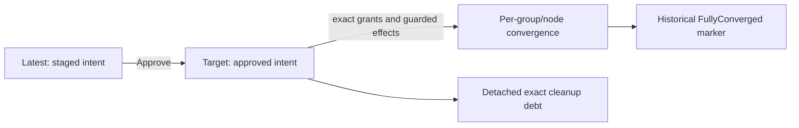
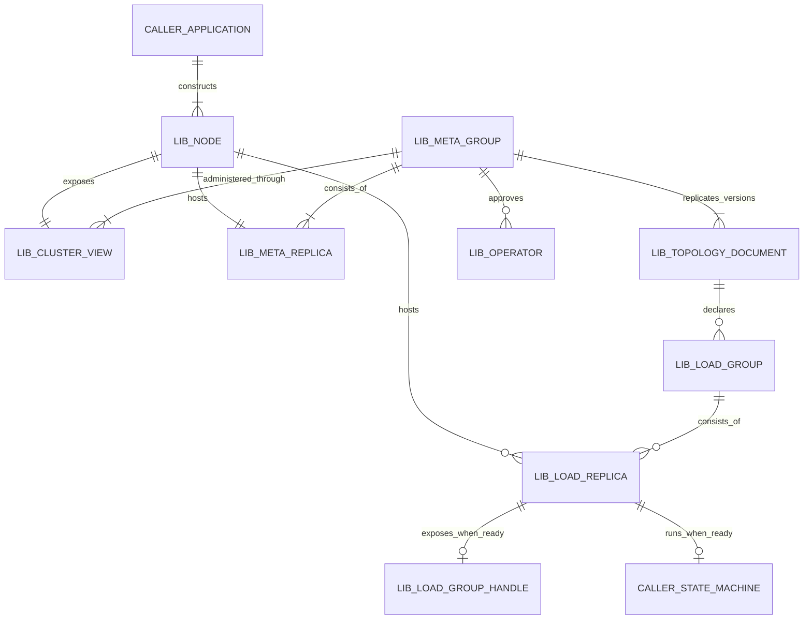

# Architecture

Start with the [library API and integration guide](library.md), then use the
[Raft model](raft.md), [node lifecycle and recovery](runtime.md), and
[placement contract](placement.md) for details. See
[load transport multiplexing](load-transport-multiplexing.md) for how independent
Raft groups share a listener and peer connections. The terms below describe the
current library behavior. Examples use an application group named `orders` and
nodes named `n1`, `n2`, and `n3`.

## Dictionary

### Groups, replicas, and placement

**`_meta` group.** The library-owned Raft group that replicates topology,
admission, approved operations, authority, sessions, and locks. Every admitted
node joins `_meta`, although some members may be learners. An `orders` command
does not pass through `_meta` on every proposal; creating or changing the
`orders` group does require `_meta` approval. See [Raft group boundaries](raft.md).

**Load group.** An application Raft group managed by the library. Each load
group has its own log, leader, membership, and application state machine. A
`*load.Group` handle refers to **one exact local replica**, not the whole
distributed group. For example, `orders` may have replicas on all three nodes,
while `node.LoadGroup("orders")` returns only this node's handle. “Load” does
not mean a CPU or request-load measurement. See [managed load integration](library.md).

**Replica.** One group's copy on one node, identified by its node name and a
numeric `ReplicaID` within that group. The same node may host both an `_meta`
replica and an `orders` replica. A replacement gets a fresh ID; a name alone
does not authorize reuse of old data. For example, `orders` replica 3 on `n3`
is distinct from `_meta` member 3 on `n3`.

**Topology role.** A replica's desired `voter` or `learner` membership in its
group. Voters form the Raft quorum; learners replicate but do not vote or become
leader. The role is separate from `Node.Type`, `Node.State`, and the group's
currently elected leader. For example, `n3` can host an `_meta` learner and an
`orders` learner while `n1` and `n2` vote in both groups.

```text
                 _meta group       orders load group
    n1           voter             voter
    n2           voter             voter
    n3           learner           learner
```

**Label.** A key/value attribute on a `topology.Node` or `topology.Group`.
Node labels such as `network=public_ip` or `az=az-a` can guide placement;
group labels such as `purpose=accounting` are descriptive and do not select
hosts by themselves. `GetLabels` returns a copy; edit that map and pass it to
`SetLabels` to replace the complete local label set. Persisting the edit still
requires a versioned topology mutation and approval. The reserved node label
`gquorum.io/reserved=true` blocks **new** load replica identities but keeps
approved existing ones. `gquorum.io/learner-only=true` forbids voting in both
`_meta` and load groups. See [label schema and API](placement.md).

**Placement.** The declared rules for which nodes may host a group and which
replicas may vote. A load group's `PlacementRule.NodeSelector` requires exact
matches against node labels; `VoterConfig.DistinctVoterLabel: "az"` requires
each voter to have a different, nonempty AZ value. For example, an accounting
group for paid queries can require `network=public_ip`. A fresh group requesting
three AZ-separated voters with only two eligible AZs fails with an
unsatisfied-placement report.
Placement is enabled by default, and the library does not measure node resources
or prove that labeled AZs are physically independent. See [placement](placement.md).

### Joining and removing nodes

**Authentication (`_meta`).** Every `_meta` gRPC request carries the configured
shared cluster credential in `gquorum-cluster-credential` gRPC metadata. The
receiver rejects a missing or wrong credential before dispatch, then checks the
cluster ID in the request header. For Raft traffic, it checks the claimed node
name and numeric member ID against topology. The message must identify that
member as sender and the local member as destination. For example, `n2`
(member 2) sends a Raft message to `n1` (member 1). The receiver first checks
the credential. It then requires the same cluster ID and `n2`/2 in the header,
plus `From=2` and `To=1` in the message.
A node joining without a member ID uses the separate admission path,
which validates and binds its identity. TLS uses caller-supplied server/client
settings; plaintext requires an explicit opt-in. The shared credential is not
a per-node cryptographic identity, and it does not itself approve membership or
administrative effects. See [meta transport](../../internal/metatransport/server.go)
and [admission](runtime.md).
It is NOT A SECURITY mechanism, only guard for prevent collisions between nodes
of the different clusters. For securing connections you need to use mTLS.

**Admission.** The controlled entry of a participant into the cluster. Founding
uses declared founders; a later node joins through the `_meta` admission and
membership workflow. Admission binds node name, numeric member ID, process
instance, approved topology, and durable local evidence. For example, adding
`n3` is not merely opening a listener: `n3` must be admitted as an `_meta`
member before its assigned load replicas can become ready. See
[construction](library.md) and [startup evidence](runtime.md).

**Drain.** An approved topology change that moves load replicas away from a
node while retaining its `_meta` membership. `Cluster.DrainNode(ctx, "n3", opts)`
marks `n3` draining and plans safe load movement; normal exclusion follows a
converged drain. This differs from the `reserved` label, which blocks new load
identities without moving existing replicas. See [topology administration](library.md).

**Readmission.** Replacement of a declared active node after fresh health
reports it dead. `Cluster.ReadmitNode` allocates fresh meta/load identities and
uses exact grants, fencing, and retirement evidence before the successor takes
over. For example, a replacement process may keep the name `n3` but cannot
reuse the departed process's member and replica IDs. A retained restart of the
same durable identity is recovery, not readmission. See
[readmission and removal](runtime.md).

**Retirement.** Authorized removal of an old exact replica or node identity and
its owned state. Normal node exclusion follows drain; `ForceRetireNode` requires
an explicit actor and reason and still follows guarded cleanup. A load replica's
application retirement callback must verify the matching identity and proof,
even if its data is already absent. For example, deleting `orders` does not
license deletion of a foreign or newer `orders` replica on the same path.
Retirement does not create a new quorum after permanent majority loss. See
[retirement and recovery](runtime.md).

### Authority, reads, and leadership

**Authority.** The committed permission for an *exact* effect, such as adding
an `orders` learner, plus the durable fences and receipts that prevent an older
effect from acting on its successor. Staging a document is not authority;
approval records a concrete plan, and execution checks the grant's operation,
version, attempt, step, action, and identity. `Cluster.ReadAuthority(ctx, opID)`
returns that operation's **revocation status and outstanding resource
obligations**; `WaitRevoked` waits until a requested revocation is durably
complete. For example, a superseded operation can remain pending while `n3` is
unreachable and its old action cannot yet be fenced. This is effect authority,
not user authentication. See [approved actions](runtime.md).



**Read barrier (`ReadBarrier`).** A point-in-time confirmation through the
relevant Raft group's quorum, followed by waiting for local application. It
returns no data. `Cluster.ReadBarrier` concerns `_meta`; a local
`load.Group.ReadBarrier` concerns that load group. For example, use
`Cluster.ReadTopology` to capture Latest, Target and the historical completion
marker after a confirmed read; `ReadProgress` reports bounded per-group/node,
operation and cleanup rows,
or `load.Group.Read` to run an application query serialized with Apply/Restore.
A barrier alone does not make a later, unsynchronized application read atomic or
authorize a future effect. See [the consistency target](raft.md).

**Lock holder (`LockHolder`).** The session currently recorded as owning a
cluster lock key. `Cluster.LockHolder(ctx, "jobs/settlement")` returns a local
observation; `ReadLockHolder` confirms `_meta` quorum and local application
before returning committed ownership. The returned TTL is configured duration,
not remaining lease time or proof that the holder process is alive. See
[sessions and locks](library.md).

**Leader transfer (`TransferLeader`).** A guarded request to hand a group's
leadership to another declared, active voter. For example,
`Cluster.TransferLeader(ctx, "orders", "n2")` commits exact transfer authority
and initiates an election; it does not change group membership. The target
still needs the group's election quorum to become leader, and a timed-out
caller cannot assume the transfer was undone. See
[topology administration](library.md) and [Raft elections](raft.md).

## Architecture

An application constructs a `gquorum.Node` for each participant and supplies
its identities, configuration, load state machines, storage, and load transport.
Each Node owns one local `_meta` replica and any assigned local load replicas;
`node.Cluster()` is its administration view, not another running service. The
distributed `_meta` group replicates topology documents and approved operators.
Those documents declare independent load groups and assign their replicas to
nodes. An approved plan authorizes changes to those replicas; each load group
then runs its own Raft consensus and application state machine, independently of
`_meta`. The diagram shows logical relationships for admitted nodes and active
groups; a parked replica may have no running handle or state machine.
`CALLER_` marks application-created components; `LIB_` marks components whose
lifecycle and coordination the library manages. The caller constructs each
`LIB_NODE` with `NewNode`, then the library manages it after `Start`.



For example, three Nodes each host one `_meta` replica, while the `orders` load
group may have one replica on each Node. An operator approved through `_meta`
can change `orders` membership, but `orders` proposals and reads use the
`orders` Raft group. See the [library integration guide](library.md) for the
public handles and [Raft model](raft.md) for the group boundaries.
