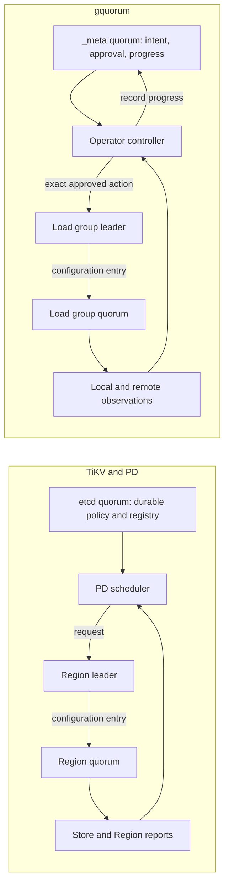

# Cluster management: gquorum compared with TiKV and PD

Status: upstream comparison at the pinned 2026-10-12 revisions; gquorum scoped
execution/cleanup/API update through `37ac2bf`, 2026-10-17. The direction table
distinguishes implemented mechanisms from remaining work. Source inspection is
not production-equivalence evidence.

gquorum and TiKV share the essential normal-operation safety boundary: a
management leader can choose and dispatch work, but changing an established
group's voting membership requires that group's Raft commitment. Management
consensus cannot supply missing votes to an application group. Their management
architectures differ substantially, however. gquorum replicates approved plans
and execution progress through `_meta`; PD usually reconciles independently
reported Region state toward durable policy, without an etcd commit for each
operator step.

This comparison covers cluster formation, authority, admission, placement,
scheduling, topology execution, failure handling, decommissioning, recovery,
upgrades, observability and administration. Learners are one part of that scope.
TiKV's database-specific services are identified separately where they have no
direct equivalent in a general-purpose Raft library.

## Scope and evidence

| Code inspected | Revision and qualification |
| --- | --- |
| gquorum | Scoped implementation through `37ac2bf`; metadata v4 and authority journal v2. Original comparison used `84ffa43` plus stable-learner changes; rows below reflect the current implementation. |
| TiKV | `/Users/speckzzz/reps/neria/tikv`, commit `137cbb2593decafebf99905b4d570869230565c2`. Inspected source files match that commit; the checkout also contains untracked documentation. |
| TiKV's raft-rs dependency | `/tmp/tikv-quorum-raft-rs-20261012`, commit `1fd05e000fb094015507c5c985849d370100fb72`, matching TiKV's `Cargo.lock`. |
| Placement Driver (PD) | `/tmp/tikv-quorum-pd-20261012`, commit `34ce7eca7eaf9b4fd06061984a1cc35884c49ee4`. This is the independent reference revision used by the supplied report, **not a PD revision pinned by TiKV or evidence of a deployed version**. |

The starting point was the supplied TiKV report,
the TiKV checkout's `docs/reports/raft-quorums-and-cluster-topology.md`.
Its relevant claims were checked against implementation, including the separate
PD and raft-rs checkouts. TiKV-side claims below link to the exact inspected
revision. PD-side claims link to PD, because TiKV's client code alone cannot
establish how PD persists policy or runs scheduling. Both raftstore engines are
used as evidence where relevant; engine-specific optimizations are qualified.

**Parity** means a comparable implemented mechanism for the stated property,
not equal production maturity. **Difference** means a deliberate architectural
choice with a tradeoff. **Gap** means a missing or materially narrower capability.
**Needs proof** identifies a guarantee that this source review does not establish.
Negative findings refer to the public APIs and management paths inspected here;
application code can add capabilities outside the library.

## 1. Map the components before comparing guarantees

| Responsibility | TiKV / PD | gquorum | Assessment and consequence |
| --- | --- | --- | --- |
| Durable management authority | PD stores durable cluster/store metadata and placement policy in etcd. PD service leadership uses a leased leader key; the PD leader and etcd Raft leader are distinct roles. [PD leadership][p-leadership], [metadata writes][p-store], [etcd writes][p-etcd]. | `_meta` combines the replicated metadata state machine with the leader that coordinates management. [Meta state machine][g-sm], [operator coordinator][g-planning]. | **Parity of purpose; different composition.** `_meta` corresponds to durable PD metadata plus its coordination role, not to an individual TiKV Region. |
| Application consensus | Each Region has its own peers, leader, log, configuration and epoch. PD commands are delivered to that Region's leader. [Dispatch][t-pd], [configuration proposal][t-conf]. | Each load group has its own Raft instance and application state machine. `_meta` authorizes management but is not on every application write path. [Engine][g-engine], [load API][g-load]. | **Parity.** Separate management and data quorums; neither system has one quorum composed of every data replica in the cluster. |
| Which machines replicate management state | A TiKV store registers with PD; it does not thereby become a member of PD's etcd group. PD member removal and TiKV store removal are separate operations. [Store bootstrap][t-bootstrap], [PD members][p-members], [store lifecycle][p-offline]. | Every admitted node hosts `_meta`, including nodes that host no load groups. Extra `_meta` replicas can be learners. [Admission][g-join], [document validation][g-validate]. | **Difference retained by requirement.** A small voter set limits quorum size, but all-node `_meta` replication still costs network, disk, catch-up and membership work as the cluster grows. |
| Data placement across machines | Regions have selected peers. Placement rules specify counts, roles and eligible locations; stores need not host every Region. [Rules][p-rules], [checker][p-checker]. | Policy-managed load groups default to all eligible hosts; explicit host sets are also supported. Voter count is independent of hosted replica count. Legacy groups retain their previous behavior. [Hosting][g-hosting], [voter configuration][g-voter-config]. | **Partial parity.** Explicit subsets exist. Automatic partition assignment and movement based on capacity/load do not follow merely from introducing learners. All-host learners still contain full application state. |
| Control-plane failure isolation | Region replication and elections are separate from PD availability. Operations needing PD metadata, scheduling or timestamps can still be affected. [Region command path][t-command], [PD client/worker][t-pd], [TSO][p-tso]. | Existing load consensus is separate from `_meta`; admission, new approvals and coordinated repair need `_meta`. Shared Node lifecycle, session fencing and resources can also affect service. [Engine][g-engine], [session lifecycle][g-session], [scheduler][g-scheduler]. | **Partial parity.** Do not promise that every application operation survives management-plane loss. Define this at the API and lifecycle level, not just from separate Raft logs. |

The intended relationship is:

Neither arrow from a scheduler to a group leader is permission to bypass that
group's quorum. Local host actions, such as opening or retiring storage, have
different completion conditions from Raft membership changes.

## 2. Consensus, authority and acknowledgement boundaries

P0 authority and P1 safe reads now use the implemented contracts below. The
[scoped target](../brainstorms/20261015-failure-isolation-and-operational-api-target.md)
records failure-isolation, cleanup and API contracts; rollout, deployment and
further scalability work remains separate.

| Concern | TiKV / PD implementation | gquorum implementation | Parity, gap or design implication |
| --- | --- | --- | --- |
| Durable management changes | Store metadata is saved before publishing the updated cache; placement patches are saved before publishing the rule set. The etcd backend waits for transaction commit. [Store][p-store], [rules][p-rule-save], [etcd][p-etcd]. | Staging, approval, exact receipts and independent group/node convergence commit through `_meta`. Latest is staged, Target approved; FullyConverged is a historical marker, not a current third document. [Documents][g-documents], [approval][g-operator-state], [convergence](../../internal/metaengine/scoped_node_progress.go). | **Parity of durable authority; different workflow.** gquorum retains explicit staged approval and per-scope proof. PD does not expose this document/operation model. |
| Membership commitment | A PD heartbeat response becomes a Region admin request, then a Raft configuration proposal. Applying it updates Region membership/epoch. [PD receiver][t-pd], [proposal/apply][t-conf], [epoch update][t-apply]. | An approved action reaches the affected group's leader; membership coordination submits a configuration entry and waits for application. `_meta` membership changes use `_meta`'s own Raft group. [Actions][g-actions], [membership][g-membership], [loop][g-loop]. | **Parity.** A leader-only API identifies who may submit the change. It does not make the change unilateral. An existing majority must authorize reducing the voter set. |
| What success acknowledges | PD's normal scheduling receiver uses `Callback::None`. Operator steps finish when later Region observations satisfy exact peer/role/leader predicates; adding a learner also checks it is no longer pending. [Receiver][t-pd], [step predicates][p-steps]. | Effects require exact durable receipts and native-result checks before `_meta` records block completion. `WaitOperation` observes terminal required-block status; detached collection is separate. Application proposals return after quorum commitment and application on the submitting local replica. [Execution](../../internal/operator/scoped_execution.go), [progress](../../topology/progress.go), [loop][g-loop]. | **Difference.** Accepted intent, native membership, local apply, required-block completion and physical collection are separate facts. Neither normal membership path waits for every replica to apply the entry. |
| Consensus versus physical persistence | TiKV persists the Raft data required for dependent follower responses before sending them. Its asynchronous integration can apply committed entries before the leader's own log persistence catches up. [Writer][t-writer], [Ready handling][t-ready], [raft-rs progress][r-raft]. | The engine persists Ready data before releasing that batch's messages and applying its entries. [Loop][g-loop], [storage contract][g-storage]. | **Parity in required durable consensus; different I/O pipeline.** Do not infer that TiKV always fsyncs the leader before every commit/apply, or weaken gquorum ordering by copying only part of that optimization. |
| Stale management commands | Region leaders validate store ID, peer ID, term and Region epoch. Membership increments `conf_ver`; range changes use the other epoch dimension. PD also cancels stale operators. [Validation][t-command], [apply][t-apply], [controller][p-controller]. | Receivers validate full committed grants and current courier identity. Native groups replicate authority floors/consumption; hosts durably fence and join older resource work. Approval starts pending revocation; `WaitRevoked` waits for affected-resource evidence. [Authority catalog](../../internal/metaengine/authority_catalog.go), [native enforcement](../../internal/raftengine/authority_effects.go), [host store](../../internal/authoritystore/store.go), [runtime][g-runtime]. | **Implemented resource-fencing contract.** Delayed older actions may complete before their affected resource is fenced; afterward they must refuse, including with stale local metadata or a replacement leader. Unreachable hosts or missing application quorum leave revocation pending. Supersession alone is not instantaneous revocation. |
| Leadership transfer | Advisory request with target readiness checks, followed by Raft election. Certain in-memory-lock transfers add a replicated marker. PD observes the resulting leader. [Transfer][t-transfer], [steps][p-steps]. | Public managed transfers commit an exact one-shot grant/intent and wait for the target leader. The intent survives controller/leader changes until a newer replicated resource floor cancels it; raw managed transfer requests refuse. [Native transfer](../../internal/raftengine/authority_effects.go), [metadata transfer](../../internal/metaservice/mutations.go). | **Explicit accepted-versus-completed semantics.** Caller cancellation ends the wait; the committed transfer can still finish. Revocation needs a resource fence even after a transfer receipt because its retained intent may resume. The target still needs election authority. |
| Consistent reads | TiKV has guarded lease reads and ReadIndex paths. A valid lease can answer some ReadIndex requests without a fresh heartbeat round; otherwise safe reads require the corresponding leadership/apply checks. [Lease path][t-read], [raft-rs][r-raft]. | `Cluster.ReadBarrier`, `ReadTopology`, `ReadProgress`, `ReadLockHolder`, `ReadAuthority` and `load.Group.ReadBarrier`/`Read` use safe ReadIndex, local apply waiting and serialized queries on any ready local replica, including learners. Ordinary status/document/lock/metrics APIs stay observational. [Cluster API][g-cluster], [load API][g-load], [read contract][g-raft-doc]. | **Implemented safe-read path; lease reads deferred.** Loss of current quorum prevents a fresh confirmation. Cancellation ends the caller wait while callback ownership and upstream-round limits remain bounded. A barrier is a point-in-time read, not authority for later effects or external lock fencing. |
| Discovery and request routing | PD provides Region/leader lookup; TiKV validates the destination and returns errors such as `NotLeader` and epoch mismatch. [Lookup][t-routing], [validation][t-command]. | Ordinary proposals on a ready local follower/learner forward through Raft. When no local group exists, the application must route the request; there is no library key-to-group router. [Load API][g-load], [forwarding][g-forwarding], [Raft contract][g-raft-doc]. | **Partial parity.** Replica forwarding does not solve discovery or routing for partitioned deployments. Define cache invalidation, exact group identity and retry handling at the application/client boundary. |
| Transactions across groups | PD policy persistence and multiple Region reconfigurations are separate steps. Split/merge have specific protocols, not a generic atomic cluster-wide topology transaction. [PD dispatch][p-controller], [merge apply][t-merge]. | `_meta` approval, load configuration commits and local effects are separate. No transaction atomically commits them together. [Controller][g-controller], [actions][g-actions]. | **Parity of limitation.** Recovery must tolerate partial completion. TiKV's distributed transaction implementation is a separate database layer, not something `_meta` replication supplies. |

For example, with management quorum available but only one surviving voter of a
three-voter application group, both systems can record policy or inspect state.
Neither normal management path can promote its way around the missing current
quorum. TiKV's explicitly unsafe recovery is a separate exception discussed below.

## 3. Formation, admission, identity and lifecycle

| Concern | TiKV / PD implementation | gquorum implementation | Parity, gap or design implication |
| --- | --- | --- | --- |
| Bootstrap and competing founders | TiKV persists cluster/store identity and prepared first-Region state; bootstrap is re-entrant. PD installs initial cluster/store/Region metadata through an etcd transaction guarded by absence of the cluster key. [TiKV bootstrap][t-bootstrap], [PD bootstrap][p-bootstrap]. | Founding configuration, durable pins and retained state are checked before startup. The first topology and approved founding plan are installed through `_meta`; established identities are not silently refounded. [Bootstrap][g-bootstrap], [recovery architecture][g-runtime]. | **Comparable safety goals, different protocols.** Preserve explicit founding-versus-restart evidence. Fewer than three actual voters means reduced fault tolerance even if desired replication is three. |
| Adding a host | Store bootstrap obtains a PD-allocated ID and durable identity. Registering a store and assigning Region peers are distinct. [Bootstrap][t-bootstrap], [ID allocation][p-ids], [store registry][p-store]. | Admission binds node/member/process identity and approved topology; all admitted nodes join `_meta`. A current-term committed/applied barrier precedes admission classification. [Join][g-join], [admission records][g-admission]. | **Difference.** Data-host expansion also expands `_meta` replication and requires its membership workflow. Evaluate this cost separately from voter quorum size. |
| Identity reuse and obsolete replicas | Store/cluster identity is persisted. Peer IDs and Region epochs fence stale commands; durable tombstones and newer peer identities distinguish obsolete peers. [Bootstrap][t-bootstrap], [validation][t-command], [peer lifecycle][t-life]. | Stable node names, fresh process `InstanceID`, monotonic member/replica IDs, retained pins and retirement evidence have separate roles. Explicit readmission is fenced and verifies replacement identity. [Join][g-join], [managed readmission][g-readmission], [runtime][g-runtime]. | **Substantial parity of intent.** Exact identity checks are core safety, not optional policy. Do not equate a name/address with ownership of retained data. |
| Liveness versus authority | Store/Region heartbeats report health, down/pending peers and load. Suspicion drives scheduling; Region quorum decides resulting membership. PD's own leadership lease is a separate mechanism. [Reports][t-pd], [checker][p-checker], [leadership][p-leadership]. | Probes and metrics are observations. Session grants/revocations and lock acquisition commit in `_meta`; `KeepAlive` refreshes leader-local deadlines. Expiry probes the exact process before proposing revocation. [RPC][g-rpc], [session][g-session], [expiry][g-expiry]. | **Difference requiring a clear contract.** A session-renewal response is not proof of a fresh quorum or external fencing. Do not equate gquorum's process session with PD leadership or TiKV's transaction locks. |
| Restart and recovery | TiKV checks retained store identity, uses Raft state and peer lifecycle records, and refuses mismatched clusters. [Bootstrap][t-bootstrap], [lifecycle][t-life]. | Snapshot plus committed tail reconstruct the application; pins, assignment and ledgers must agree. Missing/foreign/contradictory evidence is parked rather than overwritten. [Storage][g-storage], [runtime][g-runtime]. | **Comparable mechanism, not a maturity claim.** Custom state machines and stores remain part of gquorum's recovery correctness boundary. |
| Drain and decommission | PD first marks a store offline/removing. Region scheduling evacuates it; observed emptiness permits burial/tombstoning. The offline API does not mean evacuation is complete. [Offline transition and checks][p-offline], [burial checks][p-bury], [rule checker][p-checker]. | Drain changes load eligibility while retaining `_meta`. Exclusion/removal follows an approved plan, membership changes and exact retirement actions. [Mutations][g-mutations], [planner][g-planner], [retirement][g-retirement]. | **Partial parity.** Expose separate requested, evacuated, consensus-removed, fenced and physically-cleaned states. A single success flag cannot describe all of them. |
| Offline removed host and cleanup | A Region can remove an unreachable peer through the remaining quorum. The removed peer need not acknowledge removal. Tombstone delivery and destruction happen later; v2 keeps removal records and retries cleanup. [Lifecycle][t-life], [remove-step completion][p-steps]. | Native removal creates exact retained cleanup debt. Stop/retire/collect progress continues with separate dispatch capacity; an offline former host does not block unrelated groups. Whole-group deletion still requires every former owner's stop/readmission proof. [Debt](../../internal/metaengine/scoped_cleanup.go), [dispatch](../../internal/operator/dispatch_cleanup.go), [retirement][g-retirement]. | **Implemented separation, stronger proof requirement.** Durable host journal and store marker distinguish prepared deletion from proven collection. Missing data/timeout/newer IDs never imply deletion; permanently lost hosts can leave debt indefinitely. |
| Deleting a whole application group | Region removal through merge preserves data in a target and follows its specific protocol. It is not equivalent to arbitrary destruction of a user-owned Raft group. [Merge][t-merge], [lifecycle][t-life]. | Approved whole-group deletion stops exact hosts and retires storage without first obtaining a configuration change from the dying load group; required host acknowledgements still apply. [Controller][g-controller], [dispatch][g-dispatch]. | **Intentional semantic difference.** Authorization comes from `_meta`; data-destruction policy belongs to the application. Do not describe this as a normal membership change bypassing Raft. |

## 4. Scheduling, placement, capacity and topology evolution

| Concern | TiKV / PD implementation | gquorum implementation | Parity, gap or design implication |
| --- | --- | --- | --- |
| Desired replication and insufficient capacity | PD rules express desired peer counts; the checker repairs missing peers using eligible stores. Policy and observed compliance are separate. [Rules][p-rules], [checker][p-checker]. | Per-group voter targets are replicated. Fresh defaults target three; shortfalls do not rewrite the target. All-eligible hosting rejects replica-capacity overflow. `Limits` defaults to three nodes and five total replicas **per load group**. [Policy][g-voter-config], [hosting][g-hosting], [limits][g-document]. | **Partial parity.** Desired three does not mean three exist. Count limits prevent oversubscription of declarations but do not measure disk or CPU capacity. |
| Failure-domain placement | PD rules carry label constraints, ordered location labels and enforced isolation levels. The checker can move peers to improve location; filters protect placement. [Rules][p-rules], [checker][p-checker], [filters][p-filters]. | Exact node selectors filter load hosts; `DistinctVoterLabel` requires nonempty, unique voter domains in both `_meta` and load groups. Founding, approved relocation and repair enforce these rules and report unsatisfied placement. [Placement](placement.md), [voter planning][g-voter-plan]. | **Partial parity.** Strict one-voter-per-domain intent is implemented. There are no PD-style rule priorities, soft preferences, location hierarchies or healthy-group balancing; labels cannot prove physical independence or a cross-zone commit guarantee. |
| Capacity and healthy-group balancing | PD includes Region and leader balancers, load statistics, low-space filtering, snapshot/pending-peer limits and operator influence when choosing moves. [Region balancer][p-balance], [leader balancer][p-balance-leader], [filters][p-filters], [store statistics][t-stats]. | The built-in policy repairs supported degradation and voter configuration; it preserves healthy placements. Metrics expose Raft/proposal/WAL/apply state, not a full store resource model. [Policy][g-voters], [repair policy][g-restore], [metrics DTOs][g-metrics]. | **Different responsibility.** Applications measure CPU/disk/load and decide resource-based edits. Custom scheduling hooks can use caller measurements, but gquorum does not collect them or implement PD-equivalent balancing. |
| Operator concurrency and unrelated intent | PD tracks operators by Region, with waiting queues, priorities and scheduling limits; independent Regions can progress concurrently. [Controller][p-controller], [limits][p-limits], [balancer limit][p-balance]. | One nonterminal block owns each group; independent approved operations run concurrently. Disjoint automatic repair atomically approves its own delta and rebases unapproved intent. Original CAS/identity and RebasedTo recover uncertain replies. [Approval][g-operator-state], [controller][g-controller], [repair](../../internal/metaengine/scoped_repair.go). | **Adapted per-group execution.** No global Latest=Target=checkpoint gate. Shared `_meta` quorum, admission/evacuation barriers, host/group serialization and affected resource fences still constrain progress. Defaults: four group workers, two cleanup/fence requests; no priority framework. |
| Management progress persistence | In the inspected ordinary path, PD operators and their step cursor live in controller memory; commands and observed completion do not require a replicated per-step journal. Durable policy plus current Region state enable reconciliation. [Controller fields/dispatch][p-controller], [Region cache][p-regions]. | Immutable plans, attempts, grants, receipts and checkpoints are durable `_meta` state. Changed Apply persists the full state. The 10,000-debt benchmark writes ~51 MB/Apply, ~222 ms serialization / ~250 ms with bbolt on Apple M4 Pro. [Benchmark](../../internal/metaengine/cleanup_debt_bench_func_test.go), [measurement](../plans/20261015-failure-isolation-and-operational-api.md#progress-log). | **Cost remains.** Bounded workers/pages do not bound retained proof or full-state write amplification. Progress/ordinary selection also scale with history; incremental persistence and indexing require separate design. |
| Metrics transport and temporal evidence | TiKV pushes Store and Region heartbeats containing peer state, size and load. PD updates caches and asynchronously persists/synchronizes Region observations; local Region storage is the configured default, separate from etcd KV. [Statistics][t-stats], [cache][p-regions], [storage selection][p-region-storage], [default][p-region-default]. | The meta leader gathers bounded parallel samples; source generations, terms, exact identities, ages and continuity determine evidence. Histories remain in memory; role-switch records are replicated. [Collector][g-collector], [evidence][g-evidence], [switch records][g-switches]. | **Parity in separating observations from authority; different collection strategy.** Do not replicate every sample just because `_meta` exists. At scale, assess pull fan-out, freshness under overload and whether node-batched or pushed reports are needed. |
| Failure detection and stabilization | PD combines down-peer reports, store state/down time, pending-peer readiness and scheduling filters. Startup preparation checks reported Region coverage, with a timeout escape. [Checker][p-checker], [filters][p-filters], [preparation][p-prepare]. | Defaults require 30 seconds of failure/replication lag and 60 seconds of standby readiness; apply backlog blocks promotion. Freshness, hysteresis and configurable cooldowns suppress churn. A new observer rebuilds evidence and rearms cooldowns from durable switch records. [Policy][g-voter-config], [evidence][g-evidence], [checks][g-voter-check]. | **Comparable objectives, not identical algorithms or thresholds.** The current defaults are not TiKV-derived operating guarantees. Validate failure/recovery latency and repeated failover behavior under realistic workload and clock/scheduling delays. |
| Learners and replacement sequencing | PD supports learner-first steps and joint configuration changes when feature support allows them. Joint commitment requires both old and new majorities. [Steps][p-steps], [feature-gated dispatch][p-controller], [TiKV conf change][t-conf], [joint quorum][r-joint]. | Stable learners, pinned learners and guarded promotion are implemented. Membership accepts only single-change Auto transitions. Optional surge can temporarily increase voter count; each intermediate configuration must pass safety checks. [Policy][g-voter-config], [membership guards][g-safety], [voter planning][g-voter-plan]. | **Partial parity; joint-consensus capability gap.** Sequential replacement is not inherently unsafe, but its temporary quorum/fault-tolerance states differ. Joint support requires a full planning, recovery and observation design, not merely exposing a protobuf option. |
| Leadership and transition recovery | TiKV maintains pending-conf-change restrictions and exact Region state; PD advances or discards operators based on fresh observations and epochs. [Conf change][t-conf], [controller][p-controller]. | The controller revalidates immutable scope, observes already-completed effects and retries. Role transitions are recorded only after completion evidence; leadership transfer may require rerouting. [Controller][g-controller], [actions][g-actions], [operator state][g-operator-state]. | **Partial parity.** Fault coverage must include crash after group commit but before `_meta` progress commit, leader changes during transfer, stale effect delivery and concurrent admission. Source structure alone cannot prove every recovery interleaving. |
| Split, merge and automatic partitioning | TiKV commits split on the parent Region and coordinates merge through source preparation, target commit and catch-up/rollback handling. Region epochs protect routing transitions. [Split][t-split], [merge][t-merge], [validation][t-command]. | Explicit groups and host sets exist. There is no key-range catalog, split/merge protocol, atomic data migration or built-in routing layer. [Group model][g-document], [load API][g-load], [hosting][g-hosting]. | **Functional gap if partition management is a library goal.** Define an application integration contract for data movement and routing before adding automatic partition scheduling. Merely creating three groups does not partition their business data. |
| Domain-aware durability modes and witnesses | The inspected v1 code includes DR auto-sync/group-commit wiring and witness handling. These are deployment/engine-specific capabilities beyond ordinary majority voting. [Replication mode][t-replication-mode], [witness apply][t-witness]. | Ordinary full-state voters and learners; no witness or additional cross-domain commit mode in the public topology model. [Model][g-document], [engine][g-engine]. | **Optional capability gap.** First implement correct placement. Do not confuse a witness with a learner, or claim ordinary majority means a durable copy in each zone. |

## 5. Operations, upgrades, recovery and service boundaries

| Concern | TiKV / PD implementation | gquorum implementation | Parity, gap or design implication |
| --- | --- | --- | --- |
| Throttling maintenance work | PD budgets operators and per-store work, accounting for snapshot traffic, pending peers and capacity. TiKV reports the underlying store measurements. [Limits][p-limits], [filters][p-filters], [stats][t-stats]. | Proposal, transport and observation work is bounded; scheduler calls are serialized and cooldowns limit switching. There is no equivalent general per-store migration/snapshot scheduling budget. [Engine][g-engine], [driver][g-scheduler], [collector][g-collector]. | **Gap.** Cooldowns and bounded queues do not substitute for admission budgets across many recovering groups. Introduce priorities and resource reservations before increasing management concurrency. |
| Mixed versions and rollout | PD checks store compatibility, tracks cluster version and gates features such as ConfChangeV2; TiKV learns cluster version through PD responses. [Store version][p-version], [features][p-features], [TiKV client][t-client]. | Persisted/wire compatibility fixtures exist, but the inspected admission and scheduling interfaces do not negotiate per-node feature support or a replicated minimum capability set. [Meta protocol][g-proto], [join][g-join], [compatibility baseline][g-baseline]. | **Operational gap.** Byte compatibility is not behavioral compatibility. Gate new topology roles/actions/policy semantics before any participant depends on them; define upgrade and rollback rules. |
| Policy agreement after failover | PD persists placement rules and uses cluster-version feature gates. These are shared management inputs, although observations and ordinary execution cursors may be local. [Rules][p-rule-save], [features][p-features]. | Voter configuration is replicated, but custom scheduler code and some process-local settings remain caller-configured. [Policy][g-voter-config], [scheduler interface][g-policy], [driver][g-scheduler]. | **Partial parity.** A replicated target does not ensure different binaries/custom policies make compatible decisions. Add capability/policy revision declarations and an admission/activation rule for incompatible participants. |
| Online configuration | PD exposes updates to supported scheduling/replication settings. TiKV validates and dispatches supported local configuration changes and can persist them to its configuration file; this local update is not a Region consensus operation. [PD API][p-config], [TiKV controller][t-config]. | Placement, hosting and voter configuration have topology mutation APIs. Many process settings are constructor options; `Cluster.Rules()` exposes capacity rules without an online mutation API. [Cluster API][g-cluster], [options][g-options]. | **Partial parity.** Classify each setting as replicated policy, local tunable or restart-required configuration. Capacity expansion and cluster-wide rollout of local settings need an explicit supported procedure; a topology edit cannot change every process option. |
| Observability and administration | PD exposes stores, Regions, rules, schedulers and operators, with scheduling metrics. TiKV provides detailed metrics and `tikv-ctl` inspection/consistency/recovery operations. [PD router][p-api], [operator metrics][p-metrics], [TiKV tools][t-tools]. | `Operation`, `WaitOperation`, `RetryOperation` and bounded `ReadProgress` expose durable per-scope declarations, blockers, cleanup and freshness. Safe reads attach exact cached observations without fan-out. Node/Cluster/load.Group remain the main API; applications need no cleanup calls. [Cluster][g-cluster], [progress](../../topology/progress.go), [example][g-example]. | **Implemented library interface.** Public networking, exporters, UI and deployment runbooks remain application/future work. Metadata ReadAt does not freshen native observations; operation success does not promise collection. |
| Security boundary | TiKV supports TLS configuration, allowed certificate names and certificate reload; PD has separate management APIs. Configuration still matters. [TiKV security][t-security], [PD API][p-api]. | Meta transport takes TLS configuration; load transport must authenticate senders before dispatch. Exact identity authorization is enforced by the library; application administration authorization remains an integration responsibility. [Meta transport][g-transport], [load contract][g-load-transport], [actions][g-actions]. | **Partial parity, not a security certification.** Provide and test an integration profile for identity binding, certificate rotation and admin authorization. Replicated approval is not user authentication or protection against a malicious authorized participant. |
| Permanent loss of a data-group majority | Normal changes stop. TiKV/PD also offer an explicit unsafe recovery workflow; force-leader code can synthesize votes and disable quorum checking under a recovery plan. [PD controller][p-unsafe], [TiKV force leader][t-unsafe]. | No force-new-group recovery after permanent majority loss. `ForceRetireNode` is not permission to manufacture a data-group quorum. [Mutations][g-mutations], [membership guards][g-safety], [Raft failure contract][g-raft-doc]. | **Recovery capability gap, not a normal-consensus safety gap.** Decide whether to support a separately authorized disaster workflow with explicit data-loss semantics and fencing of old copies. Never put it in the ordinary scheduler. |
| Backup and disaster restoration | TiKV includes snapshot-based backup/export machinery and diagnostic/recovery tools. Those do not by themselves back up PD or prove a coordinated deployment restore. [Backup endpoint][t-backup], [tools][t-tools]. | Raft snapshots and retained-state recovery exist; there is no public coordinated backup/restore protocol spanning `_meta`, application snapshots, identities and external effects. [Load snapshot API][g-load], [storage][g-storage], [runtime][g-runtime]. | **Operational gap.** Define recovery manifests, retention, verification and restore drills. Raft replication and local snapshots are not an independent backup. A deployment-level PD/etcd restore comparison needs additional environment-specific evidence. |
| Database-specific shared services | PD supplies timestamp allocation and GC state/barriers used by database protocols. These have their own persistence and leadership rules. [TSO][p-tso], [GC state][p-gc]. | `_meta` supplies topology, process sessions and locks; applications own transaction semantics, external side effects and retention of business data. [Meta FSM][g-sm], [state-machine contract][g-machine]. | **Intentional boundary.** Do not add TSO/MVCC/GC semantics merely to resemble TiKV. Define extension points if a gquorum application needs those guarantees. |
| Reliability evidence | The checkout contains integration/failpoint suites for membership, heartbeat behavior and recovery, alongside the implementations above. [Configuration tests][t-tests], [heartbeat tests][t-heartbeat-tests]. | Unit, functional, race, process and retained-compatibility coverage is documented. [Testing guide][g-tests], [feature validation][g-validation]. | **Needs proof at the intended scale and failure envelope.** Similar algorithms and passing existing tests cannot establish equal reliability, failover bounds or operational maturity. This comparison did not run either project's tests or failure experiments. |

## 6. Design direction for `_meta`, using TiKV as the reference

The useful reference is PD's separation of durable policy, observations,
per-group consensus and eventual cleanup. We should retain gquorum's explicit
approval and exact ownership model while addressing the availability and
manageability costs of shared consensus, retained proof and reconciliation.

| Priority | Proposed change | Required outcome / acceptance evidence |
| --- | --- | --- |
| Implemented: failure isolation | Per-group owners/checkpoints, scoped revocation and state-based admission/evacuation barriers; atomic repair/rebase. | Staging an unrelated edit or blocking one group's operation does not prevent safe repair elsewhere; the repair never approves that staged edit. Preserve CAS, exact action identities and durable history. |
| Implemented: cleanup separation | Exact removed/stopped/retired/collected milestones, retained proof and independent cleanup dispatch. | An unreachable removed host cannot indefinitely block unrelated topology progress. On return, it is fenced before serving, and cleanup cannot delete a successor's data. TiKV's asynchronous peer destruction is the reference, not permission to discard evidence. |
| P0: deployment fault tolerance | Validate real deployment AZ labels and caller-owned resource decisions against the implemented strict voter-domain placement. | Demonstrate which host/zone failures each deployment tolerates; static placement reports do not prove physical independence or live quorum. Resource measurements and low-space decisions remain in caller code. |
| P0: rollout safety | Establish replicated feature/policy revisions and participant capability negotiation. | Old nodes cannot accept topology they misinterpret. Test mixed versions, feature activation, retained restarts and allowed rollback boundaries. |
| P1: scalable reconciliation | Combine independent group execution with global/per-node budgets, priorities and observed resource pressure. Benchmark management metadata and metric fan-out. | Bound recovery storms and user-workload impact while many groups repair. Demonstrate useful throughput without unbounded snapshots, polling or progress writes. |
| Implemented: Go operational interface | Progress pages, exact operation/retry IDs, blockers/freshness, cleanup debt and retained mutation replay. Exporters and deployment runbooks remain outside this change. | An operator can tell whether a request was accepted, committed, observed complete or physically cleaned, and can safely resume after an interrupted API response. |
| P1: disaster readiness | Design and test supported backup/restore first; decide separately whether explicit unsafe majority-loss recovery belongs in the library. | Verify restoration of `_meta`, application state, IDs and fencing evidence together. State data-loss and unavailable-operation boundaries; never imply a normal scheduler can repair permanent majority loss. |
| P2: optional broader capabilities | Consider joint membership, automatic group placement/partitioning, domain-aware durability modes and witnesses according to application needs. | Each feature has an end-to-end safety/recovery protocol and observability, rather than only new configuration fields. Database-specific range migration remains an explicit integration decision. |

P0 identifies work to settle before claiming TiKV-like management guarantees for
the corresponding deployment requirements. It does not classify every item as
a demonstrated safety bug. Per-group execution removes the former global cursor;
shared metadata persistence still limits scale. Authority revocation has an explicit affected-resource
fencing boundary; safe reads have a separate quorum/apply contract.

### Implemented adaptations (`TIKV_ADAPTATION`)

TiKV v2 records removed peers at committed configuration change, separates
logical tombstones from asynchronous tablet destruction and joins persistence/apply
ownership before destruction. gquorum applies those mechanisms through exact
cleanup debt, the existing managed owner and its collection journal; a newer ID
alone cannot prove application stop. TiKV's inspected tablet worker can consume a
deletion task on error; gquorum must retain preparation and retry until exact
store proof exists. [Removed peers][t-conf], [lifecycle][t-life],
[tablet worker][t-tablet], [collection contract](../../storage/retirement.go).

PD's per-Region ownership, stale-effect checks and bounded destination work inform
per-group blocks and host/group dispatch gates. gquorum preserves replicated
immutable plans, explicit approval and resource receipts rather than copying PD's
volatile operator cursor. Full-state write cost is therefore a distinct limitation,
measured above; this adaptation makes no claim of equivalent production maturity.
[PD controller][p-controller], [dispatch limits][p-limits].

### Reference scenarios for validating the design

These are proposed acceptance scenarios, not test results from this review:

1. **Management quorum lost, load quorum retained:** distinguish surviving
   application consensus from operations blocked by admission, sessions or
   management policy. Restore management without conflicting actions.
2. **Load quorum lost, management quorum retained:** normal repair refuses to
   create voting authority; status explains the missing quorum and any separate
   disaster-recovery option.
3. **Unrelated staged edit during a failure:** repair another group without
   approving or altering the staged request.
4. **Crash between group commit and progress commit:** the next controller
   recognizes the completed effect, preserves its exact identity and resumes
   without duplicating destructive work.
5. **Supersession with a delayed old action:** exercise receivers with stale
   `_meta` state, replaced processes, reused addresses and new group leadership.
6. **Decommission with a permanently offline host:** complete the supported
   consensus milestones while keeping durable cleanup debt and return fencing.
7. **Zone loss and low-space recovery:** strict placement retains the declared
   voter-domain rule; caller measurements and migration budgets protect remaining
   nodes from resource exhaustion.
8. **Mixed-version rollout and retained restart:** feature gates, approval
   decoding and retirement evidence remain compatible through the supported path.
9. **Many concurrent group failures:** measure detection freshness, scheduling
   fairness, metadata write amplification and time to restore redundancy.
10. **Restore from independent backup:** verify data and identity consistency,
    prevent old copies from rejoining incorrectly, and record achieved recovery
    point/time against explicit objectives.

## 7. Verification record and limits

The comparison follows concrete call paths, rather than relying on names such
as `leader`, `RaftCluster` or `Apply`: PD persistence and dispatch, TiKV command
validation/configuration apply, gquorum approval/authorization/effect execution,
and both systems' observation/completion paths. The references below identify
the source files used for each table row.

The original 2026-10-12 comparison inspected source without running tests. The
2026-10-17 update rechecked TiKV removed-peer records and separate tablet
destruction at the same pinned revision; no TiKV/PD tests were run. Current
gquorum unit, functional and focused race evidence plus the retained-debt benchmark
is recorded in the [implementation log](../plans/20261015-failure-isolation-and-operational-api.md#progress-log).
New process scenarios compile but await the final integrated Docker gate; this
document does not turn proposed acceptance scenarios into passing test evidence.

This is an implementation comparison, not a deployment certification. It does
not establish an RPO/RTO, a maximum supported cluster size, security audit
completion, or equivalence to TiKV's production history. Those claims require
specified workloads, storage/transport implementations, placement, deployment
versions and measured failure/recovery evidence.

Related gquorum documentation: [Raft boundaries](raft.md),
[library architecture](library.md), [ownership and recovery](runtime.md), and
[target adaptation details](../brainstorms/20261015-failure-isolation-and-operational-api-target.md#9-tikvpd-adaptations-and-differences).

<!-- Source references: upstream URLs identify the exact locally inspected revision. -->

[t-bootstrap]: https://github.com/tikv/tikv/blob/137cbb2593decafebf99905b4d570869230565c2/components/raftstore-v2/src/bootstrap.rs#L59
[t-pd]: https://github.com/tikv/tikv/blob/137cbb2593decafebf99905b4d570869230565c2/components/raftstore/src/store/worker/pd.rs#L1841
[t-stats]: https://github.com/tikv/tikv/blob/137cbb2593decafebf99905b4d570869230565c2/components/raftstore/src/store/worker/pd.rs#L1378
[t-conf]: https://github.com/tikv/tikv/blob/137cbb2593decafebf99905b4d570869230565c2/components/raftstore-v2/src/operation/command/admin/conf_change.rs#L84
[t-command]: https://github.com/tikv/tikv/blob/137cbb2593decafebf99905b4d570869230565c2/components/raftstore-v2/src/operation/command/mod.rs#L169
[t-apply]: https://github.com/tikv/tikv/blob/137cbb2593decafebf99905b4d570869230565c2/components/raftstore/src/store/fsm/apply.rs#L2167
[t-writer]: https://github.com/tikv/tikv/blob/137cbb2593decafebf99905b4d570869230565c2/components/raftstore/src/store/async_io/write.rs#L1144
[t-ready]: https://github.com/tikv/tikv/blob/137cbb2593decafebf99905b4d570869230565c2/components/raftstore/src/store/peer.rs#L2977
[t-transfer]: https://github.com/tikv/tikv/blob/137cbb2593decafebf99905b4d570869230565c2/components/raftstore-v2/src/operation/command/admin/transfer_leader.rs#L45
[t-read]: https://github.com/tikv/tikv/blob/137cbb2593decafebf99905b4d570869230565c2/components/raftstore-v2/src/operation/query/lease.rs#L34
[t-tablet]: https://github.com/tikv/tikv/blob/137cbb2593decafebf99905b4d570869230565c2/components/raftstore-v2/src/worker/tablet.rs#L368
[t-life]: https://github.com/tikv/tikv/blob/137cbb2593decafebf99905b4d570869230565c2/components/raftstore-v2/src/operation/life.rs#L3
[t-split]: https://github.com/tikv/tikv/blob/137cbb2593decafebf99905b4d570869230565c2/components/raftstore/src/store/fsm/apply.rs#L2631
[t-merge]: https://github.com/tikv/tikv/blob/137cbb2593decafebf99905b4d570869230565c2/components/raftstore/src/store/fsm/apply.rs#L2843
[t-replication-mode]: https://github.com/tikv/tikv/blob/137cbb2593decafebf99905b4d570869230565c2/components/raftstore/src/store/replication_mode.rs#L166
[t-witness]: https://github.com/tikv/tikv/blob/137cbb2593decafebf99905b4d570869230565c2/components/raftstore/src/store/fsm/apply.rs#L936
[t-client]: https://github.com/tikv/tikv/blob/137cbb2593decafebf99905b4d570869230565c2/components/pd_client/src/client.rs#L799
[t-routing]: https://github.com/tikv/tikv/blob/137cbb2593decafebf99905b4d570869230565c2/components/pd_client/src/client.rs#L524
[t-config]: https://github.com/tikv/tikv/blob/137cbb2593decafebf99905b4d570869230565c2/src/config/mod.rs#L5149
[t-tools]: https://github.com/tikv/tikv/blob/137cbb2593decafebf99905b4d570869230565c2/cmd/tikv-ctl/src/main.rs#L644
[t-security]: https://github.com/tikv/tikv/blob/137cbb2593decafebf99905b4d570869230565c2/components/security/src/lib.rs#L172
[t-unsafe]: https://github.com/tikv/tikv/blob/137cbb2593decafebf99905b4d570869230565c2/components/raftstore-v2/src/operation/unsafe_recovery/force_leader.rs#L145
[t-backup]: https://github.com/tikv/tikv/blob/137cbb2593decafebf99905b4d570869230565c2/components/backup/src/endpoint.rs#L337
[t-tests]: https://github.com/tikv/tikv/blob/137cbb2593decafebf99905b4d570869230565c2/tests/failpoints/cases/test_conf_change.rs
[t-heartbeat-tests]: https://github.com/tikv/tikv/blob/137cbb2593decafebf99905b4d570869230565c2/tests/integrations/raftstore/test_region_heartbeat.rs
[r-raft]: https://github.com/tikv/raft-rs/blob/1fd05e000fb094015507c5c985849d370100fb72/src/raft.rs#L939
[r-joint]: https://github.com/tikv/raft-rs/blob/1fd05e000fb094015507c5c985849d370100fb72/src/quorum/joint.rs#L43
[p-leadership]: https://github.com/tikv/pd/blob/34ce7eca7eaf9b4fd06061984a1cc35884c49ee4/pkg/election/leadership.go#L221
[p-etcd]: https://github.com/tikv/pd/blob/34ce7eca7eaf9b4fd06061984a1cc35884c49ee4/pkg/storage/kv/etcd_kv.go#L97
[p-store]: https://github.com/tikv/pd/blob/34ce7eca7eaf9b4fd06061984a1cc35884c49ee4/server/cluster/cluster.go#L2008
[p-offline]: https://github.com/tikv/pd/blob/34ce7eca7eaf9b4fd06061984a1cc35884c49ee4/server/cluster/cluster.go#L1704
[p-bury]: https://github.com/tikv/pd/blob/34ce7eca7eaf9b4fd06061984a1cc35884c49ee4/server/cluster/cluster.go#L2094
[p-members]: https://github.com/tikv/pd/blob/34ce7eca7eaf9b4fd06061984a1cc35884c49ee4/server/api/member.go#L114
[p-bootstrap]: https://github.com/tikv/pd/blob/34ce7eca7eaf9b4fd06061984a1cc35884c49ee4/server/server.go#L787
[p-ids]: https://github.com/tikv/pd/blob/34ce7eca7eaf9b4fd06061984a1cc35884c49ee4/pkg/id/id.go#L50
[p-controller]: https://github.com/tikv/pd/blob/34ce7eca7eaf9b4fd06061984a1cc35884c49ee4/pkg/schedule/operator/operator_controller.go#L86
[p-limits]: https://github.com/tikv/pd/blob/34ce7eca7eaf9b4fd06061984a1cc35884c49ee4/pkg/schedule/operator/operator_controller.go#L1037
[p-steps]: https://github.com/tikv/pd/blob/34ce7eca7eaf9b4fd06061984a1cc35884c49ee4/pkg/schedule/operator/step.go#L120
[p-regions]: https://github.com/tikv/pd/blob/34ce7eca7eaf9b4fd06061984a1cc35884c49ee4/server/cluster/cluster.go#L1394
[p-region-storage]: https://github.com/tikv/pd/blob/34ce7eca7eaf9b4fd06061984a1cc35884c49ee4/pkg/storage/storage.go#L201
[p-region-default]: https://github.com/tikv/pd/blob/34ce7eca7eaf9b4fd06061984a1cc35884c49ee4/server/config/config.go#L207
[p-rules]: https://github.com/tikv/pd/blob/34ce7eca7eaf9b4fd06061984a1cc35884c49ee4/pkg/schedule/placement/rule.go#L52
[p-rule-save]: https://github.com/tikv/pd/blob/34ce7eca7eaf9b4fd06061984a1cc35884c49ee4/pkg/schedule/placement/rule_manager.go#L549
[p-checker]: https://github.com/tikv/pd/blob/34ce7eca7eaf9b4fd06061984a1cc35884c49ee4/pkg/schedule/checker/rule_checker.go#L144
[p-filters]: https://github.com/tikv/pd/blob/34ce7eca7eaf9b4fd06061984a1cc35884c49ee4/pkg/schedule/filter/filters.go#L202
[p-balance]: https://github.com/tikv/pd/blob/34ce7eca7eaf9b4fd06061984a1cc35884c49ee4/pkg/schedule/schedulers/balance_region.go#L88
[p-balance-leader]: https://github.com/tikv/pd/blob/34ce7eca7eaf9b4fd06061984a1cc35884c49ee4/pkg/schedule/schedulers/balance_leader.go#L330
[p-prepare]: https://github.com/tikv/pd/blob/34ce7eca7eaf9b4fd06061984a1cc35884c49ee4/pkg/schedule/prepare_checker.go#L43
[p-version]: https://github.com/tikv/pd/blob/34ce7eca7eaf9b4fd06061984a1cc35884c49ee4/server/cluster/cluster.go#L1663
[p-features]: https://github.com/tikv/pd/blob/34ce7eca7eaf9b4fd06061984a1cc35884c49ee4/pkg/versioninfo/feature.go#L31
[p-api]: https://github.com/tikv/pd/blob/34ce7eca7eaf9b4fd06061984a1cc35884c49ee4/server/api/router.go
[p-config]: https://github.com/tikv/pd/blob/34ce7eca7eaf9b4fd06061984a1cc35884c49ee4/server/api/config.go#L133
[p-metrics]: https://github.com/tikv/pd/blob/34ce7eca7eaf9b4fd06061984a1cc35884c49ee4/pkg/schedule/operator/metrics.go#L24
[p-unsafe]: https://github.com/tikv/pd/blob/34ce7eca7eaf9b4fd06061984a1cc35884c49ee4/pkg/unsaferecovery/unsafe_recovery_controller.go#L220
[p-tso]: https://github.com/tikv/pd/blob/34ce7eca7eaf9b4fd06061984a1cc35884c49ee4/pkg/tso/tso.go
[p-gc]: https://github.com/tikv/pd/blob/34ce7eca7eaf9b4fd06061984a1cc35884c49ee4/pkg/storage/endpoint/gc_states.go
[g-engine]: ../../internal/raftengine/group.go
[g-loop]: ../../internal/raftengine/loop.go
[g-forwarding]: ../../internal/raftengine/forwarding.go
[g-options]: ../../node_options.go
[g-sm]: ../../internal/metaengine/sm.go
[g-planning]: ../../internal/metaservice/planning.go
[g-documents]: ../../internal/metaservice/documents.go
[g-operator-state]: ../../internal/metaengine/scoped_approval.go
[g-authorization]: ../../internal/metaengine/scoped_effect.go
[g-controller]: ../../internal/operator/controller.go
[g-actions]: ../../internal/managed/actions.go
[g-dispatch]: ../../internal/managed/dispatch.go
[g-membership]: ../../membership/coordinator.go
[g-safety]: ../../membership/safety.go
[g-cluster]: ../../cluster.go
[g-load]: ../../load/group.go
[g-load-transport]: ../../load/transport.go
[g-machine]: ../../load/machine.go
[g-storage]: ../../storage/storage.go
[g-document]: ../../topology/document.go
[g-validate]: ../../topology/validate.go
[g-hosting]: ../../topology/hosting.go
[g-voter-config]: ../../topology/voter_config.go
[g-voter-plan]: ../../topology/voter_plan.go
[g-planner]: ../../topology/planner.go
[g-join]: ../../internal/metaservice/join.go
[g-bootstrap]: ../../internal/metaservice/bootstrap.go
[g-admission]: ../../internal/metaengine/admission.go
[g-readmission]: ../../internal/managed/readmission.go
[g-retirement]: ../../internal/managed/retirement.go
[g-mutations]: ../../internal/metaservice/mutations.go
[g-session]: ../../internal/metaservice/session.go
[g-expiry]: ../../internal/metaservice/expiry.go
[g-rpc]: ../../internal/metaservice/rpc.go
[g-transport]: ../../internal/metatransport/transport.go
[g-scheduler]: ../../internal/scheduling/driver.go
[g-voters]: ../../scheduling/voters.go
[g-restore]: ../../scheduling/default_repair.go
[g-policy]: ../../scheduling/scheduler.go
[g-metrics]: ../../metrics/types.go
[g-collector]: ../../internal/observe/metrics.go
[g-evidence]: ../../internal/observe/evidence.go
[g-switches]: ../../internal/metaengine/voter_switch.go
[g-voter-check]: ../../internal/votercheck/check.go
[g-proto]: ../../internal/metapb/meta.proto
[g-runtime]: runtime.md
[g-raft-doc]: raft.md
[g-example]: ../../examples/cluster/cluster.go
[g-baseline]: ../testing/api-baseline-physical.md
[g-tests]: ../testing/tests.md
[g-validation]: ../testing/stable-learner-validation.md
