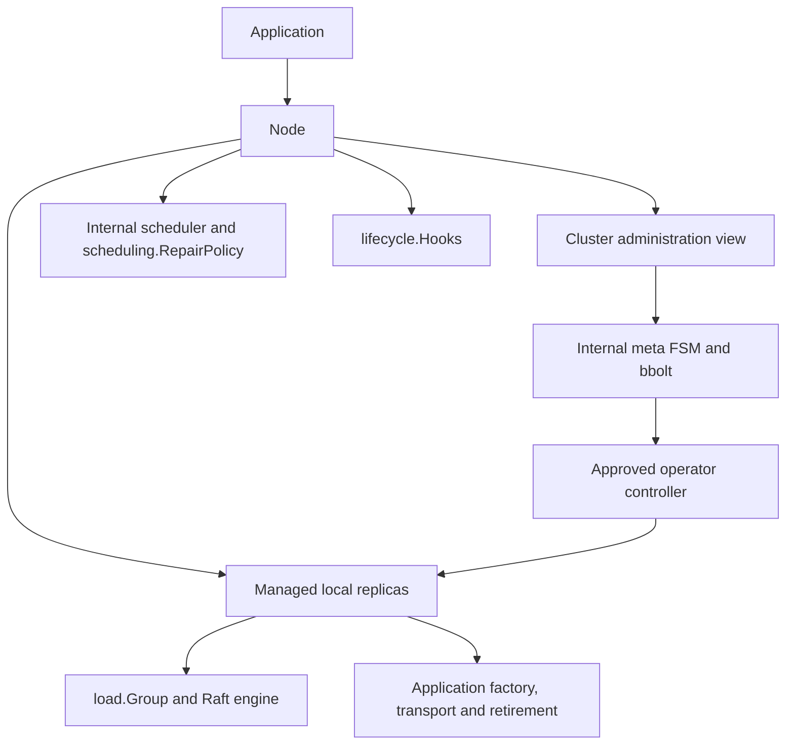

# Building a cluster with gquorum

`gquorum` owns a node's topology quorum and its local application replicas.
Applications supply settings, listeners, identities, paths, load state machines
and load transport. The library contains the `_meta` protocol, its bbolt store,
the Raft engines, recovery, an etcd WAL backend for load groups and an
in-memory store for groups that do not need to survive a full restart.

Three handles describe the public API:

| Handle | Responsibility |
| --- | --- |
| `gquorum.Node` | One participant: start, readiness, shutdown, local replica ownership, sessions and load protocol receivers. |
| `gquorum.Cluster` | A stable administration view obtained from `node.Cluster()`: topology, membership, approval and progress. It has no independent lifetime. |
| `*load.Group` | One local replica: application proposals, leadership/status, snapshots and proposal-pressure diagnostics. A stopped handle never redirects into its replacement. |



## Construct and start a node

`NewNode(NodeOptions)` validates and copies settings without opening storage or
calling application code. `Start(ctx)` acquires local resources, starts `_meta`
and begins admission/recovery. It returns before quorum readiness, so callers
can start several nodes sequentially. `WaitReady(ctx)` waits for local admission,
recovery, session activation and the configured startup gate; canceling that
wait does not stop the node. The context passed to `Start` owns its lifetime.

The application creates these settings directly; there is no configuration-file
loader or built-in storage root:

| Setting | Meaning |
| --- | --- |
| `Identity topology.Identity` | Node name, cluster ID, durable meta member ID and fresh process `InstanceID`. Member ID can be resolved from bootstrap/admission or a retained pin. |
| `Node topology.Node` | The caller-defined node type and admission description. Every admitted type joins `_meta`; type controls load placement. |
| `Bootstrap BootstrapOptions` | Founders for a new cluster, or `Join` with `JoinSeeds` for admission. Retained nodes recover their durable identity. |
| `Limits topology.Limits` | Sole capacity bounds: defaults are three nodes and five replicas per load group. Larger values are supplied here. |
| `Placement topology.PlacementRule` | Default load replica count and eligible node types. Individual groups can override it. |
| `StorageDir string` | Explicit system-storage directory containing fixed `_meta.bolt` and `_authority.bolt` files; outside all load retirement roots. |
| `Meta MetaOptions` | Network, timing, reads, session, observation, snapshot and watcher settings. |
| `Loads LoadOptions` | Optional managed load integration; leave empty for a meta-only participant. |
| `Scheduling scheduling.Options` | Repair policy selection and local reconciliation timing. |
| `Lifecycle lifecycle.Options` | Local readiness, retirement-retention and removal hooks. |
| `CallbackTimeout time.Duration` | Shared deadline for finite application and decision callbacks; zero selects ten seconds. |
| `Health`, `Events`, `Logger` | Optional application health observations, borrowed local event bus and logger. |

`MetaNetworkOptions` takes a caller-created listener, advertised address and
cluster credential, plus TLS/client TLS or explicit `AllowPlaintext`. A caller
address resolver supports address-free topology documents. The listener transfers
to Node when startup acquires the meta service. Dependencies and callbacks must
remain usable until their owner joins them.

Each founder supplies `FoundingMember{Node, MemberID, Address}` with a unique
positive member ID. `FoundingIDs(clusterID, names)` derives a stable founding map.
For a fixed roster, `StaticPeers` (node name to `StaticPeer{MetaAddress,
LoadAddress}`) implements the meta `Resolver`, provides `ResolveLoad` for
`loadgrpc.Options.Resolve`, and builds sorted founders with
`Founders(clusterID, nodeType)` using `FoundingIDs`. A route is never proof of
admission. Dynamic service discovery is not provided; it can implement the
same resolver shapes.
`LoadStoredIdentity(storageDir)` reads the fixed `_meta.bolt` file's validated
durable pin without creating storage; it returns `topology.IdentityLookup`.
On success, `Found` reports pin presence and `Identity` contains the durable pin
without a process incarnation.
Use `util.NewInstanceID()` once per process start for `Identity.InstanceID`,
including retained restarts. This helper is only for process identities; request
IDs and durable member/replica IDs have separate contracts. See the executable
[node construction](../../examples/cluster/cluster.go) and
[process wiring](../../examples/cluster/main.go) for founding, retained restart,
listener creation and shutdown.

## Topology and cluster administration

`topology.Document` contains the cluster ID, version, nodes, groups and placement.
The metadata service tracks permanently retired group IDs separately from the
document. Replica identity is a node name plus a fresh
monotonic replica ID within its group. Node states include active, draining and
excluded. Drain changes eligibility and load placement while preserving `_meta`
membership. Exclusion and readmission use the approved membership workflow.

`topology.BuildPlan(active, desired, observed, rules)` constructs a plan from
observed membership. `BuildPlanPreferred` takes the same first three arguments
and a `topology.PlanOptions` value containing `Rules` and
`PreferredMetaTransfer`. The preference names an eligible `_meta` member ID;
zero retains ordinary transfer selection, and a preference never bypasses
membership or placement safety checks.

`ValidateVoterSetTransition` groups before/after member IDs in `topology.VoterSets`.
`ValidateMetaDrainSafety` takes Active, Target and a `topology.MetaDrainInput`
containing the supplied membership status, health observations and final-phase
flag. These structs group caller inputs; they do not acquire fresh observations
or bypass the existing identity, placement and quorum checks.

`Cluster.SetReplicaPinnedLearner` takes the group ID, a `topology.LearnerPin`
containing the exact `Replica` key and desired `Pinned` value, and mutation options. `topology.ValidateLabels` selects `topology.NodeLabels`
or `topology.GroupLabels` to apply the corresponding restriction-key rules.
The setting changes learner eligibility through the existing guarded topology workflow.

Node and group values expose `GetLabels`/`SetLabels`; replacement copies and
validates the complete map, while persistent edits still require topology CAS
and approval. Load selectors match exact node-label values, and a per-group
placement rule overrides the whole inherited document rule. Group labels are
descriptive only. `gquorum.io/reserved` blocks fresh load identities but keeps
approved exact replicas; `gquorum.io/learner-only` forbids voting in `_meta` and
load groups. `VoterConfig.DistinctVoterLabel` enforces different nonempty voter
domains, with an explicit unsatisfied-placement report when the target cannot
be met. See [labels and placement](placement.md) for the full contract.

| View | Meaning |
| --- | --- |
| `Latest` | Most recently staged document, possibly unapproved. |
| `Target` | Approved desired topology. |
| `Active` | Fully converged topology. |

`EnsureGroup(ctx, spec, EnsureOptions{Actor})` is the idempotent provisioning
path for applications: it returns the Active group when every field set in the
spec matches, waits while an approved matching group converges, approves only
its own staged creation (same `ChangedBy` actor, parent Target, and no other
change), and otherwise stages the group with expected-version CAS and approval.
A different existing group or foreign unapproved intent returns
`fault.ErrConflict`; EnsureGroup never approves another actor's staging.

`Get`, paginated `History`, and `Watch` expose versioned documents and updates.
These reads, together with `Latest`, `Target`, `Active` and status, return owned
local observations. `ReadTopology` returns all three documents atomically after a
safe quorum-confirmed read barrier and local application. `ReadLockHolder`
returns committed lock ownership and configured TTL, without estimating remaining
lease time. `ReadAuthority` returns the durable revocation state; `WaitRevoked`
waits for a requested revocation to be complete. A plain `ReadBarrier` confirms
quorum and local application without returning a query result. Ready followers
and learners can use these APIs through leader-confirmed ReadIndex; learners
contribute no votes.
The in-progress failure-isolation API changes `ClusterStatus.Groups` to
`[]GroupProgress`: complete Desired/Approved/Converged declarations surround an
optional raw `Observation`. Cached samples require exact source version, cluster,
node, member, process and replica assignment; missing provenance means unknown.
`ReadProgress(ctx, ProgressQuery)` uses the existing quorum/apply read path and
only cached observations for the returned rows, preserving their timestamps.
Schema3 currently refuses this query with Unsupported; complete scoped activation
is Task78. Until then status projects Latest/Target/Active without inferring
scoped owner, deletion or blocker facts. The prepared scoped status projection
caps operation headers at100 with explicit truncation and cleanup counts.

`Stage(ctx, document, expectedVersion)` uses compare-and-swap. `Plan` previews a
staged version; `PlanFor` validates/plans an uncommitted document without staging.
`Approve(ctx, version)` commits a concrete plan and returns an `OperatorID`.
`Operator` and `WaitOperator` expose approved progress, attempts and failures.
After inherited revocations finish, the controller checks the immutable remaining
plan against quorum-confirmed native membership and retained host cleanup
identities. Unavailable confirmation leaves the operator waiting. An unreachable
plan fails with `replan_required` and leaves Active unchanged; stage and approve
a new version to change its actions. Retrying a failed version preserves its
original plan and creates a new attempt.

Typed mutation helpers share `MutationOptions{ExpectedVersion, Preview, Approve,
Actor, Comment}`. Preview and approval cannot be combined. A staged document is
returned even if subsequent approval fails; retain that version and retry its
approval rather than silently allocating another edit. For example:

```go
result, err := node.Cluster().CreateGroup(ctx,
    gquorum.GroupSpec{ID: "orders"},
    gquorum.MutationOptions{ExpectedVersion: version, Approve: true},
)
// Preserve result.Document.Version even when err reports an approval failure.
if err != nil {
    return err
}
status, err := node.Cluster().WaitOperator(ctx, result.OperatorID)
```

The full mutation surface includes `AddNode`, `ReadmitNode`, `DrainNode`,
`ActivateNode`, `ExcludeNode`, `ForceRetireNode`, `SetPlacement`,
`SetGroupPlacement`, `CreateGroup`, `DeleteGroup`, `ChangeReplica`,
`ReseatReplica`, `RollbackTo` and `TransferLeader`. `ReadmitNode` requires the
nonzero previous member ID; `ReseatReplica` requires the previous
`topology.ReplicaKey{NodeName, ReplicaID}`. A changed identity refuses the request;
a node name alone never authorizes replacing its successor. Deleted group IDs cannot be
reused. Fresh-ID readmission and replica reseating preserve the distinction
between old state and its authorized replacement. Force-new recovery after
permanent majority loss remains deferred.

`ChangeReplica` takes the group ID, `topology.ReplicaRoleChange{NodeName, Role}`,
and mutation options.

`TransferLeader` commits a grant for the exact Active target. Canceling its wait
can leave that grant unconsumed. A retry with the same Active version, group, node
and replica resumes the original open grant, including after metadata recovery.
Conflicting targets remain pending. Once consumption is recorded, a later new
request receives a new grant; the original grant and its receipt stay immutable.
Timeout does not undo an initiated election or prove that leadership stayed put.

Administrative effects carry committed authority grants to their group or host.
Managed action ingress always requires a grant; raw approval dispatch and raw
membership/transfer handlers have been removed. `load.ActionResult` echoes the
exact receiver, action and local target and carries durable receipts. It has no
`Verified` flag, and an echoed tuple without receipts cannot complete an effect.
The controller records exact resource receipts before advancing an operator, and
the metadata FSM checks those receipts independently. A new controller can reuse
committed consumption evidence; observed membership alone cannot complete an
effect. Forced retirement still requires affected host receipts. An unreachable
host therefore keeps its teardown pending. Metadata host preparation/removal also persist host receipts; readmission and
cleanup after whole-node fencing remain integration work.

`Cluster.Status(ctx)` collects cluster/load observations. `HealthObservation`,
`Rules`, `IsLeader` and `ParkedJoins` provide diagnostics. `Node.Status()` is a
local snapshot without network probes; it separates the startup `Ready` gate
from current `SessionLive` and includes meta, local replicas, removal and errors.
Group status exposes leader, term, membership and commit/applied positions.
HealthObservation is sampled against one captured approved Target and describes
declared-voter availability; it does not prove native membership or convergence.
Placement status rows label their static context as `approved` or `converged`;
they do not report native availability.

`Identity.NodeName`, `Node.Name` and `Replica.NodeName` identify the logical
node across restarts. `InstanceID` identifies one process run and must be fresh
on restart; it fences stale process messages independently of durable identity.
Numeric `MemberID` and `ReplicaID` are Raft identities, not node names.

Status exposes numeric `MetaLeaderID` / `meta_leader_id` and `LeaderID` /
`leader_id` fields. It additionally exposes `MetaLeaderNodeName` /
`meta_leader_node_name` and group `LeaderNodeName` / `leader_node_name`.
Cluster status and local meta status resolve leader names by exact replica/member
ID through the proven/approved owner catalog, including cached cluster reads.
`scheduling.ScheduleInput.Status` retains its named schema-3 Active adapter until
Task78. Empty names mean unknown or unmapped;
numeric observations remain available. `HostNode` names the reporting host,
which may be a follower. Raw load-group status does not resolve topology names;
use `Cluster.Status(ctx)` for the enriched group view.

`Node.ActivateSession`, `KeepAlive` and `DeactivateSession` support caller-owned
sessions. `Cluster.AcquireLock` and `LockHolder` use session IDs.
`LockHolder` and `ReadLockHolder` return `topology.LockHolder`, whose `Session`
is an owned value and whose `Held` field reports whether a holder exists. Node's own
activation is separate and observable through `OwnSessionLive`. A local
`SetServeOverride` changes readiness input without changing Raft quorum
or membership safety.

## Managed load integration

`Cluster.CreateGroup` declares distributed consensus. Node automatically starts
its assigned replicas. `StartLoadGroup(ctx, load.ReplicaRef)` explicitly starts
an exact approved local identity or clears its matching local stop hold.
Concurrent starts share one startup and handle. `LoadGroup` and `LoadGroupIDs`
only expose published replicas. `StopLoadGroup` joins that exact replica and
holds it for this Node lifetime; it does not delete its durable state. A fresh
Node can recover it, and approved retirement remains possible while held.

Supply the following through `LoadOptions`:

| Integration | Contract |
| --- | --- |
| `Factory GroupFactory` | Receives owned `load.ReplicaSpec`: exact storage identity, node/process identity, approved group and version. Returns `load.Application`. |
| `Application.StateMachine` | Implements `Apply(ctx, load.Command) (load.Result, error)`, `Snapshot(ctx) ([]byte, error)` and `Restore(ctx, []byte) error`. Recovery restores the full snapshot and committed tail. |
| `load.QueryMachine` | Optional `Query(ctx, []byte) (load.Result, error)` for `Group.Read`; serialized with Apply/Restore. Write-only machines can omit it and still use ReadBarrier. |
| `Application.Run` | Optional exact-replica background work started after authorized publication. Node cancels and joins it before Close; use Group.RunWhileLeader for leadership-scoped work. |
| `Application.Close` | Optional application-resource release. A successful factory transfers this responsibility to Node, even if its caller subsequently cancels. A failed factory releases its own partial acquisitions. |
| `Storage LoadStorageOptions` | Choose Node-owned `WAL: &WALOptions{RootDir: ...}`, or a borrowed `storage.Store` and explicit `storage.RetirementStore`, for groups of the default storage class. `Store.HasState` reports all retained evidence for fresh-start validation. Node also owns an in-memory store for groups created with `topology.StorageMemory`; it needs no option. |
| `Transport load.Transport` | Application-selected authenticated adapter implementing `SendRaft`, `ReadReplica`, `InstallFence` and `ApplyAction`. Use the optional public `transport/loadgrpc` adapter or supply another protocol. |
| `Retire RetireReplicaFunc` | Optional callback for application state outside the Raft store; verifies exact identity and authorization (`RetirementRequest.Verify`), performs idempotent cleanup and echoes the complete verified proof (`RetirementRequest.Result`). Leave nil when the application keeps no state outside Raft. |
| `Engine load.EngineOptions` | Timing, snapshot threshold, bounded proposal/application batches and read settings. `MetaOptions.Reads` configures metadata reads separately. |

`WALOptions.DisableFSync` (also `walstore.Options.DisableFSync`) is an explicit
local opt-out from fsync on load WAL and applied-state writes. Its default is
false. The encoder still flushes to the OS before acknowledgement; snapshot
files, identity pins and directory synchronization are unchanged, as are `_meta`
and authority persistence. This setting is for disposable/test data: host crashes
can lose acknowledged writes or leave inconsistent state. It does not authorize
reseating, resetting a group or ignoring recovery validation. The cache Compose
demo enables it through `STORAGE_DISABLE_FSYNC=true`; production callers should retain
the synchronous default.

The optional [`transport/loadgrpc`](../../transport/loadgrpc/README.md) adapter
shares peer connections across groups and routes batches by exact replica identity;
see [load transport multiplexing](load-transport-multiplexing.md) for the protocol
and routing flow. It owns bounded client connections, authenticated load ingress,
structured wire errors and exact delivery reporting. The caller supplies address resolution,
authentication policy, dial credentials and the gRPC server. It carries only
library load traffic: gquorum provides no application RPC channel, and
applications hand work between replicas through replicated state. Construct it before
Node, pass it through `Loads.Transport`, bind Node exactly once, and register the
service before serving. Node still authorizes membership and effects. Stop Node
before closing the adapter and server; adapter Close cancels and joins accepted
calls and retains ownership across a caller timeout. Shared-token authentication
is provided for trusted members; certificate-to-node authentication is caller
policy. Neither listener creation nor configuration loading moves into Node.

Transport values contain exact node/process/member and load replica identities.
The receiver authenticates its application protocol, decodes the typed request,
then calls `Node.ReceiveLoadRaft`, `ReadLoadReplica`, `InstallLoadFence` or `ApplyLoadAction`.
Successful snapshot delivery and asynchronous failure reports use
`ReportLoadDelivery` with the issued delivery ID and exact endpoints. Stale
reports cannot affect a replacement handle. `ApplyAction` is used for local
and remote destinations; an in-process adapter may forward directly to Node.
Retain exact endpoints for outstanding granted cleanup even if the host disappears
from current Target/Active. Historical or cached routes remain transport evidence;
the receiver still verifies the full grant, courier and destination identity.
Preserve `membership.SafetyRefusal` details in action errors, including the
reason and exact group/replica identity. The operator uses those details to
distinguish transient quorum/health loss from permanent membership refusal.
An unstructured `fault.UnsafeMembership` cannot supply that distinction.
`ReadReplica` may run concurrently for metrics and native status collection;
per-destination send serialization applies to `SendRaft`. Node calls it from
one worker per destination and coalesces batches queued behind a send into
one ordered call, and steps each received batch in one loop turn. An adapter
may return before the recipient steps a batch and report refusals
asynchronously; `loadgrpc` streams non-snapshot batches this way.
Read admission and protocol-round bounds are observable in
`metrics.ReplicaSample.ReadQueue`. The Raft owner samples the configured limit,
request slots/queue, quorum/application waiters and local/remote protocol rounds.
The enclosing Raft stamp supplies generation, age and validity; blocked Apply or
Query freezes that sample. These counters cannot substitute for a read barrier.

`load.ReadOptions` configures `Timeout`, `MaxPending`, `MaxRequestBytes` and
`MaxResultBytes` through load engine or metadata options. Zero selects defaults;
negative settings refuse construction. Overload or oversized queries/results
return classified errors. Cancellation ends the caller's wait, while an executing
Query remains owned and serialized until it returns. Query must be read-only,
honor cancellation and avoid waiting on its own engine or shutdown. Stopped
handles refuse reads rather than following a replacement replica.

The adapter must preserve `ReplicaQuery.Native` and `ReplicaStatus.Native`.
When requested, the receiver obtains a fresh ReadIndex confirmation, waits for
local apply and captures `topology.NativeState` on the Raft owner. This works on
a ready follower or learner without an application `Query` implementation.
Diagnostic `Status` remains an observation even in that reply. A missing native
result never proves group absence. The controller requires the confirmed native
membership to match Target before completing affected surviving groups.
Native reads may address exact ready replicas retained by an approved historical
plan, even after current placement changes. The receiver still checks the exact
local process/replica and authenticated current caller. This read path does not
broaden admission of Raft traffic or authorize effects. Internal metadata control
queries share the read queue and timeout, with byte limits at least the library
defaults so small public read limits cannot prevent convergence or fencing.

Node validates approvals, identities and membership safety before effects. The
application implements no create/prepare/membership switch. It must authenticate
its protocol and verify identities of its own durable resources. Retirement
requests distinguish approved topology cleanup from exact readmission grants.
A callback must verify a retry even when its state is already absent; a bare
success flag without the matching proof is refused. The library handles stopping,
Raft quarantine, ledger retirement and retention after the callback succeeds.

State machines must deduplicate request IDs when callers retry uncertain commits.
Canceling a proposal does not roll back an entry already committed. Application
transactions and outboxes remain application responsibilities. Callback contexts
must be honored; read-only status and `RequestStop` are safe, while waiting for
shutdown that must join the same callback would deadlock.

`load.Group` exposes `Propose`, `WaitReady`, `Snapshot`, `Status`, `IsLeader`,
`Running`, `Identity`, `GroupID`, `ReplicaID`, `WALStall`, `Error`, `ProposalStats`,
`Watch` and `RunWhileLeader`. It exposes no independent
start/stop, raw membership mutation or raw Raft transport. For independent
low-level consensus without `_meta`, use `load.NewStandalone` and its separate
`Standalone` owner, which also provides stepping, delivery reporting and safe
membership/leader operations. The caller then owns authorization and recovery
policy as well as transport and borrowed resources.

## Voter configuration, repair policies and lifecycle hooks

The `Policy` naming family is reserved for algorithms choosing replica repairs
and voter-role changes. `internal/scheduling.Scheduler` runs the selected
`scheduling.RepairPolicy`, revalidates its decision and submits approved work.
The replicated `VoterConfig` expresses group requirements; `lifecycle.Hooks`
returns local readiness, retention and post-removal decisions. Hooks are distinct
from observation channels and replica-ready background callbacks.

Configure the decision-related fields alongside the required identity, listener
and storage settings:

```go
opts.Scheduling = scheduling.Options{
    DefaultRepair: scheduling.DefaultRepairOptions{StableFor: time.Minute},
    Interval: 30 * time.Second,
    Timeout: 20 * time.Second,
    Cooldown: 5 * time.Minute,
}
opts.Lifecycle = lifecycle.Options{
    Default: lifecycle.DefaultOptions{Startup: lifecycle.LocalAdmission},
}
opts.CallbackTimeout = 10 * time.Second
```

`CallbackTimeout` also reaches finite application factory, close and retirement
callbacks and authority-related callbacks. It does not bound `Application.Run`
or the lifetime of leadership-scoped background work. Cancellation retains
ownership until callbacks return.

This alpha rename removes the old package/API names and changes topology JSON
from `voter_policy` to `voter_config` and scheduling status from `policy` to
`repair_policy` (built-in value `default-repair`). Old alpha storage and mixed
binaries are unsupported; use fresh development state for this transition.
There are no migration adapters or automatic data resets. Same-version retained
restarts, identity checks and full snapshot/tail replay remain supported.

`topology.VoterConfig` is replicated configuration data. The two local decision
interfaces live in separate packages:

```go
// Package scheduling
type RepairPolicy interface {
    Schedule(context.Context, ScheduleInput) (ScheduleDecision, error)
}
// Package lifecycle
type Hooks interface {
    Readiness(context.Context, ReadinessInput) (ReadinessDecision, error)
    Retention(context.Context, RetentionInput) (RetentionDecision, error)
    Removal(context.Context, RemovalInput) (RemovalDecision, error)
}
```

`ScheduleInput` exposes `Target` and per-group `Groups` progress, plus `Status`,
`Health`, `Alive`, `Held`, `Metrics`, `Switches` and `Now`. It no longer exposes
Latest or Active. Callback inputs omit Groups' Desired and Observation fields;
observations are supplied through Status. Clone preserves values and owns nested
maps/slices. The built-in policy rotates selected eligible groups, skips busy or
unproven scopes and binds evidence/cooldowns to the exact group source. During the
scoped-state rollout, named internal adapters still label actual schema3 evidence;
full failure isolation activates with schema4 at Task78. The prepared scoped
driver rechecks selected-group evidence after callbacks and after planning, then
submits Latest/Target CAS plus source/owner expectations. Independent staged edits
remain staged through the FSM's atomic repair rebase. Overlapping intent reports
`staged_conflict`; callback-time changes outside the selected group can refresh the
scheduler's capture. This does not change ordinary caller CAS semantics.

The default repair policy is `scheduling.DefaultRepairPolicy`. Groups with a replicated
`VoterConfig` converge toward their desired voter count and replace persistently
unavailable or replication-lagging voters using stable learners. This includes
`_meta`; every admitted node still hosts that group. Fresh groups default to
three voters. Other replicas are promotable standbys unless `PinnedLearner` is
set. Healthy voter seats remain stable. Groups with nil voter configuration retain the
legacy missing-load-voter repair path until explicit adoption.

Use `topology.DefaultVoterConfig()` and override fields before passing a complete
configuration to `MetaOptions.VoterConfig`, `GroupSpec.VoterConfig` or
`Cluster.SetGroupVoterConfig`. Defaults are 30 seconds of failure, 60 seconds of
standby stability, and five-minute group/demotion cooldowns. Apply backlog
blocks promotion but alone does not replace a voter. `MaxSurgeVoters` permits
zero or one temporary extra voter, subject to hard placement and live-quorum
checks. Configuration updates, hosting rules and learner pins use ordinary explicit
staging/approval. Automatic role changes use a separate atomic CAS operation
that cannot approve unrelated staged intent.

The scheduler skips ineligible placement candidates and never balances healthy
groups merely because labels changed. The planner checks every intermediate
voter set; at a hard replica limit it may remove an old exact identity before
preparing its replacement only when the observed live quorum remains safe.

A three-voter load group needs `Placement.MaxReplicas >= 4` to use promotion-first
replacement with `MaxSurgeVoters=1`. Its steady target remains three; the extra
headroom permits only the approved transition. With a hard maximum of three,
replacement uses demotion-first when the intermediate live quorum is safe.
The scheduler waits if neither ordering can satisfy the core checks.

`GroupSpec.Storage` selects where a group's replicas keep their Raft state. The
default (`topology.StorageDefault`) uses the configured load storage;
`topology.StorageMemory` uses the Node-owned
[`storage/memstore`](../../storage/memstore/store.go). The class is recorded in
`topology.Group.Storage`, cannot change after creation, and `EnsureGroup`
always compares it. A memory group's acknowledged writes survive while a quorum
of its replicas keeps running; a restarted node reseats its own replica under a
fresh ID ([recovery](runtime.md#in-memory-load-groups)). `storage/memstore` also
works with `load.NewStandalone`, whose owner then handles recovery.

`GroupSpec.Hosting` and `Cluster.SetGroupHosting` select all eligible hosts or a
durable explicit set. `GroupSpec.Nodes` selects explicit hosting. Total load
replicas, including learners, must fit `Limits.MaxReplicas`; overflow is rejected
before staging. Placement minimum/maximum counts retain their voter meaning.
Founding with fewer eligible nodes reports a target shortfall without lowering
the configured target. `_meta` hosting remains mandatory on every admitted node.

Set `NodeOptions.Scheduling.DefaultRepair` for legacy repair stability and
`Scheduling.Interval`, `Timeout` and `Cooldown` for local reconciliation timing,
or provide `Scheduling.Policy`. Per-group voter-config timing is
replicated; collection cadence and memory bounds use `NodeOptions.Metrics`.
`Node.SetSchedulingEnabled` controls the local scheduler; `SchedulingStatus`
reports its observations and decisions. A callback still running after its
deadline reports `policy_stalled`; it remains owned until it returns. Decisions
are checked after the callback and after planning against refreshed topology,
native membership, temporal evidence, pins and cooldowns. A custom policy cannot
bypass these checks. Arbitrary callback agreement metadata remains deferred;
applications choose consistent repair-policy implementations.

Enablement changes clear temporal evidence under the same scheduler gate as
ticks. A newly enabled tick cannot reuse the previous failure or standby window;
metric sampling and retained diagnostic history continue independently.

`Cluster.Metrics()` returns a local owned snapshot, and `MetricsHistory` reads
bounded process-local history without network I/O. `ScheduleInput.Metrics` and
`Switches` give custom schedulers copied observations and replicated completed
role records. Followers expose local replica samples; cluster evidence belongs
to the current meta-leader observer. Unknown/stale sources remain explicit.
TargetVersion supplies document context; each group's SourceVersion and exact
proven assignment determine validity. Independent group changes preserve sibling
failure/standby windows and history cursors. A cached sample keeps its original
ReceivedAt; a later probe's reachability is separate evidence. Leadership loss
invalidates all actionable windows while diagnostic history remains local.

`lifecycle.DefaultHooks` supplies local-admission or all-founders startup gates,
retired-storage retention and stop/diagnostics behavior after mandatory removal
fencing. Configure `Lifecycle.Default` or supply `Lifecycle.Hooks`.
Embed `*lifecycle.DefaultHooks` to override only selected decisions. Supplying
custom hooks and built-in options for those hooks is rejected as ambiguous.
The same restriction applies to custom repair policies and default-repair options.

Callbacks are serialized per node and receive owned inputs with deadlines.
Timeouts do not discard a still-running callback or permit overlapping replacement
calls. No policy can waive exact identity, admission, recovery, authorization or
membership safety checks. `scheduling/schedulingtest`, `lifecycle/lifecycletest` and
`storage/storagetest` provide optional reusable contract helpers for caller implementations.

## Events, shutdown and repository layout

`events.Bus` provides bounded node-local subscriptions. An optional bbolt journal
uses a caller-supplied file path and supports queries/pruning. Operator and
scheduling event names are public vocabulary; legacy persisted encodings remain
private. Events are never replicated through `_meta`. The bus and journal remain
caller-owned and should be closed after Node has joined.

For `events.LeaderChange`, `OldLeader` and `NewLeader` contain decimal Raft IDs:
meta member IDs or load replica IDs, rather than logical node names. The string
`"0"` means no known leader; an empty field means it was not supplied. Retained
journals use the same encoding.

`RequestStop` begins asynchronous teardown. `Stop(ctx)` joins it; timeout retains
ownership and may be followed by another Stop. Failed application Close also
remains owned until a serialized retry succeeds. `_meta` storage remains open
until managed resources and callbacks have joined. Read the detailed
[ownership and recovery contract](runtime.md) for the boot evidence table,
readmission, removal fencing and resource order.

| Path | Responsibility |
| --- | --- |
| `node*.go`, `cluster*.go` | Public handles, settings, methods and lifecycle composition. |
| `topology/` | Documents, identities, placement, plans, operators, session/status values and validation. |
| `load/` | Explicit application types, Group, typed transport and Standalone owner. |
| `transport/loadgrpc/` | Optional public load gRPC adapter, bounded connections, authentication and internal wire protocol. |
| `scheduling/`, `lifecycle/` and their test-helper packages | Repair policies, lifecycle hooks, built-ins and caller contract helpers. |
| `storage/`, `storage/walstore/`, `storage/memstore/`, `storage/storagetest/` | Raft persistence/retirement contracts, etcd WAL backend, in-memory store and conformance helpers. |
| `events/`, `fault/`, `membership/` | Local events/journal, classified faults and advanced fixed safety helpers. |
| `internal/managed/`, `internal/loadhandle/` | Exact replica ownership, recovery, approved actions, retirement and opaque group representation. |
| `internal/metaservice/` | Private topology service, admission, documents, local ledger and protocol integration. |
| `internal/metaengine/`, `internal/metastore/` | Meta FSM and bbolt durable state. |
| `internal/authoritystore/` | Independent node-bound durable host floors, effect receipts and readmission rebind evidence. |
| `internal/metatransport/`, `internal/metapb/` | Included meta transport, protocol and generated code. |
| `internal/operator/`, `internal/scheduling/`, `internal/observe/` | Approved plan execution, scheduling driver and health observations. |
| `internal/raftengine/`, `internal/raftlog/` | Shared Raft loop, replay, persistence, queues, pressure and logging. |
| `examples/cluster/` | Separate Go module for the small meta-only HTTP/Compose demo, with Kong configuration and distinct cluster/HTTP files; `make run-example`. |
| `tests/cluster/` | Separate Go module for Docker correctness/fault/scale tests and the actual example smoke test. |
| `tests/cluster/testapp/` | Full application FSM, typed protocol adapter, application retirement and test-only fault controls; public Node integration tests. |
| `docs/architecture/`, `docs/testing/` | Current contracts, test commands, coverage and validation evidence. |
| `docs/brainstorms/`, `docs/plans/` | Accepted target, design history and implementation progress. |

Start with the [small demo](../../examples/cluster/README.md). Use the
[full test application](../../tests/cluster/testapp/README.md) for load integration
examples and the [testing guide](../testing/tests.md) for validation commands.

## Managed application work and local watches

Return optional `Application.Run(ctx, group)` from a successful factory to run
background business work after replay, startup authorization and publication of
that exact replica. The context belongs to the replica lifetime. A nil return
completes the optional work; an unexpected error fails and holds that replica
until an explicit start retries it. Node joins Run's children through Run before
closing application resources. Callbacks may request stop but must not wait for
teardown that joins themselves.

`group.RunWhileLeader(ctx, callback)` owns one leadership supervisor per exact
handle. Its callback receives `*load.Leadership` and a context canceled directly
when that leadership is lost. It joins the callback before a later term starts.
`Leadership.Propose` checks the captured term on the Raft loop, including retries,
and never forwards through a follower. Cancellation cannot undo an accepted
proposal; application request deduplication and task-attempt fencing still apply.
Because every leadership entry carries its own term and a new leader commits an
entry of its term before serving `Group.Read`, compare-and-swap commands proposed
this way need no separate replicated scheduler epoch. A nil callback result
completes that term's work without restarting it.
`Leadership.Replicas(ctx)` returns the leader's cached progress for every
configured replica (`ReplicaID`, `NodeName`, `Voter`, `Self`, `Match`,
`RecentActive`, sorted by ID). `RecentActive` is Raft's CheckQuorum activity
flag; names resolve through the topology catalog for managed replicas. After the
term ends it returns `fault.ErrNotLeader`. It is an observation, not a barrier.

`fault.Retryable` classifies transient errors (not leader, not ready,
unavailable, overloaded, no controller and attempt deadlines; not caller
cancellation). `fault.Retry[T]` repeats a call with per-attempt timeouts and
bounded backoff, and `load.ProposeRetry` resubmits the exact proposal bytes and
RequestID through `Group.Propose` or `Leadership.Propose`. A timed-out attempt can
still commit, so retried commands must be idempotent or CAS-guarded.

`Node.Watch` and `Group.Watch` seed current local state and coalesce changes into
one buffered snapshot per subscriber. Revision gaps identify coalescing. They
close on subscription cancellation or terminal owner state, retaining the final
snapshot on normal terminal closure. Node watches can observe successor runs;
an existing Group watch stays bound to its original run. `InstanceID` identifies
the process and `RunID` distinguishes repeated opens of the same durable replica.
`Observation.AppliedIndex` reports the local applied index of that run; each
applied batch or snapshot publishes it, so pull-based workers can wake on new
commits and then read committed state.
`NodeOptions.MaxWatchers` and `load.EngineOptions.MaxWatchers` default to 128;
excess subscriptions return `fault.ErrOverloaded`. These are observations, not
quorum barriers or a durable cluster-wide event stream. Existing Cluster.Watch
continues to cover topology and events.Bus continues to cover local diagnostics.
