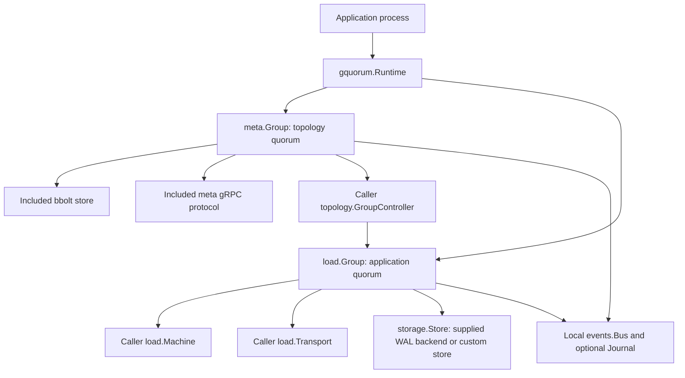

# Library guide: building a cluster with gquorum

`github.com/asalimonov/gquorum` is a Go library for applications that need a
replicated cluster topology and application-defined Raft groups. It runs inside
the application's processes. Each process represents one node, with its own
identity, storage and network listeners.

The library provides two kinds of group:

| Group | Replicated state | Persistence | Networking |
| --- | --- | --- | --- |
| `_meta` | Cluster topology, admission, activation sessions, locks and topology execution records | Included synchronous bbolt store | Included gRPC protocol |
| Load group | Commands interpreted by the application's state machine | Included etcd WAL/snapshot backend, or a caller-provided `storage.Store` | Caller-defined protocol and `load.Transport` |

Each group has independent leadership and membership. Every admitted node
participates in `_meta`; load groups can occupy a subset of nodes. A node's
user-defined type controls eligibility for load placement. A type such as
`observer` has no built-in meaning and does not remove that node's meta vote.

The application passes settings through Go options. Configuration files,
environment variables, service discovery and HTTP APIs belong to the application.
All persistent storage locations are supplied by the caller. Cluster events use
live subscriptions and an optional node-local journal; they are never stored in
the meta quorum.

## Components and responsibilities



`gquorum.Runtime` owns the group handles for one node and cluster. It allows one
meta handle and multiple load handles, coordinates their shutdown, and checks
load identities against approved topology and local storage evidence. The meta
handle owns topology consensus, planning, effect execution, health observation
and optional automatic load-replica reconciliation. A load handle owns the Raft
loop, persistence ordering, snapshots, recovery and proposal completion.

The application implements its load state machine and transport. It also
implements `topology.GroupController` to turn approved topology steps into local
or remote load-group operations. The library does not assume that load replicas
use gRPC or share the meta listener. The caller supplies load routing,
authentication, identity validation and application serving policy.

## Creating and running the meta cluster

The central construction methods are:

| Call | Result |
| --- | --- |
| `gquorum.New(gquorum.Options)` | `(*gquorum.Runtime, error)` |
| `runtime.OpenMeta(meta.Options)` | `(*meta.Group, error)` |
| `runtime.OpenLoad(load.Options)` | `(*load.Group, error)` |

`New` creates an empty runtime. Opening a handle can open and recover storage, but
does not start its Raft or network workers. The caller starts each returned
handle with `Start(ctx)` and uses `WaitReady(ctx)` as its startup gate.

For a cluster managed by `_meta`, open the meta handle before any load handles.
Supply the following through `meta.Options`:

| Structure or field | Purpose |
| --- | --- |
| `Identity meta.Identity` | `NodeName` and `ClusterID` identify the affiliation; `MemberID` identifies the meta replica; `InstanceID` identifies this process incarnation. |
| `Node topology.Node` | Local admission description, including the caller-defined node type. |
| `DBPath string` | Explicit path to this node's meta bbolt database. |
| `Founders []meta.FoundingMember` | Initial voters, each carrying a node description, member ID and meta address. |
| `Join bool`, `JoinSeeds []string` | Request admission through existing meta peers instead of declaring founders. |
| `Limits topology.Limits` | Sole cluster capacity setting, persisted in cluster rules. Zero fields default to three nodes and five replicas per group. |
| `Placement topology.PlacementRule` | Default placement policy for load groups. |
| `Network meta.NetworkOptions` | Listener, advertised address, resolver, TLS settings and cluster credential. |
| `Timing`, `SessionTTL`, `SnapshotThreshold`, `MaxWatchers` | Consensus, session and resource settings. |
| `LoadGroups topology.GroupController` | Application adapter for approved load effects and group observations. Optional for a meta-only application. |
| `Health topology.HealthSource` | Optional caller-provided coherent node health observations. |
| `Observation`, `Reconciliation` | Sampling and automatic load-repair settings. Reconciliation does not approve staged operator intent or repair meta membership. |
| `OnReadmission`, `OnSelfRemoved` | Application hooks for local recovery and approved self-removal. |
| `Logger`, `Events` | Observability dependencies; omitted values can inherit from runtime options. |

`meta.NetworkOptions` requires a caller-created `net.Listener`, an
`AdvertiseAddress` and a nonempty `ClusterCredential`. Supply server `TLS` and
`ClientTLS`, or explicitly enable `AllowPlaintext` for an appropriate environment.
`MaxSnapshotBytes` bounds incoming meta snapshots. Address lookup uses:

```go
type AddressResolver interface {
    Resolve(context.Context, string) (string, error)
}

type HealthSource interface {
    Snapshot(context.Context) (map[string]Health, error)
}
```

Both interfaces are in `topology`. The resolver maps a node name to its meta
address. Unknown or missing health remains unknown; it is not evidence that a
node is dead.

To bootstrap a new cluster, give every founding process the same cluster ID,
founder declarations, limits and placement policy. Each process uses its own
node name, member ID, fresh process ID, database path and listener. Member IDs
must be unique and positive; `meta.FoundingIDs(clusterID, names)` can derive them
deterministically. Start the processes so a majority of founding voters can
communicate, then wait for readiness before enabling application service.

To add a node, stage and approve admission through `AddNode`, and start the new
process with `Join: true`, its node description and seed addresses. The joiner
does not supply founding voters. Admission uses learner preparation and catch-up
before promotion. All admitted nodes eventually participate as meta voters.

A normal restart preserves the database and its pinned node/cluster/member
identity, while generating a fresh process ID. Founding declarations can be
omitted when resuming retained state. `meta.LoadStoredIdentity(path)` reads the
validated pin from a closed database without changing it. Data-loss readmission
uses fresh approved identities and `OnReadmission`; the application verifies the
old and granted identities and orchestrates quarantine of its supplied paths.

The [small Compose example](../../examples/cluster/README.md) demonstrates meta
bootstrap and HTTP topology operations. Its executable is the minimal concrete
startup/shutdown reference. `make run-example` starts three voters.

## Topology documents and the mutation lifecycle

`topology.Document` is the replicated declaration of the cluster:

| Type | Main fields and meaning |
| --- | --- |
| `Document` | `Version`, `ParentVersion`, `ClusterID`, `Nodes`, `Groups`, default `Placement`, and change metadata such as actor, origin and audit. |
| `Node` | `Name`, arbitrary `Type`, declared `State`, optional `Region` and `Labels`, and timestamps. |
| `Group` | `ID`, `Replicas`, monotonically allocated `NextReplicaID`, optional group-specific `Placement`, and timestamps. `_meta` is reserved. |
| `Replica` | `NodeName`, `ReplicaID`, `Role` (`voter` or `learner`), and timestamps. Replica IDs belong to their group. |
| `PlacementRule` | `MinReplicas`, `MaxReplicas`, and `AllowedNodeTypes`. An empty type list permits all types; a group can override the document default. |
| `Limits` | `MaxNodes`, `MaxReplicas`. Choose cluster capacity here at creation; every participating node must supply matching rules. |
| `Rules` | Persisted `SchemaVersion` and `Limits` used to validate declarations. |

Rules are pinned in durable state and checked during recovery and joining.
Changing constructor limits is not a live cluster-capacity update API.

Node states are `active`, `draining`, `drained` and `excluded`. Draining moves
load placement away from the node; effective state becomes drained when no load
replicas remain. Draining or draining completion preserves meta membership.
Exclusion is a separate membership operation. Node type is fixed while admitted.
Deleting a load group permanently retires its ID in that cluster; a replacement
workload must receive a new group ID.

The meta finite state machine separates three document views:

| View | Meaning |
| --- | --- |
| Latest | Most recently committed desired document, including staged changes. |
| Target | Approved document whose effects are being executed. |
| Active | Document activated after its required effects have converged. |

The normal flow is **stage → plan/approve → execute effects → activate**. Staging
alone does not authorize changing load replicas. `Latest`, `Target`, `Active`,
`Get(version)` and `History(Page)` return owned, locally applied documents. They
do not promise linearizable reads. `Watch(ctx, view)` returns an initial document
and subsequent updates; slow consumers can miss intermediate versions and should
read the current view to reconcile.

`Stage(ctx, document, expectedVersion)` performs a compare-and-swap edit. Mutation
helpers provide the same pipeline for `AddNode`, `DrainNode`, `ActivateNode`,
`ExcludeNode`, `ReadmitNode`, `ReseatReplica`, `CreateLoadGroup`, `DeleteLoadGroup`,
`ChangeReplica`, `SetPlacement`, `SetGroupPlacement` and `RollbackTo`. The
`ForceRetireNode` helper additionally requires retirement options and a reason.

```go
type MutationOptions struct {
    ExpectedVersion uint64
    Actor           string
    Comment         string
    Apply           bool
    Preview         bool
}

type MutationResult struct {
    Document    topology.Document
    ExecutionID topology.ExecutionID
}
```

These types are in `meta`. `Preview` computes the prospective document without
proposing it. `Apply` requests approval after staging; it cannot be combined with
preview. A zero `ExpectedVersion` pins the locally observed Latest version.
For an operator API, pass the version the operator actually read.

Use `Plan(version)` or `PlanFor(document)` to inspect the ordered effects.
`Apply(ctx, version)` approves execution and returns its ID. Track it with
`Execution(ctx, id)` or `WaitExecution(ctx, id)`. `ExecutionStatus` includes the
version, attempt, current step, state and waiting/error details. Pending, running
and waiting states can progress to succeeded, failed or superseded.

Staging may commit successfully before approval fails. A mutation can therefore
return both a committed `Document` and an error. Inspect that result and retry
approval of its version when appropriate; an error does not imply rollback.

## Applying approved load effects

The application supplies this interface through `meta.Options.LoadGroups`:

```go
type GroupController interface {
    Status(context.Context, string) (GroupStatus, error)
    CreateGroup(context.Context, AuthorizedStep) error
    PrepareReplica(context.Context, AuthorizedStep) error
    ApplyMembership(context.Context, AuthorizedStep) error
    TransferLeader(context.Context, AuthorizedStep) error
    StopReplica(context.Context, AuthorizedStep) error
    CleanupReplicaState(context.Context, AuthorizedStep) error
    DeleteGroupState(context.Context, AuthorizedStep) error
}
```

It is defined in `topology`. Meta executes its own effects internally; the
controller handles load groups. The adapter routes each operation to the right
process and supplies leader/membership/progress observations through `Status`.
`GroupStatus` carries the group and host identities, existence, leader, term,
commit/applied cursors, Raft configuration, replica progress and health evidence.

Each effect carries a complete authorization tuple:

```go
type AuthorizedStep struct {
    ExecutionID ExecutionID
    Version     uint64
    Attempt     uint32
    StepSeq     int
    Kind        StepKind
    GroupID     string
    NodeName    string
    ReplicaID   uint64
}
```

**Require idempotent callbacks and verification of their exact authorized
identities.** Every receiving effect handler must call
`meta.Group.Authorize(ctx, step)` against its cluster's current execution,
validate the operation and its exact node/group/replica scope, and verify any
existing result before acknowledging a retry. A delayed cleanup must never
delete a successor replica with a different ID. Networked receivers must validate
the cluster identity and authenticate their caller as part of the application
protocol.

Effects can repeat after retries, leadership changes or crashes. `CreateGroup`
seeds only approved founding voters; intentional learners use later preparation
and admission steps. `PrepareReplica` opens a joining replica. Membership steps
add a learner, wait for catch-up, promote/demote or remove it. The planner orders
leader transfer, stopping and cleanup as needed. The library verifies observable
postconditions; the application must verify its own storage and external effects.
Application transactions and outboxes remain caller-owned.

For native load membership, use `membership.NewCoordinator().Apply` with the
handle's `Membership()` adapter and a `membership.HealthSource` reporting live
replica IDs. The coordinator enforces fixed membership safety, including
catch-up and majority checks. Those checks are not replaced by configurable
placement limits.

The complete application adapter is in
[tests/cluster/testapp/controller.go](../../tests/cluster/testapp/controller.go).
It is a reference implementation and test fixture, rather than required demo
code or part of the library API.

## Creating application-defined load groups

Implement these two interfaces from `load`:

```go
type Machine interface {
    Apply(context.Context, Command) (Result, error)
    Snapshot(context.Context) ([]byte, error)
    Restore(context.Context, []byte) error
}

type Transport interface {
    Send(context.Context, []raftpb.Message) error
}
```

`Command` contains `Index`, `Term`, `RequestID` and opaque `Data`. `Result` contains
an application `Code` and opaque `Data`. Machine calls are serialized. Apply must
be deterministic; a business rejection belongs in `Result.Code`, while an Apply
error halts the replica. `Restore(nil)` initializes empty state, and Snapshot
must produce a complete, nonempty representation. Recovery restores the full
snapshot and committed log tail, so the machine must support replay. Deduplicate
application request IDs where retries must not repeat a command's effect.

The transport sends owned copies of Raft messages. It must honor context
cancellation and support concurrent sends to different destinations; sends to
one destination are serialized. The application routes incoming authenticated
messages to `Group.Step(ctx, message)` after validating cluster, group and replica
identities. Asynchronous transports report subsequent failures through
`ReportUnreachable` and `ReportSnapshot`.

`load.Options` binds these dependencies to `GroupID`, `NodeName`, `ClusterID` and
`ReplicaID`. It also carries `Mode`, founding `Peers []raft.Peer`, `Timing`,
`SnapshotThreshold`, proposal/byte bounds, and optional logger/events/process ID.
`Store`, `Machine` and `Transport` are required.

For the supplied backend, open `walstore.Open(walstore.Options{...})` with
`RootDir`, `NodeName` and `ClusterID`. Pass the resulting store to load options.
`storage.Store` separates identity binding/probing, log and hard-state writes,
applied cursors, snapshots, recovery, compaction and exact-ID quarantine from
application state. `storage.Identity` consists of node, cluster, group and replica
ID. A custom store must preserve those durability and identity contracts; reusable
conformance helpers are in `storage/storagetest`.

For a new group, stage `CreateLoadGroup` with `meta.GroupSpec` (ID, optional
placement override and optional node selection), then approve the document.
The approved controller callback obtains the assigned replica IDs and opens each
local replica with `Runtime.OpenLoad`. Founding mode uses exactly the approved
founding voters. Joining mode supplies no founding peers. With meta attached,
OpenLoad checks approved Target identities and the local boot ledger; Latest-only
intent cannot open a replica. It records the identity after durable store opening.

Call `Start(ctx)` and `WaitReady(ctx)` on the load handle. Load readiness means
startup recovery has completed, and is separate from elected leadership. Submit
commands on the leader using `Propose(ctx, load.Proposal{RequestID: ..., Data: ...})`;
completion returns the committed application result. A follower returns
`fault.ErrNotLeader`; application request routing is caller-owned.
Cancellation does not retract an
already proposed command. Other operations include `Status`, `RaftStatus`,
`IsLeader`, `Snapshot`, `TransferLeader`, `ProposalStats` and `Stop`.

Standalone `load.New` and load-only runtimes are also available. Without attached
meta, the caller supplies membership authorization and recovery identity policy.

## Status, events and shutdown

`meta.Group.LocalStatus()` observes local meta consensus without contacting
peers. `Status(ctx)` aggregates cluster, node, load-group, execution and health
observations. `HealthObservation()` exposes sampling state. These observations
are useful for monitoring, but do not supply a linearizable read or themselves
prove write quorum. The meta FSM also exposes activation/session and lock APIs;
normal startup maintains the local activation session automatically.

For cluster and quorum events, create an `events.Bus` with `events.NewBus` and
pass it through runtime or group options. `Subscribe(ctx, events.Filter, capacity)`
returns `Delivery` values containing an `Event` and `LostBefore` count. Events
include leadership, quorum, node health, execution, drain and runtime changes.
Subscriptions and publication are bounded; monitor `Bus.Dropped()` and delivery
loss when consumers cannot keep up.

An optional `events.OpenJournal(events.JournalOptions{Path: ...})` provides a
separate local bbolt journal with retention and live-size limits. Attach it through
`events.BusOptions.Journal` and query retained events with `Journal.List`. This
observational journal is best effort, not a replicated or lossless audit log.

Shut down application request/effect producers, then call `Runtime.Close(ctx)`.
It quiesces meta work, joins load handles and closes the meta database. Supplied
load stores, machines, transports, event bus and journal remain caller-owned;
close them after their users stop. Close the bus before its journal. A shutdown
timeout leaves teardown running and ownership retained. An owned callback that
initiates shutdown must call `RequestClose()` and return, so teardown can join it.

`StopLoad(ctx, groupID, expectedReplicaID)` stops and unregisters an exact load
handle without deleting its storage. `ParkedLoads()` exposes refused recovery
observations. An established replica with missing, unreadable or foreign state
is parked rather than silently recreated. Approved reseating and caller-owned
quarantine supply the recovery path; see [runtime ownership](runtime.md) for the
detailed boot and shutdown contracts.

## Repository structure

The root module contains the public library and its internal implementations.
The process-cluster suite has a separate Go module under `tests/cluster`.

| Path | Contents |
| --- | --- |
| `runtime.go`, `boot.go`, `doc.go` | Public runtime facade, handle ownership and load boot/recovery decisions. |
| `meta/` | Public meta construction, networking options, documents, mutations, planning, sessions, lifecycle and recovery APIs. |
| `topology/` | Documents, node types/states, placement, validation, plans, authorized steps, execution and status contracts. |
| `load/` | Public load-engine types and constructors. |
| `membership/` | Fixed safety policy and serialized membership coordinator. |
| `storage/` | Public Raft persistence contract and identity/recovery structures. |
| `storage/walstore/` | Included etcd WAL and snapshot backend with local bbolt bookkeeping. |
| `storage/storagetest/` | Reusable storage conformance helpers. |
| `events/` | Bounded local subscriptions and optional local bbolt journal. |
| `fault/` | Typed errors and shared error classification. |
| `internal/raftengine/` | Shared Raft loop, proposal tracking, persistence ordering, transport queues and replay. |
| `internal/metaengine/`, `internal/metastore/` | Meta FSM and durable bbolt state, identity pins and local ledgers. |
| `internal/metatransport/`, `internal/metapb/` | Built-in meta gRPC transport, protobuf schema and generated code. |
| `internal/convergence/`, `internal/reconcile/`, `internal/observe/` | Execution/retry/verification, automatic load repair and health sampling. |
| `internal/raftlog/` | Raft logging adapter. |
| `examples/cluster/` | Small meta-only executable, HTTP adapter, Dockerfile and three-node Compose demo. |
| `tests/cluster/` | Docker process-cluster correctness, membership, failure/recovery, scale and resource tests; actual demo REST end-to-end test. |
| `tests/cluster/testapp/` | Full caller-defined load FSM, protocol, effect controller, recovery adapter and fault instrumentation for the tests. |
| `docs/architecture/` | This guide and detailed runtime contracts. |
| `docs/testing/` | Test commands, coverage, performance bounds and validation evidence. |
| `docs/brainstorms/`, `docs/plans/` | Design decisions, test inventory and implementation history. |
| `Makefile` | Unit/functional/cluster checks, protocol generation and example lifecycle commands. |

Applications import the public packages; `internal/` packages are implementation
details. Tests beside library source cover units and in-process behavior. Cluster
fault scenarios and the richer load application belong under `tests/cluster`,
keeping the runnable example small.

For development commands and test-module boundaries, read the
[testing guide](../testing/tests.md). For a running application start with the
[meta demo](../../examples/cluster/README.md), then consult the
[load test application's guide](../../tests/cluster/testapp/README.md) when
implementing load protocols and effect receivers.
