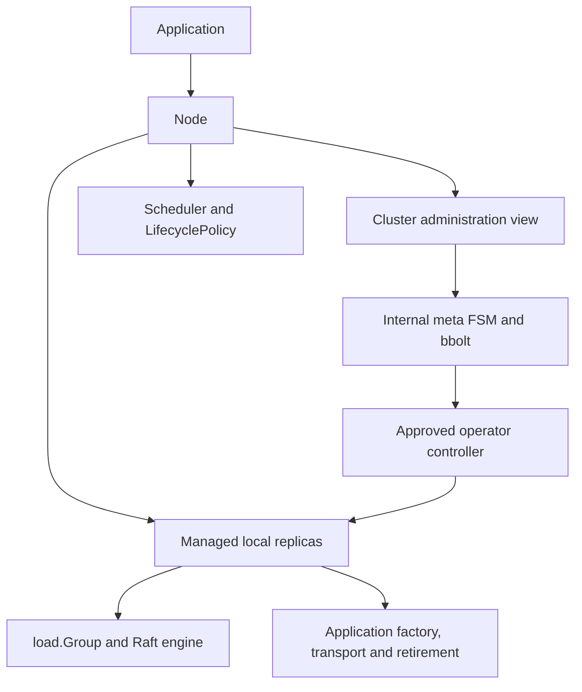

# Building a cluster with gquorum

`gquorum` owns a node's topology quorum and its local application replicas.
Applications supply settings, listeners, identities, paths, load state machines
and load transport. The library contains the `_meta` protocol, its bbolt store,
the Raft engines, recovery and an etcd WAL backend for load groups.

Three handles describe the public API:

| Handle | Responsibility |
| --- | --- |
| `gquorum.Node` | One participant: start, readiness, shutdown, local replica ownership, sessions and load protocol receivers. |
| `gquorum.Cluster` | A stable administration view obtained from `node.Cluster()`: topology, membership, approval and progress. It has no independent lifetime. |
| `*load.Group` | One local replica: application proposals, leadership/status, snapshots and proposal-pressure diagnostics. A stopped handle never redirects into its replacement. |



## Construct and start a node

`NewNode(NodeOptions)` validates and copies settings without opening storage or
calling application code. `Start(ctx)` acquires local resources, starts `_meta`
and begins admission/recovery. It returns before quorum readiness, so callers
can start several nodes sequentially. `WaitReady(ctx)` waits for local admission,
recovery, session activation and the configured startup gate; canceling that
wait does not stop the node. The context passed to `Start` owns its lifetime.

The application creates these settings directly; there is no configuration-file
loader or built-in storage root:

| Setting | Meaning |
| --- | --- |
| `Identity topology.Identity` | Node name, cluster ID, durable meta member ID and fresh process `InstanceID`. Member ID can be resolved from bootstrap/admission or a retained pin. |
| `Node topology.Node` | The caller-defined node type and admission description. Every admitted type joins `_meta`; type controls load placement. |
| `Bootstrap BootstrapOptions` | Founders for a new cluster, or `Join` with `JoinSeeds` for admission. Retained nodes recover their durable identity. |
| `Limits topology.Limits` | Sole capacity bounds: defaults are three nodes and five replicas per load group. Larger values are supplied here. |
| `Placement topology.PlacementRule` | Default load replica count and eligible node types. Individual groups can override it. |
| `Meta MetaOptions` | Explicit bbolt path, network, timing, session, observation, snapshot and watcher settings. |
| `Loads LoadOptions` | Optional managed load integration; leave empty for a meta-only participant. |
| `Policies PolicyOptions` | Built-in policy options or caller implementations, scheduling controls and callback timeout. |
| `Health`, `Events`, `Logger` | Optional application health observations, borrowed local event bus and logger. |

`MetaNetworkOptions` takes a caller-created listener, advertised address and
cluster credential, plus TLS/client TLS or explicit `AllowPlaintext`. A caller
address resolver supports address-free topology documents. The listener transfers
to Node when startup acquires the meta service. Dependencies and callbacks must
remain usable until their owner joins them.

Each founder supplies `FoundingMember{Node, MemberID, Address}` with a unique
positive member ID. `FoundingIDs(clusterID, names)` derives a stable founding map.
`LoadStoredIdentity(path)` reads a closed meta database's validated durable pin
without creating it; it returns no process incarnation. See the executable
[node construction](../../examples/cluster/cluster.go) and
[process wiring](../../examples/cluster/main.go) for founding, retained restart,
listener creation and shutdown.

## Topology and cluster administration

`topology.Document` contains the cluster ID, version, nodes, groups and placement.
The metadata service tracks permanently retired group IDs separately from the
document. Replica identity is a node name plus a fresh
monotonic replica ID within its group. Node states include active, draining and
excluded. Drain changes eligibility and load placement while preserving `_meta`
membership. Exclusion and readmission use the approved membership workflow.

| View | Meaning |
| --- | --- |
| `Latest` | Most recently staged document, possibly unapproved. |
| `Target` | Approved desired topology. |
| `Active` | Fully converged topology. |

`Get`, paginated `History`, and `Watch` expose versioned documents and updates.
Reads are owned local observations, not linearizable barriers or quorum proofs.
`Stage(ctx, document, expectedVersion)` uses compare-and-swap. `Plan` previews a
staged version; `PlanFor` validates/plans an uncommitted document without staging.
`Approve(ctx, version)` commits a concrete plan and returns an `OperatorID`.
`Operator` and `WaitOperator` expose approved progress, attempts and failures.

Typed mutation helpers share `MutationOptions{ExpectedVersion, Preview, Approve,
Actor, Comment}`. Preview and approval cannot be combined. A staged document is
returned even if subsequent approval fails; retain that version and retry its
approval rather than silently allocating another edit. For example:

```go
result, err := node.Cluster().CreateGroup(ctx,
    gquorum.GroupSpec{ID: "orders"},
    gquorum.MutationOptions{ExpectedVersion: version, Approve: true},
)
// Preserve result.Document.Version even when err reports an approval failure.
if err != nil {
    return err
}
status, err := node.Cluster().WaitOperator(ctx, result.OperatorID)
```

The full mutation surface includes `AddNode`, `ReadmitNode`, `DrainNode`,
`ActivateNode`, `ExcludeNode`, `ForceRetireNode`, `SetPlacement`,
`SetGroupPlacement`, `CreateGroup`, `DeleteGroup`, `ChangeReplica`,
`ReseatReplica`, `RollbackTo` and `TransferLeader`. Deleted group IDs cannot be
reused. Fresh-ID readmission and replica reseating preserve the distinction
between old state and its authorized replacement. Force-new recovery after
permanent majority loss remains deferred.

`Cluster.Status(ctx)` collects cluster/load observations. `HealthObservation`,
`Rules`, `IsLeader` and `ParkedJoins` provide diagnostics. `Node.Status()` is a
local snapshot without network probes; it separates the startup `Ready` gate
from current `SessionLive` and includes meta, local replicas, removal and errors.
Group status exposes leader, term, membership and commit/applied positions.

`Identity.NodeName`, `Node.Name` and `Replica.NodeName` identify the logical
node across restarts. `InstanceID` identifies one process run and must be fresh
on restart; it fences stale process messages independently of durable identity.
Numeric `MemberID` and `ReplicaID` are Raft identities, not node names.

Status exposes numeric `MetaLeaderID` / `meta_leader_id` and `LeaderID` /
`leader_id` fields. It additionally exposes `MetaLeaderNodeName` /
`meta_leader_node_name` and group `LeaderNodeName` / `leader_node_name`.
Cluster status, local meta status and `policy.ScheduleInput.Status` resolve names
by exact group/replica ID through their captured Active view, including cached
cluster reads. Empty names mean unknown or unmapped;
numeric observations remain available. `HostNode` names the reporting host,
which may be a follower. Raw load-group status does not resolve topology names;
use `Cluster.Status(ctx)` for the enriched group view.

`Node.ActivateSession`, `KeepAlive` and `DeactivateSession` support caller-owned
sessions. `Cluster.AcquireLock` and `LockHolder` use session IDs. Node's own
activation is separate and observable through `OwnSessionLive`. A local
`SetServeOverride` changes readiness policy input without changing Raft quorum
or membership safety.

## Managed load integration

`Cluster.CreateGroup` declares distributed consensus. Node automatically starts
its assigned replicas. `StartLoadGroup(ctx, load.ReplicaRef)` explicitly starts
an exact approved local identity or clears its matching local stop hold.
Concurrent starts share one startup and handle. `LoadGroup` and `LoadGroupIDs`
only expose published replicas. `StopLoadGroup` joins that exact replica and
holds it for this Node lifetime; it does not delete its durable state. A fresh
Node can recover it, and approved retirement remains possible while held.

Supply the following through `LoadOptions`:

| Integration | Contract |
| --- | --- |
| `Factory GroupFactory` | Receives owned `load.ReplicaSpec`: exact storage identity, node/process identity, approved group and version. Returns `load.Application`. |
| `Application.StateMachine` | Implements `Apply(ctx, load.Command) (load.Result, error)`, `Snapshot(ctx) ([]byte, error)` and `Restore(ctx, []byte) error`. Recovery restores the full snapshot and committed tail. |
| `Application.Close` | Optional application-resource release. A successful factory transfers this responsibility to Node, even if its caller subsequently cancels. A failed factory releases its own partial acquisitions. |
| `Storage LoadStorageOptions` | Choose Node-owned `WAL: &WALOptions{RootDir: ...}`, or a borrowed `storage.Store` and explicit `storage.RetirementStore`. |
| `Transport load.Transport` | Caller-defined protocol adapter implementing `SendRaft`, `ReadReplica` and `ApplyAction`. No load wire schema is imposed. |
| `Retire RetireReplicaFunc` | Optional callback for application state outside the Raft store; verifies exact identity and authorization, performs idempotent cleanup and echoes the complete verified proof. |
| `Engine load.EngineOptions` | Timing, snapshot threshold and bounded proposal/application batch settings. |

Transport values contain exact node/process/member and load replica identities.
The receiver authenticates its application protocol, decodes the typed request,
then calls `Node.ReceiveLoadRaft`, `ReadLoadReplica` or `ApplyLoadAction`.
Successful snapshot delivery and asynchronous failure reports use
`ReportLoadDelivery` with the issued delivery ID and exact endpoints. Stale
reports cannot affect a replacement handle. `ApplyAction` is used for local
and remote destinations; an in-process adapter may forward directly to Node.

Node validates approvals, identities and membership safety before effects. The
application implements no create/prepare/membership switch. It must authenticate
its protocol and verify identities of its own durable resources. Retirement
requests distinguish approved topology cleanup from exact readmission grants.
A callback must verify a retry even when its state is already absent; a bare
success flag without the matching proof is refused. The library handles stopping,
Raft quarantine, ledger retirement and retention after the callback succeeds.

State machines must deduplicate request IDs when callers retry uncertain commits.
Canceling a proposal does not roll back an entry already committed. Application
transactions and outboxes remain application responsibilities. Callback contexts
must be honored; read-only status and `RequestStop` are safe, while waiting for
shutdown that must join the same callback would deadlock.

`load.Group` exposes `Propose`, `WaitReady`, `Snapshot`, `Status`, `IsLeader`,
`Running`, `Identity`, `GroupID`, `ReplicaID`, `WALStall`, `Error` and `ProposalStats`. It exposes no independent
start/stop, raw membership mutation or raw Raft transport. For independent
low-level consensus without `_meta`, use `load.NewStandalone` and its separate
`Standalone` owner, which also provides stepping, delivery reporting and safe
membership/leader operations. The caller then owns authorization and recovery
policy as well as transport and borrowed resources.

## Replaceable policies

There are two public decision interfaces, both in `policy`:

```go
type Scheduler interface {
    Schedule(context.Context, ScheduleInput) (ScheduleDecision, error)
}
type LifecyclePolicy interface {
    Readiness(context.Context, ReadinessInput) (ReadinessDecision, error)
    Retention(context.Context, RetentionInput) (RetentionDecision, error)
    Removal(context.Context, RemovalInput) (RemovalDecision, error)
}
```

The default scheduler is `policy.RestoreDegraded`. It proposes supported load
repair from copied topology, status, health and hold observations; the library
revalidates every decision before approval. It does not approve staged operator
intent or alter `_meta` membership. Set `Policies.RestoreDegraded` options,
`Policies.Scheduling` intervals/cooldown, or provide `Policies.Scheduler`.
`Node.SetSchedulingEnabled` controls the local scheduler; `SchedulingStatus`
reports its observations and decisions. A callback still running after its
deadline reports `policy_stalled`; it remains owned until it returns. Decisions
are checked against refreshed topology, health and native membership before
approval, so a replica recovering during the callback is not replaced from an
old observation. Scheduler agreement metadata is deferred:
applications are responsible for choosing consistent startup settings.

`policy.DefaultLifecycle` supplies local-admission or all-founders startup gates,
retired-storage retention and stop/diagnostics behavior after mandatory removal
fencing. Configure `Policies.DefaultLifecycle` or supply `Policies.Lifecycle`.
Embed `*policy.DefaultLifecycle` to override only selected decisions. Supplying a
custom policy and built-in options for that same policy is rejected as ambiguous.

Callbacks are serialized per node and receive owned inputs with deadlines.
Timeouts do not discard a still-running callback or permit overlapping replacement
calls. No policy can waive exact identity, admission, recovery, authorization or
membership safety checks. `policy/policytest` and `storage/storagetest` provide
optional reusable contract helpers for caller implementations.

## Events, shutdown and repository layout

`events.Bus` provides bounded node-local subscriptions. An optional bbolt journal
uses a caller-supplied file path and supports queries/pruning. Operator and
scheduling event names are public vocabulary; legacy persisted encodings remain
private. Events are never replicated through `_meta`. The bus and journal remain
caller-owned and should be closed after Node has joined.

For `events.LeaderChange`, `OldLeader` and `NewLeader` contain decimal Raft IDs:
meta member IDs or load replica IDs, rather than logical node names. The string
`"0"` means no known leader; an empty field means it was not supplied. Retained
journals use the same encoding.

`RequestStop` begins asynchronous teardown. `Stop(ctx)` joins it; timeout retains
ownership and may be followed by another Stop. Failed application Close also
remains owned until a serialized retry succeeds. `_meta` storage remains open
until managed resources and callbacks have joined. Read the detailed
[ownership and recovery contract](runtime.md) for the boot evidence table,
readmission, removal fencing and resource order.

| Path | Responsibility |
| --- | --- |
| `node*.go`, `cluster*.go` | Public handles, settings, methods and lifecycle composition. |
| `topology/` | Documents, identities, placement, plans, operators, session/status values and validation. |
| `load/` | Explicit application types, Group, typed transport and Standalone owner. |
| `policy/`, `policy/policytest/` | Replaceable decisions, built-ins and caller contract helpers. |
| `storage/`, `storage/walstore/`, `storage/storagetest/` | Raft persistence/retirement contracts, etcd WAL backend and conformance helpers. |
| `events/`, `fault/`, `membership/` | Local events/journal, classified faults and advanced fixed safety helpers. |
| `internal/managed/`, `internal/loadhandle/` | Exact replica ownership, recovery, approved actions, retirement and opaque group representation. |
| `internal/metaservice/` | Private topology service, admission, documents, local ledger and protocol integration. |
| `internal/metaengine/`, `internal/metastore/` | Meta FSM and bbolt durable state. |
| `internal/metatransport/`, `internal/metapb/` | Included meta transport, protocol and generated code. |
| `internal/operator/`, `internal/scheduling/`, `internal/observe/` | Approved plan execution, scheduling driver and health observations. |
| `internal/raftengine/`, `internal/raftlog/` | Shared Raft loop, replay, persistence, queues, pressure and logging. |
| `examples/cluster/` | Separate Go module for the small meta-only HTTP/Compose demo, with Kong configuration and distinct cluster/HTTP files; `make run-example`. |
| `tests/cluster/` | Separate Go module for Docker correctness/fault/scale tests and the actual example smoke test. |
| `tests/cluster/testapp/` | Full application FSM, typed protocol adapter, application retirement and test-only fault controls; public Node integration tests. |
| `docs/architecture/`, `docs/testing/` | Current contracts, test commands, coverage and validation evidence. |
| `docs/brainstorms/`, `docs/plans/` | Accepted target, design history and implementation progress. |

Start with the [small demo](../../examples/cluster/README.md). Use the
[full test application](../../tests/cluster/testapp/README.md) for load integration
examples and the [testing guide](../testing/tests.md) for validation commands.
