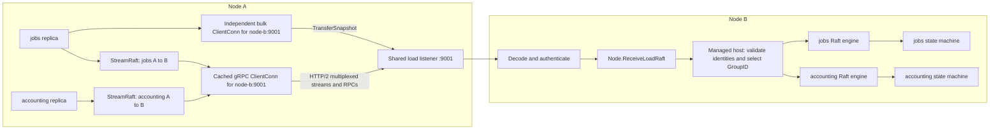

# Multiplexing load Raft groups

One node can host many load groups through one shared network listener. With
the included `transport/loadgrpc` adapter, groups targeting the same peer address
reuse bounded cached gRPC connections, with separate ordinary and bulk pools. Each batch identifies its group and exact
replicas, so the receiver can deliver it to the correct Raft engine.

This document describes the current managed load transport and gRPC adapter.
Custom implementations of `load.Transport` may use another network protocol,
but must preserve the same identity, authentication and delivery contracts.
For consensus behavior, see [the Raft model](raft.md); for application wiring,
see [the runtime overview](runtime.md).

## 1. What is shared and what is independent

| Resource | Scope |
| --- | --- |
| Load listener and registered gRPC service | Shared by all load groups on a node in the examples |
| Ordinary cached `grpc.ClientConn` | Shared by ordinary streams/control calls to the same address |
| Bulk cached `grpc.ClientConn` | Separate pool for snapshot RPCs to that same address and listener |
| Snapshot workers and byte/count admission | Node-wide bounded coordinator, independent of ordinary destination workers |
| Outgoing `StreamRaft` stream | One exact sender/recipient replica pair, including group and process identities |
| Node send worker and queue | One per destination replica inside each group's Raft engine |
| Raft engine, log, snapshots, membership and leader | Independent for each group; each host owns its local replica |
| State-machine instance | Created separately for each local replica by the application factory |

For example, a node hosting `jobs`, `accounting` and `locks` can receive all their
load traffic on `9001`. Those groups may implement different state machines and
hold unrelated state. Within each group, replicas must apply compatible,
deterministic application logic.

The cache and scheduler examples use `9000` for the separate `_meta` transport
and `9001` for load traffic. These are configurable example ports. Creating a
load group does not create a listener. The application creates the load listener
and gRPC server, registers the adapter once, and supplies that adapter through
`NodeOptions.Loads.Transport`.

“One connection” means connection reuse for a peer endpoint, not one socket for
the entire cluster or a promise that one TCP socket lives forever. Each adapter
caches ordinary and bulk gRPC client connections separately by address; gRPC manages the underlying HTTP/2
connections and reconnection. Other peer addresses have their own connections,
and the reverse direction uses the other node's outgoing transport.



The arrows show one traffic direction. Raft responses follow the same routing
mechanism in the opposite direction. Committed entries reach the selected
state machine after the engine performs its normal persistence and apply work.

## 2. Routing information in the protocol

The public [load transport types](../../load/transport.go) describe endpoints:

```go
type ReplicaRef struct {
    GroupID   string
    ReplicaID uint64
}

type Peer struct {
    Node    topology.Identity
    Replica ReplicaRef
}

type RaftBatch struct {
    From, To   Peer
    DeliveryID uint64
    Messages   []raftpb.Message
}
```

`topology.Identity` includes `ClusterID`, `NodeName`, `_meta` `MemberID` and
process `InstanceID`. `ReplicaID` identifies a load replica within its group;
it is not globally unique. For example, `jobs` replica 2 and `accounting`
replica 2 are different destinations.

The [protobuf protocol](../../transport/loadgrpc/internal/loadpb/load.proto)
uses two encodings. Raft traffic travels in a version-2 `RaftFrame`: generated
protobuf `RaftPeer` headers for `from` and `to` (cluster, node, process
instance, member, group and replica), the delivery ID, and `messages` holding
complete native binary `raftpb.Message` encodings. Administrative requests use
`Envelope{version: 1, body: ...}` with a JSON body, limited to 64 KiB, and
unary `Reply` values keep their JSON codec. In both cases routing identity is
inside the request, not inferred from the TCP port. There is no JSON Raft
encoding or fallback: every adapter in a cluster must speak frame version 2.

```proto
message RaftFrame {
  uint32 version = 1;          // must be 2
  RaftPeer from = 2;
  RaftPeer to = 3;
  uint64 delivery_id = 4;
  repeated bytes messages = 5; // complete native raftpb.Message encodings
}
```

| RPC | Purpose |
| --- | --- |
| `StreamRaft` | Ordered, non-snapshot Raft frames on a bidirectional stream; replies carry only refusals |
| `SendRaft` | Unary ordinary frame ingress; MsgSnap is refused |
| `TransferSnapshot` | Version-1 bidirectional chunk transfer on separate bulk connections |
| `ReadReplica` | Replica diagnostics or requested quorum-confirmed native evidence |
| `ApplyAction` | An approved action with its exact authority grant and receipts |
| `InstallFence` | A fence request for an exact authority resource |

These methods share the registered load service. `ReadReplica` is a library
control/observation operation; it is not an arbitrary application query RPC.
See [binary transport validation](../testing/binary-raft-transport.md) for the
frame contract's test coverage.

## 3. Sending a batch

1. A group's Raft engine copies outgoing messages into a bounded queue for each
   destination replica. One send worker per destination coalesces batches
   queued behind an in-flight send into one ordered call. Each call is bounded
   by half the election interval (500 ms with default timing).
2. The managed transport resolves the destination replica to a full `load.Peer`,
   validates it against the approved routing catalog and checks every message's
   `From`/`To`. It registers a delivery ID in a bounded per-replica window, which
   expires after `LoadOptions.EffectTimeout` (default 10 seconds), and passes a
   `RaftBatch` with exact sender/recipient identities to `load.Transport.SendRaft`.
3. `loadgrpc.Transport.SendRaft` checks the route against its bound Node and
   validates the batch identities. It plans and encodes every frame before sending
   any of them, splitting the batch into frames bounded by `MaxMessageBytes` and
   at most 4,096 messages each, without splitting an individual Raft message or
   changing message order. An individual ordinary message that cannot fit one frame is refused as overloaded. Managed MsgSnap never enters this queue/path: native Ready prepares a separately admitted snapshot job.
4. The application's resolver maps the full recipient identity to an address.
   The adapter reuses `clients[address]`, opening a gRPC client connection when
   needed. Resolving an address does not itself authorize the destination.
5. Batches without `MsgSnap` use a stream keyed by `streamKey{from, to load.Peer}`.
   Groups with different IDs therefore have distinct streams even when their
   numeric replica IDs and destination address match. The streams reuse the
   address's client connection, and gRPC multiplexes them using HTTP/2. A cached
   stream is replaced when it breaks or the route resolves to a different address.

Writes to one stream are serialized to preserve order. The sender does not wait
for the recipient to step a frame; a send blocked by flow control past its
deadline breaks the stream instead of holding the caller. There is no global
ordering between different groups and no cross-group transaction implied by
sharing a connection.

Managed `MsgSnap` is rejected by ordinary send/receive paths. Ordinary traffic never downgrades to unary calls: a recipient without `StreamRaft`
fails the send. Streams unused for two minutes are retired by a background janitor. With Node local group lookup, idle routes for stopped/replaced replicas begin retirement within two one-second ticks; live routes retain their normal reuse policy. Retirement half-closes the send side so already written native frames drain before EOF; CallTimeout bounds a stalled drain and Close joins it. This observation only closes a network stream and never authorizes or stops a replica. The next send revalidates normally; the next send opens a fresh stream.

## 4. Receiving and selecting the replica

Streamed and unary frames pass the same adapter checks before Node ingress. The
adapter validates the frame version, size, message count and `RaftPeer` headers,
calls the application's `Authenticate` for the declared sender, and requires the
declared recipient to equal the bound Node's exact cluster, node, member and
process identity. Only then does it decode the native messages, checking each
one's `From`/`To` against the declared replicas, and call
`Node.ReceiveLoadRaft(batch)`. Application command payloads remain opaque. Native MsgSnap is refused before any dispatch; verified snapshots enter through the coordinator.

The node delegates to the managed host, which:

1. Checks that the peer identities are complete, the delivery ID is nonzero,
   and the batch is nonempty.
2. Requires sender and recipient group IDs to match and every embedded Raft
   message's `From`/`To` to match the declared replica IDs.
3. Validates both peers through the exact routing index derived from the approved
   and retained catalog; staged intent never grants a route.
4. Looks up the local slot by group ID:

   ```go
   slot := h.slots[batch.To.Replica.GroupID]
   ```

5. Requires the slot's complete local peer identity to equal `batch.To` and
   checks that the engine is running and not stopping. Forwarded proposals are
   refused until the replica is published as ready.
6. Calls that slot's `core.StepBatch(ctx, messages)`.

The group ID chooses the local engine; the remaining identity checks ensure that
it is the intended replica incarnation. A delayed packet for a replaced replica
or previous node process is rejected instead of being redirected to its successor.
A missing/unready replica returns a refusal rather than creating a group from
incoming traffic.

The library does not inspect business-command semantics at this boundary. Raft
orders and commits entries, and that replica's state machine interprets their
application payloads.

## 5. Delivery, resource limits and failures

A successful streamed send means frames were written to the stream, not that
the receiver applied them or a quorum committed them. The receiver steps frames
in order and sends `StreamRefusal` only for refused batches. Normal Raft reply
messages provide consensus progress; they travel through Raft transport separately.
A malformed or unauthenticated frame ends the stream rather than producing a
per-delivery refusal.

Stream refusals are reported through `Node.ReportLoadDelivery` as unreachable
deliveries. A broken stream reports its last delivery unreachable so Raft can
resend. Delivery reports retain exact endpoints and delivery IDs; stale reports cannot affect replacements. Managed snapshot jobs own native reporting, independently of ordinary delivery-window expiry. A successful terminal Ack means native ingress accepted ownership, not that persistence or Restore finished. `not_needed` is an owner-confirmed native skip. The bounded local `LoadSnapshots().List` observation separates delivery state from receiver installed/skipped/failed outcomes. It also includes coalesced local admission refusals with explicit unissued-delivery markers, byte-bound details, counts and timestamps; they never consume a transfer permit.

The adapter defaults to 64 cached connections, 128 concurrent incoming/outgoing
operations, 16 MiB `MaxMessageBytes` per protobuf request or reply, and a
10-second `CallTimeout` per operation; a shorter caller deadline wins. Control
request bodies are limited to 64 KiB. Configure the caller's `grpc.Server` with
the same receive/send limits. Idle cached connections may be evicted; exhausted
limits return `Overloaded`. Node bounds ordinary Raft sends to half an election interval. Snapshot RPCs instead use independent total/progress deadlines and count/byte/window limits; see
[adapter configuration](../../transport/loadgrpc/README.md).

Independent group engines and streams still share CPU and network bandwidth. Bulk traffic has separate connection flow control, queues and workers. Multiplexing avoids a listener/connection per group; it
does not provide complete performance isolation. A broken shared connection can
affect several groups communicating with that peer.

The application keeps the transport and server available while `Node.Stop` joins
managed work. It then closes the transport, which cancels and joins its streams
and calls and releases its client connections, before stopping the borrowed server.

## 6. Large snapshot transfer

NewNode validates `Loads.SnapshotTransfer` and requires `snapshot.Transport` alongside `load.Transport`; missing or typed-nil capabilities refuse without I/O. The Node owns the coordinator, while its `LoadSnapshots()` facade is borrowed. The same load service registers `TransferSnapshot`; `_meta` retains its separate listener and no third port is needed.

Open authenticates and authorizes exact peers and carries a small native MsgSnap header, encoded length and whole SHA256. The receiver reserves full size/count quotas before allocating memory and negotiates a payload fitting both frame limits. Data carries offset, ordinal and chunk hash; cumulative Acks advance only verified bytes. Exact duplicates are harmless and do not renew progress. Finish checks complete digest, decodes once off-loop and queues owned ingress at the sole Raft consumer's safe Ready boundary. Native classification, persistence and serialized Restore release the retained ownership. Header-only obsolete skip is isolated at the same boundary, with strict positive term/index checks.

Defaults are 256 MiB encoded maximum, one transfer in each direction, derived directional byte budgets, 1 MiB payloads/window eight, 30-minute total and one-minute verified-progress timeout. Reconnect preserves both clocks and exact manifest/process/receiver-run identity. A restart/replacement requires a new transfer. Terminal cache eviction degrades safely to restart; it cannot refuse new admission. Invalid data and size/frame/capability refusal differ from transient capacity/group_busy backoff.

Full-buffer state-machine/storage APIs remain. In-memory staging is behind a private backend interface; no receive files or caller storage-location parameters exist. Transfer budgets exclude resident snapshots, encoding/decoded copies and application state, so RSS can exceed them substantially. Local Snapshot/Restore callbacks remain serialized and can delay their replica. See [ownership and bounded repair protection](runtime.md#managed-load-snapshot-ownership) and [adapter settings](../../transport/loadgrpc/README.md).

## 7. Application request routing

HTTP, Redis or application-specific gRPC requests use the application's own
handler. That handler chooses a local group, for example:

```go
group, ok := node.LoadGroup("jobs")
// Handle an absent local replica, then call group.Propose or group.Read.
```

`Propose` enters this group's consensus path; resulting Raft messages use the
shared load transport described above. `Read` uses a safe read barrier and the
selected replica's query machine. The load adapter does not automatically route
business RPCs between workers. Applications can register their own gRPC services
on the same application-owned server, with their own handlers and authentication.

## Implementation references

| Source | Responsibility |
| --- | --- |
| [Managed transport](../../internal/managed/transport.go) | Build endpoint identities, route batches to slots, validate peers and delivery reports |
| [Node transport entry points](../../node_load.go) | Delegate authenticated ingress to the managed host |
| [gRPC transport](../../transport/loadgrpc/transport.go) | Node binding, service registration, connection cache, bounds and shutdown |
| [Client](../../transport/loadgrpc/client.go), [streams](../../transport/loadgrpc/stream.go) | Ordinary stream selection, refusals and delivery reports |
| [Snapshot coordinator](../../internal/loadsnapshot/coordinator.go), [managed ports](../../internal/managed/snapshot_ports.go) | Admission, pinned source jobs, receiver ownership and exact native callbacks |
| [Snapshot client](../../transport/loadgrpc/snapshot_client.go), [snapshot server](../../transport/loadgrpc/snapshot_server.go) | Independent bulk RPCs, framing, resume and joined teardown |
| [Raft wire](../../transport/loadgrpc/raft_wire.go) | Version-2 frame planning, splitting and header/native-message validation |
| [Server](../../transport/loadgrpc/server.go), [control wire](../../transport/loadgrpc/wire.go) | Authentication, JSON control envelopes/replies and typed dispatch |
| [Cache runtime](../../examples/inmemory-cache/server/runtime.go) | Shared listener/server setup in an application |
| [Stream tests](../../transport/loadgrpc/stream_func_test.go), [wire tests](../../transport/loadgrpc/raft_wire_func_test.go), [adapter tests](../../transport/loadgrpc/transport_func_test.go), [managed ingress tests](../../internal/managed/transport_func_test.go) | Ordering, refusals, framing, authentication, resource limits and exact-identity checks |
