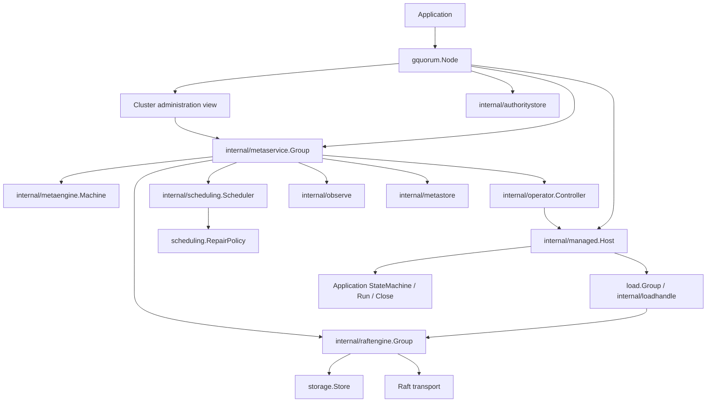

# Project map

Source baseline: `926a18b` (2026-10-15). Scope: all 41 Go package directories
outside `examples/`, including internal packages, generated protocols, caller
fixtures and tooling. This is a source navigation and contract index: interface
method lists are complete for the interfaces named below; concrete functions and
methods are selected entry points, with explanations concentrated on consequential
behavior. Generated accessors, mechanical adapters and ordinary helpers are omitted.
Paths are relative to this document. `ctx` means `context.Context`; brace lists
name separate methods, not Go syntax. `KB_*` tokens connect related records;
search this file for a token, then follow its source/test links.

## Structure and dependency direction

Module `github.com/asalimonov/gquorum`: Go 1.26.0, toolchain 1.26.5; etcd Raft
v3.6.0, bbolt, etcd WAL/snapshot, gRPC/protobuf. The root module contains the
library and adapters. [tests/cluster](../../tests/cluster/go.mod) is a separate
module for Docker infrastructure and its application fixture;
[scripts/revive](../../scripts/revive/go.mod) is a separate lint-tool module.
`examples/` contains additional independent modules and is outside this map.

Arrows show composition/call relationships, not exclusively Go imports.
`topology`, `storage`, `load`, `metrics`, `fault` and `events` provide shared
contracts. `membership` and `internal/votercheck` enforce safety beneath policy.
Each Node owns one `_meta` replica and zero or more independent load replicas;
ordinary load proposals/reads use their own group's quorum. `_meta` coordinates
admission, topology, authority, sessions and locks; it is not a load-command relay.
`KB_GROUP_BOUNDARY`: losing meta progress blocks administration and acquisition
of new authority; accepted healthy load owners can continue their own consensus.

| Area | Package directories / purpose |
| --- | --- |
| Public composition | Root `gquorum`: Node lifetime and Cluster view |
| Declarations and application contracts | `topology`, `load`, `storage`, `membership`, `scheduling`, `lifecycle` |
| Public infrastructure | `events`, `fault`, `metrics`, `util`, `storage/{walstore,memstore}`, `transport/loadgrpc` |
| Caller contract checks | `storage/storagetest`, `scheduling/schedulingtest`, `lifecycle/lifecycletest` |
| Ownership and control | `internal/{managed,loadhandle,metaservice,metaengine,metastore,authoritystore,operator,scheduling}` |
| Consensus and observation | `internal/{raftengine,raftstate,raftlog,observe,metrics,votercheck,replicastate,watchstate,collection}` |
| Protocols | `internal/{metatransport,metapb}`, `transport/loadgrpc/internal/loadpb` |
| Process tests | `tests/cluster`, `tests/cluster/testapp`, `tests/cluster/testapp/loadpb` |
| Tooling | `scripts/revive`; Python runners in `scripts/`, root Makefile and `.githooks/` |

## Identity, authority and storage vocabulary

| Entity | Meaning and relationship |
| --- | --- |
| `topology.Identity` | `{ClusterID, NodeName, MemberID, InstanceID}`: participant identity; MemberID is its numeric `_meta` replica ID; InstanceID changes every process start. |
| `storage.Identity` | `{ClusterID, NodeName, GroupID, ReplicaID}`: durable exact local replica; excludes process incarnation. `load.ReplicaRef` contains only GroupID/ReplicaID and is resolved in the owning Node. |
| `metrics.ReplicaIdentity` / `load.Observation` | Add InstanceID and RunID to distinguish restarts and successive local engine runs; watch Revision and sample Sequence have only local meaning. |
| `topology.Document` / `ReadView` | One versioned declaration / atomic capture of Latest, Target, Active. Latest may be staged; Target is approved; Active is converged. A version alone is not permission to act. |
| `Plan`, `PlanVoterBase`, `Step`, `AuthorizedStep` | Immutable execution plan, retained voter-set bases, ordered operation, and exact `{OperatorID, Version, Attempt, StepSeq, Kind, GroupID, node/replica/transfer identities, voter digests}`. |
| `AuthorityKey`, `AuthorityGrant` | Key `{ClusterID, GroupID, Revision}` identifies immutable authority. Grant adds purpose, action/admission/request identity, sorted resources and exact targets `{NodeName, MemberID, ReplicaID}`. |
| `AuthorityResource` | Group resource is fenced through that group's Raft log; host resource names GroupID/NodeName and is fenced in the node-local authority database. |
| `FenceEvidence`, `EffectReceipt` | Fence proves installation of an authority boundary; receipt proves consumption of one exact effect. Group evidence carries AppliedIndex/AppliedTerm; host evidence carries LocalSequence. |
| `NativeState` | Quorum-confirmed local applied ConfState plus installed grant/receipt, used to validate actual membership against remaining plan; not interchangeable with cached GroupStatus. |
| `AuthorityStatus` | Operator revocation requested/complete flags and outstanding fence obligations. Operator supersession/terminal state does not imply resource revocation completion. |

`KB_IDENTITY`: names, MemberID, ReplicaID, InstanceID, RunID, document versions,
authority revisions and Raft indices are distinct namespaces. In particular,
authority Revision originates in `_meta`; it is not the affected load group's
applied index. IDs are allocated monotonically, deleted group IDs remain retired,
and stale handles/delivery reports never redirect to successors. Leader names in
cluster status are resolved through exact identities in the captured Active view;
an unresolved name remains empty while the observed numeric ID is preserved.

| Retained resource | Owner and role |
| --- | --- |
| `NodeOptions.StorageDir/_meta.bolt` | Node/metaservice: Raft entries, snapshot, applied membership, materialized metadata FSM, durable participant pin, serve override and load-replica ledger. |
| `NodeOptions.StorageDir/_authority.bolt` | Node/authoritystore: independent identity pin, acquisition marker, host fences and running/completed effects; survives replacement of `_meta.bolt`. |
| `walstore.Options.RootDir/<GroupID>/` | `identity.json`, `state.bolt`, `wal/`, `snap/`: load identity, applied hints, etcd log and complete engine snapshots. Quarantine creates retained retirement records. |
| Application resources | Acquired by GroupFactory; application Close releases a live instance; Retire verifies exact durable identity before destructive cleanup. These are separate callbacks. |
| Memory store | Node-owned volatile Raft state for `StorageMemory`; `_meta` and its durable ledger remain persistent. |

`KB_RETAINED_EVIDENCE`: authority storage must remain outside every load
retirement root, including resolved/symlinked paths. Missing retained authority,
pins or logs cannot be interpreted as fresh founding. Read-only inventory must
include unknown groups, partial acquisitions and quarantined data. See
[authority path checks](../../node_authority_path.go),
[freshness checks](../../node_authority.go) and
[storage inventory contract](../../storage/store_contract.go).

## Public packages

### Root `gquorum`

[Node](../../node.go), [Cluster](../../cluster.go),
[options](../../node_options.go), [lifecycle](../../node_lifecycle.go).
Unexported `node` composes meta, managed Host, storage, lifecycle runner and
watches; `clusterView` delegates administration through that same owner.

| Entry / entity | Role |
| --- | --- |
| `NewNode(NodeOptions) (Node, error)` | Validates and deep-copies settings; no I/O, listener acquisition, goroutines or application callbacks. `NodeOptions.Validate` uses the same resolution path. |
| `NodeOptions` | Identity/declaration/bootstrap/limits/placement plus Meta, Loads, Scheduling, Lifecycle, Metrics, Health, Events, Logger; explicit metadata StorageDir. |
| `MetaOptions`, `MetaNetworkOptions`, `MetaTiming` | Meta read/session/snapshot/network/consensus settings; caller supplies listener, credential, resolver and TLS policy. `DefaultMetaTiming` supplies defaults. |
| `LoadOptions`, `LoadStorageOptions`, `WALOptions` | Factory, retirement callback, transport, engine settings and injected Store or Node-owned WAL backend; class selects memory storage separately. |
| `GroupFactory(ctx, load.ReplicaSpec) (load.Application, error)` | Acquires exactly one approved application's machine and lifetime callbacks. `ReplicaSpec` includes exact durable identity, process identity, declaration and ApprovedVersion. |
| `RetireReplicaFunc(ctx, load.RetirementRequest) (load.RetirementResult, error)` | Application-side identity-checked retirement, also for resources whose live factory was never acquired. |
| `MutationOptions`, `MutationResult`, `GroupSpec`, `EnsureOptions`, `RetireOptions` | CAS expected version, actor/comment, preview/approval; returned document/operator/placement; complete group creation intent; idempotent-create provenance; explicit forced-retirement reason. |
| `NodeStatus`, `NodeObservation`, `ParkedLoad`, `LoadParkedError` | Local state/admission/replica health; coalesced observation; retained refused-start evidence and classified error. |
| `FoundingIDs`, `LoadStoredIdentity`, `StaticPeers.{Resolve,ResolveLoad,Founders}` | Deterministic founding IDs, read-only metadata pin lookup and fixed-roster routing/bootstrap. A fresh InstanceID is still required on retained restart. |

Complete `Node` interface method index:

| Concern | Methods |
| --- | --- |
| Lifetime | `Start(ctx) error`, `WaitReady(ctx) error`, `RequestStop()`, `Stop(ctx) error` |
| Local view | `Identity() topology.Identity`, `Status() NodeStatus`, `Watch(ctx) (<-chan NodeObservation,error)`, `Cluster() Cluster` |
| Replicas | `StartLoadGroup(ctx,load.ReplicaRef) (*load.Group,error)`, `LoadGroup(string) (*load.Group,bool)`, `LoadGroupIDs() []string`, `StopLoadGroup(ctx,load.ReplicaRef) error`, `ParkedLoads() map[string]ParkedLoad` |
| Authenticated ingress | `ReceiveLoadRaft(ctx,load.RaftBatch) error`, `ReadLoadReplica(ctx,load.ReplicaQuery) (load.ReplicaStatus,error)`, `ApplyLoadAction(ctx,load.ActionRequest) (load.ActionResult,error)`, `InstallLoadFence(ctx,load.FenceRequest) (load.FenceResult,error)`, `ReportLoadDelivery(ctx,load.DeliveryReport) error` |
| Sessions/serving | `ActivateSession(ctx) (topology.Session,error)`, `KeepAlive(ctx,string) error`, `DeactivateSession(ctx,string) error`, `OwnSessionLive() bool`, `ServeOverride() int`, `SetServeOverride(ctx,int) error` |
| Repair control | `SchedulingStatus() topology.SchedulingStatus`, `SetSchedulingEnabled(ctx,bool) error` |

Complete `Cluster` interface method index (parameter/result details in
[cluster.go](../../cluster.go); mutations generally take `MutationOptions` and
return `MutationResult`):

| Concern | Methods |
| --- | --- |
| Confirmed reads | `ReadBarrier`, `ReadTopology`, `ReadAuthority`, `WaitRevoked`, `ReadLockHolder` |
| Observations/configuration | `Rules`, `IsLeader`, `Status`, `HealthObservation`, `Metrics`, `MetricsHistory`, `ParkedJoins` |
| Documents | `Latest`, `Target`, `Active`, `Get`, `History`, `Watch` |
| Approval/execution | `Stage`, `Plan`, `PlanFor`, `Approve`, `Operator`, `WaitOperator` |
| Nodes | `AddNode`, `ReadmitNode`, `DrainNode`, `ActivateNode`, `ExcludeNode`, `ForceRetireNode` |
| Placement/roles | `SetPlacement`, `SetGroupPlacement`, `SetGroupVoterConfig`, `SetGroupHosting`, `SetReplicaPinnedLearner` |
| Groups | `CreateGroup`, `EnsureGroup`, `DeleteGroup`, `ChangeReplica`, `ReseatReplica`, `RollbackTo` |
| Leadership/locks | `TransferLeader`, `AcquireLock`, `LockHolder` |

`KB_OWNER`: Start's context owns Node lifetime; Start returns before quorum
readiness. WaitReady/StartLoadGroup caller cancellation only ends that wait.
Successful factories transfer Close ownership even when success arrives late;
failed factories own their partial cleanup. Teardown joins engine, application
Run and finite callbacks before Close; a failed/timed-out Close retains the slot
for serialized retry. RequestStop is callable inside callbacks; Stop can deadlock
when it joins the calling callback. Injected stores, load transport and event bus
are borrowed; selected WAL/memory stores are owned; the meta listener transfers
on service acquisition. See [managed release](../../internal/managed/replica.go)
and [ownership regressions](../../internal/managed/ownership_ports_func_test.go).

`KB_ENSURE`: [EnsureGroup](../../cluster_ensure.go) recognizes its own staged
creation using matching spec and provenance, retries CAS conflicts, approves
only matching owned intent and waits for Active. Different existing groups or
foreign staged intent return Conflict. Its result is an Active observation, not a
read barrier. Actor is required; unspecified optional spec fields are unconstrained,
while ID and Storage always match exactly. Preview and Approve cannot combine;
if staging succeeds but approval fails, preserve the returned staged version.
Rollback stages a new version; it
does not rewind IDs, retired history or already-applied resource effects.

### `topology`

[Declarations](../../topology/document.go), [groups](../../topology/groups.go),
[planning](../../topology/planner.go), [placement](../../topology/placement.go).
Pure domain values, validation, placement evaluation and plan construction; no
network probes, ownership acquisition or persistence. Default Limits are 3 nodes,
5 replicas per load group and 1024 pending authority records. VoterConfig is a
complete replicated value: begin with DefaultVoterConfig when overriding fields;
zero can be meaningful, and decoding never installs defaults into a nil config.

| Entity family | Responsibilities / selected methods and package functions |
| --- | --- |
| `Document`, `Node`, `Group`, `Replica` | Nodes carry type/state/labels; groups carry replicas, allocation cursor, storage class, optional placement/voter/hosting rules and descriptive labels. `Document.{Clone,Node,Group,MetaGroup,LoadGroups,MemberID,VotersOf,GroupPlacement,GroupBounds,Validate}`; `Group.AllocateReplicaID`, `Document.{AllocateMemberID,SetMemberID}`. |
| `Rules`, `Limits`, `PlacementRule`, `HostingRule` | Hard node/replica/authority capacities; placement voter bounds, allowed types and exact NodeSelector; all-eligible or explicit hosting. `Limits.{WithDefaults,Validate}`, `ValidateTransition`, `ValidateHostingCapacityFor`, `RequiredLoadHostsFor`, `SelectFoundingRoles`. |
| Placement reports | `PlacementInput`, `PreparedPlacement`, `PlacementReport`, `GroupPlacementReport`, `PlacementCandidate`, `PlacementIssue`, `PlacementError`: proposed hosts/roles, eligibility and actionable refusal detail. `PreparePlacement`, `ExplainPlacement`, `EvaluatePlacement`, `AffectedPlacementGroups`, `ValidatePlacementTransition`, `ValidateVoterPlacement`, `MatchNodeSelector`. |
| Labels | `Node.{GetLabels,SetLabels}`, `Group.{GetLabels,SetLabels}`, `ValidateLabels`, `ValidateSelector`, `NodeReserved`, `NodeLearnerOnly`. Get owns a non-nil copy; Set validates/copies a full replacement without staging or I/O. |
| Voters | `VoterConfig`, `VoterChange`, `ReplicaKey`, `LearnerPin`, `VoterSwitchState`, `RoleChangeRecord`, `VoterSets`; `DefaultVoterConfig`, `VoterSetDigest`, `ValidateVoterSetTransition`. Target voter seats are separate from hosted replica count. |
| Plans/operators | `Plan`, `PlanVoterBase`, `Step`, `AuthorizedStep`, `Operator`, `OperatorStatus`, `OperatorTransition`; `BuildPlan`, `BuildPlanPreferred`, `ValidatePlanShape`, `ValidatePlanGuardChain`, `AuthorizedStep.Matches`, `MakeOperatorID`, `ReadmissionCovers`, `ValidAdmissionSequence`, `ValidateMetaDrainSafety`. |
| Authority | `AuthorityGrant.{Validate,Clone,Equal}`, `FenceEvidence.Validate`, `EffectReceipt.{Validate,Clone}`, `AuthorityStatus.Clone`; structural verification, immutable copy boundaries and exact evidence matching. |
| Observations | `ReadView`, `GroupStatus`, `ClusterStatus`, `NodeStatus`, `HealthObservation`, `GroupHealthEvaluation`, `SchedulingStatus`, `Session`, `LockHolder`, `ParkedJoin`, `SelfRemovalStatus`; `EvaluateGroupHealth`, `EvaluateAllGroupHealth`, `EffectiveNodeState`, `QuorumOf`. Health conclusions do not establish consensus. |

Integration interfaces: `AddressResolver.Resolve(ctx,string) (string,error)`;
`HealthSource.Snapshot(ctx) (map[string]Health,error)`. The latter's string keys
are node names; `membership.HealthSource` instead supplies numeric per-group IDs.

`KB_ALIAS`: Document.Node/Group/MetaGroup return pointers into the receiver.
LoadGroups copies group values but nested maps/slices still alias; GroupPlacement
returns a shallow rule value. Clone the document before editing. Label methods
copy their maps, but direct writes to exported Labels follow normal Go aliasing.

`KB_PLACEMENT`: a non-nil group Placement replaces the entire document rule;
selectors are ANDed exact matches, with missing distinct from present-empty.
Group labels do not select hosts. `reserved=true` preserves exact prior approved
Target assignments, not staged-only assignments or fresh replacement IDs;
`learner-only=true` forbids voting including `_meta` without altering PinnedLearner.
DistinctVoterLabel requires unique nonempty voter domains; learners may share or
lack domains. `_meta` ignores load selectors/reservation. All-eligible means all
eligible hosts, never best-N or silent truncation. PreparePlacement owns copies,
reconciles affected assignments/roles and returns tentative IDs; the FSM validates
again at Stage/Approve. See [contract](placement.md),
[preparation](../../topology/placement_prepare.go),
[approval regressions](../../internal/metaengine/placement_approval_test.go).

### `load`

[Group](../../load/group.go), [application](../../load/application.go),
[machine](../../load/machine_contracts.go), [transport](../../load/transport.go).
Public facade over one exact replica; `Group` is backed by internal/loadhandle,
so it exposes consensus without raw lifecycle or membership mutation.

| Interface / callback | Complete method set / shape |
| --- | --- |
| `StateMachine` | `Apply(ctx,Command) (Result,error)`; `Snapshot(ctx) ([]byte,error)`; `Restore(ctx,[]byte) error` |
| Optional `QueryMachine` | `Query(ctx,[]byte) (Result,error)` |
| `Transport` | `SendRaft(ctx,RaftBatch) error`; `ReadReplica(ctx,ReplicaQuery) (ReplicaStatus,error)`; `ApplyAction(ctx,ActionRequest) (ActionResult,error)`; `InstallFence(ctx,FenceRequest) (FenceResult,error)` |
| `RaftTransport` (Standalone) | `Send(ctx,[]raftpb.Message) error` |
| `Application` callbacks | StateMachine; optional `Run(ctx,*Group) error`; `Close(ctx) error` after engine/Run join |

`Group` methods: `Identity`, `GroupID`, `ReplicaID`, `Propose`, `ReadBarrier`,
`Read`, `WaitReady`, `IsLeader`, `Status`, `ProposalStats`, `WALStall`, `Snapshot`,
`Error`, `Running`, `Metrics`, `MetricsHistory`, `Watch`, `RunWhileLeader`.
`Leadership` methods: `Term`, `Propose`, `Replicas`.
`NewStandalone(StandaloneOptions)` creates a separate owner with methods
`Group`, `Start`, `Stop`, `Step`, `ChangeMembership`, `TransferLeader`,
`ReportUnreachable`, `ReportSnapshot`; it borrows integration dependencies.

`Command={Index,Term,RequestID,Data}`, `Proposal={RequestID,Data}`,
`Result={Code,Data}`. `Peer` combines participant and durable replica identity;
RaftBatch/DeliveryReport preserve exact endpoints and DeliveryID. ReplicaQuery/
ReplicaStatus carry observed or confirmed native state and authority evidence.
ActionRequest/ActionResult bind exact grant, authorization and LocalTarget;
FenceRequest/FenceResult address a group or host resource separately.

`KB_APPLY`: machine Apply/Snapshot/Restore/Query are serialized. Apply errors
halt that replica; deterministic business refusal uses Result.Code. Query errors
fail only the read. Restore(nil) initializes empty application state; Snapshot
must return a complete nonempty representation. AppliedHint never permits
skipping restoration/replay. Propose returns after local application even when a
ready follower/learner forwards it. Cancellation is not rollback; the application
deduplicates RequestID across retries and snapshots. `ProposeRetry` resubmits the
supplied Proposal without copying Data or enforcing RequestID: keep its bytes
immutable and supply a stable nonempty request ID. Otherwise separate attempts
can receive different engine-generated correlation/request IDs.

`KB_LEADERSHIP`: Application.Run begins after replay, authorization and handle
publication; it lasts for the replica run, not a leader term. Nil completes it
without restart; unexpected failure holds the exact replica until explicit
StartLoadGroup. RunWhileLeader permits one supervisor, cancels on term loss and
joins the old callback before the next term; nil completes only that term's work.
Leadership.Propose is term-checked at engine admission and never forwards.
Leadership.Replicas is a sorted observation, not a quorum barrier. Neither leader
scope nor callback cancellation fences external side effects. See
[leadership](../../load/leadership.go),
[Run ownership tests](../../internal/managed/application_func_test.go).

`KB_RETIRE`: `RetirementRequest.Verify(storage.Identity)` checks the complete
structural proof, including host resource, target and reason-specific topology or
readmission tuple; Node separately verifies committed authority. After checking
the application's durable identity and finishing cleanup, return `request.Result()`
to echo the entire proof with Verified=true. Repeat verification when data is
already absent. Close does not authorize deletion; a bare Verified flag is
insufficient. See [proof implementation](../../load/retirement.go).

### `storage`, `storage/walstore`, `storage/memstore`

[storage.Store](../../storage/store_contract.go) is the engine persistence
contract; [RetirementStore](../../storage/retirement.go) is optional collection.
BindReplica precedes Ensure. Probe/HasState must be read-only and preserve
contradictory or partial evidence. `ReadyWrite` holds entries/HardState;
`Recovery` holds full snapshot, tail, HardState, AppliedHint/AppliedConfState;
`RetiredReplica` carries exact identity and opaque collection token.

| Interface | Complete method set |
| --- | --- |
| `Store` | `HasState(ctx) (bool,error)`; `BindReplica(ctx,Identity) error`; `Probe(ctx,string) (Probe,error)`; `Ensure(ctx,string) error`; `SaveReady(ctx,string,ReadyWrite) error`; `SaveApplied(ctx,string,uint64,raftpb.ConfState) error`; `SaveSnapshot(ctx,string,raftpb.Snapshot) error`; `Load(ctx,string) (Recovery,error)`; `Compact(ctx,string,uint64) error`; `Quarantine(ctx,string,uint64) (string,error)`; `Close() error` |
| `RetirementStore` | `Retired(ctx) ([]RetiredReplica,error)`; `Collect(ctx,RetiredReplica) error` |

- [walstore](../../storage/walstore/store.go): `Open(Options)` returns a Store
  implementing both interfaces plus `Stats`; identity pins, etcd WAL segments,
  snapshot markers and bbolt applied hints. `KB_WAL`: segment size is fixed
  process-wide by the first Open; conflicting later sizes fail. Snapshot/compact
  ordering preserves recovery coverage; cached markers avoid rescanning WAL on
  hot paths. Quarantine/Collect recheck exact identity and token.
  DisableFSync bypasses WAL/applied-state fsync, not snapshot/pin/directory sync;
  acknowledged writes then lack host-crash durability.
- [memstore](../../storage/memstore/store.go): `New(Options)` returns a
  concurrency-safe Store implementing both interfaces plus Stats, with copied
  in-memory state and exact-identity retirement. `KB_MEMORY`: a Node restart
  retains the meta ledger but loses this store. Managed recovery requests a fresh
  replica ID for a lost memory voter using Active-version CAS; it never starts an
  empty established voter. Lost learners and replicas restarted before joining
  are not automatically reseated. Reseating still needs the surviving group's quorum;
  majority loss has no force-new recovery. See
  [own reseating](../../internal/managed/reseat.go) and
  [process regression](../../tests/cluster/memory_storage_test.go).

### `membership`

[Coordinator](../../membership/coordinator.go),
[SafetyRules](../../membership/safety.go), [promotion](../../membership/promotion.go).
Serializes each group's membership changes and checks native membership/liveness;
it does not approve topology or replace Node ownership.

Interfaces: `RaftGroup` = `GroupID() string`, `IsLeader() bool`,
`Status() raft.Status`, `ProposeConfChangeV2(ctx,raftpb.ConfChangeV2) error`,
`TransferLeader(ctx,uint64) error`; `HealthSource` =
`Live(string) (map[uint64]bool,bool)` where bool distinguishes known from unknown.
Entries: `NewCoordinator`, `Coordinator.Apply`, `SafetyRules.Check`, `CaughtUp`,
`AddLearner`, `PromoteLearner`, `DemoteVoter`, `RemoveReplica`; SafetyRefusal retains
operation, reason, live voters/quorum, lag and health-known evidence.

`KB_MEMBERSHIP`: only one-change Auto ConfChangeV2 is supported; joint
configurations are rejected. Add learners before promotion; promotions require
leader-observed learner progress and lag <= `PromotionLagLimit` (1000).
Transfer leadership before removing/demoting the leader; prove post-change live
quorum. Adding a new learner is quorum-neutral. An outstanding configuration
entry can outlive its waiter or leader, so the engine checks unapplied log entries
as well as local pending requests before admitting another change.

### `scheduling`, `lifecycle` and contract helpers

| Package | Entities, interfaces and entry points |
| --- | --- |
| [scheduling](../../scheduling/scheduler.go) | `RepairPolicy.Schedule(ctx,ScheduleInput) (ScheduleDecision,error)`; ScheduleInput owns Active/Latest/Target, health/status/metrics, held identities and timing; `Clone` owns nested values. ScheduleDecision carries optional ScheduleAction and reason. `NewDefaultRepairPolicy(DefaultRepairOptions)` supplies Schedule; Options configures local driver settings. |
| [lifecycle](../../lifecycle/lifecycle.go) | `Hooks`: `Readiness(ctx,ReadinessInput) (ReadinessDecision,error)`, `Retention(ctx,RetentionInput) (RetentionDecision,error)`, `Removal(ctx,RemovalInput) (RemovalDecision,error)`. Inputs carry startup/health, retired resources or applied self-removal evidence; decisions select readiness, collection or removal handling. `NewDefaultHooks(DefaultOptions)` implements all three; Options selects gates/modes/timing. |
| [scheduling/schedulingtest](../../scheduling/schedulingtest/contracts.go) | `RepairPolicyCase`, `CheckRepairPolicy(t,factory,cases)`: reusable caller-policy contracts and repeatable owned-input checks. |
| [lifecycle/lifecycletest](../../lifecycle/lifecycletest/contracts.go) | `HooksCases`, ReadinessCase/RetentionCase/RemovalCase; `CheckHooks(t,factory,cases)` validates application hooks against supplied cases. |
| [storage/storagetest](../../storage/storagetest/conformance.go) | `Opener`, `Run(t,open)` exercises storage identity, persistence/recovery/copy contracts; `Entries`, `Snapshot` build fixtures. Suite placement depends on backend: memory units, disk functional tests. |

`KB_POLICY`: default repair considers `_meta` first and configured load groups
deterministically; converges voter counts, preserves healthy seats and replaces
failed voters with qualified stable learners. Nil VoterConfig retains legacy
missing-load-voter repair. It neither balances healthy groups nor approves foreign
staged intent. Policies return supported actions; the driver independently
refreshes/revalidates leadership, views, health, membership and holds before
replicated CAS. Repair and lifecycle callbacks have separate serialized runners;
deadline expiry reports a stall but never releases ownership before actual return.
Retention cannot bypass identity/assignment/token checks. Applied authorized
self-removal fences participation before optional Removal decisions; drain or
unapproved intent does not establish self-removal authority.

### `metrics`, `events`, `fault`, `util`

| Package | Entities / API / significant semantics |
| --- | --- |
| [metrics](../../metrics/types.go) | Public value schema: ReplicaIdentity, Stamp, Validity, ReplicaSample, ReplicaObservation, GroupObservation, ClusterSnapshot, PeerProgress, ReadQueue, Latency/Counters/Rates, Evidence, UnsignedValue/DurationValue, HistoryQuery/HistoryPage; Clone methods own mutable data and normalize JSON read shape. ScheduleInput.Clone instead preserves exact nil/unknown spellings. Distinguishes current/unknown/stale evidence from numerical zero; history uses SeriesID/After/Limit and returns Next/Truncated. |
| [events](../../events/bus.go) | `NewBus(BusOptions)`; Bus `{Publish,Subscribe,Dropped,Close}`. Event carries local diagnostic identity/type/payload; Delivery adds LostBefore. `OpenJournal(JournalOptions)`; Journal `{Append,List,Prune,Close}` with Filter/Query. `KB_OBSERVATION`: bounded Publish acceptance is not journal durability; queue/subscriber drops are explicit, journal append failures are logged. Bus.Close drains accepted work but caller separately closes Journal. No event replication through `_meta`. |
| [fault](../../fault/fault.go) | `Code`, `Error{Code,Message,Cause,ExpectedVersion,CurrentVersion}`; `New`, Error `{Error,Unwrap,Is}`, `Retryable`, generic `Retry`, RetryOptions. Protocol classifications survive transport; Conflict is local-only. Use errors.Is/As. Retry handles transient leadership/readiness/unavailable/overload/controller/deadline errors, not authorization/CAS refusal; retries do not undo uncertain writes. |
| [util](../../util/instance_id.go) | `NewInstanceID() string`: cryptographically random 16-byte hex process-incarnation ID, generated once per process start; not a durable member or request identifier. |

### `transport/loadgrpc` and its generated protocol

[Adapter](../../transport/loadgrpc/transport.go),
[stream implementation](../../transport/loadgrpc/stream.go),
[integration guide](../../transport/loadgrpc/README.md).
`Options` supplies full-identity Resolve, sender Authenticate, DialOptions and
bounded calls/connections/messages/timeouts. `New` does no I/O; construct transport,
pass it to NewNode, Bind once, Register on caller-owned gRPC server, serve before
Node.Start. Transport implements all four load.Transport methods plus
`Bind`, `Register`, `Close`.

`Ingress` complete interface: `Identity`, `ReceiveLoadRaft`, `ReadLoadReplica`,
`ApplyLoadAction`, `InstallLoadFence`, `ReportLoadDelivery`, with the same signatures
as Node. `SharedToken` implements `GetRequestMetadata`, `RequireTransportSecurity`
and `Authenticate`; `NewSharedToken` configures cluster-secret possession, while
certificate-bound sender authentication remains application policy.

`KB_DELIVERY`: Resolve sees the full destination identity on every operation;
retain historical cleanup routes. Non-snapshot batches use one ordered
bidirectional stream per exact sender/recipient replica pair: SendRaft success
means frames written, not remotely applied. Only refusals are replied to and
reported through ReportLoadDelivery. Stream failure reports the last delivery
unreachable; unary fallback handles peers without StreamRaft. Snapshot batches
use unary delivery with acceptance of every frame. Preserve endpoints/DeliveryID
through splitting and failure reports. Close transport after Node.Stop joins its
work, keeping the server available during teardown.

[transport/loadgrpc/internal/loadpb](../../transport/loadgrpc/internal/loadpb/load.proto)
defines Envelope/Reply/StreamRefusal and Load client/server interfaces with
`SendRaft`, `StreamRaft`, `ReadReplica`, `ApplyAction`, `InstallFence`.
This is adapter-private generated Go; edit `.proto`, run `make generate`.
It transports library consensus/control traffic, not application RPC.

## Internal packages

### `internal/managed` and `internal/loadhandle`

[Host](../../internal/managed/host.go), [replica lifecycle](../../internal/managed/replica.go),
[storage selection](../../internal/managed/stores.go),
[startup evidence](../../internal/managed/boot.go).
Host owns per-group replica reservations, exact holds, parked evidence, action/fence
workers, delivery correlation, observation reads, retirement and readmission.
Config injects typed functions for meta scope/grants/catalog/ledger/routing and
application/storage/transport dependencies; Host does not own the metadata FSM.

Selected Host methods: `New`, `Start`, `Quiesce`, `Fence`, `Stop`,
`FenceParticipation`, `FenceReadmission`, `StartReplica`, `StopReplica`,
`Lookup`, `IDs`, `Held`, `Parked`, `Snapshot`, `Wake`, `RecoverAssignments`,
`Effects`, `DispatchGrant`, `ApplyAction`, `InstallFence`, `InstallHostFence`,
`ReadNative`, `ObserveGroup`, `ReceiveRaft`, `ReadReplica`, `ReportDelivery`,
`LocalMetrics`, `MetricsReads`, `Readmit`, `CollectRetired`.
`Readmission.{Clone,Validate}` and `ReadmitMeta` coordinate exact meta replacement.

`KB_START_RESERVATION`: StartReplica reserves before callbacks; equal exact
starts share the same startup result. It reconciles meta authority floors before
the group operation gate, because a fence may need that gate to join an earlier
reservation. Then it checks local scope/ledger/storage, acquires factory, restores
engine, waits for replay and rechecks startup authorization before publishing.
A fence-only grant cannot create a fresh replica. StopReplica with explicit reason
installs an exact local hold, not deletion; only explicit matching start clears
the hold. See [authority ordering](../../internal/managed/authority.go),
[startup tests](../../internal/managed/authority_func_test.go).

`KB_RETIRE`: retirement orders exact proof/resource checks, owner join,
application cleanup acknowledgement, Raft quarantine and ledger forgetting.
Collection later rechecks retained record, ledger, live assignments, active
storage and retention decision. A successor or foreign store survives. Readmit
fences/joins old owners and verifies cleanup receipts before installing the granted
new member pin. [Retirement](../../internal/managed/retirement.go),
[readmission](../../internal/managed/readmission.go).

[internal/loadhandle](../../internal/loadhandle/handle.go): `Handle` stores
immutable storage.Identity and engine pointer; `New`, `Core`, `Identity` bridge
managed ownership and load's public type without exposing engine methods through
the public API. Old handles keep their original run after replacement.

### `internal/metaservice`

[Group](../../internal/metaservice/group.go), [options](../../internal/metaservice/options.go),
[RPC dispatch](../../internal/metaservice/rpc.go).
Service orchestration for `_meta`: bootstrap/retained open/join/readmission,
networking, document APIs, proposal forwarding, authority reconciliation, approved
operator execution, repair, health/metrics, sessions, local serving and watches.
It composes metaengine.Machine, raftengine.Group, metastore.Store,
metatransport.Transport, membership.Coordinator, operator.Controller and observers.

API mirrors Cluster documents/mutations/status/read operations; internal approval
entry is `Apply` (public Cluster.Approve delegates here). Root CreateGroup/
DeleteGroup map to CreateLoadGroup/DeleteLoadGroup. Additional seams:

| Methods / entity | Responsibility |
| --- | --- |
| `New`, `Start`, `WaitReady`, `Quiesce`, `FenceParticipation`, `RequestStop`, `Stop` | Acquire/serve/join meta lifetime; keep control-only authority handling alive after participation fencing. |
| `BeginEffect`, `ValidateGrant`, `ReadGrant`, `RecordFence`, `RecordEffect`, `EffectReceipts`, `ReconcileFences`, `ReadAuthorityFloors` | Replicated grant creation/evidence acceptance and resource fence progress. |
| `LoadAssignments`, `LoadReplicaScope`, `LoadCatalog`, `LookupLoadReplica`, `RecordLoadReplica`, `ForgetGrantedLoadReplica` | Managed Host's approved recovery and local-ledger boundaries. |
| `ResolveLoadPeer`, `ResolveAuthorityPeer`, `ValidateLoadNode`, `ValidateLoadPeer`, `ValidateAuthorityCourier` | Exact routing/authentication against current or retained authority, including cleanup destinations. |
| `Step`, `Call`, `InstallFence`, `ApplyMetaAction` | Authenticated wire dispatch and resource control. |
| `Activate`, `KeepAlive`, `Deactivate`, `AcquireLock`, `LockHolder`, `ReadLockHolder` | Replicated sessions/locks plus leader-local renewal/expiry management; TTL returned to callers is configured duration. |
| `Lifecycle`, `Readiness`, `LocalStatus`, `CachedStatus`, `Watch` | Local lifecycle, cached observations and document subscriptions. |

`KB_CONTROL_ONLY`: stopping participation is distinct from final service Stop.
Authorized self-removal stops consensus/application participation first, but
retained control routes remain available to finish fences/receipts. Delayed
predecessor cleanup cannot resolve through a successor's current address/identity.
Current status or credential possession is insufficient effect authority. See
[fences](../../internal/metaservice/authority_fences.go),
[control-only tests](../../internal/metaservice/control_store_func_test.go),
[node fencing](../../node_meta_authority.go).

### `internal/metaengine`

[Machine](../../internal/metaengine/machine.go), [FSM state](../../internal/metaengine/sm.go),
[proposal codec](../../internal/metaengine/codec.go).
Deterministic replicated metadata state: Latest/Target/Active/history, operators,
admissions, retired group IDs, allocation high-water marks, sessions/locks,
voter-switch history and authority grants/floors/revocations. `Machine` embeds
locked `topologySM` and implements raftengine.Machine, AppliedObserver and
QueryMachine. Proposals carry state-transition data rather than performing I/O to
remote hosts; ApplyResult encodes accepted/refused outcome and exact evidence.

Selected entries: `NewMachine`, `Encode`, `DecodeProposal`,
`Machine.{Apply,Snapshot,Restore,AfterApply,Query,SupportsQuery,Views,ValidateDesired,ValidateGrant,AuthorityGrant,AuthorityStatus,PendingFences,EffectReceipts,ReadmissionGrants,AuthorityFloorsForNode,WithLoadScope,WithGrantedLoadCleanup}`;
`ReplicaRepairDocument`, `VoterChangeDocument`, `ReadmissionDocument` construct
owned candidate edits. Promoted topologySM queries include Latest/Target/Active,
Get/History, Operator/OperatorRecord/CurrentOperator and RecoveryCatalog/LoadCatalog.

Private persistence interfaces: `statePersister.SaveState([]byte) error`;
optional `applicationPersister.SaveApplication(uint64,raftpb.ConfState,[]byte) error`.
`KB_APPLIED_BOUNDARY`: AfterApply atomically persists materialized state with
applied index/ConfState before OnApplied, outside the FSM lock, and before the
engine's Advance/messages. Startup authorization and self-removal consume that
durable boundary, not merely a staged document or in-memory callback result.

`KB_HISTORY`: pruning retains documents/catalog identities/authority needed by
interrupted preparation, retirement and revocation until proof completes. Snapshot
must retain the same obligations. Schema is currently metadata version 3;
`disk.go` deliberately keeps legacy execution-field vocabulary within supported
encodings. Reject unsupported retained formats unchanged; current code must never
regenerate immutable baselines to conceal incompatibility. See
[cleanup evidence tests](../../internal/metaengine/cleanup_evidence_test.go),
[physical baseline](../testing/api-baseline-physical.md).

### `internal/metastore` and `internal/authoritystore`

| Package | Entities / selected methods / contracts |
| --- | --- |
| [metastore](../../internal/metastore/store.go) | Store owns `_meta.bolt`; Adapter implements storage.Store for `_meta`. `Open`, `LoadIdentity`, `StoreIsFresh`, `PeekLocalLineage`, `LoadReplicaRecords`; Store `{EnsureIdentity,VerifyIdentity,SaveReady,SaveSnapshot,InstallSnapshot,LoadAll,SaveState,LoadState,SaveApplication,SetApplied,AppliedConfState,RecordReplicaCAS,LookupReplica,ForgetReplica,SaveOverride,LoadOverride,Close}`. ReplicaRecord/ReplicaLookup track exact load acquisition; IdentityLookup and AppliedMembership distinguish absent from zero-valued evidence. SaveApplication binds FSM bytes/index/ConfState in one transaction. |
| [authoritystore](../../internal/authoritystore/store.go) | Independent bbolt Store with Freshness=`FreshEvidence` or `RetainedEvidence`; `Open`, `LoadIdentity`; Store `{Identity,MetadataAcquired,MarkMetadataAcquired,Current,Fence,CompleteFence,BeginEffect,FinishEffect,FenceEffect,Running,Receipt,MetaParticipationStopped,CompletedMetaStop,VerifyRebind,Rebind,Close}`. FenceRecord retains current grant and completion; EffectRecord/EffectLookup/ReceiptLookup distinguish running work, durable receipt and absence. |

`KB_FENCE_COMPLETION`: authoritystore.Fence persists the admission floor before
canceling/joining old work; CompleteFence records completion only after old owners
return. Persisted intent survives a crash but is not completion evidence.
BeginEffect/FinishEffect provide idempotent host-effect consumption; exact structural
grant equality is required on replay. Rebind needs granted readmission evidence;
it cannot be inferred from a new process InstanceID. See
[fences](../../internal/authoritystore/fences.go),
[effects](../../internal/authoritystore/effects.go),
[rebind](../../internal/authoritystore/rebind.go).

### `internal/operator`

[Controller](../../internal/operator/controller.go),
[effects contracts](../../internal/operator/contracts.go),
[coordinators](../../internal/operator/coordinator_contracts.go).
Leader-owned approved-plan executor; Record retains ID/version/attempt, immutable
steps/voter bases, grants/receipts and progress. Config injects topology store,
coordinators and group effects. Topology alias files preserve domain value identity.

| Interface | Complete method set |
| --- | --- |
| `Store` | `Target(ctx) (Document,error)`; `Active(ctx) (Document,error)` |
| `Coordinator` | `IsMetaLeader() bool`; `CurrentOperator(ctx) (Record,bool)`; `RecordOperatorTransition(ctx,Transition) error` |
| `AuthorityCoordinator` | `BeginEffect(ctx,topology.AuthorizedStep) (topology.AuthorityGrant,error)`; `ReconcileFences(ctx) error`; `EffectReceipts(ctx,topology.AuthorityGrant) ([]topology.EffectReceipt,error)`; `RecordEffect(ctx,topology.EffectReceipt) error` |
| `MembershipCoordinator` | `Apply(ctx,topology.AuthorityGrant) ([]topology.EffectReceipt,error)`; `CaughtUp(GroupStatus,uint64) bool` |
| `GroupEffects` | `Status(ctx,string) (GroupStatus,error)`; `ReadNative(ctx,string,...storage.Identity) (topology.NativeState,error)`; each of `CreateGroup`, `PrepareReplica`, `ApplyMembership`, `TransferLeader`, `StopReplica`, `CleanupReplicaState`, `DeleteGroupState` takes `(ctx,topology.AuthorityGrant)` and returns `([]topology.EffectReceipt,error)` |

Entries: `New`; Controller `{Start,Stop,Signal,Tick,SetFinalValidator}`;
`FromPublic`, `IDFor`, `NewFixedMembershipCoordinator`, `ValidateRemainingPlan`.
`KB_RECEIPT`: success requires exact durable receipts plus observed native result;
nil RPC error or a refusal is not completion. Tick reconciles resource fences,
validates remaining plan against native membership, obtains exact grants, executes
steps, records evidence and only then advances/activates. TransferStarted receipts
prove initiation; leadership must still be observed as required. Retained cleanup
may address identities absent from current desired topology. See
[remaining-plan validation](../../internal/operator/remaining_plan.go),
[verification regressions](../../internal/operator/verification_func_test.go).

### `internal/scheduling` and `internal/votercheck`

[Scheduler](../../internal/scheduling/driver.go) owns repair loop/gate, callback
lifetime, cooldown/stability state and diagnostic transitions. `New`; Scheduler
`{Start,Stop,Status,SetEnabled,Enabled,Tick,Wake}`. Config provides policy, Host,
held identities and transition callback; RepairCommit binds approval to observed
versions/operator state rather than unconditionally approving latest intent.

Host interface complete method list:
`Views`, `CurrentOperator`, `IsLeader`, `Health`, `GlobalStatus`, `PlanFor`,
`Approve`, `CommitRepair`, `RefreshObservations`, `ResetObservations`,
`Observations`, `VoterSwitches`, `CommitVoterChange`, `WakeOperator`.
Exact signatures are in [contracts.go](../../internal/scheduling/contracts.go).
`KB_POLICY`: callback return is a proposal for revalidation, not permission;
overdue calls keep the gate and status becomes policy_stalled. Leadership/enablement
changes reset relevant observation continuity.

[internal/votercheck](../../internal/votercheck/check.go) shares pure safety
predicates between default policy and validating driver: `Input` combines Active,
metrics, native status and holds; `Group` returns usable observation/blocker,
`ReplacementFailure` interprets configured failure evidence, `Check` returns a
refusal reason for a proposed VoterChange. It checks exact candidates, freshness,
pins, placement/domain constraints, catch-up, quorum and cooldown; independent
engine membership guards remain required.

### `internal/raftengine`

[Group](../../internal/raftengine/group.go), [loop](../../internal/raftengine/loop.go),
[writer](../../internal/raftengine/writer.go), [outbound](../../internal/raftengine/outbound.go).
Shared `_meta`/load RawNode owner: replay/startup, admission, proposals/results,
safe reads, configuration entries, grant fencing, snapshots, bounded persistence
and destination workers, local observations/metrics and leader scopes.

| Interface | Complete method set |
| --- | --- |
| `Machine` | `Apply(ctx,Command) (Result,error)`; `Snapshot(ctx) ([]byte,error)`; `Restore(ctx,[]byte) error` |
| `AppliedObserver` | `AfterApply(ctx,uint64,uint64,raftpb.ConfState) error` |
| `QueryMachine` | `SupportsQuery() bool`; `Query(ctx,[]byte) (Result,error)` |
| `Transport` | `Send(ctx,[]raftpb.Message) error` |

`Options` supplies exact identity/Mode, peers/founding learners, machine/store/
transport, Timing, ReadOptions, metrics, bounds and ManagedAuthority.
`New`, `NewContext`, `NewMeta` construct engines; Group entry families:
`{Start,WaitReady,RequestStop,Stop,Fail}`, `{Propose,ProposeInTerm,ReadBarrier,Read,ReadControl}`,
`{Step,StepBatch,Snapshot,ProposeConfChange,TransferLeader,Membership}`,
`{InstallAuthority,AuthorityReceipt,ObserveAuthorizedEffect,TransferAuthorized,ProposeAuthorizedConfChange,ReadNative}`,
`{AcquireLeadershipSupervisor,LeadershipState,LeaderProgress,PeerName,Watch,Metrics,MetricsHistory}`,
`{ReportUnreachable,ReportSnapshot,RaftStatus,Status,ProposalStats,WALStall}`.
Registry `{Add,Get,Remove,IDs}` enforces exact local group ownership.

`KB_READY_ORDER`: a Ready batch is owned/copied, persisted by the writer, restored/
applied, materialized through AfterApply, then sent and Advanced; membership view
is refreshed before send routing. Snapshots wrap application state and authority.
Recovery validates a contiguous log, terms, commit/snapshot bounds and membership;
it always restores/replays committed application state. Machines run on the owner
loop; a slow callback still stalls that replica despite asynchronous WAL/sends.
`WALWriteWait` batches nearby Ready work without weakening fsync. Default proposal
slots=256, uncommitted bound=64 MiB, apply batch=1 MiB; WAL stalls over one second
refuse new proposals as overloaded. Queues are bounded per destination and send
workers join at Stop.

`KB_READ_COHORT`: ReadIndex confirmation is followed by local applied-index
waiting; Query then runs on the serialized machine loop. The active cohort freezes
before issuing ReadIndex, so a later request cannot borrow an earlier barrier.
Contexts include a process nonce, sequence and source replica; term/leader/role
changes fail pending rounds. At most one remote round per source is admitted before
current-term commit, bounding upstream Raft's pending read queue. Followers retry
the same read context after lost replies. Cancellation never detaches an active
Query callback. ReadBarrier works without QueryMachine; Read does not. See
[reads](../../internal/raftengine/reads.go),
[read regressions](../../internal/raftengine/reads_func_test.go).

`KB_MEMBERSHIP`: managed engines reject raw membership control; granted changes
validate expected ConfState/voter digests at admission/apply. Cancellation does
not free an unapplied configuration-change slot. When removing a peer, the leader
queues a bounded prefix-checked final append carrying the committed removal,
because Raft stops ordinary replication to the removed peer; delivery remains
best effort and cannot synthesize missing log history.

### `internal/raftstate`, `internal/replicastate`, `internal/watchstate`, `internal/raftlog`, `internal/collection`

| Package | Compact map |
| --- | --- |
| [raftstate](../../internal/raftstate/snapshot.go) | Engine-neutral encoding for administrative/application Entry and complete Snapshot; AuthorityState retains installed grant, receipt and transfer evidence. `EncodeEntry`, `DecodeEntry`, `Entry.Validate`, `EncodeSnapshot`, `DecodeSnapshot`, `DecodeRaftSnapshot`, `ValidateAuthority`. Current schema=2; raw legacy application snapshots are rejected. Snapshot envelope identity is cluster/group so it can transfer between replicas; authority indices are checked against snapshot's local applied boundary. `KB_IDENTITY`, `KB_HISTORY`. |
| [replicastate](../../internal/replicastate/state.go) | Process-local State enum and Observation shared by engine and load facade: exact identity/run, revision, readiness, term/leader/voter, AppliedIndex and fault. Applied entries or snapshot advance Revision. No persisted/replicated encoding. |
| [watchstate](../../internal/watchstate/latest.go) | Generic Latest[T]; `New`, `Subscribe`, `Publish`, `Finish`, `Join`. One buffered owned latest value per subscriber; atomic registration+seed, bounded subscription workers, terminal value retained after Finish, actual cancellation workers joined. Slow readers lose intermediate revisions. Clone runs under the publisher lock and must not reenter it. `KB_OBSERVATION`. |
| [raftlog](../../internal/raftlog/logger.go) | Logger adapts slog to upstream Raft's `Debug/Debugf`, `Info/Infof`, `Warning/Warningf`, `Error/Errorf`, `Fatal/Fatalf`, `Panic/Panicf`; fatal calls panic to expose invariant failure. |
| [collection](../../internal/collection/slice.go) | `Slice[T](capacity)` returns nil at zero capacity, allocated empty slice otherwise; preserves intentional nil/empty encodings in callers. |

### `internal/observe` and `internal/metrics`

[Health watch](../../internal/observe/watch.go),
[metrics collection](../../internal/observe/metrics.go),
[condition windows](../../internal/observe/windows.go),
[read pool](../../internal/observe/pool.go).
Watch owns bounded health rounds; MetricsCollector collects replica samples and
builds scheduler evidence, cluster snapshots and history. ReadPool bounds callback
parallelism and exact-source overlap; Round/Probe/GroupSamples describe collection
results; LeaderEpoch and EvidenceScope fence temporal conclusions.

Interfaces: `Source` = `Active(ctx) (topology.Document,error)`,
`Health(ctx,topology.Document) (map[string]topology.Health,error)`;
`MetricsSource` = `Active(ctx) (topology.Document,error)`,
`Epoch() (LeaderEpoch,bool)`, `Collect(ctx,topology.Document,*ReadPool) (Round,error)`.
Entries: `New`, Watch `{Start,Wake,Stop,Snapshot,Refresh}`;
`NewMetricsCollector`, MetricsCollector `{Start,Stop,Refresh,Revalidate,Snapshot,History,ResetDecisions}`;
`NewReadPool`, ReadPool `{Do,DoKey,Stop}`, `CollectReads`;
ConditionWindow `{Reset,Observe,Duration}`.

`KB_EVIDENCE_WINDOW`: elapsed wall time does not extend failure/standby proof.
Continuity requires fresh advancing source generations in an unchanged exact
replica/run, leader/term, membership, voter-config and scheduler epoch. Repeated,
stale or out-of-order samples cannot earn readiness time. Timeout of a pooled read
does not release its permit/key until callback return; collection cannot launch
overlapping replacements for a stuck source. Native-status and metrics collection
use separately bounded pools. See [window tests](../../internal/observe/windows_test.go),
[pool tests](../../internal/observe/pool_func_test.go).

[internal/metrics](../../internal/metrics/meter.go): `Meter`, `EWMA`, generic
`Ring[T]`, Settings/Options and PersistenceObservation implement local sampling,
latency/rates, bounded retention and aging. `NewMeter`; Meter
`{ObserveProposal,ObserveResult,ObservePersistence,ObserveApply,ObserveSendError,ObserveLeaderChange,Tick,Snapshot,History,Stop}`;
`NewEWMA`, EWMA `{Observe,Update,Snapshot}`; `NewRing`, Ring `{Roll,Snapshot}`;
`AgeObservation`, `UnknownEvidence`, `Age`, `AddDuration`. Public metrics package
contains the schema; this internal package owns measurement machinery.

### `internal/metatransport` and `internal/metapb`

[Transport](../../internal/metatransport/transport.go),
[server](../../internal/metatransport/server.go).
Included dedicated meta gRPC transport owns its acquired listener, server,
connections and send workers. `Options`, `New`; Transport
`{Start,Stop,Error,SetMemberID,Header,Prune,Send,CallAddress,SetPeerAddresses}`;
`Reply`, `ReplyError` preserve fault classes, CAS versions, membership refusals and
placement reports. Handler interface: `Step(ctx,*metapb.Header,raftpb.Message) error`;
`Call(ctx,string,*metapb.Header,[]byte) *metapb.Reply`.

`KB_WIRE_IDENTITY`: credential metadata is checked before dispatch; cluster/name/
member identity and message From/To are checked independently. Shared credential
is not unique cryptographic node identity; TLS/mTLS configuration is caller-owned.
Snapshot stream uses bounded 256 KiB chunks, consistent endpoints, explicit final
frame and EOF; malformed/partial streams cannot become installed snapshots.

[internal/metapb](../../internal/metapb/meta.proto) defines Header, PeerAddress,
Reply, RaftMessage, SnapshotChunk, MetaRequest and generated MetaClient/MetaServer.
RPC method set: `StreamMessages`, `SendSnapshot`, `Join`, `JoinReady`, `KeepAlive`,
`IdentityPing`, `MetaStatus`, `MetaReplicaMetrics`, `MetaControl`, `ProposeMeta`,
`ApplyVersion`, `ParkedRead`, `InstallFence`, `AuthorityRead`. Opaque request data
carries typed internal JSON commands; protobuf headers provide routing identity.
Generated `.pb.go` files follow pinned `make generate`, never hand edits.

## Cross-package execution paths

| Trigger | Path / non-obvious boundary |
| --- | --- |
| Start/recover a participant | `Node.Start` -> retained authority/meta inventory -> `metaservice.Start` -> founding/join/recovery -> durable admission -> `managed.RecoverAssignments` -> exact startup reservation -> storage/factory/engine replay -> authorization -> publication/Run. `KB_RETAINED_EVIDENCE`, `KB_START_RESERVATION`. |
| Change topology | Cluster mutation/PreparePlacement -> expected-Latest CAS Stage -> Plan/Approve -> metaengine committed plan/grants -> operator -> managed/meta effects -> group/host receipts -> native verification -> Active. Staged intent never directly stops/creates replicas. `KB_PLACEMENT`, `KB_RECEIPT`. |
| Supersede an operator | metaengine records revocation obligations -> metaservice.ReconcileFences -> raftengine.InstallAuthority (group) or managed.InstallHostFence (host) -> durable evidence -> RecordFence -> ReadAuthority/WaitRevoked. Offline host or lost group quorum leaves obligations pending. `KB_FENCE_COMPLETION`. |
| Write application command | Group.Propose -> engine admission/correlation -> local leader or forwarded Raft proposal -> durable Ready -> local Apply -> result. Engine correlation routes a waiter; application RequestID supplies deduplication. `KB_APPLY`, `KB_READY_ORDER`. |
| Read application/topology | Group.Read / Cluster.ReadTopology -> own group's ReadIndex -> local apply catch-up -> serialized Query returning copied result. Status/Watch/Latest/LockHolder do not imply this path. `KB_READ_COHORT`, `KB_OBSERVATION`. |
| Repair voter seats | observe samples/windows -> scheduling policy -> internal scheduling refresh/revalidation -> metaengine CAS -> immutable operator plan -> native membership/placement guards -> receipts. No shortcut from health label to voting authority. `KB_EVIDENCE_WINDOW`, `KB_POLICY`, `KB_MEMBERSHIP`. |
| Stop/retire/readmit | Fence new admission -> cancel/join accepted work -> application Close; retirement additionally verifies grant/application identity, quarantines Raft and clears exact ledger; readmission then installs fresh IDs. Failed release blocks successors. `KB_OWNER`, `KB_RETIRE`. |

## Test packages and repository operations

| Package / path | Entities, entry points and scope |
| --- | --- |
| [tests/cluster](../../tests/cluster/cluster.go) | Docker harness: Spec/NodeSpec describe processes; Cluster/Node expose HTTP/status/mutation/data and lifecycle controls; Pool/Lease provide bounded isolated resources. `NewPool`, Pool `{Start,Acquire,RequestClose,Close}`, Lease.Release; Node `{Start,Stop,Kill,StartJoining,Endpoint,Logs}`; Cluster `{WaitReady,Request,Document,Status,Operator,WaitOperator,Mutate,WaitActive,Stage,Approve,CreateGroup,Put,Get,Read,WaitValue}` plus fault/snapshot/barrier/authority controls; `Poll` waits for observed conditions. Multi-node consensus, faults, recovery, scaling/performance; `clustertest` build tag. Pool release verifies container/volume cleanup before network reuse. |
| [tests/cluster/testapp](../../tests/cluster/testapp/README.md) | Package main, actual caller of public APIs: application owns Node, WAL store, listeners, load transport, event journal, HTTP adapter and fixture controls; `newApplication`, application `{Start,RequestClose,Close,newReplica,retireReplica}`. kvMachine `{Apply,Query,Snapshot,Restore}` stores values, dedup requests and applied index. fixtureStore/controlledStore and controlledMachine inject WAL/apply/query faults; projection loop exercises Application.Run; fixtureScheduler/lifecycle exercise callbacks. Authenticated hooks expose exact-replica barriers, resource counters, authority replay/fence and meta/load traffic faults. |
| [tests/cluster/testapp/loadpb](../../tests/cluster/testapp/load.proto) | Fixture-specific generated protocol: Header/Request/Frame/Reply; LoadClient/LoadServer methods `Deliver`, `Call`. Distinct from reusable transport/loadgrpc protocol; fixture retains fault interception and typed control operations. |
| [scripts/revive](../../scripts/revive/main.go) | Package main, separately pinned revive library wrapper. `run`, `collectFindings`, `packageFiles`, `groupFiles`, `filterFindings`, `outputFindings`; groups selected tagged files by directory to preserve package/type context and filters findings without editing code. |
| [scripts/test_report.py](../../scripts/test_report.py) | Go JSON/build runner; per-suite persistent package logs, JUnit, Markdown summary/timeline and raw events. Preserves failures/timeouts/interruptions; `latest` references completed run. |
| [scripts/lint.py](../../scripts/lint.py), [lint_staged.py](../../scripts/lint_staged.py), [.githooks/pre-commit](../../.githooks/pre-commit) | Vet/build-tag matrix, pinned golangci/revive/Staticcheck, merged unused analysis; staged lint reconstructs the Git index in a temporary tree and limits diagnostics to affected scope. |
| [docs/architecture](README.md), [docs/testing](../testing/tests.md), `docs/plans`, `docs/brainstorms` | Current contracts, test/validation records and historical design/implementation context. Plans may describe superseded APIs; no `docs/plans/completed/` directory at this baseline. |

`KB_TEST_BOUNDARY`: units (`!functional`) exercise isolated logic without
services/replicas/subprocesses; functional files (`functional`) own one participant,
engine or protocol double; multi-node scenarios live in Docker process tests.
Independent cases use t.Parallel with private roots/listeners and joined cleanup.
Root `go test ./...` misses nested modules. Existing baseline files under
`events/testdata`, `load/testdata/api-baseline`,
`internal/metaengine/testdata/api-baseline` are immutable provenance, not outputs
to regenerate with the implementation under test.

Useful [Makefile](../../Makefile) targets: `make test`, `make lint`,
`make test-race`, `make test-function`, `make test-function-race`;
`make test-cluster-build` then
`make test-cluster-run CLUSTER_ARGS='-v -run TestName'` for focused process work;
`make test-cluster` at the end of related changes; `make test-perf`, `make bench`;
`make generate`, `make proto-check`. Python tool regressions:
`python3 -m unittest discover -s scripts -p '*_test.py'`.
Documentation-only checks: source/API/path verification and `git diff --check`.
Reports: `test-reports/<suite>/latest/{report.md,timeline.md}` and package logs.

## Search routes for difficult failures

| Search token | First implementation / regression to inspect |
| --- | --- |
| `KB_START_RESERVATION` / handle visible too early | [managed/replica.go](../../internal/managed/replica.go), [application_func_test.go](../../internal/managed/application_func_test.go), [node publication tests](../../node_meta_authority_func_test.go) |
| `KB_OWNER` / Stop timeout or overlapping successor | [managed/host.go](../../internal/managed/host.go), [ownership_ports_func_test.go](../../internal/managed/ownership_ports_func_test.go), [lifecycle runner](../../node_lifecycle_hooks.go) |
| `KB_RETAINED_EVIDENCE` / missing authority or storage | [node_authority.go](../../node_authority.go), [node_retained_authority_func_test.go](../../node_retained_authority_func_test.go), [managed/boot.go](../../internal/managed/boot.go) |
| `KB_FENCE_COMPLETION` / superseded effect still running | [authoritystore/fences.go](../../internal/authoritystore/fences.go), [managed/authority_func_test.go](../../internal/managed/authority_func_test.go), [authority process tests](../../tests/cluster/authority_fencing_test.go) |
| `KB_RECEIPT` / operator falsely converged | [operator/receipts.go](../../internal/operator/receipts.go), [verification_func_test.go](../../internal/operator/verification_func_test.go), [metaengine/retirement_receipts_test.go](../../internal/metaengine/retirement_receipts_test.go) |
| `KB_RETIRE` / cleanup destroys newer resources | [managed/retirement.go](../../internal/managed/retirement.go), [retirement_func_test.go](../../internal/managed/retirement_func_test.go), [readmission_authority_func_test.go](../../internal/managed/readmission_authority_func_test.go) |
| `KB_HISTORY` / interrupted cleanup forgotten after restart | [metaengine/cleanup_evidence_test.go](../../internal/metaengine/cleanup_evidence_test.go), [raftstate/snapshot.go](../../internal/raftstate/snapshot.go) |
| `KB_READ_COHORT` / stale read, late apply, lost read reply | [raftengine/reads.go](../../internal/raftengine/reads.go), [reads_func_test.go](../../internal/raftengine/reads_func_test.go), [consistent_reads_test.go](../../tests/cluster/consistent_reads_test.go) |
| `KB_EVIDENCE_WINDOW` / stale sample qualifies promotion | [observe/windows.go](../../internal/observe/windows.go), [evidence tests](../../internal/observe/evidence_test.go), [votercheck/check.go](../../internal/votercheck/check.go) |
| `KB_PLACEMENT` / selector, reserved host or AZ conflict | [placement_prepare.go](../../topology/placement_prepare.go), [placement_approval_test.go](../../internal/metaengine/placement_approval_test.go), [placement process tests](../../tests/cluster/placement_test.go) |
| `KB_DELIVERY` / old stream failure affects replacement | [managed/transport.go](../../internal/managed/transport.go), [transport_func_test.go](../../internal/managed/transport_func_test.go), [loadgrpc/stream_func_test.go](../../transport/loadgrpc/stream_func_test.go) |
| `KB_MEMORY` / volatile replica returns empty with old ID | [managed/reseat.go](../../internal/managed/reseat.go), [reseat_func_test.go](../../internal/managed/reseat_func_test.go), [memory_storage_test.go](../../tests/cluster/memory_storage_test.go) |

Further contract detail: [library integration](library.md), [Raft](raft.md),
[ownership/recovery](runtime.md), [placement](placement.md),
[load transport multiplexing](load-transport-multiplexing.md).
