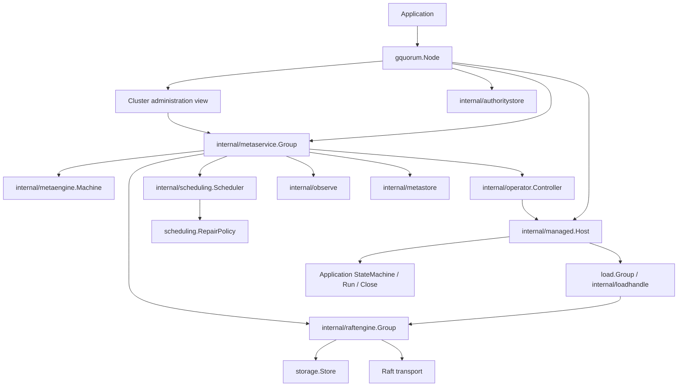

# Project map

How the repository is organized: modules, responsibility zones and the key
entities and interfaces each zone owns. Contracts and behavior live in the
[runtime overview](runtime.md), [Raft model](raft.md) and [placement](placement.md); test
commands live in the [testing guide](../testing/tests.md).

| Path | Responsibility |
| --- | --- |
| `node*.go`, `cluster*.go` | Public handles, settings, methods and lifecycle composition. |
| `topology/` | Documents, identities, placement, plans, operations, session/status values and validation. |
| `load/` | Explicit application types, Group, typed transport and Standalone owner. |
| `transport/loadgrpc/` | Optional public load gRPC adapter, bounded connections, authentication and internal wire protocol. |
| `scheduling/`, `lifecycle/` and their test-helper packages | Repair policies, lifecycle hooks, built-ins and caller contract helpers. |
| `storage/`, `storage/walstore/`, `storage/memstore/`, `storage/storagetest/` | Raft persistence/retirement contracts, etcd WAL backend, in-memory store and conformance helpers. |
| `events/`, `fault/`, `membership/` | Local events/journal, classified faults and advanced fixed safety helpers. |
| `internal/managed/`, `internal/loadhandle/` | Exact replica ownership, recovery, approved actions, retirement and opaque group representation. |
| `internal/metaservice/` | Private topology service, admission, documents, local ledger and protocol integration. |
| `internal/metaengine/`, `internal/metastore/` | Meta FSM and bbolt durable state. |
| `internal/authoritystore/` | Independent node-bound durable host floors, effect receipts and readmission rebind evidence. |
| `internal/metatransport/`, `internal/metapb/` | Included meta transport, protocol and generated code. |
| `internal/operator/`, `internal/scheduling/`, `internal/observe/` | Approved plan execution, scheduling driver and health observations. |
| `internal/raftengine/`, `internal/raftlog/` | Shared Raft loop, replay, persistence, queues, pressure and logging. |
| `examples/cluster/` | Separate Go module for the small meta-only HTTP/Compose demo, with Kong configuration and distinct cluster/HTTP files; `make run-example`. |
| `tests/cluster/` | Separate Go module for Docker correctness/fault/scale tests and the actual example smoke test. |
| `tests/cluster/testapp/` | Full application FSM, typed protocol adapter, application retirement and test-only fault controls; public Node integration tests. |
| `docs/architecture/`, `docs/testing/` | Current contracts, test commands, coverage and validation evidence. |

## Structure and dependency direction

Module `github.com/asalimonov/gquorum`: Go 1.26.0, toolchain 1.26.5; etcd Raft
v3.6.0, bbolt, etcd WAL/snapshot, gRPC/protobuf. The root module contains the
library and adapters. [tests/cluster](../../tests/cluster/go.mod) is a separate
module for Docker infrastructure and its application fixture;
[scripts/revive](../../scripts/revive/go.mod) is a separate lint-tool module.
`examples/` contains additional independent modules and is outside this map.

Arrows show composition/call relationships, not exclusively Go imports.
`topology`, `storage`, `load`, `metrics`, `fault` and `events` provide shared
contracts. `membership` and `internal/votercheck` enforce safety beneath policy.

| Area | Package directories / purpose |
| --- | --- |
| Public composition | Root `gquorum`: Node lifetime, Cluster view and local Recovery handle; package `recovery`: plain values |
| Declarations and application contracts | `topology`, `load`, `storage`, `membership`, `scheduling`, `lifecycle` |
| Public infrastructure | `events`, `fault`, `metrics`, `util`, `storage/{walstore,memstore}`, `transport/loadgrpc` |
| Caller contract checks | `storage/storagetest`, `scheduling/schedulingtest`, `lifecycle/lifecycletest` |
| Ownership and control | `internal/{managed,loadhandle,metaservice,metaengine,metastore,authoritystore,operator,scheduling}` |
| Consensus and observation | `internal/{raftengine,raftstate,raftlog,observe,metrics,votercheck,replicastate,watchstate,collection}` |
| Protocols | `internal/{metatransport,metapb}`, `transport/loadgrpc/internal/loadpb` |
| Process tests | `tests/cluster`, `tests/cluster/testapp`, `tests/cluster/testapp/loadpb` |
| Tooling | `scripts/revive`; Python runners in `scripts/`, root Makefile and `.githooks/` |

## Responsibility zones

| Zone | Packages | Responsibility |
| --- | --- | --- |
| Public composition | root `gquorum` (`node*.go`, `cluster*.go`) | Node lifetime, Cluster administration, recovery entry points, option validation. |
| Domain model | `topology` | Documents, identities, placement, plans, operations, authority values, status. Pure values and validation; no I/O. |
| Application contracts | `load`, `load/snapshot` | State machine, transport, replica handle, leadership scope, standalone engine, snapshot transfer service. |
| Persistence contracts | `storage`, `storage/walstore`, `storage/memstore` | Raft store and retirement contracts; WAL and in-memory backends. |
| Decision hooks | `scheduling`, `lifecycle`, `membership` | Repair policy, local lifecycle hooks, membership-change safety rules. |
| Shared infrastructure | `fault`, `events`, `metrics`, `util`, `recovery` | Classified errors and retry, local event bus/journal, metrics schema, instance IDs, recovery values. |
| Optional adapters | `transport/loadgrpc` | Multiplexed load gRPC transport with authentication hooks. |
| Caller test helpers | `storage/storagetest`, `scheduling/schedulingtest`, `lifecycle/lifecycletest` | Conformance checks for caller implementations. |
| Metadata control plane | `internal/metaservice`, `internal/metaengine`, `internal/metastore`, `internal/metatransport`, `internal/metapb` | `_meta` service, replicated FSM, bbolt persistence, gRPC protocol. |
| Execution and repair | `internal/operator`, `internal/scheduling`, `internal/votercheck`, `internal/observe` | Approved plan execution, repair driver, voter safety predicates, health and metrics observation. |
| Replica ownership | `internal/managed`, `internal/loadhandle`, `internal/authoritystore`, `internal/loadsnapshot` | Exact replica startup/stop/retirement, host fences and receipts, snapshot transfer coordination. |
| Consensus engine | `internal/raftengine`, `internal/raftstate`, `internal/raftlog`, `internal/walbackend` | Shared RawNode loop, entry/snapshot encoding, logging, WAL implementation. |
| Recovery | `internal/recovery/...` | Offline permanent-majority-loss inspection, approval, archive and startup consumption. |
| Small internals | `internal/metrics`, `internal/replicastate`, `internal/watchstate`, `internal/collection` | Local measurement, observation state, watch fan-out, slice helpers. |
