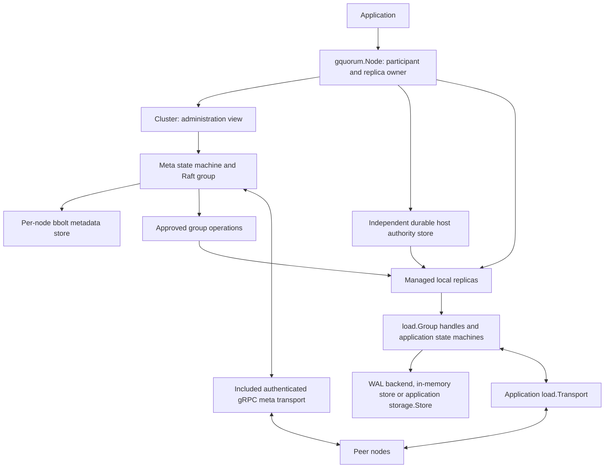

# Raft in gquorum

How gquorum uses Raft consensus, which state it replicates, and how elections,
transport, persistence and recovery fit together. This document describes the
current implementation; the [library guide](library.md) covers public integration
and the [runtime guide](runtime.md) covers ownership and recovery authorization.

gquorum uses `go.etcd.io/raft/v3` for two kinds of consensus group: one `_meta`
group for cluster coordination, and independent application groups called
**load groups**. The library provides the Raft runtime and manages replicas;
applications decide which business commands and state belong in load groups.
Raft orders replicated decisions. It does not make arbitrary application I/O,
external stores or local observations part of a distributed transaction.

## 1. Scope: what uses Raft and what does not

| Concern | Mechanism | Reason and boundary |
| --- | --- | --- |
| Cluster topology, placement and membership intent | `_meta` Raft state machine | Participants need a common approved description of groups and their exact replicas. |
| Approved operator plans, transitions and activation | `_meta` Raft state machine | Startup, membership changes and retirement require replicated authorization. |
| Session grants/revocation and distributed lock ownership | `_meta` Raft state machine | Coordinate ownership across participants; session lease renewals use a separate leader-local mechanism. |
| Application commands and state | One Raft state machine per load group | Applications choose the invariants that need an ordered, durable command stream. |
| Health, status, readiness and event subscriptions | Local observations, probes and callbacks | Useful diagnostics and decision inputs; they are not consensus read barriers. |
| Actual replica resources and local stop holds | Local ownership and storage, constrained by approved topology | Replicated intent authorizes effects; it does not replace physical resource management. |
| Infrastructure provisioning, stream ingestion and external side effects | Application-defined mechanisms | These responsibilities remain outside the library's consensus implementation. |

The consensus domains are independent: each group has its own leader, term,
membership, log, snapshots and run loop. `_meta` is not an extra consensus hop
on every load proposal. Existing load groups do not need a new topology approval
for each command, but admission, reassignment and repair depend on `_meta`.
Independent logs do not imply complete failure isolation: groups can share CPU,
disks, networks, application dependencies and Node lifecycle decisions.

## 2. The consistency target

Within a group, commands become committed through Raft's voter quorum and are
applied in log order. With a stable configuration of `N` voters, the quorum is
`floor(N/2) + 1`; learners replicate state but do not vote. Three voters can
continue with one unavailable voter; five can continue with two. A single-voter
group provides ordering and local durability but no redundant copy.

For `_meta`, the central invariant is that effects follow the same approved
topology and exact replica identities. `Latest` is staged intent, `Target` is
approved intent. Durable group/node checkpoints record independent convergence;
`FullyConverged` is only the historical last complete topology marker. A committed
edit to Latest alone does not authorize startup or retirement. Immutable operation
blocks authorize exact effects and converge independently, subject to explicit
admission/evacuation dependencies. Deferred physical cleanup does not hold that
marker. Neither checkpoint nor marker proves current native quorum.

For application groups, `load.Group.Propose` may be called on a ready local
leader, follower or learner. A follower or learner forwards the command through
native Raft messages to the group's leader. The command must first commit through
the group's voter quorum. The call then returns its result after the exact
replica where it was submitted has applied the committed command; other replicas
may still be catching up. Learners do not contribute votes toward commitment.

Topology edits and approvals require commitment through the `_meta` voter quorum.
Adding, promoting, demoting or removing a replica also requires a configuration
change to commit in the affected Raft group. Its leader submits that change;
leader-only processing does not allow topology or membership to change without
quorum. Initiating leadership transfer does not append a membership change, but
the successor still needs the group's election quorum to become leader.

A timeout or cancellation can leave the caller uncertain whether its command
committed; applications must handle retries with that possibility in mind.
When a node has no local replica of the requested load group, the application
must route the request to a node that hosts one.

This command ordering does not make `Cluster.Status`, ordinary document reads,
`LockHolder`, or raw replica status linearizable. `ReadBarrier` confirms a fresh
ReadIndex and waits for local apply; `load.Group.Read` then runs the optional
application query serialized with Apply and Restore. `ReadTopology` and
`ReadLockHolder` provide authoritative metadata reads. The private native read
captures applied membership on the same Raft owner after the barrier, without
using an application's query or the diagnostic status cache. These are
point-in-time reads, not permission for later effects or an atomic read-modify-
write operation. There is no transaction across `_meta` and a load group, or
across two load groups.

## 3. High-level architecture

`Node` owns the participant and its managed replicas. `Cluster` is an
administration view, and a `load.Group` handle refers to one exact local replica;
neither has an independent lifecycle. Applications supply load state machines,
their protocol and storage configuration. `load.NewStandalone` is an explicit
alternative with independent lifecycle and caller-owned membership authority.

All admitted node types participate in `_meta`; placement selects which nodes
host each load group. Nodes need not host every application group. Leadership
is per group, so one possible three-node layout is:

| Node | `_meta` | `orders` | `jobs` |
| --- | --- | --- | --- |
| node1 | Leader | Follower | Follower |
| node2 | Follower | Leader | Follower |
| node3 | Follower | Follower | Leader |

Node labels can restrict load hosting through exact selectors. A reserved node
keeps its approved exact load replicas but takes no new ones; a learner-only
node still hosts `_meta` while being barred from voting there and in load
groups. A group's distinct-voter label can require one voter per nonempty AZ
value. Approved plans guard both the final assignment and intermediate native
voter sets; infeasible transitions report why they cannot proceed. See
[labels and placement](placement.md).

Additional groups can distribute leadership and independent workloads. The
library does not automatically shard business data or balance healthy groups,
and adding groups does not guarantee proportional throughput on shared hardware.

## 4. Identity, elections and heartbeat traffic

`NodeName` is the stable logical node name. `InstanceID` is fresh for each process
run and fences stale process messages. `_meta` uses a positive numeric
`MemberID` as its Raft ID; each load group uses positive numeric `ReplicaID`
values. A Raft ID identifies a member of one group, not a globally named host.
These identities are checked at storage and transport boundaries.

Every replica advances an etcd `RawNode` through periodic ticks. Leaders send
`MsgHeartbeat`; followers send `MsgHeartbeatResp`. Heartbeats maintain leader
contact and feed quorum activity. Without leader contact, eligible voters can
campaign after a randomized election timeout. The shared engine explicitly sets
`PreVote: true` and `CheckQuorum: true`: pre-votes reduce disruptive term changes
from isolated replicas, and a leader without recent quorum activity steps down.
Neither setting can make a minority commit commands.

The default tick interval is 100 ms, with one heartbeat tick and ten election
ticks. That gives a nominal 100 ms heartbeat interval and a 1 s election base;
election randomization and scheduling/network delays affect actual failover.
Meta timing is configured through `NodeOptions.Meta.Timing`; load timing through
`NodeOptions.Loads.Engine.Timing`.

Raft traffic, health probes and session renewals serve different purposes:

| Purpose | Meta protobuf method | Behavior |
| --- | --- | --- |
| Raft replication, votes and heartbeats | `Meta.StreamMessages` | Carries serialized `raftpb.Message` values in `RaftMessage.raft_message`, including both heartbeat directions. |
| Snapshot catch-up | `Meta.SendSnapshot` | Streams snapshot chunks with their Raft message metadata. |
| Node health and exact-process checks | `Meta.IdentityPing` | Returns identity for liveness probes; session-expiry checks also verify the process InstanceID. |
| Session renewal | `Meta.KeepAlive` | Renews an exact process session at the meta leader; this is separate from Raft election heartbeats. |
| Consensus status query | `Meta.MetaStatus` | Retrieves meta status and health information; it is a diagnostic query. |

The meta sender drains already queued messages into bounded batches and sends
consecutive non-snapshot messages through one `StreamMessages` RPC. It does not
wait to fill a batch. This avoids a round trip per message overwhelming the
sender when RTT exceeds the heartbeat interval. Snapshots retain their ordered,
separate chunked RPC and completion acknowledgement. A later batch failure does
not invalidate an already acknowledged snapshot. The stream's `Reply`
acknowledges transport handling; `MsgHeartbeatResp` remains a separate Raft
message sent in the reverse direction. There is no dedicated Heartbeat RPC.

Load groups send the same Raft message types through `load.Transport.SendRaft`
and receive them through `Node.ReceiveLoadRaft`. The application chooses the wire
schema and authenticates senders. The included `loadgrpc` adapter streams
non-snapshot batches per replica pair without waiting for each to be stepped,
and keeps snapshots on unary calls with explicit completion reports. Its version-2
`RaftFrame` uses generated protobuf headers and native binary `raftpb.Message`
bytes. It validates/authenticates each frame before native decoding and current
Node authorization; application payloads remain opaque. Complete frames obey the
configured byte limit and a 4,096-message bound. Full local preflight precedes any
send, and snapshot completion requires all unary frames to be accepted.
Administrative requests and unary replies retain their JSON codecs. There is no
JSON Raft fallback or missing-stream downgrade: all adapter users must upgrade
together, preserving existing storage. See [binary transport validation](../testing/binary-raft-transport.md).
The test application's `Load.Deliver` RPC is an example protocol, not a library
requirement.

The default node-health sampler runs every five seconds. It uses the configured
`HealthSource`, or probes meta members with IdentityPing. Own-session renewal is
attempted around one third of its TTL; the default TTL is 15 seconds. When a
session deadline expires, the leader checks the exact process before proposing
revocation, and can extend the lease if that process answers. These observations
and lease checks do not replace Raft's quorum rules.

## 5. From an application proposal to an applied result

1. The application calls `Propose` on a ready local `load.Group`, supplying
   command bytes and an application request ID when retries need deduplication.
2. The engine bounds admission, copies the command into an envelope and submits
   it to RawNode. The group run loop serializes access to Raft and the machine.
   A follower or learner forwards an ordinary MsgProp through the authenticated
   load transport. Only the current leader accepts a normal command envelope
   from a native member; configuration entries and raw meta proposals are refused.
3. RawNode produces a `Ready` batch. Entries, hard state and any received
   snapshot are persisted before that batch's outgoing messages are released.
4. Followers receive and persist replication work. Their Raft responses allow
   the leader to establish the committed prefix under the current voter quorum.
5. The engine persists the resulting durable state and applies committed entries
   in order. `StateMachine.Apply` receives index, term, request ID and command
   bytes. The matching proposal gets the result after local application.
6. After the committed batch, any meta materialization hook runs on the same
   loop. Applied bookkeeping is handed to the writer before the engine advances
   RawNode and releases the batch's outgoing messages. Snapshot work can follow
   when its threshold or a membership change requires it.

The included load WAL backend explicitly synchronizes acknowledged Ready writes.
Meta consensus writes use synchronous bbolt transactions. An application-supplied
`storage.Store` must honor the same persistence contract. Applied-index hints can
be coalesced and flushed later; a proposal result does not promise that a
separate applied marker has already reached disk.

Cancellation ends the caller's wait, not an already-submitted consensus effect.
Leadership loss can also leave a caller uncertain whether its command committed.
The engine passes `RequestID` to the machine but does not deduplicate business
commands. Applications preserve IDs across retries and include durable
deduplication state in snapshots and replay. `Apply` errors halt the replica;
deterministic business rejections should return `Result.Code`. External side
effects and outboxes remain application responsibilities.

`load.EngineOptions.ProposalTimeout` defaults to 30 seconds; a shorter caller
deadline takes precedence. A definitive local `ErrProposalDropped` gets at most
one retry on the owned Raft loop, retaining the same correlation and request ID.
Ambiguous transport outcomes are not automatically retried. Installing a snapshot
that may subsume a pending result returns unavailable with an uncertain outcome.

Replicas must implement deterministic application decisions for the same command
stream. Inputs such as business timestamps or random choices that affect state
belong in the command, rather than being independently chosen during Apply on
each replica. Raft orders bytes; it cannot correct divergent application logic.

## 6. Persistence, snapshots and recovery

Each local replica has Raft state: entries, term/vote/commit hard state, a
snapshot and membership information. `_meta` uses its dedicated bbolt store;
managed load groups use the included etcd WAL backend or a caller-supplied store.
The snapshot contains the complete machine state, not merely its last position.
Every group, `_meta` included, runs its own engine instance: one Raft run loop,
one writer that persists that group's Ready batches to that group's store, and
its own destination send workers. A slow store therefore delays only the groups
that use it.

The WAL backend synchronizes writes by default. Explicit
`WALOptions.DisableFSync` skips load WAL and applied-state fsync, retaining
userspace-buffer flushing to the OS. Process restart and host/power-loss recovery
are different guarantees: this opt-out can lose acknowledged writes or corrupt
state after host failure. Snapshot/identity/directory synchronization and `_meta`
remain unchanged. Recovery validation still rejects inconsistent retained state.

A load group created with `GroupSpec{Storage: topology.StorageMemory}` keeps its
Raft state in the Node-owned [`storage/memstore`](../../storage/memstore/store.go)
instead. The class is replicated in `topology.Group.Storage` and cannot change.
An entry still commits only once a quorum holds it, but in memory: acknowledged
writes survive while a quorum of the group's replicas keeps running. A restarted
replica has no state, so it cannot resume its old Raft identity (an amnesiac
voter could vote twice). It parks as `store_missing`, as a voter with a lost WAL
would, and its node then reseats its own replica under a fresh ID; see
[node ownership and recovery](runtime.md#in-memory-load-groups).

Startup verifies durable identity and recovery evidence, restores the snapshot,
and replays the full committed tail. An applied hint is not permission to skip
application reconstruction; recovery only checks that it does not exceed the
durable commit. The engine therefore persists the applied hint and its
configuration on a 250 ms timer rather than after every Ready, so each write
batch costs one durable WAL sync instead of two. Missing, foreign or contradictory retained state is
preserved and refused or parked, rather than silently treated as a new replica.
Approved assignment, local ledgers and actual storage must agree before a
managed handle is published.

Snapshots are requested explicitly through `load.Group.Snapshot` and generated
automatically after membership changes or the applied-index threshold, which
defaults to 10,000 entries since the last snapshot. The snapshot is persisted
before compaction removes its covered log prefix. A peer behind that prefix can
catch up by snapshot transfer. The WAL backend keeps the newest two complete
snapshots and deletes every WAL segment wholly below the older one, so disk use
is bounded by about two segments plus their preallocated successors. It reads
the WAL's snapshot markers once when a group opens and maintains them in memory
afterwards; saving a snapshot or compacting never rescans the log. Managed load transports must report the exact
snapshot delivery's completion or failure through `Node.ReportLoadDelivery`;
accepting a send is not proof of completed snapshot installation.

## 7. Membership and background coordination

Topology changes are staged, planned and approved through `Cluster`. The operator
executes exact authorized steps; meta and load membership changes then commit in
the affected group's own Raft log. Membership additions use learners first,
followed by guarded promotion after catch-up. Removal or demotion transfers
leadership first when necessary, preserves a live post-change quorum, and never
removes the final voter. Changes are serialized per group; the current engine
supports single-change Auto `ConfChangeV2`, not arbitrary joint configurations.

Drain changes load eligibility while retaining meta participation. Exclusion,
readmission and reseating are separate workflows; replacements get fresh Raft
identities, and deleted group IDs cannot be reused. Physical retirement verifies
the exact authorization and identity before releasing or collecting storage.

| Background work | Responsibility |
| --- | --- |
| Raft loop, writer and destination send workers | Tick, process messages/proposals, persist Ready batches and replicate without sharing RawNode across goroutines. |
| Meta service and session manager | Admission, bootstrap, session renewal/expiry and observing approved self-removal. |
| Operation controller | Execute independently owned group blocks; record exact receipts and convergence; dispatch detached cleanup with a separate budget. |
| Managed replica maintenance | Recover assigned replicas, honor local holds and retire exact authorized identities. |
| Health observer and scheduler | Observe degradation and propose supported repairs, with authorization and safety rechecked by the core. |

The default scheduler restores missing required load voters. It does not rebalance
healthy groups or provision machines. Configured groups, including `_meta`,
support guarded voter-role changes. Repair policies choose
supported decisions; they cannot bypass quorum or ownership constraints.

## 8. Performance and bounded work

The write path includes durable storage, communication with enough voters and
state-machine application. Slow storage, slow Apply/Snapshot callbacks or a slow
voter needed for quorum increase latency. Independent destination queues prevent
one slow peer's send from directly blocking other peers; bounded queues report
overload or unreachable destinations instead of accumulating unlimited work.
They cannot remove shared CPU, disk or network bottlenecks.

The shared engine defaults to 256 pending proposal slots, 64 MiB of uncommitted
entries and a 1 MiB committed-entry batch limit. Load `EngineOptions` exposes
these controls. `WALWriteWait` is disabled by default; when enabled, it provides
a bounded capture delay for batching during closely spaced writes, trading
waiting time for fewer persistence batches. It does not weaken durability.

`ProposalStats`, `WALStall` and replica errors expose pressure. A WAL stall over
one second rejects new proposals as overloaded. Raft storage writes and peer
sends use separate workers. Machine calls and meta materialization hooks remain
serialized on the run loop and can perform application or metadata I/O. Snapshot
work and application callbacks therefore need bounded execution. No throughput
or latency target is guaranteed by the default settings.

## 9. Failure behavior and limits

| Condition | Result |
| --- | --- |
| Leader failure with an available voter majority | Raft can elect a new leader; callers may need to retry uncertain requests. |
| A group loses its voter majority | New commands cannot commit; health probes and policies cannot supply missing votes. |
| `_meta` cannot make progress | Topology approvals, admission and coordinated changes cannot advance; load groups retain independent consensus paths subject to local ownership and fencing. |
| Apply failure or invalid recovery evidence | The replica halts or startup is refused/parked, retaining evidence for diagnosis. |
| Overload or slow/unreachable peers | Admission and queues are bounded; delivery failures feed Raft's retry/catch-up behavior. |
| Permanent majority loss | Force-new recovery is not implemented; reassigning names or deleting retained state is not a safe substitute. |
| A majority of an in-memory group's replicas restarts | Their state is gone; the group cannot commit or reseat. Delete it and create a group under a new ID. |

Status is an observation. `MetaLeaderID` and `LeaderID` are numeric Raft IDs;
their readable node names are resolved through exact approved/proven identities in
cluster status, local meta status and scheduler inputs. Raw load status does not
resolve names. A known leader ID is not proof that the caller can currently
reach a committing quorum. Events are local and are not replicated through
`_meta`; their leader fields retain decimal Raft IDs, with `"0"` meaning no known
leader.

## 10. Implementation map

| Source | Responsibility |
| --- | --- |
| [Shared engine](../../internal/raftengine/group.go), [run loop](../../internal/raftengine/loop.go), [writer](../../internal/raftengine/writer.go), [sender](../../internal/raftengine/outbound.go) | RawNode integration, admission, persistence ordering, apply and outgoing traffic. |
| [Load contracts](../../load/machine.go), [transport](../../load/transport.go), [group handle](../../load/group.go) | Application integration and replica-facing API. |
| [Meta protobuf](../../internal/metapb/meta.proto), [transport](../../internal/metatransport/transport.go) | Included meta RPCs and serialized Raft message delivery. |
| [Meta service](../../internal/metaservice/group.go), [session renewal](../../internal/metaservice/session.go), [expiry](../../internal/metaservice/expiry.go) | Node coordination and session maintenance. |
| [Storage contract](../../storage/storage.go), [meta adapter](../../internal/metastore/adapter.go), [WAL writes](../../internal/walbackend/operations.go), [in-memory store](../../storage/memstore/store.go) | Identity and consensus persistence. |
| [Membership safety](../../membership/safety.go), [managed ownership](../../internal/managed/host.go) | Safe group changes and exact replica lifetimes. |

See the [testing guide](../testing/tests.md) for unit, functional, race and
process coverage, and the [physical compatibility baseline](../testing/api-baseline-physical.md)
for retained storage and protocol fixtures.

## Disaster recovery and consensus boundaries

Permanent-majority-loss recovery creates a new lineage from one complete
survivor's validated retained commit. Ordinary restart and offline inspection
share the replay interpreter for complete snapshots, application entries and
native/admin records. Applied hints never replace commit evidence, and an
uncommitted suffix is reported/preserved in A's backup rather than applied or
truncated. Required snapshots, gaps, invalid terms/CRC and nonfinal torn frames
refuse recovery. Only a validated final torn tail beyond retained evidence may
be ignored for interpretation; bytes remain intact.

B uses ordinary single-node metadata founding, one scoped import and normal
load creation authority. It transplants committed application state into fresh
replicas, writes a normalized complete checkpoint and confirms actual effect
receipts before consumption. The metadata recovery subtree is independently
versioned; old decoders explicitly refuse it. No force-leader RPC, forged vote,
new protobuf or copied A authority is introduced. Local reconstruction does not
solve large remote snapshot transfer; GQ-02 remains separate.
