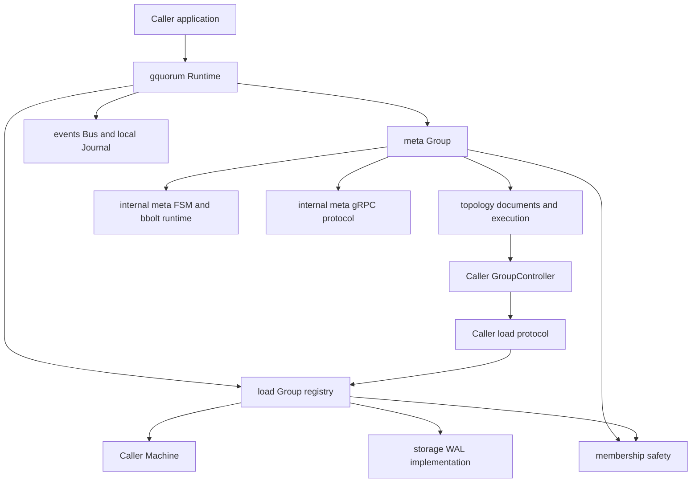

# Target architecture: gquorum

Date: 2026-10-10. Status: implementation in progress. The scope choices below are confirmed; implementation and validation progress is recorded in ../plans/20261010-implementation.md. This document specifies the complete target, not a claim that every component is implemented.

## 1. Initial request and scope

Extract and refactor the supplied Go cluster implementation into an independent library. Provide a reserved `_meta` group that manages cluster topology using the existing finite state machine; support caller-defined node types; provide application-defined load-group state machines; retain bbolt meta storage and etcd WAL load storage; include meta networking/protocol; expose documents, proposals, administrative mutations, quorum status, events and hooks for approved effects. Constructors receive settings and storage paths as arguments. Load protocols, application configuration and application persistence schemas belong to callers. Events never enter meta consensus. Deliver a Docker Compose example runnable with `make run-example`, HTTP REST demonstrations of node administration and drain, unit tests and focused cluster tests.

Require idempotent callbacks and verification of their exact authorized identities. This is a mandatory main-scope requirement for every approved runtime effect and its retry path.

Port all source cluster tests that verify applicable Raft correctness, with their supporting unit and integration tests. Larger-cluster correctness and operational validation are main scope, including admission, planner cost, snapshot size, multi-group operation and bounded shutdown. The source inventory and required adaptations are specified in [the test-port inventory](20261010-raft-library-test-port.md).

Production code, module/package names, generated protobuf descriptors, exported errors, metrics, README and examples must have no dependencies on or product references to the source application. Its generic mechanisms may be reused after removing application-specific naming and domain assumptions.

| Decision | Chosen behavior | Alternative not selected |
| --- | --- | --- |
| Meta participation | Every admitted, non-excluded node participates in `_meta`, regardless of node type. | Load-only admitted nodes outside meta. |
| Events | Event subscriptions and a separate node-local bbolt journal. | Only callbacks with caller-owned storage. |
| Bounds | Constructor-supplied Limits, default MaxNodes three and MaxReplicas five, pinned at founding. Limits.MaxNodes is the only node-limit setting. | Independent constants or duplicate node-limit settings. |
| Load runtime | Library owns RawNode loop, durability ordering, snapshots and recovery. Caller owns application Machine, transport and application state. | Callers write their own Raft loop. |
| Deleted group IDs | Permanently retired after deletion is approved. A recreated workload gets a new group ID. | Reuse with a wire-level incarnation mechanism. |
| Permanent majority-loss recovery | Force-new is deferred. Normal restart, join, fresh-ID readmission and reseating remain in scope. | Offline force-new API in the first version. |
| Approved-effect callbacks | Require idempotent callbacks and verification of their exact authorized identities. | Callbacks that duplicate effects on retry or accept mismatched identities. |
| Cluster validation | Port every applicable source Raft correctness scenario; require three-, five- and seven-node coverage plus single-node unit cases and fifteen load groups. | Deferring larger-cluster validation or replacing the source suite with a small smoke suite. |

The user-supplied module path is `github.com/asalimonov/gquorum`, targeting Go 1.26 with the extraction toolchain pinned to Go 1.26.5.

## 2. Architecture and dependency direction



`topology` owns wire-neutral data and the controller contract; it does not import `meta`, `load`, grpc, or the facade. `membership` imports only Raft and defines its own small status/evidence types, with adapters in topology; it does not import topology, avoiding a planner/coordinator import cycle. `load` imports `storage`, Raft and events, not meta or grpc. Internal meta transport depends on handler interfaces and topology types; `meta` implements those interfaces and assembles the transport. Only the example imports both meta and its own load-network implementation.

Use one internal persistence-ordered Raft loop for meta and load groups, with distinct storage and Machine adapters. The meta adapter retains synchronous bbolt Ready/snapshot transactions and atomic materialized/applied membership persistence; the load adapter retains WAL recovery and advisory hints. This implementation decision avoids duplicating the verified Ready/retry/shutdown behavior. The public packages keep their separate constructor, protocol and state-machine responsibilities; real gRPC/bbolt consensus, restart and failover tests validate the meta adapter.

Keep the source dependency versions initially: Go 1.26.5, Raft v3.6.0, etcd server/WAL v3.6.12, bbolt v1.4.3. Derive grpc/protobuf/zap dependency pins from the corresponding source module and reduce go.mod to actual imports. These are extraction pins, not claims about current upstream releases. Generate new protobuf code from the new protocol definition.

## 3. Core invariants

1. Latest, Target and Active are separate persisted document views. Staging never starts effects. Target follows durable approval; Active follows completed convergence and final live-state validation.
2. Every runtime effect is authorized by the exact execution ID/version/attempt/step/kind/group/node/replica tuple. Authentication alone does not authorize a mutation.
3. Only the current meta leader advances convergence. A receiver revalidates exact authorization. Loss of leadership or a stale execution prevents recording further progress.
4. Require idempotent callbacks and verification of their exact authorized identities. Effects may repeat after crashes or leader replacement; the same authorized operation must converge to the same intended result without duplicating the effect. An existing result is successful only when its identities match the authorized operation. Conflicting or superseded identities must be refused.
5. IDs are positive and stable. Retired replica IDs are never allocated again. Rollback preserves allocation high-water marks. Deleted group IDs are not reused.
6. All nondeterministic inputs to meta state changes are proposal fields. Replicated Apply does not read clocks, resolve network addresses, call caller hooks, perform probes, or inspect local filesystem layout.
7. Unknown health differs from known total outage. Destructive membership changes fail closed without current liveness evidence. Learner addition may proceed without changing quorum.
8. Durable Raft writes precede application of committed entries and sending messages whose safety depends on those writes. There is one unadvanced Ready per Raft group.
9. Application snapshots contain complete replicated application state and exact current ConfState. The source WAL's placeholder single-voter ConfState is removed.
10. A stored applied hint cannot prove application restoration. Load recovery restores a snapshot and replays its committed tail.
11. Events, local identity/overrides, and replica ledgers do not enter replicated meta snapshots. Event backpressure cannot block heartbeat processing.
12. Empty required storage paths fail. No library environment/file configuration readers or default absolute directories exist.

## 4. Public data structures

### CREATED `topology/document.go`

```go
const MetaGroupID = "_meta"

type NodeType string
type NodeState string
const (
    NodeActive NodeState = "active"
    NodeDraining NodeState = "draining"
    NodeDrained NodeState = "drained"
    NodeExcluded NodeState = "excluded"
)
type ReplicaRole string
const (
    ReplicaVoter ReplicaRole = "voter"
    ReplicaLearner ReplicaRole = "learner"
)
type Origin string // api, reconciler, system, founding, operator, internal

type Limits struct {
    MaxNodes int `json:"max_nodes"`
    MaxReplicas int `json:"max_replicas"`
}
func (l Limits) WithDefaults() Limits
func (l Limits) Validate() error
type Rules struct {
    SchemaVersion uint32 `json:"schema_version"`
    Limits Limits `json:"limits"`
}
type PlacementRule struct {
    MinReplicas int `json:"min_replicas"`
    MaxReplicas int `json:"max_replicas"`
    AllowedNodeTypes []NodeType `json:"allowed_node_types,omitempty"`
}
type Node struct {
    Name string `json:"name"`
    Type NodeType `json:"type"`
    State NodeState `json:"state"`
    Region string `json:"region,omitempty"`
    Labels map[string]string `json:"labels,omitempty"`
    CreatedAt time.Time `json:"created_at"`
    UpdatedAt time.Time `json:"updated_at"`
}
type Replica struct {
    NodeName string `json:"node_name"`
    ReplicaID uint64 `json:"replica_id"`
    Role ReplicaRole `json:"role"`
    CreatedAt time.Time `json:"created_at"`
    UpdatedAt time.Time `json:"updated_at"`
}
type Group struct {
    ID string `json:"id"`
    Replicas []Replica `json:"replicas"`
    NextReplicaID uint64 `json:"next_replica_id"`
    Placement *PlacementRule `json:"placement,omitempty"`
    CreatedAt time.Time `json:"created_at"`
    UpdatedAt time.Time `json:"updated_at"`
}
type ChangeAudit struct {
    Operation string `json:"operation"`
    TargetNode string `json:"target_node,omitempty"`
    Forced bool `json:"forced"`
    Reason string `json:"reason"`
    StagedBy string `json:"staged_by"`
    StagedAt time.Time `json:"staged_at"`
}
type Document struct {
    Version uint64 `json:"version"`
    ClusterID string `json:"cluster_id"`
    Placement PlacementRule `json:"placement"`
    Nodes []Node `json:"nodes"`
    Groups []Group `json:"groups"`
    ChangedBy string `json:"changed_by"`
    Origin Origin `json:"origin"`
    Comment string `json:"comment,omitempty"`
    CreatedAt time.Time `json:"created_at"`
    ParentVersion uint64 `json:"parent_version"`
    Audit *ChangeAudit `json:"audit,omitempty"`
}
```

Node type is a nonempty caller-defined string; it is not administrative state or voter role. No closed application enum or user validator runs inside the meta FSM. Empty AllowedNodeTypes means unrestricted load placement. A nonempty list is sorted, duplicate-free and restricts both explicit and repaired load placement. `_meta` ignores type restrictions, and every admitted node retains a meta identity during drain. Node type is immutable after admission in the first version; changing it requires exclusion/readmission with fresh identities.

Limits.WithDefaults resolves a zero MaxNodes to three and a zero MaxReplicas to five before founding; reject negatives. Require MaxNodes >= 1 and MaxReplicas >= 1. Limits.MaxNodes is the sole node-capacity setting: no MaxClusterNodes/DefaultMaxNodes constant, separate constructor field, configuration field or meta placement cap is introduced. Constructors accept the Limits struct, and persisted Rules carry that same resolved struct for deterministic validation. `_meta` has no independently configurable Placement rule; its replicas follow admitted membership, checked against Limits.MaxNodes. Its Group.Placement remains nil. Global and per-load-group placement rules apply only to load groups, bounded by Limits.MaxReplicas and eligible nodes. Capacity counts non-excluded nodes; tombstoned nodes do not consume live capacity. At least one meta voter always remains. During an in-flight exclusion, preserve the source allowance for a still-live meta replica on an excluded declared node until its authorized removal commits; final activation verifies the removal.

IDs accept a safe single path component: letters, digits, `_`, `-`, `.`; reject empty, `.`, `..`, path separators, NUL, quarantine-reserved suffixes, and `_meta` for a load ID. At most one replica of a given group is declared per node. IDs must be below the group's next allocation counter. Detect uint64 overflow before incrementing any counter.

Omit source reserved witness/group-stopped fields instead of accepting modes the runtime does not implement. Per-group placement is active behavior in this library, not an inert declaration.

### CREATED `topology/execution.go`

```go
type ExecutionID string
type ExecutionState string
// pending, running, waiting_for_replica, waiting_for_catch_up,
// waiting_for_leader, succeeded, failed, superseded
type StepKind string
// create_founding_group, prepare_replica, add_learner, wait_caught_up,
// promote_voter, demote_voter, remove_replica, transfer_leader,
// stop_replica, cleanup_replica_state, delete_group_state
type Step struct {
    Seq int `json:"seq"`
    Kind StepKind `json:"kind"`
    GroupID string `json:"group_id"`
    NodeName string `json:"node_name,omitempty"`
    ReplicaID uint64 `json:"replica_id,omitempty"`
}
type Plan struct {
    Version uint64 `json:"version"`
    Steps []Step `json:"steps"`
}
type AuthorizedStep struct {
    ExecutionID ExecutionID `json:"execution_id"`
    Version uint64 `json:"version"`
    Attempt uint32 `json:"attempt"`
    StepSeq int `json:"step_seq"`
    Kind StepKind `json:"kind"`
    GroupID string `json:"group_id"`
    NodeName string `json:"node_name,omitempty"`
    ReplicaID uint64 `json:"replica_id,omitempty"`
}
type ExecutionStatus struct {
    ID ExecutionID `json:"id"`
    Version uint64 `json:"version"`
    Attempt uint32 `json:"attempt"`
    State ExecutionState `json:"state"`
    CurrentStep int `json:"current_step"`
    TotalSteps int `json:"total_steps"`
    WaitingReason string `json:"waiting_reason,omitempty"`
    ErrorCode string `json:"error_code,omitempty"`
    Error string `json:"error,omitempty"`
}
type ExecutionRecord struct {
    Status ExecutionStatus `json:"status"`
    Plan Plan `json:"plan"`
    Actor string `json:"actor"`
    Origin Origin `json:"origin"`
    StartedAt time.Time `json:"started_at"`
    UpdatedAt time.Time `json:"updated_at"`
}
```

Execution IDs encode document version and attempt using the existing source convention, generalized names. Single-change Auto ConfChangeV2 only; reject multiple changes/joint transitions. A new replica is first a learner, then promoted after current leader progress confirms a nonzero commit and the fixed source lag threshold (at most 1000 behind). A lagging learner must be RecentActive. Preserve the source exception for an idle learner whose Match exactly equals Commit; CheckQuorum may clear RecentActive for an otherwise fully caught-up idle replica. Transfer leadership before removing/demoting the current leader. Fixed safety checks require a live post-change majority. Do not treat an application placement minimum as the Raft majority.

### CREATED `topology/status.go` and `topology/controller.go`

```go
type Health string // unknown, alive, dead
type GroupHealth string // unknown, healthy, degraded, quorum_lost
type ReplicaProgress struct { Match uint64; RecentActive bool }
type GroupStatus struct {
    GroupID string
    HostNode string
    Found bool
    LeaderID uint64
    Commit uint64
    Applied uint64
    ConfState raftpb.ConfState
    Progress map[uint64]ReplicaProgress
    LiveVoters map[uint64]bool
    HealthKnown bool
}
type NodeStatus struct {
    Node Node
    EffectiveState NodeState
    Health Health
    Address string
}
type ClusterStatus struct {
    Lifecycle string // constructed, starting, joining, parked, ready, stopping, stopped, failed
    ErrorCode string
    LatestVersion uint64
    TargetVersion uint64
    ActiveVersion uint64
    Nodes []NodeStatus
    Groups []GroupStatus
    MetaLeader uint64
    SessionLive bool
    Execution *ExecutionStatus
}
type GroupController interface {
    Status(context.Context, string) (GroupStatus, error)
    CreateGroup(context.Context, AuthorizedStep) error
    PrepareReplica(context.Context, AuthorizedStep) error
    ApplyMembership(context.Context, AuthorizedStep) error
    TransferLeader(context.Context, AuthorizedStep) error
    StopReplica(context.Context, AuthorizedStep) error
    CleanupReplicaState(context.Context, AuthorizedStep) error
    DeleteGroupState(context.Context, AuthorizedStep) error
}
type AddressResolver interface {
    Resolve(context.Context, string) (string, error)
}
type HealthSource interface {
    Snapshot(context.Context) (map[string]Health, error)
}
```

Caller controller methods apply only to load groups. Meta internally supplies the corresponding meta controller and combines both for planning. The caller implements local registry lookup and remote calls through its own protocol. Status is a current leader observation where possible; a local miss cannot imply global absence. Explicitly distinguish all known hosts reporting not-found from an unreachable host. Receiver hooks call `meta.Group.Authorize` using their locally applied approval and check their own exact node/replica identity. A receiver behind the required approval waits/retries, never executes based solely on the request's version number.

Cleanup targets the exact removed replica even if Active has changed. Whole-group delete must account for every previous host. Cleanup/quarantine must not erase an already reseated replacement. Step zero is reserved for immediate leader transfer and is checked against Active and current identity, as in the existing mechanism.

Idempotence and verification apply to create, prepare, membership change, leadership transfer, stop, cleanup and delete callbacks. If an effect succeeds but the leader crashes before `_meta` records completion, the next leader reobserves and safely retries the approved step. Receiver authorization validates execution/version/attempt/step/kind/group/node/replica scope before execution; result verification checks that observed state belongs to the expected exact identities before accepting completion.

Application-specific stronger guarantees may use an atomic effect-plus-deduplication transaction or a recipient-supported idempotency key. An outbox durably records delivery intent but still requires delivery deduplication or transactional coordination. The library owns the approved retry/authorization/verification contract; caller application transactions/outboxes remain caller-owned.

## 5. Constructors and public APIs, organized by created file

All files below are CREATED in the empty destination. No existing destination files are UPDATED. Source files remain read-only. Types imported from another public package are qualified in actual Go code; signatures below abbreviate types declared above when their package is unambiguous.

### CREATED `runtime.go`

```go
type Options struct { Logger *slog.Logger; Events *events.Bus }
func New(Options) (*Runtime, error)
func (r *Runtime) OpenMeta(meta.Options) (*meta.Group, error)
func (r *Runtime) OpenLoad(load.Options) (*load.Group, error)
func (r *Runtime) Meta() (*meta.Group, bool)
func (r *Runtime) Load(string) (*load.Group, bool)
func (r *Runtime) LoadIDs() []string
func (r *Runtime) StopLoad(context.Context, string) error
func (r *Runtime) Close(context.Context) error
```

Runtime admits one local meta handle and many load handles. Duplicate live local IDs fail; stopping and reopening an existing authorized replica is allowed. This local registry operation does not delete a consensus group or bypass its retired-ID checks. Runtime owns handles it opens; injected Events, application Machine and shared storage.Store remain caller-owned. New starts no goroutines. OpenMeta/OpenLoad construct but do not start groups. Close is idempotent, stops meta convergence before load teardown, then closes its meta handle; it does not close injected stores/bus.

### CREATED `meta/options.go`

```go
type Identity struct { NodeName, ClusterID, InstanceID string; MemberID uint64 }
type FoundingMember struct { Node topology.Node; MemberID uint64; Address string }
type Timing struct {
    TickInterval time.Duration
    ElectionTicks, HeartbeatTicks int
    DialTimeout, SendTimeout time.Duration
    PeerRetryInitial, PeerRetryMax time.Duration
}
type NetworkOptions struct {
    Listener net.Listener
    AdvertiseAddress string
    Resolver topology.AddressResolver
    TLS *tls.Config
    ClientTLS *tls.Config
    AllowPlaintext bool
    ClusterCredential []byte
    MaxSnapshotBytes int
}
type Options struct {
    Identity Identity
    Node topology.Node // explicit local type/metadata for admission; may derive from matching founder
    DBPath string
    Founders []FoundingMember
    JoinSeeds []string
    Join bool
    Limits topology.Limits
    Placement topology.PlacementRule
    Timing Timing
    SessionTTL time.Duration
    SnapshotThreshold uint64
    MaxWatchers int
    Network NetworkOptions
    LoadGroups topology.GroupController
    Health topology.HealthSource
    Events *events.Bus
    Logger *slog.Logger
    OnSelfRemoved func(context.Context, string) error
    OnReadmission func(context.Context, Readmission) error
}
type Readmission struct {
    Previous Identity
    Granted Identity
    AdmissionID string
    MetaDBPath string
    PreviousGroups []topology.Group
    GrantedGroups []topology.Group
}
type ReadmissionRequiredError struct { Readmission Readmission }
func (e *ReadmissionRequiredError) Error() string
func (o Options) Validate() error
func DefaultTiming() Timing
```

Listener and advertised address are explicit inputs; no library bind port is chosen. The meta group takes ownership of its supplied dedicated listener for its lifecycle. Supplied resolver/health/controllers are dependencies, not owned resources. TLS objects are cloned. Plaintext is accepted only when explicitly requested; example selects it for the local Compose network. Credential validation and cluster ID checks remain separate from execution authorization. The protocol does not put raw secrets in message bodies.

Founding names/member IDs are unique, positive and consistent across founders. Callers supply common ClusterID and founder IDs; provide a helper for deterministic founder IDs from cluster identity and names, independent of mutable peer ordering. Joining nodes obtain a granted member ID from meta before opening a new voter identity; the Join path may initially use MemberID zero until the durable admission is received. Existing stores always recover their pinned identity and membership instead of refounding from new peers. Reject incompatible supplied cluster-wide limits rather than changing recovered rules.

Meta defaults: source tick 100 ms, election ticks 10, heartbeat ticks 1, dial/send 500 ms, peer retry 100 ms through 5 s, session TTL 15 s, snapshot threshold 512. Zero selects defaults; negative values fail before default resolution. Validate heartbeat < election, positive timeouts and retry bounds, and source timing safety relationships. Fixed PreVote and CheckQuorum are enabled.

### CREATED `meta/group.go`, `meta/documents.go`, `meta/mutations.go`, `meta/session.go`

```go
// group.go
func New(Options) (*Group, error)
func (g *Group) Start(context.Context) error
func (g *Group) WaitReady(context.Context) error
func (g *Group) Quiesce(context.Context) error
func (g *Group) Stop(context.Context) error
func (g *Group) Status(context.Context) (topology.ClusterStatus, error)
func (g *Group) IsLeader() bool
func (g *Group) Rules() topology.Rules
func (g *Group) Authorize(context.Context, topology.AuthorizedStep) error
func FoundingIDs(clusterID string, names []string) (map[string]uint64, error)

// documents.go
type View string // latest, target, active
type Page struct { Offset, Limit int }
type HistoryResult struct { Documents []topology.Document; OldestVersion uint64 }
type Update struct { View View; Document topology.Document }
func (g *Group) Latest(context.Context) (topology.Document, error)
func (g *Group) Target(context.Context) (topology.Document, error)
func (g *Group) Active(context.Context) (topology.Document, error)
func (g *Group) Get(context.Context, uint64) (topology.Document, error)
func (g *Group) History(context.Context, Page) (HistoryResult, error)
func (g *Group) Watch(context.Context, View) (<-chan Update, error)
func (g *Group) Stage(context.Context, topology.Document, uint64) (topology.Document, error)
func (g *Group) Plan(context.Context, uint64) (topology.Plan, error)
func (g *Group) PlanFor(context.Context, topology.Document) (topology.Plan, error)
func (g *Group) Apply(context.Context, uint64) (topology.ExecutionID, error)
func (g *Group) Execution(context.Context, topology.ExecutionID) (topology.ExecutionStatus, error)
func (g *Group) WaitExecution(context.Context, topology.ExecutionID) (topology.ExecutionStatus, error)

// mutations.go
type MutationOptions struct { ExpectedVersion uint64; Actor, Comment string; Apply bool }
type MutationResult struct { Document topology.Document; ExecutionID topology.ExecutionID }
type GroupSpec struct { ID string; Placement *topology.PlacementRule; Nodes []string }
type RetireOptions struct { Reason string; Mutation MutationOptions }
func (g *Group) AddNode(context.Context, topology.Node, MutationOptions) (MutationResult, error)
func (g *Group) DrainNode(context.Context, string, MutationOptions) (MutationResult, error)
func (g *Group) ActivateNode(context.Context, string, MutationOptions) (MutationResult, error)
func (g *Group) ExcludeNode(context.Context, string, MutationOptions) (MutationResult, error)
func (g *Group) ForceRetireNode(context.Context, string, RetireOptions) (MutationResult, error)
func (g *Group) SetPlacement(context.Context, topology.PlacementRule, MutationOptions) (MutationResult, error)
func (g *Group) CreateLoadGroup(context.Context, GroupSpec, MutationOptions) (MutationResult, error)
func (g *Group) DeleteLoadGroup(context.Context, string, MutationOptions) (MutationResult, error)
func (g *Group) ChangeReplica(context.Context, string, string, topology.ReplicaRole, MutationOptions) (MutationResult, error)
func (g *Group) ReseatReplica(context.Context, string, string, MutationOptions) (MutationResult, error)
func (g *Group) RollbackTo(context.Context, uint64, MutationOptions) (MutationResult, error)
func (g *Group) TransferLeader(context.Context, string, string) error

// session.go
type Session struct { ID, NodeName, InstanceID string; TTL time.Duration }
func (g *Group) Activate(context.Context) (Session, error)
func (g *Group) Deactivate(context.Context, string) error
func (g *Group) KeepAlive(context.Context, string) error
func (g *Group) OwnSessionLive() bool
func (g *Group) AcquireLock(context.Context, string, string) error
func (g *Group) LockHolder(context.Context, string) (Session, bool, error)
func (g *Group) ServeOverride() int
func (g *Group) SetServeOverride(context.Context, int) error
```

Start launches the meta service and bootstrap/join worker and returns without waiting for all founders to start. WaitReady waits for exact voter membership plus a leader-acknowledged activation session. Status reports the explicit Lifecycle and ErrorCode fields in ClusterStatus; no HTTP handlers are part of this package. OnSelfRemoved is delivered asynchronously once after durable removal, never from FSM Apply; callback failures are observable without reversing removal. Quiesce refuses new approval/proposals, stops and joins convergence/effect calls, attempts deactivation and cancels network workers without closing owned state; Stop completes teardown. This lets the facade stop load runtimes after meta effects have stopped.

OnReadmission is a local orchestration hook, not a replicated FSM effect. If the leader grants a superseding identity, the library first stops its old meta runtime and closes its DB handle, then supplies exact old/granted identities, group tuples and the caller's DB path to this hook. Caller code stops affected load runtimes and quarantines exact old storage/application state. Only after successful callback completion does the library reopen the meta DB under the granted identity and acknowledge join-ready. If the hook is absent or fails, WaitReady returns ReadmissionRequiredError/callback error and status stays blocked; it never silently wipes or rebinds state. Retry the same durable admission without allocating more IDs. The hook must be idempotent across crashes, and no shared event journal is part of its quarantine scope.

Reads return deep copies of locally applied materialized state. They are explicitly not linearizable ReadIndex reads. Watches emit an initial view followed by monotonic versions, use a bounded coalescing buffer and may skip intermediate versions. History is the bounded retained document window (128); callers receive its horizon. WaitExecution observes durable replicated transitions, not event subscriptions.

Stage CAS is checked at committed apply, not only before submission. If a mutation stages successfully but Apply fails, return MutationResult containing the committed document plus a typed error; do not imply staging was rolled back. Apply from a follower is forwarded once to the known meta leader. The receiver never forwards again. Empty plans still durably approve and activate without membership effects.

TransferLeader uses the meta protocol for `_meta`; for load groups it uses the caller controller with source step-zero validation. ForceRetireNode requires an audit reason and live safe membership transitions; it is not force-new and cannot manufacture a majority. Excluded nodes stay in history/tombstones. ServeOverride is a persisted local operator input, not consensus, not an automatic application bypass; callers decide its serving semantics.

### CREATED `load/load.go`, `internal/raftengine/{options,group,loop,writer,recovery,registry}.go`

The public load types and constructors delegate to a shared internal Raft engine. Its public load constructor rejects `_meta`; only the internal `NewMeta` path admits that reserved group. Meta uses `internal/metastore.Adapter` and `internal/metaengine.Machine`; load uses caller-provided Store/Machine/Transport. This shares Ready ordering, retry, committed-tail recovery and shutdown while keeping the public load package independent of the meta network protocol. Runtime tests live in `internal/raftengine/group_test.go`.

```go
type Command struct { Index, Term uint64; RequestID string; Data []byte }
type Result struct { Code string; Data []byte }
type Machine interface {
    Apply(context.Context, Command) (Result, error)
    Snapshot(context.Context) ([]byte, error)
    Restore(context.Context, []byte) error
}
type Transport interface {
    Send(context.Context, []raftpb.Message) error
}
type Mode string // founding, joining; nonempty existing state always recovers
type Options struct {
    GroupID, NodeName, ClusterID string
    ReplicaID uint64
    Mode Mode
    Peers []raft.Peer
    Timing Timing
    Store storage.Store
    Machine Machine
    Transport Transport
    Events *events.Bus
    Logger *slog.Logger
    SnapshotThreshold uint64
    MaxPendingProposals int
    MaxUncommittedBytes uint64
    MaxApplyBatchBytes uint64
}
type Proposal struct { RequestID string; Data []byte }
type Timing struct { TickInterval time.Duration; ElectionTicks, HeartbeatTicks int; WALWriteWait time.Duration }
func (o Options) Validate() error
func New(Options) (*Group, error)
func (g *Group) Start(context.Context) error
func (g *Group) WaitReady(context.Context) error
func (g *Group) Propose(context.Context, Proposal) (Result, error)
func (g *Group) Step(context.Context, raftpb.Message) error
func (g *Group) Status() topology.GroupStatus
func (g *Group) ProposeConfChange(context.Context, raftpb.ConfChangeV2) error
func (g *Group) TransferLeader(context.Context, uint64) error
func (g *Group) Snapshot(context.Context) error
func (g *Group) ReportUnreachable(uint64)
func (g *Group) ReportSnapshot(uint64, raft.SnapshotStatus)
func (g *Group) Stop(context.Context) error
func (g *Group) Membership() membership.RaftGroup
func (g *Group) RaftStatus() raft.Status
func (g *Group) WALStall() time.Duration
func NewRegistry() *Registry
func (r *Registry) Add(*Group) error
func (r *Registry) Get(string) (*Group, bool)
func (r *Registry) Remove(string, uint64) error
func (r *Registry) IDs() []string
```

The Machine receives normal application commands only. The runtime handles empty Raft entries and membership entries itself. Machine operations are serialized on a group apply/snapshot path; callers synchronize their own concurrent reads. An Apply error means a failed machine operation and halts that replica. Business rejection consumes the committed entry and returns a deterministic Result.Code. No in-loop compensating budget proposal exists.

Internally frame proposals as versioned request ID plus opaque application bytes. Assign a unique correlation ID if RequestID is empty; return the requested outcome after local committed application. RequestID is passed to Machine. Caller-specified RequestID is not an exactly-once guarantee: applications implement any durable deduplication inside Machine state/snapshots. Caller cancellation removes its waiter but may not cancel a submitted log proposal; document the uncertain outcome.

Transport.Send receives owned message copies, including snapshots. Caller code serializes and routes by cluster/group identity and reports snapshot delivery success/failure through ReportSnapshot. A Send error reports its destination replicas unreachable; the transport may report later asynchronous failures too. Receiving code validates cluster/group/from/to and then calls Step. Step accepts only remote-network Raft messages, not local control messages. No grpc dependency or load proto is introduced in load.

Load founding uses an exact, durable seed snapshot with the supplied founding voter set, preserving the existing V2-only membership runtime. Join mode creates no founding voters. A committed membership change also triggers a complete snapshot with that exact ConfState; otherwise a newly added learner could be rejected when catching up from a founding snapshot that does not contain it. Existing durable state wins over constructor Peers; a voted store cannot be treated as fresh. Start/WaitReady do not serve application reads before full recovery. Stop joins its writer but does not close shared Store or caller Machine. Applications invoke membership through the fixed coordinator; ProposeConfChange is a documented low-level primitive, not a safe administrative replacement for the coordinator.

Defaults retain source queue/message mechanics: proposal queue 256, inbound queue 1024, compact queue 64, transfer/conf-change/snapshot queues 16 each, unreachable queue 256, snapshot-report queue 64, one writer request/result slot, MaxSizePerMsg 64 KiB, MaxInflightMsgs 256 and committed apply batch 1 MiB. Source-derived writer defaults are one attempt timeout five seconds, backoff 200 ms through five seconds, applied-hint idle flush 250 ms and enqueue timeout five seconds. WALWriteWait defaults to zero and follows the source ten-millisecond cap and election-time relationship.

The generic extraction adds a 64 MiB default MaxUncommittedBytes and 10,000-entry default SnapshotThreshold because the source depended on domain admission and an external application snapshot task. These are numeric constructor defaults, not configuration readers or paths. A caller may select other positive bounds/thresholds. MaxPendingProposals defaults to 256; snapshot requests and explicit caller contexts also remain available. Persist all nonempty HardState changes initially. Defer domain-specific admission exemptions, compensation and Commit-only HardState skipping rather than relying on source SQL recovery guarantees that no longer exist.

### CREATED `storage/storage.go`, `storage/walstore/options.go`

```go
type Identity struct { NodeName, ClusterID, GroupID string; ReplicaID uint64 }
type Probe struct { Exists, HasLog bool; Identity Identity }
type ReadyWrite struct { Entries []raftpb.Entry; HardState raftpb.HardState }
type Recovery struct {
    Snapshot raftpb.Snapshot
    Entries []raftpb.Entry
    HardState raftpb.HardState
    AppliedHint uint64
    AppliedConfState raftpb.ConfState
}
type Store interface {
    BindReplica(context.Context, Identity) error
    Probe(context.Context, string) (Probe, error)
    Ensure(context.Context, string) error
    SaveReady(context.Context, string, ReadyWrite) error
    SaveApplied(context.Context, string, uint64, raftpb.ConfState) error
    SaveSnapshot(context.Context, string, raftpb.Snapshot) error
    Load(context.Context, string) (Recovery, error)
    Compact(context.Context, string, uint64) error
    Quarantine(context.Context, string, uint64) (string, error)
    Close() error
}
type Stats struct { LogBytes, SnapshotBytes int64; SnapshotIndex uint64 }
// walstore/options.go
type Options struct {
    RootDir, NodeName, ClusterID string
    SegmentBytes int64
    Prewrite *bool
    Logger *slog.Logger
}
func Open(Options) (*Store, error)
func (s *Store) Stats(context.Context, string) (storage.Stats, error)
func (s *Store) SweepQuarantine(context.Context) error
```

Implement all storage.Store methods on walstore.Store in CREATED `walstore/{store,identity,state,snapshot,segments,quarantine,refill}.go`, retaining source mechanisms with generic contracts. Add a test-only memory implementation and port the reusable conformance suite. BindReplica now returns errors instead of silently accepting incompatible pins. Quarantine takes expected ReplicaID and refuses to touch a replacement's state. Store.Close cancels and joins refillers, closes WAL handles and then bbolt handles; it is idempotent.

Zero SegmentBytes resolves the agreed process-wide default of 64 MiB; negative values fail. Zero pointer Prewrite selects true. A package-level locked registration fixes SegmentBytes on first open; later incompatible opens fail. No store constructor changes the upstream global while another store is active. Keep two snapshot files and seven-day quarantine retention as initial source defaults. An explicit periodic sweep is owned by the facade/application lifecycle, not inferred from unrelated application metrics.

### CREATED `events/event.go`, `events/bus.go`, `events/journal.go`

```go
type Type string // leader_change, quorum_lost, quorum_achieved, node_alive, node_dead,
                 // execution_changed, drain_completed, runtime_error
type Event struct {
    Seq uint64 `json:"seq"`
    At time.Time `json:"at"`
    Type Type `json:"type"`
    NodeName string `json:"node_name"`
    InstanceID string `json:"instance_id"`
    ClusterID string `json:"cluster_id"`
    GroupID string `json:"group_id,omitempty"`
    SubjectNode string `json:"subject_node,omitempty"`
    OldLeader string `json:"old_leader,omitempty"`
    NewLeader string `json:"new_leader,omitempty"`
    Term uint64 `json:"term,omitempty"`
    HealthyVoters *int `json:"healthy_voters,omitempty"`
    Voters int `json:"voters,omitempty"`
    ExecutionID string `json:"execution_id,omitempty"`
    Code string `json:"code,omitempty"`
}
type Filter struct { GroupID string; Types []Type }
type Delivery struct { Event Event; LostBefore uint64 }
type BusOptions struct { Journal *Journal; Buffer int; Logger *slog.Logger }
type JournalOptions struct { Path string; Retention time.Duration; MaxLiveBytes int64; Logger *slog.Logger }
type Query struct { AfterSeq uint64; Limit int; Filter Filter }
func NewBus(BusOptions) (*Bus, error)
func (b *Bus) Publish(Event) bool
func (b *Bus) Subscribe(context.Context, Filter, int) (<-chan Delivery, error)
func (b *Bus) Dropped() uint64
func (b *Bus) Close(context.Context) error
func OpenJournal(JournalOptions) (*Journal, error)
func (j *Journal) Append(Event) (Event, error)
func (j *Journal) List(context.Context, Query) ([]Event, error)
func (j *Journal) Prune(context.Context) error
func (j *Journal) Close() error
```

Bus.Publish is nonblocking and reports acceptance to its bounded ingress queue. The dispatcher writes to the journal before subscriber delivery, assigning a persisted local Seq on successful append. Journal failure logs and delivers a live-only event with Seq zero. A bus without a journal also uses Seq zero. Per-subscriber queues drop on overflow; the next delivery reports a LostBefore count. Ingress losses are counted globally and surfaced through subscription gap information. Do not invent replay guarantees for a live-only event.

Journal uses source NoSync=true behavior; it is best-effort and independent of Raft durability. Seq is journal-local, and event clocks are observer-local. The node/instance/cluster fields disambiguate identity changes; this is not a globally ordered cluster log. Rotation defaults are 30 days/64 MiB of live bucket bytes; zero selects defaults and negative settings fail. The journal file survives ordinary Raft quarantine/reseating. Changing its path deliberately selects a different local journal.

## 6. Exact durable schemas and transaction boundaries

### CREATED `fault/fault.go` and package error adapters

The shared `fault` package imports no runtime packages. Define `type Code string` and `type Error struct { Code Code; Message string; Cause error; ExpectedVersion, CurrentVersion uint64 }` with `Error() string`, `Unwrap() error`, and `Is(error) bool`; `func New(Code, string, error) *Error`. Export sentinels for `ErrInvalid`, `ErrVersionConflict`, `ErrHistoryUnavailable`, `ErrNotLeader`, `ErrUnavailable`, `ErrNoController`, `ErrUnsafeMembership`, `ErrExecutionAuthorization`, `ErrIdentityMismatch`, `ErrUnreadable`, `ErrGroupRetired`, `ErrOverloaded`, `ErrStopped`, `ErrShutdownTimeout`, `ErrUnsupported`, and `ErrReadmissionRequired`. Package-specific errors retain typed fields and wrap the appropriate sentinel. Wire/HTTP mapping switches on stable Code, never error prose. All effect errors returned by caller adapters must preserve retryable versus terminal classification.

There are no SQL tables, indexes, foreign keys, ORM structs or SQL DDL. None are created or updated. Application-owned tables are outside the library and unchanged by it. The complete storage schema is bbolt buckets, JSON structures and unchanged upstream Raft/WAL protobuf formats below. No durable application cache or cache TTL schema is introduced.

### Meta file: exact caller `meta.Options.DBPath`

File permissions 0600; library-created parent directories 0700. Open lock timeout retains five seconds. Use synchronous transactions for every meta state write. Store schema version one independently from protocol/envelope versions.

| Bucket | Key | Value encoding | Constraint |
| --- | --- | --- | --- |
| `format` | `schema_version` | ASCII `1` | Fail on unsupported/newer version; initialize atomically with buckets. |
| `hardstate` | `current` | raftpb.HardState protobuf | Term/Commit monotone; vote tied to term. |
| `entries` | uint64 BE log index, exactly 8 bytes | raftpb.Entry protobuf | Replace an entire conflicting tail from the first incoming index. |
| `snapshot` | `current` | raftpb.Snapshot protobuf | Includes actual ConfState and full serialized meta FSM. |
| `applied` | `index` | uint64 BE, exactly 8 bytes | Never decrease; atomic with confstate. |
| `applied` | `confstate` | raftpb.ConfState protobuf | Membership at the paired applied index. |
| `state` | `current` | canonical UTF-8 JSON MetaState | Applied index embedded for replay deduplication. |
| `identity` | `node_name`, `cluster_id` | UTF-8 nonempty string | Fail on incompatible pinned identity. |
| `identity` | `member_id` | uint64 BE | Positive after admission; never silently rebind voted state. |
| `serve_override` | `current` | uint64 BE | Zero means no override; local only. |
| `load_replicas` | UTF-8 validated group ID | ReplicaRecord JSON | Local identity ledger; not replicated/snapshotted. |

No event bucket exists in this file. No force-new arm/marker buckets or environment flags are copied. Preserve normal identity/admission and materialized-state durability mechanisms.

```go
type ReplicaRecord struct {
    NodeName string `json:"node_name"`
    ClusterID string `json:"cluster_id"`
    ReplicaID uint64 `json:"replica_id"`
    Origin string `json:"origin"` // fresh, seed, reseat
    CreatedAt time.Time `json:"created_at"`
}
type AdmissionRecord struct {
    NodeName string `json:"node_name"`
    InstanceID string `json:"instance_id"`
    MemberID uint64 `json:"member_id"`
    ExecutionID topology.ExecutionID `json:"execution_id"`
    State string `json:"state"` // pending, ready, learner, promoted, completed, superseded, retired
}
type SessionRecord struct {
    ID string `json:"session_id"`
    NodeName string `json:"node_name"`
    InstanceID string `json:"instance_id"`
    TTLSeconds int64 `json:"ttl_seconds"`
}
type LockRecord struct { Key string `json:"key"`; SessionID string `json:"session_id"` }
type RetiredGroup struct { ID string `json:"id"`; Version uint64 `json:"version"` }
type AllocationRecord struct { GroupID string `json:"group_id"`; NextReplicaID uint64 `json:"next_replica_id"` }
type MetaState struct {
    SchemaVersion uint32 `json:"schema_version"`
    Rules topology.Rules `json:"rules"`
    Latest topology.Document `json:"latest"`
    Target topology.Document `json:"target"`
    Active topology.Document `json:"active"`
    History []topology.Document `json:"history"`
    Executions []topology.ExecutionRecord `json:"executions"`
    Admissions []AdmissionRecord `json:"admissions"`
    Sessions []SessionRecord `json:"sessions"`
    Locks []LockRecord `json:"locks"`
    Activated []string `json:"activated"`
    RetiredGroups []RetiredGroup `json:"retired_groups"`
    Allocations []AllocationRecord `json:"allocations"`
    AppliedIndex uint64 `json:"applied_index"`
    AppliedTerm uint64 `json:"applied_term"`
}
```

Sort History by version; Executions by version/attempt; Admissions by name/instance; Sessions by ID; Locks by key; Activated/RetiredGroups/Allocations by name/ID. Node/group/replica collections use canonical ordering without mutating returned documents. Clone nested maps/slices. Keep 128 latest documents; pin Target/Active and nonterminal executions. RetiredGroups and allocation high-water marks do not expire.

Document approval that removes a previously established load group adds its tombstone in the same replicated state change as Target/execution. A merely staged removal is reversible. Once deletion is approved, later desired documents cannot reintroduce the ID, even if deletion stalls. The prior Active view may temporarily retain the retired group for cleanup. Rollback may not resurrect a retired group or reuse old replica identities. Preserve the source refusal when historical tuples reintroduce a retired/replaced identity; do not silently reseat it during rollback. Valid historical content is re-proposed as a new forward version with current high-water counters and current live safety checks. Explicit fresh-ID mutations are the path for repairing/reintroducing a node or replica.

Meta snapshot installation writes snapshot, materialized state, applied index/ConfState and compatible HardState in one bbolt transaction, compacting obsolete entries consistently. Notify watchers and self-removal observers only after durable completion. Ordinary FSM persistence and batched applied-index persistence preserve the source replay guard when materialized state is ahead of the batch marker.

### Load root: exact caller `walstore.Options.RootDir`

```text
<root>/<group_id>/identity.json
<root>/<group_id>/state.bolt
<root>/<group_id>/wal/<sequence>-<first-index>.wal
<root>/<group_id>/wal/0.tmp, 1.tmp
<root>/<group_id>/snap/<term>-<index>.snap
<root>/<group_id>.quarantine-<timestamp>[-collision-counter]/...
```

Identity JSON is `{schema_version:1,node_name,cluster_id,group_id,replica_id}` with exact snake_case tags. Write temp/fsync/rename/directory-fsync. WAL metadata uses the same versioned full identity tuple, including replica_id. Bind the exact positive replica identity before Ensure creates any durable store. Compare metadata on every reopen. Runtime receives a failed identity pin as a typed error.

`state.bolt` has `format/schema_version` ASCII `1` and `meta` keys: `applied` uint64 BE, `confstate` raftpb.ConfState paired with applied, `floor` uint64 BE, `base` uint64 BE, `snapmark` index/term as two uint64 BE values. A reserved application settings bucket is not created because no library writer requires it. Exact actual snapshot bytes are stored in raftpb.Snapshot.Data; no reservation/state-extension framing or placeholder voters remain.

SaveReady preserves Raft tail-replacement rules while strengthening HardState protection: reject term/commit regression, same-term vote replacement and a commit above the available log; accept exact repeated committed entries but reject changed or truncated committed entries. A nonzero replay base requires a full snapshot; markers alone are insufficient. Probe/Load report unpinned or corrupt directories as unreadable instead of silently recreating a voted replica. SaveApplied compares against the durable applied value, not an advisory in-memory hint, and persists its ConfState atomically. SaveSnapshot saves the actual snapshot file, then its WAL marker, then bbolt snapmark metadata (the applied hint is saved separately with its ConfState), then prunes files only after the new durable recovery boundary is installed. A marker must never outlive its file.

Compaction must retain every entry required by either retained valid snapshot. With two snapshots, the durable deletion watermark cannot exceed the older retained fallback snapshot boundary. Load selects a valid retained snapshot, opens WAL at that selected snapshot's marker rather than blindly at a newer bbolt snapmark, and returns a contiguous tail above that snapshot; a newer logical floor cannot hide entries needed for older-snapshot fallback. If corruption leaves no complete snapshot-plus-tail recovery chain, return ErrUnreadable instead of booting an incomplete machine. Add a regression test for corrupt newest snapshot after compaction.

Ensure fsyncs directory entries before ledger registration. Quarantine stops/closes a group and atomically renames only its directory, with collision-safe naming and parent fsync. Symlink roots/group state, mount-point rename failures and cross-filesystem moves yield actionable errors rather than falling back to deletion. The retention sweep ignores malformed quarantine names, reports failures and never touches live group names.

### Event file: exact caller `events.JournalOptions.Path`

Buckets `meta` and `events`. `meta/schema_version` is ASCII `1`. `events` keys are 8-byte BE bbolt sequence numbers; values are Event JSON with exact tags listed above. Append assigns UTC At if absent, assigns local Seq, writes JSON and periodically prunes in one transaction. Retention pruning uses event age and live bucket bytes, not file high-water size; reuse source measurement gating/amortization. Journal NoSync is deliberate and does not carry safety-critical state.

## 7. Meta protocol and integration wiring

CREATED `internal/metapb/meta.proto`, generated `meta.pb.go` and `meta_grpc.pb.go`. Protobuf package `gquorum.meta.v1`. Define a meta-only service:

| RPC | Request/response fields | Rules |
| --- | --- | --- |
| StreamMessages | ClusterID, FromNode, ToMemberID, raft_message bytes | Dedicated meta domain; validate raft From/To against identity. No load group field/routing. |
| SendSnapshot | ClusterID, from member ID, message term, snapshot index/term, actual ConfState, chunk bytes, final | Preserve Raft message term separately from snapshot term; bounded chunks; cancel streams on stop; call ReportSnapshot. |
| Join | name, type, labels/region, instance ID, advertised address, expected cluster ID, prior member/version | Caller node type retained; addresses prime resolver but are not consensus identity. |
| JoinReady | node/instance/member/execution ID | Exact durable admission match before admitting the empty started learner. |
| KeepAlive | session ID, node/instance | Leader-local lease refresh; followers supply one leader hint. |
| IdentityPing | expected node/instance/cluster | Verify exact process holder before revocation/readmission. |
| MetaStatus | caller cluster ID | Meta runtime membership/progress only. |
| MetaControl | exact AuthorizedStep | Execute meta-only membership/leader-transfer effect; reject load IDs. |
| ProposeMeta | versioned command envelope | Forward only whitelisted valid meta commands with normal proposal correlation and committed validation. |
| ApplyVersion | version, forwarded flag | One-hop approval forwarding; stable refusal/error codes and execution ID. |
| ParkedRead | empty plus cluster identity | Leader-local refused-join observations; follower gets leader hint. |

No load Raft RPC, load snapshot RPC, load GroupControl service, generic application request forwarding or SQL bootstrap protocol is generated. A network adapter must never accept caller load transport traffic through these endpoints.

CREATED `internal/metatransport/{server,client,peer_queue,auth}.go`: retain per-peer bounded queues, backoff/jitter and cancellation ownership. Send only current Raft traffic; do not replay stale buffered heartbeats after a backoff. Serialize/copy before handing loop-owned messages to workers. Cancel/close connections before joining blocked send loops. Expose RPC adapters through internal handler interfaces, avoiding import cycles.

CREATED `internal/metaengine/{group,store,fsm,codec,admission,sessions,ledger}.go` and `topology/{planner,convergence,reconcile}.go` implement the source mechanisms with the following internal signatures:

```go
func openStore(path string) (*boltStore, error)
func (s *boltStore) EnsureIdentity(metaIdentity Identity) error
func (s *boltStore) SaveReady([]raftpb.Entry, raftpb.HardState) error
func (s *boltStore) SaveState([]byte) error
func (s *boltStore) SaveApplied(uint64, raftpb.ConfState) error
func (s *boltStore) InstallSnapshot(raftpb.Snapshot, raftpb.HardState) error
func (s *boltStore) Load() (MetaRecovery, error)
func (s *boltStore) RecordReplica(string, ReplicaRecord) error
func (s *boltStore) Replica(string) (ReplicaRecord, bool, error)
func (s *boltStore) ForgetReplica(string, uint64) error
func (s *boltStore) Close() error
func newMachine(StatePersister) *metaMachine
func (m *metaMachine) Apply(uint64, uint64, []byte) (ApplyResult, error)
func (m *metaMachine) Snapshot() ([]byte, error)
func (m *metaMachine) Restore([]byte) error
func (m *metaMachine) Authorize(topology.AuthorizedStep) error
func (m *metaMachine) CurrentExecution() (topology.ExecutionRecord, bool)
func encodeCommand(command MetaCommand) ([]byte, error)
func decodeCommand(data []byte) (MetaCommand, error)
func ValidateDocument(Document, Rules) error
func ValidateTransition(Document, Document, AllocationState, RetiredState) error
func BuildPlan(active, desired Document, live map[string]GroupStatus, rules Rules) (Plan, error)
func ValidatePlan(active, desired Document, plan Plan) error
func NewConvergence(ConvergenceOptions) (*Convergence, error)
func (c *Convergence) Start(context.Context) error
func (c *Convergence) Wake()
func (c *Convergence) Tick(context.Context) error
func (c *Convergence) Stop(context.Context) error
func NewReconciler(ReconcileOptions) (*Reconciler, error)
func (r *Reconciler) Tick(context.Context) error
func NewCoordinator() *Coordinator
func (c *Coordinator) Apply(context.Context, Group, LiveEvidence, raftpb.ConfChangeV2) error
func (c *Coordinator) CaughtUp(GroupStatus, uint64) bool
func CheckSafety(GroupStatus, LiveEvidence, raftpb.ConfChangeV2) error
```

Define recovery/apply/internal options structs in their corresponding file from the exact persisted schemas above. Port small deterministic source helper functions under private names; do not create extension points for safety policy or application licensing. Use error-returning constructors instead of panic for invalid caller inputs.

Keep all source normal FSM command variants: propose_document; begin_execution; commit_repair_execution; transition_execution; activate_target; bind_admission; commit_readmission; ready_admission; grant_session; revoke_session; acquire_lock. Legacy admit_node replay may be retained internally if useful to copied tests, but there is no claimed old-store import API. Founding metadata includes Rules; internal encode/decode uses an explicit envelope schema version plus command kind and JSON body. Replicated mutation handlers validate all applicable transitions again at apply time.

## 8. Data flows, happy paths and failure modes

### 8.1 Founding/startup

1. Application creates its local event journal/bus, controller, resolver, load store and dedicated meta listener with chosen paths/options.
2. NewMeta validates constructor inputs, opens/pins bbolt, verifies schema/rules and restores existing state. Fresh founding computes one deterministic seed membership and canonical founding document/rules from identical caller inputs; it uses the source seed-snapshot mechanism, not V1 Bootstrap entries.
3. Start registers the meta service, starts its stream workers and RawNode loop, and starts activation/convergence workers. Founders use the same provided IDs; Raft elects a leader.
4. Commit founding topology as the source lifecycle requires; WaitReady confirms this node's exact meta voter ID plus an acknowledged session. Cluster rules are persisted and no longer change via constructor defaults.
5. Register load controller before Apply. Application declares/approves initial load group through the normal document/execution API. Exact founding callback builds only the declared replicas using supplied storage, Machine and caller transport.
6. Load Start restores the machine and membership before it reports ready. Example HTTP health distinguishes process live from consensus ready.

If any constructor fails, close only resources it opened before returning. If startup is canceled, Stop joins started workers. A caller-opened shared load store remains its responsibility. A founder rules/identity mismatch is a startup error, not a silent rewrite.

### 8.2 Join/readmission

1. Joiner supplies name/type/incarnation/address and any stored lineage to a seed. Followers give a bounded leader hint.
2. Leader enforces declared approval, current name/session fence and compatible cluster rules. Allocate fresh IDs when state was lost; bind a durable admission to the exact approved execution. Fresh-ID readmission commits document/plan/admission atomically.
3. If old stores are incompatible, the library stops/closes its old meta state and invokes OnReadmission with exact old/granted tuples, or returns ReadmissionRequiredError when no hook is configured. Caller first stops old load runtimes and quarantines only its explicit meta/load/application paths. Never erase a shared assumed parent or events. Failed recovery leaves admission resumable and no fresh voter is started against stale state.
4. Joiner opens/starts an empty meta learner identity with seeded address mappings and sends JoinReady for the exact admission.
5. Meta convergence adds learner, transfers a full snapshot/log, verifies catch-up and promotes. Joiner activates a session only after exact voter membership.
6. Approved load effects prepare fresh-ID replicas through caller protocols. Observe, record progress and finally activate Target. Retried joins return the existing exact admission rather than allocate again.

Duplicate active process identity is refused and shown in parked observations. Unreadable voted state is blocked for explicit repair, never restarted empty under the same ID. Normal reconnect uses its pinned identity/log rather than fresh-ID readmission.

### 8.3 Document reads, staging, approval and effects

Read hits return copied local materialized views. There is no cache hit/miss layer; a missing requested version below retained history returns ErrHistoryUnavailable with the retained horizon. A new watch reads its selected view and registers a monotonic subscription without a lost-initial-update race.

Mutation reads Latest, checks expected version, clones/edits, stamps proposer audit fields and validates eligibility/limits/high-water marks. Stage proposal returns only after committed CAS validation and durable state write. Approval plans against current global runtime state, commits Target and the exact resumable execution, and wakes convergence. Reconciler repair uses the atomic document+approval command instead of two proposals.

Convergence obtains current leadership and execution, reobserves status, validates scope/safety and invokes one effect. Retryable conditions produce waiting states and bounded backoff. Successful effects are observed before completion is recorded. Final validation rechecks exact live membership, exclusions, eligibility and active target/execution before ActivateTarget. WatchActive wakes application routing/lifecycle consumers after durable activation.

Staging/approval watches describe views; they are not effect notifications. Application runtime effects belong to controller methods. Every step's behavior is listed above, including prepare/stop/cleanup/delete. A pure actor/audit/topology metadata change may have an empty membership plan but still completes a durable execution.

### 8.4 Load proposal/Ready path

Application sends opaque bytes/optional request ID. Runtime admits into a bounded queue, frames the proposal and submits it to RawNode. Raft replication uses caller Transport. One accepted Ready waits for its durable snapshot/entries/HardState phases before dependent sends and applies. The loop handles Raft configuration entries itself; Machine.Apply handles only normal framed commands. Resolve pending results after successful committed application. Batch/piggyback durable applied hints without using them to skip required reconstruction. No new Ready or conflicting storage mutations pass the current writer gate. Tick/inbound handling follows the source allowed-handler discipline.

Caller business reads query its Machine under application synchronization. They are local reads; linearizable application reads/ReadIndex are deferred. Do not write opaque commands through meta networking.

### 8.5 Snapshot/restart

At a serialized applied boundary, request full Machine.Snapshot, pair bytes with actual ConfState/index/term, persist it via storage and compact only recoverable prefixes. Snapshot send goes through caller transport; inbound snapshot retains from/message term and exact metadata, is persisted before acknowledged installation, then restores application state.

Restart binds/probes identity, loads newest valid complete snapshot plus contiguous WAL tail and HardState, restores Machine from snapshot (or its documented empty-state Restore for no snapshot), initializes MemoryStorage/RawNode at the snapshot's applied boundary and replays committed normal and membership entries. Do not initialize RawNode Applied from an advisory marker that would skip missing machine state. Replay of uncommitted tail is never applied until it later commits. WaitReady completes only after reconstruction and current identity checks.

Meta restart uses its durable materialized FSM plus its source applied-index/ConfState recovery and replay guard. Load restart uses complete snapshot/replay, since its caller Machine cannot inherit the application's SQL recovery assumptions.

### 8.6 Drain/activate/exclude

Drain stages NodeDraining plus a type-eligible desired load layout, approves it, transfers current load leadership when necessary, removes/stops/cleans its load replicas safely and then activates. The node keeps its meta voter. EffectiveDrained is derived from Active; emit a local drain_completed observation on the observed transition without another document version.

Activate stages active and restores desired load placement through learner-first new identities as needed. Exclusion checks load and meta safety, drains/removes load state and then retires meta participation, preserving source exact removal semantics and node tombstones. A force-retire audit does not override a missing live majority. Every caller replica teardown verifies the expected replica ID against storage pins.

### 8.7 Events and shutdown

Runtime transitions publish to bounded bus ingress; dispatcher journals asynchronously then sends to filtered subscriptions. Journal reads page by sequence/filter. Overflow is visible through counters/gap data; execution watchers remain independent. A journal failure does not fail consensus or approval.

Runtime.Close stops proposals/approval/convergence, cancels effect calls and joins them, attempts bounded deactivation, cancels/closes meta connections before joining senders, joins load loops/writers and closes owned meta state. Caller closes shared WAL store, bus and journal in that order after Runtime.Close. Timeout returns a typed error and keeps ownership visible; do not free a store while a writer still accesses it. No goroutine may outlive a successful Stop/Close.

| Failure | Required response |
| --- | --- |
| CAS conflict | ErrVersionConflict carrying expected/current versions; no document change. |
| Stage committed, approval failed | Return committed document plus approval error; user can retry Apply by version. |
| Leader unavailable | ErrNotLeader/ErrUnavailable; single bounded forwarding hop; no synthetic approval. |
| Missing controller | ErrNoController before load plan approval/effects; no implicit local-only success. |
| Unknown liveness/destructive step | Waiting/ErrUnsafeMembership; learner growth may still be allowed. |
| Effect succeeded, completion lost | Reobserve and idempotently repeat under the current approved scope. |
| Superseded execution | Reject stale receiver scope; never continue the old plan. |
| Identity mismatch/missing voted state | Block startup/replica; require fresh-ID repair, do not silently erase. |
| Filesystem lock contention | Specific hard startup error; do not classify as corrupt state. |
| Corrupt snapshot/WAL | Recover only from a complete retained snapshot+tail chain; otherwise ErrUnreadable. |
| Transient WAL write failure | Hold Ready, retry with cancellation and bounded proposal admission; no unsafe Advance. |
| Meta materialized-state persistence failure | Fail-stop that meta replica before advancing applied state. |
| Machine Apply/Restore failure | Halt load replica, fail pending waiters and emit runtime_error; no compensation. |
| Caller canceled proposal | Remove waiter; proposal outcome may remain unknown and may later commit. |
| Event queue/journal failure | Count/report local loss; no Raft mutation or heartbeat delay. |
| Conflicting process WAL segment option | Constructor error before opening a competing store. |
| Recreate retired group ID | ErrGroupRetired; create a new ID instead. |
| Shutdown timeout | Return error identifying remaining worker/resource; successful close cannot leak writers. |

## 9. Example files, REST routes and validation

CREATED `examples/cluster/{main,controller,machine,http,load_transport}.go`, `load.proto`/generated files, `Dockerfile`, `compose.yaml`, `README.md`. Keep the example caller protocol inside the example, never exported from the library. Use Go standard HTTP handlers; any grpc implementation for load is the example's choice.

Three Compose nodes have separate durable volumes and caller-selected `/data/meta.bolt`, `/data/load`, `/data/events.bolt` paths. Example chooses these paths and passes them; library contains no such literals. Use a small full-state key/value Machine, nodes of caller types `worker` and `observer`, and two groups: an unrestricted demo group and a worker-only group. For a useful maintenance demonstration use two workers plus one observer, unrestricted placement 2..3, worker-only placement 1..2. Draining one worker demonstrates constrained reduced redundancy; do not claim it maintains a two-replica worker-only rule after only one eligible worker remains. The HTTP API exposes the actual placement and execution results.

Provide a route for editing desired placement so the demo can show refusal when a caller asks for min two worker replicas with only one eligible active worker. Demonstrate node replacement by excluding the old node before admitting its replacement, keeping the example within its default Limits.MaxNodes. All admitted example nodes remain meta voters regardless of type.

| Method/path | Handler | Result |
| --- | --- | --- |
| GET `/health/live` | handleLive | Process live status. |
| GET `/health/ready` | handleReady | Example serving decision/session/load readiness; JSON 503 while unavailable. |
| GET `/api/cluster/status` | handleStatus | Observed nodes, groups, versions and execution. |
| GET `/api/topology/{latest,target,active}` | handleDocument | Selected local view. |
| GET `/api/topology/history` | handleHistory | Paged versions and horizon. |
| PUT `/api/topology` | handleStage | Expected version plus explicit document, returns staged version. |
| POST `/api/topology/{version}/plan` | handlePlan | Side-effect-free plan. |
| POST `/api/topology/{version}/apply` | handleApply | Execution ID, HTTP 202. |
| GET `/api/executions/{id}` | handleExecution | Durable execution status. |
| POST `/api/nodes` | handleAddNode | Name/type plus expected version/apply options. |
| POST `/api/nodes/{name}/{drain,activate,exclude}` | handleNodeMutation | Version/execution ID. |
| PUT `/api/groups/{id}/placement` | handleGroupPlacement | Versioned eligible types/replication change through Stage+Apply. |
| POST `/api/groups` | handleCreateGroup | Declare/optionally apply load group. |
| DELETE `/api/groups/{id}` | handleDeleteGroup | Approved deletion permanently retires ID. |
| POST `/api/groups/{id}/leader/{name}` | handleTransfer | Immediate observed transfer result. |
| PUT `/api/load/{id}/keys/{key}` | handlePut | Opaque caller load proposal. |
| GET `/api/load/{id}/keys/{key}` | handleGet | Local example Machine read with stated consistency. |
| GET `/api/events` | handleEvents | This node's journal, filters/cursor. |
| GET `/api/events/watch` | handleEventStream | Example SSE over event subscription and gap indicators. |

All mutations carry explicit expected versions/actor/apply intent; use If-Match to populate ExpectedVersion in HTTP handlers. Typed errors map to 400 invalid input, 409 CAS/retired identity conflicts, 422 unsafe placement/membership, 503 unavailable and 500 unexpected errors. No data-wipe/reset endpoint is inferred from the request's likely “REST” typo. No application-specific proxy routes or UI catch-all are introduced.

DI in main: parse flags/environment in example only; open journal/bus; open WAL root; build local registry/Machine factories and application load server/controller; create meta listener/resolver; construct meta with controller; start application load server and meta; establish initial topology through the same public APIs; serve HTTP; on signal perform explicit ownership-ordered shutdown.

CREATED Makefile targets: `test` (go test ./...), `test-race` (scoped race tests), `test-cluster` (build the test application once, run all required isolated process-cluster scenarios including larger-cluster and failure cases, always clean unit resources), `test-cluster-run` (select a test by RUN without changing the full-suite obligation), `bench` (planner and snapshot size/cost measurements), `run-example` (docker compose up --build -d and print endpoint/instructions), `stop-example` (compose down preserving volumes), `clean-example` (explicit example volume removal), `generate` (pinned protobuf generators), `lint` (go vet plus chosen static checker). Provide no default publish/deploy target.

Port source behavioral tests into `topology`, `internal/metaengine`, `internal/metatransport`, `membership`, `storage/walstore`, `load`, `events` and `tests/cluster`; replace gateway/budget/SQL fixture dependencies while retaining each applicable Raft safety and recovery assertion. Tests use t.TempDir and explicit sockets to avoid external paths. Cluster tests isolate project names/ports/volumes, use readiness and JSON assertions, poll with bounded deadlines and clean up after failure. The complete source cluster inventory and supporting test symbols are in [the test-port inventory](20261010-raft-library-test-port.md); every applicable case is required, rather than an optional candidate.

Required cluster cases: initial meta/load consensus, unrestricted and type-specific placement, proposals replicated, drain/activate preserving meta membership, leader replacement midway through an approved effect, persisted process restart, fresh-ID readmission, CAS collision, impossible eligible placement refusal, retired-ID reuse refusal and snapshot/WAL recovery. Unit ordering tests cover writer failure/cancellation, machine errors, exact receiver authorization and corrupt-newest snapshot after compaction.

Required callback tests repeat each approved operation after its effect succeeded but before completion was recorded, verifying that no duplicate effect occurs. Existing results with mismatched group/node/replica identities and requests with stale execution authorization must be refused. Include a cluster failover case covering that effect/completion crash window.

Verification commands when implemented: `gofmt` for changed Go files; `go test ./...`; scoped `go test -race`; `go vet ./...`; `make generate` then generated-file diff check; `make test-cluster`; `make bench`; `make run-example` followed by documented HTTP checks and `make stop-example`; `git diff --check`. Do not claim those commands passed during design.

### 9.1 Test harness and port acceptance

CREATED `internal/testcluster/{cluster,network,machine,controller,storage_faults}.go` provides an in-process harness for actual meta/load Raft loops, caller-defined deterministic full-state Machine, bounded transport routing, partitions, storage stalls and exact authorized-effect barriers. Port the existing loopback meta harness and real-meta executor tests; remove per-message unbounded goroutine creation. Fault injection and effect barriers are test utilities, not public configuration or production protocol fields.

CREATED `tests/cluster/{main,harness,founding,meta,load,membership,topology,execution,identity,recovery,transport,scale}_test.go` and `tests/cluster/testapp/` provide separate process/container tests with the real meta protocol and a caller-defined test load/control protocol. Keep these behind a `cluster` build tag; `make test-cluster` runs `go test -tags cluster ./tests/cluster/...` with the test application built locally. Tests must not require a database, application license, external provider, gossip subsystem or data download. Reuse the source isolation and bounded cleanup semantics; do not copy its database/template pool or fixed three-node capacity.

The fixture accepts resolved `topology.Limits`, initial node names/types and test timing/storage/effect hooks. Node capacity is read only from Limits.MaxNodes. Initial node lists describe a test scenario; they do not introduce another maximum-node setting. Compose/process definitions are generated per fixture to permit growth, restart and replacement while leaving the three-node runnable example unchanged. Check every fixture configuration against resolved cluster rules before starting processes.

For each source case in the inventory, implementation records the target test name and execution result, or its already-specified application-only/force-new reason. Renaming, splitting and consolidating tests is allowed only while retaining every applicable assertion. Mixed tests preserve the Raft portions. An empty workload, missing metric, ineffective partition, silently skipped larger-cluster test or reading a healthy peer instead of the recovering node cannot count as passing recovery or operational validation. Do not carry source tolerances that could hide lost commands; compare exact acknowledged command IDs, values and replicated state digests for the generic Machine.

Port all table-driven cases and subtests within each retained source function. Source-symbol counts make omissions auditable; they are not a limit on target assertions or new library-specific cases. Generic immutable-storage/concurrent-writer assertions from the source memory-store tests also apply to the WAL backend and test adapters, without adding a public memory-store backend.

### 9.2 Larger-cluster and operational validation

Run the ported core consensus, concurrent CAS, watch fanout, membership, failover, recovery and shutdown cases with three, five and seven admitted meta members. Add single-node unit cases and four-node admission/growth transitions. Pass Limits.MaxNodes values through fixtures; the library default remains three. Meta includes every admitted node regardless of type. Load replicas obey the same fixture's Limits.MaxReplicas, initially five; a seven-node cluster exercises restricted/subset hosting and a non-host meta leader without assuming seven load replicas. Tests that exercise seven load replicas explicitly use Limits.MaxReplicas seven.

Mandatory scale cases preserve `TestClusterAPI_FiveNodeMultiShardControllerShutdown` and `TestShard_ScaleTo15` as five-/seven-node multi-group shutdown and fifteen-load-group create/propose/list/delete checks. At each tested capacity, refuse an additional admission, replace an excluded identity without exceeding capacity, refuse unsafe membership operations and verify excluded tombstones do not consume live-node capacity. Include concurrent admission/CAS races, mixed node types, learner-first growth, intentional learners, leader transfer before removal, retained-majority availability, minority commit refusal and recovery after reconnection.

Operational checks inject a load WAL stall while meta continues processing, isolate a dead peer while healthy peers continue, apply backlog/pending-waiter pressure, restart under committed traffic and shut down all groups with writers/controllers in flight. Assert bounded queues, live heartbeat/status handling, resumed writes and no goroutine/connection/writer leaks. Application command rejection and transport/storage unavailability remain distinct. Port the source WAL-coalescing workload with exact generic command results and per-replica entry accounting; batching must not duplicate or lose commands.

CREATED `topology/planner_bench_test.go` and `internal/metaengine/snapshot_bench_test.go` measure planner time/allocations, serialized meta snapshot bytes and restore time for three/five/seven nodes, fifteen groups and retained history/executions/tombstones. Correctness tests prove planning completes within the configured operation deadline, is deterministic and safe, and full snapshots restore equivalent state. Record benchmark results as part of implementation validation and fix scaling defects found within this tested matrix. The tests establish behavior for their matrix; no unmeasured universal throughput or arbitrary-size guarantee is inferred.

## 10. Explicit deferred scope

- [postponed] [porting:postponned-to-the-next-task] Offline force-new-cluster recovery and caller fencing/storage coordination, explicitly deferred by the user. No automatic fallback or half-implemented live endpoint.
- [postponed] [porting:deffered] In-place migration of existing application store formats and rolling compatibility with its old network protocol. New library schema/protocol identifiers are versioned independently.
- [postponed] [porting:simplefication] SQL stores/projections, application configuration readers, licensing, application entity counters and domain admission/compensation. Excluded by scope, no stubs in the public package.
- [postponed] [porting:simplefication] Witness mode, group pause/resume and joint multi-change membership. Unsupported operations fail typed validation; no inert accepted fields.
- [postponed] [porting:simplefication] ReadIndex/linearizable read APIs, global event aggregation, region-aware balancing and mutable node types. Local read/event semantics are documented explicitly.

## 11. Go-flavoured pseudocode for key implementation methods

### `meta.New`

```go
func New(opts Options) (*Group, error) {
    if err := validateRawOptions(opts); err != nil { return nil, err }
    opts = resolveNumericDefaultsAndCloneOptions(opts)
    store, err := openExactPath(opts.DBPath)
    if err != nil { return nil, err }
    cleanup := true
    defer func() { if cleanup { store.Close() } }()
    recovery, err := store.Load()
    if err != nil { return nil, classifyStoreError(err) }
    if err := verifyRulesAndIdentityOrPrepareJoin(recovery, opts); err != nil { return nil, err }
    group, err := hydrateMetaAndAssembleTransport(recovery, opts, store)
    if err != nil { return nil, err }
    cleanup = false
    return group, nil // constructed; Start owns future goroutines
}
```

### `meta.Stage`

```go
func (g *Group) Stage(ctx context.Context, doc Document, expected uint64) (Document, error) {
    if err := ctx.Err(); err != nil { return Document{}, err }
    candidate := canonicalClone(doc)
    if err := validateBeforeProposal(candidate, g.rules); err != nil { return Document{}, err }
    // Actual CAS and allocator/retirement transition validation are repeated in FSM Apply.
    result, err := g.proposeMeta(ctx, ProposeDocument{Doc: candidate, Expected: expected, ID: newID()})
    if err != nil { return Document{}, err }
    return result.Document, result.RefusalError()
}
```

### `metaMachine.Apply`

```go
func (m *metaMachine) Apply(index, term uint64, data []byte) (ApplyResult, error) {
    command, err := decodeVersionedCommand(data)
    if err != nil { return rejectMalformed(data), nil }
    m.mu.Lock()
    defer m.mu.Unlock()
    if index <= m.appliedIndex { return replayNoop(), nil }
    result, changed := m.applyDeterministicCommand(command)
    m.appliedIndex, m.appliedTerm = index, term
    if changed {
        bytes, err := m.canonicalSnapshotLocked()
        if err != nil { return ApplyResult{}, fatal(err) }
        if err := m.persister.SaveState(bytes); err != nil { return ApplyResult{}, fatal(err) }
    }
    return result, nil // never invoke caller effect or event journal here
}
```

### `meta.Apply` and deletion retirement

```go
func (g *Group) Apply(ctx context.Context, version uint64) (ExecutionID, error) {
    if !g.IsLeader() { return g.forwardApplyOnce(ctx, version) }
    active, desired, err := g.documentsForPlan(version)
    if err != nil { return "", err }
    status, err := observeAllRelevantGroups(ctx, active, desired, g.controllers)
    if err != nil { return "", err }
    plan, err := BuildPlan(active, desired, status, c.rules)
    if err != nil { return "", err }
    result, err := g.proposeMeta(ctx, BeginExecution{Version: version, Plan: plan})
    // FSM atomically installs Target, exact execution and approved-deletion tombstones.
    if err != nil { return "", err }
    g.convergence.Wake()
    return result.ExecutionID, result.RefusalError()
}
```

### `Convergence.Tick`

```go
func (c *Convergence) Tick(ctx context.Context) error {
    if !c.isMetaLeader() { return nil }
    ex, ok := c.currentExecution()
    if !ok || ex.Status.State.Terminal() { return nil }
    if executionSuperseded(ex) { return c.recordSuperseded(ctx, ex) }
    step, exists := nextStep(ex)
    if !exists {
        if err := c.validateFinalLiveTarget(ctx, ex); err != nil { return c.waitOrFail(ctx, ex, err) }
        return c.activateExactTarget(ctx, ex)
    }
    if err := c.authorize(step); err != nil { return c.waitOrFail(ctx, ex, err) }
    observed, err := c.controller(step.GroupID).Status(ctx, step.GroupID)
    if err != nil { return c.waitOrFail(ctx, ex, err) }
    if alreadySatisfied(observed, step) { return c.recordCompleted(ctx, ex, step) }
    if err := checkSafety(observed, step); err != nil { return c.waitOrFail(ctx, ex, err) }
    if err := c.executeCallerOrMetaEffect(ctx, step); err != nil { return c.waitOrFail(ctx, ex, err) }
    if !c.isMetaLeader() || !c.scopeStillCurrent(ex, step) { return ErrNotLeader }
    if err := c.verifyEffect(ctx, step); err != nil { return c.waitOrFail(ctx, ex, err) }
    return c.recordCompleted(ctx, ex, step)
}
```

### `meta.Group.Authorize`

```go
func (g *Group) Authorize(ctx context.Context, cmd AuthorizedStep) error {
    if err := ctx.Err(); err != nil { return err }
    if cmd.StepSeq == 0 { return validateImmediateTransferAgainstActive(cmd) }
    ex, ok := g.machine.currentExecution()
    if !ok || ex.Status.State.Terminal() { return ErrExecutionAuthorization }
    if !exactCurrentStepMatches(ex, cmd) { return ErrExecutionAuthorization }
    if !exactNodeReplicaMatchesRequiredActiveOrTarget(cmd) { return ErrExecutionAuthorization }
    return nil // receiver additionally verifies its own local identity
}
```

### `load.recover`

```go
func (g *Group) recover(ctx context.Context) error {
    if err := g.store.BindReplica(ctx, g.identity); err != nil { return err }
    probe, err := g.store.Probe(ctx, g.id)
    if err != nil { return err }
    if err := validateProbeForMode(probe, g.options); err != nil { return err }
    recovered, err := g.store.Load(ctx, g.id)
    if err != nil { return err }
    if err := validateSnapshotTailAndCommit(recovered); err != nil { return ErrUnreadable }
    if err := g.machine.Restore(ctx, applicationSnapshotOrEmpty(recovered)); err != nil { return err }
    g.memory = memoryStorageFrom(recovered)
    // Exact ConfState comes from snapshot, with committed configuration entries replayed normally.
    g.rawNode = newRawNode(g.memory, appliedAtSnapshot(recovered))
    return g.replayCommittedBeforeReady(ctx) // never trust AppliedHint to skip Machine.Apply
}
```

### `load.processReady`

```go
func (g *Group) processReady(ctx context.Context, rd raft.Ready) error {
    if g.pendingReady != nil { return ErrInternalOrdering }
    owned := cloneReadyPayloads(rd)
    g.pendingReady = &owned
    if snapshotPresent(owned) {
        if err := g.writer.persistSnapshot(ctx, owned.Snapshot); err != nil { return g.halt(err) }
    }
    if err := g.writer.persistEntriesAndAllHardState(ctx, owned); err != nil { return g.halt(err) }
    g.updateMemoryStorageAfterDurability(owned)
    if snapshotPresent(owned) {
        if err := g.machine.Restore(ctx, owned.Snapshot.Data); err != nil { return g.halt(err) }
    }
    g.dispatchOwnedMessages(owned.Messages) // caller transport and snapshot result callbacks
    for _, entry := range owned.CommittedEntries {
        switch entry.Type {
        case raftpb.EntryNormal:
            if len(entry.Data) > 0 {
                proposal, err := decodeProposal(entry.Data)
                if err != nil { return g.halt(err) }
                result, err := g.machine.Apply(ctx, Command{entry.Index, entry.Term, proposal.Data})
                if err != nil { return g.halt(err) }
                g.queueProposalResult(proposal.ID, result)
            } // empty entries still advance the runtime's applied boundary below
        case raftpb.EntryConfChangeV2:
            cc := decodeConfChange(entry)
            g.confState = *g.rawNode.ApplyConfChange(cc)
        default:
            return g.halt(ErrUnsupportedEntry)
        }
        g.applied = entry.Index
    }
    g.writer.queueAppliedHint(g.applied, g.confState)
    g.resolveCompletedWaiters()
    g.rawNode.Advance(rd)
    g.pendingReady = nil
    return nil
}
```

This pseudocode expresses ordering, not blocking the event loop on synchronous I/O. Implement its source-derived phase machine using a writer goroutine, one request/result slot and allowed-handler gates. Retry transient writer failures while keeping Ready held; shutdown cancellation/fatal corruption are the exceptional halt paths.

### `walstore.SaveSnapshot` and `Compact`

```go
func (s *Store) SaveSnapshot(ctx context.Context, id string, snap raftpb.Snapshot) error {
    group, err := s.openBoundGroup(id)
    if err != nil { return err }
    if err := validateRealSnapshot(snap); err != nil { return err }
    if err := group.snapshotter.SaveSnap(copySnapshot(snap)); err != nil { return err }
    if err := group.wal.SaveSnapshot(markerFromActualSnapshot(snap)); err != nil { return err }
    if err := group.updateSnapshotMetadataAtomically(snap); err != nil { return err }
    return group.pruneAfterDurableMarker(2)
}

func (s *Store) Compact(ctx context.Context, id string, upTo uint64) error {
    group, err := s.openBoundGroup(id)
    if err != nil { return err }
    retained, err := group.validRetainedSnapshotBoundaries()
    if err != nil { return err }
    safeFloor := min(upTo, oldestRecoverableBoundary(retained))
    if err := group.persistFloor(safeFloor); err != nil { return err }
    return group.releaseAndUnlinkOnlySegmentsBefore(safeFloor)
}
```

### `events.dispatch` and graceful shutdown

```go
func (b *Bus) dispatch(ctx context.Context, event Event) {
    if b.journal != nil {
        persisted, err := b.journal.Append(event)
        if err == nil { event = persisted } else { event.Seq = 0; b.reportJournalFailure(err) }
    }
    for _, sub := range b.matchingSubscribers(event) {
        if !sub.trySend(Delivery{Event: event, LostBefore: sub.pendingLoss()}) { sub.recordLoss() }
    }
}

func (r *Runtime) Close(ctx context.Context) error {
    r.preventNewHandlesAndProposals()
    if r.meta != nil {
        if err := r.meta.Quiesce(ctx); err != nil { return err }
    }
    if err := r.stopAndJoinLoadGroups(ctx); err != nil { return err }
    if r.meta != nil {
        if err := r.meta.Stop(ctx); err != nil { return err }
    }
    return nil // caller now closes shared WAL, Bus, Journal; no owned worker remains
}
```

## 12. Model review status

The scope choices, including required source-test porting and larger-cluster validation, are resolved. This target is ready for review of the concrete APIs and flows before an implementation plan is produced. Any user changes should update both the decision record and this specification. No code, generated protocol, example or tests have yet been implemented.
