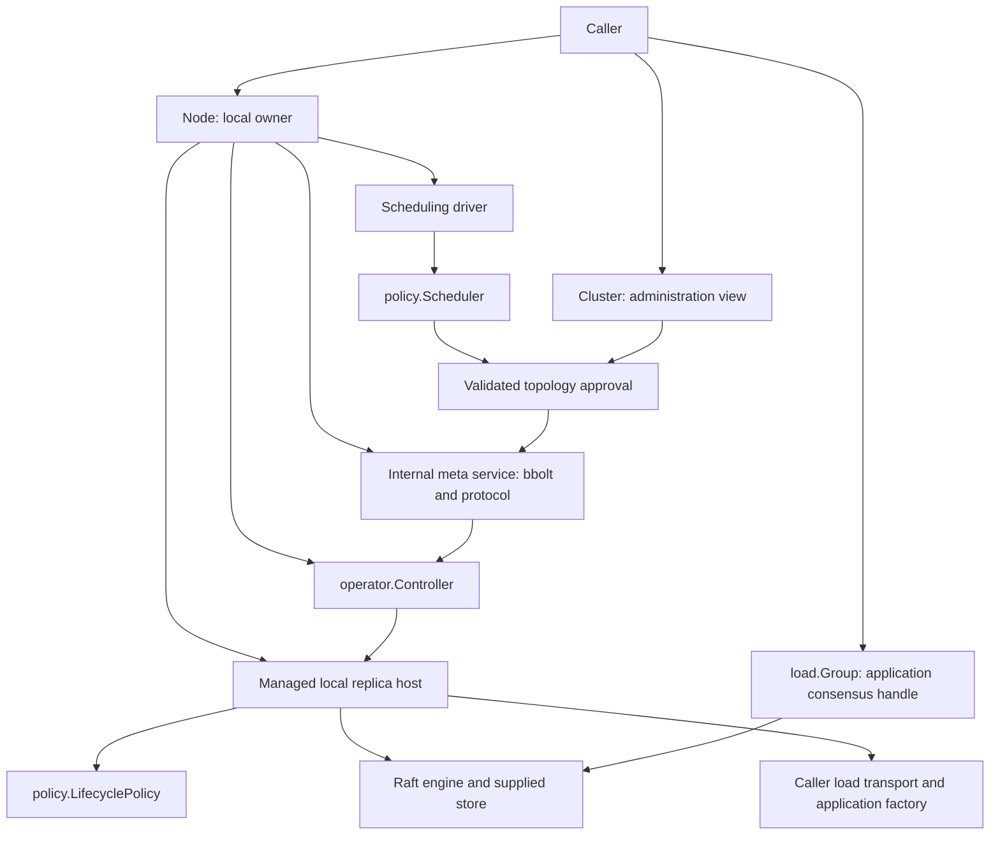

# Target architecture: Node, Cluster, managed replicas and configurable policies

Status: target specification for implementation. No implementation changes have
been made as part of this document. Baseline: `4b7721a`. This document resolves
the design tasks in the [discussion record](20261011-public-api-simplification.md)
and supersedes its intermediate sketches. The existing library behavior remains
the baseline wherever this document does not explicitly change a contract.

## 1. Request and accepted decisions

The request is to make the library easier to understand and integrate: replace
Runtime/OpenMeta/OpenLoad construction choreography with a node entry point,
separate cluster administration from local replicas, replace engine aliases
with deliberate public handles, and remove application-written Raft lifecycle
switches. Provide configurable built-in policies and public contracts that let
applications replace them without changing the library. Keep few interfaces.

| Decision | Target |
| --- | --- |
| Compatibility | Clean Go API refactor; migrate every example/test caller; no deprecated aliases. |
| Entry points | `gquorum.Node`, `gquorum.Cluster`, concrete `load.Group` handle. |
| Construction | `NewNode(NodeOptions)` followed by `Start(ctx)`; `_meta` opening is internal. |
| Distributed vs local | `cluster.CreateGroup` declares a group; `node.StartLoadGroup` starts an exact local replica. |
| Default hosting | Node owns recovery, replica supervision, membership effects and retirement orchestration. |
| Application integration | Factory, state machine, store, transport and typed retirement hook. |
| Local stop | Hold the exact replica for the current Node lifetime; explicit Start clears it. |
| Decision interfaces | `policy.Scheduler` and `policy.LifecyclePolicy`. |
| Built-in scheduler | `policy.RestoreDegraded`, replacing `RestoreDegradedPolicy`. No ReplicaChecker alias. |
| Execution | Concrete `internal/operator.Controller`, constructed and owned by Node. |
| Progress vocabulary | `Plan` is a preview; `Operator` is an approved plan and its execution progress. |
| Document names | Keep Latest, Target and Active. |
| Policy configuration | Caller supplies settings/implementation at startup. Cluster-agreed policy metadata is postponed. |
| Storage compatibility | Preserve existing identity strings, bucket keys, WAL and snapshot encodings. |
| Example | Small `_meta` demo in `examples/cluster`; align approve/operator HTTP names. |
| Testing | Preserve and migrate Raft correctness/fault tests in `tests/cluster`; keep short unit suite parallel. |

Unchanged requirements: all admitted nodes participate in `_meta`; node types
are caller-defined; `topology.Limits` alone contains cluster capacity bounds
(defaults: MaxNodes=3, MaxReplicas=5); deleted load-group IDs are permanently
retired. `_meta` uses bbolt and the included load store uses etcd WALs. Paths are
supplied by callers. The library supplies the `_meta` protocol and no load wire
protocol or application configuration loader. Events remain node-local through
the event bus and optional bbolt journal. Require idempotent callbacks and
verification of their exact authorized identities.

## 2. Components and dependency direction



Node owns one participant and one `_meta` service. Cluster is a stable view of
that Node, not another connection, store or lifecycle owner. Group is a view of
one local application replica. It exposes no raw membership or independent stop
operation. A stopped Group never redirects proposals into a successor replica.

The scheduler decides whether to request a supported topology change. The core
validates the request and commits the concrete plan. The operator controller
dispatches that approved plan and verifies progress. The managed host executes
exact local actions and owns their resources. No policy can replace the core's
authorization, persistence or membership checks.

Public packages are `gquorum`, `load`, `policy`, `topology`, `storage`,
`storage/walstore`, `events`, `fault`, and the advanced `membership` helpers.
Public `meta` disappears: its implementation moves to `internal/metaservice`.
Existing `internal/metaengine`, `metastore`, `metatransport`, `metapb`,
`raftengine`, `observe` and `raftlog` retain focused responsibilities.

Avoid import cycles: topology/storage/events/fault are lower-level public
packages; policy depends on their values, never on the root package. Load has
its own public application types and adapts them to the engine. Managed code
depends on load/policy/topology and internal consensus packages, never on
gquorum. The root package performs composition and converts public facade calls
to internal service/host calls. Small private interfaces and function fields are
allowed for internal composition; do not export a manager interface per helper.

### File inventory

Paths below are target paths. MOVED files are CREATED at the target path and
removed at their former path. Tests move with their owning implementation.

| File or subtree | Change | Responsibility |
| --- | --- | --- |
| `node.go`, `node_lifecycle.go` | CREATED | Node facade, constructor and shutdown composition; replaces runtime.go. |
| `node_options.go`, `node_status.go` | CREATED | Caller settings and owned local diagnostics. |
| `node_load.go`, `node_transport.go`, `node_session.go` | CREATED | Local group, protocol receiver and session facades. |
| `cluster.go`, `cluster_documents.go`, `cluster_mutations.go` | CREATED | Cluster interface and forwarding implementation. |
| `cluster_operators.go`, `cluster_status.go` | CREATED | Approval/progress and observation facades. |
| `runtime.go` | REMOVED | No Runtime compatibility layer. |
| `boot.go` | MOVED/UPDATED to `internal/managed/boot.go` | Existing identity/evidence decision table. |
| `load/load.go` | REPLACED by `load/group.go`, `machine.go`, `transport.go`, `standalone.go` | Explicit public values, facade and standalone owner. |
| `policy/scheduler.go`, `restore_degraded.go` | CREATED | Public scheduling contract and built-in decision logic. |
| `policy/lifecycle.go`, `default_lifecycle.go` | CREATED | Readiness/retention/removal contracts and defaults. |
| `policy/policytest/contracts.go` | CREATED | Optional public contract test helpers. |
| `internal/managed/host.go`, `replica.go`, `actions.go`, `transport.go` | CREATED | Per-group ownership, action dispatch and verified remote observations. |
| `internal/managed/recovery.go`, `retirement.go`, `policies.go` | CREATED | Recovery/readmission, retirement and callback invocation. |
| `internal/loadhandle/handle.go` | CREATED | Opaque handle representation; deliberately limited public method forwarding. |
| `internal/reconcile/engine.go` | MOVED/UPDATED to `internal/scheduling/driver.go` | Observation, leader/staging gates, cooldown and Scheduler invocation. |
| `internal/reconcile/policy.go` | MOVED/UPDATED to `policy/restore_degraded.go` | Preserve default decision semantics. |
| `internal/reconcile/contracts.go` | SPLIT | Public decision values in policy; internal service dependencies in scheduling. |
| `internal/convergence/*` | MOVED/UPDATED to `internal/operator/*` | Controller, exact-step validation and progress. |
| `meta/*.go` | MOVED/UPDATED to `internal/metaservice/*.go` | Existing topology service; private protocol and ledger entry points. |
| `topology/identity.go`, `views.go` | CREATED | Former meta identity/document/session observation values. |
| `topology/execution.go` | MOVED/UPDATED to `topology/operator.go` | Operator names and public JSON fields. |
| `topology/controller.go`, `reconciliation.go` | UPDATED | Owned statuses; remove public effect adapter; SchedulingStatus. |
| `internal/metaengine/codec.go`, `sm.go`, `metadata.go` | UPDATED | Explicit conversions preserving old persisted/wire encodings. |
| `internal/metaservice/wire.go`, `internal/metaengine/disk.go` | CREATED | Legacy wire/storage DTOs, separated from renamed public DTOs. |
| `storage/storage.go`, `storage/walstore/lifecycle.go` | UPDATED | Explicit retirement capabilities; no hidden age-based deletion. |
| `events/event.go`, `events/journal.go`, `events/disk.go` | UPDATED/CREATED | Public operator names with unchanged journal encoding. |
| `fault/fault.go`, `membership/safety.go` | UPDATED | Intentional names; safety remains fixed. |
| `examples/cluster/{main.go,http.go,http_test.go,README.md}` | UPDATED | Node/Cluster API and reviewed HTTP contract. |
| `tests/cluster/testapp/*`, `tests/cluster/*.go` | UPDATED | Application integration through new hooks; preserve test coverage. |
| `README.md`, `doc.go`, `docs/architecture/*`, `docs/testing/*`, `Makefile` | UPDATED | Current API guide, ownership, migration and checks. |

Private helper splitting within these files is implementation work. All new or
changed boundary methods and changed algorithms are specified below; existing
unchanged helper algorithms are retained rather than reimplemented.

## 3. Public node contract

### `node.go` — CREATED

```go
type Node interface {
    Start(context.Context) error
    WaitReady(context.Context) error
    Stop(context.Context) error
    RequestStop()
    Identity() topology.Identity
    Status() NodeStatus
    Cluster() Cluster

    StartLoadGroup(context.Context, load.ReplicaRef) (*load.Group, error)
    LoadGroup(string) (*load.Group, bool)
    LoadGroupIDs() []string
    StopLoadGroup(context.Context, load.ReplicaRef) error
    ParkedLoads() map[string]ParkedLoad

    ReceiveLoadRaft(context.Context, load.RaftBatch) error
    ReadLoadReplica(context.Context, load.ReplicaQuery) (load.ReplicaStatus, error)
    ApplyLoadAction(context.Context, load.ActionRequest) (load.ActionResult, error)
    ReportLoadDelivery(context.Context, load.DeliveryReport) error

    ActivateSession(context.Context) (topology.Session, error)
    KeepAlive(context.Context, string) error
    DeactivateSession(context.Context, string) error
    OwnSessionLive() bool
    ServeOverride() int
    SetServeOverride(context.Context, int) error
    SchedulingStatus() topology.SchedulingStatus
    SetSchedulingEnabled(context.Context, bool) error
}

func NewNode(NodeOptions) (Node, error)
func FoundingIDs(clusterID string, names []string) (map[string]uint64, error)
func LoadStoredIdentity(path string) (topology.Identity, bool, error)
```

The private implementation is `node`; Cluster is a private `clusterView{node}`.
Constructors validate/copy settings but open no stores and start no workers.
LoadStoredIdentity remains a read-only closed-database inspection; InstanceID
is empty because process identity is not a durable member pin.

Start is one-shot, launches admission/recovery and returns without waiting for
quorum. Its context is the Node lifetime context: cancellation requests joined
shutdown. Repeated Start while starting/running is idempotent and does not
replace that original context. Start after stopping/failed startup returns
ErrStopped; construct a new Node for another lifetime. WaitReady is cancelable
without stopping Node and completes after local admission, replay/activation
and the selected startup gate. It does not promise load leadership or perpetual
application readiness. Immediate setup failures are returned by Start; failures
after launch are exposed through Status and WaitReady and request cleanup.

StartLoadGroup waits for local recovery/replay, not election or quorum. Accepted
startup is owned by Node: a caller timeout ends its wait, while Status/LoadGroup
allow it to observe the ongoing attempt. Explicit Start only clears a hold
after validating the exact currently authorized identity. A repeat request joins
the existing attempt or returns the same exact running handle. Different IDs
cannot share a live group slot. Internal supervisor starts respect holds.

StopLoadGroup installs the hold before cancellation/join. Its successful return
means engine work and application Close have joined, with durable state retained.
Absent exact local handles can still be held when the identity is assigned;
an unknown or mismatched identity is refused. New Node lifetimes have no holds.

### `node_options.go` — CREATED

```go
type NodeOptions struct {
    Identity topology.Identity
    Node topology.Node
    Bootstrap BootstrapOptions
    Limits topology.Limits
    Placement topology.PlacementRule
    Meta MetaOptions
    Loads LoadOptions
    Policies PolicyOptions
    Health topology.HealthSource
    Events *events.Bus
    Logger *slog.Logger
}
type BootstrapOptions struct {
    Founders []FoundingMember
    Join bool
    JoinSeeds []string
}
type FoundingMember struct {
    Node topology.Node
    MemberID uint64
    Address string
}
type MetaOptions struct {
    DBPath string
    Network MetaNetworkOptions
    Timing MetaTiming
    SessionTTL time.Duration
    SnapshotThreshold uint64
    MaxWatchers int
    Observation ObservationOptions
}
type MetaNetworkOptions struct {
    Listener net.Listener
    AdvertiseAddress string
    Resolver topology.AddressResolver
    TLS, ClientTLS *tls.Config
    AllowPlaintext bool
    ClusterCredential []byte
    MaxSnapshotBytes int
}
type MetaTiming struct {
    TickInterval time.Duration
    ElectionTicks, HeartbeatTicks int
    DialTimeout, SendTimeout time.Duration
    PeerRetryInitial, PeerRetryMax time.Duration
}
type ObservationOptions struct { Interval, Timeout time.Duration }
type LoadOptions struct {
    Factory GroupFactory
    Retire RetireReplicaFunc
    Transport load.Transport
    Storage LoadStorageOptions
    Engine load.EngineOptions
    EffectTimeout time.Duration
    RecoveryInterval, RetirementInterval time.Duration
}
type LoadStorageOptions struct {
    WAL *WALOptions
    Store storage.Store
    Retirement storage.RetirementStore
}
type WALOptions struct {
    RootDir string
    SegmentBytes int64
    Prewrite *bool
}
type PolicyOptions struct {
    Scheduler policy.Scheduler
    RestoreDegraded policy.RestoreDegradedOptions
    Scheduling SchedulingOptions
    Lifecycle policy.LifecyclePolicy
    DefaultLifecycle policy.DefaultLifecycleOptions
    CallbackTimeout time.Duration
}
type SchedulingOptions struct {
    Disabled bool
    Interval, Timeout, Cooldown time.Duration
}
func (NodeOptions) Validate() error
func DefaultMetaTiming() MetaTiming
```

Zero durations use existing defaults: meta tick 100ms, election 10 ticks,
heartbeat 1, dial/send 500ms, peer retry 100ms..5s, session TTL 15s, snapshot
threshold 512, watchers 256, max snapshot 64MiB; observation 5s/2s; scheduling
30s/20s with 5m cooldown; stable-node window 60s. EffectTimeout defaults to 10s;
CallbackTimeout to 10s; load recovery's fallback scan to 250ms and retirement
collection to 1m. Topology changes also wake recovery immediately. Readiness
reevaluates on state changes and a bounded meta-tick timer. All timers are owned
and joined with Node. Scheduling callback deadline is the smaller of the
driver tick deadline and CallbackTimeout. Durations/bounds must validate before
use; never silently repair a negative value. Session TTL and Raft timing checks
retain their existing relationships. Limits is not duplicated in Meta or Loads.

Nil policies select the built-ins. Reject nonzero built-in options alongside
their custom implementation, so unused settings are not silently ignored.
Only resolve built-in option defaults when selecting that implementation; do
not manufacture nonzero unused options before the ambiguity check.
Scheduling.Disabled is the explicit automatic-repair opt-out. Copy maps/slices,
credentials, TLS configs and value options; installed custom objects must remain
stable for the Node lifetime. Do not add identity hashes, policy registries,
configuration parsers or `_meta` policy records.

No load dependencies means a valid meta-only Node. Otherwise Factory, Transport
and exactly one storage selection are required. WAL selection creates an owned
store using the Node identity. Injected Store is borrowed and requires an
explicit Retirement implementation for the managed retention contract (it may
be the same concrete object); do not use type-assertion fallbacks with different
cleanup semantics. Retire is optional only when no persistent application state
needs retirement; nil is an explicit application choice of no such resources.

### Factory and retirement — `node_load.go`, `load/application.go` — CREATED

```go
type GroupFactory func(context.Context, load.ReplicaSpec) (load.Application, error)
type RetireReplicaFunc func(context.Context, load.RetirementRequest) (load.RetirementResult, error)

// package load
type ReplicaRef struct { GroupID string; ReplicaID uint64 }
type ReplicaSpec struct {
    Identity storage.Identity
    Node topology.Identity
    Group topology.Group
    ApprovedVersion uint64
}
type Application struct {
    StateMachine StateMachine
    Close func(context.Context) error
}
type RetirementReason string // "topology" or "readmission"
type RetirementRequest struct {
    Identity storage.Identity
    Reason RetirementReason
    Authorization *topology.AuthorizedStep
    AdmissionID string
    PreviousMemberID, GrantedMemberID uint64
}
type RetirementResult struct {
    Identity storage.Identity
    Reason RetirementReason
    Authorization *topology.AuthorizedStep
    AdmissionID string
    PreviousMemberID, GrantedMemberID uint64
    Verified bool
}
```

Factory input is an owned approved specification, not caller-decided founding
peers or recovery mode. A failed factory cleans up its partial acquisitions.
A successful result transfers lifetime ownership of the machine and Close to
Node. Close runs after engine/callback work is joined, including failed startup.
A Close failure retains an owned failed/stopping slot; explicit retries of Stop
retry Close serially. Require idempotent Close; do not start a successor while
release is incomplete. Machine methods themselves remain serialized by Raft.

Retire handles durable application resources without needing a live machine.
It must verify the exact authorized identity and return matching proof fields.
Topology retirement requires Authorization and no AdmissionID. Readmission
requires AdmissionID and the exact previous/granted member pair instead of a
forged ordinary step. Require Verified=true and a matching complete tuple before
forgetting the local ledger. The library checks declared identities; verifying
arbitrary application databases is the application's responsibility. External
transactions/outboxes are caller-owned. Replaying an effect after a crash is
normal; exactly-once invocation is not promised.

### `node_status.go` — CREATED

```go
type NodeState string // new, starting, ready, fenced, stopping, stopped, failed
type NodeStatus struct {
    Identity topology.Identity
    State NodeState
    Ready bool
    SessionLive bool
    Meta topology.GroupStatus
    Scheduling topology.SchedulingStatus
    SelfRemoval *topology.SelfRemovalStatus
    Loads []LocalReplicaStatus
    ErrorCode fault.Code
    Error string
}
type LocalReplicaStatus struct {
    Identity storage.Identity
    State string // starting, ready, held, parked, stopping, failed
    ErrorCode fault.Code
    Error string
}
type ParkReason string // store_missing, store_unreadable, identity_mismatch
type ParkedLoad struct {
    Identity storage.Identity
    Reason ParkReason
    Since time.Time
}
type LoadParkedError struct { ParkedLoad; Cause error }
func (*LoadParkedError) Error() string
func (*LoadParkedError) Unwrap() error
func (*LoadParkedError) Is(error) bool
```

These values are copied observations, not health leases or linearizable reads.
Ready reports the completed startup gate while SessionLive/Active state remain
separate current serving inputs. Drain does not stop Raft. Fencing overrides
readiness immediately. Existing serve override stays local and durable; it is
an application readiness input, never a quorum or membership override.

## 4. Public Cluster contract and topology values

### `cluster.go` and facade files — CREATED

```go
type Cluster interface {
    Rules() topology.Rules
    IsLeader() bool
    Status(context.Context) (topology.ClusterStatus, error)
    HealthObservation() topology.HealthObservation
    ParkedJoins(context.Context) ([]topology.ParkedJoin, error)

    Latest(context.Context) (topology.Document, error)
    Target(context.Context) (topology.Document, error)
    Active(context.Context) (topology.Document, error)
    Get(context.Context, uint64) (topology.Document, error)
    History(context.Context, topology.Page) (topology.HistoryResult, error)
    Watch(context.Context, topology.View) (<-chan topology.Update, error)
    Stage(context.Context, topology.Document, uint64) (topology.Document, error)
    Plan(context.Context, uint64) (topology.Plan, error)
    PlanFor(context.Context, topology.Document) (topology.Plan, error)
    Approve(context.Context, uint64) (topology.OperatorID, error)
    Operator(context.Context, topology.OperatorID) (topology.OperatorStatus, error)
    WaitOperator(context.Context, topology.OperatorID) (topology.OperatorStatus, error)

    AddNode(context.Context, topology.Node, MutationOptions) (MutationResult, error)
    ReadmitNode(context.Context, string, MutationOptions) (MutationResult, error)
    DrainNode(context.Context, string, MutationOptions) (MutationResult, error)
    ActivateNode(context.Context, string, MutationOptions) (MutationResult, error)
    ExcludeNode(context.Context, string, MutationOptions) (MutationResult, error)
    ForceRetireNode(context.Context, string, RetireOptions) (MutationResult, error)
    SetPlacement(context.Context, topology.PlacementRule, MutationOptions) (MutationResult, error)
    SetGroupPlacement(context.Context, string, topology.PlacementRule, MutationOptions) (MutationResult, error)
    CreateGroup(context.Context, GroupSpec, MutationOptions) (MutationResult, error)
    DeleteGroup(context.Context, string, MutationOptions) (MutationResult, error)
    ChangeReplica(context.Context, string, string, topology.ReplicaRole, MutationOptions) (MutationResult, error)
    ReseatReplica(context.Context, string, string, MutationOptions) (MutationResult, error)
    RollbackTo(context.Context, uint64, MutationOptions) (MutationResult, error)
    TransferLeader(context.Context, string, string) error

    AcquireLock(context.Context, string, string) error
    LockHolder(context.Context, string) (topology.Session, bool, error)
}
type MutationOptions struct {
    ExpectedVersion uint64 `json:"expected_version,omitempty"`
    Actor string `json:"actor,omitempty"`
    Comment string `json:"comment,omitempty"`
    Approve bool `json:"approve"`
    Preview bool `json:"preview"`
}
type MutationResult struct {
    Document topology.Document `json:"document"`
    OperatorID topology.OperatorID `json:"operator_id,omitempty"`
}
type GroupSpec struct {
    ID string `json:"id"`
    Placement *topology.PlacementRule `json:"placement,omitempty"`
    Nodes []string `json:"nodes,omitempty"`
}
type RetireOptions struct {
    Reason string `json:"reason"`
    Mutation MutationOptions `json:"mutation"`
}
```

Keep existing CAS/preview/mutation behavior: zero ExpectedVersion in Go pins the
locally observed Latest; HTTP requires an explicit observed version. Preview
does not propose and cannot combine with Approve. MutationResult.Document can
be nonzero with an error when staging succeeded but approval failed. Approve
accepts only the current Latest; it reuses a matching nonterminal/succeeded
attempt and creates a fresh attempt after an eligible failed one. Preserve
permanent group retirement and allocation high-water marks on rollback/reseat.

Document reads and status return owned local state. Watch retains bounded
coalescing/overflow behavior and cancellation; reread current state to recover
from missed intermediate versions. Mutation forwarding still uses the included
meta protocol. Lock APIs keep existing session ownership and reserved node-key
checks; manual session methods on Node do not create a second session manager.

### `topology/identity.go`, `views.go`, `operator.go` — CREATED/UPDATED

Move Identity, Session, View (Latest/Target/Active), Page, HistoryResult, Update
and ParkedJoin from meta into topology with the same fields and semantics.
Identity retains NodeName/ClusterID/InstanceID/MemberID and snake_case JSON tags.
Session retains ID/NodeName/InstanceID/TTL. ParkedJoin retains all existing
reported member/version, refusal, timestamp and attempt fields.

Rename ExecutionID/State/Status/Record/Transition to OperatorID/State/Status/
Operator/OperatorTransition respectively. Copy the complete existing fields;
replace named ExecutionID fields with OperatorID and public JSON execution_id
with operator_id. `MakeOperatorID(version, attempt)` retains `exec-v%d-a%d`.
Preserve state strings pending/running/waiting_for_replica/waiting_for_catch_up/
waiting_for_leader/succeeded/failed/superseded and methods Terminal/Waiting/Valid.
Keep Plan/Step/StepKind fields, ordering, string encodings and Equal/IsEmpty.
AuthorizedStep retains Matches with the renamed ID type. Its complete identity
is OperatorID, Version, Attempt, StepSeq, Kind, GroupID, NodeName, ReplicaID.

ClusterStatus.Execution becomes Operator with JSON operator. Reconciliation
status becomes SchedulingStatus: retain all fields and states, rename its
CurrentExecutionID to CurrentOperatorID and public JSON accordingly. Local
scheduling status remains independent of the replicated Operator status.
Keep group health, term, applied/commit, learner/voter progress and fresh/unknown
observation fields. Public GroupController is removed; its capability is now an
internal managed implementation. AddressResolver and HealthSource remain public.

Go-only symbol renames must use explicit private disk/wire adapters wherever
they would change serialized bytes. Sections 9 and 10 define that boundary.

## 5. Load handle, transport and standalone API

### `load/machine.go`, `group.go` — CREATED

```go
type Command struct { Index, Term uint64; RequestID string; Data []byte }
type Result struct { Code string; Data []byte }
type Proposal struct { RequestID string; Data []byte }
type StateMachine interface {
    Apply(context.Context, Command) (Result, error)
    Snapshot(context.Context) ([]byte, error)
    Restore(context.Context, []byte) error
}
type Timing struct {
    TickInterval time.Duration
    ElectionTicks, HeartbeatTicks int
    WALWriteWait time.Duration
}
type EngineOptions struct {
    Timing Timing
    SnapshotThreshold uint64
    MaxPendingProposals int
    MaxUncommittedBytes, MaxApplyBatchBytes uint64
}
type ProposalStats struct { Limit, InFlight, Queued, AwaitingCommit int }

// Group is opaque; only these methods are public.
func (*Group) Identity() storage.Identity
func (*Group) GroupID() string
func (*Group) ReplicaID() uint64
func (*Group) Propose(context.Context, Proposal) (Result, error)
func (*Group) WaitReady(context.Context) error
func (*Group) IsLeader() bool
func (*Group) Status() topology.GroupStatus
func (*Group) ProposalStats() ProposalStats
func (*Group) WALStall() time.Duration
func (*Group) Snapshot(context.Context) error
func (*Group) Error() error
func (*Group) Running() bool
```

Public values are defined types, not aliases to raftengine. Preserve existing
defaults for engine bounds and the proposal lifecycle. State-machine business
rejections return deterministic Result.Code; Apply errors halt that replica.
Restore(nil) initializes empty state, snapshots are complete and nonempty, and
recovery restores the full snapshot plus committed tail. Applied hints do not
permit skipping state-machine reconstruction. Request cancellation never rolls
back a committed proposal; application request IDs/deduplication remain needed.

Implement a deliberate facade without promoting methods from the engine. One
concrete construction technique avoids public internal-engine constructors:
`internal/loadhandle.Handle` owns an unexported pointer to the core;
`type Group loadhandle.Handle` is a defined type, not an alias. Explicit Group
methods convert to the internal handle and forward only the listed operations.
Root composition can convert a returned internal handle pointer to *load.Group;
Go does not inherit the internal method set. No embedded engine, unsafe casts,
global registries, public Internal() escape hatch or exported raw handle field.
The internal host retains the core pointer separately for membership/stop.
Reject operations on a zero-value Group cleanly; callers obtain handles from an
owner. Close/Start/Step/ProposeConfChange/Membership are absent on managed Group.

### `load/transport.go` — CREATED

```go
type Transport interface {
    SendRaft(context.Context, RaftBatch) error
    ReadReplica(context.Context, ReplicaQuery) (ReplicaStatus, error)
    ApplyAction(context.Context, ActionRequest) (ActionResult, error)
}
type Peer struct {
    Node topology.Identity
    Replica ReplicaRef
}
type RaftBatch struct {
    From, To Peer
    DeliveryID uint64
    Messages []raftpb.Message
}
type ReplicaQuery struct { From topology.Identity; To Peer }
type ReplicaStatus struct {
    Peer Peer
    Found bool
    Status topology.GroupStatus
    LocalState string
}
type ActionRequest struct {
    From topology.Identity
    To Peer
    Authorization topology.AuthorizedStep
    LocalTarget storage.Identity
}
type ActionResult struct {
    From Peer
    Authorization topology.AuthorizedStep
    LocalTarget storage.Identity
    Verified bool
}
type DeliveryKind string // unreachable, snapshot_succeeded, snapshot_failed
type DeliveryReport struct {
    From, To Peer
    DeliveryID uint64
    Kind DeliveryKind
}
```

This is a Go adapter contract, not a network protocol. The application chooses
codec, authentication, RPC server, addresses and connection lifecycle. It binds
its three handlers directly to Node's matching receiver methods after decoding
and authenticating the peer. Query/action replies must echo the complete exact
identity and authorization; an empty or malformed reply is not success.

Every peer includes cluster, node, member, process incarnation, group and replica
identity. The host derives identities from approved topology/admissions and
observations; unknown identity delays sending instead of accepting a wildcard.
The authenticated sender must match the encoded sender. For managed actions,
From is the authorizing meta participant; To is the receiving load participant.
Membership action target and receiving leader can differ. LocalTarget is the
replica being created/stopped/retired for host-local effects. Do not compare an
added learner ID to the leader receiver ID as though they were interchangeable.

For group-wide founding/deletion, expand the approved operation into exact local
replica targets from the retained approval lineage. Deletion includes prepared
replicas and interrupted Target identities, not just current Active. Validate
each local ledger identity against that catalog. Use no zero-ID wildcard RPC.
Host-local deletion remains possible after the load quorum has stopped; it
does not require a live load leader. A missing local handle can be observed as
Found=false for a specified exact identity without authorizing foreign state.

ReceiveLoadRaft validates both header identities and every raft Message.From/To,
permits only the current/approved preparation membership scope, and passes owned
messages to the exact core. ReadLoadReplica is an owned local observation with
no linearizability promise. ApplyLoadAction validates the complete immutable
approved step before execution and after waits; a receiver behind the authorizing
cursor returns retryable unavailability only after retained-plan identity
matches. A stale/terminal/future/other-attempt action is refused.

SendRaft calls for a destination are serialized, and distinct destinations are
independent with bounded queues. Nil return means accepted by the transport;
it is not sufficient snapshot-completion proof. DeliveryID is generated by the
sending host for one exact handle lifetime and batch. Synchronous transports
report snapshot completion before/after returning; asynchronous transports use
ReportLoadDelivery when transfer finishes and report later failures. Validate
reports against issued delivery IDs and both peers; drop completed/old reports
without affecting successors. A send error automatically reports undelivered
messages. Bound pending report bookkeeping by engine outbound/snapshot limits;
on expiry report snapshot failure and release the token. Report deadlines use
EffectTimeout, not an unbounded background wait. The transport owns queued copies
after return and must honor cancellation and joined shutdown.

### `load/standalone.go` — CREATED

Preserve the existing advanced ability to run a load engine without `_meta`.
Use a separate concrete owner so managed Group cannot expose an authorization
bypass. Standalone is never attached to Node's managed registry.

```go
type RaftTransport interface { Send(context.Context, []raftpb.Message) error }
type StartMode string // founding, joining
type StandaloneOptions struct {
    Identity storage.Identity
    InstanceID string
    Mode StartMode
    Peers []raft.Peer
    Engine EngineOptions
    Store storage.Store
    StateMachine StateMachine
    Transport RaftTransport
    Events *events.Bus
    Logger *slog.Logger
}
func NewStandalone(StandaloneOptions) (*Standalone, error)
func (*Standalone) Start(context.Context) error
func (*Standalone) Group() *Group
func (*Standalone) Stop(context.Context) error
func (*Standalone) Step(context.Context, raftpb.Message) error
func (*Standalone) ChangeMembership(context.Context, raftpb.ConfChangeV2, membership.HealthSource) error
func (*Standalone) TransferLeader(context.Context, uint64) error
func (*Standalone) ReportUnreachable(uint64)
func (*Standalone) ReportSnapshot(uint64, raft.SnapshotStatus)
```

NewStandalone opens/restores storage but starts no workers, matching the previous
low-level constructor contract. Start lifetime and Stop ownership are explicit;
injected store/machine/transport remain caller-owned. ChangeMembership uses the
fixed membership coordinator, not raw unchecked ConfChange forwarding. Without
meta the caller supplies membership authority, recovery identity policy and
protocol validation. This preserves the capability without a load-only Node
mode or another public interface. Remove load.Registry and load.Options engine
aliases; registry operations become internal owner operations.

## 6. Policies and controlled behavior

### `policy/scheduler.go`, `restore_degraded.go` — CREATED

```go
type Scheduler interface {
    Schedule(context.Context, ScheduleInput) (ScheduleDecision, error)
}
type ScheduleInput struct {
    Now time.Time
    Latest, Target, Active topology.Document
    Status map[string]topology.GroupStatus
    Health map[string]topology.GroupHealthEvaluation
    Alive map[string]time.Duration
    Held []storage.Identity
}
type ScheduleActionKind string // initially only "restore_missing_replica"
type ScheduleAction struct {
    Kind ScheduleActionKind
    Identity storage.Identity // exact old missing required voter
}
type ScheduleDecision struct {
    Action *ScheduleAction
    Reason string
}
type RestoreDegradedOptions struct { StableFor time.Duration }
type RestoreDegraded struct { /* private copied options */ }
func NewRestoreDegraded(RestoreDegradedOptions) (*RestoreDegraded, error)
func (*RestoreDegraded) Schedule(context.Context, ScheduleInput) (ScheduleDecision, error)
```

The input is copied, coherent local observations rather than a linearizable
transaction. Nil Action means no proposal; Reason explains waiting/blocked/idle.
The core validates an action and assigns the new replica ID, so custom code
cannot skip allocators, reuse identities or supply arbitrary Raft operations.
Supported actions are deliberately bounded by the existing replicated repair
command. Custom policies can select/order/defer those repairs; additional
placement/scaling actions require separately specified validated commands.

RestoreDegraded retains the current algorithm: consider non-meta required Active
voters on active nodes; skip intentional learners, missing observations and
present membership; refuse quorum-lost candidates; wait for stable-node duration;
propose one exact missing voter replacement using a fresh identity. A valid
candidate wins even if another group is blocked; absent a candidate, quorum-loss
reason outranks stability wait, which outranks converged. Do not infer that a
node with a missing established WAL may start from empty state. Honor local
stop holds in host startup; do not use replacement to erase a current-node hold.

The scheduling driver retains leader/staging/failed-operator gates, bounded
health collection, cooldown and the existing narrowly authorized empty Internal
document healing path. It wakes approved execution independently of scheduling
enablement. Disable prevents new automatic work, not an approved Operator.
Only the current meta leader evaluates automatic decisions. Followers apply the
concrete proposal through the deterministic FSM, without invoking custom code.

### `policy/lifecycle.go`, `default_lifecycle.go` — CREATED

```go
type LifecyclePolicy interface {
    Readiness(context.Context, ReadinessInput) (ReadinessDecision, error)
    Retention(context.Context, RetentionInput) (RetentionDecision, error)
    Removal(context.Context, RemovalInput) (RemovalDecision, error)
}
type ReadinessInput struct {
    Now, StartedAt time.Time
    Identity topology.Identity
    FirstBootstrap bool
    Admitted, Recovered, SessionLive bool
    MissingFounders []topology.Identity
}
type ReadinessState string // ready, waiting, failed
type ReadinessDecision struct { State ReadinessState; Reason string }
type RetentionInput struct { Now time.Time; Retired storage.RetiredReplica }
type RetentionDecision struct { Collect bool; NotBefore time.Time; Reason string }
type RemovalInput struct {
    Identity topology.Identity
    Removal topology.SelfRemovalStatus
    Fenced bool
}
type RemovalAction string // stop_node, keep_diagnostics
type RemovalDecision struct { Action RemovalAction; Reason string }
type StartupGate string // local_admission (default), all_founders
type RemovalMode string // stop_node (default), keep_diagnostics
type DefaultLifecycleOptions struct {
    Startup StartupGate
    FoundersTimeout time.Duration
    Retention time.Duration
    RetainForever bool
    Removal RemovalMode
}
type DefaultLifecycle struct { /* private copied options */ }
func NewDefaultLifecycle(DefaultLifecycleOptions) (*DefaultLifecycle, error)
func (*DefaultLifecycle) Readiness(context.Context, ReadinessInput) (ReadinessDecision, error)
func (*DefaultLifecycle) Retention(context.Context, RetentionInput) (RetentionDecision, error)
func (*DefaultLifecycle) Removal(context.Context, RemovalInput) (RemovalDecision, error)
```

Readiness defaults to admitted/recovered/session-live. AllFounders adds an exact
founder-admission/health gate only for the first bootstrap of this local meta
lineage, never disables the meta listener, and cannot loosen mandatory checks.
FirstBootstrap is based on a genuinely fresh store opened for founding in this
Node lifetime; retained stores use normal recovery even if an earlier process
stopped before its optional gate completed. Timeout marks startup failed and
requests joined shutdown; cancellation of one WaitReady call does not.

Retention defaults to seven days for approved quarantined load Raft state;
RetainForever prevents collection, not quarantine/namespace retirement. Reject
negative values and RetainForever combined with a nonzero duration. Collect
requires Now >= NotBefore, a matching owned quarantine token/identity and no
live ownership of that exact state. Retention never chooses arbitrary paths or
deletes application data. Meta readmission backups are retained for explicit
caller administration; they are not swept as load directories.

Removal always fences the old identity, disables application serving and stops
its load replicas/meta participation before the response choice matters.
StopNode invokes RequestStop; KeepDiagnostics retains only local read-only
observations and lets the caller's HTTP server continue. Never call os.Exit.
In that state Cluster.Status returns cached observations; it does not initiate
new probes, proposals or effects.
On policy error or invalid output remain fenced, record failure and retry the
decision; never resume the removed participant through a fallback.

### Callback execution and replacement

Install one Scheduler and one LifecyclePolicy per Node. Serialize invocations
of each selected instance in that Node; never overlap retries after timeout.
Callers sharing one object/state across Nodes or both contracts must synchronize
that sharing. Take owned snapshots under locks, release locks, invoke the
callback, then revalidate versions/identities after return. No storage, replica
or topology mutex may be held during caller code.

Factory and policy calls receive fresh bounded contexts capped by the owning
operation. Shutdown Close calls use a fresh bounded teardown context instead of
the already-canceled engine context. Persistent state-machine Apply/Restore/
Snapshot use their engine-owned contexts and existing serialization; an RPC
deadline is never used as a successful replica's lifetime.

Callbacks must honor context cancellation. A deadline does not kill a Go
goroutine: retain ownership until it returns, expose the stalled operation and
let Stop time out rather than leaking it or launching competing work. Factory,
Close and Retire are serialized through per-group reservations without holding
mutexes during application code. Callbacks can read status or RequestStop and
return; they must not synchronously wait for Stop, their own group's lifecycle
operation or another action that must join them. This restriction is documented
on every callback, not left to accidental deadlock behavior.

Errors are visible and non-successful: scheduler errors retry after the driver's
bounded delay; readiness errors keep startup unready (explicit Failed is fatal);
retention errors retain data; removal errors retain fencing; factory/retirement
errors retain ownership/evidence. Invalid decisions never choose permissive
defaults. Scheduler/LifecyclePolicy callbacks propose decisions only; application
side effects use the explicit factory/Close/Retire contracts.

Provide `policytest.CheckScheduler(t, factory, cases)` and
`policytest.CheckLifecycle(t, factory, cases)` with exported case structs
containing Input, expected Decision and expected error code. Each factory creates
an independent implementation. Helpers exercise input ownership and declared
results; cancellation and runtime fencing are separately tested in the host.
They cannot prove arbitrary caller code terminates, is deterministic or is free
of side effects. An external-package example embeds *DefaultLifecycle and
overrides one method, demonstrating replacement without internal imports.

## 7. Internal ownership, execution and method contracts

The following are implementation boundaries, not more caller-facing interfaces.
Construct service/host with closures that avoid importing gquorum. All workers
are registered with Node before launch and participate in one joined shutdown.

| Target file | Required signatures / changes |
| --- | --- |
| `internal/managed/host.go` | `New(Config) (*Host,error)`; `Start(context.Context) error`; `Quiesce(context.Context) error`; `Stop(context.Context) error`; owned `Snapshot() []ReplicaStatus`. |
| `internal/managed/replica.go` | `StartReplica(ctx, load.ReplicaRef, StartReason) (*loadhandle.Handle,error)`; `StopReplica(ctx, load.ReplicaRef, StopReason) error`; `Lookup(string) (*loadhandle.Handle,bool)`; `IDs() []string`; `Parked() map[string]ParkedReplica`. |
| `internal/managed/actions.go` | `ApplyAction(ctx, load.ActionRequest) (load.ActionResult,error)`; `authorize(ctx, topology.AuthorizedStep) error`; `verifyLocalEffect(ctx, load.ActionRequest) error`. |
| `internal/managed/transport.go` | `ReceiveRaft(ctx, load.RaftBatch) error`; `ReadReplica(ctx, load.ReplicaQuery) (load.ReplicaStatus,error)`; `ReportDelivery(ctx, load.DeliveryReport) error`; `ObserveGroup(ctx,string) (topology.GroupStatus,error)`; `Dispatch(ctx,topology.AuthorizedStep) error`. |
| `internal/managed/boot.go` | Preserve `decideLoadBoot(identity, record, recorded, probe, scope)` as a pure helper; boot/preflight errors map into public parked observations. |
| `internal/managed/recovery.go` | `RecoverAssignments(ctx) error`; `Readmit(ctx, Readmission) error`; exact previous-catalog checks and meta-file quarantine. |
| `internal/managed/retirement.go` | `Retire(ctx, load.RetirementRequest) (load.RetirementResult,error)`; `CollectRetired(ctx) error`; catalog/authorization and physical cleanup separated. |
| `internal/managed/policies.go` | `CheckReadiness(ctx) (policy.ReadinessDecision,error)`; `HandleRemoval(ctx,topology.SelfRemovalStatus) error`; bounded serial callback guards. |
| `internal/scheduling/driver.go` | `New(Config) (*Driver,error)`; `Start(ctx) error`; `Stop(ctx) error`; `Tick(ctx) error`; `Status() topology.SchedulingStatus`; `SetEnabled(ctx,bool) error`; `commitDecision(ctx,ScheduleInput,ScheduleDecision) (topology.OperatorID,error)`. |
| `internal/operator/controller.go` | `New(Config) (*Controller,error)`; `Start(ctx)`; `Stop()`; `Signal()`; `Tick(ctx)`; `SetFinalValidator(func(ctx,active,target Document) error)`. Preserve step ordering, bounded proposal timeout and error classification. |
| `internal/operator/contracts.go` | Rename existing ExecutionCoordinator/Record types to OperatorCoordinator/Record. Required methods: `IsMetaLeader() bool`, `CurrentOperator(ctx) (Record,bool)`, `RecordOperatorTransition(ctx,topology.OperatorTransition) error`. GroupEffects remains internal with existing Status/CreateGroup/PrepareReplica/ApplyMembership/TransferLeader/StopReplica/CleanupReplicaState/DeleteGroupState methods. |
| `internal/metaservice/*` | Retain existing service algorithms and signatures with renamed public types. Constructor takes private Options; injected GroupEffects, scheduling driver, and typed readmission/removal callbacks are composed by Node. Meta Step/Call, Authorize and ledger APIs are internal only. |
| `internal/metaengine/*` | Rename Go execution symbols consistently, preserve proposal kind strings and disk/wire DTO tags, validate conversions before apply. No policy callbacks inside FSM. |
| `membership/safety.go` | Rename concrete SafetyPolicy to SafetyRules; preserve Check signature/algorithm and fixed coordinator use. No configurable safety implementation. |
| `fault/fault.go` | Rename ExecutionAuthorization/ErrExecutionAuthorization to OperatorAuthorization/ErrOperatorAuthorization while preserving code string `execution_authorization`; NoController may remain the stable transport error but user-facing messages explain missing load hosting. Other stable codes remain. |

Config values are private concrete structs. Managed Config supplies immutable
identity, store and retirement handles, application factory/hooks, transport,
policy runner and closures for service identity/views/authorization/ledger CAS.
Scheduling Config supplies selected Scheduler, timings, observation/service
host and event/logger callbacks. Operator Config retains Store, Rules,
Coordinator, GroupEffects, immutable OwnsGroup, intervals and final validator.
Do not export either Config through a public type alias.

Node startup wiring order: create private meta service and host with dependency
closures; wire group effects to the host; construct operator controller and
scheduler driver; start meta storage/protocol/engine; start policy/observation
workers and host supervision once durable service dependencies exist. Callback
closures resolve current stores/identities after readmission, not stale handles.
Start the meta service before waiting for local admission or load readiness.

Group creation fan-out attempts every authorized founder even when earlier ones
are waiting; it never waits for the first founder's election before contacting
the others. Membership creation retries verify the complete founding voter set.
Prepared learners start in joining mode with no founding peers. Existing voters
recover their persisted ConfState, overriding constructor peer suggestions.

Retirement ordering: reserve exact identity, fence/stop/join, verify authorized
catalog and actual disk identity, invoke/verify application Retire, quarantine
the exact Raft state, then forget only the exact ledger identity. Retry can verify
an already absent retired identity without touching an authorized successor.
Collection of quarantine bytes is a separate later retention action. No callback
is skipped merely because the Raft directory has already moved after a crash.

Readmission owns the former fixture orchestration: validate the granted member
and admission ID; fence old work; join old engines and close old meta DB; inspect
all previous approved/Active replica IDs; stop/quarantine only the actual retained
identity in that catalog; run application retirement with readmission proof;
rename the old pinned meta file to an exact deterministic retired path; fsync its
parent; verify the live path is genuinely fresh before installing the new pin.
Existing matching backup plus absent original is an idempotent retry; foreign
backup/live pin is refusal. Never infer fresh bootstrap from an established
missing WAL. Caller Bootstrap.Join/retained identity selects admission mode;
the library does not guess application deployment intent after a missing meta DB.

## 8. Ownership and data flows

| Resource | Owner and release contract |
| --- | --- |
| Meta bbolt and included WAL store | Node opens and closes at caller-supplied paths. |
| Supplied meta listener | Borrowed at construction; successful Start transfers serving/close ownership to Node's meta server; never reuse it after Stop. Failed NewNode leaves it with caller. |
| Caller load transport/listeners and custom stores | Borrowed; caller closes after Node.Stop succeeds. |
| Factory result | Node owns machine lifetime; invokes Close after joining engine work. |
| Events bus/journal | Borrowed; caller closes bus after producers, then journal. |
| Standalone dependencies | Caller-owned; Standalone.Stop joins workers without closing shared dependencies. |
| Stop holds | Node-local memory; exact identity keys; destroyed with Node. |
| Policy implementations | Caller-created, fixed installation; invocations owned/joined by Node. |

### Startup, restart and admission

1. NewNode normalizes/copies and validates settings. Reject ambiguous load storage,
   invalid modes, duplicate founders, inconsistent IDs/types, missing paths,
   impossible timing and invalid policy options before any resource mutation.
2. Start opens validated/pinned storage, starts the included meta server and
   launches workers under its lifetime context. Diagnostics are immediately usable.
3. Fresh founders use the exact declaration. Joiners contact seeds and wait for
   an approved admission; unapproved joins remain parked. Retained stores resume
   their exact lineage. A readmission grant follows the fenced flow in section 7.
4. WaitReady observes meta replay, admission/session activation and the selected
   startup gate. Waiting does not block peer messages or load action receivers.
5. The host recovers approved local assignments. Missing established storage is
   parked with evidence retained. An active replica missing only its ledger can
   be adopted from matching durable storage. An empty prepared learner can resume.
6. Application readiness remains the caller's conjunction of Node/session state,
   Active node status and application requirements. Draining never rewrites quorum.

### Replica start, duplicate requests and holds

1. Resolve an exact ReplicaRef against Target/Active/retained preparation evidence.
2. Reserve its group slot. The registry hit path returns/awaits only the matching
   identity. A different live/stopping identity blocks replacement.
3. Supervisor starts return held when the exact local hold exists. Explicit
   starts clear that hold only after authorization. Holds never authorize peers.
4. Probe storage and ledger before factory construction. Refuse/park foreign,
   unreadable or established-missing evidence. Decide fresh/join/resume/reseat.
5. Acquire the machine through Factory, create/recover durable engine state, then
   CAS-record the ledger. Start Raft under Node lifetime, wait for local replay.
6. Revalidate after waits, publish one handle, release reservation. A failure
   stops the created engine and releases acquired application resources; retain
   ownership if teardown fails. Caller cancellation does not lose the slot.

### Topology mutation, approval and execution

1. A mutation or Stage pins Latest via CAS. Preview computes an owned candidate
   with no proposal. Mutation approval can fail after the staged version commits.
2. Plan reads current membership and builds an ordered exact plan. It is a preview,
   not authorization; Approve revalidates before the replicated begin proposal.
3. The FSM validates the version, exact plan, allocation/retirement rules and audit,
   records Target and Operator, and returns its stable ID/attempt.
4. Controller observes the recorded cursor, routes an exact action and verifies
   its postcondition. Receiver checks sender, receiver, target and full approved
   tuple. Membership uses fixed single-change learner-first safety checks.
5. Lost replies/restarts repeat verified idempotent actions. Re-observe membership
   before progress; host-local attestations require exact verified results.
6. Commit cursor transitions with bounded proposal contexts. On leader changes,
   stop proposing progress and let the new leader resume the same record.
7. Verify all affected groups and final drain safety before advancing Active.
   WaitOperator reports terminal status; success does not imply app read readiness.

### Automatic scheduling

1. Wake already approved Operators even if new scheduling is disabled.
2. Only the leader with aligned Latest/Target/Active, known health and no relevant
   failed/in-progress work collects inputs. Respect staging and cooldown.
3. Call the startup-installed Scheduler on owned inputs outside locks.
4. Validate decision kind, exact old identity, current documents/observations and
   allocator. Reject stale decisions via the ordinary replicated CAS command.
5. The FSM commits the concrete repair and operator; use the normal execution path.
   Different node configurations are allowed. No policy agreement or hash is stored.

### Retirement and shutdown

1. Local explicit Stop records a hold and joins exact owned work; topology retirement
   uses its own reason and does not create a manual hold.
2. Retirement verifies application results, quarantines exact Raft state and CAS
   forgets the ledger. Retention lists owned quarantine records and collects only
   individually revalidated decisions. No callbacks run under store locks.
3. Node.RequestStop atomically rejects new mutations/lifecycle admissions, cancels
   owned contexts and starts one teardown coordinator. Accessors remain available.
4. Quiesce scheduling, operator, admission/session side effects and inbound action
   work. Join admitted callbacks and replica starts, then stop/join load engines
   and application Close callbacks. Close owned WAL store, stop meta and close DB.
5. Stop waits for that same coordinator. A timeout returns ShutdownTimeout and
   retains ownership; another Stop can continue waiting. No reuse until joined.
   If a release callback returns an error, expose an incomplete teardown result,
   retain the slot and leave dependent stores open. A subsequent Stop requests a
   serial retry from the same coordinator. Do not mark the Node stopped or close
   stores behind resources whose release is still incomplete.

### Reads, watches and events

Local document/cache hits return clones. Unknown history versions return
HistoryUnavailable; they do not cause network fetching or mutate state. Cluster
Status may perform bounded live observations; Node.Status never does. Watches
and event subscribers have explicit bounded buffers and cancellation. Slow event
subscribers receive loss information; local journal availability never grants
Raft authorization and events are never embedded in topology snapshots.

### Failure matrix

| Failure | Required outcome |
| --- | --- |
| Invalid constructor settings | No stores/workers created; typed Invalid. |
| Meta open/pin/replay failure | Failed startup; joined cleanup; never recreate retained state. |
| No meta quorum / join not approved | Unready/parked with live protocol and diagnostics; caller deadline is respected. |
| Load WAL absent after establishment | Park exact identity; retain ledger; require approved reseating/readmission. |
| Foreign/unreadable load state | Park without deleting or rebinding it. |
| Factory fails | Factory releases partial resources; no published handle. |
| Close fails | Retain stopping ownership; no successor; retry only serially. |
| Retirement callback errors or mismatched attestation | Do not forget ledger; report/retry, preserving exact evidence. |
| Callback ignores cancellation | Remains owned and visible; Stop may time out; no replacement goroutine. |
| Stale Scheduler decision | Refuse before effects through identity/version validation/CAS. |
| Changed caller Scheduler after restart | New decisions use caller selection; approved Operators retain their concrete plans. |
| Receiver behind approved cursor | Retryable only after immutable retained-plan identity matches. |
| Stale action or successor mismatch | Refuse; never stop/delete a successor. |
| Action reply lost after effect | Retry and verify postcondition; no exactly-once invocation assumption. |
| Meta leadership changes mid-effect | Finish admitted consensus operation safely; revalidate before progress; new leader resumes. |
| Staging succeeds, approval fails | Return staged document and error; HTTP preserves staged version. |
| Local hold blocks start | Waiting-for-replica status with local-stop reason, not automatic restart. |
| Quarantine move succeeds but fsync/reply fails | Retry verifies exact location/identity; no blind second move. |
| Removal policy fails | Remain fenced; retry policy; never reactivate. |
| Watch/event buffer overflows | Bounded loss/coalescing semantics; consensus remains independent. |

## 9. Persistence schemas and local state

There is no SQL database, DDL, ORM or external cache in this library. The schema
is bbolt buckets/keys, JSON records, raft protobuf payloads and etcd WAL files.
This refactor introduces no new durable bucket or schema version. Specifically,
there is no scheduler declaration/fingerprint, stop-hold bucket or replicated
event log. New in-memory fields and physical retirement capabilities are listed
below. All retained data must remain readable after the API refactor.

### Meta bbolt — unchanged physical layout

Caller path: NodeOptions.Meta.DBPath. Parent mode 0700, database 0600. Writes
remain synchronous; do not inherit the local event journal's NoSync option.
Integer keys/values described as BE64 use exactly eight big-endian bytes.

| Bucket | Keys and value encoding | Constraint/index/lifetime |
| --- | --- | --- |
| `format` | `schema_version` -> ASCII `1` | Complete known bucket set required; unsupported/partial retained schemas refused. |
| `hardstate` | `current` -> raftpb.HardState protobuf | Persist term/vote/commit before dependent messages; reject regression. |
| `entries` | BE64 log index -> raftpb.Entry protobuf | Ordered unique index; contiguous restored prefix; committed entries cannot be replaced. |
| `snapshot` | `current` -> raftpb.Snapshot protobuf | Complete application state and ConfState; monotonic index. |
| `applied` | `index` -> BE64; `confstate` -> raftpb.ConfState protobuf | Applied cannot exceed durable commit; paired evidence validated. |
| `state` | `current` -> JSON meta state schema 1 | Materialized FSM state; record graph below. |
| `identity` | `node_name`, `cluster_id` -> UTF-8; `member_id` -> BE64; optional `member_seen` -> byte 1 | Exact node/cluster/member pin. No InstanceID pin. Incomplete/unknown identity fields refused. |
| `serve_override` | optional `current` -> BE64 | 0 clears key; positive <= Limits.MaxNodes; local only. |
| `load_replicas` | group ID UTF-8 -> JSON ReplicaRecord | Node/cluster must equal meta pin; replace/forget only exact expected replica ID. |

The bbolt ordered keys are the indexes; there are no extra secondary indexes or
uniqueness tables. Identity comparisons use full tuples. Fresh means all retained
buckets contain no prior evidence except format; an absent identity key alone
is insufficient. A member_seen marker survives snapshots to distinguish removed
members from never-admitted joiners.

```go
// Private durable record; tags remain unchanged.
type ReplicaRecord struct {
    NodeName string `json:"node_name"`
    ClusterID string `json:"cluster_id"`
    ReplicaID uint64 `json:"replica_id"`
    Origin string `json:"origin"`
    CreatedAt time.Time `json:"created_at"`
}
type metaDiskState struct {
    SchemaVersion uint32 `json:"schema_version"`
    Rules topology.Rules `json:"rules"`
    RetiredGroups []retiredGroup `json:"retired_groups"`
    Allocations []allocationRecord `json:"allocations"`
    Latest topology.Document `json:"latest"`
    Target topology.Document `json:"target"`
    Active topology.Document `json:"active"`
    History []topology.Document `json:"history"`
    Executions []diskOperator `json:"executions"`
    Admissions []diskAdmission `json:"admissions,omitempty"`
    Sessions []diskSession `json:"sessions"`
    Locks []diskLock `json:"locks"`
    Activated []string `json:"activated,omitempty"`
    AppliedIndex uint64 `json:"applied_index"`
    AppliedTerm uint64 `json:"applied_term"`
}
type retiredGroup struct {
    ID string `json:"id"`
    Version uint64 `json:"version"`
}
type allocationRecord struct {
    GroupID string `json:"group_id"`
    NextReplicaID uint64 `json:"next_replica_id"`
}
type diskAdmission struct {
    NodeName string `json:"node_name"`
    InstanceID string `json:"instance_id"`
    MemberID uint64 `json:"member_id"`
    ExecutionID topology.OperatorID `json:"execution_id"`
    State string `json:"state"`
}
type diskSession struct {
    SessionID string `json:"session_id"`
    NodeName string `json:"node_name"`
    InstanceID string `json:"instance_id"`
    TTLSeconds int `json:"ttl_seconds"`
}
type diskLock struct {
    Key string `json:"key"`
    SessionID string `json:"session_id"`
}
type diskOperator struct {
    Status diskOperatorStatus `json:"status"`
    Plan topology.Plan `json:"plan"`
    Actor string `json:"actor"`
    Origin topology.Origin `json:"origin"`
    StartedAt time.Time `json:"started_at"`
    UpdatedAt time.Time `json:"updated_at"`
}
type diskOperatorStatus struct {
    ID topology.OperatorID `json:"id"`
    Version uint64 `json:"version"`
    Attempt uint32 `json:"attempt"`
    State topology.OperatorState `json:"state"`
    CurrentStep int `json:"current_step"`
    TotalSteps int `json:"total_steps"`
    GroupID string `json:"group_id,omitempty"`
    NodeName string `json:"node_name,omitempty"`
    WaitingReason string `json:"waiting_reason,omitempty"`
    ErrorCode string `json:"error_code,omitempty"`
    Error string `json:"error,omitempty"`
}
```

Full unchanged topology/plan nested structures are reproduced in Appendix A.
Preserve schema=1; Active.Version <= Target.Version <= Latest.Version; strictly
ordered history of at most 128 documents; positive non-regressing allocators;
retired IDs absent from Latest/Target; exact operator version/attempt/step
validation; canonical node/group/replica sorting. Session expiry observations
remain local timers while session grant/revoke/lock state stays replicated.
Operator status strings, admission states and Origin string values do not change.

### Load WAL store — unchanged physical layout

```text
<caller RootDir>/<validated GroupID>/
    identity.json
    state.bolt
    wal/<etcd segment sequence-index>.wal
    wal/<preallocated temporary segment>.tmp
    snap/<etcd snapshot file>.snap
<caller RootDir>/<GroupID>.quarantine-<UnixNano>/
    the same exact identity and durable files
```

Group IDs exclude separators, traversal and the quarantine delimiter. Directories
are 0700, files 0600. The configured root is required. Identity installation uses
temporary file, file sync, rename, parent sync. A valid directory lacking its
identity is unreadable, not a new replica. WAL segments retain etcd formats;
do not add an alternate handwritten WAL encoder. Segment size remains a
process-wide etcd constraint, default 64MiB; conflicting settings are refused.

```go
type diskIdentity struct {
    SchemaVersion int `json:"schema_version"` // 1
    storage.Identity // node_name, cluster_id, group_id, replica_id
}
```

In state.bolt, bucket `meta`: `schema_version` ASCII 1; `applied`, `floor` and
`snapmark` are BE64; `confstate` is raftpb.ConfState protobuf. Bucket `settings`
is retained as created today; the current backend does not persist policy
settings there. Applied/floor/snapshot-marker validation and snapshot/WAL
ordering are unchanged. WAL metadata retains the versioned identity representation
used by the current store. Application snapshot payload remains opaque bytes
owned by the state machine; topology/public API renaming cannot rewrite it.

Quarantine name and identity.json provide the reconstruction record after a
crash; do not invent a second local retirement database. A quarantine move must
close writers and sync the root before ledger retirement. Existing exact-ID
Quarantine remains. Replace automatic SweepQuarantine's hardcoded age decision
with explicit capability methods:

```go
// storage/storage.go — UPDATED; separate from the Raft write interface.
type RetiredReplica struct {
    Identity Identity
    Token string // opaque store-owned retirement location identifier
    QuarantinedAt time.Time
}
type RetirementStore interface {
    Retired(context.Context) ([]RetiredReplica, error)
    Collect(context.Context, RetiredReplica) error
}
// storage/walstore/lifecycle.go — UPDATED
func (*Store) Retired(context.Context) ([]storage.RetiredReplica, error)
func (*Store) Collect(context.Context, storage.RetiredReplica) error
```

The core storage.Store signatures stay unchanged (Appendix A). Standalone users
may use retirement methods explicitly. Managed callers inject RetirementStore
when supplying a custom Store; the included WAL store implements both. Retired
only returns this store's validated owner/group/timestamp records. Collect
accepts a previously enumerated token, rechecks path confinement, rejects
symlinks/foreign identity/live namespace/changed timestamp, removes only that
record and syncs the parent. A repeated collection of a valid now-absent token
is idempotent. No recursive scan/removal of arbitrary application directories.

Meta readmission backup names are derived from the supplied DBPath, previous
member ID and admission ID hash, as in the current fixture. Preserve backups;
they have no automatic TTL. The host validates their stored pins on retry and
syncs the parent after rename. Application storage paths/retention remain in
the application Retire hook; library paths never substitute for application
ownership proof.

### Local event journal — unchanged physical schema

Caller-supplied JournalOptions.Path, buckets `meta` and `events`.
`meta/schema_version` is ASCII 1. `events` keys are BE64 local sequence numbers
and values are JSON event records; the bucket sequence is the allocator. Default
retention is 30 days and MaxLiveBytes is 64MiB. Existing local best-effort NoSync
behavior remains and is documented; this journal cannot prove effects happened.
Public Event.ExecutionID becomes OperatorID and Type names become
OperatorChanged/SchedulingChanged, but retain stored string values
execution_changed/reconciliation_changed through disk adapters. Do not relabel
or rewrite historical rows on disk; decoded public values use the new names.
Appendix A contains the complete disk event shape.

New conversion functions in `events/disk.go`:
`encodeEvent(Event) ([]byte,error)` and `decodeEvent([]byte) (Event,error)`.
Journal.Append/List use them, while public Event JSON uses operator_id. Preserve
existing filtering, loss reporting, ordering, pruning and explicit Close.

### Volatile registries and caches

| Key | Value and invalidation | TTL/bound |
| --- | --- | --- |
| Managed group ID | exact identity, core, factory ownership, phase, completion channel | One slot per approved local group; removed only after joined release. |
| Full storage.Identity | explicit local stop hold | Node lifetime; no TTL or persistence. |
| Group ID | parked identity/reason/since | Rebuilt from disk evidence; clears on successful exact recovery. |
| Node name + process instance | parked join diagnostics | Existing 5m TTL, 30s sweep, capacity 128; not cluster capacity. |
| Document view | owned applied document | Replaced by committed state; no wall-clock TTL. |
| Health observation | version/time and node/group statuses | Existing sample interval/timeout; consumers validate freshness. |
| Outbound handle lifetime + delivery ID | exact batch peers and pending snapshot report | Bounded by outbound limits; EffectTimeout expiry; remove on report/stop. |
| Scheduler node health | stability start times and last decision time | Clear on leadership/enablement changes; cooldown is local. |
| Watch subscription | view/version/single-slot channel | Until cancellation/stop; MaxWatchers limit. |

No Redis/cache service or persistence of these maps is introduced. Limits does
not double as a queue bound; existing explicit resource limits remain separate.

## 10. Protocol and example HTTP alignment

The included meta protobuf service remains at `gquorum.meta.v1` with existing
field numbers and RPC names, including ApplyVersion. Public Approve delegates
to that internal method. Header cluster/node/member/process identity, credentials
in transport metadata, stream/snapshot bounds and stale-identity refusals remain.
Preserve proposal envelope schema_version=1 and kind strings: propose_document,
admit_node, begin_execution, commit_repair_execution, transition_execution,
activate_target, bind_admission, commit_readmission, ready_admission,
grant_session, revoke_session and acquire_lock. Legacy execution_id fields stay
in private wire DTOs. No new public API exposes metapb headers or Call(any).

Required codec boundary signatures in their private packages:

```go
func toDiskOperator(topology.Operator) diskOperator
func fromDiskOperator(diskOperator) (topology.Operator, error)
func toDiskTransition(topology.OperatorTransition) diskOperatorTransition
func fromDiskTransition(diskOperatorTransition) (topology.OperatorTransition, error)
func toWireAuthorization(topology.AuthorizedStep) wireAuthorization
func fromWireAuthorization(wireAuthorization) (topology.AuthorizedStep, error)
```

Disk/wire transition and authorization structs copy the current field order/tags,
including execution_id, version, attempt, step_seq, kind/group/node/replica and
state/waiting/error/time where present. Public field names are mapped explicitly.
Schema/identity validation runs after decoding; mapping is not authorization.
The fixture owns its load.proto and can adapt to typed load values without
making that protocol a dependency of the library. The fixture proto comment
should identify the test application, rather than claiming it is the small demo.

### HTTP routes — `examples/cluster/http.go` UPDATED

```go
func routes(node gquorum.Node) http.Handler
func requestBody(http.ResponseWriter, *http.Request, any) error
func decodeJSON([]byte, any) error
func expectedVersion(*http.Request) (uint64, error)
func positiveNumber(string) (uint64, error)
func mutationOptions(*http.Request, gquorum.MutationOptions) (gquorum.MutationOptions, error)
func approvalOptions(http.ResponseWriter, *http.Request, uint64) error
func mutationResponse(http.ResponseWriter, gquorum.MutationResult, error)
func httpError(http.ResponseWriter, error)
func jsonResponse(http.ResponseWriter, int, any)
```

Keep handlers small closures over node and node.Cluster(). Share a tiny private
drain/activate handler factory if useful, without a generic command interpreter.
All requests retain the 10s context bound and strict 1MiB request-body bound.

| Method and path | Handler behavior | Success |
| --- | --- | --- |
| GET `/health/live` | Process handler available; return local node name. | 200 |
| GET `/health/ready` | Node started/admitted/session-live, unfenced, Active node state active. | 200; otherwise 503 |
| GET `/api/cluster/status` | Cluster.Status, public operator field. | 200 |
| GET `/api/topology/latest` | Cluster.Latest + version ETag. | 200 |
| GET `/api/topology/target` | Cluster.Target + version ETag. | 200 |
| GET `/api/topology/active` | Cluster.Active + version ETag. | 200 |
| POST `/api/nodes/{name}/drain` | Exact If-Match, strict MutationOptions, DrainNode. | 200 preview/staged; 202 approved |
| POST `/api/nodes/{name}/activate` | Same validation, ActivateNode. | 200 preview/staged; 202 approved |
| POST `/api/topology/{version}/approve` | Positive path version, approvalOptions, Cluster.Approve. | 202 `{ "operator_id": "..." }` |
| GET `/api/operators/{id}` | Cluster.Operator. | 200 OperatorStatus |

Use explicit route registrations. Unsupported methods use Go ServeMux's method
handling; unknown resources/actions are 404. Retain latest/target/active names.
Remove old apply/executions routes and apply/execution_id JSON compatibility
fields. Request mutation field is approve; Preview remains available and cannot
combine with Approve. A mutation response contains document and optional
operator_id. ClusterStatus serializes operator rather than execution.

If-Match accepts the existing one positive decimal version, bare or quoted;
reject weak validators, wildcard, multiple versions, zero/overflow and body/header
disagreement. Approval's path version itself pins Latest; an optional If-Match
must equal it. Approval accepts empty body or `{}` only, rejects null/trailing
JSON/unknown fields and all query parameters, including preview/dry_run/apply/
approve. Invalid options are refused before any Raft call.

Preserve 400 Invalid/Unsupported, 404 HistoryUnavailable, 409 version/retired/
identity/operator-authorization conflicts, 422 UnsafeMembership, 503 unavailable/
not-leader/not-ready/stopped/overloaded/missing-hosting, and 500 unexpected errors.
Error JSON keeps code/error plus expected_version/current_version for CAS.
X-Staged-Version remains present if staging committed before approval failed.
202 means approval accepted; clients poll for succeeded/failed/superseded.
Follower lag may yield a temporary operator 404; do not treat it as success.

README example uses approve=true, reads operator_id and polls /api/operators.
Also show approve=false followed by POST /api/topology/<version>/approve. Drain
changes demo readiness while retaining all three meta voters. No group CRUD,
load transport, fault control or policy configuration endpoints enter the demo.
Main still parses its own environment/flags and owns HTTP listener lifecycle;
it supplies a NodeOptions value and starts/stops Node once. Keep existing Compose
volumes/ports/build commands; do not change or wipe stored data to simplify tests.

## 11. Complete public migration map

| Old surface | Target or disposition |
| --- | --- |
| Runtime, New(Options) | Node, NewNode(NodeOptions). |
| OpenMeta/New(meta.Options), Group.Start/WaitReady | Internal meta construction; Node.Start/WaitReady. |
| Runtime.Meta | Node.Cluster. |
| Runtime.OpenLoad + load.Group.Start | Node.StartLoadGroup(ctx, exact ReplicaRef). |
| Runtime.Load/LoadIDs/StopLoad | Node.LoadGroup/LoadGroupIDs/StopLoadGroup. |
| Runtime.ParkedLoads, LoadParkedError | Same local diagnostic capability through Node and explicit public values. |
| Runtime.Close/RequestClose | Node.Stop/RequestStop. |
| meta.Options/Timing/NetworkOptions/FoundingMember | NodeOptions.Meta, MetaTiming, MetaNetworkOptions, FoundingMember. |
| meta.Identity/Session/Page/HistoryResult/Update/View/ParkedJoin | topology value types. |
| meta.FoundingIDs/LoadStoredIdentity | Root helpers of the same names. |
| meta.Latest/Target/Active/Get/History/Stage/Watch | Same methods on Cluster. |
| meta.Plan/PlanFor | Same methods on Cluster. |
| meta.Apply/Execution/WaitExecution | Cluster.Approve/Operator/WaitOperator. |
| meta.AddNode/ReadmitNode/DrainNode/ActivateNode/ExcludeNode/ForceRetireNode | Same typed mutations on Cluster. |
| meta.SetPlacement/SetGroupPlacement/ChangeReplica/ReseatReplica/RollbackTo/TransferLeader | Same typed capabilities on Cluster. |
| meta.CreateLoadGroup/DeleteLoadGroup | Cluster.CreateGroup/DeleteGroup. |
| meta.MutationOptions.Apply, MutationResult.ExecutionID | Root MutationOptions.Approve, MutationResult.OperatorID. |
| meta.Rules/IsLeader/Status/HealthObservation/ParkedJoins | Cluster counterparts. |
| meta.LocalStatus | Node.Status().Meta (owned non-network observation). |
| meta.Identity/OwnSessionLive | Node.Identity/OwnSessionLive. |
| meta.Activate/KeepAlive/Deactivate | Node.ActivateSession/KeepAlive/DeactivateSession. |
| meta.AcquireLock/LockHolder | Cluster.AcquireLock/LockHolder; caller passes owned session ID. |
| meta.ServeOverride/SetServeOverride | Node counterparts; same durable local input. |
| meta.ReconciliationStatus/SetReconciliationEnabled | Node.SchedulingStatus/SetSchedulingEnabled. |
| meta.OnSelfRemoved | Library fencing plus LifecyclePolicy.Removal; callback no longer performs Raft teardown. |
| meta.OnReadmission/ReadmissionRequiredError | Built-in owned recovery orchestration plus typed application Retire; preserve classified readmission failure diagnostics. |
| meta.Authorize/LookupLoadReplica/LoadReplicaScope/RecordLoadReplica/ForgetLoadReplica | Internal managed/service integration only; Node receivers enforce them. |
| meta.Step/Call/Quiesce | Internal meta protocol/lifecycle only. |
| topology.GroupController, Options.LoadGroups | Internal managed effect adapter; caller uses Factory/Retire/Transport/Store. |
| load.Machine | load.StateMachine. |
| load.Group/Command/Result/Proposal/Timing/ProposalStats aliases | Explicit public types and deliberate Group methods. |
| load.New/load-only Runtime | load.NewStandalone and concrete Standalone owner. |
| load.Registry | Internal registry; Node handles local lookup/lifecycle. |
| load.Group.Step/ReportUnreachable/ReportSnapshot | Node receiver/report methods for managed loads; Standalone methods for low-level use. |
| load.Group.ProposeConfChange/Membership/TransferLeader | Approved Cluster operations for managed loads; safe Standalone membership/transfer methods. |
| load.Group.RaftStatus | Public owned Status; internal raw status stays internal. |
| RestoreDegradedPolicy/ReconcilePolicy | policy.RestoreDegraded/policy.Scheduler. |
| ConvergenceEngine | internal/operator.Controller. |
| topology.Execution* | topology.Operator*; old disk/wire spellings retained privately. |
| events.ExecutionChanged/ReconciliationChanged/Event.ExecutionID | OperatorChanged/SchedulingChanged/OperatorID; unchanged journal encodings. |
| membership.SafetyPolicy | Concrete fixed SafetyRules. |
| walstore.SweepQuarantine | Retired/Collect called by retention worker or explicit standalone owner. |

Public snapshot/proposal diagnostics and events remain available. No raw internal
type aliases, ledger write methods or generic protocol methods are re-exported
for tests. Internal tests can import the internal implementation; external fixture
tests use the new real application interfaces. Keep fault instrumentation in the
test module or existing cluster build hooks, never in the public example.

## 12. Verification and acceptance

Implementation is complete only after example and both Go modules use the new
API, the current architecture guide describes the result, and the existing
Raft assertions still execute. Preserve the [test port inventory](20261010-raft-library-test-port.md)
and [runtime coverage map](../testing/runtime-ports.md); update symbol/file
references rather than deleting obligations that move out of application code.

| Boundary | Required evidence |
| --- | --- |
| Public facade | External-package construction; no internal imports or aliases; managed handle lacks raw membership/start/stop. |
| Startup | Sequential multi-node Start does not wait for quorum; WaitReady cancellation does not kill Node; first-bootstrap gate and retained restart remain distinct. |
| Ownership | Factory failure/replay failure/canceled waiter/Close error/Stop timeout keep exact resource ownership; shutdown joins callbacks. |
| Local holds | Explicit stop stays stopped for the Node lifetime; Start clears only matching hold; fresh Node recovers; retirement still completes. |
| Custom policies | External implementation and default embedding; invalid/stale decisions refused; caller-configured leader changes work without a policy metadata gate. |
| Actions | Sender/receiver/target distinctions; stale attempt/step/instance rejection; prepared replicas and group-wide deletion expanded exactly. |
| Retirement | Callback identity/proof mismatch; retry after application cleanup or WAL move; successor protected; hold does not block retirement. |
| Transport | Slow/dead destination independence, bounded pressure, snapshot completion and late reports scoped to handle lifetime. |
| Disk/wire compatibility | Baseline-produced meta DB, WAL, snapshot, event journal and proposal fixtures open/replay through new codecs without rewriting pins or changing IDs. |
| HTTP | Strict approve parsing before side effects; CAS; staged-version error; renamed fields/routes; health/drain/activate and both approval flows. |

Port/migrate all existing process scenarios under tests/cluster, including
founding/delayed founders/timeouts, credentials and address-free routing,
learner admission and leader changes, staged topology, exact CAS/history,
intentional learners, independent groups, membership/drain/force-retire,
readmission/rejoin/reseat, complete snapshot catch-up, durable own recovery,
WAL stalls/coalescing, pending proposal pressure, projection stalls, unreachable
deletion hosts, refused cleanup, repeated retained restarts, leadership stability,
multi-group shutdown and resource/performance suites. Retain the 3/5/7-node
variants and fifteen-group scenarios with caller-supplied Limits. A default of
three does not justify removing larger-cluster correctness coverage.

Migrate application orchestration tests to internal/managed where they exercise
library-owned logic. Keep process/fault tests and full application FSM/protocol in
tests/cluster/testapp. Move any root test that actually runs an integrated cluster
to the cluster module where appropriate; fast pure decision/codec/ownership tests
remain beside their packages. Do not add tests that merely mirror field renames.

Required implementation validation commands:

```sh
make test-unit
make test-unit-race
make lint
make test-fixture
make test-example
make test-cluster
make test-perf
make bench
```

Use make proto-check only if checked-in generated protocols change; preserving
meta protobuf fields should normally avoid regeneration. Unit tests use
t.Parallel for independent cases and existing -parallel/-p bounds. Keep plain
short-unit execution under 30 seconds on the established development environment,
report measured duration, and isolate functional/cluster waits from short mode.
Race/Compose/process suites have separate budgets and do not count as simple
unit-test timing. No cluster tests are replaced by a small example smoke test.

Before removing old types, record old public signatures and test names; compare
against section 11 and the migrated test list. Check public API docs with go doc,
search for remaining old imports/names, and inspect git diff --check. Commit local
stages for value/facade changes, managed behavior, and callers/docs/tests. Do not
claim runtime validation from Markdown-only checks of this design document.

### Deferred and deliberately preserved boundaries

- [postponed] Cluster-agreed Scheduler declaration, version/configuration hash,
  mismatch handling and policy update operations, explicitly deferred by user.
- [postponed] Force-new-cluster recovery after permanent majority loss remains
  deferred from the original scope; normal recovery/readmission/reseating stays.
- Application configuration loading, load wire protocols, application storage
  formats and application transactions/outboxes remain caller responsibilities.
  Idempotent callbacks and exact authorized-identity verification are required
  main-scope behavior, not a deferred substitute for effect correctness.

No unresolved design questions block implementation planning. Appendix A records
the full unchanged nested schemas; the final section provides algorithm sketches.


## Appendix A. Exact nested schemas and remaining value contracts

Go snippets omit import blocks. These declarations specify field names and tags;
scalar enums retain their existing values except the public renames described
above. Public topology and storage declarations below retain their package names.
Private disk DTOs are used only by their named codecs.

### Unchanged topology and Raft storage schemas

```go
// package topology

type Limits struct {
	MaxNodes    int `json:"max_nodes"`
	MaxReplicas int `json:"max_replicas"`
}

type Rules struct {
	SchemaVersion uint32 `json:"schema_version"`
	Limits        Limits `json:"limits"`
}

type PlacementRule struct {
	MinReplicas      int        `json:"min_replicas"`
	MaxReplicas      int        `json:"max_replicas"`
	AllowedNodeTypes []NodeType `json:"allowed_node_types,omitempty"`
}

type Node struct {
	Name      string            `json:"name"`
	Type      NodeType          `json:"type"`
	State     NodeState         `json:"state"`
	Region    string            `json:"region,omitempty"`
	Labels    map[string]string `json:"labels,omitempty"`
	CreatedAt time.Time         `json:"created_at"`
	UpdatedAt time.Time         `json:"updated_at"`
}

type Replica struct {
	NodeName  string      `json:"node_name"`
	ReplicaID uint64      `json:"replica_id"`
	Role      ReplicaRole `json:"role"`
	CreatedAt time.Time   `json:"created_at"`
	UpdatedAt time.Time   `json:"updated_at"`
}

type Group struct {
	ID            string         `json:"id"`
	Replicas      []Replica      `json:"replicas"`
	NextReplicaID uint64         `json:"next_replica_id"`
	Placement     *PlacementRule `json:"placement,omitempty"`
	CreatedAt     time.Time      `json:"created_at"`
	UpdatedAt     time.Time      `json:"updated_at"`
}

type ChangeAudit struct {
	Operation  string    `json:"operation"`
	TargetNode string    `json:"target_node,omitempty"`
	Forced     bool      `json:"forced"`
	Reason     string    `json:"reason"`
	StagedBy   string    `json:"staged_by"`
	StagedAt   time.Time `json:"staged_at"`
}

type Document struct {
	Version       uint64        `json:"version"`
	ClusterID     string        `json:"cluster_id"`
	Placement     PlacementRule `json:"placement"`
	Nodes         []Node        `json:"nodes"`
	Groups        []Group       `json:"groups"`
	ChangedBy     string        `json:"changed_by"`
	Origin        Origin        `json:"origin"`
	Comment       string        `json:"comment,omitempty"`
	CreatedAt     time.Time     `json:"created_at"`
	ParentVersion uint64        `json:"parent_version"`
	Audit         *ChangeAudit  `json:"audit,omitempty"`
}

type Step struct {
	Seq       int      `json:"seq"`
	Kind      StepKind `json:"kind"`
	GroupID   string   `json:"group_id"`
	NodeName  string   `json:"node_name,omitempty"`
	ReplicaID uint64   `json:"replica_id,omitempty"`
}

type Plan struct {
	Version uint64 `json:"version"`
	Steps   []Step `json:"steps"`
}

```

NodeType is an unrestricted nonempty string. NodeState values are active,
draining, drained and excluded; ReplicaRole values are voter and learner.
StepKind values retain create_founding_group, prepare_replica, add_learner,
wait_caught_up, promote_voter, demote_voter, remove_replica, transfer_leader,
stop_replica, cleanup_replica_state and delete_group_state.

```go
// package storage

type Identity struct {
	NodeName  string `json:"node_name"`
	ClusterID string `json:"cluster_id"`
	GroupID   string `json:"group_id"`
	ReplicaID uint64 `json:"replica_id"`
}

type Probe struct {
	Exists, HasLog bool
	Identity       Identity
}

type ReadyWrite struct {
	Entries   []raftpb.Entry
	HardState raftpb.HardState
}

type Recovery struct {
	Snapshot         raftpb.Snapshot
	Entries          []raftpb.Entry
	HardState        raftpb.HardState
	AppliedHint      uint64
	AppliedConfState raftpb.ConfState
}

type Store interface {
	BindReplica(context.Context, Identity) error
	Probe(context.Context, string) (Probe, error)
	Ensure(context.Context, string) error
	SaveReady(context.Context, string, ReadyWrite) error
	SaveApplied(context.Context, string, uint64, raftpb.ConfState) error
	SaveSnapshot(context.Context, string, raftpb.Snapshot) error
	Load(context.Context, string) (Recovery, error)
	Compact(context.Context, string, uint64) error
	Quarantine(context.Context, string, uint64) (string, error)
	Close() error
}

type Stats struct {
	LogBytes, SnapshotBytes int64
	SnapshotIndex           uint64
}

```

### Private legacy operator wire/disk DTOs

```go

type wireAuthorization struct {
	ExecutionID topology.OperatorID `json:"execution_id"`
	Version     uint64      `json:"version"`
	Attempt     uint32      `json:"attempt"`
	StepSeq     int         `json:"step_seq"`
	Kind        topology.StepKind    `json:"kind"`
	GroupID     string      `json:"group_id"`
	NodeName    string      `json:"node_name,omitempty"`
	ReplicaID   uint64      `json:"replica_id,omitempty"`
}

type diskOperatorTransition struct {
	ExecutionID   topology.OperatorID    `json:"execution_id"`
	Version       uint64         `json:"version"`
	Attempt       uint32         `json:"attempt"`
	StepSeq       int            `json:"step_seq"`
	State         topology.OperatorState `json:"state"`
	GroupID       string         `json:"group_id,omitempty"`
	NodeName      string         `json:"node_name,omitempty"`
	WaitingReason string         `json:"waiting_reason,omitempty"`
	Error         string         `json:"error,omitempty"`
	At            time.Time      `json:"at"`
}

```

The immutable public AuthorizedStep has the same tuple, but its field is
OperatorID with json operator_id. The private DTO retains execution_id.
Apply the same explicit conversion to legacy activate_target and ready_admission
proposal fields; do not serialize the new public authorization directly into
the old envelope. Every other unchanged body field in internal/metaengine/codec.go
retains its original JSON tag and validation.

### Private event journal record

```go
// package events; Type is stored using the legacy event string mapping.

type diskEvent struct {
	Seq           uint64    `json:"seq"`
	At            time.Time `json:"at"`
	Type          Type      `json:"type"`
	NodeName      string    `json:"node_name"`
	InstanceID    string    `json:"instance_id"`
	MemberID      uint64    `json:"member_id,omitempty"`
	ClusterID     string    `json:"cluster_id"`
	GroupID       string    `json:"group_id,omitempty"`
	SubjectNode   string    `json:"subject_node,omitempty"`
	OldLeader     string    `json:"old_leader,omitempty"`
	NewLeader     string    `json:"new_leader,omitempty"`
	Term          uint64    `json:"term,omitempty"`
	HealthyVoters *int      `json:"healthy_voters,omitempty"`
	Voters        int       `json:"voters,omitempty"`
	ExecutionID   string    `json:"execution_id,omitempty"`
	Code          string    `json:"code,omitempty"`
	State         string    `json:"state,omitempty"`
	Version       uint64    `json:"version,omitempty"`
	Attempt       uint32    `json:"attempt,omitempty"`
	StepSeq       int       `json:"step_seq,omitempty"`
	ReplicaID     uint64    `json:"replica_id,omitempty"`
}
```


Public Event retains every field above except ExecutionID becomes OperatorID
with json operator_id. Public Type values operator_changed and scheduling_changed
map to the stored execution_changed and reconciliation_changed strings. Other
event values and nullable health fields remain unchanged. List decodes into the
public representation without rewriting historical rows.

Event bus/journal API remains:
`NewBus(BusOptions) (*Bus,error)`, `Bus.Publish(Event) bool`,
`Bus.Subscribe(context.Context,Filter,int) (<-chan Delivery,error)`,
`Bus.Dropped() uint64`, `Bus.Close(context.Context) error`,
`OpenJournal(JournalOptions) (*Journal,error)`, `Journal.Append(Event) (Event,error)`,
`Journal.List(context.Context,Query) ([]Event,error)`,
`Journal.Prune(context.Context) error`, `Journal.Close() error`.
An application subscribes using its supplied Bus and reads its supplied Journal;
Node does not introduce a second event subscription manager.


### Moved public observation/session values

```go
// package topology

type Page struct{ Offset, Limit int }

type HistoryResult struct {
	Documents     []Document
	OldestVersion uint64
}

type Update struct {
	View     View
	Document Document
}

type Session struct {
	ID, NodeName, InstanceID string
	TTL                      time.Duration
}

type ParkedJoin struct {
	Name               string            `json:"name"`
	Type               NodeType `json:"type"`
	InstanceID         string            `json:"instance_id"`
	ClusterID          string            `json:"cluster_id"`
	Address            string            `json:"address"`
	ReportedDocVersion uint64            `json:"reported_doc_version"`
	ReportedMemberID   uint64            `json:"reported_member_id"`
	RefusalKind        string            `json:"refusal_kind"`
	Reason             string            `json:"reason"`
	FirstSeen          time.Time         `json:"first_seen"`
	LastSeen           time.Time         `json:"last_seen"`
	Attempts           uint64            `json:"attempts"`
}

type Identity struct {
	NodeName   string `json:"node_name"`
	ClusterID  string `json:"cluster_id"`
	InstanceID string `json:"instance_id"`
	MemberID   uint64 `json:"member_id"`
}

```

View remains a string with Latest, Target and Active constants. Public status
JSON tags follow the existing fields with the execution/operator and
reconciliation/scheduling mappings specified in section 4. Maps/slices returned
through any facade or callback are owned copies.

### Public contract-test helper values

```go
// package policytest; helpers create fresh implementations and never touch Raft.
type SchedulerCase struct {
    Name string
    Input policy.ScheduleInput
    Want policy.ScheduleDecision
    ErrorCode fault.Code
}
type ReadinessCase struct {
    Name string
    Input policy.ReadinessInput
    Want policy.ReadinessDecision
    ErrorCode fault.Code
}
type RetentionCase struct {
    Name string
    Input policy.RetentionInput
    Want policy.RetentionDecision
    ErrorCode fault.Code
}
type RemovalCase struct {
    Name string
    Input policy.RemovalInput
    Want policy.RemovalDecision
    ErrorCode fault.Code
}
type LifecycleCases struct {
    Readiness []ReadinessCase
    Retention []RetentionCase
    Removal []RemovalCase
}
func CheckScheduler(*testing.T, func() policy.Scheduler, []SchedulerCase)
func CheckLifecycle(*testing.T, func() policy.LifecyclePolicy, LifecycleCases)
```

## Appendix B. Caller integration sketch

This sketch shows construction order; application-owned values such as listener,
identity, founders, paths and transport are passed in by the caller. Imports and
ordinary error handling around acquisition of those values are omitted here.

```go
n, err := gquorum.NewNode(gquorum.NodeOptions{
    Identity: identity,
    Node: localNode,
    Bootstrap: gquorum.BootstrapOptions{Founders: founders},
    Limits: topology.Limits{},
    Meta: gquorum.MetaOptions{
        DBPath: suppliedMetaPath,
        Network: suppliedMetaNetwork,
    },
    Loads: gquorum.LoadOptions{
        Factory: newApplicationReplica,
        Retire: retireApplicationReplica,
        Transport: applicationLoadTransport,
        Storage: gquorum.LoadStorageOptions{
            WAL: &gquorum.WALOptions{RootDir: suppliedWALRoot},
        },
    },
    Events: applicationEventBus,
})
if err != nil { return err }
if err := n.Start(processContext); err != nil { return err }
// Install application load RPC handlers before waiting for group readiness:
// Deliver -> n.ReceiveLoadRaft; Read -> n.ReadLoadReplica;
// Action -> n.ApplyLoadAction, after authentication and decoding.
if err := n.WaitReady(startupContext); err != nil { return err }

c := n.Cluster()
latest, err := c.Latest(requestContext)
if err != nil { return err }
result, err := c.CreateGroup(requestContext, gquorum.GroupSpec{ID: "orders"},
    gquorum.MutationOptions{ExpectedVersion: latest.Version, Approve: true})
if err != nil { /* result.Document may already have committed */ return err }
progress, err := c.WaitOperator(requestContext, result.OperatorID)
if err != nil { return err }
if progress.State != topology.OperatorSucceeded { return applicationFailure(progress) }
// The Node hosts this group only if approved topology assigns a local replica.
if g, ok := n.LoadGroup("orders"); ok {
    _, err = g.Propose(requestContext, load.Proposal{RequestID: requestID, Data: command})
}
// On shutdown use an independent bounded context, then close borrowed dependencies.
return errors.Join(err, n.Stop(shutdownContext))
```

Production caller code defers joined Node shutdown immediately after successful
Start, including early error paths; it closes caller transports/stores/events
only after Node has joined. The example omits Loads entirely and exposes only
its own HTTP routes. Custom behavior selection is a value assignment to
Policies.Scheduler or Policies.Lifecycle, with configurable built-in constructors
available for embedding/delegation. No command-kind switch is needed in caller
factory, transport handlers or policy code.

## Appendix C. Key algorithms (Go-flavoured pseudocode)

These blocks specify control flow rather than compilable implementations.
Helpers refer to the typed contracts above; all context-bound work participates
in its owner's shutdown. Existing Raft loop persistence ordering is preserved.

### NewNode

```go
func NewNode(input NodeOptions) (Node, error) {
    opts := cloneAndResolveDefaults(input)
    if err := opts.Validate(); err != nil { return nil, err }
    scheduler := opts.Policies.Scheduler
    if scheduler == nil {
        scheduler, err = policy.NewRestoreDegraded(opts.Policies.RestoreDegraded)
        if err != nil { return nil, err }
    }
    lifecycle := opts.Policies.Lifecycle
    if lifecycle == nil {
        lifecycle, err = policy.NewDefaultLifecycle(opts.Policies.DefaultLifecycle)
        if err != nil { return nil, err }
    }
    // No workers, store opens, network starts or policy calls here.
    return assemblePrivateNode(opts, scheduler, lifecycle), nil
}
```

### Node.Start

```go
func (n *node) Start(lifetime context.Context) error {
    if err := lifetime.Err(); err != nil { return err }
    claim := n.claimStart() // synchronized new -> starting
    if claim.alreadyStarted { return nil }
    if claim.terminal { return fault.ErrStopped }
    n.installOwnedLifetime(lifetime)
    if err := n.openAndWireStoresAndMeta(); err != nil {
        n.recordStartupFailure(err)
        n.RequestStop() // join anything already acquired
        return err
    }
    n.launchMetaProtocolAndRecovery()
    n.launchTrackedObservationSchedulingAndHostWorkers()
    n.launchTrackedReadinessGate()
    n.launchTrackedContextCancellationWatcher()
    return nil // no wait for peer quorum or application groups
}
```

### Node.WaitReady

```go
func (n *node) WaitReady(ctx context.Context) error {
    for {
        state := n.startupSnapshot()
        if state.failed { return state.err }
        if state.fenced || state.stopped { return fault.ErrStopped }
        if state.ready { return nil }
        select {
        case <-ctx.Done(): return ctx.Err() // leaves Node running
        case <-state.changed:
        }
    }
}
```

### Host.StartReplica

```go
func (h *Host) StartReplica(ctx context.Context, ref load.ReplicaRef, why StartReason) (*Handle, error) {
    scope, err := h.authorizedStartScope(ctx, ref)
    if err != nil { return nil, err }
    slot, claim, err := h.reserveExactGroup(ref, scope)
    if err != nil { return nil, err }
    if why == Explicit { h.clearExactHoldAfterValidation(slot, scope) }
    if h.isHeld(slot) { return nil, waitingLocalStop(ref) }
    if !claim { return waitForSameAttempt(ctx, slot) }
    h.launchOwnedStart(slot, func(owned context.Context) {
        // Reservation prevents competitors, but no mutex is held during callbacks.
        probe, ledger, scope, err := h.preflight(owned, ref)
        if err != nil { h.finishParkedOrFailed(slot, err); return }
        mode, err := decideLoadBoot(scope.Identity, ledger, probe, scope)
        if err != nil { h.finishParkedOrFailed(slot, err); return }
        app, err := h.factory(owned, ownedSpec(scope))
        if err != nil { h.finishFailed(slot, err); return }
        h.takeApplicationOwnership(slot, app)
        core, err := h.openDurableEngine(owned, scope, mode, app.StateMachine)
        if err == nil { err = h.revalidateStartAndRecordLedger(owned, scope) }
        if err == nil { err = core.Start(h.lifetime) }
        if err == nil { err = core.WaitReady(owned) }
        if err == nil { err = h.revalidateStart(owned, scope) }
        if err != nil { h.joinAndReleaseFailedAttempt(slot, core, err); return }
        h.publishExactHandle(slot, core)
    })
    return waitForSameAttempt(ctx, slot) // timeout does not abandon owned attempt
}
```

### Host.StopReplica

```go
func (h *Host) StopReplica(ctx context.Context, ref load.ReplicaRef, why StopReason) error {
    if err := h.validateStopIdentity(ref, why); err != nil { return err }
    slot := h.reserveStop(ref)
    if why == Explicit { h.recordExactHold(ref) }
    h.requestAttemptCancellation(slot)
    h.ensureSingleOwnedTeardown(slot, func() error {
        if err := joinStartAndStopCore(slot); err != nil { return err }
        if err := closeApplicationSerially(slot); err != nil { return err }
        h.unregisterOnlyThisJoinedIdentity(slot)
        return nil
    })
    // A release error keeps the slot; an explicit retry retries Close serially.
    return waitOwnedTeardown(ctx, slot)
}
```

### Cluster mutation helper

```go
func mutate(ctx context.Context, options MutationOptions, edit documentEdit) (MutationResult, error) {
    if options.Preview && options.Approve { return empty, fault.ErrInvalid }
    base, candidate, err := computeAndValidateOwnedCandidate(ctx, options, edit)
    if err != nil { return empty, err }
    if options.Preview { return MutationResult{Document: candidate}, nil }
    committed, err := stageCAS(ctx, candidate, base.Version)
    result := MutationResult{Document: committed}
    if err != nil || !options.Approve { return result, err }
    result.OperatorID, err = approve(ctx, committed.Version)
    return result, err // retain committed Document when approval fails
}
```

### Cluster.Approve

```go
func approve(ctx context.Context, version uint64) (OperatorID, error) {
    if !localMetaLeader() { return forwardLegacyApplyVersion(ctx, version) }
    latest := localLatest()
    if latest.Version != version { return "", versionConflict(version, latest.Version) }
    if op, reusable := existingExactApprovedAttempt(version); reusable {
        controller.Signal()
        return op.ID, nil
    }
    plan, err := buildPlanFromFreshObservations(ctx, latest)
    if err != nil { return "", err }
    result, err := proposeBeginOperator(ctx, version, plan, actor, origin)
    if err != nil { return "", err } // FSM repeats exact version/plan checks
    controller.Signal()
    return result.OperatorID, nil
}
```

### RestoreDegraded.Schedule

```go
func (p *RestoreDegraded) Schedule(ctx context.Context, in ScheduleInput) (ScheduleDecision, error) {
    sawLost, sawWaiting, sawHeld := false, false, false
    for _, group := range in.Active.Groups {
        if err := ctx.Err(); err != nil { return empty, err }
        if group.ID == topology.MetaGroupID { continue }
        observed, known := in.Status[group.ID]
        if !known || !observed.Found { continue }
        for _, replica := range group.Replicas {
            if !requiredActiveVoterOnActiveNode(in.Active, replica) { continue }
            if observedContains(observed, replica.ReplicaID) { continue }
            if heldHere(in.Held, group.ID, replica) { sawHeld = true; continue }
            if in.Health[group.ID].ObservedHealth.State.QuorumLost() {
                sawLost = true; continue
            }
            if in.Alive[replica.NodeName] < p.stableFor { sawWaiting = true; continue }
            return requestExactMissingReplica(group.ID, replica), nil
        }
    }
    if sawLost { return noAction("quorum_lost"), nil }
    if sawWaiting { return noAction("stability_window"), nil }
    if sawHeld { return noAction("local_stop"), nil }
    return noAction("converged"), nil
}
```

### Scheduling Driver.Tick / commitDecision

```go
func (d *Driver) Tick(ctx context.Context) error {
    if approvedOperatorNeedsWork() { controller.Signal() }
    if !d.enabled || !isMetaLeader() { return nil }
    if blockedByStagingFailureOrCooldown() { return publishBlockReason() }
    input, err := d.collectOwnedKnownObservations(ctx)
    if err != nil { return publishObservationFailure(err) }
    decision, err := d.callSchedulerSerially(ctx, input)
    if err != nil { return publishPolicyFailure(err) }
    if decision.Action == nil { return publishDecisionReason(decision.Reason) }
    _, err = d.commitDecision(ctx, input, decision)
    return publishDecisionOutcome(err)
}
```

```go
func (d *Driver) commitDecision(ctx context.Context, in ScheduleInput, out ScheduleDecision) (OperatorID, error) {
    if !supportedKind(out.Action.Kind) { return "", fault.ErrUnsupported }
    now, err := freshViewsAndRuntimeIdentity(ctx)
    if err != nil { return "", err }
    if !sameApprovalBoundary(now, in) { return "", fault.ErrVersionConflict }
    if err := verifyExactMissingActiveVoter(now, out.Action.Identity); err != nil { return "", err }
    candidate, plan, err := allocateAndPlanOneFreshReplacement(now, out.Action.Identity)
    if err != nil { return "", err }
    // Fixed FSM rejects unrelated edits, skipped allocator IDs and stale inputs.
    return commitRepairCAS(ctx, now.Latest.Version, candidate, plan)
}
```

### Controller.Tick

```go
func (c *Controller) Tick(ctx context.Context) {
    if !c.claimTick() { return }
    defer c.releaseTick()
    if ctx.Err() != nil || !isMetaLeader() { return }
    op, exists := currentOperator()
    if !exists || op.State.Terminal() { return }
    if targetVersion() > op.Version { c.recordSupersededBounded(ctx, op); return }
    if targetVersion() != op.Version { return }
    if planCompleteOrEmpty(op) { c.verifyAllAndActivate(ctx, op); return }
    step, err := exactCurrentStep(op)
    if err != nil { c.recordFailureBounded(ctx, op, err); return }
    status, err := observeForStepIncludingFoundingDeletionExceptions(ctx, op, step)
    if err != nil { c.recordWaitOrFailure(ctx, op, err); return }
    if err := validateExactStepAndSafety(op, step, status); err != nil {
        c.recordWaitOrFailure(ctx, op, err); return
    }
    if err := c.ensureRunningBounded(ctx, op, step); err != nil { return }
    if !effectAlreadyVerified(step, status) {
        if err := revalidateExactCurrentBoundary(op, step); err != nil { return }
        if err := c.effects.Dispatch(ctx, authorization(op, step)); err != nil {
            c.recordWaitOrFailureOnlyIfStillCurrent(ctx, op, err); return
        }
        if err := revalidateExactCurrentBoundary(op, step); err != nil { return }
        if err := verifyFreshEffectOrExactLocalAttestation(ctx, op, step); err != nil {
            c.recordWaitOrFailure(ctx, op, err); return
        }
    }
    c.advanceBounded(ctx, op, step) // CAS includes ID/version/attempt/step
}
```

### Host.ApplyAction

```go
func (h *Host) ApplyAction(ctx context.Context, req load.ActionRequest) (load.ActionResult, error) {
    if err := h.validateAuthenticatedEndpoints(req); err != nil { return empty, err }
    if err := h.authorize(ctx, req.Authorization); err != nil { return empty, err }
    reservation, err := h.reserveExactAction(ctx, req)
    if err != nil { return empty, err }
    defer reservation.release()
    if err := h.authorize(ctx, req.Authorization); err != nil { return empty, err }
    switch req.Authorization.Kind {
    case CreateFoundingGroup, PrepareReplica:
        err = h.startApprovedExactTarget(ctx, req)
    case AddLearner, PromoteVoter, DemoteVoter, RemoveReplica:
        err = h.fixedMembershipCoordinator.Apply(ctx, exactReceiver(req), knownHealth(req), change(req))
    case TransferLeader:
        err = h.transferFromExactReceiver(ctx, req)
    case StopReplica:
        err = h.stopForApproval(ctx, req) // no manual hold
    case CleanupReplicaState, DeleteGroupState:
        _, err = h.Retire(ctx, retirementForExactLocalTarget(req))
    default:
        err = fault.ErrUnsupported
    }
    if err != nil { return empty, err }
    if err := h.authorize(ctx, req.Authorization); err != nil { return empty, err }
    if err := h.verifyLocalEffect(ctx, req); err != nil { return empty, err }
    return verifiedExactReply(req), nil
}
```

Reservation-aware helper variants reuse the action reservation instead of trying
to acquire the same group gate recursively. The core owns this dispatch switch;
the application transport forwards the typed request directly.

### Host.Retire

```go
func (h *Host) Retire(ctx context.Context, req load.RetirementRequest) (load.RetirementResult, error) {
    if err := verifyRetirementAuthorityAndCatalog(ctx, req); err != nil { return empty, err }
    if err := stopAndJoinExactOrVerifySuccessor(ctx, req.Identity); err != nil { return empty, err }
    probe, err := h.store.Probe(ctx, req.Identity.GroupID)
    if err != nil { return empty, err }
    if probe.Exists && probe.Identity != req.Identity {
        if !authorizedSuccessorProvesOldStateGone(ctx, req, probe.Identity) {
            return empty, fault.ErrIdentityMismatch
        }
    }
    result, err := callApplicationRetireOrVerifyNoResources(ctx, req)
    if err != nil { return empty, err }
    if !exactVerifiedRetirementResult(req, result) { return empty, fault.ErrOperatorAuthorization }
    if err := verifyRetirementAuthorityAndCatalog(ctx, req); err != nil { return empty, err }
    if probe.Exists && probe.Identity == req.Identity {
        if _, err := h.store.Quarantine(ctx, req.Identity.GroupID, req.Identity.ReplicaID); err != nil {
            return empty, err // retain ledger even if move partly completed
        }
    }
    if req.Reason == TopologyRetirement {
        if err := forgetOnlyExactLedgerID(ctx, req); err != nil { return empty, err }
    }
    return result, nil
}
```

### Host.CollectRetired

```go
func (h *Host) CollectRetired(ctx context.Context) error {
    records, err := h.retirementStore.Retired(ctx)
    if err != nil { return err }
    for _, record := range records {
        if err := ctx.Err(); err != nil { return err }
        if !h.ownsRetiredIdentity(record.Identity) { continue }
        decision, err := h.callRetentionSerially(ctx, ownedRetentionInput(record))
        if err != nil { h.reportRetentionFailure(record, err); continue }
        if !decision.Collect || clock.Now().Before(decision.NotBefore) { continue }
        if err := h.revalidateNoLiveOwnership(record); err != nil { continue }
        if err := h.retirementStore.Collect(ctx, record); err != nil {
            h.reportRetentionFailure(record, err)
        }
    }
    return nil
}
```

### Host.Readmit

```go
func (h *Host) Readmit(ctx context.Context, grant Readmission) error {
    if err := validateExactAuthenticatedGrant(grant); err != nil { return err }
    fencePreviousMemberAndBlockStarts(grant.Previous)
    if err := joinOldWorkAndCloseMetaDatabase(ctx); err != nil { return err }
    for _, actual := range inspectActualRetainedIdentities(grant.PreviousGroups) {
        if !grant.CatalogContains(actual) { return fault.ErrIdentityMismatch }
        if _, err := h.Retire(ctx, retirementFromReadmission(grant, actual)); err != nil { return err }
    }
    pin, exists, err := readClosedMetaPin(grant.MetaDBPath)
    if err != nil { return err }
    if exists && pin != grant.Previous.DurableIdentity() { return fault.ErrIdentityMismatch }
    if err := quarantineOrVerifyAlreadyMovedExactMetaFile(grant, pin, exists); err != nil { return err }
    if err := fsyncParentAndVerifyFreshLivePath(grant.MetaDBPath); err != nil { return err }
    // Service owns installing the granted pin and finishing normal admission.
    return nil
}
```

### DefaultLifecycle.Readiness / Retention / Removal

```go
func (p *DefaultLifecycle) Readiness(ctx context.Context, in ReadinessInput) (ReadinessDecision, error) {
    if err := ctx.Err(); err != nil { return empty, err }
    if p.allFounders && in.FirstBootstrap && p.deadlinePassed(in.StartedAt, in.Now) &&
       (!in.Admitted || !in.Recovered || !in.SessionLive || len(in.MissingFounders) > 0) {
        return failed("founders_timeout"), nil
    }
    if !in.Admitted || !in.Recovered || !in.SessionLive { return waiting("admission"), nil }
    if p.allFounders && in.FirstBootstrap && len(in.MissingFounders) > 0 {
        return waiting("founders"), nil
    }
    return ready(), nil
}
```

```go
func (p *DefaultLifecycle) Retention(ctx context.Context, in RetentionInput) (RetentionDecision, error) {
    if err := ctx.Err(); err != nil { return empty, err }
    if p.forever { return RetentionDecision{Collect: false, Reason: "retain_forever"}, nil }
    at := in.Retired.QuarantinedAt.Add(p.duration)
    return RetentionDecision{Collect: !in.Now.Before(at), NotBefore: at}, nil
}
```

```go
func (p *DefaultLifecycle) Removal(ctx context.Context, in RemovalInput) (RemovalDecision, error) {
    if err := ctx.Err(); err != nil { return empty, err }
    if !in.Fenced || !exactLocalRemoval(in) { return empty, fault.ErrIdentityMismatch }
    if p.keepDiagnostics { return RemovalDecision{Action: KeepDiagnostics}, nil }
    return RemovalDecision{Action: StopNode}, nil
}
```

### Node.RequestStop / Stop

```go
func (n *node) RequestStop() {
    n.stopOnce.Do(func() {
        n.refuseNewWorkAndCancel()
        go func() {
            for !n.allTeardownStagesComplete() {
                if err := n.performNextOwnedTeardownStage(); err != nil {
                    n.publishIncompleteTeardown(err)
                    <-n.teardownRetry // a later Stop retries serially
                    continue
                }
                n.recordStageComplete()
            }
            n.finishStopped(nil)
        }()
    })
}
```

```go
func (n *node) Stop(ctx context.Context) error {
    n.RequestStop()
    attempt := n.retryIncompleteTeardownIfNeeded()
    select {
    case <-n.stopped: return n.stopError()
    case <-attempt.failed: return attempt.error() // ownership retained
    case <-ctx.Done(): return shutdownTimeout(ctx.Err())
    }
    // Timeout never forgets the still-running teardown or closes borrowed resources.
}
```

### HTTP approval validation and response

```go
func approvalOptions(w http.ResponseWriter, r *http.Request, version uint64) error {
    if len(r.URL.Query()) != 0 { return fault.ErrInvalid }
    if r.Header.Get("If-Match") != "" {
        expected, err := expectedVersion(r)
        if err != nil || expected != version { return fault.ErrInvalid }
    }
    body, err := readAtMostOneMiB(w, r.Body)
    if err != nil { return fault.ErrInvalid }
    if len(bytes.TrimSpace(body)) == 0 { return nil }
    if bytes.Equal(bytes.TrimSpace(body), []byte("null")) { return fault.ErrInvalid }
    return decodeStrictSingleJSON(body, &struct{}{})
}
```

```go
func approveHTTP(w http.ResponseWriter, r *http.Request) {
    version, err := positiveNumber(r.PathValue("version"))
    if err == nil { err = approvalOptions(w, r, version) }
    if err != nil { httpError(w, err); return }
    id, err := cluster.Approve(r.Context(), version)
    if err != nil { httpError(w, err); return }
    jsonResponse(w, http.StatusAccepted, map[string]any{"operator_id": id})
}
```
