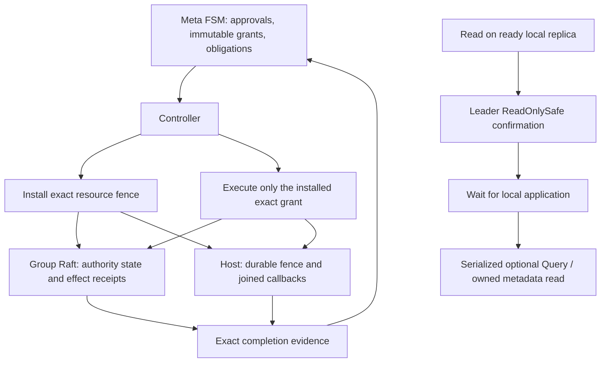

# Authority contract and consistent reads: target implementation

Date: 2026-10-12. Status: implementation specification, not implemented code.
Source baseline: gquorum `498cb45`; TiKV `137cbb2593decafebf99905b4d570869230565c2`;
etcd Raft Go dependency `v3.6.0`.

## 1. Request, decisions and boundaries

Implement the outcomes named **P0: authority contract** and **P1: consistent
reads** in `docs/architecture/design-constraints.md` and
`docs/architecture/comparision-with-tikv.md`. The library is in development;
the user explicitly requires no backward compatibility. This document specifies
the implementation to plan next. The brainstorm changes documentation only.

The accompanying session log is
[20261012-authority-contract-consistent-reads.md](20261012-authority-contract-consistent-reads.md).

| Decision | Selected design | Reason |
| --- | --- | --- |
| Revocation | Approval requests revocation; resource fences establish its completion | Cross-log local checks cannot prove instantaneous revocation |
| Leadership change | Does not by itself invalidate a durable grant | The next controller resumes exact durable work |
| Read APIs | Barrier plus optional serialized Query | Applications get safe state access without making Query mandatory |
| Read placement | Any ready local voter or learner | Leader confirms the index; the requesting replica applies it |
| Lock reads | Committed ownership only; user confirmed “I agree” | Leader-local renewal timers are not replicated lease validity |
| Read protocol | ReadOnlySafe; no lease optimization | No clock assumptions are needed for quorum confirmation |
| Authority granularity | Monotonic revision per exact effect, with separate fence-only revisions | Prevents replay of earlier steps within the same operator |
| Local durability | A Node-owned authority database outside replaceable meta/load storage | Readmission and cleanup must not erase fencing evidence |
| Compatibility | Explicit new formats; reject unsupported retained formats | No migration or mixed-version negotiation in this task |
| Availability | Required unreachable resource leaves revocation pending | No timeout or suspicion substitutes for a durable fence |

The first five rows capture user choices. The remaining rows are implementation
resolutions derived from those choices and the inspected code.

### 1.1 Exact guarantees

An administrative action is bound to a committed immutable grant, its entire
operator/version/attempt/step/action/identity tuple, and exact resources. It may
execute while that grant is installed and unconsumed at the resource. A newer
fence makes earlier grants unusable there, even when the receiver's `_meta`
state is stale. Unrelated intent never refreshes an old grant.

For a Raft resource, the boundary is log order: old administrative entries
ordered before the fence may have their effects; entries ordered after it must
not apply an old grant. Lagging followers may materialize earlier entries later
in wall-clock time, before applying the fence themselves. This is not an atomic
wall-clock update of every replica.

For a host resource, the boundary is a durable fence plus joined ownership of
older in-flight effects. Persisting the fence blocks new old-grant admissions;
completion additionally waits for old factories, retirement callbacks and release
work to actually return. Previously completed effects are not rolled back.

Ordinary application proposals are not administrative grants. P0 does not add
`_meta` RPCs to every data write/read, guarantee uninterrupted service during
management loss, or change application side-effect responsibilities.

Successful `Read` includes a fresh safe ReadIndex round requested after that
read's invocation, local application through that index, and a serialized Query.
It returns an owned result from committed local state during the operation.
A read barrier alone supplies the first two guarantees, not a reusable lease,
an atomic future read-modify-write, or cross-group consistency.

`ReadLockHolder` reports ownership in replicated state. Its TTL is configured
session duration, not remaining validity. A holder remains visible until a
revocation command applies. External resources still need their own fencing.

### 1.2 Special effect boundaries

- Membership: exact grant checked in the engine and deterministically during
  application; existing learner-first, promotion, leader-removal and live-quorum
  safety checks remain mandatory.
- Startup: fence joins any old startup reservation; publication uses the exact
  current host grant/receipt and approved assignment. A ready replica created
  before the fence is evidence to reconcile, not automatically deleted.
- Stop/cleanup: join exact owner; durable resource identity checks still precede
  callbacks, quarantine and collection. Grant possession never authorizes a
  different replica's data.
- Leadership transfer: fence controls admission/initiation. A previously sent
  TimeoutNow may still trigger an election; elections are not revocable effects.
  Completion means the target leadership was observed, never that it will persist.
- Local explicit StopLoadGroup, node shutdown and durable self-removal remain
  owner/safety operations, not remote operator grants. They share ownership gates
  with fences. Explicit restart cannot bypass a host fence or approved assignment.
- Independent `load.Standalone` uses its existing caller-owned administrative
  authority; it receives P1 reads and the new snapshot encoding, not managed
  `_meta` authorization. Managed engines cannot select standalone mode.

## 2. Components and data flow



### Metadata authority catalog

The replicated metadata FSM allocates revisions, retains immutable grants and
records exact fence/effect evidence. Controller memory and cached health never
create grants. The catalog is distinct from document history and survives history
pruning. Revision = the applied `_meta` log index of the command creating the
grant. Multiple fence-only grants created by one approval share that revision
but differ by GroupID. Revisions are compared only within a resource; a grant is
identified by `(ClusterID, GroupID, Revision)`.

`BeginEffect` is idempotent by the full authorized step. It validates the current
operator and step with replicated CAS, refuses unresolved conflicts, and returns
the existing grant on retry. Direct transfer and readmission use explicit typed
grant proposals, not the former implicit StepSeq==0 permission.

### Affected-group authority

One authority slot belongs to each managed Raft group. Fence evidence names the resource and grant whose floor it proves; group receipts are emitted only after its committed entry has applied, with normal persistence ordering. A committed normal
internal entry installs a grant. Its exact contents, index and term become
snapshot state. A grant can allow one exact administrative action or be
fence-only. A configuration entry embeds the grant key and exact action. Applying
it validates against this slot and records a consumed receipt. Requests matching
a consumed receipt return its result; they do not redo membership changes.

Install/propose checks run on the RawNode owner loop. A pending internal fence or
configuration entry blocks another administrative proposal until the prior work
has applied. Ordinary application proposals continue normally. Recovered pending
entries count, including entries originated by an earlier leader.

### Host authority and ownership

One local authority slot per group covers all replica generations on that node.
It lives in a separate bbolt file, opened by Node. It is not quarantined with a
load group or renamed with the meta database. It contains a durable pending
fence, its completion marker, and exact local effect receipts. Advancing the
slot first blocks old admissions, then cancels/joins outstanding old effects,
then writes completion. A canceled RPC does not cancel ownership of this work.

The existing per-group managed operation gate remains the serializer. Add a
separate admission floor readable before acquiring that gate, so an incoming
fence blocks queued old actions immediately rather than waiting behind them.
Never wait while holding Host.mu or a bbolt transaction. Startup goroutines and
failed Close retries remain registered owners until genuinely joined/released.

### Read engine

The same internal read implementation serves `_meta`, managed loads and
standalone groups. All RawNode access stays on its loop. Read requests are copied,
bounded and grouped into frozen cohorts. Only requests present when a cohort's
ReadIndex is issued may consume that confirmation. New requests wait for another
round. After application catches up, execute queries in the machine's serialized
domain. Query errors do not halt the engine; persistence/Apply/Restore errors do.

## 3. Public contracts and exact data types

The following definitions are target declarations. Existing fields not explicitly
changed retain their current meaning; owned slices/maps are cloned at boundaries.

### 3.1 CREATED `load/read.go`; UPDATED `load/machine.go`

```go
type QueryMachine interface {
    Query(context.Context, []byte) (Result, error)
}
func (g *Group) ReadBarrier(ctx context.Context) error
func (g *Group) Read(ctx context.Context, query []byte) (Result, error)

type ReadOptions struct {
    Timeout         time.Duration // zero => 10s
    MaxPending      int           // zero => 256; includes executing callbacks
    MaxRequestBytes int           // zero => 1 MiB
    MaxResultBytes  int           // zero => 4 MiB
}
// EngineOptions gains Reads ReadOptions.
```

Both adapters expose an explicit internal SupportsQuery() bool check; a Query adapter method returning Unsupported by itself is insufficient for pre-admission detection. No Query addition to the required StateMachine interface. Optional Query is
read-only, may return Result.Code for domain rejection, must honor cancellation,
and must not call an operation that waits for its own engine loop. It may inspect
cached status or request stop. Query runs on the existing serialized machine
owner, so a slow Query delays that replica's Raft loop as a slow Apply does.
Moving queries onto snapshots/worker pools is deferred.

Unsupported Query fails before starting a read round. Both byte arguments and
returned Result.Data are copied. Oversize requests/results return Overloaded.
Timeout bounds the caller's wait; an overdue executing callback stays owned and
continues counting against admission until its return.

### 3.2 UPDATED `cluster.go`; CREATED `cluster_reads.go`

```go
// Add to Cluster and implement on *clusterView:
ReadBarrier(context.Context) error
ReadTopology(context.Context) (topology.ReadView, error)
ReadLockHolder(context.Context, string) (topology.Session, bool, error)
ReadAuthority(context.Context, topology.OperatorID) (topology.AuthorityStatus, error)
WaitRevoked(context.Context, topology.OperatorID) (topology.AuthorityStatus, error)
```

`WaitRevoked` uses authoritative reads and waits for all obligations for the
specified operator, including obligations inherited through subsequent
supersessions. Calling it for an operator whose revocation has not been requested
returns Invalid; a deadline returns the last obtained status plus the context
error. `WaitOperator` remains a local operator-progress observer and is not
revocation proof.

```go
// CREATED topology/read.go
type ReadView struct {
    AppliedIndex uint64   `json:"applied_index"`
    Latest       Document `json:"latest"`
    Target       Document `json:"target"`
    Active       Document `json:"active"`
}
```

ReadView is captured atomically under the metadata FSM lock after the exact
engine's barrier. Its index is the state actually copied, which may exceed the
minimum confirmed index. Existing Latest, Target, Active, Status, Metrics,
HealthObservation and LockHolder remain explicitly observational.

### 3.3 CREATED `topology/authority.go`

```go
type AuthorityResourceKind string
const (
    AuthorityGroup AuthorityResourceKind = "group"
    AuthorityHost  AuthorityResourceKind = "host"
)
type AuthorityResource struct {
    Kind     AuthorityResourceKind `json:"kind"`
    GroupID  string                `json:"group_id"`
    NodeName string                `json:"node_name,omitempty"`
}
type AuthorityKey struct {
    ClusterID string `json:"cluster_id"`
    GroupID   string `json:"group_id"`
    Revision  uint64 `json:"revision"`
}
type AuthorityPurpose string
const (
    AuthorityEffect     AuthorityPurpose = "effect"
    AuthorityFence      AuthorityPurpose = "fence"
    AuthorityTransfer   AuthorityPurpose = "transfer"
    AuthorityReadmit    AuthorityPurpose = "readmission"
)
type AuthorityTarget struct {
    NodeName  string `json:"node_name"`
    MemberID  uint64 `json:"member_id"`
    ReplicaID uint64 `json:"replica_id"`
}
type AuthorityGrant struct {
    Key          AuthorityKey        `json:"key"`
    Purpose      AuthorityPurpose    `json:"purpose"`
    OperatorID   OperatorID          `json:"operator_id,omitempty"`
    Action       *AuthorizedStep     `json:"action,omitempty"`
    AdmissionID  string              `json:"admission_id,omitempty"`
    RequestID    string              `json:"request_id,omitempty"`
    Resources    []AuthorityResource `json:"resources"`
    Targets      []AuthorityTarget   `json:"targets"`
}
type FenceEvidence struct {
    Key           AuthorityKey      `json:"key"`
    Resource      AuthorityResource `json:"resource"`
    Receiver      Identity          `json:"receiver"`
    ReplicaID     uint64            `json:"replica_id,omitempty"`
    AppliedIndex  uint64            `json:"applied_index,omitempty"`
    AppliedTerm   uint64            `json:"applied_term,omitempty"`
    LocalSequence uint64            `json:"local_sequence,omitempty"`
}
type EffectOutcome string
const (
    EffectApplied          EffectOutcome = "applied"
    EffectAlreadySatisfied EffectOutcome = "already_satisfied"
    EffectTransferStarted  EffectOutcome = "transfer_started"
)
type EffectReceipt struct {
    Key           AuthorityKey      `json:"key"`
    Resource      AuthorityResource `json:"resource"`
    Action        *AuthorizedStep   `json:"action,omitempty"`
    AdmissionID   string            `json:"admission_id,omitempty"`
    Target        AuthorityTarget   `json:"target"`
    Outcome       EffectOutcome     `json:"outcome"`
    AppliedIndex  uint64            `json:"applied_index,omitempty"`
    AppliedTerm   uint64            `json:"applied_term,omitempty"`
    LocalSequence uint64            `json:"local_sequence,omitempty"`
}
type FenceObligation struct {
    Key      AuthorityKey      `json:"key"`
    Resource AuthorityResource `json:"resource"`
    Evidence *FenceEvidence    `json:"evidence,omitempty"`
}
type AuthorityStatus struct {
    OperatorID          OperatorID        `json:"operator_id"`
    RevocationRequested bool              `json:"revocation_requested"`
    RevocationComplete  bool              `json:"revocation_complete"`
    Obligations         []FenceObligation `json:"obligations"`
}
func (g AuthorityGrant) Clone() AuthorityGrant
func (g AuthorityGrant) Validate() error
func (g AuthorityGrant) Equal(other AuthorityGrant) bool
func (s AuthorityStatus) Clone() AuthorityStatus
```

Validation requires nonzero revision, exact cluster/group, sorted unique resources
and targets, NodeName only for host resources, and complete action fields for
effect/transfer grants. Fence-only grants have no action. Readmission grants bind
the existing exact admission identity and previous/granted identities in the
replicated admission record; they cannot be synthesized from a normal effect.
EffectReceipt has Action for effect/transfer grants and AdmissionID for readmission grants; exactly the matching variant is required. Group-wide founding receipts may have a zero Target; host receipts always identify a complete exact target. Full structural equality is used, not only a hash or revision. String identifiers
must use existing validation and length bounds. No floating-point revision
decoding is permitted in transports.

### 3.4 UPDATED `load/transport.go`, `node.go`, `node_transport.go`

```go
type FenceRequest struct {
    From      topology.Identity          `json:"from"`
    To        topology.Identity          `json:"to"`
    ReplicaID uint64                     `json:"replica_id,omitempty"`
    Resource  topology.AuthorityResource `json:"resource"`
    Grant     topology.AuthorityGrant    `json:"grant"`
}
type FenceResult struct {
    From     topology.Identity     `json:"from"`
    Evidence topology.FenceEvidence `json:"evidence"`
}
// Add to load.Transport:
InstallFence(context.Context, FenceRequest) (FenceResult, error)
// Add to Node:
InstallLoadFence(context.Context, load.FenceRequest) (load.FenceResult, error)
```

`ActionRequest` gains `Grant topology.AuthorityGrant`; Authorization must equal
`*Grant.Action`. `ActionResult` gains `Receipts []topology.EffectReceipt`; the old
Verified field is removed. A delete/founding operation can have multiple exact
targets; results must cover every required target. `RetirementRequest` and
`RetirementResult` gain the exact grant as well; caller retirement callbacks still
echo identity/proof and verify application storage. Internal fence completion
comes from Node, never an application-supplied bare boolean.

Founding uses the same immutable action in two resource-specific requests.
A nonempty LocalTarget creates one exact host replica and returns its local
receipt. After all hosts acknowledge, an empty LocalTarget routes to the group's
exact leader and records the native founding configuration through the authorized
engine. A host receipt alone cannot complete group creation. Dispatch returns
partial exact receipts alongside an error so the controller can retain successful
host progress without claiming the entire action completed. Historical targets
resolve through their retained grant and exact current process identity, without
depending on a current topology catalog entry or redirecting to successor members.

Host fence requests have ReplicaID zero and do not require a running local load
handle. Group fence requests name an exact current local replica and require a
leader. Authenticate From before dispatch. From is a courier, not the grant's
source of authority. Retained committed grants remain verifiable across controller
incarnations; endpoint validation still rejects foreign/replaced receivers.

### 3.5 Configuration and errors

UPDATED `node_options.go`: add required `NodeOptions.AuthorityDBPath string` and
`MetaOptions.Reads load.ReadOptions`. `Loads.Engine.Reads` configures load reads.
Validate paths without I/O in NewNode: nonempty, no NUL, and not equal to Meta.DBPath;
startup additionally checks actual file identity to reject aliases. No implicit
storage root. AuthorityDBPath must be outside application/load retirement roots.

UPDATED `topology/document.go`: add replicated
`Limits.MaxPendingAuthorityRecords int`, default 1024. The limit counts retained
unfinished grant and revocation records; exhausted capacity rejects new work
without deleting evidence. Reserve space for a fence when issuing its effect
grant so cancellation/supersession cannot be prevented by a full catalog. High-water
floors/tombstones are small historical identity records, not TTL-evicted cache.

UPDATED fault declarations: add `AuthorityFenced` / `ErrAuthorityFenced` and
`AuthorityPending` / `ErrAuthorityPending`. Use existing Invalid, Unsupported,
NotLeader, Overloaded, Stopped, Unavailable and OperatorAuthorization for their
existing distinctions. Context errors remain discoverable with errors.Is.

## 4. Persistence schemas and invariants

There is no SQL database, DDL or ORM in this implementation. The complete new
schemas below specify bbolt buckets/key encodings and JSON Go records instead.
No cache is part of authority correctness and no fence has a TTL.

### 4.1 Replicated metadata, UPDATED `internal/metaengine/sm.go` and `disk.go`

Add these records to the complete metadata snapshot (schema version 2), with
sorted serialization. Keep existing document, identity-allocation, retired-group,
session, lock, admission and voter-policy data. Do not flatten grants into Latest.

```go
type authorityRecord struct {
    Grant       topology.AuthorityGrant   `json:"grant"`
    Fences      []topology.FenceEvidence  `json:"fences"`
    Effects     []topology.EffectReceipt  `json:"effects"`
    Closed      bool                     `json:"closed"`
}
type resourceFloor struct {
    Resource topology.AuthorityResource `json:"resource"`
    Key      topology.AuthorityKey      `json:"key"`
}
type revocationRecord struct {
    Requested bool `json:"requested"` // false for inherited nonoperator prerequisites
    OperatorID  topology.OperatorID       `json:"operator_id"`
    Obligations []topology.FenceObligation `json:"obligations"`
}
// New metaDiskState fields:
AuthorityRecords []authorityRecord  `json:"authority_records"`
AuthorityFloors  []resourceFloor    `json:"authority_floors"`
Revocations      []revocationRecord `json:"revocations"`
```

In-memory indexes: grant map keyed by AuthorityKey; floor map keyed by resource;
grant-by-action index keyed by the full AuthorizedStep; revocations keyed by
OperatorID. Build/revalidate indexes on restore. Reject duplicate grants, revision
regression, mismatched actions/resources, orphan evidence and impossible complete
records. Revision cannot exceed the metadata applied boundary that created it.

Existing bbolt buckets remain: format, hardstate, entries, snapshot, applied,
state, identity, serve_override, load_replicas. No new bucket is required for the
replicated catalog: it is contained in `state/current` and complete snapshots.
The state JSON schema changes. `format/schema_version` is explicitly bumped to
2; old database formats are rejected before acquisition/mutation. Existing bucket
key layouts and ledger value fields otherwise remain unchanged.

Metadata proposals added to `codec.go` (all fields have exact lower_snake_case
JSON tags corresponding to their Go names):

```go
type BeginEffectProposal struct {
    Action     topology.AuthorizedStep `json:"action"`
    ProposalID string                  `json:"proposal_id"`
}
type RecordFenceProposal struct {
    Evidence   topology.FenceEvidence `json:"evidence"`
    ProposalID string                 `json:"proposal_id"`
}
type RecordEffectProposal struct {
    Receipt    topology.EffectReceipt `json:"receipt"`
    ProposalID string                 `json:"proposal_id"`
}
type GrantTransferProposal struct {
    ExpectedActiveVersion uint64 `json:"expected_active_version"`
    GroupID               string `json:"group_id"`
    NodeName              string `json:"node_name"`
    ReplicaID             uint64 `json:"replica_id"`
    RequestID             string `json:"request_id"`
    ProposalID            string `json:"proposal_id"`
}
```

Proposal kinds are `begin_effect`, `record_fence`, `record_effect`, and
`grant_transfer`, and `begin_readmission_authority`. ApplyResult gains `Grant *topology.AuthorityGrant` and
`Grants []topology.AuthorityGrant` for a readmission spanning multiple groups. Existing
approval, failed-attempt retry and supersession transitions create fence-only
grants and obligations atomically with their transition. CommitReadmission approves the exact replacement and starts predecessor
revocation. A separate `BeginReadmissionAuthority` command takes NodeName,
InstanceID, MemberID, PreviousMemberID, OperatorID and ProposalID, validates the retained approved
admission, waits for predecessor revocation and atomically issues the host grants.
This separate apply index avoids assigning a revocation fence and a readmission
grant the same `(GroupID, Revision)` in one command. No unapproved path can
allocate an admission fence.

`PreviousMemberID uint64` (`json:"previous_member_id"`) is the exact retained
authority owner, not an inference from current Active. Approved history or a
retained grant must prove that member belonged to this node, and it must precede
the granted member. This supports readmission after completed exclusion, when
Active no longer contains the former member. An exact retry cannot change it.
The metadata host grant names only that former metadata pin. Load host grants
cover historical replicas belonging to that or an older member and exclude
replicas still present in approved Target. Later members and metadata archives
are never implicitly included in the retirement scope.

`ReadmissionID(AdmissionRecord) string` identifies operator, granted member, node
and original instance using `<operator>/<member>/<node-byte-length>:<node>/<instance>`.
The process identifier alone is not globally unique across nodes. Join payloads
and authority grants use this same opaque identity.

`AdmissionRecord` and its disk representation add `ReadmissionInstanceID string`
with JSON `readmission_instance_id,omitempty`. Empty denotes an original admission.
When BindAdmission replaces a pending process under the exact same node/member/
operator, the FSM inherits that process's original readmission instance (flattened,
never a chain). Callers cannot assign this field. ReadmissionID uses the inherited
instance while admission readiness still uses the current InstanceID. An existing
grant batch, retirement backup and receipts therefore survive process replacement
without reallocating authority. A changed operator or member does not inherit it.
Snapshot restore requires the referenced original record to exist for the same
node/member/operator, have no origin itself and be superseded. Authority catalog
validation resolves the unique original admission, not its process aliases.

Before issuing a replacement `_meta` PrepareReplica grant, metadata requires
the exact admission's complete readmission receipts, including load resources.
This prevents preparation from occupying a host floor needed by readmission.
Installing a fence or closing a grant does not prove retirement completion.
Fresh names without prior approved ownership do not require this prerequisite.
Snapshot restore requires consistent former-member identity across the batch
and exactly one former metadata pin, alongside existing revision/receipt checks.

`RecordReadmissionReceiptsProposal` (`record_readmission_receipts`) contains
`Admission AdmissionRecord` (`admission`), `Receipts []topology.EffectReceipt`
(`receipts`) and `ProposalID string` (`proposal_id`). The FSM checks the exact
node/process/member/operator binding and every retained readmission grant, then
applies the receipt batch atomically, including boundary and duplicate checks.
Contradictory batches cannot record a valid prefix. Superseded admissions may
still record their historical completion; ReadyAdmission independently rejects
supersession and missing resource receipts.

Join's JSON request adds `AuthorityMemberID uint64` (`authority_member_id`),
separate from its metadata header/Identity. The response adds `PreviousMemberID
uint64` (`previous_member_id,omitempty`) and `Grants []topology.AuthorityGrant`
(`grants,omitempty`). PreviousGroups is the exact load target set of those
grants. JoinReady adds `Receipts []topology.EffectReceipt` (`receipts,omitempty`)
and verifies the request's process as well as node/member against its header.
It commits historical receipts before attempting readiness. No protobuf schema
changes are needed for these existing JSON payloads.

Private metaservice owner hooks add `ReadmissionIdentity func() topology.Identity`
and `ReadmissionReceipts func(context.Context, Readmission)
([]topology.EffectReceipt, error)`. Node supplies the independent authority pin
and historical receipt lookup after exact rebind. The service checks the entire
batch before route/storage mutation and obtains every receipt before opening the
replacement engine. A retry after in-process rebind may still carry the old meta
header only while its exact cached readmission owns the transition, no old engine
or open store remains, and the live meta path is fresh. This exception does not
authorize recovery from an unexplained pin mismatch after a process restart.
Immutable receipt copies accompany every readiness retry. Temporary owned
retirement errors retain their classification so the join worker can retry.
On cross-process restart, Join binds the new process to the pending admission and
returns its retained retirement origin. Before rebind, the receiver resumes exact
retirement intents/receipts and the same metadata backup. After rebind, Node checks
the durable transition's previous pin, granted pin and admission ID with
`Store.VerifyRebind` before collecting receipts. It then opens only the approved
replacement identity, subject to the metadata-acquisition guard in §4.2. No cached
in-memory grant is required across that restart, and no old Raft engine is reopened.

The metadata machine exposes private `ReadmissionRequired(string, uint64) bool`
for current-term-applied join classification, and `ReadmissionGrants(context.Context,
AdmissionRecord) ([]topology.AuthorityGrant, error)` for an already committed
immutable batch. Neither is a new public application read API.

When pruning, retain unresolved grants, exact targets and obligations regardless
of terminal operator status. Remove a consumed old receipt only after its resource
has a durably acknowledged strictly newer fence and metadata has recorded the
effect or reconciled its uncertain outcome. Retain the per-resource floor, its current full immutable grant and
terminal revocation summary. Grant issuance advances each referenced desired floor
in the same metadata command; installing/recovering a floor never fabricates a
grant from a revision number. Pruning must never resurrect grant validity.

Private planning includes intermediate approved metadata members and their node
attributes even when they never reached Active. Unresolved metadata preparation
pins its approved document under the same bounded-history reservation as unresolved
founding. Native-removal receipts end inbound routing; host-retirement receipts
settle cleanup independently and survive completed-operator pruning. A rebuilt
member index avoids per-frame scans of retained history. Applications must retain
exact authenticated transport endpoints for outstanding cleanup; the fixture uses
member-bound cached routes and approved historical documents without treating a
route as effect authority.

### 4.2 CREATED `internal/authoritystore`: node-local bbolt

File: explicit AuthorityDBPath; file permissions 0600, parent 0700; one exclusive
Node owner. Transactions sync normally; never enable NoSync. Opening occurs in
Start. No application callback runs inside a transaction.

| Bucket | Key | Value |
| --- | --- | --- |
| format | `schema_version` | ASCII `1` |
| identity | `current` | authorityIdentity JSON below |
| identity | `readmission` | exact previous/granted durable pins and admission ID for idempotent rebind |
| identity | `metadata_acquired` | current authorityIdentity JSON, present after durable metadata acquisition |
| fences | UTF-8 GroupID | hostFence JSON below |
| effects | length-prefixed GroupID + big-endian revision + length-prefixed target node + big-endian target replica | localEffect JSON below |

Length prefixes are uint32 big endian byte counts, not delimiter concatenation.
Group names and target names use existing identifier validation. GroupID is
unique within the bound cluster. All returned buffers/records are owned copies.

```go
type authorityIdentity struct {
    ClusterID string `json:"cluster_id"`
    NodeName  string `json:"node_name"`
    MemberID  uint64 `json:"member_id"`
}
type hostFence struct {
    Grant     topology.AuthorityGrant `json:"grant"`
    Sequence  uint64                  `json:"sequence"`
    Complete  bool                    `json:"complete"`
}
type localEffect struct {
    Grant   topology.AuthorityGrant `json:"grant"`
    Target  topology.AuthorityTarget `json:"target"`
    Sequence uint64                  `json:"sequence"` // original completed fence sequence
    State   string                   `json:"state"` // running, complete or fenced
    Receipt *topology.EffectReceipt   `json:"receipt,omitempty"`
}
```

Write pending fence plus incremented per-group Sequence atomically. A matching
revision requires full equal grant; a lower revision returns AuthorityFenced.
Complete fence update requires the same revision and sequence. BeginEffect
requires completed matching fence and writes running before invoking side effects.
FinishEffect requires exact running record and stores receipt in one transaction.
The running record pins its original fence sequence so receipt validation remains
exact while a newer pending fence joins it. A completed newer fence rejects any
unrecorded old consumption. Rebind persists its exact durable identity transition
and admission ID atomically with the new pin so retries cannot substitute proof.
Installing a new pin clears `metadata_acquired` atomically; an exact rebind retry
does not clear it. The marker must match `current` when present. Node's private
AfterOpenEngine hook writes it after metadata pin creation and before publishing
or starting that engine. Hook failure closes the unstarted store. BeforeOpenEngine
refuses absent metadata for a member whose acquisition was recorded; a fresh
readmission must allocate a newer member instead of recreating the established one.
An interrupted acquisition with no marker can resume only under its exact grant.
Sequence overflow fails closed. A completed exact effect is an idempotent hit;
an existing running record requires reconciliation, never blind repetition.
After the host has joined every older callback and startup reservation under the
group action gate, `FenceEffect(ctx, record, newerKey)` can retain an interrupted
record as `fenced`. This terminal state has no receipt and claims no successful
outcome. It preserves partial application/storage evidence for successor planning;
it authorizes neither retry nor later FinishEffect. Only a strictly newer pending
floor can make this transition. CompleteFence rejects remaining older running
records. This makes crash recovery possible when the old action did not complete,
without requiring execution of a superseded action merely to finish its fence.

The file is bound to ClusterID/NodeName. MemberID changes only under the exact
readmission proof after the old owner is joined, preserving every group floor.
InstanceID is a live endpoint property, not a durable identity pin.

`storage.Store.HasState(ctx)` is a required read-only inventory predicate covering
all retained pins, active/partial resources and quarantined state, including groups
absent from metadata. Borrowed stores supply it; WAL checks all root entries.
Unknown or unreadable state must never report a fresh store.

If the authority file is absent but any established meta pin/load ledger/retained
load state exists, startup parks/fails with evidence preserved. It does not create
an empty fence store. A fresh join with no old resources initializes under its
exact granted identity and imports the relevant authoritative floors before it
accepts actions. A missing file during retained readmission is not a fresh join.
An existing authority file with absent/inconsistent established meta evidence
likewise requires explicit readmission or reports unreadable state.

### 4.3 CREATED `internal/raftstate`: engine-owned snapshot and admin records

Use a dependency-light codec package (imports topology and raftpb, never engine,
metaengine or metastore) so every snapshot consumer decodes the same envelope.

```go
type AuthorityState struct {
    Grant        *topology.AuthorityGrant `json:"grant,omitempty"`
    InstallIndex uint64                   `json:"install_index"`
    InstallTerm  uint64                   `json:"install_term"`
    Receipt      *topology.EffectReceipt  `json:"receipt,omitempty"`
    DemotionTransferIndex uint64          `json:"demotion_transfer_index,omitempty"`
    DemotionTransferTerm  uint64          `json:"demotion_transfer_term,omitempty"`
}
type Snapshot struct {
    Schema      uint32         `json:"schema"` // 2
    ClusterID   string         `json:"cluster_id"`
    GroupID     string         `json:"group_id"`
    Application []byte         `json:"application"`
    Authority   AuthorityState `json:"authority"`
}
type Entry struct {
    Schema      uint32                   `json:"schema"` // 2
    Kind        string                   `json:"kind"`
    Correlation string                   `json:"correlation,omitempty"`
    RequestID   string                   `json:"request_id,omitempty"`
    Data        []byte                   `json:"data,omitempty"`
    Grant       *topology.AuthorityGrant `json:"grant,omitempty"`
    Action      *topology.AuthorizedStep `json:"action,omitempty"`
}
```

Entry kinds: `application`, `install_authority`, `observe_effect`,
`transfer_intent`, `managed_configuration`. Configuration context uses Entry;
only configuration entries may carry `managed_configuration`. Ordinary forwarded
application proposals cannot carry internal authority kinds. Keep normal empty
Raft election entries valid. Standalone configuration uses an explicit separate
`standalone_configuration` kind, accepted only by standalone engines.

Snapshots contain the entire application snapshot and group authority at the
same applied index. Authority has no local replica ID because group snapshots
are portable to another exact replica of that group. Store identity and transport
still bind the receiving replica. Fresh standalone/meta genesis authority may
be empty; established managed load authority may not silently disappear.

Fresh load founding snapshots seed the group authority from the committed
founding grant. Every founder uses the same grant and founding voter set.
Host installation occurs before creating any initial snapshot. The synthetic
index-1 founding snapshot is not quorum completion proof: the controller must
obtain a safe barrier through the founded group before reporting the group fence
or founding effect complete.

WAL layout, identity files, hard-state encoding and ConfState encoding are
unchanged. Snapshot Data and command/context payloads change. Raw old snapshots
or command envelopes are rejected as unsupported/unreadable; fixtures are not
regenerated to disguise incompatibility.

Critical consumers to update together:

- `raftengine.newGroup`, received-snapshot restore, beginSnapshot and recovery
  validation: unwrap/wrap authority and application atomically.
- `metaservice/rpc.go` snapshot preflight: validate the wrapper, pass only its
  Application bytes to the temporary metadata machine.
- `metastore/raft.go:InstallSnapshot`: save the whole Raft snapshot in snapshot,
  but only the unwrapped metadata Application bytes in state/current. Do this
  in the existing atomic transaction with applied/confstate/hardstate updates.
- WAL stores treat the complete wrapped snapshot as opaque durable data.

### 4.4 Volatile read state and bounds

No read cache and no TTL-based authority. Per engine: MaxPending request slots,
one active local round, one next cohort, and at most one unresolved remote round
per currently admitted source replica. Remote round capacity is bounded by actual
native membership, including learners, rather than a fixed cluster-size constant.

```go
// Engine-owned runtime structures; no JSON encoding or persistence.
type readRequest struct {
    Context context.Context
    Barrier bool
    Data    []byte
    Reply   chan readResponse // capacity 1, never blocks abandoned caller
    Index   uint64            // zero until safe index received
}
type readResponse struct { Result Result; Err error }
type readRound struct {
    Context    []byte // fixed-size protocol context, copied into/out of Ready
    Term       uint64
    LeaderID   uint64
    Requests   []*readRequest // frozen cohort, each admitted before dispatch
    LastIssued time.Time
    Submitted  bool
}
type remoteReadRound struct {
    Context   []byte
    Term      uint64
    Submitted bool
}
// Group adds: readSlots chan struct{}, reads chan *readRequest,
// activeRead *readRound, nextReads []*readRequest, applyReads []*readRequest,
// remoteReads map[uint64]remoteReadRound. All collections are owner-loop-only.
```

The API takes a slot before enqueue. Before enqueue succeeds the caller owns
slot release; after enqueue succeeds only the engine releases it, including
canceled queued requests and callbacks that return after caller cancellation.
Clear queued requests and reply nonblockingly during engine exit.

Each protocol context is fixed-size: version byte + 16-byte engine nonce + uint64
round sequence + uint64 requester replica ID. Include the exact nonce/context in
correlation; never reuse it after restart. Drop malformed or unsolicited responses.
Query payloads never travel in ReadIndex messages.

The context is in `msg.Entries[0].Data` for both MsgReadIndex and
MsgReadIndexResp, not msg.Context. Validate request and response shapes separately:
requests are termless forwarded messages from an admitted source; responses
must come from the known leader at the current term, contain one valid local
round context and a nonzero confirmed index. Conservative rejection after leader
change is permitted. Never apply the request-only leader/source checks to a
response arriving on a follower or learner.

Retain protocol bookkeeping for canceled rounds until completion or Raft term
reset; upstream RawNode cannot cancel them. Repeat the same round context at most
once per election timeout while unresolved. Leader-side duplicate admission
prevents retries from growing Raft pending-read arrays. Do not submit ReadIndex
to a leader's RawNode before its committed entry belongs to the current term;
hold one deduplicated round per source outside RawNode until then. An unknown
leader causes bounded wait, never success from cached state.

When a source has an outstanding context and sends a newer context, hold/reject
the newer one until the old round resolves; no eviction of unresolved upstream
bookkeeping to admit more work. Removing a source does not free its upstream
round until completion/term reset. Enforce an additional MaxPending cap on total
remote round slots, independent of native membership count, so identity churn
cannot grow the registry without bound. Valid sources beyond that admission cap
wait/retry; the cap is not a cluster-size or voter-count assumption.

An outgoing remote ReadIndex response releases that source's active slot after
Ready processing; lost responses may lead to another round with the same context.
This is safe and bounded. A local ReadState releases its protocol slot, but query
ownership stays counted until Query returns. Term changes, and role/leader changes that reset RawNode read state, invalidate unresolved
round correlations and return Unavailable to their callers; late replies are
ignored. Confirmed reads waiting for application may also fail conservatively on
term change. Each new call receives a new round after the prior one drains.

## 5. Operational flows

### 5.1 Grant, fence and execute an ordinary operator step

1. Stage and approve retain existing expected-version CAS. Approval commits the
   exact immutable plan. New approval atomically closes older grant issuance and
   records revocation obligations for every older unconsumed/uncertain resource.
2. Controller confirms it is the current meta leader, reads the current operator,
   and completes required prior revocations. This implementation preserves the
   current serial operator model; independent group scheduling is not added.
3. Commit BeginEffect for the exact current step. The FSM checks the entire tuple,
   constructs targets/resources from retained approved documents, and assigns the
   applied log index as revision. Retrying returns the existing immutable grant.
4. Dispatch InstallFence to each required resource. Receiver authenticates the
   courier, validates the exact committed grant from its metadata catalog (lag is
   retryable), then installs the resource revision. Retained grant verification
   does not require the issuing controller to still be leader.
5. Commit each exact fence acknowledgement in `_meta`. Fence completion for a
   group is a durable committed/applied entry; host completion requires durable
   floor and joined old callbacks. A response lost before this commit is retried.
6. Execute the action under the installed grant. Recheck the full grant inside
   the owner loop or local ownership gate, not just before queueing.
7. Persist/commit the exact receipt. For configuration, application consumes the
   grant in the same deterministic engine transition as ApplyConfChange. For a
   host, persist the receipt after the exact effect is verified.
8. Commit the receipt in metadata, then allow operator progress to advance. All
   required local targets must be covered. Native predicates alone no longer
   stand in for a receipt from the exact granted operation.

Resources by action:

| Action | Required resources / completion |
| --- | --- |
| CreateFoundingGroup | Host resource on each exact founder; seeded group grant and safe group barrier |
| PrepareReplica | Host resource on its exact destination; complete replay/publication or exact already-ready evidence |
| AddLearner/Promote/Demote/Remove | Affected group resource; committed exact configuration receipt |
| WaitCaughtUp | Observation only; no side-effect grant, existing catch-up rules |
| TransferLeader | Affected group resource; durable intent, then observed target leadership |
| StopReplica | Exact host resource; joined exact owner |
| CleanupReplicaState/DeleteGroupState | Host resources for every catalogued target; identity checks and durable receipts |

A completed grant is consumed permanently at its resource. Revocation need not
contact a destroyed group just to invalidate an already-consumed one-shot grant:
its recorded durable one-shot consumption is already proof it cannot execute again. Only pending
or uncertain grants create new fence obligations. The controller must not prune
that consumption proof until a newer floor or permanent retired-group evidence
makes replay impossible. Transfer intent is the exception: its receipt consumes
the command but leaves initiation resumable by a replacement leader. Revocation
therefore requires a newer durable group fence even after recording that receipt.
A receipt still permits issuance of the next action; its newer installed floor
settles the preceding transfer intent. Keep revocation capacity reserved until
that floor is proven. Transfer also has the initiation/election distinction in 1.2.

### 5.2 Supersession while an old action is delayed

Approval at meta index R closes issuance for the old operator and creates
fence-only grants at revision R over its unresolved resource set. New effects are
not attached to those fence-only grants. A receiver with stale metadata may still
execute an installed old grant before receiving its fence: this is permitted by
the selected contract. It may not execute it after the resource's boundary.

All revocations stay in a dedicated pending-work catalog. A superseded operator
being terminal must not stop the controller from processing its obligations.
Repeated supersession carries forward the union of unresolved obligations; a
newer complete fence can discharge an older obligation for the same resource.
The FSM verifies the monotonic relation and exact scope rather than rewriting
an old grant to match new intent.

Approval also closes conflicting standalone transfer/readmission grants whose
OperatorID is empty: enumerate by resource, not only by operator ID. Attach those
fence obligations to the successor's execution prerequisites. If an admission is
superseded, retain its old owner/identity evidence until those obligations settle.
Direct transfer completion may return AuthorityFenced if supersession wins.

The next operator waits for the inherited unresolved revocations before issuing
new effect grants. This is conservative and preserves existing global execution
scope. It may block unrelated work; solving the separately listed failure-isolation
backlog is deliberately not claimed here.

After those fences complete, re-observe affected native state and validate that
the immutable approved plan can still reach its approved target, including all
possible earlier startup/cleanup identities retained in the catalog. An old
permitted effect may have finished after the successor's plan was constructed.
Do not silently alter its approved actions or mark Active converged. If the plan
cannot reconcile the resulting state safely, fail with a clear replan-required
reason; the caller stages/approves a new version. All old cleanup evidence stays
retained. Retries of the same version keep its existing immutable plan.

The controller performs this validation before each step and before an empty
plan can succeed. One safe metadata query captures the exact operator, Target,
retained planning identities and completed revocation prerequisites. Native
reads include historical routing candidates. The validator checks the remaining
membership sequence, voter capacity, destructive quorum boundaries and transfer
prerequisites, as well as exact stop/cleanup coverage. The planner includes
historical host identities in surviving groups even when their preparations never
entered native membership. New planning omits proven cleanup; immutable retries
retain the exact identities in their already approved actions.

Native membership reads use the shared safe-read queue and capture the applied
configuration on the Raft owner. For load replicas, transports preserve the
explicit `ReplicaQuery.Native` request and `ReplicaStatus.Native` result; an
ordinary status reply or absent replica is not confirmation. The controller's
final convergence check also requires this confirmed membership for affected
surviving groups before advancing Active.

If quorum is absent, group fencing remains pending. If an affected host is down,
its host fence remains pending even if the group fence is complete. A resource
proven to have consumed its one-shot effect is already settled; suspected or
unobserved completion is not consumption proof.

### 5.3 Retry, lost acknowledgement and existing native effects

- Grant cache hit: full equality and matching receipt returns the receipt without
  re-execution. An older revision always rejects, even if native state happens to
  match the request.
- Grant cache miss: read exact retained metadata record; missing/future record is
  unavailable or authorization failure, never permission inferred from Target.
- Group effect committed, metadata response lost: current group state/snapshot
  contains the receipt. Query it under safe barrier and record it in metadata.
- Required native state exists but no receipt for this new grant: propose an
  `observe_effect` entry under the current grant. At deterministic apply, verify
  the exact native membership predicate and consume the grant with outcome
  already_satisfied. This acknowledges satisfaction, not authorship by an old
  operator. Never stamp an unrelated historical action as completed.
- Host callback completed before receipt persistence: running record remains.
  An exact current-grant retry reconciles durable identity and the callback's
  documented idempotent retirement semantics before writing a receipt. A newer
  fence joins all old owners and retains unresolved outcomes as fenced, without
  completion proof or evidence deletion. If an owner cannot be joined, it stays
  pending.
- Timeout after dispatch: caller receives uncertainty. The grant/receipt and
  durable ownership determine recovery; retry does not invent another action.

### 5.4 Membership and transfer sequencing

Before proposing a membership change, require an applied current-term leader
barrier, no pending internal fence/configuration entry, matching installed grant,
no consumed receipt, and fresh existing membership safety validation. Freeze the
observed native ConfState digest in the queued control request and recheck it on
the RawNode loop; if it changed, return Unavailable for re-observation.

Configuration context includes the full grant and action. During committed
application every replica compares that context with its own replicated authority
slot. An old or already-consumed grant is a deterministic rejection, not a fatal
engine error. Do not call ApplyConfChange for a rejected entry; advance the log
entry normally. This follows the pinned RawNode contract permitting application
rejection. Verify in dedicated tests that Advance clears pending configuration
constraints and later valid configuration proposals proceed. Rejecting based on
local meta state, health, wall clock or callback results is forbidden.

Bootstrap/standalone entries have distinct explicit handling and cannot be used
as managed membership bypasses. Retain the existing single-change V2 constraint.

Transfer intent is a committed internal entry, recording exact target and grant.
Only the current leader may initiate it, and only while the grant remains current.
A replacement leader can resume the intent. An exact caller retry may restart a
native attempt that expired in the same leader term; it never creates another
consumption receipt. Before proposing a newer verified authority floor, abort any
transient native transfer, because RawNode otherwise drops proposals during that
phase. The durable old intent remains installed until the new fence applies;
pending administrative log work prevents resumption while installation commits.
Fence application cancels any local
not-yet-issued transfer work, including RawNode's pending catch-up phase. Managed
engines reject raw forwarded MsgTransferLeader requests. Already-sent election messages can still act; no
"transfer undone" claim is made. Controller completion still observes the exact
voter as leader. For direct Cluster.TransferLeader, allocate a durable transfer
grant using expected Active version and an internal request ID; reject conflicts
with a running operator for that group. Both meta and load direct APIs wait for
observed target leadership or return a context/error, rather than meta success
meaning merely queued initiation. A timeout may leave a successful transfer.
If a caller retries after cancellation without its internal request ID, grant
allocation reuses the current open unconsumed transfer only when Active version,
group, node and replica match exactly. It returns the original immutable grant
and request ID. A different action remains pending; a consumed command requires
a fresh grant for a later new request. Original-request retries remain idempotent.

A demotion may carry its existing exact TransferNodeName/TransferReplicaID guard.
If the demotion target becomes leader before execution, commit a transfer_intent
under that same demotion grant before invoking RawNode transfer. Persist the
prerequisite's local index/term in AuthorityState, without a success receipt or
membership change. Only the demotion target resumes this prerequisite when it is
leader. The next leader consumes the original demotion grant through its granted
configuration entry; its receipt stops prerequisite resumption. New floors clear
both forms of transfer intent. Snapshot validation preserves the exact intent
boundary, requires completion after it, and requires a newer fence to follow all
previous installed/intent/receipt boundaries. This preserves immutable guarded
plans across intervening elections without a raw transfer authorization bypass.

For `_meta`, the authority-install entry and configuration entry share its own
log. Metadata grant creation precedes installation as distinct entries. The engine
checks the replicated grant at install admission and its replicated installed
slot at configuration apply, exactly as for loads. The founding `_meta` genesis
is the sole fresh bootstrap exception and cannot run on established storage.

### 5.5 Fresh founding, retained recovery and readmission

1. NewNode validates/copies all options, including authority path and read limits,
   with no I/O or callback.
2. Start inspects durable evidence, acquires the authority database before any
   host effect can be accepted, then acquires the existing meta and load owners.
3. Fresh meta founding creates a pinned empty authority store and explicit genesis
   state. Fresh load founding installs the exact approved host grant first and
   seeds group authority in its founding snapshots.
4. Restore unwraps the entire engine snapshot; restore application and authority;
   replay all committed tail entries. Applied hints cannot skip either part.
   Do not publish readiness until existing replay and startup guards finish.
5. On retained Node recovery, reconcile local host floors with an authoritative
   metadata view before admitting managed recovery/startup effects. Without meta
   quorum this admission waits/fails; it does not discard existing evidence or
   refound. Already-running loads are not put behind a per-operation meta barrier.
6. A pending local fence survives restart. With the previous process proven dead
   by exclusive ownership, reconcile interrupted effects and finish the fence
   before admitting any older work. Missing/corrupt records park the scope.
7. Readmission retains the authority file while the old managed owner and meta
   service are joined and their storage is quarantined. Apply the exact admission
   fence to all previous host scopes before updating the authority identity pin.
   Import current floors before installing the granted member identity.
   The internal `metaservice.Readmission` and `managed.Readmission` values include
   `Grants []topology.AuthorityGrant` (wire JSON `grants`); cloning owns every grant.
   Validate the complete batch against PreviousGroups plus the exact former meta
   pin before writing its first floor. All scopes use one committed revision and
   exact admission ID. Persist pending floors before joining the old Host and
   Node's metadata administrative worker; complete them only after those owners
   join. Keep uncertain older intents as fenced evidence. Before each retirement,
   persist its exact target intent; after verified application/storage retirement,
   persist its receipt. Metadata quarantine is the final resource effect.
   `managed.ReadmitMeta` receives the Node-owned `*authoritystore.Store` alongside
   the authenticated readmission authorizer and follows the same metadata effect
   path for meta-only nodes. Node checks all receipts and a fresh live metadata
   path before `Store.Rebind`. Retrying a completed resource skips its application
   callback but still refuses reappeared live storage. Receipt lookup after rebind
   is historical verification and cannot authorize another former-member effect.
8. Stop blocks new reads/effects, cancels waiters, joins engine/query/startup/
   retirement work, then closes owned stores. The authority database closes after
   all local fence/effect writers join. Failed Close retains serial retry ownership.

Applications must keep AuthorityDBPath along with retained node identity. Erasing
it is not a supported way to force recovery. No automatic unsafe majority-loss
recovery or path reset is introduced.

### 5.6 Safe load read

1. Resolve the exact load handle once; refuse invalid/stopped/not-ready handles.
   Check Query support (for Read), copy bounded input and take a read slot.
2. Queue on the engine. At dispatch, freeze the cohort and its unique round
   context. On a follower/learner, RawNode forwards the ReadIndex message through
   the authenticated existing Raft transport. It does not forward the query.
3. Leader validates remote shape/source and bounded round admission. Wait for a
   committed current-term entry, then submit ReadOnlySafe. Majority confirmation
   is by voters only; single-voter semantics follow the Raft implementation.
4. Process Ready.ReadStates with owned context buffers. Match a known local round;
   do not complete before the exact local applied index reaches ReadState.Index.
   Snapshot restoration can satisfy the wait only after its full restore succeeds.
5. At a serialized machine boundary after Ready/application processing, check
   cancellation/lifecycle. For a barrier, reply success. For Read, invoke Query
   with caller deadline combined with engine lifetime; copy/bound its result.
6. Release its request slot when the engine no longer owns the request/callback.
   On error return the classified error; no fallback to a local read. Later reads
   always need their own round, even if an earlier round returned a high index.

Calls are linearizable as read operations, not fixed-index historical snapshots:
concurrent writes may be reflected if applied before Query executes. Applications
must not modify machine state outside serialized replicated Apply/Restore.

### 5.7 Authoritative metadata read

Capture one live engine reference under the metadata lifecycle guard. Encode an
internal query kind and pass it through the engine's read path to the matching
Machine.Query. Query copies Latest/Target/Active under one lock, or returns the
committed session/lock owner, or copies authority status. Do not reload
`g.state()` after a barrier against an earlier engine. No external health probes
are performed. Meta engine replacement makes a pending old-owner call fail or
finish entirely against the old captured owner before it is released.

No new RPC is needed for public metadata reads: native ReadIndex reaches the
leader and the calling node reads its locally applied machine. Existing generic
meta RPC routes are extended for administrative fence traffic only.

### 5.8 Failure-mode table

| Failure/interleaving | Required behavior |
| --- | --- |
| Receiver behind grant creation | Retryable unavailable; no effect |
| Receiver behind supersession but no resource fence yet | Exact old installed grant may execute; old controller cannot allocate a new grant |
| Old grant delivered after newer resource fence | AuthorityFenced; no factory, configuration change or cleanup |
| Same revision with altered tuple/targets | OperatorAuthorization; never accept by revision alone |
| Crash after fence commit, before metadata acknowledgement | Recover fence from group log/snapshot or authority DB; resend exact evidence |
| Crash after effect, before progress | Recover consumed receipt or reconcile durable running local record |
| New leader has unapplied old administrative entries | Gate new admin work until replay/current-term barrier; deterministic apply guards remain |
| Host callback ignores cancellation | Caller may time out; fence incomplete and replacement blocked until actual return |
| Group quorum missing | No group fence, membership commit or fresh consistent read success |
| Old leader isolated | New safe reads cannot succeed without valid quorum confirmation |
| Learner behind read index | Wait for local application; learner never contributes a vote |
| Local Apply/Restore fails | Halt replica and fail reads; never serve partially restored state |
| Query returns error | Fail only that query |
| Read timeout/response loss | Release caller; keep bounded protocol ownership; retry same round context |
| Term change during read | Conservative Unavailable; unknown delayed responses ignored |
| Authority store missing on retained identity | Park/fail with evidence intact |
| Successor uses same address | Endpoint and durable identities reject predecessor's requests |
| New snapshot has no authority or foreign group identity | Reject before installation/publication |
| Meta available, external lock resource unavailable | Read still only reports committed lock ownership; no external authority inferred |
| Grant capacity exhausted | Reject new admission; preserve reserved fencing capacity and obligations |

## 6. Implementation inventory: methods, wiring and routes

Signatures below are the required new/changed seams. Unlisted existing methods
keep their signatures; their identified call sites still require the behavioral
changes above. Small private helpers may be split without changing the contracts.

### CREATED `internal/authoritystore/store.go`, `fences.go`, `effects.go`

```go
func Open(path string, identity topology.Identity, fresh bool) (*Store, error)
func (s *Store) Fence(ctx context.Context, grant topology.AuthorityGrant) (FenceRecord, bool, error)
func (s *Store) CompleteFence(ctx context.Context, key topology.AuthorityKey, sequence uint64) (topology.FenceEvidence, error)
func (s *Store) Current(ctx context.Context, group string) (FenceRecord, bool, error)
func (s *Store) BeginEffect(ctx context.Context, grant topology.AuthorityGrant, target topology.AuthorityTarget) (*topology.EffectReceipt, error)
func (s *Store) FinishEffect(ctx context.Context, receipt topology.EffectReceipt) error
func (s *Store) FenceEffect(ctx context.Context, record EffectRecord, boundary topology.AuthorityKey) error
func (s *Store) Receipt(ctx context.Context, grant topology.AuthorityGrant, target topology.AuthorityTarget) (topology.EffectReceipt, bool, error)
func (s *Store) Running(ctx context.Context, group string) ([]EffectRecord, error)
func (s *Store) Rebind(ctx context.Context, previous, granted topology.Identity, admissionID string) error
func (s *Store) VerifyRebind(ctx context.Context, previous, granted topology.Identity, admissionID string) error
func (s *Store) MetadataAcquired(ctx context.Context) (bool, error)
func (s *Store) MarkMetadataAcquired(ctx context.Context, identity topology.Identity) error
func (s *Store) Close() error
type FenceRecord = hostFence
type EffectRecord = localEffect
// These are owned exported representations of the disk records in 4.2. Rebind is reachable only after Node verifies/joins readmission;
// the store itself verifies its old pin and monotonic new member identity.
```

### CREATED `internal/raftstate/snapshot.go`, `entry.go`

```go
func EncodeSnapshot(Snapshot) ([]byte, error)
func DecodeSnapshot([]byte, string, string) (Snapshot, error) // expected cluster/group
func EncodeEntry(Entry) ([]byte, error)
func DecodeEntry([]byte) (Entry, error)
func ValidateAuthority(AuthorityState, uint64) error // snapshot applied index
```

### CREATED `internal/raftengine/reads.go`, `authority.go`

```go
// Optional internal machine extension; managed/standalone adapters preserve it.
type QueryMachine interface {
    SupportsQuery() bool
    Query(context.Context, []byte) (Result, error)
}
func (g *Group) ReadBarrier(context.Context) error
func (g *Group) Read(context.Context, []byte) (Result, error)
func (g *Group) InstallAuthority(context.Context, topology.AuthorityGrant) (topology.FenceEvidence, error)
func (g *Group) AuthorityReceipt(context.Context, topology.AuthorityKey) (topology.EffectReceipt, bool, error)
func (g *Group) ProposeAuthorizedConfChange(context.Context, topology.AuthorityGrant, raftpb.ConfChangeV2, raftpb.ConfState) (topology.EffectReceipt, error)
func (g *Group) ObserveAuthorizedEffect(context.Context, topology.AuthorityGrant) (topology.EffectReceipt, error)
func (g *Group) TransferAuthorized(context.Context, topology.AuthorityGrant) error
func (g *Group) admitRead(*readRequest)
func (g *Group) issueReadRound()
func (g *Group) acceptReadStates([]raft.ReadState)
func (g *Group) completeAppliedReads()
func (g *Group) retryReadRound(time.Time)
func (g *Group) resetReadRounds(uint64)
func (g *Group) validateRemoteRead(raftpb.Message) error // requests only
func (g *Group) validateReadIndexResponse(raftpb.Message) error
func (g *Group) applyAuthority(raftpb.Entry, raftstate.Entry) error
func (g *Group) applyAuthorizedConfChange(raftpb.Entry, raftpb.ConfChangeV2) error
func (g *Group) pendingAdministrativeEntry() bool
```

`AuthorityReceipt` uses a safe read and returns an owned receipt for the exact
key. It must not return a newer grant's receipt as if it belonged to the caller.
The membership adapter must carry the approved grant and expected ConfState
through to ProposeAuthorizedConfChange. Raw ProposeConfChange/TransferLeader are
available only for standalone/bootstrap internal paths, with explicit mode checks.

UPDATED `group.go`, `loop.go`, `options.go`, `forwarding.go`, `recovery.go`,
`writer.go`: add read queue/state, grants, snapshots and Ready.ReadStates handling;
validate internal-vs-application envelopes; release all owned requests on exit.
Options gains `Reads`, `ManagedAuthority bool`, the host `MemberID uint64`, and
`InitialAuthority *topology.AuthorityGrant`. Constructor wiring sets managed mode
for Node-owned meta/load engines and false for standalone. InitialAuthority is
accepted only for fresh managed load founding, never to override retained state.

### CREATED `internal/metaengine/authority.go`, `queries.go`

```go
func (sm *topologySM) applyBeginEffect(index uint64, p BeginEffectProposal) (ApplyResult, bool)
func (sm *topologySM) applyRecordFence(p RecordFenceProposal) (ApplyResult, bool)
func (sm *topologySM) applyRecordEffect(p RecordEffectProposal) (ApplyResult, bool)
func (sm *topologySM) applyGrantTransfer(index uint64, p GrantTransferProposal) (ApplyResult, bool)
func (sm *topologySM) requestRevocationLocked(index uint64, id topology.OperatorID) error
func (sm *topologySM) grantResourcesLocked(a topology.AuthorizedStep) ([]topology.AuthorityResource, []topology.AuthorityTarget, error)
func (m *Machine) AuthorityGrant(key topology.AuthorityKey) (topology.AuthorityGrant, bool)
func (m *Machine) ValidateGrant(context.Context, topology.AuthorityGrant) error
func (m *Machine) PendingFences() []topology.FenceObligation
func (m *Machine) AuthorityFloorsForNode(string) []topology.AuthorityGrant
func (m *Machine) SupportsQuery() bool // true
func (m *Machine) Query(context.Context, []byte) (raftengine.Result, error)
```

UPDATED `sm.go`, `disk.go`, `codec.go`, `metadata.go`, `operator_state.go`,
`cleanup_evidence.go`, `admission.go`: integrate catalog serialization/validation,
revision allocation, capacity reservations, progress proof requirements and
retention. `applyBeginOperator` and other grant-creating apply handlers receive
`index uint64`. Replace current-only Authorize as effect authority with
ValidateGrant + resource enforcement; keep a separate current-step validator
for grant issuance. Do not weaken existing identity/document validation.

Machine.Query's request schema is private JSON with `kind` and optional `key` or
`operator_id`. Kinds are `topology`, `lock_holder`, `authority`, and internal-only `authority_floors`. Replies are owned
ReadView, `{session, held}`, and AuthorityStatus respectively. The internal
authority_floors query returns the retained grants establishing current host floors
for the exact node. Internal `authority_grant` reads one retained grant by key;
`authority_proof` captures that grant, its recorded receipts and the requested
courier's current process identity in one query. Unknown kind is Unsupported;
malformed input is Invalid. All are read-only under the FSM lock.

### CREATED `internal/metaservice/authority.go`, `reads.go`

```go
func (g *Group) BeginEffect(context.Context, topology.AuthorizedStep) (topology.AuthorityGrant, error)
func (g *Group) ValidateGrant(context.Context, topology.AuthorityGrant) error
func (g *Group) RecordFence(context.Context, topology.FenceEvidence) error
func (g *Group) RecordEffect(context.Context, topology.EffectReceipt) error
func (g *Group) ReconcileFences(context.Context) error
func (g *Group) ReadAuthorityFloors(context.Context, string) ([]topology.AuthorityGrant, error)
func (g *Group) ReadBarrier(context.Context) error
func (g *Group) ReadTopology(context.Context) (topology.ReadView, error)
func (g *Group) ReadLockHolder(context.Context, string) (topology.Session, bool, error)
func (g *Group) ReadAuthority(context.Context, topology.OperatorID) (topology.AuthorityStatus, error)
func (g *Group) WaitRevoked(context.Context, topology.OperatorID) (topology.AuthorityStatus, error)
```

UPDATED `planning.go`, `effects.go`, `mutations.go`, `rpc.go`, `wire.go`,
`options.go`, `replicas.go`, `join.go`, `lifecycle.go`: drive pending fences across
leadership changes, require receipts before progress, route meta group/host
fences, use exact captured engine in reads, carry grants through recovery and
readmission. Existing wireAuthorization is replaced/extended with the exact
public grant representation; no legacy execution-field compatibility requirement.

| Route | Handler | Authorization and result |
| --- | --- | --- |
| Existing meta Raft Step | Group.Step | Admit bounded validated MsgReadIndex/Resp; all current sender checks retained |
| New generic meta Call `InstallFence` | authority dispatcher | Exact receiver and committed grant; group/host resource evidence |
| New generic meta Call `AuthorityRead` | exact authority proof | Leader-confirmed grant, receipts and courier identity; permits retained grant targets to request evidence after removal |
| Existing ApplyVersion | approval | CAS approval response means accepted; revocation may remain pending |
| Existing action/transfer routes | effect dispatcher | Require durable grant; no StepSeq==0 bypass |
| Application load fence route | Node.InstallLoadFence | Caller authenticates sender; Node enforces exact resource and grant |
| Application Read HTTP fixture endpoint | Group.Read | Business query, no internal grant fields exposed |

The Go meta transport dispatches named calls, but its protobuf service enumerates
those names as separate RPCs. Add `InstallFence(MetaRequest) returns (Reply)` and
`AuthorityRead(MetaRequest) returns (Reply)` to
that service, retaining the existing generic authenticated header/JSON payload.
Edit .proto and use pinned generators; never hand-edit generated files.

### UPDATED `internal/operator/contracts.go`, `controller.go`

Add an AuthorityCoordinator dependency:

```go
type AuthorityCoordinator interface {
    BeginEffect(context.Context, topology.AuthorizedStep) (topology.AuthorityGrant, error)
    ReconcileFences(context.Context) error
    EffectReceipts(context.Context, topology.AuthorityGrant) ([]topology.EffectReceipt, error)
    RecordEffect(context.Context, topology.EffectReceipt) error
}
```

Change each side-effect method in GroupEffects from AuthorizedStep/error to
AuthorityGrant/`([]topology.EffectReceipt, error)`; Status is unchanged. The exact
methods are CreateGroup, PrepareReplica, ApplyMembership, TransferLeader,
StopReplica, CleanupReplicaState and DeleteGroupState. MembershipCoordinator.Apply
likewise receives AuthorityGrant and returns a receipt; CaughtUp remains unchanged.
Controller construction requires AuthorityCoordinator. On every tick reconcile
pending fences before selecting executable steps. Revalidate current operator
before BeginEffect; do not auto-approve Latest. A stale controller cannot advance
progress with old receipts under a new operator tuple.

EffectReceipts returns owned, immutable committed evidence for the exact retained
grant. A positive local result remains proof through leader changes; a missing
result cannot authorize progress. This lets a replacement controller advance an
already consumed one-shot effect without contacting an unreachable host again.
Transfer intent additionally requires fresh observed leadership. Record partial
valid receipts even when dispatch returns an error. The FSM independently checks
all resources and host targets before advancing, including direct pending-to-success
transitions, and snapshot restore rejects consumed steps with missing evidence.
A forced retirement does not waive host fencing or manufacture completion receipts;
unreachable affected hosts remain pending.

The fence driver coalesces inherited obligations to the highest pending revision
per resource and uses bounded concurrent attempts. It records independent
successes even when another resource is unavailable; terminal or empty operators
do not stop this reconciliation. Exact receiver/evidence matching precedes every
RecordFence proposal. Resource-owned work survives a courier's bounded wait.

Joining and participation-fenced metadata owners use AuthorityRead on a live
leader to validate exact grants and couriers. This path never redirects ordinary
public reads or reopens a fully stopped owner. Its client attempts and redirects
are bounded, and responses validate the complete grant and receipts. Meta host
control/fence ingress uses protocol ownership rather than the ordinary effect
worker lifetime; native group effects still require an active engine.
A grant-scoped IdentityPing resolves the exact host process after ordinary session
deactivation, including a stopped Raft participant. Its expected node/member must
match the retained target and its courier is checked by safe proof. An ordinary
IdentityPing still refuses a stopped Raft engine. This keeps cleanup routing from
relying on an expired session or redirecting to a successor member.

`metaengine.AuthorityProof` additionally carries
`CleanupTargets []topology.AuthorityTarget` (`json:"cleanup_targets,omitempty"`).
The same safe query checks retained cleanup/delete authority and excludes exact
targets still assigned in approved Target. It never derives cleanup permission
from Latest, native absence, or a missing local ledger. Fenced receivers use this
proof in `Group.ForgetGrantedLoadReplica`; active receivers retain the local FSM
lock through ledger mutation. The fenced path holds protocol ownership across
the read, rechecks the captured process/member and durable metadata pin, and uses
the existing exact replica-ID CAS before erasing the ledger. The managed host
owns the resource gate until its receipt is durable, so a successor resource fence
must join this admitted cleanup before admitting later effects. No persisted
schema changes accompany this read-only response extension.

`Group.ValidateAuthorityCourier(context.Context, topology.AuthorityGrant,
topology.Identity) error` is injected into managed Config as required
`ValidateCourier` when authority is configured. Action/fence ingress validates
the grant and current courier in one safe proof read, even after participation
fencing. `ValidateGrant` remains an immutable local-cache lookup with safe remote
proof fallback and protocol ownership; full shutdown refuses both operations.

### CREATED `internal/managed/authority.go`; UPDATED managed ownership files

```go
func (h *Host) InstallFence(context.Context, load.FenceRequest) (load.FenceResult, error)
func (h *Host) installHostFence(context.Context, topology.AuthorityGrant) (topology.FenceEvidence, error)
func (h *Host) joinOlderEffects(context.Context, string, uint64) error
func (h *Host) reconcileRunningEffects(context.Context, string) error
func (h *Host) checkInstalledGrant(context.Context, topology.AuthorityGrant) error
func (h *Host) FenceParticipation(context.Context) error
```

Config adds borrowed `Authority func() *authoritystore.Store`, ValidateGrant
callback and authoritative current-floor read callback. The getter becomes usable
once a fresh join receives its exact member identity; Node owns the store until
all Host work joins. New explicit/recovery owners read and import the relevant
host floor before acquiring the action gate; an already accepted local owner
needs no extra metadata barrier. Retained startup may resume under a fence-only
floor, but fresh storage/founding requires an exact creation grant. Replace Authorize-only checks in actions,
retirement, replica startup, boot and dispatch. ApplyAction keeps its existing
signature but uses the extended request/result. Start reservations capture grant
identity and remain in the owned-work registry even if their requester leaves.
Fresh startup writes its running intent before the factory and persists its host
receipt immediately before publishing readiness. This also covers explicit startup
and recovery callers whose original controller waiter has left. A cached creation
receipt with absent retained storage is evidence loss, not permission to refound.
Local effect workers share an exact request, own callbacks independently of caller
cancellation, and return cloned durable receipts. Current-grant interrupted
retirements retry the documented idempotent callback with the full grant; a newer
pending fence waits for that owner to finish or retain an uncertain fenced outcome.
Local fencing never joins itself or waits while holding the group gate needed by
its own callback completion; split admission/floor update from joined completion.

The Host keeps separate participation and authority contexts, admission counters
and join channels, sharing the same per-group operation gate. FenceParticipation
cancels and joins replicas and ordinary work while retaining host fencing and
granted stop/cleanup/delete effects. Creation, preparation and native group effects
still require participation. Stop and Readmit close authority admission, cancel
its context and join even overdue callbacks before releasing or retiring resources.
Start admission checks a pending durable floor before waiting for a group gate,
then revalidates it under the gate before creating a reservation.

### UPDATED root lifecycle and callers

Meta host authority needs a distinct participation-fence phase. Existing full
Quiesce closes networking immediately after self-removal, before the following
StopReplica step can obtain its newly issued host grant and persist a receipt.
Stop/join Raft and ordinary work first, retaining only the narrowly scoped
authority protocol lifetime and metadata evidence until required host receipts
are recorded. Optional removal-policy shutdown follows that acknowledgement;
explicit Node.Stop still cancels the entire lifetime and can leave remote
revocation pending. Grant verification for an unadmitted joiner or an already
fenced meta engine must use an authenticated safe leader query when its retained
local catalog lacks the grant. Neither can obtain a local Raft read barrier at
that lifecycle stage. These control reads do not reopen application or topology
serving on a stopped handle.

- `node.go`: own authority store and expose InstallLoadFence.
- `node_options.go`: validate required path/read options without opening files.
- `node_lifecycle.go`: acquire store during Start, preserve ownership on errors,
  close after managed/meta authority work joins.
- `node_load.go`: inject store, grant validator and recovery barrier callbacks.
- `node_transport.go`: route fence ingress with existing authenticated boundaries.
- `node_session.go` / readmission composition: retain and rebind authority store
  after exact old owner joins; never rename it with Meta.DBPath.
- `load/standalone.go` and `internal/managed/replica.go`: add Query adapter methods
  and Query support reporting so unsupported machines fail before quorum work.
- `internal/metastore/store.go`, `raft.go`, `adapter.go`: format validation and
  snapshot wrapper/materialized-state separation from 4.3.
- `tests/cluster/testapp`: implement InstallFence transport/handler, optional KV
  Query, configured authority path and authenticated deterministic delay controls.
- `examples/cluster`: supply authority path and meta read settings; stay meta-only.
- All in-tree NodeOptions builders, fake load transports and storage/snapshot
  fixtures compile against these intentional breaking APIs.

## 7. Verification plan and delivery sequence

Implementation order: shared codecs and authority value types; safe read engine;
public load/meta reads; replicated grant catalog; group enforcement; local durable
fencing/ownership; controller/transport integration; recovery/fault tests; docs.
This allows the read primitive to support receipt recovery without claiming that
reads alone implement fencing.

| Suite | Required evidence |
| --- | --- |
| Unit | Exact grant equality, monotonic floors, immutable issuance, capacity reserves, replay rejection, deterministic state transitions, codec corruption, read cohort admission and byte limits |
| Single-participant functional | Authority DB reopen/missing evidence, snapshot+tail replay, blocked Query vs Stop, late factory completion vs fence, rejected config followed by valid config, current-term read gating, incomplete host fence recovery |
| Three-node Docker | Stale meta receiver, old/new controllers, meta/load leader changes, partitions, load quorum loss, delayed action before/after fence, follower/learner reads, delayed apply, lost evidence response |
| Existing regressions | Startup authorization, shutdown ownership, readmission, identity retirement, learner promotion and live-quorum safety |

Use explicit fault barriers: hold old action delivery; approve successor; observe
pending revocation; deliver old action before fence and verify permitted outcome;
then apply/ack fence; deliver it again and verify no mutation. Repeat with stale
receiver metadata and a different group leader. Assert both native membership
and application/storage identity, not only error codes.

Test same-operator delayed earlier step after a later action has changed roles;
the consumed receipt/new revision must prevent toggling membership back. Test
same revision with altered fields and evidence from a wrong host/replica.

For reads: partition an old leader while a majority elects a new one and commits
a write. New reads on the isolated old leader must fail/time out; reads on a
reachable follower/learner must include the completed write after local apply.
Hold Apply after ReadIndex confirmation and prove Read does not finish. Flood
canceled reads without quorum and assert both wrapper and upstream-bound round
counts remain bounded. Verify a new request cannot join a previously issued round.

Three nodes suffice for learner reads by configuring one learner and two voters
for that specific scenario; no claim of one-voter-failure tolerance is made for
that configuration. Normal partition/quorum scenarios use three voters.

Run focused regressions first, then `make test`, `make lint`, `make test-race` and
relevant `make test-function-race` coverage. At the end build the Docker fixture
and run focused process cases, then the required process suite once. Rebuild after
fixture changes and do not replace a shared image during a run. Follow current
suite tags and parallelism rules. This specification does not claim those runs
have happened.

Update README, raft/library/runtime architecture, design-constraints backlog and
TiKV comparison to describe implemented behavior only after validation. Update
fixture documentation for the new authority path and snapshot format. Preserve
old baseline files unchanged; replace compatibility-success expectations with
explicit unsupported-format assertions or separate new-format fixtures. Do not
silently regenerate old baselines.

## 8. NOT CONSIDERED & TODO

These are explicit exclusions/default behavior for this implementation, not gaps
that permit weakening the contracts above:

- [potential-improvement] [porting:deffered] Lease-read optimization: no public
  option or stub; always ReadOnlySafe.
- [postponed] [porting:postponned-to-the-next-task] Per-group scheduling/failure
  isolation: retain serial operator execution and report blocked obligations.
- [postponed] [porting:postponned-to-the-next-task] Asynchronous cleanup separation:
  preserve existing cleanup requirements and exact evidence; do not declare an
  offline host fenced on its behalf.
- [postponed] [porting:simplefication] TiKV MVCC, range splits/merges, timestamp
  services and transactions: no corresponding API in this task.
- [postponed] External fencing tokens and time-valid lock leases: committed
  ownership only, explicitly documented. No invented lease-valid flag.
- [potential-improvement] Read snapshot/worker execution for slow queries: current
  serialized engine-owned callback, retained until return.
- [postponed] Mixed-version rollout and format migration: unsupported old format
  fails closed; no negotiation. User explicitly waived compatibility.
- [postponed] Forced recovery/independent backup restore: retain existing refusal
  after established log loss. Restoring authority and data independently is not
  supported.
- [postponed] Byzantine participants/cryptographic grant certificates: assume
  authenticated trusted participants, as current transport does. Exact proof
  verification prevents stale/mismatched work, not malicious replicas forging
  their own durable-commit evidence.

## 9. Key method algorithms

Go-flavoured pseudocode below specifies ownership and decision ordering. Helper
names refer to concepts defined above; implementation must preserve these checks
when splitting methods.

### BeginEffect: replicated grant issuance

```go
func applyBeginEffect(index uint64, p BeginEffectProposal) Result {
    validateCurrentOperatorVersionAttemptStep(p.Action) // deterministic FSM state
    if grant := grantByExactAction(p.Action); grant != nil {
        return accepted(copy(grant))
    }
    require(allInheritedRevocationsComplete(p.Action.OperatorID))
    resources, targets := deriveFromImmutableApprovalAndCleanupCatalog(p.Action)
    require(noUnconsumedConflictingGrant(resources))
    reserveRecordAndFutureFenceCapacity(resources)
    grant := Grant{Key: key(cluster, p.Action.GroupID, index), Purpose: Effect,
                   Action: copy(p.Action), Resources: resources, Targets: targets}
    persistInReplicatedState(grant)
    return accepted(copy(grant))
}
```

### Supersession: retain obligations independently of terminal operators

```go
func requestRevocationLocked(index uint64, old OperatorID) error {
    closeGrantIssuance(old)
    unresolved := union(inheritedObligations(old), unconsumedOrUncertainGrants(old),
                        conflictingNonOperatorGrantsForSuccessorResources())
    for group, resources := range sortedByGroup(unresolved) {
        fence := exactFenceOnlyGrant(cluster, group, index, resources)
        retainGrant(fence) // consumes capacity reserved when effect was issued
        attachObligations(old, fence)
        raiseDesiredFloors(fence)
    }
    markOperatorSuperseded(old) // NOT a declaration of completed revocation
    return nil
}
```

### InstallAuthority: affected-group admission

```go
func InstallAuthority(ctx context.Context, grant Grant) (Evidence, error) {
    validateCommittedGrant(grant) // owned exact historical record, not just epoch
    return onEngineLoop(ctx, func() {
        requireManagedReadyLeader()
        requireCurrentTermCommittedAndApplied()
        if grant.Revision < installed.Revision { return AuthorityFenced }
        if grant.Revision == installed.Revision {
            require(fullEqual(grant, installed.Grant))
            return exactInstallEvidence(installed)
        }
        if pendingAdministrativeEntry() { return AuthorityPending }
        appendInternalEntry("install_authority", grant)
        // Reply only after durable commit/application, not Propose acceptance.
        retainWaiterUntilApplyOrCallerCancellation()
    })
}
```

### applyAuthority: deterministic fence installation

```go
func applyAuthority(entry LogEntry, cmd InternalEntry) error {
    validateClusterGroupAndCompleteGrant(cmd.Grant)
    if cmd.Grant.Revision < installed.Revision {
        answerMatchingWaiter(AuthorityFenced)
        return nil // committed stale intent is a deterministic rejection
    }
    if cmd.Grant.Revision == installed.Revision {
        requireOrHalt(fullEqual(cmd.Grant, installed.Grant))
        answerMatchingWaiter(exactInstallEvidence(installed))
        return nil
    }
    installed = AuthorityState{Grant: clone(cmd.Grant), InstallIndex: entry.Index,
                               InstallTerm: entry.Term}
    cancelNotYetIssuedOldTransferIntent()
    // State is reconstructable from persisted log and included in every snapshot.
    answerAfterReadyDurability(exactInstallEvidence(installed))
    return nil
}
```

### ProposeAuthorizedConfChange: owner-loop boundary

```go
func proposeAuthorizedConfChange(req ControlRequest) {
    requireLiveContextReadyLeader(req)
    requireCurrentTermCommittedAndApplied()
    require(fullEqual(req.Grant, installed.Grant))
    if installed.Receipt != nil { return matchingReceiptOrReject(req) }
    require(nativeConfEqual(req.ExpectedConf, currentConf))
    require(noPendingAdministrativeEntry())
    require(validSingleChangeForExactAction(req.Change, req.Grant.Action))
    // Membership coordinator already checked health/promotion; re-run the
    // core native membership guards against this exact current configuration.
    enforceCoreMembershipGuards(req)
    req.Change.Context = encodeManagedConfiguration(req.Grant)
    RawNode.ProposeConfChange(req.Change)
    retainExactWaiter(req)
}
```

### applyAuthorizedConfChange: replay-safe consumption

```go
func applyAuthorizedConfChange(entry LogEntry, cc ConfChangeV2) error {
    command := decodeAndValidateContext(cc.Context)
    if !matchesInstalledUnconsumedGrant(command, installed) {
        answerMatchingWaiter(AuthorityFenced)
        return nil // do not ApplyConfChange; still advance applied log index
    }
    requireOrHalt(changeExactlyMatchesApprovedAction(cc, command.Action))
    conf := RawNode.ApplyConfChange(cc)
    currentConf = clone(conf)
    installed.Receipt = receipt(command, entry.Index, entry.Term, EffectApplied)
    publishMembershipOnlyAfterExistingDurabilityBoundary()
    answerAfterReadyDurability(clone(installed.Receipt))
    return nil
}
```

### installHostFence: admission before joining

```go
func installHostFence(ctx context.Context, grant Grant) (Evidence, error) {
    validateCommittedGrantAndExactHost(grant)
    pending, same, err := store.Fence(ctx, grant) // durable higher floor first
    if err != nil { return empty, err }
    raiseInMemoryAdmissionFloor(grant) // admissions also check durable floor
    if same && pending.Complete { return persistedEvidence(pending), nil }
    work := ownOrJoinFenceCompletion(grant.Key, pending.Sequence)
    work.RunOnceWithNodeLifetime(func() error {
        cancelOlderQueuedActionsAndStartupReservations(grant)
        joinOlderCallbacksWithoutHoldingRegistryMutexOrTheirCompletionGate()
        reconcileInterruptedExactEffects(grant.GroupID)
        require(noOlderOwnedWorkRemains())
        return store.CompleteFence(nodeContext, grant.Key, pending.Sequence)
    })
    return waitForOwnedResult(ctx, work) // deadline does not release work ownership
}
```

### ApplyAction: local ownership and receipts

```go
func ApplyAction(ctx context.Context, req ActionRequest) (ActionResult, error) {
    authenticateAndValidateExactEndpoints(req)
    validateCommittedGrant(req.Grant)
    require(req.Authorization == *req.Grant.Action)
    requireCurrentInstalledResourceGrant(req.Grant)
    ownExactOperationUntilActualCompletion(req)
    defer releaseAfterCallbacksJoin()
    recheckInstalledGrantAfterGate(req.Grant)
    if receipt := exactConsumedReceipt(req); receipt != nil {
        return actionResult(receipt), nil
    }
    if isConsensusAction(req) {
        receipt := executeThroughAuthorizedEngine(req)
        return actionResult(receipt), nil
    }
    store.BeginEffect(ctx, req.Grant, exactTarget(req))
    executeOrReconcileExactLocalEffect(req)
    verifyIdentityAndCompletion(req)
    // A newer pending fence may already block new admissions; this old owned
    // operation is allowed to finish, and the fence must join it before completion.
    receipt := exactLocalReceipt(req)
    store.FinishEffect(ownedContext, receipt)
    return actionResult(receipt), nil
}
```

### RecordFence: exact acknowledgement and supersession chains

```go
func applyRecordFence(p RecordFenceProposal) Result {
    grant := retainedGrant(p.Evidence.Key)
    require(grant != nil && exactResourceInGrant(p.Evidence.Resource, grant))
    require(validEvidenceVariantAndReceiver(p.Evidence, grant))
    // Receiver auth was checked before proposal; the FSM checks durable identity
    // bindings and proof shape against retained grant/admission data.
    recordIdempotentlyOrRejectContradiction(p.Evidence)
    dischargeMatchingAndOlderObligationsForSameResource(p.Evidence)
    recomputeRevocationCompletion()
    return accepted()
}
```

### admitRead / issueReadRound: bounded frozen cohorts

```go
func admitRead(req *readRequest) {
    if err := req.Context.Err(); err != nil { finishRead(req, err); return }
    if !ready || stopped { finishRead(req, ReplicaNotReady); return }
    // Slot was acquired before enqueue, remains owned by engine after enqueue.
    nextCohort.append(req)
    if activeRound == nil { issueReadRound() }
}
func issueReadRound() {
    pruneCanceledQueuedRequestsAndReleaseTheirSlots()
    if nextCohort.empty() || activeRound != nil { return }
    if knownLeader == 0 { return } // caller deadlines still bound waits
    activeRound = freeze(nextCohort, newRunUniqueContext())
    nextCohort = empty()
    if isLeader && !committedEntryInCurrentTerm() { return } // hold, don't spam RN
    RawNode.ReadIndex(activeRound.Context)
    activeRound.LastIssued = now()
}
```

### Remote read admission and retry

```go
func validateRemoteRead(msg Message) error {
    requireKnownMemberOrLearnerAndAuthenticatedSource(msg.From)
    requireFixedContextShapeAndRequesterMatchesSource(readContext(msg), msg.From)
    requireNoQueryPayloadOrUnrelatedControlFields(msg)
    if !isLeader { return NotLeader } // don't forward using another source identity
    if sameActiveContext(msg.From, readContext(msg)) { return deduplicated }
    if sourceAlreadyHasActiveRound(msg.From) || remoteRoundCount == MaxPending {
        return Overloaded
    }
    rememberOneRound(msg.From, readContext(msg))
    if !committedEntryInCurrentTerm() { return heldOutsideRawNode }
    return RawNode.Step(msg)
}
func retryReadRound(now Time) {
    expireCanceledWrapperWaitersButRetainUnresolvedProtocolRound()
    if activeRound == nil || tooSoonSinceLastIssue(now) { return }
    if knownLeader == 0 { return }
    // A leader already holding this RawNode round does not append another copy.
    // A follower retransmits the same context; leader admission deduplicates it.
    if isLeader { issueOnlyIfHeldOutsideRawNodeAndCurrentTermCommitted(); return }
    RawNode.ReadIndex(activeRound.Context)
    activeRound.LastIssued = now
}
```

### ReadState/application completion and Query lifetime

```go
func acceptReadStates(states []ReadState) {
    for _, state := range states {
        if !matchesCurrentLocalRound(state.RequestCtx) { continue }
        moveFrozenCohortToApplyWait(state.Index)
        activeRound = nil
    }
}
func completeAppliedReads() {
    for _, req := range readsWhoseIndexIsAtMost(applied) {
        if err := req.Context.Err(); err != nil { finishRead(req, err); continue }
        if stoppedOrIdentityReplaced() { finishRead(req, Stopped); continue }
        if req.Barrier { finishRead(req, success); continue }
        ctx := combineCallerDeadlineAndEngineLifetime(req.Context)
        result, err := optionalMachine.Query(ctx, clone(req.Data)) // serialized call
        if err == nil { err = ctx.Err() }
        if len(result.Data) > MaxResultBytes { err = Overloaded }
        finishRead(req, clone(result), err) // release slot only after actual return
    }
    issueReadRound()
}
```

### Snapshot/recovery and metadata read

```go
func beginSnapshot(req *request) error {
    requireSerializedMachineBoundary()
    app := Machine.Snapshot(snapshotContext(req))
    require(len(app) != 0)
    data := EncodeSnapshot(Snapshot{Schema: 2, ClusterID: cluster, GroupID: group,
                                    Application: clone(app), Authority: clone(installed)})
    snapshot := MemoryStorage.CreateSnapshot(applied, currentConf, data)
    persistBeforeCompaction(snapshot)
    return nil
}
func restoreCompleteSnapshot(snapshot Snapshot) error {
    decoded := DecodeSnapshot(snapshot.Data, expectedCluster, expectedGroup)
    validateAuthorityAtIndex(decoded.Authority, snapshot.Index)
    Machine.Restore(engineContext, clone(decoded.Application))
    installed = clone(decoded.Authority)
    applied = snapshot.Index
    // At startup replay the full retained committed tail before readiness.
    // On live snapshot install, the owner loop next applies this Ready's
    // committed tail using its existing ordering; do not invoke a nested loop.
    return nil
}
func ReadTopology(ctx context.Context) (ReadView, error) {
    engine, release := acquireExactMetaEngineLifetime(ctx)
    defer release()
    result, err := engine.Read(ctx, encodeQuery("topology"))
    if err != nil { return ReadView{}, err }
    return decodeOwnedReadView(result)
}
```

## 10. Reference evidence

- Current library: `internal/metaengine/authorization.go`, `operator_state.go`,
  `cleanup_evidence.go`; `internal/managed/actions.go`, `operations.go`,
  `replica.go`, `retirement.go`, `readmission_meta.go`; shared engine `group.go`,
  `loop.go`, `recovery.go`; meta snapshot consumers listed in 4.3.
- TiKV local checkout: `components/raftstore/src/store/fsm/peer.rs` validates
  store/peer/term/Region epoch; `components/raftstore-v2/src/operation/query/lease.rs`
  and `query/mod.rs` separate leadership confirmation, lease conditions and local
  apply/read readiness. These are references for boundaries, not a claim that
  TiKV implements this proposed cross-log revocation protocol.
- [Pinned RawNode API](https://github.com/etcd-io/raft/blob/v3.6.0/rawnode.go):
  ReadIndex, Ready.ReadStates, and configuration-application rejection contract.
- [Pinned safe-read options](https://github.com/etcd-io/raft/blob/v3.6.0/read_only.go)
  and [Raft protocol implementation](https://github.com/etcd-io/raft/blob/v3.6.0/raft.go):
  safe quorum rounds, current-term gating and forwarded read handling.


#### Implementation clarification: metadata host ownership

Node serializes metadata host fence/effect work independently of courier waits.
Preparation verifies the exact acquired metadata pin and engine replay readiness,
without waiting on admission completion. Stop joins participation and local load
owners before writing its durable receipt. Optional removal policy runs only after
a live metadata quorum confirms that receipt, approved Target/Active convergence,
and settlement of the member's host authority, preserving retries after response
loss and waiting for later plan steps even before grant issuance. A persisted stop intent, including a fenced uncertain outcome, blocks
same-member Raft restart until fresh-member readmission explicitly rebinds the
independent authority store.

Whole-node fencing preserves a route for still-required load cleanup and
revocation acknowledgements. Existing plans order `_meta` before load groups;
Node's action/fence ingress therefore retains the managed administrative owner
after joining participation. Replacement readmission closes ordinary Host
administration and uses the separate revocation worker described below. Full
shutdown closes all ingress. A terminal metadata host receipt alone does not discharge unrelated
load obligations.

`AuthorityProof.ReleasedHosts []topology.AuthorityTarget`
(`json:"released_hosts,omitempty"`) lists metadata-stop targets whose exact
receipt is recorded, whose member is absent from the fully converged approved
topology, and whose retained host authority is consumed or fenced. This includes
nonoperator/inherited work. `Group.ConfirmHostRelease(context.Context,
topology.AuthorityGrant, topology.EffectReceipt) error` validates that combined
proof before optional removal policy. The authority database method
`CompletedMetaStop(context.Context) (EffectRecord, bool, error)` returns this
member's newest completed stop even after later floor installation; fresh-member
rebind excludes old-member receipts. Neither addition changes persisted schemas.

For explicit joining restarts with a retained metadata pin, the pre-engine
authority guard may report AuthorityFenced. `internal/metaservice/control_store.go`
then implements `openControlStore(topology.Identity) error`: open the existing
store, verify its exact pin, validate/restore materialized topology for retained
evidence, and retain the store under protocol ownership without creating Raft.
`Group.controlOnly` is an in-memory lifecycle flag. Ordinary effect admission and
runtime guards refuse this state; current-member join responses remain pending.
Only a fresh approved identity may pass readmission and `openEngine`, whose
successful acquisition clears the flag. Non-joining stopped restarts still fail.
No new persistent encoding or public configuration is needed.

Node captures the exact owner before removal policy and revalidates ownership
after its proof/callback waits. Readmission reserves its granted identity under
the same mutex used to accept the stop decision. Stale decisions are discarded;
accepted teardown prevents a later readmission reservation. Callback ownership
and joining remain with the lifecycle runner even when its result is discarded.

Deletion grant construction honors durable individual cleanup proof when
expanding historical targets. It does not reintroduce already retired hosts.
When a retry follows completed whole-group deletion, it preserves only the latest
deletion grant's exact target set and obtains new exact receipts from those
remaining owners. Same-grant retries keep their original immutable target set.


#### Implementation clarification: revocation while readmission is pending

UPDATED `node.go`, `node_load.go`, `node_transport.go`, `node_meta_authority.go`
and CREATED `node_readmission_fence.go` retain one readmission callback owner
(cancel function, done channel and committed grant revision) and one bounded host
revocation worker (immutable grant, done channel, evidence/error). These records
are in memory; existing durable floors/intents/receipts remain the restart proof.

```go
func (n *node) needsReadmissionFence(load.FenceRequest) bool
func (n *node) installReadmissionFence(context.Context, load.FenceRequest) (load.FenceResult, error)
func (n *node) executeReadmissionFence(*authoritystore.Store, *managed.Host, *readmissionWork, topology.AuthorityGrant) (topology.FenceEvidence, error)
// UPDATED internal/managed/host.go:
func (h *Host) FenceReadmission(context.Context) error
```

For a pending readmission, or a joining owner whose metadata is absent but whose
independent authority pin survives, host `AuthorityFence` requests use this
worker. Group authority and ordinary actions keep their existing lifetimes.
Validate the entire grant, current courier and exact retained receiver first.
Under Node's ownership mutex, refuse overlapping metadata work and a different
active fence; identical requests share the worker. A fence cannot cancel an equal
or newer readmission revision. Persist the new pending floor before canceling the
retirement callback. Wait for its actual return, then FenceReadmission joins the
Host's remaining ordinary/admin/callback ownership while leaving later approved
readmission reconciliation possible. Fence uncertain older intents without a
success receipt, and only then CompleteFence. A canceled courier leaves the worker
owned by Node. Full Node teardown joins it before closing authority storage.

Readmission checks the same ownership slots before reserving its identity; it
cannot begin while a fence or metadata operation owns the host. Once the old
callback and fence finish, a newer authenticated readmission may replace the
canceled reservation. Its resource floors still reject delayed older actions.
Node starts the managed Host before starting metadata control networking, so an
immediate fence cannot race a not-yet-started administrative owner.

UPDATED `internal/metaservice/authority_reads.go` adds private
`Group.authorityIdentity() (topology.Identity, error)` and
`authorityReadRequest.ReaderMemberID uint64` (`reader_member_id,omitempty`). This
uses ReadmissionIdentity's independent pin only for grant-scoped control. The
read-only leader route validates that member against the authenticated node and
current membership or the exact grant target; it rejects a regressing member
claim. Grant-scoped IdentityPing and host revocation InstallFence likewise resolve
the retained pin. Ordinary metadata identity, headers and Raft membership remain
unchanged, including a zero member while metadata is absent.

UPDATED `internal/metaservice/join.go` publishes an exact committed admission's
control address before attempting retirement grant issuance. Existing admission
and newly committed bind/readmission paths do this after identity and live-name
checks. Predecessor revocation can therefore reach the admitted owner even when
Join returns AuthorityPending. Refused identity/name claims never replace the
accepted route.

### Readmission plan retirement boundary

Before approval, `topology.bindReadmissionRetirement` retains the full exact
replacement metadata admission sequence even if an earlier attempt already added
or promoted that member. `topology.ReadmissionCovers(active, desired, plan, node)`
recognizes this boundary for plan validation. Metadata steps precede load groups;
load groups retain deterministic name order. Native removal of former identities
remains required. Stop/cleanup calls to the former member are omitted because
replacement preparation is gated on the entire actual readmission receipt batch.
No new effect receipt is derived from a fence or from another grant's completion.
A deleted group needs no separate deletion action when every retained host has
this mandatory boundary; partial deletion still covers all other hosts.

The metadata cleanup catalog recognizes each exact readmission effect receipt as
permanent retirement evidence. Later deletion grants exclude those identities.
Planning keeps old native routing identities while the replacement is not Active,
so retirement cannot hide a still-required native removal. A successor operator
may use the complete retained batch for the same exact granted member even after
its grant closes. Snapshot recovery preserves that distinction: retirement is a
permanent fact, whereas admission readiness and effect authorization remain tied
to the current process/operator. An incomplete batch or a different granted member
cannot cross the replacement preparation gate.

### Process ownership during metadata replacement

`Group.probeAdmission(context.Context, metaengine.AdmissionRecord) bool` sends a
private process-scoped IdentityPing to the cached prior endpoint before Join can
replace its route or rebind admission. The strict request names the exact node
and process instance; it cannot combine process scope with authority-grant scope.
The receiver's protocol lifetime owns the reply. It remains available without a
metadata engine and after participation fencing, and stops at full shutdown.
The caller validates cluster, node and instance; the returned metadata member may
be old, zero or replaced and supplies no membership, readiness or effect proof.
Ordinary health/session probes still require metadata participation. Grant-scoped
identity probes retain their exact target and quorum-confirmed courier checks.

### Read control and queue observability

The process fixture implements exact node/member/process and replica-scoped
read fault controls. Append/snapshot traffic can be dropped independently of
ReadIndex responses so tests can observe confirmation before local application.
Snapshot drops report transport failure. Additional controls drop read responses
or all incoming load Raft and hold the actual application Apply/Query owner.
Counters record active/completed callbacks, received confirmation indexes and
sent contexts; a bounded single-context observation distinguishes retransmission.
Application Close removes controls only after the machine owner joins.

`metrics.ReplicaSample.ReadQueue` is a diagnostic addition needed to assert read
request and upstream-round bounds in process tests through public APIs. It reports
limit, in-flight/queued requests, quorum/apply waiters and local/remote rounds from
the Raft owner, with the enclosing Raft stamp's generation, age and validity.
A blocked machine freezes it. This observation supplies no linearizability or
permission to perform an effect, and creates no additional lifetime or sampler.
