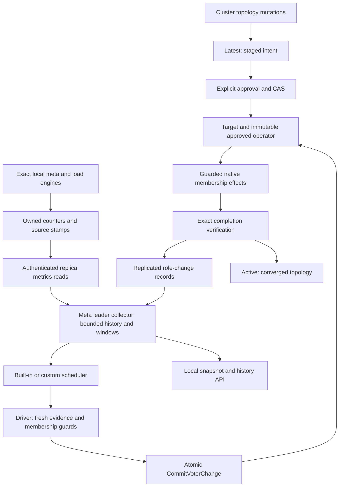

# Stable learners, voter policy and internal observations

Date: 2026-10-12. Status: target architecture finalized for implementation
planning at the user's request. This is a specification, not an implementation
or validation report. It incorporates the four follow-up topics selected by the
user. Confirmed decisions are distinguished from engineering defaults below.

The research record is [the session log](20261012-stable-learner-replicas.md).
Research baseline is commit `84ffa43`; public Node/Cluster/load boundaries take
precedence over historical brainstorm APIs. Work-in-progress source changes do
not establish completion of any requirement in this document.

## Objective and decisions

Support seven admitted nodes with three `_meta` voters and four stable learners.
All nodes retain `_meta`. Initially, load groups also host on every eligible
node by default, with three voters and the remaining replicas as learners.
Replace persistently unavailable or replication-lagging voters with stable
learners. Returning former voters remain learners when voter seats are full.
Forward ordinary learner/follower load proposals through the group's leader
using Meridian's native Raft forwarding mechanism.

Collect measurements inside the library so built-in and custom policies can use
fresh evidence, continuous failure/stability periods, and switch suppression.
Future load partitioning across subsets of nodes is enabled by the separation
of placement and voting; data migration and automatic partitioning are deferred.

| Decision | Result | Basis |
| --- | --- | --- |
| Desired voters | Per-group replicated policy, default 3 for meta and loads | Confirmed |
| Learner eligibility | Standby by default, explicit pin prevents promotion | Confirmed |
| Temporary extra voter | Optional, guarded by live quorum | Confirmed; default allowance of 1 is an engineering choice |
| Failure/stability | 30 seconds / 60 seconds, configurable | Confirmed |
| Capacity | Explicit limits; reject all-host overflow without a partial mutation | Confirmed in follow-up |
| Apply backlog | Blocks standby promotion; alone does not replace a voter | Confirmed in follow-up |
| Observation durability | Local bounded history; replicated recent switch records | Confirmed |
| Cooldown | Five minutes per group by default; new-failure exception; demoted replica cooldown remains binding | Confirmed |
| Healthy voters | Retain them; built-in policy does not balance healthy seats | Consistent with requested replacement behavior |
| Old documents | Preserve legacy behavior until explicit policy adoption | Compatibility design choice |
| Observer failover | Rebuild failure/stability windows; conservatively rearm durable cooldown records | Engineering choice; timing consequence documented below |

### Disposition of the four requested follow-ups

| Follow-up | Target contract | Detailed specification |
| --- | --- | --- |
| Default placement and capacity | All eligible load hosts by default; explicit total limits; atomic overflow rejection; founding below the desired voter count reports a persistent shortfall | [Placement and capacity](#1-placement-capacity-and-voter-shortfall), [replicated policy and hosting schema](#5-replicated-schema-and-persistence) |
| Meaning of lag and eligibility | Independent unavailability, replication-lag and no-progress windows; apply backlog blocks promotion; source freshness and hysteresis prevent cached or contradictory data from earning eligibility | [Failure and standby predicates](#2-failure-lag-and-standby-eligibility), [source generations](#source-generations-and-elapsed-time) |
| Interrupted replacement and concurrent admission | One immutable approved ordering, exact repeated-transfer guard, idempotent completion records and scoped atomic CAS; automatic actions cannot approve unrelated staged intent | [Replacement and recovery](#3-replacement-interruption-and-concurrent-intent), [durable role records](#durable-role-effect-materialization) |
| Complete metrics pipeline | Typed DTOs, validated constructor settings, independent bounded collection, exact source/run generations, local snapshot/history APIs and durable switch suppression | [Metrics contracts](#4-typed-metrics-and-public-reads), [implementation signatures](#7-file-and-signature-inventory) |

These four areas are specified for this change. Their implementation and tests
are required; they are not deferred by the remaining TODO list. Entry-count
thresholds and no-progress behavior are explicit engineering defaults, distinct
from the user-confirmed 30-second failure and 60-second standby windows.

### Component responsibilities and information flow



Topology owns desired hosting, voter counts and learner eligibility. Each Raft
group owns its actual voting membership and commit quorum. The collector owns
volatile evidence; policies choose from supported actions; the driver and effect
receivers enforce authority and safety independently of policy code. `_meta`
replicates approved intent and completed role effects, never raw metrics.

A role swap preserves both exact replica identities and their data. It changes
neither hosting nor admission. Administrative removal, data-loss readmission and
fresh-ID repair continue to use their separate existing workflows.

### Meridian port provenance and limits

The inspected local reference is `meridian-old` at `ac0b637f3`, under
`/Volumes/M4DATA/Users/speckzzz/reps/agent01/neria/`. The related
`meridian-overlay-v2` checkout at `91f9a75` also contains the proposal-forwarding
pattern. Preserve source attribution when copying applicable code.

| Reference source, relative to Meridian | Reuse in gquorum | Required adaptation |
| --- | --- | --- |
| `framework/cluster/raftbudget/raft/raftgroup_methods.go`, `handleProposalRG` | Ordinary follower `RawNode.Propose`, correlation, local apply-result wait | gquorum command envelope and authentication; owned-loop retry instead of an unjoined goroutine |
| `framework/cluster/loadmeter/ring.go` | Bounded, ordered in-memory history and copied snapshots | Configurable count/age limits, deep copies and cursor-based reads instead of a fixed 60-slot ring |
| `framework/cluster/loadmeter/ewma.go` | Accumulated-duration gate and delta-based EWMA | Explicit unknown/stale state, monotonic age and validated settings |
| `framework/cluster/loadmeter/node.go` | Atomic counters and rates over actual elapsed time | Per-replica ownership and joined sampling; omit application-specific HTTP/budget dimensions |
| `framework/cluster/raftbudget/admission/history.go` | Keep measurements distinct from policy decisions | Typed cluster evidence and replicated role records are new target work |

These sources provide measurement and forwarding primitives. They do not supply
the complete multi-source cluster evidence, failover, cooldown and authorization
pipeline specified here. No external exporter is required for scheduling.

## 1. Placement, capacity and voter shortfall

### Independent quantities

`Limits.MaxNodes` bounds admitted nodes and therefore required `_meta` hosting.
`Limits.MaxReplicas` bounds total replicas of each load group, counting both
voters and learners. Preserve their current defaults of 3 and 5. Rules are
durable cluster settings: do not silently expand them when a node joins or
reinterpret an existing database through different constructor values.

For the seven-node all-host example configure at founding:

```go
Limits: topology.Limits{MaxNodes: 7, MaxReplicas: 7}
```

`PlacementRule.MinReplicas/MaxReplicas` currently constrain load VOTERS despite
their names. Preserve that meaning and document it. They do not cap learners;
the total cap remains `Limits.MaxReplicas`. Require the load policy's target to
be within these voter bounds. Meta has voter bounds `[1, Limits.MaxNodes]`.
The defaults therefore allow singleton startup: minimum 1, desired target 3.

The built-in hosting rule for a policy-managed load group is every `NodeActive`
node allowed by its placement type filter. Draining/drained nodes keep meta
participation but receive no new load assignment. Administrative drain uses
the existing approved removal workflow. Ordinary unreachability never removes
a host assignment or lowers a policy target.

Before staging AddNode, ActivateNode, CreateGroup or placement changes, calculate
the complete resulting hosting set for every affected group. If any set exceeds
the total cap, return `fault.Invalid` identifying group, required count and cap.
Do not stage a truncated subset, allocate committed identities or partially add
the node to other groups. Preview reports the same invalid result. Existing
rules do not acquire an implicit online resize operation through this change.

### Initial and subsequent voter selection

For a fresh group, select `min(TargetVoters, eligible unpinned hosts)` voters in
sorted node-name order; declare all other assigned replicas learners. Reject
creation with no voters or fewer than an explicitly configured load minimum.
This deterministic founding choice does not use volatile health or latency.

| Founders/eligible hosts | Policy target | Initial role distribution | Status |
| --- | --- | --- | --- |
| 1 | 3 | 1 voter | Shortfall 2; quorum 1 |
| 2 | 3 | 2 voters | Shortfall 1; quorum 2; no voter-failure tolerance |
| 3 | 3 | 3 voters | Target met; quorum 2 |
| 7 | 3 | 3 voters + 4 learners | Target met; quorum 2 |
| 3 | 5, within configured hard bounds | 3 voters | Shortfall 2 |

Do not lower `TargetVoters` to the number currently healthy. A target above
current hosts is valid when within hard configured bounds. Report requested
target, actual native voters, eligible standbys and shortfall separately from
quorum health. Readiness may succeed below the target when the exact approved
membership is functioning; target shortfall is not proof of quorum loss.

After founding, new members join as learners. Additions do not bypass the
60-second standby window to fill an unoccupied voter seat. The scheduler promotes
one eligible learner at a time until the target is met. Existing healthy voters
keep their seats. A configured target reduction demotes excess voters one at a
time, preserving leadership transfer and live-quorum checks; the existing
planner's prohibition on a destructive `2 -> 1` transition remains. Reject a
policy update requiring that unsupported transition; target 1 is supported for
fresh founding without promising automatic conversion of established clusters.

### Explicit hosting and future partitioning

Make a custom hosting set durable rather than interpreting `GroupSpec.Nodes`
only once and later filling it with all nodes. Add an optional `Hosting` rule
to policy-managed load groups: `all_eligible` or `explicit`, with a sorted unique
node-name list for `explicit`. `CreateGroup` with `Nodes` selects `explicit`;
without Nodes it selects `all_eligible`. Explicit hosts must be admitted,
active and type-eligible at creation/addition. Draining or excluding a listed
host removes its assignment through approval; the selector can retain the name
as intent, but a later reassignment always allocates a fresh ID if retired.
Report unmet explicit placement rather than adding an unlisted host.

Meta rejects a Hosting rule: its host set is every admitted participant.
Legacy groups with no VoterPolicy retain their current placement semantics.
Explicit adoption freezes their current host set as `explicit` unless the caller
chooses `all_eligible`, preventing adoption from unexpectedly adding replicas.
Custom policies may choose supported role actions; automatic host relocation or
data partitioning is not a new scheduler action in this feature.

## 2. Failure, lag and standby eligibility

The built-in voter replacement predicates are:

1. **Unavailable:** repeated completed authenticated reachability attempts fail
   for this exact replica for at least `FailureWindow`.
2. **Replication lag:** the current group leader observes
   `max(Commit - Match, 0) > FailureLagEntries` continuously for that window.
3. **Replication stopped:** positive replication lag persists without Match
   advancing for `NoProgressWindow`. This catches a stuck final entry in a
   low-traffic group that never crosses the entry-count threshold.

Maintain independent windows for these reasons. Unknown metrics, failed overall
collection, a request never dispatched before round cancellation, and a missing
adapter field do not count as failed reachability. An idle, caught-up replica is
healthy even when no application writes change its Match index.

The third predicate is an engineering default of 30 seconds; it is configurable
and can be disabled explicitly. It does not add another 30-second wait after the
no-progress period has already elapsed.

A standby is eligible only when all these remain true for `StandbyWindow`:

- Exact assigned identity is a native learner and locally ready, without a hold,
  pending retirement, incomplete admission, pin, or demotion cooldown.
- Current leader's replication lag is at most `StandbyLagEntries`.
- Replica-local coherent `max(LocalCommit - Applied, 0)` is at most
  `StandbyApplyBacklogEntries`.
- Fresh reachability and leader acknowledgements exist; no snapshot restore or
  current storage failure/stall disqualifies the replica.
  A writer failure makes its source unknown immediately. An in-flight write
  becomes a disqualifying WAL stall after one second, matching the existing
  engine pressure guard; a normal short persistence call does not restart the
  standby window. This threshold is a core safety bound in this change.
- Every required source is fresh, compatible in scope, and progressing in sample
  generation. A stale cached sample never earns stability credit.

Engineering defaults are failure lag **greater than 1,000 entries**, standby
replication lag **at most 100 entries**, and standby apply backlog **at most 100
entries**. These are configurable entry counts, not byte/time estimates. A
standby's replication limit cannot exceed `membership.PromotionLagLimit=1000`.
Require failure threshold greater than standby threshold. Zero standby limits
are valid strict catch-up settings when explicitly supplied.

Do not subtract a remote Applied value from a later leader Commit value: that
would turn sampling/network skew into artificial apply backlog. Calculate local
apply backlog from one coherent local status capture. Match may legitimately be
ahead of Commit; saturating subtraction also aligns the operator's catch-up
predicate with the core membership check.

`RecentActive` alone is unsuitable as the continuous health signal because Raft
periodically clears it. Instrument time/sequence of accepted current-term peer
append/heartbeat responses in the Raft loop. Scope these to the same leader
epoch and exact peer. Retain native promotion safety checks as an additional
last-moment guard.

Application apply latency/backlog, CPU, GC, queue load and EWMA latency remain
diagnostics and custom-policy inputs. The default policy does not replace a
voter solely on those signals. Forwarded result latency includes local apply;
label it accordingly rather than presenting it as quorum commit latency.

## 3. Replacement, interruption and concurrent intent

### Atomic approval and immutable execution

Introduce `CommitVoterChangeProposal`, separate from fresh-ID replica repair.
The driver requests only a promotion, demotion or replacement in one group with
unchanged replica IDs. It revalidates after every user callback. The meta FSM
atomically checks converged Latest/Target/Active, expected version, no conflicting
operator, exact policy and role scope, then stores the new document, Target and
immutable operator. Ordinary automatic decisions never call Approve on an
arbitrary Latest document.

Whitelist document differences: selected existing replica roles and their
timestamps, affected group timestamp, version/parent/audit provenance. Preserve
all node states, assignments, identities, allocation counters, placements,
hosting selectors, pins and policies. Only the explicit administrative mutation
APIs may change those fields. Add comparisons for new fields to the OLD repair
validator as well, so it cannot become a bypass.

If admission, readmission, drain or a manual stage wins CAS, discard the candidate
and wait for that intent to resolve. If voter replacement wins, admission retries
against its new Active after convergence. No merge/approval of unrelated intent
is implicit. Losing leadership or CAS causes re-observation, not forced retry
of a stale decision. Keep the existing globally serialized approved operator.

Revalidation performs a new bounded collection after the policy callback and
again after plan construction. Merely reading the cached snapshot is insufficient:
a replica may have restarted while the callback ran and its old 60-second window
must not qualify the new run. The new observations must retain the same observer
epoch, exact replica/run identities, policy, leader term and membership scope.
Serialize these reads with periodic collection and use the same owned read pool.
A revalidation round does not wake the scheduler again; periodic collection still
continues independently and coalesces ordinary wakeups.

### Transition ordering

`MaxSurgeVoters=1` permits promotion-first only if all intermediate live-quorum
checks pass. `0` disables it. Total hosting capacity is unchanged by a role swap.
Load placement's hard voter maximum still applies; surge may exceed the desired
target but cannot silently override that hard bound. If surge is unavailable,
the planner may choose demotion-first only when all intermediate configurations
are safe and the selected standby already qualified.

Store the chosen ordering in the approved plan. Once effects start, never switch
ordering or substitute another learner inside that plan. Promotion rechecks
catch-up at execution, even after a successful WaitCaughtUp step. If the candidate
degrades or quorum disappears, wait with a reason and continue sampling. A
successful partial promotion is not rolled back without new approved intent.

### Leadership guard on demotion

Extend a new demotion step with exact `TransferNodeName` and `TransferReplicaID`
fields. The planner chooses a retained desired voter that is already a voter at
that boundary; it includes the usual explicit transfer step when required by
the initial observation. The fields authorize repeating that exact transfer as
a prerequisite while the demotion step is current, if the victim becomes leader
again. This closes the election gap between transfer completion and demotion.

Include the fields in `AuthorizedStep.Matches`, plan equality, all scope
validators, copies and wire/disk encodings. They are optional/omitted for legacy
steps. A guard never authorizes an arbitrary target or the replay of a past
standalone step. Guarded transfer does not advance the demotion cursor or count
as a completed role change. After the transfer, re-observe leadership and
revalidate the current demotion authorization before proposing membership.
For meta self-demotion, the old leader stops execution; the new meta leader
continues the same operator and step.

If the exact transfer target is unavailable, wait. Changing it requires a new
approved plan. Legacy steps without this guard preserve their strict behavior.

### Crash and race outcomes

| Interruption | Required behavior |
| --- | --- |
| Before approval | No effect or durable switch record; a later callback selects again. |
| Approval committed, reply lost | Read Target/operator before resubmitting; resume the stored operator. |
| Membership proposal accepted, outcome unknown | Re-observe native membership under the same current authorization; never infer failure from timeout. |
| Promotion committed, meta step acknowledgement lost | Exact idempotent verification recognizes the voter; advance and record once. |
| Crash while four voters exist | Resume remaining approved demotion; no fresh decision/cooldown gate can strand the approved plan by itself. |
| Crash after demotion-first | Resume the approved promotion if safe; do not choose another learner or reverse ordering. |
| Group leader changes during control RPC | Return retryable leadership outcome, resolve current leader, recheck exact authorization and membership. |
| Removed/demoted victim becomes leader before demotion | Repeat only the approved guarded transfer, then retry demotion. |
| New admission/manual stage while callback waits | Revalidation/CAS refuses stale replacement; staged intent remains unapproved. |
| Plan is superseded | Stop stale effects; retain completed-effect/cleanup evidence. Build any new plan from actual native state. |
| Quorum lost | Wait; metrics and learners cannot authorize forced recovery. |

Returning replicas retain durable identity/logs on ordinary demotion/restart and
apply the new learner membership. Demotion does not retire or stop a replica.
Actual data-loss readmission continues to allocate a fresh ID and fence/join the
old owner. Neither node-name reuse nor a new process incarnation inherits metrics
eligibility from an old replica.

## 4. Typed metrics and public reads

Use a public `metrics` package with only standard-library dependencies. Keep
`topology` imports out of it to avoid a metrics/topology cycle. Types below are
the target API schema; times ending `_ns` are integer nanoseconds, wall times
are RFC3339 JSON timestamps. Validity is always explicit.

```go
// CREATED metrics/types.go
type Validity string
const (
    Unknown Validity = "unknown"
    Current Validity = "current"
    Stale   Validity = "stale"
)
type ReplicaIdentity struct {
    ClusterID  string `json:"cluster_id"`
    GroupID    string `json:"group_id"`
    NodeName   string `json:"node_name"`
    ReplicaID  uint64 `json:"replica_id"`
    InstanceID string `json:"instance_id"`
    RunID      string `json:"run_id"`
}
type Stamp struct {
    Sequence uint64        `json:"sequence"`
    Age      time.Duration `json:"age_ns"`
    State    Validity      `json:"state"`
}
type Latency struct {
    Count   uint64        `json:"count"`
    Sum     time.Duration `json:"sum_ns"`
    EWMA    time.Duration `json:"ewma_ns"`
    LastAge time.Duration `json:"last_age_ns"`
    State   Validity      `json:"state"`
}
type Counters struct {
    Proposals uint64 `json:"proposals"`
    Results   uint64 `json:"results"`
    Timeouts  uint64 `json:"timeouts"`
    Rejected  uint64 `json:"rejected"`
    WALRetries uint64 `json:"wal_retries"`
    SendErrors uint64 `json:"send_errors"`
    LeaderChanges uint64 `json:"leader_changes"`
}
type Rates struct {
    State Validity `json:"state"`
    Window time.Duration `json:"window_ns"`
    Proposals float64 `json:"proposals_per_second"`
    Results float64 `json:"results_per_second"`
    Timeouts float64 `json:"timeouts_per_second"`
    Rejected float64 `json:"rejected_per_second"`
}
type PeerProgress struct {
    ReplicaID uint64        `json:"replica_id"`
    Match     uint64        `json:"match"`
    RecentActive bool       `json:"recent_active"`
    AckSequence uint64      `json:"ack_sequence"`
    AckAge    time.Duration `json:"ack_age_ns"`
    AckKnown  bool          `json:"ack_known"`
}
type ReplicaSample struct {
    Identity ReplicaIdentity `json:"identity"`
    At       time.Time       `json:"at"`
    Meter    Stamp           `json:"meter"`
    Raft     Stamp           `json:"raft"`
    Writer   Stamp           `json:"writer"`
    Ready bool `json:"ready"`
    Running bool `json:"running"`
    Restoring bool `json:"restoring"`
    LeaderID uint64 `json:"leader_id"`
    Term uint64 `json:"term"`
    Commit uint64 `json:"commit"`
    Applied uint64 `json:"applied"`
    Voters []uint64 `json:"voters"`
    Learners []uint64 `json:"learners"`
    MembershipDigest string `json:"membership_digest"`
    Progress []PeerProgress `json:"progress,omitempty"`
    Pending int `json:"pending"`
    Queued int `json:"queued"`
    ProposalLimit int `json:"proposal_limit"`
    OutboundQueued int `json:"outbound_queued"`
    OutboundLimit int `json:"outbound_limit"`
    WALStall time.Duration `json:"wal_stall_ns"`
    Counters Counters `json:"counters"`
    Rates Rates `json:"rates"`
    ResultLatency Latency `json:"result_latency"`
    PersistenceLatency Latency `json:"persistence_latency"`
    ApplyLatency Latency `json:"apply_latency"`
}
type UnsignedValue struct {
    State Validity `json:"state"`
    Value uint64   `json:"value"`
}
type DurationValue struct {
    State Validity      `json:"state"`
    Value time.Duration `json:"value_ns"`
}
type Evidence struct {
    UnavailableFor DurationValue `json:"unavailable_for"`
    ReplicationLagFor DurationValue `json:"replication_lag_for"`
    NoProgressFor DurationValue `json:"no_progress_for"`
    StandbyReadyFor DurationValue `json:"standby_ready_for"`
    DemotionCooldownRemaining time.Duration `json:"demotion_cooldown_remaining_ns"`
    Reasons []string `json:"reasons"` // bounded library vocabulary
}
type ReplicaObservation struct {
    SeriesID string `json:"series_id"`
    Sequence uint64 `json:"sequence"` // observer history cursor, not source seq
    ReceivedAt time.Time `json:"received_at"`
    State Validity `json:"state"`
    Sample ReplicaSample `json:"sample"`
    Reachability string `json:"reachability"` // alive, unreachable, unknown
    ReplicationLag UnsignedValue `json:"replication_lag"`
    ApplyBacklog UnsignedValue `json:"apply_backlog"`
    Evidence Evidence `json:"evidence"`
}
type GroupObservation struct {
    GroupID string `json:"group_id"`
    LeaderID uint64 `json:"leader_id"`
    Term uint64 `json:"term"`
    MembershipDigest string `json:"membership_digest"`
    State Validity `json:"state"`
    TargetVoters int `json:"target_voters"`
    NativeVoters int `json:"native_voters"`
    EligibleStandbys int `json:"eligible_standbys"`
    Shortfall int `json:"shortfall"`
    CooldownRemaining time.Duration `json:"cooldown_remaining_ns"`
    Replicas []ReplicaObservation `json:"replicas"`
}
type ClusterSnapshot struct {
    ObserverNodeName string `json:"observer_node_name"`
    ObserverInstanceID string `json:"observer_instance_id"`
    CollectorRunID string `json:"collector_run_id"`
    At time.Time `json:"at"`
    ActiveVersion uint64 `json:"active_version"`
    IsCollectorLeader bool `json:"is_collector_leader"`
    Local []ReplicaObservation `json:"local"`
    Groups []GroupObservation `json:"groups"`
}
type HistoryQuery struct {
    SeriesID string `json:"series_id"`
    After uint64    `json:"after"`
    Limit int       `json:"limit"`
}
type HistoryPage struct {
    SeriesID string `json:"series_id"`
    Points []ReplicaObservation `json:"points"`
    Next uint64 `json:"next"`
    Truncated bool `json:"truncated"`
}
```

These are telemetry DTOs, not persisted topology. Clone every nested slice
before returning. Always emit empty arrays as arrays rather than synthesizing a
measured zero for an unknown signal. A value is actionable only when its State
is Current; At alone does not establish freshness.

The separate Meter/Raft/Writer stamps prevent an independently running sampler
from making a stuck Raft loop appear fresh. A new engine run gets a random RunID
after resource acquisition; a process restart also changes InstanceID. Source
sequences only advance when their owning component actually samples/updates.
No component accesses RawNode off its owning loop.

### Measurement ownership and idle replicas

| Source | Owned measurements | What advances its generation |
| --- | --- | --- |
| Raft loop | Leader, term, membership, Commit/Applied, peer progress, proposal pressure | A coherent capture on that loop at the configured sample cadence, including idle ticks |
| Writer loop | Persistence latency, retries, in-flight write age and storage health | A writer-owned sample or completed operation; an idle writer samples on its own timer |
| Meter | Counter deltas, rates, latency summaries and history publication | Its owned aggregation tick; it cannot advance Raft or Writer stamps |
| Leader peer acknowledgement | Exact peer's current-term successful replication/heartbeat response | Accepted response handled on the leader loop; never an RPC read or cached RecentActive flag |
| Collector probe | Exact destination attempt, dispatch/completion, elapsed time and outcome | A new completed read attempt, whether successful or an eligible reachability failure |

A writer timer does not run past a blocking storage call on that writer. The
independent meter can expose the growing age/stall, but cannot make the writer
current. Conversely, an idle writer and idle Raft loop continue to sample: no
application traffic is needed to establish standby stability. A successful
rejection response to a replication attempt is evidence of contact, not a
successful catch-up acknowledgement; it cannot qualify a standby by itself.

Keep producer timestamps with their monotonic component inside each process.
Send relative ages over the wire; converting timestamps to Unix nanoseconds and
subtracting them later is insufficient for elapsed-time evidence. Saturate age,
counter and duration arithmetic instead of wrapping; a reset/overflow invalidates
the affected rate interval and never creates apparent recovery.

For diagnostic latency EWMAs use Meridian's weight 0.3 and minimum accumulated
observed duration 100ms as internal defaults, evaluated on each SampleInterval.
The first eligible batch seeds the average. Before then the EWMA is unknown;
no samples is not zero latency. These constants do not govern voter decisions.
Rates use counter deltas divided by the actual positive elapsed interval; the
initial/reset interval is unknown and a fresh idle interval is a measured zero.

### Options, reads and transport

```go
// UPDATED node_options.go: add NodeOptions.Metrics MetricsOptions.
type MetricsOptions struct {
    SampleInterval time.Duration // default 1s
    CollectInterval time.Duration // default 5s
    CollectTimeout time.Duration // default 2s per round
    MaxSampleAge time.Duration // default 15s
    HistoryRetention time.Duration // default 10m
    MaxHistoryPoints int // default 600 per series, absolute cap
    MaxParallelReads int // default 8, shared across groups/destinations
}

// UPDATED cluster.go, implemented in CREATED node_metrics.go.
Metrics() metrics.ClusterSnapshot
MetricsHistory(metrics.HistoryQuery) (metrics.HistoryPage, error)

// UPDATED load/group.go; exact local handle, never successor routing.
func (g *Group) Metrics() metrics.ReplicaObservation
func (g *Group) MetricsHistory(q metrics.HistoryQuery) (metrics.HistoryPage, error)

// UPDATED load/transport.go; no new Transport method.
// Add to ReplicaStatus:
Metrics *metrics.ReplicaSample `json:"metrics,omitempty"`

// UPDATED policy/scheduler.go; added ScheduleInput fields:
Metrics metrics.ClusterSnapshot
Switches []topology.VoterSwitchState
```

`Metrics()` is an owned local read without network I/O or freshness guarantees.
The returned stamps/state expose age. A follower includes its local replicas;
cluster observations are unavailable/stale when it does not own collection.
Applications may send a read to their chosen node through their own adapter.
No implicit leader forwarding, linearizable barrier, listener or Prometheus
registry is introduced by these public read APIs.

History uses an opaque process/observer-scoped SeriesID, never a node name alias.
It changes when source identity/run or observer history ownership changes.
Limit defaults to 100, accepts 1..MaxHistoryPoints, and is enforced before copying.
A pruned series returns `fault.HistoryUnavailable`. A cursor older than retained
points returns the available suffix with Truncated=true. A request after the
latest cursor returns an empty page. Reads never trigger sampling or create a
series. A stopped load handle may expose retained bounded history as stale;
it cannot query a successor's series.

Validate all options in NewNode without allocation of workers, I/O or callbacks.
Periods/timeouts/caps must be positive after defaults; CollectTimeout must be
less than CollectInterval; MaxSampleAge must cover the configured sampling and
round budget. Reject integer/duration overflow in retention capacity arithmetic.
Allocate rings lazily after authorized replica publication. Effective retention
is bounded by BOTH age and point count. Keep only current approved identities
and bounded retained stopped-handle data; never accept arbitrary caller keys.

Concretely, require `MaxSampleAge >= SampleInterval + CollectTimeout`, using
checked duration addition. Validate negative settings before applying zero-value
defaults. Sampling cadence is local configuration; group MaxObservationGap still
determines whether this observer can build an actionable continuous window.

The collector keeps at most one current and one retired series per exact replica
key `(ClusterID, GroupID, NodeName, ReplicaID)`. A newer run evicts the older retired
series; removed assignments leave the collector cache after current approved
work no longer references them. An old load handle may retain its own bounded
ring until the caller releases the handle; Node does not retain every old handle.
HistoryRetention expires points on reads as well as writes, so a stopped source
does not retain readable history indefinitely just because sampling ended.

| Protocol/read | Request | Response | Semantics |
| --- | --- | --- | --- |
| Existing load ReadReplica | Exact authenticated ReplicaQuery | ReplicaStatus with optional sample | Local exact target; no application-result RPC |
| NEW meta `MetaReplicaMetrics(MetaRequest) returns (Reply)` | Existing authenticated header; request body empty | JSON `metrics.ReplicaSample` in Reply.Data | Local meta replica, including learners; admitted authenticated callers; exact response identity check |
| Existing MetaStatus | Unchanged | Existing GroupStatus | Leader observation; use for native membership/health, retain current routing |
| Cluster.Metrics / Group.Metrics | Local call | Owned current/stale snapshot | Cached observation only |
| MetricsHistory | Bounded SeriesID/cursor/limit | Owned bounded page | Memory only; missing history is explicit |

Add the meta RPC to `.proto`, server adapter and client method dispatch; run the
pinned generator. Reject request/response incarnation mismatches. Unsupported
peers or load adapters that omit metrics produce unknown evidence, not healthy
zeroes. Default automatic promotion waits until required evidence exists.

### Source generations and elapsed time

Use producer monotonic sample age plus collector request elapsed time as a
conservative age bound. The collector uses its monotonic clock for continuous
windows; remote wall timestamps are display-only. A duplicate sequence does
not extend evidence. A source reset, out-of-order response, identity mismatch,
stale source or excessive gap resets the affected predicate. Multi-source
predicates retain a generation vector; never globally compare independent
sequence counters. One fresh leader reading cannot refresh old learner data.

Decision scope includes scheduler leadership epoch, group leader/run ID, term,
membership digest and relevant policy. Rebuild decision windows after scheduler
leadership changes or enablement. Reset group replication windows on group
leadership/membership changes; leave unrelated groups' evidence intact.

Collect continuously during cooldown and approved execution. The sampler is
independent of custom scheduler callback execution. One bounded pending wakeup
allows timely evaluation when evidence becomes sufficient; serialize callbacks
and coalesce ticks without backlog. Recheck immediately before approval and
again at each guarded effect. Remote history is not copied over the wire; only
compact samples are exchanged and the observing leader builds its own history.

### Collection and read outcomes

Each probe result records whether it was dispatched and whether its outcome
belongs to the exact intended identity. Maintain separate probe generations so
unavailability can accumulate without requiring samples from the failed replica.
Transport authentication is enforced when a response exists; no response cannot
attest to the absent peer's identity. Requests still target a previously validated
exact peer endpoint and incarnation.

| Outcome | Evidence and read behavior |
| --- | --- |
| Exact fresh reply | Advance only the source generations actually observed; update relevant predicate windows and append an owned history point. |
| Fresh local history cache hit | Return bounded owned points, with current ages; never extend predicate duration because of a read. |
| Unknown/pruned SeriesID | Return HistoryUnavailable; no probe, source creation or routing to a replacement. |
| Duplicate sample | Keep its original confirmation time; do not earn window duration or another successful-source generation. |
| Source stale, run changed, malformed reply or identity mismatch | Invalidate the relevant evidence; preserve an explicit diagnostic, never count the payload as health. |
| Exact dispatched probe fails to connect or reaches its own deadline | May confirm unavailability for that target if the round/observer is otherwise valid; it supplies no lag or apply measurement. |
| Scheduling hold, unsupported metrics, or rejected credentials | Explicit ineligibility or unknown evidence; never treat these as a failed voter based solely on node liveness. |
| Read never dispatched, owner stopping, leadership lost, or entire round canceled | Unknown; no new unavailability confirmation. |
| Caller adapter ignores cancellation | Keep its worker slot and ownership until return; prevent overlapping reads for that exact source, report stalled collection, and join it on shutdown. |
| Native membership or leader term changes during the round | Discard incompatible samples and reset affected group windows. Unrelated groups retain valid evidence. |

An observer needs fresh local source progress and a fresh current group-leader
observation before using a failed probe to approve a replacement. Losing contact
with every member cannot be interpreted as permission to change membership.
No-progress evidence advances only while positive replication lag, unchanged
Match and fresh leader generations coexist; any Match increase resets its timer.

Use a rotating dispatch cursor across exact sources so a round exhausted by slow
peers does not perpetually starve later groups. Hold the global read-pool permit
until the actual callback returns, including after timeout. A normal round-budget
expiry publishes partial results: a dispatched attempt that exhausted its own
deadline can report unavailability; never-dispatched work remains unknown.
Distinguish this from owner/leadership cancellation, which invalidates the round.
If configured concurrency and cadence cannot confirm a source within its policy
gap, expose insufficient observation frequency and wait; do not relax freshness
to accommodate a large cluster.

Build one flat ordered list of exact meta and load reads for the whole round.
Rotate its starting cursor across rounds; do not restart the budget or allocate
an independent worker pool for every group. Dispatch is marked only after peer
identity/address resolution and immediately before invoking the actual local or
remote read. Result storage belongs to that invocation until it returns, so a
late callback cannot mutate an already published partial round.

The observer may retain one previously validated peer endpoint and process pin
per assigned replica for read-only probes after its session expires. Otherwise
session expiry could erase the destination before the failure window matures.
A newly known incarnation replaces that pin; an identity contradiction invalidates
it; assignment removal prunes it. Without a previously validated destination the
result is unknown. This bounded cache grants no authority to send Raft messages,
execute control actions, renew sessions or start a successor.

Native load membership observations used by planning, approval revalidation and
effect dispatch must also return bounded partial results. One Host-owned pool
spans these calls across load groups, with `MaxParallelReads` permits separate
from the temporal collector. A native observation uses at most `CollectTimeout`
and half its remaining effect/caller budget, leaving time for the subsequent
action. Preserve exact reply attestation and a current leader's native membership;
unanswered peers never count as live voters. Expiry of this inner read budget
can retain healthy replies; caller or Host cancellation invalidates the whole
observation. Exclude overlapping calls for each durable replica identity while
resolving its process pin, retain canceled callback ownership until actual return,
and join the pool before releasing Host resources. These native status calls
do not earn temporal failure or standby eligibility.
Serialize concurrent native rounds for one group with a separate observation
gate so a membership effect can observe its group while holding its own effect
gate.
Completed read callbacks must release their exact-source exclusion before
publishing completion. Otherwise overlapping status users can turn a healthy
peer into missing quorum evidence. Preserve structured membership safety
refusals through load adapters so transient post-change quorum loss is retryable;
never infer that classification by parsing error messages.

## 5. Replicated schema and persistence

### Topology additions

```go
// CREATED topology/voter_policy.go; time.Duration encodes integer nanoseconds.
type VoterPolicy struct {
    TargetVoters int `json:"target_voters"`
    MaxSurgeVoters int `json:"max_surge_voters"`
    FailureWindow time.Duration `json:"failure_window_ns"`
    StandbyWindow time.Duration `json:"standby_window_ns"`
    FailureLagEntries uint64 `json:"failure_lag_entries"`
    StandbyLagEntries uint64 `json:"standby_lag_entries"`
    StandbyApplyBacklogEntries uint64 `json:"standby_apply_backlog_entries"`
    ReplaceNoProgress bool `json:"replace_no_progress"`
    NoProgressWindow time.Duration `json:"no_progress_window_ns"`
    MaxObservationGap time.Duration `json:"max_observation_gap_ns"`
    SwitchCooldown time.Duration `json:"switch_cooldown_ns"`
    DemotionCooldown time.Duration `json:"demotion_cooldown_ns"`
    AllowNewFailureDuringCooldown bool `json:"allow_new_failure_during_cooldown"`
}

// UPDATED topology/document.go: complete changed entities.
type HostingMode string
const (
    HostingAllEligible HostingMode = "all_eligible"
    HostingExplicit HostingMode = "explicit"
)
type HostingRule struct {
    Mode HostingMode `json:"mode"`
    Nodes []string `json:"nodes,omitempty"`
}
type Replica struct {
    NodeName string `json:"node_name"`
    ReplicaID uint64 `json:"replica_id"`
    Role ReplicaRole `json:"role"`
    PinnedLearner bool `json:"pinned_learner,omitempty"`
    CreatedAt time.Time `json:"created_at"`
    UpdatedAt time.Time `json:"updated_at"`
}
type Group struct {
    ID string `json:"id"`
    Replicas []Replica `json:"replicas"`
    NextReplicaID uint64 `json:"next_replica_id"`
    Placement *PlacementRule `json:"placement,omitempty"`
    VoterPolicy *VoterPolicy `json:"voter_policy,omitempty"`
    Hosting *HostingRule `json:"hosting,omitempty"`
    CreatedAt time.Time `json:"created_at"`
    UpdatedAt time.Time `json:"updated_at"`
}

// CREATED topology/voter_change.go
type ReplicaKey struct {
    NodeName string `json:"node_name"`
    ReplicaID uint64 `json:"replica_id"`
}
type VoterChange struct {
    GroupID string `json:"group_id"`
    Promote *ReplicaKey `json:"promote,omitempty"`
    Demote *ReplicaKey `json:"demote,omitempty"`
}
// UPDATED topology/operator.go: complete changed authorization entities.
type Step struct {
    Seq int `json:"seq"`
    Kind StepKind `json:"kind"`
    GroupID string `json:"group_id"`
    NodeName string `json:"node_name,omitempty"`
    ReplicaID uint64 `json:"replica_id,omitempty"`
    TransferNodeName string `json:"transfer_node_name,omitempty"`
    TransferReplicaID uint64 `json:"transfer_replica_id,omitempty"`
}
type AuthorizedStep struct {
    OperatorID OperatorID `json:"operator_id"`
    Version uint64 `json:"version"`
    Attempt uint32 `json:"attempt"`
    StepSeq int `json:"step_seq"`
    Kind StepKind `json:"kind"`
    GroupID string `json:"group_id"`
    NodeName string `json:"node_name,omitempty"`
    ReplicaID uint64 `json:"replica_id,omitempty"`
    TransferNodeName string `json:"transfer_node_name,omitempty"`
    TransferReplicaID uint64 `json:"transfer_replica_id,omitempty"`
}
```

`DefaultVoterPolicy()` returns a COMPLETE resolved value: target 3, surge 1,
30s/60s windows, 1000/100/100 entry limits, ReplaceNoProgress=true and 30s
NoProgressWindow, 15s MaxObservationGap, both cooldowns 5m, and the new-failure
exception enabled. Constructor/meta/group creation nil selects this value for
fresh groups. For explicit policies callers copy this helper and override fields.
An explicit struct is validated as a complete value; zero target/windows are
invalid. Zero surge and zero standby entry limits mean exactly zero, not default.
Zero cooldown is allowed to disable that particular policy delay deliberately.
NoProgressWindow must be positive when ReplaceNoProgress is enabled.

`NewNode` validates an explicitly supplied policy without reading storage. A nil
fresh-group default must not cause rejection or reinterpretation of a retained
legacy group; resolve its durable policy after the startup identity/state checks.
Only genuinely fresh founding validates and installs the default against its
capacity. For example, fresh founding with `MaxNodes=1` must explicitly request
target 1, whereas a retained legacy singleton is not silently upgraded to target 3.

Stored nil policy remains legacy; decoding/restoring never defaults it. New
fields use omitempty where absence has compatibility meaning. Default helpers
run only on fresh construction or an explicit administrative mutation. Require
MaxSurgeVoters in `{0,1}`, target within hard voter bounds, standby lag <= core
limit, and failure lag > standby lag. Reject pinned voters. Deep-copy policies,
hosting lists, pin fields and action pointers throughout public/callback paths.

Per-group policy timing supersedes local legacy scheduling defaults for managed
groups. `SchedulingOptions.Cooldown`/RestoreDegraded.StableFor retain their
existing meaning for legacy groups. Sampling caps stay local. A group with an
observation-gap policy incompatible with a node's sampling cadence reports
`insufficient_observation_frequency` and cannot auto-promote from that evidence.

### Durable role-effect materialization

```go
// CREATED topology/voter_switch.go
type RoleChangeRecord struct {
    OperatorID OperatorID `json:"operator_id"`
    Version uint64 `json:"version"`
    Attempt uint32 `json:"attempt"`
    StepSeq int `json:"step_seq"`
    GroupID string `json:"group_id"`
    NodeName string `json:"node_name"`
    ReplicaID uint64 `json:"replica_id"`
    From ReplicaRole `json:"from"`
    To ReplicaRole `json:"to"`
    At time.Time `json:"at"`
    Index uint64 `json:"index"`
}
type VoterSwitchState struct {
    GroupID string `json:"group_id"`
    Last RoleChangeRecord `json:"last"`
    Replicas []RoleChangeRecord `json:"replicas"`
}

// UPDATED internal/metaengine/disk.go: full state envelope after this change.
type metaDiskState struct {
    SchemaVersion uint32 `json:"schema_version"`
    Rules topology.Rules `json:"rules"`
    RetiredGroups []retiredGroup `json:"retired_groups"`
    Allocations []allocationRecord `json:"allocations"`
    Latest topology.Document `json:"latest"`
    Target topology.Document `json:"target"`
    Active topology.Document `json:"active"`
    History []topology.Document `json:"history"`
    Executions []diskOperator `json:"executions"`
    Admissions []diskAdmission `json:"admissions,omitempty"`
    Sessions []sessionState `json:"sessions"`
    Locks []lockEntry `json:"locks"`
    Activated []string `json:"activated,omitempty"`
    VoterSwitches []topology.VoterSwitchState `json:"voter_switches,omitempty"`
    AppliedIndex uint64 `json:"applied_index"`
    AppliedTerm uint64 `json:"applied_term"`
}

// UPDATED internal/metaengine/codec.go: new schema-1 command kind
// "commit_voter_change" with this body.
type CommitVoterChangeProposal struct {
    Change topology.VoterChange `json:"change"`
    Doc topology.Document `json:"doc"`
    ExpectedVersion uint64 `json:"expected_version"`
    Plan topology.Plan `json:"plan"`
    At time.Time `json:"at"`
    ProposalID string `json:"proposal_id"`
}
```

Add VoterSwitches to the internal `smState` representation and BOTH directions of
the custom smState JSON conversion through metaDiskState. Editing only smState
would silently lose the records: current persistence deliberately uses a separate
legacy vocabulary in `disk.go`. Preserve `executions`, `execution_id` and other
existing disk/wire names. Snapshot and materialized state use the same complete
encoding. New command dispatch must be registered in encode/decode and Apply.

Write a role record only when an exact authorized operator transition verifies
completion of a promote/demote step; use the containing meta apply index and
transition timestamp. A retry of the same tuple is a no-op for cooldown. Last
is the highest-index role effect for that group, Replicas contains the latest
record for each protected exact identity, sorted deterministically. State restore
rejects duplicates, zero identity/tuple fields, impossible roles and inconsistent
indexes. Retained historical identity records are allowed when protected by
existing execution/retirement evidence; do not require all to occur in Active.

Group cooldown suppresses fresh replacements/rotations. Monotonic filling of a
fixed target deficit is not a replacement; it remains subject to standby and
per-replica demotion windows. This avoids holding a growing cluster at two voters
for five minutes solely because it just promoted its second voter. Reducing
an explicitly lowered target is similarly a target-convergence operation.
Neither exemption allows swapping healthy seats or immediate repromotion of a
recently demoted replica. Policy changes themselves require explicit approval.

Within one scheduler leadership epoch, measure cooldown from first observation
of a new durable record using monotonic time. On a new epoch, conservatively
rearm the full configured duration for relevant records. Re-reading the same
record does not rearm it. This preserves suppression without assuming synchronized
clocks, but can delay a replacement after failover; the configured new-failure
exception is available. Cooldown never blocks continuation of an already
approved operator. Failed attempts use a separate bounded retry backoff and do
not generate durable role-change records.

Define the new-failure exception conservatively within the current observer
epoch. After first observing the group's latest role record, remember which
exact current voters have been confirmed free of all replacement predicates.
A later continuously failing interval for such a voter may bypass group cooldown
once the ordinary failure window and standby checks pass. An already-bad voter
first seen after failover has no proof of a new failure: wait for cooldown expiry
or an observed recovery followed by a qualifying new failure. A fresh durable
role record resets this exception baseline; unchanged rereads do not. This avoids
treating a window reset or leader election as a newly failed voter. Demotion
cooldown remains binding in every case.

Keep current-group records independent of topology history pruning. Remove
obsolete identities only after no current assignment/approved execution/retirement
obligation needs them. Group IDs are never reused. Old snapshots have no records;
established in-progress operators must finish/reconcile before automatic policy
decisions regardless of whether records are present.

### Physical schema and unchanged state

There is no SQL database, DDL, ORM, external cache or new bbolt bucket in this
change. The complete relevant key space remains:

| bbolt bucket | Key | Value / change |
| --- | --- | --- |
| `format` | `schema_version` | ASCII storage schema 1, unchanged |
| `hardstate` | `current` | Raft protobuf HardState, unchanged |
| `entries` | big-endian 8-byte index | Raft protobuf Entry; may contain the new JSON command |
| `snapshot` | `current` | Raft protobuf Snapshot; data contains full extended metaDiskState |
| `applied` | `index`, `confstate` | Applied uint64 index and protobuf ConfState, unchanged |
| `state` | `current` | Extended metaDiskState JSON above |
| `identity` | `node_name`, `cluster_id`, `member_id`, `member_seen` | Existing scalar encodings, unchanged |
| `serve_override` | `current` | Existing override encoding, unchanged |
| `load_replicas` | group ID | Existing ReplicaRecord JSON, unchanged |

Rules, Document's outer fields, Nodes, placement field encodings, retired group
and allocation ledgers, admission/session/lock records, and storage identity
pins remain unchanged. Role changes do not allocate IDs or rewrite application
ledgers. Load WAL snapshots still contain application snapshots and committed
tail; metrics and cooldown records do not enter application state machines.

Memory caches are explicitly bounded: local series key is exact replica+run,
observer series key additionally includes collector run. Predicate state adds
leader/membership/policy scope; changing that scope resets decision windows but
does not alias a different replica into the same history. Value is a
ring of owned observations, maximum 600 points/10m by default. Oldest entries
are evicted by count and age; stopping/removing a source expires its actionable
state. Temporal evidence is one bounded state per current replica/predicate,
reset by scope/expiry rather than persisted. No stale history is promoted into
recovery proof. No Redis/cache TTL configuration is introduced.

Preserve immutable baseline bytes/hashes. Old data must still decode and replay.
Do not claim mixed-version operation: old binaries cannot execute the new command
or guarded-step semantics. Require a coordinated compatible rollout before
enabling this feature; version-negotiated rolling enablement is deferred.

## 6. Startup, admission, forwarding and lifecycle flows

### Administrative intent and target convergence

1. A typed mutation reads the expected Latest version, clones its document and
   applies only the requested policy, pin, hosting or node change.
2. Validate the complete resulting document, voter bounds, exact identities and
   every affected hosting set before committing allocations or staging anything.
   Preview returns the proposed document/plan without staging; preview and approval
   cannot be combined.
3. Stage using expected-version CAS. A conflict changes nothing. Staging success
   changes Latest alone and does not start membership work.
4. When approval was requested, approve that exact staged version. If approval
   fails after staging succeeds, return its staged version with the error so the
   caller can retry that version's approval. Never silently select a newer Latest.
5. Execute the stored plan, verify effects, then advance Active. A policy-only
   update may converge without a role effect; subsequent automatic actions fill,
   reduce or replace seats using fresh evidence and their own atomic command.
   An unpin only enables later candidacy; it does not promise immediate promotion.

### Founding and learner admission

Meta currently seeds a snapshot at index/term 1 with founding voters. Extend the
internal engine options with `FoundingLearners []raft.Peer` and reuse that existing
durable seed path, putting sorted disjoint sets in ConfState.Voters/Learners.
Require at least one voter and the local founder in the union. A single shared
deterministic role-selection helper supplies both that seed and the first meta
topology, preserving the current empty founding-plan invariant. Never seed all
seven as voters and hope a later scheduler can elect/reduce them.

For load groups, retain the existing founding-voters step followed by explicit
prepare/add steps for declared learners. Learners do not need to be present in
the initial load seed. The metadata approval remains the acquisition authority.

Join/admission sequence validation must accept prepare+add for a desired stable
learner, and prepare+add+wait+promote for a desired voter. Share one role-aware
validator between runtime and replicated admission checks. Complete admission
and session activation for an exact ready learner once its approved Active and
native membership have applied locally. Native membership, staged Latest or
resource preparation alone does not make a node ready. Sessions/locks and load
hosting do not require meta voter status.

On retained restart, recover the complete snapshot/tail, validate pins and
authorization, publish the exact replica only after readiness, then start fresh
metric evidence. Missing/foreign storage stays parked. Demotion preserves the
replica and metrics run unless it actually restarts; a role change resets the
appropriate eligibility scope. Data-loss readmission preserves existing fences
and fresh-ID allocation while copying policy/hosting/pin intent.

### Mutation forwarding

Port Meridian's ordinary RawNode.Propose forwarding and local apply-result
correlation. Existing meta mutations keep authenticated `ProposeMeta` routing.
Keep membership/control calls leader-only.

For a ready authorized load follower/learner: reserve a bounded local waiter,
encode the existing schema-1 correlation and stable application RequestID,
submit to RawNode, send MsgProp through the existing authenticated transport,
and resolve the waiter only when that same replica applies the committed entry.
Proposal cancellation ends a wait and does not cancel a committed mutation.

Both the local leader-only guard in `handleProposal` AND the blanket ingress
MsgProp rejection in `Group.Step` must change. Accept inbound load MsgProp only
at the current leader from an exact authenticated current group member, with
one valid bounded EntryNormal envelope. Reject configuration entries, malformed
payloads, wrong destination, oversized data and raw meta MsgProp. Retain
MaxUncommittedBytes and bounded inbound/outbound queues. Native consensus traffic
continues through its existing validation path.

A stale leader destination must not forward again under the original sender's
identity: managed transport correctly requires message From to match the sending
replica. Return/drop with a retryable outcome and retain bounded uncertainty at
the origin; never relax sender authentication. Permit one owned-loop delayed
retry only for a definitive local ErrProposalDropped, with the same correlation
and RequestID. No retry goroutine or automatic ambiguous-result resubmission.

Add configurable `load.EngineOptions.ProposalTimeout`, default 30s, as an upper
bound on local result waiting; caller's shorter deadline wins. On timeout or a
received snapshot that may subsume a pending result, return an explicit unavailable
or deadline outcome; do not manufacture a business result. Application deduplication
uses RequestID across retries. No-local-replica write routing is deferred.

### Collection and shutdown

Counters exist with their exact owner. Start local sampling only after resource
acquisition; do not publish an unapproved startup owner through metrics. The
meta-leader collector fans out over approved identities with a shared worker
limit, preserves per-source failures and publishes one immutable snapshot per
round. Rate calculation uses actual elapsed time and resets on counters/run
reset. Periodic telemetry must not block apply, storage or Raft critical paths.

RequestStop cancels collectors before releasing stores/transports they read.
Stop joins collectors, callbacks, engine work and send workers before application
Close/storage release. Timeout retains ownership for serialized retry. Injected
dependencies remain borrowed. Metrics primitives own no independent public
lifecycle and add no unjoined goroutines. Application exporters can consume
snapshots without affecting scheduler progress.

## 7. File and signature inventory

Signatures below identify the implementation seams. Types in previous sections
are the full changed persistence/public DTO definitions. Existing unchanged
public methods retain their signatures. Internal receiver/type names here use
the current code (`metaengine.Machine` exposes the internal topologySM).

### Topology and public facade

```go
// CREATED topology/voter_policy.go
func DefaultVoterPolicy() VoterPolicy
func (p VoterPolicy) Validate(minVoters, maxVoters int) error

// CREATED topology/hosting.go
func (h HostingRule) Validate() error
func RequiredLoadHosts(doc Document, groupID string) ([]string, error)
func ValidateHostingCapacity(doc Document, rules Rules) error
func FoundingRoles(hosts []string, pinned map[string]bool, target int) map[string]ReplicaRole

// CREATED topology/admission.go: shared pure sequence validator.
func ValidAdmissionSequence(steps []Step, nodeName string, replicaID uint64, role ReplicaRole) bool

// UPDATED topology/document.go, validate.go, plan.go, planner.go, operator.go
func (d Document) Clone() Document
func (d *Document) Validate(rules Rules) error
func ValidateTransition(previous, next Document, rules Rules, retired map[string]bool) error
func ValidatePlanShape(active, desired Document, plan Plan) error
func BuildPlan(active, desired Document, observed map[string]GroupStatus, rules Rules) (Plan, error)
func (s Step) Equal(other Step) bool
func (a AuthorizedStep) Matches(id OperatorID, attempt uint32, version uint64, step Step) bool
// Internal planner functions additionally implement steady-voter bounds,
// transitional surge and guarded transfer. Signatures need not be exported.

// UPDATED cluster.go, cluster_mutations.go (interface + clusterView methods).
SetGroupVoterPolicy(context.Context, string, topology.VoterPolicy, MutationOptions) (MutationResult, error)
SetGroupHosting(context.Context, string, topology.HostingRule, MutationOptions) (MutationResult, error)
SetReplicaPinnedLearner(context.Context, string, topology.ReplicaKey, bool, MutationOptions) (MutationResult, error)
// Metrics/History signatures are in section 4.

// UPDATED GroupSpec, retaining ID, Placement and Nodes.
VoterPolicy *topology.VoterPolicy
Hosting *topology.HostingRule
// Reject specifying both Nodes and Hosting. Nodes maps to HostingExplicit.

// UPDATED node_options.go: add Metrics; MetaOptions.VoterPolicy applies only
// to fresh founding. Add FoundingMember.PinnedLearner bool for meta founders.
func (o NodeOptions) Validate() error
func resolveNodeOptions(input NodeOptions) (NodeOptions, metaservice.Options, error)
```

`SetGroupVoterPolicy` preserves current roles initially; an approved policy update
authorizes the scheduler to converge thereafter, not a hidden membership effect
at Stage time. When adopting legacy groups it pins existing intentional learners
and preserves their hosting set as described above. The caller can explicitly
unpin them. `ChangeReplica(..., learner)` on a managed group means deliberate
manual demotion and sets PinnedLearner; built-in replacements leave it false.
Explicit voter promotion clears the pin through that approved mutation.
Pinning a current voter requests a guarded demotion and may be refused by the
same quorum/placement rules; unpinning only changes eligibility. An exact
ReplicaKey prevents pinning a successor accidentally.

### Metrics ownership and collection

```go
// CREATED metrics/clone.go
func (s ReplicaSample) Clone() ReplicaSample
func (s ReplicaObservation) Clone() ReplicaObservation
func (s GroupObservation) Clone() GroupObservation
func (s ClusterSnapshot) Clone() ClusterSnapshot
func (s HistoryPage) Clone() HistoryPage

// CREATED internal/metrics/ring.go and ewma.go (Meridian port).
func NewRing[T any](capacity int, retention time.Duration, clone func(T) T) (*Ring[T], error)
func (r *Ring[T]) Roll(now time.Time, value T)
func (r *Ring[T]) Snapshot(now time.Time, after uint64, limit int) ([]T, uint64, bool)
func NewEWMA(weight float64, minSamples time.Duration) (*EWMA, error)
func (e *EWMA) Observe(d time.Duration)
func (e *EWMA) Update(now time.Time) bool
func (e *EWMA) Snapshot(now time.Time) metrics.Latency

// CREATED internal/metrics/meter.go; construction allocates no goroutines.
func NewMeter(id metrics.ReplicaIdentity, options Options) (*Meter, error)
func (m *Meter) ObserveProposal()
func (m *Meter) ObserveResult(latency time.Duration, outcome Outcome)
func (m *Meter) ObservePersistence(latency time.Duration, retry bool)
func (m *Meter) ObserveApply(latency time.Duration)
func (m *Meter) Tick(now time.Time, sample metrics.ReplicaSample)
func (m *Meter) Snapshot(now time.Time) metrics.ReplicaObservation
func (m *Meter) History(now time.Time, q metrics.HistoryQuery) (metrics.HistoryPage, error)
// Outcome is a closed enum: applied, business_rejected, canceled, timed_out,
// unavailable, overloaded. Arbitrary error strings never become dimensions.
// Options holds the resolved sample interval, history retention and point cap.

// CREATED internal/observe/metrics.go, pool.go, windows.go
type LeaderEpoch struct { InstanceID string; Term uint64; LeaderID uint64 }
type Probe struct {
    Identity metrics.ReplicaIdentity
    Observation metrics.ReplicaObservation
    Status topology.GroupStatus
    Dispatched bool
    Reachability string // alive, unreachable, unknown
    Held bool
    Error error
}
type GroupSamples struct {
    Status topology.GroupStatus
    Replicas []metrics.ReplicaObservation
    Probes []Probe
    Error error
}
type Round struct {
    ActiveVersion uint64
    Epoch LeaderEpoch
    Groups map[string]GroupSamples
}
type MetricsSource interface {
    Active(context.Context) (topology.Document, error)
    Epoch() (LeaderEpoch, bool)
    Collect(context.Context, topology.Document, *ReadPool) (Round, error)
}
type MetricsConfig struct {
    Source MetricsSource
    Settings MetricsSettings
    WakeScheduler func() // internal, bounded coalesced notification
    Now func() time.Time // internal test seam; defaults time.Now
    Local func() []metrics.ReplicaObservation
    Identity func() topology.Identity
    Switches func() []topology.VoterSwitchState
    Enabled func() bool
    // These four callbacks are owned in-memory reads, with no I/O or
    // application callbacks. Local exposes only authorized published owners.
}
func NewMetricsCollector(cfg MetricsConfig) (*MetricsCollector, error)
func (c *MetricsCollector) Start(ctx context.Context) error
func (c *MetricsCollector) Stop(ctx context.Context) error
func (c *MetricsCollector) Refresh(ctx context.Context) error
func (c *MetricsCollector) Revalidate(ctx context.Context) error
func (c *MetricsCollector) ResetDecisions()
func (c *MetricsCollector) Snapshot() metrics.ClusterSnapshot
func (c *MetricsCollector) History(q metrics.HistoryQuery) (metrics.HistoryPage, error)
func NewReadPool(limit int) (*ReadPool, error)
func (p *ReadPool) Do(ctx context.Context, read func(context.Context) error) error
func (p *ReadPool) DoKey(ctx context.Context, key string, read func(context.Context) error) error
func (p *ReadPool) Stop(ctx context.Context) error
// CREATED internal/observe/reads.go
type ReadAttempt struct { /* private atomic dispatch marker */ }
func (a *ReadAttempt) Dispatch()
type ReplicaRead struct {
    Identity metrics.ReplicaIdentity
    Read func(context.Context, *ReadAttempt) (Probe, error)
    Error error
}
func CollectReads(ctx context.Context, pool *ReadPool, reads []ReplicaRead,
    start, parallel int, maxAge time.Duration) ([]Probe, int)
func (w *ConditionWindow) Observe(now time.Time, scope EvidenceScope, sample EvidenceSample)
func (w *ConditionWindow) Duration(now time.Time) metrics.DurationValue
func (w *ConditionWindow) Reset()
```

`MetricsSettings` contains the same resolved fields as public MetricsOptions.
`EvidenceScope` contains exact source runs, group leader/term, membership digest,
scheduler epoch and predicate-policy digest. `EvidenceSample` contains the
required generation vector, conservative ages, observation monotonic time,
validity and predicate truth. These are private, memory-only types. The pool
limits actual read invocations across groups, not just a parent goroutine count;
queued/canceled reads cannot be recorded as failed peer probes.

`DoKey` excludes overlapping invocations for the exact cluster/group/node/
replica/process key, even after a caller times out. `CollectReads` returns probes
in input order and the next rotating cursor. `ResetDecisions` advances the
observer epoch and invalidates eligibility on enablement/leadership changes;
it preserves bounded diagnostic history. Neither re-reading records nor querying
history advances a predicate window.

```go
// CREATED internal/managed/observation.go (moved from dispatch.go).
func (h *Host) ObserveGroup(ctx context.Context, group string) (topology.GroupStatus, error)
func (h *Host) serializeObservation(ctx context.Context, group string) (func(), error)
func (h *Host) readNativeObservation(ctx context.Context, group string,
    id storage.Identity, attempt *observe.ReadAttempt) (observe.Probe, error)
// UPDATED internal/managed/host.go, replica.go and node_load.go.
// Config.Metrics carries resolved internalmetrics.Settings; engines receive
// Settings.Local(). New constructs the native observation pool without I/O.
// Quiesce cancels and joins this pool, including late callback returns.
```

### Engine, meta integration and wire

```go
// UPDATED internal/raftengine/options.go
// Add Options.FoundingLearners []raft.Peer, Metrics internalmetrics.Options,
// ProposalTimeout time.Duration. Existing Peers continues to mean voters.

// UPDATED internal/raftengine/group.go, loop.go, writer.go, outbound.go
func (g *Group) Metrics() metrics.ReplicaObservation
func (g *Group) MetricsHistory(q metrics.HistoryQuery) (metrics.HistoryPage, error)
func (g *Group) Step(ctx context.Context, msg raftpb.Message) error
func (g *Group) handleProposal(req *request)
func (g *Group) apply(entry raftpb.Entry) error
func (g *Group) finishWrite(kind writeKind) error
// CREATED internal/raftengine/metrics.go
func (g *Group) sampleRaftMetrics(now time.Time)
func (g *Group) recordPeerAck(now time.Time, msg raftpb.Message)
// Accept current leader/term/native-peer acknowledgements after dispatch;
// remote RPC callbacks must never read or mutate RawNode directly.

// UPDATED internal/managed/transport.go, dispatch.go, replica.go
func (h *Host) ReadReplica(ctx context.Context, q load.ReplicaQuery) (load.ReplicaStatus, error)
func (h *Host) ObserveGroup(ctx context.Context, group string) (topology.GroupStatus, error)
func (h *Host) applyConsensusAction(ctx context.Context, req load.ActionRequest) error
// CREATED internal/managed/metrics.go
func (h *Host) LocalMetrics() []metrics.ReplicaObservation
func (h *Host) MetricsReads(ctx context.Context, doc topology.Document) []observe.ReplicaRead
// Existing engineOptions passes resolved metrics/timeouts and exact owner ID.
// Existing ObserveGroup retains native status semantics. MetricsReads builds
// read descriptions so the collector can schedule fairly across ALL groups.

// UPDATED internal/metaservice/options.go
// Add Metrics observe.MetricsSettings, VoterPolicy *topology.VoterPolicy,
// and internal callbacks wired through Node to the managed Host:
LoadMetricsReads func(context.Context, topology.Document) []observe.ReplicaRead
LocalLoadMetrics func() []metrics.ReplicaObservation

// UPDATED internal/metaservice/group.go, bootstrap.go, join.go
func (g *Group) openEngine(identity topology.Identity, mode raftengine.Mode, voters, learners []raft.Peer) error
func (g *Group) bootstrap(ctx context.Context) error
func (g *Group) run()
// Replace duplicate hasAdmissionSteps/hasAdmissionSequence with shared helper.

// CREATED internal/metaservice/metrics.go
func (g *Group) Metrics() metrics.ClusterSnapshot
func (g *Group) MetricsHistory(q metrics.HistoryQuery) (metrics.HistoryPage, error)
func (s metricsSource) Active(context.Context) (topology.Document, error)
func (s metricsSource) Epoch() (observe.LeaderEpoch, bool)
func (s metricsSource) Collect(context.Context, topology.Document, *observe.ReadPool) (observe.Round, error)
func (g *Group) localReplicaMetrics(ctx context.Context, header *metapb.Header) (*metapb.Reply)

// UPDATED internal/metaservice/rpc.go; add read-only method branch.
func (g *Group) Call(ctx context.Context, method string, header *metapb.Header, data []byte) *metapb.Reply
// UPDATED internal/metatransport/server.go and transport.go: register/generated
// MetaReplicaMetrics forwarding to Handler.Call and client CallAddress dispatch.
func (s *server) MetaReplicaMetrics(ctx context.Context, req *metapb.MetaRequest) (*metapb.Reply, error)
// UPDATED internal/metapb/meta.proto; generated .pb.go files via make generate.
// rpc MetaReplicaMetrics(MetaRequest) returns (Reply);
```

Node construction wires local Host observations into metaservice once; all
libraries/callbacks retain current ownership. Local meter aggregation includes
meta and managed loads without going through their network adapters. Run the
collector under the accepted Node work context, stop/join it before its Host or
meta store releases resources. Keep the small example meta-only.

### Policy, atomic approval and records

```go
// UPDATED policy/scheduler.go
const ReconfigureVoters ScheduleActionKind = "reconfigure_voters"
// Add to ScheduleAction; only one action variant may be populated.
VoterChange *topology.VoterChange
func (in ScheduleInput) Clone() ScheduleInput

// UPDATED policy/restore_degraded.go: preserve legacy path for nil policy.
func (p *RestoreDegraded) Schedule(ctx context.Context, in ScheduleInput) (ScheduleDecision, error)
// CREATED policy/voters.go
func chooseVoterChange(in ScheduleInput) (ScheduleDecision, error)

// UPDATED internal/scheduling/contracts.go; additions to Host.
RefreshObservations(context.Context) error
ResetObservations() // internal in-memory reset under Driver.SetEnabled's gate
Observations() metrics.ClusterSnapshot
VoterSwitches() []topology.VoterSwitchState
CommitVoterChange(context.Context, topology.VoterChange, topology.Document, uint64, topology.Plan) (topology.OperatorID, error)
// UPDATED driver.go
func (r *Driver) Wake()
func (r *Driver) commitVoterChange(ctx context.Context, in policy.ScheduleInput, change topology.VoterChange) (topology.OperatorID, error)
// UPDATED internal/metaservice/scheduling.go implements the Host additions.

// CREATED internal/metaengine/voter_change.go
func VoterChangeDocument(base topology.Document, change topology.VoterChange, at time.Time, actor string) (topology.Document, error)
func validateVoterChangeDocument(base, next topology.Document, change topology.VoterChange) error
func validateVoterChangePlan(base, next topology.Document, change topology.VoterChange, plan topology.Plan) error
func (sm *topologySM) applyCommitVoterChange(p CommitVoterChangeProposal) (ApplyResult, bool)

// CREATED internal/metaengine/voter_switch.go
func (sm *topologySM) VoterSwitches() []topology.VoterSwitchState
func (sm *topologySM) recordRoleEffectLocked(index uint64, ex *operatorRecord, step topology.Step, at time.Time)
func (sm *topologySM) pruneVoterSwitchesLocked()
// UPDATED operator_state.go: pass current meta application index for records.
func (sm *topologySM) applyTransitionOperator(index uint64, p TransitionOperatorProposal) (ApplyResult, bool)

// UPDATED internal/metaengine/codec.go, sm.go, disk.go, authorization.go,
// restore validation, repair validators and readmission document builders:
// register new command, deep-copy new fields, persist records in both codecs,
// and validate guard fields as part of the exact authorization tuple.

// UPDATED internal/operator/controller.go, managed/actions.go,
// metaservice/effects.go: preserve existing dispatcher signatures, execute
// exact guarded transfer while demotion is current, verify native effect,
// record completion once. Match > Commit means zero lag in caughtUpStatus.
```

Custom schedulers receive observations and may choose among supported role/count
repair actions or decline them. This change does not add arbitrary placement,
balancing or infrastructure actions to the whitelist. The driver independently
checks pins, windows, role/count direction, cooldown and quorum; custom policy
cannot claim a replacement is target convergence when its count stays unchanged.
No instantaneous metric rank alone authorizes rotation of healthy voters.

## 8. Verification and failure reporting

Use deterministic fake-clock unit tests for periods and source generations,
with no services or replicas in units. Functional tests remain single-participant
or protocol-double fixtures in owning packages. Multi-node behavior belongs in
the Docker pool. Do not regenerate physical compatibility fixtures.

Required regression matrix:

- Hosting: default all-eligible, explicit host persistence across admission,
  seven replicas within configured caps, atomic overflow rejection, pinned
  founders, one/two founders, target beyond current hosts, target beyond hard
  bounds, and unchanged legacy topology.
- Timing: 29/30, 59/60 boundaries; independent unavailable/lag/no-progress reasons;
  no-progress with positive vs zero lag; standby thresholds at 100/101;
  failure threshold at 1000/1001; local commit/apply coherence; Match > Commit;
  no writes, fresh idle heartbeat, periodic RecentActive reset; unknown vs zero.
- Ownership: new process and same-process engine restart; no evidence inherited
  by successor IDs; duplicate/stale/out-of-order samples; changed terms/membership;
  bounded memory/history queries, nested cloning, collector cancellation/join,
  slow custom callback, cooldown sampling and no exporter dependency. Exercise
  fair dispatch with more destinations than worker slots, hung adapters, partial
  round expiry, idle writers and repeated engine-run eviction. A voter already
  bad at observer failover must not acquire a new-failure exception merely from
  resetting its evidence window.
- Approval: callback races with admission/manual stage; exact CAS loss; unchanged
  unrelated policy/hosting/pins; forged transfer guard; lost approval response;
  committed effect with lost acknowledgement; exactly-once switch materialization;
  restoration/pruning; unsupported old wire peers stay unknown.
- Consensus: four-node three-voter/one-learner tests for direct learner forwarding,
  learner readiness, replacement, return as learner, both surge settings and
  interruptions before/after promotion/demotion. Use a specifically justified
  additional-standby case for consecutive failures during cooldown. Keep ordinary
  quorum-loss cases at three nodes. Seven-node tests cover the distinct capacity
  regression, not a repeated fault matrix.
- Required five-node acceptance case: start three voters and two stable learners,
  wait for observable standby eligibility, stop one voter, and verify automatic
  promotion of exactly one learner plus demotion of the unavailable voter. After
  convergence there must be three native voters and two learners. Restart the
  former voter with its retained storage and verify that it rejoins as a learner
  with the same replica identity, while the other standby remains a learner.
  Exercise both `_meta` and a managed load group, checking actual native
  membership, approved operator completion and durable switch records. The
  second standby makes candidate selection and avoidance of redundant promotion
  observable; the user explicitly requires this five-node regression. Use
  eligibility/operator barriers and bounded deadlines, not fixed sleeps as proof.
- Forwarding: malformed/oversized MsgProp, injected conf-change entry, wrong
  sender/destination, stale leader, no leader, cancellation, bounded retry,
  proposal timeout, snapshot-covered result, stopped handle and RequestID replay.

During implementation run focused units, `make test`, `make lint`, and relevant
functional/race targets. Build and run focused Docker scenarios only after the
complete set of changes. Protocol changes require `make generate` and
`make proto-check`. Update README, current architecture and policy/API comments
to describe implemented contracts; the current brainstorm is not evidence that
any of those behaviors already work.

Status must explain why no action was taken using bounded reasons such as
`unknown_observation`, `stale_observation`, `failure_window`, `standby_window`,
`replica_cooldown`, `group_cooldown`, `pinned_learner`, `target_shortfall`,
`insufficient_observation_frequency`, `quorum_lost`, `staged_latest`,
`approved_execution`, `cas_conflict` and `transfer_target_unavailable`. Include
group/exact identity and remaining duration as fields, not unbounded metric
labels. Metrics observations do not replace the authoritative operator status.

## NOT CONSIDERED & TODO

- [postponed] Forced recovery after permanent majority loss. Return/wait with
  quorum-unavailable diagnostics; no hidden force flag.
- [postponed] Automatic load partitioning, data migration, healthy-seat balancing
  and proposals from nodes without a local replica. Explicit host selection is
  supported now; these additional algorithms are not.
- [postponed] Online mutation of durable cluster Limits and negotiated mixed-old/
  new binary feature activation. Explicit capacities are chosen before founding;
  rollout must use compatible binaries before feature adoption.
- [postponed] [porting:simplefication] Durable raw time series, built-in exporters,
  HTTP/budget metrics and Meridian application load-shedding policy. Internal
  metrics remain sufficient to run the requested membership policy.
- [potential-improvement] [porting:improvement-over-upstream] Byte/time lag and
  workload-aware thresholds may supplement entry-count thresholds later. Expose
  the units now and retain conservative unknown handling.
- [potential-improvement] A bounded-clock contract could reduce conservative
  cooldown rearming after observer failover. Until then full rearming is explicit.

## 9. Key method pseudocode

The blocks below express decisions and failure handling; use current classified
errors and owned contexts when implementing them.

```go
// RequiredLoadHosts + ValidateHostingCapacity
func materializeHosts(doc, group, rules) error {
    names := sortedActiveTypeEligibleNames(doc, group)
    if group.Hosting.Mode == explicit {
        names = intersection(names, group.Hosting.Nodes)
    }
    if len(names) > rules.Limits.MaxReplicas { return InvalidCapacity(group) }
    // Compute all affected groups before committing any document/allocations.
    retainExactIdentitiesOnRetainedHosts()
    allocateFreshIDsForNewHostsAsLearners()
    if isFreshGroup() { assignFoundingRolesDeterministically() }
    if desiredVoters() < explicitMinimum() { return InvalidMinimum() }
    return nil
}
```

```go
// MetricsCollector.Refresh
func collect(ctx) error {
    acquireSerializedRoundOrCancel(ctx)
    doc, epoch := source.Active(), source.Epoch()
    if !epoch.IsLeader { expireRemoteEvidence(); return nil }
    round := collectWithSharedBoundedPool(ctx, doc)
    if epoch != source.Epoch() { resetDecisionEvidence(); return NotLeader }
    if relevantTopologyChanged(doc) { discardAffectedSamples(); return VersionConflict }
    for each exact assigned replica {
        validateIdentityRunAndGeneration()
        // Probe dispatched and completed failure != canceled undispatched work.
        markUnknownOrObservedUnreachableAsAppropriate()
        updateFreshMeasurementsAndTypedWindows()
        appendOneRealObservationToBoundedHistory()
    }
    expireMissingSourcesAndPruneRemovedIdentities()
    publishOwnedSnapshot()
    coalescedWakeScheduler()
    return classifiedPartialRoundError()
}
```

```go
// ConditionWindow.Observe
func observe(now, scope, sample) {
    if scope != currentScope { reset(); currentScope = scope }
    if !sample.Valid || sample.Stale || sample.Contradictory {
        resetPredicateButRememberGeneration(); return
    }
    if !allRequiredSourcesAdvanced(sample.Vector) { return }
    if gapSinceLastConfirm(now) > configuredMaxGap { resetPredicate() }
    if !sample.True { resetPredicate(); remember(sample); return }
    if !predicateTrue { since = now }
    predicateTrue = true
    lastConfirmed = now
    remember(sample)
    // Duration is lastConfirmed-since while fresh, never now-since on cached reads.
}
```

```go
// chooseVoterChange
func choose(in) Decision {
    for groups in deterministic order, meta first {
        if legacyPolicy(group) { evaluateExistingMissingVoterRepair(); continue }
        if !freshNativeQuorum(group) { recordBlocker(); continue }
        if voterCount(group) < target(group) {
            return promoteOneStableUnpinnedNonCoolingStandbyIfAvailable()
        }
        if voterCount(group) > target(group) {
            return demoteOneExcessVoterIfSafe()
        }
        bad := choosePersistentlyUnavailableLaggingOrStalledVoter()
        spare := chooseStableUnpinnedNonCoolingLearner()
        if bad == nil || spare == nil { continue }
        if groupCooldown && !allowedNewFailure(bad) { continue }
        return replaceExactExistingIDs(bad, spare)
    }
    return waitWithMostRelevantBoundedReason()
}
```

```go
// New-failure exception for the current group's durable role-record index
func allowedNewFailure(voter, group, now) bool {
    if !group.Policy.AllowNewFailureDuringCooldown { return false }
    if voter.Key != currentExactAssignedVoter(voter.Key) { return false }
    if voter.ExceptionBaseline != group.LatestRoleRecord.Index { return false }
    if !voter.ConfirmedHealthyAfterBaseline { return false }
    if !voter.HasContinuousFailureBeginningAfterHealthyConfirmation { return false }
    if !voter.FailureEvidence.CurrentAndSufficient(now) { return false }
    // Caller still checks a qualified standby, its demotion cooldown,
    // converged intent, leadership, exact authorization and native quorum.
    return true
}
```

```go
// Driver.commitVoterChange
func commitChange(ctx, oldInput, change) (OperatorID, error) {
    RefreshObservations(ctx) // new bounded reads; cached ages alone cannot qualify
    fresh := readViewsLeadershipCurrentOperatorAndEvidence(ctx)
    if fresh.Views != oldInput.Views || !fresh.Converged { return VersionConflict }
    if !fresh.MetaLeader || fresh.OperatorExists { return Refused }
    validateExactCandidatesPinsPoliciesWindowsAndCooldown(change, fresh)
    reobserveAffectedGroupNativeMembershipAndQuorum(ctx)
    desired := VoterChangeDocument(fresh.Active, change)
    plan := chooseSafeImmutableOrderingAndTransferGuard(desired, fresh)
    RefreshObservations(ctx)
    recheckViewsEpochExactRunsWindowsNativeMembershipAndQuorum(ctx)
    id, err := CommitVoterChange(change, desired, fresh.Version, plan)
    if ambiguous(err) { resolveTargetAndOperatorBeforeAnyRetry() }
    if err == nil { wakeOperator() }
    return id, err
}
```

```go
// topologySM.applyCommitVoterChange
func applyCommit(p) ApplyResult {
    requireExpectedVersionAndMatchingLatestTargetActive(p)
    requireNoConflictingOperator()
    validateOnlyAllowedRoleDiffAndPreservedIDs(p)
    validateCountDirectionAgainstReplicatedPolicy(p)
    validateExactPlanOrderingGuardIdentitiesAndShape(p)
    // Health/time measurements are not recomputed nondeterministically in FSM.
    commitLatestTargetAndOperatorTogether(p)
    return acceptedWithDocumentAndOperator()
}
```

```go
// Guarded demotion in managed/metaservice effect receiver
func demote(ctx, authorization) error {
    requireExactCurrentAuthorizationAndLocalOwner(authorization)
    if exactVictimAlreadyNativeLearner() { return nil }
    requireCurrentGroupLeadership()
    if victimIsLeader() {
        requireApprovedTransferTargetStillExactVoter()
        transferToExactlyApprovedTarget()
        // Leadership may move to another process; retry the SAME demotion there.
        return RetryableLeadershipTransition
    }
    refreshLiveQuorumAndRecheckFullAuthorization(ctx)
    applySingleDemotionThroughExistingMembershipSafety()
    // Caller verifies membership before recording completed step.
    return result
}
```

```go
// topologySM.recordRoleEffectLocked, called from verified operator advancement
func record(index, execution, step, at) {
    if step.Kind != Promote && step.Kind != Demote { return }
    key := exactOperatorVersionAttemptStepIdentityTuple(execution, step)
    if alreadyRecorded(key) { return }
    requireStepBelongsToExactApprovedPlan()
    row := deriveRoleRecordFromStep(index, key, at)
    replaceLatestPerReplicaRecordIfNewer(row)
    replaceGroupLastIfNewer(row)
    // Persist with this FSM transition in complete materialization/snapshot.
}
```

```go
// load proposal forwarding
func handleProposal(req) {
    requireContextBoundAndExactRunningReplica()
    enforceLocalProposalAndByteBounds()
    if metaControl && !leader { replyNotLeader(); return }
    envelope := encodeExistingRequestIDAndCorrelation(req)
    err := rawNode.Propose(envelope) // owner loop only, including load learner
    if err == ErrProposalDropped && req.Attempts == 0 {
        scheduleOneOwnedTickRetry(req); return
    }
    if err != nil { releaseAndReply(err); return }
    trackBoundedWaiterUntilLocalApplyOrTimeout(req)
    // Snapshot install fails potentially covered waiters with uncertain outcome.
}
```
