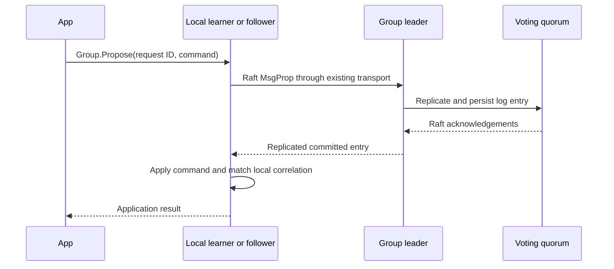
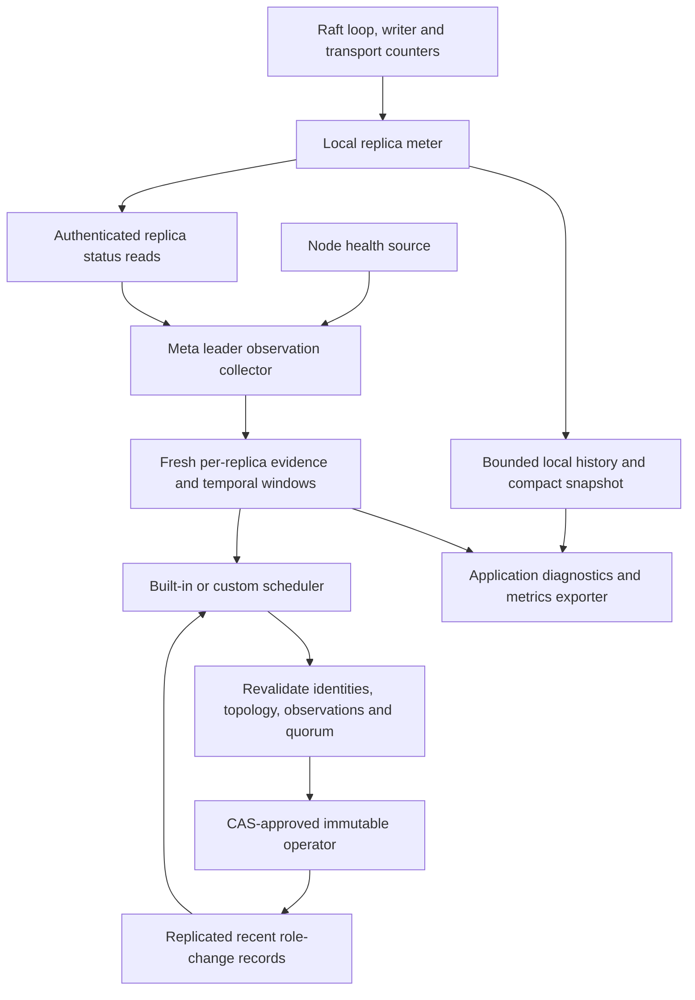

# Stable learners, voter targets and proposal forwarding

Date: 2026-10-12.
Status: brainstorm complete; target architecture written at the user's request.
The brainstorm work edits documentation only. The [target specification](20261012-stable-learner-replicas-target.md)
consolidates the decisions and supersedes earlier provisional shapes in this log.

## Initial request

Support stable learner replicas so that a large cluster can use a smaller voting
quorum. The example is seven nodes with three `_meta` voters and four learners.
The original request repeated “voters” for the four remaining nodes; this log
interprets that second occurrence as “learners”, as explained in the conversation.

When a voter becomes unavailable or persistently slow, promote a suitable learner.
A returning node stays a learner if the configured voter seats are occupied.
Learner mutation calls must forward to the group's leader using Meridian's
approach; copying applicable source code is explicitly permitted.

Every admitted node must retain a `_meta` replica. Future work will distribute
load groups across subsets of nodes, for example three groups with three
replicas each across seven nodes. Application data partitioning is future scope.

The explicitly invoked `go-brainstorm` workflow requires read-only implementation
research and permits this log. Once the user resolves the design questions, write
a separate detailed `20261012-stable-learner-replicas-target.md` specification.
Do not mark this session complete before that discussion is resolved.

## Repository and source baseline

- gquorum HEAD at research start: `84ffa43` (`Optimized cluster tests`), clean
  working tree. Recent context includes public API simplification, scheduler
  decision revalidation and startup publication authorization.
- The supplied working directory is the project. There is no `project.txt` in
  this checkout; the task was supplied directly in the conversation.
- Current architecture is in `docs/architecture`, rather than `./architecture`.
  Read README, Raft/library/runtime contracts, testing guidance and nearby code.
- Dependency pins: Go 1.26.0 with toolchain 1.26.5, `go.etcd.io/raft/v3 v3.6.0`.
- Meridian reference sources found locally:
  `/Volumes/M4DATA/Users/speckzzz/reps/agent01/neria/meridian-old`, HEAD
  `ac0b637f3`, and `meridian-overlay-v2` in the same parent, HEAD `91f9a75`.
  Both contain the same relevant native proposal-forwarding approach in
  `framework/cluster/raftbudget/raft/raftgroup_methods.go`. The directory named
  `meridian` does not expose that source layout through the inspected file list.
  These are concrete inspected references, not a claim about Meridian's latest
  deployment or a user-selected source revision.

## Discussion and decisions

### Question 1: Where should voter targets live?

Asked: should `_meta` and load groups each have their own replicated voter
target, use a cluster-wide count, or let scheduler code determine the count?

User answer:

> Need to have per-group voter targets in topology with the default behavior for
> `_meta` group, like by default only 3 voters, when cluster has 4+ nodes - other
> replicas are stable learners which can be promoted in cases of needs. "load"
> groups should have the same behavior by default (for the current stage) but
> there should be have possibility to specify custom options or custom
> policy/schedule rule.

Resolution:

- Replicate the desired voter count per group.
- Default target is three for `_meta` and load groups.
- Extra replicas are stable learners available for replacement when eligible.
- Allow group-specific settings and custom scheduling decisions.
- Core authorization, identity, persistence and quorum checks remain mandatory.
- Working interpretation, stated to the user: load groups currently host on every
  eligible node, using three voters and learners for the rest. Future placement
  can restrict the hosting set. This placement interpretation has not received
  a separate explicit answer.
- Small-cluster effective count, retained-document defaults and the distinction
  between intentional nonpromotable learners and automatic standbys still need
  precise treatment.

### Question 2: Temporary voter increase during replacement

Asked: may a three-voter group briefly have four voters while promoting a
caught-up replacement before demoting the unhealthy voter? Recommendation is
promotion first, with a guarded temporary extra voter. Alternative is a strict
three-voter ceiling requiring demotion first.

User answer:

> Allow temporary overquoting, but overquoting should be as optional to avoid
> degraded state.

Resolution: permit a configurable temporary extra voter, rather than requiring
an oversized voting set for every replacement. Use it only when the intermediate
configuration has a live quorum. Otherwise select a safely validated demotion-first
sequence or wait; never weaken quorum checks to meet the desired count. The
configuration field and default are still provisional. This interpretation was
stated back to the user.

For the example, starting voters `{A,B,C}` with C unavailable and caught-up
learner D:

| Approach | Native configurations | Quorums | Consequence |
| --- | --- | --- | --- |
| Promote first | `{A,B,C}` → `{A,B,C,D}` → `{A,B,D}` | 2 → 3 → 2 | Requires A, B and D during the intermediate configuration; D participates before C loses its vote. |
| Demote first | `{A,B,C}` → `{A,B}` → `{A,B,D}` | 2 → 2 → 2 | Intermediate progress requires both A and B; promotion should be prepared before entering this state. |

Neither sequence is atomic. Revalidate live membership and approved identity
before every step, and make the approved plan resumable after leadership changes
or process restarts. No membership change can restore progress after the existing
voting majority is already lost.

### Question 3: Learner promotion eligibility

Asked: should learners default to promotable standbys with an explicit option to
pin a replica as a learner, should every learner be promotable, or should promotion
require an explicit standby designation?

Recommendation: default new learners to standbys, and allow a per-replica setting
that prevents automatic promotion. This distinguishes replication role from
voter eligibility and makes custom placement constraints expressible.

User answer: “Standby by default; allow pinned learners (recommended)”.

Resolution: new learners are eligible standbys unless topology explicitly pins
them as learners. Automatic scheduling must not promote a pinned learner.

### Question 4: Existing persisted topology

Asked: preserve membership for old topology lacking the new settings until an
explicit voter-policy update, or automatically converge old groups to three
voters after upgrade?

Recommendation: retain old membership/intent until an explicit policy update.
Fresh groups get the new three-voter defaults. This keeps restart/replay from
silently changing established topology and retains historical learner intent.

No explicit option was selected. The user said “Continue”. Working assumption,
stated on resuming: preserve established groups until an explicit voter-policy
update. This remains an assumption rather than a confirmed migration choice.

### Question 5: Failure and standby windows

Asked: replace after 30 seconds of continuous unavailability or excessive Raft
replication lag, using a learner healthy and caught up for 60 seconds?

User answer:

> 30-second failure window; 60-second standby stability. It is the default
> settings. This should be configurable.

Resolution: both windows are configurable, with defaults of 30 and 60 seconds.
Evaluate each replica within its group. A healthy node can have a lagging replica
in one group and a healthy replica in another. The lag threshold and sample
freshness rules are distinct settings from these confirmed durations.

### Additional request: Internal metrics and period controls

User request:

> Look in meridian project how it collects metrics inside cluster, possible need
> to port here its mechanism to control periods. Also need to gather metrics
> inside to have ability source data for triggers on failures, stabilizations,
> and other mechanism which prevents redundant switches/promotions/etc.

Resolution: metrics collection and temporal observations are part of this feature,
not an external monitoring prerequisite. Research and proposed contracts follow
in “Internal metrics, temporal evidence and switch suppression” below.

### Question 6: Durability of observations and switch history

Asked: keep bounded metrics history in memory and replicate recent per-group
switch records, rebuilding 30-second failure and 60-second stability evidence
after a scheduler leadership change?

User answer: “Local metrics; durable switch records (recommended)”.

Resolution: raw measurements and observation windows are local and volatile.
Recent role-change records are durable `_meta` state. A new scheduler leader
rebuilds temporal evidence and honors durable cooldown records. Neither a
historical measurement nor a switch record authorizes a membership effect.

### Question 7: Cooldown and a subsequent failure

Asked: use a configurable five-minute per-group cooldown, permitting a newly
failed voter to bypass the group cooldown after normal failure/stability checks,
while keeping recently demoted replicas ineligible during their own cooldown?

User answer: “Allow new-failure exception (recommended)”.

Resolution: configurable five-minute cooldown per group, with the new-failure
exception described in the question. Recently demoted replicas remain ineligible
during their own cooldown. An exception never skips failure/stability windows,
pinning, exact approval, catch-up, leadership-transfer or live-quorum checks.

### Follow-up: Four topics selected for detailed consideration

The user selected default placement/capacity, exact lag/apply thresholds,
replacement recovery/admission concurrency, and typed metrics/read APIs from
the unresolved list. These are now sections 1–4 of the target specification, supported
by its schema, flow, signature, verification and pseudocode sections.

### Question 8: Explicit capacity versus silent host omission

Asked: for default all-eligible load hosting, reject a topology change that
exceeds configured capacity? A seven-node all-host deployment explicitly sets
MaxNodes and MaxReplicas to at least seven.

User answer: “Explicit limits; reject overflow (recommended)”.

Resolution: validate the entire desired hosting result before staging; reject
overflow without silently selecting fewer hosts or growing durable limits.
Preserve current capacity defaults. A target of three with one/two initial hosts
remains target three and reports its shortfall; it does not prevent a safe small
founding with minimum one. Explicitly configured voter minima still apply.

The target preserves PlacementRule MinReplicas/MaxReplicas as voter bounds and
Limits.MaxReplicas as total hosting capacity. It makes explicit host selection
durable through a HostingRule, so a GroupSpec.Nodes subset cannot silently expand
on a later admission. Current live health never lowers the desired target.

### Question 9: Apply backlog as a replacement trigger

Asked: replace for sustained unavailability or Raft replication lag, while using
application apply backlog to block an unready learner from promotion? Alternative:
also replace voters solely because their application apply backlog is large.

User answer: “Replication failure replaces; apply lag blocks promotion (recommended)”.

Resolution: apply backlog alone does not trigger built-in voter replacement.
It remains a promotion-readiness check and a custom-policy observation. Compute
it from one local Commit/Applied snapshot, not mismatched remote samples.

Engineering defaults in the target: bad replication gap >1,000 entries;
standby gap <=100 and local apply backlog <=100 entries. Positive replication
backlog with unchanged Match for 30 seconds is a separate configurable trigger,
covering low-traffic stalls. A caught-up idle replica never fails that predicate.

### Derived recovery and metrics contracts

- Automatic role changes use their own atomic CAS command, restricted to exact
  roles in one group. Admission/manual intent wins or loses CAS independently;
  the scheduler never approves someone else's staged document.
- Persist and resume the exact approved ordering. Native effects committed
  before a crash are verified idempotently before the step advances. Cooldown
  cannot block continuation of that approved plan.
- Election gap: transfer can complete and its victim can regain leadership
  before demotion. New demotion steps carry an exact approved transfer target,
  included in authorization equality, permitting that prerequisite to be repeated
  without inventing a new destination or rewriting the plan.
- Meta persistence has BOTH smState and its custom disk.go codec. The target
  explicitly extends both; otherwise switch records would disappear from stored
  JSON even if added to the internal state struct.
- The target specifies complete public metrics DTOs, separate Meter/Raft/Writer
  source generations, exact run identities, local snapshot/history reads,
  constructor defaults/bounds, load transport extension and local meta metrics
  RPC. Independent collection continues through cooldown/callback stalls.
- Group cooldown suppresses replacements; monotonic convergence toward an
  explicitly approved voter target is distinct. In particular, adding a third
  voter is not delayed five minutes merely because the second was just added.
  Standby windows and demoted-replica cooldown still apply.

These concrete implementation contracts are incorporated in the target
architecture. They distinguish engineering choices from explicitly confirmed
user decisions; writing the specification does not complete implementation.

### Finalization request

The user requested: “Write the target architecture”. The separate target
specification consolidates the decisions, resolves the four selected topics,
and supplies replicated schemas, public and internal interfaces, defaults,
ownership and recovery rules, forwarding behavior, verification requirements
and key-method pseudocode. Remaining deferred scope is listed explicitly.

Final review against the inspected Meridian sources and current integration
boundaries adds these concrete engineering details to the target:

- A component/data-flow diagram and a source-to-target porting table distinguish
  copied primitives from the new cluster evidence pipeline.
- Raft and writer source generations advance on their own idle samples, while
  a blocked owner cannot be made fresh by the independent meter. Counter/rate
  intervals and EWMA unknown state have explicit semantics.
- Constructor defaults apply only to genuinely fresh groups. A retained nil
  policy is not rejected or silently changed because a new default target would
  exceed that old cluster's capacity.
- History is bounded across source restarts as well as within each ring. Reads
  expire points without sampling. Collection uses fair dispatch and keeps worker
  ownership for adapters that have not returned after cancellation.
- Completed failed probes, undispatched work, stale payloads and whole-round
  cancellation have separate meanings. Partial round-budget expiry does not
  erase valid completed observations or turn undispatched peers into failures.
- A cooldown exception needs an observed healthy current voter followed by a
  qualifying new failure after the latest switch-record baseline. A leader
  change alone cannot manufacture proof of a new failure.
- Administrative mutation flow preserves preview, CAS and staged-version return
  contracts. The exact guarded authorization DTO is included in full.

These refinements resolve implementation details rather than adding new user
decisions. The target labels engineering defaults and remaining deferred work.

The final target also includes a linked disposition table for the four selected
follow-ups, making their implementation obligations explicit. Its acceptance
matrix includes the requested five-node case: three voters, two eligible stable
learners, one voter stopped, exactly one automatic replacement, and retained
restart of the former voter as a learner. Both meta and managed load membership
must be checked through observable convergence and durable switch records.

## Verified current behavior and required changes

| Component | Current behavior | Design consequence |
| --- | --- | --- |
| `topology/document.go` | `ReplicaRole` already supports `voter` and `learner`; each group has exact replica identities. | Reuse these role encodings. A learner is a membership role, independent of node administrative state. |
| `topology/validate.go` | Every admitted node needs `_meta` membership, but that membership may be a learner. Meta must retain at least one voter. | Preserve universal meta membership; do not equate membership with voting. |
| `topology/document.go`, `internal/metaservice/mutations.go` | `SetMemberID` inserts new meta replicas as voters; `AddNode` uses it. | Admission must select the approved role according to the group's voter policy. |
| `internal/metaservice/bootstrap.go` | Founders become voters; ready/session activation is gated on local membership in `ConfState.Voters`. | Stable learners need role-aware bootstrap, readiness and session activation. Native membership alone is not sufficient authorization. |
| `internal/metaservice/join.go` | `hasAdmissionSteps` requires prepare, add learner, wait caught up, promote voter. | A learner-only approved admission needs a valid complete sequence without mandatory promotion. |
| `internal/metaengine/admission.go` | The durable FSM independently requires the same four-step sequence. | Change runtime and replicated validation together; keep exact approval binding. |
| `internal/metaengine/admission.go` | Readmission allocates new IDs while preserving existing replica roles. | Ordinary demotion/restart preserves IDs; genuine replacement/readmission retains fresh-ID rules. |
| `topology/planner.go` | Already emits learner addition, guarded promotion and demotion, and leadership transfer. Defaults to growing before shrinking unless the current maximum forces shrink first. | Separate steady-state voter target from permitted transition size and total hosted replica capacity. |
| `membership/safety.go`, `promotion.go` | Single-change Auto `ConfChangeV2`, no joint configurations; catch-up and post-change live quorum checks. Current promotion lag limit is 1,000 entries. | Reuse enforced safety. Scheduler thresholds may be stricter; policy cannot weaken membership safety. |
| `policy/restore_degraded.go` | Skips `_meta` and learners; only restores required load voters missing from native membership. | Existing repair cannot implement offline-voter replacement or steady voter counts. Add explicit supported role-selection actions. |
| `internal/scheduling/driver.go` | Only allows `RestoreMissingReplica`; rejects meta repairs; supplies health evaluations for data groups. | Extend driver inputs/actions, include meta, and revalidate decisions before replicated CAS approval. |
| `internal/metaengine/repair_document.go`, `repair_scope_test.go` | Existing automatic repair is restricted to a fresh identity for one exact active load voter; unrelated role edits are refused. | Define a separately constrained replicated voter-reconfiguration command or equally explicit validation path; do not weaken the existing repair command into unrestricted document approval. |
| `topology/controller.go` | Group status includes leader, term, commit and per-replica Match/RecentActive. Health distinguishes alive/dead/unknown. | Useful base signals, but no sustained per-replica lag duration is currently exposed to policy. |
| `internal/metaservice/rpc.go` | Nonleader meta proposals use the `ProposeMeta` control RPC to the observed leader. | Meta mutations already have forwarding; retain leader-side identity validation. |
| `load/group.go`, `internal/raftengine/loop.go` | Load proposals call the shared engine, which rejects nonleaders before RawNode sees the proposal. | Remove that restriction for authorized ordinary load proposals using Meridian's native forwarding model. |
| `internal/raftengine/group.go` | `Step` explicitly rejects incoming `MsgProp`. | Enabling local follower proposals alone is insufficient. Permit bounded ordinary load proposal messages from authenticated exact peers; retain meta/control restrictions and reject injected configuration-change entries. |
| `load/transport.go` | Carries generic Raft messages, replica reads and approved actions through an application-owned adapter. | Native proposal forwarding can use `SendRaft`; no new application-write RPC is inherently necessary. |
| `tests/cluster/intentional_learner_test.go` | Explicitly verifies the default scheduler does not promote intentional learners without approval. | Preserve explicit learner intent or explicitly model eligibility; do not silently treat all historical learners as replaceable voters. |

The requested behavior deliberately expands the documented scheduler scope and
changes the documented load proposal contract. README, architecture documents,
public comments and affected AGENTS guidance will need updating during
implementation. Historical brainstorms are not authoritative current contracts.

## Meridian forwarding: reusable behavior and boundaries

Inspected functions in `raftgroup_methods.go`:

- `handleProposalRG`: application proposals that allow forwarding call
  `RawNode.Propose` even on a follower; selected control proposals are leader-only.
- A stable proposal identity links the replicated command to a local waiter.
- `applyCommittedEntryRG` resolves the waiter from the result of local application.
- `ErrProposalDropped` can trigger one bounded, delayed retry, re-enqueued onto
  the owner run loop. No off-loop RawNode calls are permitted.
- Pending-result expiration and ownership-aware cleanup prevent stale waiters
  from consuming a later attempt's result.

The proposed gquorum flow is:



Recommendation: port the mechanism into gquorum's bounded queues, generic opaque
commands and existing correlation envelope. Meridian's budget proposal types,
metrics and application admission implementation are not generic library code.
The source permits copying, but blindly copying those application dependencies
would violate gquorum's public integration boundaries.

The pinned upstream implementation confirms that follower `MsgProp` is sent to
the known leader unless forwarding is disabled; unknown leadership drops the
proposal. See [etcd Raft v3.6.0 `stepFollower`](https://github.com/etcd-io/raft/blob/v3.6.0/raft.go).
Single-step voter changes and voter-to-learner conversion are supported by
[v3.6.0 configuration changes](https://github.com/etcd-io/raft/blob/v3.6.0/confchange/confchange.go).

Forwarding design obligations:

1. Keep membership/control authority at the group leader. Ordinary application
   forwarding must not make approved effects or leader-only meta commands callable
   from arbitrary followers.
2. Preserve exact source/destination validation through the authenticated caller
   transport. Stopped or replaced handles must never begin routing to successors.
   `internal/managed/transport.go` requires each outbound message's `From` to
   match the sending local replica. A stale destination trying to forward an
   original `MsgProp` onward would retain its original sender and fail this check.
   Cover stale leadership explicitly; do not relax sender authentication to
   accommodate an arbitrary chain of forwards.
3. Success means the submitting replica has applied the committed command. A
   lagging learner may answer later than the leader, even though quorum commit
   does not require that learner.
4. Keep caller request IDs across retries. Correlation identifies a waiter, not
   durable application deduplication. Cancellation does not undo a command.
5. Bound unknown-leader, lost-message and partition waits, including callers with
   no deadline. Decide which errors are definite rejection versus uncertain
   committed outcome; do not automatically retry ambiguous effects as new writes.
6. Audit `refresh` leadership-loss cleanup and `pruneWaiters` for follower waiters.
   Preserve single-owner cleanup and per-node admission limits.
7. A received snapshot may cover an entry whose application result the learner
   has not observed. Generic snapshots cannot reconstruct arbitrary old results.
   Define an uncertain-outcome failure/retry contract, rather than reporting
   fabricated success or leaving a waiter forever.
8. A node without a replica cannot use native proposal forwarding through that
   group. Routing from unassigned nodes remains part of future partitioning work
   or the application's current request router.

## Candidate data model, not yet a final schema

Separate hosted replicas, desired voters and observed native membership. Existing
`PlacementRule.MinReplicas/MaxReplicas` currently bound voter counts in important
paths, while `Limits.MaxReplicas` caps total load replicas. Using either as the
new voter target without reconciling their existing meaning is insufficient.

The following illustrates the confirmed per-group target; names and compatibility
semantics remain provisional:

```go
// Proposed addition to topology.Group; other fields remain as today.
VoterPolicy *VoterPolicy `json:"voter_policy,omitempty"`

type VoterPolicy struct {
    TargetVoters int `json:"target_voters"` // New-group default: 3.
}

// Proposed addition to topology.Replica; name is provisional.
PinnedLearner bool `json:"pinned_learner,omitempty"`

// Illustrative supported scheduler action, alongside existing fresh-ID repair.
type VoterReplacement struct {
    GroupID string
    Demote  storage.Identity // Existing voter, retained as a learner.
    Promote storage.Identity // Existing eligible learner; same identity.
}
```

Pinning learners is confirmed; finalize its schema and mutation API, override
inheritance, and absent fields in pre-change persisted topology. Policy callback
implementations remain application-supplied; the replicated target is common
input for those callbacks, not a serialization of Go policy code.

No SQL or ORM is used for this state. The final target must describe the exact
bbolt materialization/snapshot JSON changes, rules/version handling and unchanged
buckets, rather than inventing relational tables. Existing envelope encodings and
immutable compatibility fixtures must remain readable. Volatile observation
windows are not durable evidence of membership or approval.

## Candidate replacement algorithm

This is a design sketch with unresolved ordering and timing settings:

```go
func chooseReplacement(in ScheduleInput) Decision {
    requireMetaLeadershipAndNoConflictingIntent(in)
    for _, group := range groupsInDeterministicOrder(in.Active) {
        observed := requireFreshLeaderStatus(group, in.Status)
        if !hasExistingLiveQuorum(observed) { continue }
        old := selectPersistentlyUnhealthyVoter(group, observed)
        spare := selectStableEligibleLearner(group, observed)
        if old == nil || spare == nil { continue }
        return ReplaceVoter(old.ExactIdentity(), spare.ExactIdentity())
    }
    return NoChange()
}

func approveReplacement(ctx context.Context, decision Decision) error {
    // Follow existing scheduler ownership and post-callback revalidation.
    fresh := refreshTopologyHealthAndNativeMembership(ctx)
    validateExactCandidatesAndPolicy(decision, fresh)
    desired := cloneConvergedDocument(fresh)
    setRole(desired, decision.Promote, ReplicaVoter)
    setRole(desired, decision.Demote, ReplicaLearner)
    plan := buildImmutablePlan(fresh, desired) // Order still being discussed.
    return commitDocumentAndApprovedPlanCAS(ctx, desired, plan)
}
```

Demote the unavailable replica through the surviving group, retaining its log,
identity and assignment. It need not return first to surrender its vote. When
it returns with intact storage it catches up to the approved learner role; it
does not displace a healthy replacement merely because it previously voted.
Avoid automatic balancing of healthy seats unless a custom policy requests
supported, safely validated changes.

## Capacity and large-cluster implications

- Three voters use quorum two regardless of learner count. Loss of two of those
  three voters still prevents membership changes and writes until quorum returns.
- Learners continue receiving the full log/snapshots, consuming storage, CPU and
  leader bandwidth. Reducing voter count does not make replication cost independent
  of cluster size.
- Current default `Limits.MaxNodes=3` and `Limits.MaxReplicas=5` cannot by themselves
  express seven hosted load replicas. Resolve capacity defaults/overrides without
  conflating physical capacity with the voter target.
- Existing meta health probes have a bounded pool of at most eight workers. Audit
  observation deadlines, per-destination workers/queues, snapshots and status
  collection for the intended scale.
- `_meta` runs everywhere. Load participation is independent of meta voting role;
  a meta learner can host a load voter or leader.

## Internal metrics, temporal evidence and switch suppression

This section extends the design after the additional metrics request. Confirmed
behavior is identified above; numerical sampling/retention/lag settings below are
engineering proposals. This is still a brainstorm, not implemented behavior.

### Meridian mechanisms inspected

Paths below are relative to the inspected `meridian-old` checkout at `ac0b637f3`.
The EWMA implementation also matches the inspected `meridian-overlay-v2` copy.

| Source | Verified mechanism | Port decision |
| --- | --- | --- |
| `framework/cluster/loadmeter/README.md`, `ewma.go` | Atomic latency sum/count, single-writer delta fold, caller-supplied weight/minimum sampled duration. Initial value seeds the average. | Reuse for diagnostic latency and candidate ranking; keep validity, count and age alongside the value. An EWMA is not evidence of continuous failure or health. |
| `framework/cluster/loadmeter/ring.go` | Mutex-protected generic 60-entry ring, owned chronological snapshots, flat JSON buckets. | Reuse bounded-ring mechanics; make retention/capacity configurable. Values containing maps/slices need deep copies, not only a copied bucket slice. |
| `framework/cluster/loadmeter/node.go` | Hot-path counters, one-second measured-elapsed rates, runtime sampling, per-shard summaries. | Reuse counter/rate sampling. Replace HTTP, budget, reservation and unwind fields with generic Raft/replica measurements. |
| `framework/cluster/raftbudget/admission/controller.go` | A consumer owns policy constants; its tick folds metrics, reads hard probes and rolls history. EWMA staleness reduces shedding. | Reuse separation of measurement from decision and one owning tick. Do not use its decay-to-open behavior for learner eligibility: absent measurements must remain unknown. |
| `framework/cluster/topology/reconcile.go` | Local `aliveSince`, local action time, stability window, cooldown, leader-only decisions, serialized bounded ticks. | Extend to exact per-group replicas and durable role-change suppression. Existing `sampleAlive` precedes cooldown, but group-status collection follows it; neither implementation currently samples replication lag throughout cooldown. |
| `framework/cluster/topology/metrics.go` | Exports the shared health evaluator; unknown measurements are absent rather than zero; bounded diagnostic reasons. | Reuse semantics and bounded labels, without importing Meridian's process-global Prometheus registry. |
| `framework/cluster/pubsubhealth/checker.go` | Dynamic peer pruning, receipt-time freshness, startup readiness latch distinct from current health. | Reuse freshness/pruning distinctions. Do not add a cache/pubsub dependency for Raft scheduling. Its startup latch is unsuitable as continuing promotion evidence. |

The inspected node/admission metrics are node-local. Their read APIs can target
another node, but the rings are not replicated cluster history. Meridian's
reconciler does not consume those rings as a general failure/stability engine.
Port the primitives and timing discipline; cluster collection and temporal
membership decisions require additional gquorum integration.

Source caveats to address while porting:

- `NodeMeter.Start` starts a goroutine without a joined stop API. Use Node-owned,
  canceled and joined workers instead.
- The fixed 60-slot ring cannot explain a five-minute cooldown. Use a larger
  bounded diagnostic history; do not derive continuous eligibility by counting
  buckets.
- EWMA's no-samples value and retained GC p99 can look like current measurements.
  Expose unknown/stale explicitly. CPU/heap/GC are diagnostic; they do not
  automatically evict an otherwise healthy voter.
- Rate denominators must use actual elapsed time. A delayed ticker records one
  wider measurement interval, not several fabricated one-second observations.
- Keep EWMA updates single-writer and reset rate baselines on an incarnation
  change/counter reset. Latency sum/count observations are approximate concurrent
  metrics, not a coherent consensus snapshot.

### Proposed ownership and data flow



1. Every local managed replica, including `_meta` learners, publishes compact
   measurements. Sampling does not depend on scheduling being enabled or on
   the local node being a voter.
2. The `_meta` leader owns cluster observation collection for scheduling. It
   reuses existing authenticated replica reads, preserving individual responses
   and separately identifying the group's actual leader response. This supplies
   leader-observed Match/commit lag and replica-local applied/WAL measurements
   without conflating them.
3. Extend `load.ReplicaStatus` with an optional metrics sample, using the existing
   `ReadReplica` transport method. A missing sample from an adapter is unknown,
   not zero. Application adapters that serialize a fixed field set must forward
   the new fields; the fixture's JSON payload transport can carry them.
4. `_meta` needs a read-only local replica-metrics RPC: current `MetaStatus` is
   leader-only and cannot supply every follower's local WAL/apply state. Add a
   `MetaReplicaMetrics` method in `internal/metapb/meta.proto` and its transport
   dispatch. It returns exact local identity plus a compact sample. Validate
   admitted source identity and response identity; never route this read to the
   leader. Generate protobuf code with the pinned generators.
5. Use bounded fan-out with per-destination deadlines and no overlapping rounds.
   `internal/managed/dispatch.go` currently launches one worker per replica and
   discards individual observations after choosing a leader. Refactor it to
   return an internal observation bundle; keep its existing `ObserveGroup`
   projection for callers needing only `GroupStatus`. Reuse the bundle in the
   collector instead of launching a second full round.
6. Collect independently of user scheduler callbacks and cooldowns. Slow custom
   callbacks remain serialized/owned but cannot prevent the collector from
   recording recovery. Coalesce wakeups and never accumulate tick backlogs.
7. Feed owned compact measurements, validity and evaluated durations into
   `policy.ScheduleInput`. Status/metrics readers receive copies. Raw history is
   a separate bounded query; do not copy every history ring on every callback.
8. After a callback, re-read exact topology/native membership and use the newest
   evidence. Resume an existing approved operator before considering another
   action. CAS and execution guards remain the effect authority.
9. Retain the existing declared-topology health observation API and semantics.
   Native-membership/replication metrics supplement it; do not silently turn
   `HealthObservation` into a different health or consistency contract.

A partial collection error invalidates the affected source/group. It must not
silently use old data, nor erase fresh observations for unrelated groups. A
membership action still needs a complete fresh quorum assessment for its group.
Existing strict planning reads may continue to fail the entire requested plan
when required observations are missing.

### Measurements and their uses

| Measurement | Authoritative observation source | Use |
| --- | --- | --- |
| Node reachability and current incarnation | Existing health source and exact authenticated probes | Node-level failure input; preserve unknown vs observed unreachable. |
| Native voters/learners, leader ID, term, commit | Current group leader | Membership shape and scope for lag comparisons; still not a linearizable barrier. |
| Per-replica Match, acknowledgement freshness, RecentActive | Current group leader's Raft loop | Sustained replication lag/failure and promotion catch-up. Preserve core promotion checks. |
| Applied index and local commit | Each exact local replica | Local apply backlog and standby readiness; distinguish committed-but-unapplied work from replication lag. |
| Pending proposals, queue occupancy/capacity, result latency and errors | Replica engine | Diagnose overload, forwarding delay and backpressure. Origin result latency includes local apply and is not pure quorum commit latency. |
| Ready persistence latency, retry/error counts, current WAL-stall duration | Writer | Diagnose storage delay; blocked writer remains observable through independent atomics. |
| Outbound queue pressure, delivery errors, snapshot state | Exact transport destination and engine | Diagnose transport/snapshot delay; never treat transport acceptance as completed delivery. |
| Leader/term transitions, completed role changes, suppression reasons | Engine plus operator/scheduler | Churn diagnostics and cooldown/reversal prevention. |
| Process runtime statistics | Optional node-local runtime sampler | Diagnostic context; application metrics such as HTTP/budgets remain application-owned. |

No external Prometheus server or scrape loop is needed for decisions. Applications
can export snapshots through their own metrics stack. No process-global metric
registration or hidden HTTP listener is added by the library.

### Freshness, identity and period semantics

Proposed engineering defaults: local sampling once per second, cluster collection
every five seconds, ten minutes of bounded history, and a maximum evidence gap
of fifteen seconds. Keep them configurable and validate positive periods,
deadlines below their collection period, and finite history capacity. These
defaults do not change the confirmed 30/60-second policy windows.

Separate physical measurement collection from temporal classification:

- Key a local replica by cluster ID, group ID, node name, replica ID, process
  `InstanceID`, and a new ephemeral engine-run ID. The run ID changes when one
  replica restarts inside the same process; durable replica identity does not.
- A source sample carries its run ID and strictly increasing sample sequence,
  plus sample age computed on the producer's monotonic clock. The collector
  records request start/receipt using its own monotonic clock. Bound effective
  age conservatively by producer age plus request elapsed time. Wall timestamps
  are for display, not cross-node duration subtraction.
- Repeated reads of one cached sequence do not extend healthy/bad duration. An
  engine heartbeat/sample sequence must not advance merely because an RPC read
  relabels cached status. A frozen run loop must become stale even when its
  process answers RPCs. A separate writer-stall probe may remain current.
- Leader progress is scoped by leader replica/run ID, Raft term and native
  membership fingerprint. Do not compare Match values from different epochs.
- Each failure or readiness predicate advances only across fresh observations
  of the same scope with no excessive gap. False resets its window; unknown,
  stale, missing, contradictory or reset data also resets its window. An idle
  group can prove readiness through fresh heartbeat acknowledgements and zero
  backlog; it does not need application writes or latency samples.
- Sampled continuity means every valid observed interval passed the predicate;
  it is not a claim of observing every instant between probes. A gap larger
  than the allowed maximum earns no elapsed-time credit.
- Failure windows are separate by reason: unavailable, excessive replication
  lag, and any explicitly configured additional trigger. Switching between
  different weak signals does not accidentally accumulate 30 seconds of one
  sustained failure. Missing metrics alone are unknown; repeated completed
  reachability failures are explicit unavailability observations.
- A new `_meta` leader resets its decision windows even if the process retained
  diagnostic history. A load-group leader/term change resets that group's
  replication windows. A policy change resets predicates whose thresholds
  changed. Unrelated group changes do not reset all groups.
- Continue measurements during cooldown, disabled scheduling and approved-plan
  execution. Eligibility resets on enabling scheduling and leadership change;
  a role/membership transition also resets the affected group's predicates.
- No telemetry callback runs on RawNode's critical path. Hot paths update
  counters or small owned snapshots; sampling/aggregation owns expensive work.

The scheduler may wake on a threshold becoming satisfied, with one pending
wakeup, rather than waiting for its current 30-second periodic fallback. Timing
windows are minimum observed durations, not a promise of replacement at exactly
30 seconds: collection, approval and Raft convergence add delay.

### Lag hysteresis and replacement policy

Proposed initial thresholds: bad replication lag greater than 1,000 entries;
standby replication lag at most 100 entries, with fresh acknowledgements and
bounded local apply backlog. Both thresholds are configurable, and the standby
limit must remain at or below the existing core promotion limit. The exact apply
backlog default should be specified with the final policy schema. Comparing
leader commit with Match uses saturating subtraction, never unsigned underflow.

These are entry counts, not byte or time lag. Document that limitation. A
no-progress trigger, if enabled, requires a positive backlog plus no advancement;
an idle caught-up replica must not fail because its Match index is unchanged.
Do not silently enable CPU, GC, latency EWMA or generic overload eviction in
this change. Those measurements are available to custom policies; automatic
membership effects still pass all core guards.

Default selection retains healthy current voters. A better instantaneous metric
is not a reason to rotate a voter. Choose among qualifying learners with stable
deterministic tie-breaking; short-lived ranking changes must not create new
topology versions. Returning old voters accumulate fresh readiness evidence and
stay learners when the seats are occupied.

### Durable switch records and cooldowns

Confirmed default: five-minute configurable per-group cooldown, with a new-failure
exception; recently demoted replicas have their own cooldown. Thresholds and
cooldown durations belong to replicated group voter policy so `_meta` leader
changes do not select different built-in defaults. Local sampling/resource
settings remain constructor options. Custom Go scheduler agreement remains an
application responsibility.

Use a small replicated materialization of recent verified role effects, not a
replicated time series. Suggested persistence addition to `metaengine.smState`:

```go
// New optional field in the existing state/current and snapshot JSON.
VoterSwitches []VoterSwitchState `json:"voter_switches,omitempty"`

type VoterSwitchState struct {
    GroupID string           `json:"group_id"`
    Last    RoleChangeRecord `json:"last"`
    // One latest record per current exact replica, sorted by replica ID.
    Replicas []RoleChangeRecord `json:"replicas"`
}

type RoleChangeRecord struct {
    OperatorID topology.OperatorID `json:"operator_id"`
    Version    uint64              `json:"version"`
    Attempt    uint32              `json:"attempt"`
    StepSeq    int                 `json:"step_seq"`
    GroupID    string              `json:"group_id"`
    NodeName   string              `json:"node_name"`
    ReplicaID  uint64              `json:"replica_id"`
    From       topology.ReplicaRole `json:"from"`
    To         topology.ReplicaRole `json:"to"`
    At         time.Time           `json:"at"`
    Index      uint64              `json:"index"` // meta application index
}
```

The containing state supplies cluster identity. Keep records independent of the
128-document history retention so unrelated topology changes cannot erase a
cooldown. Record manual and automatic completed role effects consistently. A
record is written atomically when an exact authorized operator transition proves
the corresponding role step completed, not when a callback merely recommends
it or a topology document is staged. Duplicate acknowledgements do not restart
cooldown or duplicate records. Preserve exact tuple validation after waits.

If a membership change commits but the meta acknowledgement is lost, the existing
operator blocks another switch and resumes verification. Once the effect is
verified, record it through the same transition path. Approved-plan resumption
does not wait for cooldown. If a partly executed plan is superseded, retain
verified effects and require reconciliation of actual membership before another
automatic change; a missing record is never permission to skip that check.

No SQL/ORM table is introduced. All existing bbolt buckets, identity/replica
ledgers and their encodings are unchanged; only the optional FSM materialization
and snapshot field is added. Old snapshots decode to an empty switch set. Full
snapshot restore validates exact group/replica references and operator tuple
shape; it must allow legitimately retained historical references protected by
the operator/retirement retention rules. Records for removed identities may be
collected once they no longer guard a live replica or retained execution; deleted
groups never reuse IDs. Mixed old/new binary operation is not implied by old
snapshot readability and needs a separate rollout contract.

Cooldown elapsed time needs care across process clocks. Proposed conservative
rule: within one scheduler epoch, use monotonic time since observing a newly
completed role-effect record. On startup/leadership acquisition, rearm a full
configured cooldown for existing relevant records. This may delay an elective
change after failover, but does not trust cross-node wall-clock subtraction.
Re-reading the same record within that epoch does not rearm it. The confirmed
new-failure exception still applies; clocks never establish membership safety.
The final target should call out this conservative failover delay explicitly.

A new-failure exception requires a fresh continuously bad CURRENT voter,
qualifying stable replacement, no conflicting operator/intent, and surviving
native quorum. It is not a balancing exception or permission to retry the same
failed approval repeatedly. Per-replica demotion cooldown, pinning and the core
membership checks still apply. If all standbys are cooling down or unhealthy,
wait and report that reason.

Keep failed proposal attempts distinct from completed switches: use a short
bounded local retry backoff for transient errors/CAS conflicts, without writing
a durable cooldown for an action that never happened. Accepted/ambiguous
submissions are resolved by reading the operator/target before retrying. Do not
approve a duplicate action on each metrics tick.

### Proposed API and implementation seams

Names below are design candidates to finalize in the target specification;
they are not existing APIs. Keep metric DTOs in a small public `metrics` package
that does not import `topology`, avoiding an import cycle when topology/status
references metrics. Raw collection machinery is internal.

| File/package | Change |
| --- | --- |
| CREATED `metrics/types.go` | Owned `ReplicaSample`, `GroupObservation`, `ClusterSnapshot`, validity, temporal evidence and bounded history query DTOs. Exact keys include incarnation/run identity. |
| CREATED `internal/metrics/ring.go`, `ewma.go`, `meter.go` | Port generic bounded history, latency folding and counter/rate primitives. `NewMeter`, `Observe…`, `Tick`, `Snapshot`, `History`; no goroutines in primitives. |
| CREATED `internal/observe/metrics.go`, `windows.go` | Node-owned collector and typed predicate windows; `Start`, `Stop(ctx)`, `Refresh(ctx)`, `Snapshot`, `History`. Inject a clock internally for deterministic tests. |
| UPDATED `node_options.go` | `MetricsOptions` for sample/collection intervals, deadlines and history bounds; constructor validates/copies only. |
| UPDATED `internal/raftengine/group.go`, `loop.go`, `writer.go`, `outbound.go` | Instrument both meta and load; publish run-loop source generation and independent writer state; expose `Metrics()` without application callbacks. |
| UPDATED `load/transport.go`, `internal/managed/transport.go`, `dispatch.go` | Add optional compact sample to `ReplicaStatus`; preserve exact peer checks and per-source observations; share bounded collection. |
| UPDATED `internal/metapb/meta.proto`, metatransport dispatch and metaservice RPC | Read-only `MetaReplicaMetrics`; generated bindings; exact local source, no implicit leader forwarding. |
| UPDATED `internal/metaservice/group.go` and lifecycle wiring | Acquire sampler resources on Start; join collectors before closing resources they read. Never run meters from `NewNode`. |
| UPDATED `policy/scheduler.go`, built-in policy and test helpers | Add cloned metrics/evidence/switch inputs, deterministic reason codes and role-change selection. |
| UPDATED `internal/scheduling/contracts.go`, `driver.go` | Consume independently collected evidence; coalesced wakeups, current-epoch windows, post-callback refresh, cooldown/exception validation and separate retry backoff. |
| UPDATED `topology/document.go`, clone/validation, group-policy mutations | Replicated failure/stability/lag/cooldown settings; separate these from local sampling settings. |
| UPDATED `internal/metaengine/sm.go`, `operator_state.go`, snapshot validation | Persist bounded recent role effects; derive updates only from verified exact operator transitions and retain through pruning. |
| UPDATED `cluster.go`, `cluster_status.go`, `load/group.go` | Read-only compact metrics/evidence access plus explicit bounded history query. Cluster metrics are the receiving observer's view, with leader/age/scope visible; no hidden read barrier. |
| UPDATED test fixture adapter and diagnostics | Forward new samples; expose direct learner proposals and observable temporal/cooldown state for Docker barriers. |

Suggested shapes for the central temporal algorithm:

```go
type ConditionWindow struct { // internal, one writer
    Scope       EvidenceScope // source identity/run + leader term + membership
    LastSeq     uint64
    LastReceipt time.Time     // monotonic clock retained locally
    Since       time.Time
    State       EvidenceState // unknown, false, true
}

func (w *ConditionWindow) Observe(now time.Time, s Sample, truth EvidenceState) {
    if s.Scope != w.Scope {
        w.Reset()
    }
    if !s.Valid || s.IsStale(now) || s.Contradictory {
        w.Reset()
        w.RememberSource(s, now)
        return
    }
    if s.Sequence <= w.LastSeq && s.Scope == w.Scope {
        return // cached data cannot increase the window
    }
    if !w.LastReceipt.IsZero() && now.Sub(w.LastReceipt) > s.MaxGap {
        w.Reset()
    }
    if truth != EvidenceTrue {
        w.Reset()
        w.RememberSource(s, now)
        return
    }
    if w.State != EvidenceTrue {
        w.Since = now
    }
    w.State = EvidenceTrue
    w.RememberSource(s, now)
}

func (w *ConditionWindow) Duration(now time.Time) time.Duration {
    if w.State != EvidenceTrue || w.Expired(now) { return 0 }
    // Advance only to the latest fresh confirming observation, not arbitrary
    // wall time while the source stops producing samples.
    return max(0, w.LastReceipt.Sub(w.Since))
}

func eligibleSwitch(in ScheduleInput, pair Replacement) bool {
    if !exactCurrentIdentities(pair, in) || hasConflictingIntent(in) { return false }
    if !freshCurrentLeaderAndQuorum(pair.Group, in) { return false }
    if pair.Standby.Pinned || pair.Standby.Held { return false }
    if pair.Voter.BadFor < in.Policy.FailureFor { return false }
    if pair.Standby.GoodFor < in.Policy.StableFor { return false }
    if replicaCooldownActive(pair.Standby, in) { return false }
    if groupCooldownActive(pair.Group, in) && !newFailureException(pair, in) {
        return false
    }
    return safeTransitionExists(pair, in) // final effect checks run again
}
```

Predicate evidence combines multiple fresh sources (leader progress, local
replica metrics, reachability). Its confirming sequence advances only when every
required component is current and not replaying an old generation. Keep a
generation vector internally rather than pretending independent source sequences
are globally ordered. Status reads expire old evidence without manufacturing
new samples. Custom schedulers receive the measured inputs and interpreted
durations, and retain control over their choices within core guards.

### Metrics-specific verification requirements

- Fake-clock unit cases at 29/30 and 59/60 seconds, intermittent failures, lag
  hysteresis, zero traffic, no-progress with/without backlog, long missed ticks,
  unknown samples, duplicates, out-of-order sequences and producer resets.
- Same durable replica restarted in the same process must reset evidence through
  engine-run identity. Same node name with a successor ID must never inherit it.
- Leader/term/membership change, policy edit, kill-switch disable/enable, stale
  source age, and observer leadership change all have explicit reset tests.
- Cooldown survives restored metadata and leader changes; idempotent operator
  transitions do not extend it. History pruning cannot erase it. Newly failed
  voters may use the confirmed exception, while recently demoted candidates
  remain blocked. Failed CAS alone never creates a completed-switch record.
- Rates use measured elapsed time; no-sample latency is unknown; history capacity
  and age bounds hold; nested snapshots are immutable to callers; removed peers
  and finished ownerships release observation state.
- Race/functional checks cover collector shutdown, delayed callbacks, writer
  stalls, independent collection during cooldown and bounded parallel reads.
- Four-node Docker regression: three voters plus standby, sustained lag or loss,
  promotion/demotion, returning voter stays learner, and no churn from transient
  spikes. A separate suitable-capacity case covers consecutive failures during
  cooldown; name why its voter/standby configuration needs that capacity.
- Applications may run two Nodes in one process without shared metric registries
  or cross-node sample contamination. Prometheus/exporter absence must not change
  scheduler behavior.

## NOT CONSIDERED & TODO

Final disposition of the items raised during the discussion:

1. [modeled in target §§3, 5] Replacement ordering and temporary voter headroom:
   optional surge defaults to one; zero disables it. The approved plan fixes a
   safe transition sequence that recovery resumes without changing candidates.
2. [modeled in target §1] Placement/capacity: explicit capacity and overflow
   rejection confirmed in question 8; small founding, persistent shortfall,
   all-eligible and explicit hosting contracts are specified.
3. [modeled in target §2] “Laggy”: replication vs apply responsibility confirmed
   in question 9. The target defines configurable entry thresholds, no-progress,
   continuous windows, freshness, idle-heartbeat behavior and local apply checks.
4. [modeled in target §§5, 7] Learners default to promotable standbys and can be
   pinned, as confirmed in question 3. Pin mutations and manual role changes
   preserve replicated intent and guarded target reconciliation.
5. [modeled in target §§1, 5] Old all-voter documents and retained clusters
   preserve their behavior until explicit policy adoption. This is the target's
   compatibility design choice, not an explicit answer to question 4.
6. [modeled in target §6] Learner-only admission completion, readiness proof,
   mixed founding roles, sessions, retained restart and fresh-ID readmission.
7. [modeled in target §6] Native forwarding has bounded owned retries and request
   deadlines; a snapshot covering an unresolved result returns uncertainty.
8. [modeled in target §3] Replacement crash/leader-transfer recovery and admission
   concurrency: atomic scoped CAS, immutable resumable ordering and exact guarded
   transfer; unrelated staged intent cannot be automatically approved.
9. [postponed] Forced recovery after permanent majority loss remains outside scope.
10. [postponed] Automatic application data partitioning, migration and routing from
    nodes without a replica remain future work; per-group targets must support it.
11. [modeled in target §§6–7] [porting:improvement-over-upstream] Forwarding
    retries use gquorum's joined worker ownership, without unowned retry goroutines.
12. [modeled in target §§4–7] [porting:improvement-over-upstream] Typed metrics
    DTOs, constructor settings, source generations, freshness and exact snapshot/
    history APIs are specified. The port is extended with cluster collection,
    durable switch records and joined ownership.
13. [postponed] [porting:simplefication] Durable raw metrics/time-series storage,
    external monitoring dependencies, and Meridian HTTP/budget/load-shedding
    policy are outside this feature. Missing history after restart is expected;
    the confirmed durable switch records preserve suppression state.
14. [modeled in target §3] Cooldowns use conservative full rearming on scheduler
    failover. The target documents the availability delay and does not infer
    elapsed time from unrelated clocks. A bounded-clock improvement is deferred.

## Verification scope

This documentation finalization changes no Go code and runs no Go tests. Source
inspection is evidence about current implementation, not proof of the proposed
behavior. Documentation checks include whitespace, closed fenced blocks and
existence of cited inspected source files and current target integration paths.

Expected implementation coverage:

- Pure unit coverage for policy defaults, candidate eligibility, deterministic
  plans, backward document handling, capacity and quorum guards.
- Isolated functional coverage for readiness/admission, waiter lifecycle,
  persistence, replay and protocol validation; use race checks for concurrency.
- Docker coverage for learner forwarding and elections, voter substitution,
  returning voters staying learners, lag-triggered actions, interruption/resume,
  snapshots and loss of voting majority.
- A specifically named four-node regression is necessary for three voters plus
  one promotable standby. Ordinary three-node tests cannot represent that case.
  Additional seven-node cases need a distinct capacity/placement regression;
  do not duplicate all fault scenarios at larger sizes.
- Keep the small example meta-only, use the public test application for load
  integration, and preserve baseline fixture hashes.

## Current summary

The role model and Raft primitives already exist. The work primarily changes
role-aware admission/readiness, replicated voter intent, supported scheduler
actions and ordinary proposal acceptance/forwarding. The user has confirmed
per-group targets with a default of three voters for both group kinds and optional
temporary extra voters during safe replacement. New learners default to standbys,
and an explicit pin prevents automatic promotion. Failure and standby windows
default to 30 and 60 seconds, both configurable. Internal metrics/history remain
local; recent switch records are replicated. The configurable five-minute group
cooldown permits new-failure replacement after ordinary checks, while recently
demoted replicas retain their own cooldown. Metrics collection continues through
suppression and exposes fresh evidence to built-in and custom policies. Further
policy engineering choices are specified in the target architecture;
preserving old topology until explicit policy adoption is the compatibility
design choice. The four topics selected in the follow-up have concrete target
contracts and required regression coverage. The brainstorm is complete;
implementation and its validation remain separate work.

## Target architecture finalization

The user requested: “Write the target architecture.” The separate target file
contains the complete replicated and metrics schemas, public/internal method
inventory, configuration defaults, lifecycle/data flows, failure outcomes,
implementation pseudocode and regression matrix. The four selected follow-up
topics are required parts of that specification.

The metrics integration uses a single list of exact read operations across meta
and load groups, with a shared bounded pool and rotating cursor. This makes the
previously discussed fairness requirement explicit in the interfaces. Typed
probes distinguish dispatch from resolution and expose partial-round outcomes.
Previously validated destinations may survive session expiry only for read-only
failure probes; this cache never authorizes consensus or control traffic.

Driver revalidation requires fresh bounded reads after callbacks and planning,
with exact run/observer fencing. A cached healthy window from a prior engine run
cannot authorize its replacement. These are implementation details of the
confirmed local-evidence/durable-switch-record model, not new user policy choices.
