# Binary Raft transport: proposed target

Date: 2026-10-19. Status: architecture proposal, not implemented.

## Objective and boundary

Replace JSON encoding of load-group Raft batches in `transport/loadgrpc` with
binary protobuf while retaining the generic public `load.Transport` contract.
The user explicitly requires no backward compatibility because the library has
not been released. All participants using this adapter must upgrade together.

The measured target is `StreamRaft -> decodeEnvelope -> decodeJSON`, which used
2.40 s out of node3's 16.56 s sampled CPU in the referenced 30-second capture.
Removing that path does not imply removing all JSON from the process, and its
14.5% CPU share is not a guaranteed throughput improvement.

```mermaid
flowchart LR
    A[Application-owned command bytes] --> B[Raft engine]
    B --> C[load.RaftBatch]
    C --> D[Size planning and native Raft Marshal]
    D --> E[Typed protobuf RaftFrame over gRPC]
    E --> F[Header checks and authentication]
    F --> G[Native Raft Unmarshal]
    G --> H[Node.ReceiveLoadRaft]
    H --> I[Exact peer authorization and Raft engine]
```



No public API changes: `load.Transport`, `load.RaftBatch`, `load.Peer`,
`load.ReplicaRef`, `Ingress`, `Options`, `New`, `Bind`, `Register`, `Close`, Node
receivers and application state-machine interfaces retain their signatures.
Existing resolver, credential and TLS injection remain application-owned.
Cache and scheduler examples benefit by rebuilding against the changed adapter.

## Decisions

| Area | Target |
| --- | --- |
| Outer encoding | Generated protobuf `RaftFrame` with exact peer identities and delivery ID |
| Inner encoding | `raftpb.Message.Marshal/Unmarshal`; repeated bytes, one complete native message per element |
| Protocol version | `RaftFrame.version == 2`; all other values rejected |
| Ordinary delivery | Existing long-lived bidirectional stream per exact replica route |
| Snapshot delivery | Existing ordered unary calls, success reported only after all frames accepted |
| Frame construction | Size-based partition planning, then marshal each native message once |
| Frame bounds | Existing `MaxMessageBytes` plus internal maximum 4096 messages per frame |
| Compatibility | Coordinated upgrade; remove JSON Raft input and older-server fallback |
| Replies | Existing protobuf `StreamRefusal`; existing unary `Reply` error/acknowledgement codec |
| State and ownership | Existing lifetime, cancellation, queue, identity and delivery-report contracts |
| Scope | Raft request batches only; administrative codecs and application payload formats unchanged |

The count limit bounds expansion of many tiny binary messages into native Go
structs, in addition to the byte limit. It is a transport framing limit, not a
cluster or public batch capacity limit: larger batches are split transparently.
Name it `maxRaftMessagesPerFrame`; use the same value at sender and receiver.
No new user setting is needed.

## Protocol schema

Update `transport/loadgrpc/internal/loadpb/load.proto` in place. Keep its package
`gquorum.load.v1` and Go package: the new frame's explicit version identifies this
unreleased breaking wire revision without renaming unaffected administrative RPCs.

Add these exact definitions:

```proto
message RaftPeer {
  string cluster_id = 1;
  string node_name = 2;
  string instance_id = 3;
  uint64 member_id = 4;
  string group_id = 5;
  uint64 replica_id = 6;
}

message RaftFrame {
  uint32 version = 1;             // Must be 2.
  RaftPeer from = 2;
  RaftPeer to = 3;
  uint64 delivery_id = 4;         // Nonzero; unchanged across split frames.
  repeated bytes messages = 5;   // Native raftpb.Message binary encodings.
}
```

Replace only these service input types:

```proto
rpc SendRaft(RaftFrame) returns (Reply);
rpc StreamRaft(stream RaftFrame) returns (stream StreamRefusal);
```

`Envelope`, `Reply`, `StreamRefusal`, `ReadReplica`, `ApplyAction` and
`InstallFence` keep their current definitions. Administrative requests still use
JSON envelopes. Unary Raft acknowledgement/error replies retain the existing
codec, including its small JSON success body and structured safety details. This
proposal eliminates JSON from Raft **batch requests**, not from every RPC payload.
There is no JSON decoding on the accepted ordinary-stream request path.

Native Raft encodings preserve entry data, message context and snapshot data as
opaque binary. The adapter never parses or rewrites application commands or
snapshot contents. Use the pinned etcd Raft generator's native methods; do not
hand-copy its fields or regenerate its upstream protocol.

Required outer fields are validated explicitly; protobuf defaults do not imply
valid identity. Unknown additive protobuf fields can follow normal protobuf
handling, but future mandatory semantics require a new supported wire version.
Invalid native message bytes are rejected before Node ingress. Preserve arbitrary
byte contents; only identity strings are protobuf strings.

## Exact routing and validation

Each frame carries both complete peers. Preserve cluster ID, node name, current
InstanceID, numeric meta MemberID, group ID and numeric ReplicaID separately.
Do not hoist authorization to a stream-opening handshake: topology and process
incarnations may change while a stream remains open.

Processing order:

1. gRPC enforces its configured message-byte limit; adapter checks `proto.Size`
   against `Options.MaxMessageBytes` as it does today.
2. Validate version, present peers, complete identity fields, legal matching
   group IDs, nonzero delivery ID and nonempty bounded message count. Decode
   the header into a `load.RaftBatch` without decoding native message bytes.
3. Acquire an ingress operation through `begin`, retaining current admission,
   timeout and shutdown ownership semantics. For streams, header validation
   precedes an overload refusal so its delivery ID is attributable. Unary
   handlers may acquire admission first, since their errors have RPC correlation.
4. Authenticate the declared sender with `Options.Authenticate`, check context,
   matching cluster IDs and exact current local recipient identity.
5. Decode every native message in the frame into fresh owned `raftpb.Message`
   values. Reject an empty message encoding, corrupt encoding or mismatched
   native From/To IDs. Do not dispatch any prefix of an invalid frame.
6. Call `Node.ReceiveLoadRaft`, which remains responsible for current approved
   exact peers, recipient ownership/publication and safe engine delivery.

Keep the original per-frame validation; do not replace it with the loader's
readiness checks or observed topology. The admission timeout also covers native
decode and ingress; check cancellation during a large decode loop.

This reorders authentication ahead of expensive native decoding. Outer protobuf
decoding still occurs inside gRPC first; the design does not claim otherwise.

## Frame planning and buffer ownership

The existing `load.RaftBatch` remains the owned input to `SendRaft`. Validate the
whole batch and plan every frame before sending any bytes. This retains atomic
local refusal for an oversized message anywhere in the batch.

Let H be `proto.Size(RaftFrame{Version:2, From:..., To:..., DeliveryId:...})`.
For each native message of size N from `Message.Size()`, the repeated bytes field
adds `protowire.SizeTag(5) + protowire.SizeBytes(N)`. Partition contiguous ranges
using those exact contributions, stopping at either byte or count limit. Use
checked arithmetic, e.g. compare contribution with `limit-currentSize` rather
than allowing an unchecked addition. Reject a message that cannot fit alone.

The planner is linear in the batch's encoded data size and never marshals trial
prefixes. After successful full planning, create all frames and marshal each
native message once. Check marshal errors and verify final `proto.Size` bounds
before the first network send. This keeps encoding failures from sending an
unexpected prefix. Extra buffer use remains proportional to the already-owned
batch, as in the existing pre-encoded-frame approach; stream-time lazy encoding
is deferred.

Keep buffers ordinarily allocated and immutable through Send. Receiver-native
messages own their data after conversion; do not pool, recycle or expose borrowed
gRPC buffers to asynchronous engine work. Do not describe this as zero-copy:
gRPC and native protobuf decoding still perform encoding/copies. No application
payload transformation occurs.

## Delivery flows

### Ordinary Raft traffic

`SendRaft` retains its outer admission and route checks, plans/encodes frames,
and obtains the cached exact-route stream. An existing healthy stream with the
same resolved address is reused; a broken, idle-retired or rerouted stream is
replaced under the current ownership rules. Frames are sent in original order
under the stream send mutex. Return after writing, without waiting for receiver
application. Successful receipt produces no per-frame acknowledgement.

On receiver ingress refusal, send `StreamRefusal` with the original delivery ID
and fault code/message. Sender reports `DeliveryUnreachable` against the exact
stream route. Malformed/unattributable frames and authentication failures end
the stream. Broken streams retain the existing last-delivery unreachable report
and Raft-driven retry behavior. Do not add transport command retries or new
delivery IDs; command deduplication and commit semantics remain unchanged.

Remove the `Unimplemented -> unaryOnly` downgrade. A missing binary stream method
is a deployment/protocol error and follows the stream-failure/report path. Do
not claim successful delivery merely because a local gRPC Send buffered bytes.
As today, a later refusal/error can follow a successful SendRaft return.

### Snapshot-bearing batches

If any message is `MsgSnap`, send every planned frame through unary `SendRaft`.
Each request uses `RaftFrame`, not JSON. Sequential replies establish acceptance
of each frame. Report `DeliverySnapshotSucceeded` only after all frames succeed;
any error reports failure through the existing outcome logic. Cancellation of
the caller does not fabricate completion.

Frames split only between complete messages. A snapshot message larger than
the configured frame limit is refused, matching current behavior. Snapshot
chunking and changes to the state-machine snapshot representation are not part
of this proposal. Later network failure may leave earlier frames accepted;
there is no claim of cross-frame transactional delivery.

### Startup and shutdown

`New` remains free of I/O and callbacks. `Bind` keeps its single-lifetime binding;
`Register` registers the generated service as before. Start listeners before
Node startup. Keep transport available while Node joins managed shutdown, then
Close transport and stop the borrowed gRPC server. Existing stream receiver,
idle janitor, references and accepted ingress operations remain joined. Keep
deadlines and concurrent-operation limits unchanged in this optimization.

### Failures

| Condition | Result |
| --- | --- |
| Unsupported frame version, missing header, zero delivery ID, corrupt native bytes | InvalidArgument; no Node ingress; terminate stream if streaming |
| Frame bytes or message count exceed bounds | ResourceExhausted; no Node ingress |
| Incomplete/mismatched identity or native From/To | Preserve identity-refusal classification where attributable; no engine dispatch |
| Authentication failure | Unauthenticated, stream ends, no Node ingress |
| Stale incarnation/unapproved replica | Node's existing typed refusal, never bypassed by transport |
| Admission full | Existing Overloaded refusal semantics |
| Ordinary frame rejected by Node | StreamRefusal for exact delivery; sender reports unreachable |
| Send blocked beyond deadline | Cancel/break stream, propagate error/report, no orphan sender |
| Unknown/unimplemented RPC | Protocol failure; no JSON or unary downgrade |
| Snapshot partial failure | Report snapshot failure, never success |
| Oversized later message on sender | Refuse before any frame is sent |
| Close timeout | Retain joined-work ownership for retry, unchanged |

## Implementation map and method signatures

### UPDATED: internal/loadpb/load.proto and generated files

Add RaftPeer/RaftFrame and replace the two request types above. Regenerate
`load.pb.go` and `load_grpc.pb.go` with `make generate`; never hand-edit generated
files. Existing Makefile protoc input and pinned generators already cover this
schema. Administrative handlers retain their signatures.

### CREATED: transport/loadgrpc/raft_wire.go

```go
const raftWireVersion uint32 = 2
const maxRaftMessagesPerFrame = 4096

type raftFrameRange struct { start, end int } // half-open original message range

func encodeRaftPeer(peer load.Peer) *loadpb.RaftPeer
func decodeRaftPeer(peer *loadpb.RaftPeer) (load.Peer, error)
func validateBatch(batch load.RaftBatch) error
func planRaftFrames(batch load.RaftBatch, limit int) ([]raftFrameRange, error)
func encodeRaftFrames(batch load.RaftBatch, limit int) ([]*loadpb.RaftFrame, error)
func decodeRaftHeader(frame *loadpb.RaftFrame, limit int) (load.RaftBatch, error)
func decodeRaftMessages(ctx context.Context, frame *loadpb.RaftFrame, batch *load.RaftBatch) error
```

Move `validateBatch` from client.go and extend its sender preflight to complete
peer identities. Native source messages must remain unchanged during planning
and encoding, consistent with owned input. Header decode handles only outer
structure; message decode occurs after authentication. Error conversion should
follow the existing transport fault/status conventions.

### UPDATED: transport/loadgrpc/client.go

```go
func (t *Transport) sendFrames(ctx context.Context, batch load.RaftBatch,
    frames []*loadpb.RaftFrame, outcome sendOutcome) error
func (t *Transport) sendUnary(ctx context.Context, to topology.Identity,
    frames []*loadpb.RaftFrame) error
```

`sendBatchFrames` calls `encodeRaftFrames`. Ordinary batches call `sendStream`
directly; snapshot batches call `sendUnary`. Remove `splitBatch`,
`splitValidBatch`, `batchChunk`, `batchSearch`, `findBatchChunk`,
`encodeBatchChunk` and `batchSearch.try`. Keep control `invoke`, `call` and
reply decoding unchanged. No public method signature changes.

### UPDATED: transport/loadgrpc/stream.go

```go
func (t *Transport) sendStream(ctx context.Context, batch load.RaftBatch,
    frames []*loadpb.RaftFrame) error
func (s *raftStream) sendFramesLocked(ctx context.Context, delivery uint64,
    frames []*loadpb.RaftFrame) error
func (s *serverAdapter) StreamRaft(stream loadpb.Load_StreamRaftServer) error
func (s *serverAdapter) receiveStreamed(parent context.Context,
    frame *loadpb.RaftFrame) (refused, terminal error)
```

Generated stream aliases now carry RaftFrame. `raftStream`, `openRaftStream`,
`publishRaftStream`, `readRefusals`, `reportUnreachable` and idle retirement retain
their signatures/ownership. Remove `unaryRetry` and old-version handling from
`raftStream`/`readRefusals`. `receiveStreamed` performs admission, header checks,
authentication, native decoding and Node ingress with one joined operation.

### UPDATED: transport/loadgrpc/server.go

```go
func (s *serverAdapter) SendRaft(ctx context.Context,
    frame *loadpb.RaftFrame) (*loadpb.Reply, error)
```

Implement binary unary reception directly instead of the JSON generic
`receive[load.RaftBatch]` helper. Reuse peer/header/message codec helpers and
existing `authenticateSender` and `encodeReply`. Keep the generic JSON receive
helper for administrative RPCs. Keep unary-vs-stream refusal behavior explicit;
avoid a boolean-driven generalized handler that obscures those differences.

### UPDATED: transport/loadgrpc/transport.go

Remove `unaryOnly` from Transport and its constructor initialization. Remove the
comment promising older-server fallback. No new constructor, dependency
injection, public option or environment variable. Preserve all other connection
and stream caches, their exact-route keys and idle lifetime.

### UPDATED/CREATED: tests and documentation

Update wire tests to inspect decoded RaftFrames and preserve complete routing,
ordering and atomic oversize refusal. Keep JSON strict-envelope tests for
control messages. Add `raft_wire_test.go` for native codec and rejection cases,
`raft_wire_bench_test.go` for like-for-like codec measurements. Both unit files
use `//go:build !functional`; they do not start services.

Adapt stream/transport functional tests to typed frames. Replace the
older-recipient fallback test with an incompatible-version/missing-method
refusal test demonstrating no fallback. Keep functional fixtures as protocol
doubles, not multi-node consensus. Preserve authentication-before-ingress,
stream order, partial snapshot completion, bounds and joined-close assertions.

Update transport/loadgrpc/README.md and docs/architecture/raft.md with the
wire-format and coordinated-upgrade rules when implementation is complete.
The target document describes proposed behavior, not current implementation.

## Persistence and compatibility

There are **no database schema changes, new tables, DDL, ORM models, migrations,
durable cache records or storage-version changes**. Existing metadata and
authority bbolt buckets, load WAL/snapshots, pins, ledgers, journals, application
databases, cache command/snapshot encodings and frozen fixtures remain unchanged.
Application command bytes must round-trip byte-for-byte through native messages.

No new cache is introduced. Existing connection map remains endpoint ->
connection/reference count; stream map remains exact `(from Peer, to Peer)` ->
stream with two-minute idle retirement. The address -> one-minute legacy
fallback cache is deleted. Existing delivery tracking stays in Node.

Older binaries cannot exchange load Raft traffic with the new protocol. Require
coordinated replacement of all users of this adapter; restart against retained
volumes with existing identity/replay checks. This does not authorize clearing
volumes or changing the independently configured testapp transport. A source
tree checkout alone is not an upgrade; rebuild all participating binaries/images.

## Verification and performance experiment

Unit coverage: round-trip every native message type used by this engine;
entries, snapshots, ConfState, contexts, large IDs and arbitrary bytes; no
mutation/aliasing of caller payloads; exact byte/count boundaries and varint
length transitions; oversized later item refuses the whole send; nil/malformed
headers, wrong versions, stale/mismatched identities, empty/corrupt native
messages; cancellation. Use native protobuf semantic equality where nil/empty
representations differ rather than imposing JSON-specific struct equality.

Functional/race coverage: existing stream reuse/refusal/close cases, invalid
input must never reach ingress, missing method must not fall back, ordinary
ordering and snapshots only acknowledged after all frame acceptance.

Run `make generate`, focused unit and functional/race checks for loadgrpc,
`make test`, `make lint`, and `make test-cache-example`. Include scheduler adapter
process coverage at the end as appropriate. Review generated diffs for
reproducibility; `make proto-check` compares against the Git index/base and will
report intended uncommitted generated changes, so don't confuse that with an
unexpected regeneration difference. Never stage files just to satisfy a check.

Benchmark identical public RaftBatch values through the existing JSON frame
codec (test-only baseline) and the new binary frame codec: heartbeat, app response,
ReadIndex, append entries with opaque commands, multi-message frames, and
snapshot. Report ns/op, B/op, allocs/op and total encoded frame bytes; include
outer protobuf serialization/deserialization for both variants. Previous Sonic
cache-command benchmarks do not measure this Raft-batch workload.

Repeat the saved three-node capture with one worker, 615 keys, GOMAXPROCS=1,
fsync setting unchanged, same image/toolchain environment, and separate syscall
phase. Identify the actual load leader in every run rather than assuming node3.
Run repeated A/B captures under comparable host load and record total CPU per
completed operation, read/write rates and latency, allocation rate and failures.
The acceptance evidence should show no loadgrpc JSON decoder below StreamRaft,
lower codec cost/allocations and no correctness/latency regression. Retain raw
profiles and binaries; do not claim an end-to-end gain until measured. Profile
syscall-tracing windows separately because tracing heavily distorts throughput.

## Key algorithms (Go-flavoured pseudocode)

```go
func encodeRaftPeer(p load.Peer) *loadpb.RaftPeer {
    return &loadpb.RaftPeer{ClusterId: p.Node.ClusterID, NodeName: p.Node.NodeName,
        InstanceId: p.Node.InstanceID, MemberId: p.Node.MemberID,
        GroupId: p.Replica.GroupID, ReplicaId: p.Replica.ReplicaID}
}
```

```go
func decodeRaftPeer(p *loadpb.RaftPeer) (load.Peer, error) {
    if p == nil || anyRequiredIdentityFieldMissing(p) || invalidLoadID(p.GroupId) {
        return zeroPeer, InvalidArgument
    }
    return peerWithEveryFieldPreserved(p), nil
}
```

```go
func validateBatch(b load.RaftBatch) error {
    require complete peers, same cluster, same valid group, nonzero delivery ID
    require at least one message
    for each message: require native From/To equal exact peer ReplicaIDs
    return nil
}
```

```go
func planRaftFrames(b load.RaftBatch, limit int) ([]raftFrameRange, error) {
    if err := validateBatch(b); err != nil { return nil, err }
    headerBytes := proto.Size(headerOnlyFrame(version2, b))
    if headerBytes >= limit { return nil, Overloaded }
    ranges := []raftFrameRange{}
    start, used := 0, headerBytes
    for i := range b.Messages {
        n := b.Messages[i].Size()
        if n <= 0 || n > limit { return nil, Overloaded }
        added := protowire.SizeTag(5) + protowire.SizeBytes(n)
        if added > limit-headerBytes { return nil, Overloaded }
        if added > limit-used || i-start == maxRaftMessagesPerFrame {
            ranges = append(ranges, range(start, i))
            start, used = i, headerBytes
        }
        used += added
    }
    return append(ranges, range(start, len(b.Messages))), nil
}
```

```go
func encodeRaftFrames(b load.RaftBatch, limit int) ([]*loadpb.RaftFrame, error) {
    ranges, err := planRaftFrames(b, limit)
    if err != nil { return nil, err }
    frames := make([]*loadpb.RaftFrame, 0, len(ranges))
    for each range {
        f := headerOnlyFrame(version2, b)
        for each message in range {
            data, err := message.Marshal()
            if err != nil { return nil, invalidEncoding(err) }
            f.Messages = append(f.Messages, data)
        }
        if proto.Size(f) > limit { return nil, Overloaded }
        frames = append(frames, f)
    }
    return frames, nil // caller sends only after this succeeds completely
}
```

```go
func decodeRaftHeader(f *loadpb.RaftFrame, limit int) (load.RaftBatch, error) {
    require nonnil frame and f.Version == 2
    require proto.Size(f) <= limit and 1 <= len(f.Messages) <= maxRaftMessagesPerFrame
    from, to := decodeBothCompletePeersOrFail(f)
    require nonzero delivery ID and matching cluster/group
    return load.RaftBatch{From: from, To: to, DeliveryID: f.DeliveryId}, nil
}
```

```go
func decodeRaftMessages(ctx context.Context, f *loadpb.RaftFrame, b *load.RaftBatch) error {
    messages := make([]raftpb.Message, len(f.Messages))
    for i, raw := range f.Messages {
        if err := ctx.Err(); err != nil { return err }
        require len(raw) > 0
        if err := messages[i].Unmarshal(raw); err != nil { return InvalidArgument }
        require messages[i].From == b.From.Replica.ReplicaID
        require messages[i].To == b.To.Replica.ReplicaID
    }
    b.Messages = messages // publish only a fully decoded frame
    return nil
}
```

```go
func (t *Transport) sendFrames(ctx context.Context, b load.RaftBatch,
    frames []*loadpb.RaftFrame, outcome sendOutcome) error {
    if outcome.snapshot { return t.sendUnary(ctx, b.To.Node, frames) }
    return t.sendStream(ctx, b, frames) // never downgrade
}
```

```go
func (t *Transport) sendUnary(ctx context.Context, to topology.Identity,
    frames []*loadpb.RaftFrame) error {
    conn := acquireExistingBoundedConnectionOrFail(ctx, to)
    defer conn.Release()
    for _, f := range frames {
        invoke SendRaft using f and existing bounded Reply decoder
        if any error { return error }
    }
    return nil // outcome.report subsequently records exact snapshot success
}
```

```go
func (t *Transport) sendStream(ctx context.Context, b load.RaftBatch,
    frames []*loadpb.RaftFrame) error {
    reuse/open exact-route stream; acquire its send mutex
    retry one concurrent replacement as current implementation does
    err := stream.sendFramesLocked(ctx, b.DeliveryID, frames)
    on send failure: mark broken and cancel; propagate transport error
    return err
}
```

```go
func (s *raftStream) sendFramesLocked(ctx context.Context, delivery uint64,
    frames []*loadpb.RaftFrame) error {
    link caller cancellation to stream cancellation for duration of send
    send every typed frame in original order, stop on first error
    stop the cancellation link and preserve current cancellation-race handling
    on success: update lastDelivery and lastUsed
    return error
}
```

```go
func (s *serverAdapter) StreamRaft(stream loadpb.Load_StreamRaftServer) error {
    for {
        frame, err := stream.Recv()
        if err == io.EOF { return nil }
        if err != nil { return err }
        refusal, terminal := s.receiveStreamed(stream.Context(), frame)
        if terminal != nil { return terminal }
        if refusal != nil {
            send existing bounded StreamRefusal(frame.DeliveryId, refusal)
            if send fails { return sendError }
        }
    }
}
```

```go
func (s *serverAdapter) receiveStreamed(parent context.Context,
    frame *loadpb.RaftFrame) (refused, terminal error) {
    // Validate the bounded header even when reporting admission overload so an
    // unattributable frame can never produce a zero/foreign delivery refusal.
    b := decodeRaftHeaderOrTerminalError(frame)
    call := beginOrClassifyError(parent) // overload is refusal; stopped is terminal
    defer call.Release()
    authenticate b.From.Node; on failure return terminal Unauthenticated
    require current recipient identity; mismatch is an attributable refusal
    decodeRaftMessages(call.Context, frame, &b); malformed -> terminal
    err := call.Node.ReceiveLoadRaft(call.Context, b)
    if parent canceled { return nil, contextStatus(parent.Err()) }
    return err, nil
}
```

```go
func (s *serverAdapter) SendRaft(parent context.Context,
    frame *loadpb.RaftFrame) (*loadpb.Reply, error) {
    acquire ingress call; on failure use existing typed error reply
    defer Release()
    decode bounded header; malformed -> gRPC status
    authenticate declared sender; invalid credentials -> Unauthenticated
    require current recipient; mismatch -> existing typed error reply
    decode all native messages; malformed -> gRPC status
    err := call.Node.ReceiveLoadRaft(call.Context, batch)
    return encodeReply(struct{}{}, err, configuredReplyLimit)
}
```

## NOT CONSIDERED & TODO

- [postponed] Convert administrative JSON RPCs and unary reply/error payloads.
  Existing codecs remain intentional for this phase.
- [postponed] Application command codecs and persisted snapshot codecs. These
  remain caller-owned and require separate evidence/compatibility decisions.
- [potential-improvement] Pooling, stream-header compression, cross-batch
  coalescing, routing lookup indexes and lifecycle allocation reduction. Measure
  the binary change first; keep changes attributable.
- [postponed] Oversized snapshot chunking. Existing complete-message limit and
  typed refusal remain in force.
- [potential-improvement] Broader resource accounting for encoded batches and
  stream backpressure; this change adds a per-frame decode-count bound but does
  not redesign the existing engine queues or concurrent-call accounting.
