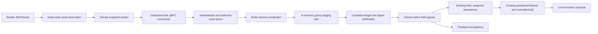

# Large load-snapshot transfer — target architecture

Date: 2026-10-25. Source baseline: implementation `14a54c2`; current architecture correction `2ba951a`.
Status: ready for implementation planning after three colleague review passes; final review suggestions incorporated. Not implemented or performance-qualified.
Session record: [brainstorm](20261025-large-load-snapshot-transfer.md).

## 1. Request, scope and decision record

Implement the complete GQ-02 requirement from `/Volumes/M4DATA/Users/speckzzz/reps/.paseo/worktrees/1qs56y0s/gquorum/docs/report/20261024-gquorum-requirements.md`. Support managed load snapshots larger than ordinary Raft frames, including configured sizes of tens of gigabytes. Preserve full-buffer StateMachine and Store APIs, ordinary message bounds, exact identities, Raft semantics and persistence ordering.

The test environment can qualify at most **2 GB = 2,000,000,000 complete encoded snapshot bytes**. This is not a production ceiling. The original 24 GB test proposal is superseded. Large payloads must be generated during explicitly opted-in Docker cluster tests and never committed.

| Decision | Selected behavior | Status |
|---|---|---|
| Full application/storage buffers | Keep current Snapshot/Restore and storage contracts | User confirmed |
| Receive staging | In memory; internal interface for a future disk backend | User confirmed |
| Staging naming | One stable incoming slot per exact local group owner; no path/name configuration | User confirmed |
| Reconnect | Resume exact retained transfer within unchanged processes/replicas; restart after restart/replacement | User confirmed |
| Concurrency | Default one incoming and one outgoing transfer per Node, across all groups | User confirmed |
| Total deadline | 30 minutes by default, configurable | User confirmed |
| Progress deadline | 1 minute without verified byte progress, including disconnection; configurable | User confirmed |
| Configuration lifecycle | NodeOptions at NewNode construction; immutable for that Node lifetime | User confirmed |
| Default size allowance | 256 MiB, configurable above 2 GB; byte budgets derive from allowance and concurrency | User confirmed |
| Qualification | Generated fixtures up to 2 GB; explicit cluster flag; excluded from defaults | User confirmed |
| Chunk payload | 1 MiB default; negotiate downward for receiver/frame limits | Design proposal |
| Flow control | At most eight unacknowledged chunks, default 8 MiB per sender | Design proposal |
| Coordinator owner | Node/managed host owns receive assembly and lifecycle; gRPC is an authenticated adapter | Design proposal |
| Delivery semantics | Exact ingress acceptance; local installation outcome separate; no new remote durable-install receipt | GQ-02 baseline/design proposal |
| Wire compatibility | New snapshot RPC version 1 alongside unchanged ordinary Raft frame version 2 | Design proposal |
| Persistent compatibility | No encoding/schema migrations or baseline regeneration | Design proposal |
| Heartbeat isolation | Independent ordinary-Raft and bulk-transfer workers/queues/deadlines | User requested |
| Listeners/ports | Existing _meta and load listeners only; bulk connection uses the same load endpoint | User requested |
| Package boundaries | Contracts in load/snapshot, mechanism in internal/loadsnapshot; no new root files | User requested; concrete layout proposed |

The requirements questions are resolved. The selected colleague's final verdict is ready for implementation planning, with no open architecture decisions or blocking findings. Remaining release/qualification checks are listed explicitly. User acceptance of the completed target is distinct from that technical review; no implementation has begun.

## 2. Architectural boundaries

Current-state reference: the colleague-updated [load transport architecture](../architecture/load-transport-multiplexing.md) now describes binary RaftFrame v2/native message encoding, JSON administrative envelopes, unary snapshot-containing batches, no ordinary unary fallback and ingress-only delivery success. This target preserves that distinction: the existing engine snapshot data still contains its JSON/base64 application envelope inside a binary native message. The new chunk RPC changes how that encoded payload is transported, not its persisted encoding. Treat the updated working-tree architecture document, together with current source, as the baseline rather than its stale committed wording.



Ordinary Raft/control RPCs keep their existing connection pool and worker scheduling. Snapshot TransferSnapshot is registered on the existing load gRPC service/listener at the same configured load address; there is no third listener or port. Separate bulk ClientConn objects establish connections to that same address, not a new endpoint. Bulk work has separate connections, permits and workers. The same physical network can still become saturated; this design prevents unbounded queueing and application/HTTP2 head-of-line coupling, not arbitrary bandwidth contention.

`internal/loadsnapshot` owns the incoming transfer slots, outgoing reservations, deadlines and status on behalf of Node. A narrow internal adapter in `internal/managed/snapshot_ports.go` supplies exact peer authorization, run ownership, Raft ingress and delivery reports without moving topology logic into the snapshot package. `transport/loadgrpc` owns network streams and reconnect loops. Custom authenticated transports call the same `snapshot.Service` ingress contract rather than rebuilding assembly rules. The service is a borrowed view of Node-owned work, with no independent Start, Stop or constructor for applications.

The staging interface lives in `internal/loadsnapshot/staging.go`, superseding both earlier tentative adapter-local and managed-package locations. The user requested no additional root source files and a dedicated package for snapshot machinery. A future disk backend can replace staging without moving authorization or lifecycle ownership into the adapter.

A stable slot means one active **incoming transfer** per local group run. It does not replace the WAL backend's two retained recovery snapshots, and does not forbid sending a local immutable snapshot to multiple destinations when configured outbound capacity permits it.

## 3. Configuration, admission and bounded resources

### 3.1 Public options

CREATED `load/snapshot/options.go`:

```go
type Options struct {
    MaxSnapshotBytes uint64
    MaxIncoming     int
    MaxOutgoing     int
    MaxReceiveBytes uint64
    MaxSendBytes    uint64
    ChunkBytes      int
    WindowChunks    int
    TotalTimeout    time.Duration
    ProgressTimeout time.Duration
}

func (o Options) Resolve() (Options, error)
func (o Options) Validate() error
```

UPDATED `node_options.go`: add `SnapshotTransfer snapshot.Options` to `LoadOptions`; resolve it only when managed loads are configured. Include a nonzero snapshot-transfer options value in implicit-load detection. All existing factory/store validation remains.

| Field | Zero-value resolution | Validation / meaning |
|---|---|---|
| MaxSnapshotBytes | 256 << 20 | Complete existing `raftpb.Snapshot.Data` encoded bytes; finite configurable limit, no 2 GB special case |
| MaxIncoming / MaxOutgoing | 1 each | Positive after resolution; separate node-wide counts |
| MaxReceiveBytes | MaxSnapshotBytes × MaxIncoming | Checked multiplication; bounds sum of reserved incoming encoded payloads |
| MaxSendBytes | MaxSnapshotBytes × MaxOutgoing | Checked multiplication; bounds sum of reserved outgoing encoded payloads |
| ChunkBytes | 1 << 20 | Positive; per-frame overhead must also fit adapter/server limits |
| WindowChunks | 8 | Positive; checked multiplication bounds outstanding chunk payload bytes |
| TotalTimeout | 30 minutes | Negative refuses; no hard upper bound other than representable time arithmetic |
| ProgressTimeout | 1 minute | Negative refuses; resolved value must not exceed TotalTimeout |

Check `TotalTimeout + ProgressTimeout` and all deadline additions for overflow. Require directional byte budgets to accommodate one MaxSnapshotBytes transfer. If a deployment needs a lower effective maximum, it sets MaxSnapshotBytes accordingly. Count limits may be larger than the number of maximum-sized transfers fitting a custom byte budget; size and count reservations both apply. Check all sums/products, native `int` conversion, durations and frame overhead before allocation.

These values are local construction-time settings, not new replicated topology limits. NewNode performs no transport callbacks or I/O. The borrowed snapshot.Service exposes a pure Options getter used by adapter Bind; Bind validates/copies the resolved policy without changing the Node. Start starts the coordinator using those values. A borrowed adapter stays caller-owned.

### 3.2 What the budgets cover

Reserve outgoing count/bytes before pinning snapshot data for a transfer or queueing its job. Senders borrow the engine-owned immutable slice; do not clone it for this path. Charge pinned bytes because the transfer can extend their lifetime after native snapshot replacement. Reserve incoming count/bytes before allocating the declared receive buffer. A resumed transfer reuses its reservation. Count disconnected transfers until they expire or are explicitly aborted and joined.

Incoming reservation stays charged while its buffer has been handed to the engine and installation/skip/error cleanup has not completed. Native retained snapshot state after installation belongs to the engine's existing resident state; it is not a new active transfer. Do not claim releasing a reservation immediately reduces RSS or releases the native retained snapshot.

Concurrent destinations borrowing the same immutable source artifact are each charged its full encoded size. This is deliberately conservative accounting; no cross-transfer sharing-credit system is added.

Byte budgets bound transfer payload ownership, not the total RSS of application state, native resident snapshots, JSON/base64 decoding, WAL encoding, Go runtime or borrowed custom stores. Their additional allocations remain bounded by admitted size/count and existing operations, and must be measured. No constant-memory or 2-GB-RSS promise is made. Avoid extra whole-payload marshal/unmarshal copies on the new path, and retain one validated decoded engine envelope through restore instead of repeatedly decoding it.

Separate bounded overhead:

- Each outgoing stream: at most WindowChunks outstanding chunk payloads, plus one encoded frame being sent; gRPC flow control remains active.
- Incoming streams: one chunk being validated/copied per attachment; no queue of arbitrary incoming chunks.
- Small native snapshot header: 64 KiB maximum, also subject to ordinary frame limit. Header includes no application snapshot data.
- Terminal acknowledgements are a bounded best-effort cache, not an admission resource. Maximum completed records: `max(256, 4*MaxIncoming)` with overflow checks; evict the oldest completed record when full. Never refuse a new transfer because this cache is full. Unresolved handing-off transfers stay in the live map under their receive reservation and are not evictable cache records.
- Terminal result maximum age: receiver's original total deadline plus one ProgressTimeout, subject to earlier oldest-first eviction. Cache accepted/not-needed outcomes only; pre-ingress failures need no terminal cache row. Cache misses/eviction safely return restart_required, never fabricated success. A handing-off record is retained as live ownership until its actual result is established.
- Diagnostic history: latest 256 completed records per Node, strings limited to 512 bytes; active records are bounded by transfer concurrency. Paged reads return at most 128 records.
- No transfer staging files: temporary transfer disk usage is zero. Normal WAL/snapshot persistence remains disk-backed when selected.

Never enqueue an unbounded list of transfers waiting for permits. Capacity refusal is transient overload; permanent configured size refusal is distinct. A group slot occupied by another exact transfer returns busy unless current exact-run receiver Raft state proves the old transfer obsolete before handoff. Only owner-confirmed monotonic term/commit evidence permits cancellation and joined replacement; a sender-declared higher term/index alone does not. Never overwrite a buffer while old operations own it.

## 4. Public integration contracts

### 4.1 Types

CREATED `load/snapshot/protocol.go` (imports `load` for its existing Peer type):

```go
type Key struct {
    From, To   load.Peer
    DeliveryID uint64
}

type Manifest struct {
    Key          Key
    NativeHeader []byte // native MsgSnap encoding with Snapshot.Data cleared
    TotalBytes   uint64
    SHA256       [32]byte // digest of complete encoded Snapshot.Data
    ChunkBytes   uint32  // sender requested payload size; negotiated downward
}

type Session struct {
    Key        Key
    Attachment uint64 // receiver-issued nonzero fencing generation
}

type BeginRequest struct {
    MaxChunkBytes uint32 // optional adapter frame cap; zero adds no cap; not part of manifest
    Manifest       Manifest
    RemainingTotal time.Duration // relative, not a sender wall-clock timestamp
    ProgressTimeout time.Duration // sender policy; negotiated downward
    Resume         bool
}

type Chunk struct {
    Session Session
    Ordinal uint64
    Offset  uint64
    Data    []byte
    SHA256  [32]byte
}

type Ack struct {
    Session       Session
    NextOffset    uint64
    ChunkBytes    uint32
    State         DeliveryState
    RestartNeeded bool
    RemainingTotal time.Duration
    ProgressTimeout time.Duration
    ReceiverRunID string
}

type DeliveryState string // receiving, verifying, handing_off, accepted, not_needed, failed

type ReceiverOutcome string // unknown, installed, skipped, failed

type Send struct {
    Manifest Manifest
    Data     []byte // immutable borrowed view for this SendSnapshot call only
    ReportProgress func(Progress) // library callback; nonblocking; only verified cumulative Acks
}
type Progress struct {
    ReceiverRunID string
    VerifiedBytes uint64
    State DeliveryState
    RemainingTotal time.Duration
    ProgressTimeout time.Duration
}

type Transport interface {
    SendSnapshot(context.Context, Send) (Ack, error)
}
```

Implementation refinement: `BeginRequest.MaxChunkBytes` carries an optional adapter-local payload cap separately from immutable `Manifest.ChunkBytes`. The first admission takes its minimum with sender/local policy. A resumed request may refuse if its cap is below the retained negotiated size, but never renegotiates offsets. This adds no wire field or Node setting.

The manifest's immutable identity is exact peers + delivery ID + native header bytes + total length + payload digest. Resume must match all fields except the sender's remaining-duration hint. Manifest.ChunkBytes is the original requested size and must be resent unchanged on resume. The receiver separately stores the negotiated chunk size, returns it in every Ack, and uses that stored value for offsets/ordinals. Neither reconnect nor a new frame limit changes that transfer's negotiated mapping; refuse/restart if it no longer fits. Require MsgSnap, positive message Term, positive Snapshot.Metadata.Index, and `0 < Snapshot.Metadata.Term <= Message.Term`, with nonzero exact From/To. Reject headers with missing metadata, nonempty application data, Entries or Responses. Apply these checks in the package service and native preflight as well as the gRPC decoder, so custom transports cannot bypass them. Preserve all other bounded native fields. Message From/To, group/cluster identity and ConfState must validate against current library rules. Do not infer authorization from a digest.

The adapter invokes Send.ReportProgress after authenticated admission and after each newly verified cumulative Ack (and final accepted/not_needed outcome). It may coalesce intermediate updates, but cannot fabricate progress, refresh duplicates or call it after SendSnapshot has joined/returned. Coordinator validates bounds/exact attempt and stamps receipt time locally, then posts a bounded update to the source engine. This explicitly connects gRPC progress to Node/repair evidence; the final return value alone is insufficient. A nil callback is permitted for direct adapter tests, while Node-owned jobs always supply it.

`snapshot.Transport.SendSnapshot` runs synchronously until ingress acceptance or terminal transfer failure; it owns and joins reconnect workers. It does not report success through ReportLoadDelivery itself. The Node-owned outgoing job owns the exact managed delivery report, avoiding double reporting. A network failure while final acceptance is uncertain may return uncertainty; a later exact terminal acknowledgement can resolve it within the original lifetime.

Existing `load.Transport` remains source-compatible, but NewNode validates that a configured managed load transport also implements `snapshot.Transport` using a pure type assertion. Missing/nil capability returns fault.Unsupported during construction, not at the first snapshot. No transport method is invoked by this check. Defensive internal admission checks remain for invalid internal fixtures. No silent giant unary fallback. Custom adapters may implement the new method using the common snapshot.Service chunk APIs. This capability requirement is a documented behavioral change for managed snapshot delivery, even though the old interface remains unchanged.

### 4.2 Package service; minimal existing-root wiring

CREATED `load/snapshot/service.go` (package snapshot):

```go
// Service is a borrowed view of one Node lifetime, not an independent owner.
// Transports authenticate the sender before calling ingress methods.
type Service interface {
    Options() Options
    Begin(context.Context, BeginRequest) (Ack, error)
    Write(context.Context, Chunk) (Ack, error)
    Finish(context.Context, Session) (Ack, error)
    Detach(context.Context, Session) error
    Abort(context.Context, Session) error
    SessionDone(Session) <-chan struct{} // closes on attachment fencing/expiry/stop
    List(Query) Page
}
```

Modify existing `node.go` to expose only `LoadSnapshots() snapshot.Service`, retain the service field, and construct the pure internal facade in NewNode. Implement that single accessor in existing `node_load.go`. Keep `LoadOptions.SnapshotTransfer snapshot.Options` in existing `node_options.go` as already agreed. **Create no new files in the project root.** Remove the earlier proposed `node_snapshot.go` and seven individual root-interface methods from the implementation plan.

CREATED `internal/loadsnapshot/service.go`:

```go
type Resolver func() (*Coordinator, error)
func NewService(options snapshot.Options, resolve Resolver) snapshot.Service
func (s *service) Options() snapshot.Options
func (s *service) Begin(context.Context, snapshot.BeginRequest) (snapshot.Ack, error)
func (s *service) Write(context.Context, snapshot.Chunk) (snapshot.Ack, error)
func (s *service) Finish(context.Context, snapshot.Session) (snapshot.Ack, error)
func (s *service) Detach(context.Context, snapshot.Session) error
func (s *service) Abort(context.Context, snapshot.Session) error
func (s *service) SessionDone(snapshot.Session) <-chan struct{}
func (s *service) List(snapshot.Query) snapshot.Page
```

NewService copies already validated/resolved options and stores an internal resolver closure; it performs no I/O, calls no resolver and starts no workers. NewNode supplies the closure via existing node_load.go wiring; it captures only the Node reference. Resolver returns the current coordinator even while stopping so read-only List can observe terminal state; mutating coordinator methods enforce their own fence. The facade retains the last resolved coordinator for bounded terminal observations after Host release; it never uses that fallback to mutate a released owner. Options works before Start; mutating methods resolve the current coordinator or return ReplicaNotReady/Stopped. List returns an empty page before a host exists; teardown must preserve bounded observations through the service's terminal view. A coordinator replacement during readmission never inherits a prior owner's active transfer: every operation retains and checks the original exact owner/run and full session key after resolution and waits.

As with ReceiveLoadRaft, transports authenticate the declared sender first. The coordinator then uses managed ports to validate both peers and the current local replica/run before allocation, after waits, on chunks and before handoff. No cached stream admission bypasses revoked topology. The public service methods expose a transport integration contract, not an application snapshot export/import facility.

Detach fences/joins only its attachment and retains resumable bytes. Abort cancels the exact transfer and joins owned work. A stale attachment cannot detach/abort its successor. StopLoadGroup and Node teardown use internal owner-bound cancellation without requiring a network peer.

Snapshots for unpublished but running authorized joining replicas remain admissible, as with existing native ingress. A changed engine RunID or stopped handle cannot inherit a previous slot even when durable peer fields match.

### 4.3 Diagnostics and errors

CREATED `load/snapshot/status.go`:

```go
type Status struct {
    Key             Key
    Direction       string // incoming or outgoing
    SnapshotIndex   uint64
    SnapshotTerm    uint64
    TotalBytes      uint64
    VerifiedBytes   uint64
    StartedAt       time.Time
    LastProgressAt  time.Time
    Deadline        time.Time
    Delivery        DeliveryState
    ReceiverOutcome ReceiverOutcome
    ReservedBytes   uint64
    ErrorReason     string
}
type Query struct {
    GroupID string
    Cursor  uint64
    Limit   int
}
type Page struct {
    Items      []Status
    NextCursor uint64
    Truncated  bool
    Incoming, Outgoing int
    ReceiveBytes, SendBytes uint64
}
```

These are local, bounded observations, never quorum barriers. ReceiverOutcome is installed only after exact Ready snapshot persistence and successful Restore; skipped only with owner evidence of no installation. Sender observations normally retain unknown receiver outcome. A returned accepted Ack carries no installed claim. No remote installation polling API or mandatory receipt is added.

CREATED `load/snapshot/error.go`:

```go
type TransferError struct {
    Reason string
    Size, Limit uint64
    Cause error
}
func (e *TransferError) Error() string
func (e *TransferError) Unwrap() error
```

Reasons: size_limit, frame_limit, capacity, group_busy, unsupported, malformed, checksum, identity, transfer_conflict, restart_required, obsolete, progress_timeout, total_timeout, stopped, ingress_failed. A native-owner-confirmed header-only skip returns a distinct not_needed Ack, not a size/checksum bypass or a claim that payload bytes were delivered. Unwrap to existing fault codes: permanent size/frame/malformed -> Invalid; capability -> Unsupported; capacity/busy -> Overloaded; identity -> IdentityMismatch; checksum -> Unreadable; restart/timeout -> Unavailable; shutdown -> Stopped. Preserve structured Reason/Size/Limit on the snapshot wire. Identical oversize/capability failures are not retried inside the adapter. Node/engine applies bounded per-destination cooldown to native retry as well (§7.4), and reports terminal outcomes through a non-lossy exact-attempt mailbox. Refusals therefore cannot rehash or reopen at heartbeat frequency.

No changes to Proposal retry semantics or general payload-preflight APIs are included.

## 5. Wire protocol and resume semantics

UPDATED `transport/loadgrpc/internal/loadpb/load.proto`, with generated files rebuilt by `make generate`:

```proto
// Existing RaftPeer, RaftFrame v2 and administrative messages remain unchanged.
message SnapshotOpen {
  uint32 version = 1; // exactly 1
  RaftPeer from = 2;
  RaftPeer to = 3;
  uint64 delivery_id = 4;
  bytes native_header = 5; // complete native MsgSnap with Snapshot.Data cleared
  uint64 total_bytes = 6;
  bytes sha256 = 7; // exactly 32 bytes
  uint32 chunk_bytes = 8;
  uint64 remaining_total_nanos = 9;
  bool resume = 10;
  uint64 progress_timeout_nanos = 11;
}
message SnapshotData {
  uint64 attachment = 1;
  uint64 ordinal = 2;
  uint64 offset = 3;
  bytes data = 4;
  bytes sha256 = 5;
}
message SnapshotFinish { uint64 attachment = 1; }
message SnapshotAbort { uint64 attachment = 1; }
message SnapshotFrame {
  oneof body {
    SnapshotOpen open = 1;
    SnapshotData data = 2;
    SnapshotFinish finish = 3;
    SnapshotAbort abort = 4;
  }
}
message SnapshotFailure {
  string code = 1;
  string reason = 2;
  string message = 3;
  uint64 size = 4;
  uint64 limit = 5;
}
message SnapshotAck {
  uint64 delivery_id = 1;
  uint64 attachment = 2;
  uint64 next_offset = 3;
  uint32 chunk_bytes = 4;
  string state = 5;
  bool restart_needed = 6;
  SnapshotFailure failure = 7;
  uint64 remaining_total_nanos = 8;
  uint64 progress_timeout_nanos = 9;
  string receiver_run_id = 10;
}
// Add to existing Load service:
// rpc TransferSnapshot(stream SnapshotFrame) returns (stream SnapshotAck);
```

The first frame must be Open, authenticated using the adapter's existing caller-supplied authentication. No Data before admission Ack. A not_needed Ack is terminal before chunk negotiation; it may have attachment/offset/chunk-size zero, but must carry the exact delivery and receiver RunID and be backed by the private native-owner skip path. It is never interpreted as verification/delivery of the absent payload. The connection's Open binds subsequent frames to immutable From/To/delivery. Reject another Open on that stream. Verify frame version, digest sizes, positive total and checked remaining duration before allocation. Unknown fields must not cause unbounded retained state; enforce native-header and protobuf-frame byte limits and reject unsupported required versions.

On first admission, receiver total allowance is the smaller of local TotalTimeout and sender RemainingTotal; receiver progress allowance is the smaller of both advertised ProgressTimeout values. Ack returns these effective values as relative durations. Sender narrows its existing deadline/progress policy; it never extends either. A reconnect uses the already stored receiver policy and original sender deadline, not freshly negotiated lifetimes. Zero/overflow/negative converted durations refuse. Different local budgets remain independent; local resource admission is authoritative.

The sender starts its network progress clock when first attempting Open, so a peer that never acknowledges admission cannot hold its network attempt until total expiry alone. Source preparation/hash uses total lifetime. Once all bytes are acknowledged, waiting for final verified ingress is governed by total lifetime rather than artificial zero-byte progress. Receiver uses its admission time as initial progress time and advances it only on new verified bytes.

The server chooses the minimum of sender ChunkBytes, local ChunkBytes and the largest payload fitting its frame bound including field/tag/varint/digest overhead. Sender also validates the returned choice against its own frame limit. No valid positive payload -> typed frame_limit. Header itself must fit both endpoints. Different ordinary server limits can still cause gRPC ResourceExhausted before application decoding; classify this explicitly rather than claiming Bind can introspect the caller's grpc.Server.

All nonfinal chunks have the agreed size. Ordinal equals offset/chunk size; final chunk may be shorter. Check `offset <= total`, `len(data) <= total-offset`, expected ordinal and nonempty data before copying. Validate SHA256 per chunk, then update the running full digest and verified offset. Retransmitted exact already-verified chunks are compared with retained bytes and acknowledged without extending last-progress time. Reject holes, overlaps not matching a previous complete chunk, corruption or conflicting duplicates. Full digest must match before Finish can hand off.

Acknowledgements are cumulative. Sender has independent send/receive goroutines and a bounded window, avoiding one round trip per chunk and avoiding receiver Ack backpressure deadlock. The server sends an Ack per chunk; repeated acknowledgements do not count as progress at the sender. Finish is sent only after all bytes are cumulatively acknowledged.

On stream loss, the server detaches that exact attachment and retains the transfer. Reconnect uses Resume=true and the same immutable manifest. An unknown resume key yields restart_required without allocating. The sender ends this delivery with failure and lets native Raft initiate a fresh delivery; it does not silently turn the original key into a new session. A new process/successor never resumes an old key.

Resume=true with an active old attachment fences its generation, closes its SessionDone signal, and joins its active Node operation before issuing a new generation. The adapter observes that signal and terminates the old RPC; a generic child-context cancel alone cannot interrupt an existing server RecvMsg (§7.6). Bounded reconnect admission refuses if the old owner has not joined; timeout does not permit overlapping mutation. Resume during final verification/handoff observes or awaits the same completion object; it does not call native Step again.

If final Ack is lost, an exact resume returns accepted from the terminal record while retained. Once terminal evidence expires, return restart_required. A new native delivery may offer the same snapshot; native Raft may skip it. Do not claim global exactly-once delivery beyond retained process-local evidence.

No minimum-throughput rule is added: a stream advancing at least one valid chunk within every configured minute can hold its permit until the 30-minute total deadline. This bounded slow-trickle behavior is deliberate; deployments can shorten/raise timeouts and size budgets. No compression is enabled for this initial snapshot RPC; frame and byte budgets count the actual encoded payload. Hashes detect corruption and transfer mixing; they do not replace authentication or make shared tokens prove unique node identity. Preserve explicitly configured plaintext deployments.

## 6. State, storage and ownership schema

### 6.1 Persistent schema

**No new SQL tables, DDL, ORM models, bbolt buckets, persistent caches or transfer files.** There is no migration. Adding a speculative disk journal or ORM schema would contradict the selected in-memory scope.

Existing stores explicitly unchanged:

- `_meta.bolt` metastore buckets: format, hardstate, entries, snapshot, applied, state, identity, serve_override, load_replicas; all replicated topology document/session/operation encodings remain unchanged.
- `_authority.bolt` and all its existing format/identity/fence/effect/retirement/collection journal buckets, rows and schema remain unchanged.
- Per-group WAL backend state.bolt `meta` and `settings` buckets; applied, confstate, floor, snapmark and schema/identity settings retain their encodings.
- Existing etcd WAL entries, HardState and snapshot markers; `.snap` files and retention policy remain unchanged.
- Engine snapshot schema 2 JSON/base64 envelope, application payload encoding, metadata schema v4, authority journal v2 and offline recovery journals remain unchanged.
- All frozen baseline files remain untouched.

A crash discards volatile partial transfers. Startup uses only existing durable snapshot/commit evidence. Since no staging files exist, there is no transfer artifact to recover/delete; the future disk backend must add its own owned crash-cleanup design when implemented.

### 6.2 Volatile schema

CREATED `internal/loadsnapshot/state.go` (all `snapshot.*` names refer to public `load/snapshot`):

```go
type OwnerKey struct {
    Peer load.Peer
    RunID string
}
type Owner interface {
    Key() OwnerKey
    Context() context.Context
    SnapshotBounds() raftengine.SnapshotBounds // exact-run monotonic lower bounds
    PreflightSnapshot(context.Context, raftpb.Message) (raftengine.SnapshotPreflight, error)
    PrepareOwnedSnapshot(context.Context, raftpb.Message) (raftstate.Snapshot, error)
    StepOwnedSnapshot(context.Context, raftengine.SnapshotIngress) error
}
type snapshotOwner struct {
    key OwnerKey
    handle Owner // opaque exact owner supplied by managed ports
}

type snapshotReceive struct {
    key         snapshot.Key
    manifest    snapshot.Manifest
    owner       snapshotOwner
    attachment  uint64
    state       snapshot.DeliveryState
    staging     snapshotStaging
    next        uint64
    chunkBytes  uint32
    digest      hash.Hash
    started     time.Time
    progress    time.Time
    deadline    time.Time
    reservation *snapshotReservation
    cancel      context.CancelFunc
    attached    *snapshotAttachment
    completion  *snapshotCompletion // exactly one finalization/ingress result
}

type snapshotReservation struct {
    direction snapshotDirection
    bytes     uint64
    owner     snapshotOwner
    // release-once state; remains owned until joined
}

type snapshotTerminal struct {
    owner snapshotOwner // exact run for same-process local restart fencing
    manifest snapshot.Manifest // bounded header, never full payload
    ack      snapshot.Ack
    outcome  snapshot.ReceiverOutcome
    expires  time.Time
}

type Coordinator struct {
    options snapshot.Options
    ports Ports
    // Protected by a short-held mutex; no I/O/callback/hash/joins under it.
    incoming map[snapshot.Key]*snapshotReceive
    groups   map[string]*snapshotReceive // current exact local owner checked separately
    terminal map[snapshot.Key]*snapshotTerminal
    incomingCount, outgoingCount int
    receiveBytes, sendBytes uint64
    sequence uint64 // attachment generation; fail on exhaustion
    history []snapshot.Status // bounded ring, monotonically numbered
    digests map[SourceSnapshotID][32]byte // max two completed entries per live run
    // Hash singleflight work is separately owned by admitted outgoing jobs.
    // Context, wait group, closed fence, active outgoing jobs and completion signal.
}
```

Uniqueness: incoming primary key is full exact transfer key; group index allows one live record per local group; each record retains an opaque exact owner handle and engine RunID. Terminal records must match the complete immutable manifest on replay. A group ID alone cannot resume a successor. Values contain owned copies of small metadata; no cache alias to mutable application structs.

TTL is the fixed transfer deadline plus terminal grace described in section 3. Diagnostic history evicts oldest records by count; it is not terminal deduplication evidence. Active transfer expiry starts cancellation and joined cleanup, not immediate map replacement. Completed-ack cache eviction never controls live ownership or admission. Cache misses never imply completed installation.

### 6.3 Staging backend interface and the single deferred-backend TODO

CREATED `internal/loadsnapshot/staging.go`:

```go
// TODO: Add a disk-backed snapshotStaging in the group owner's storage namespace,
// using one stable incoming-snapshot name per group rather than configurable
// per-transfer paths; preserve exact transfer fencing and joined cleanup.
type snapshotStaging interface {
    Append(context.Context, uint64, []byte) error
    ReadAt(context.Context, []byte, uint64) (int, error)
    Seal(context.Context) error
    Materialize(context.Context) ([]byte, error)
    Close() error
}

type memorySnapshotStaging struct {
    data []byte
    written uint64
    sealed, closed bool
}
func newMemorySnapshotStaging(total uint64) (snapshotStaging, error)
func (s *memorySnapshotStaging) Append(context.Context, uint64, []byte) error
func (s *memorySnapshotStaging) ReadAt(context.Context, []byte, uint64) (int, error)
func (s *memorySnapshotStaging) Seal(context.Context) error
func (s *memorySnapshotStaging) Materialize(context.Context) ([]byte, error)
func (s *memorySnapshotStaging) Close() error
```

This is one multi-line code TODO, placed only at the interface. There is no disk implementation, backend selector or path option now. `incoming-snapshot` is a stable logical slot name, not authorization and not an instruction to replace normal durable `.snap` files.

The coordinator serializes calls. Failure cleanup is scheduled after the current operation unpins itself; it must not synchronously wait for its own active reference. Append accepts only the contiguous next offset and copies into owned storage. An error leaves the transfer invalid for further append until cleanup; do not resume uncertain partial writes in a later backend. ReadAt supports bounded duplicate comparison. Seal requires exactly declared length and makes storage immutable. Materialize returns a borrowed immutable byte slice after sealing; memory implementation returns its existing allocation without copying. A future disk implementation may materialize under a separate allocation reservation. Close is idempotent on success; a future close failure retains ownership for retry.

Keep staging alive until the engine finishes installation/skip or joins teardown, so the immutable view cannot be reused prematurely. Full native state can retain the same immutable bytes afterward; Close drops the staging reference without zeroing/recycling them. If a future backend requires stronger release semantics, it must honor that retained reference explicitly.

## 7. Engine integration and lifecycle

### 7.1 Outgoing snapshots

CREATED internal engine contracts (not imported from load, avoiding a package cycle):

```go
type SnapshotJob interface {
    Run(context.Context) // owns exactly one terminal managed delivery report
    Discard(error)       // release/report for a job never run; idempotent
}
type SnapshotOffer struct {
    Message raftpb.Message
    Attempt SnapshotAttempt
    PublicationGeneration uint64
    Epoch context.Context // canceled on source term/leadership loss
}
type SnapshotJobTransport interface {
    PrepareSnapshot(SnapshotOffer) (SnapshotJob, error)
}
```

The managed engine transport implements this optional interface by forwarding to its internal/loadsnapshot.Coordinator.PrepareSend with the exact Owner handle. `_meta` and standalone transports retain their existing paths; managed load snapshots use jobs. `PrepareSnapshot` must be bounded/no I/O: validate shape/capability, reserve global send count/bytes, pin the source run/leadership term and immutable native snapshot bytes, and return a job. Bind its lifetime to the source leadership term as well as the exact run. No resolution, authentication callback, hashing or network call on the Raft loop. Before job admission the native engine already holds its normal snapshot; this is not a transfer allocation.

Change `ownReady` to an engine method which separates managed MsgSnap jobs from ordinary messages without marshal/unmarshal copying their full payload. Pin native data read-only for the worker without another full-size copy; lifetime reservations account for that pin. Ordinary message ownership remains unchanged. A later local snapshot/compaction may drop an old reference but cannot mutate the pinned bytes.

Store jobs beside the Ready in writeJob. Release them only after the Ready's required persistence/application boundary, as existing outgoing messages require. Then dispatch through joined bulk workers bounded by node-wide reservations. Preserve relative ordering of ordinary message segments; the snapshot admission point is retained, but bulk completion may occur after subsequent heartbeats. Raft already handles delay/reordering. Do not keep normal send workers blocked on bulk completion.

On full capacity, report SnapshotFailure for the refused native destination and retain no queued payload copy. On failed Ready, cancellation, dropped dispatch or shutdown, Discard every unstarted job. Started jobs join before replica storage/Application.Close. Incoming callbacks on abnormal engine termination run from the post-worker-join finalizer before closing g.done, never from finishRun while the writer may still own data. Every managed delivery gets one terminal report through a compare-and-set record and the non-lossy exact-attempt engine mailbox; timeout and final Ack racing cannot report both success and failure.

The worker resolves and validates the exact destination, borrows the pinned immutable snapshot slice, obtains its cached digest (or computes it off-loop once), and registers the exact delivery using the reservation's original total deadline. It calls Transport.SendSnapshot with the owner context/deadline. It revalidates endpoints after resolution/waits and before reporting; delayed reports never affect successors.

### 7.2 Incoming owned handoff

CREATED `internal/raftengine/snapshot_ingress.go`:

```go
type SnapshotInstallOutcome uint8
const (
    SnapshotInstallUnknown SnapshotInstallOutcome = iota
    SnapshotInstalled
    SnapshotSkipped
    SnapshotInstallFailed
)
type SnapshotIngress struct {
    Message raftpb.Message // owned immutable data; new chunk path only
    Decoded raftstate.Snapshot // fully validated off-loop, exact immutable payload
    Done func(SnapshotInstallOutcome, error) // internal nonblocking completion
}
type SnapshotBounds struct { RunID string; Term, Commit uint64 }
func (g *Group) SnapshotBounds() SnapshotBounds
func (g *Group) PreflightSnapshot(context.Context, raftpb.Message) (SnapshotPreflight, error)
type SnapshotPreflight struct {
    Term, Commit uint64
    NotNeeded bool
    HeaderStepped bool
}
func (g *Group) PrepareOwnedSnapshot(context.Context, raftpb.Message) (raftstate.Snapshot, error)
func (g *Group) StepOwnedSnapshot(context.Context, SnapshotIngress) error
func (g *Group) handleOwnedSnapshot(*request, *loopState)
func (g *Group) handleSnapshotPreflight(*request, *loopState)
func (g *Group) snapshotBoundaryReady(*loopState) bool
func (g *Group) finishOwnedSnapshot(SnapshotInstallOutcome, error)
func (g *Group) finishSnapshotIngressAfterJoin()
```

StepOwnedSnapshot is an internal ownership transfer, not a replacement for existing public StepBatch ownership. Its submission helper distinguishes definitely-not-enqueued from enqueued. Done is called exactly once even on queue refusal/cancellation/shutdown. Once queued, the engine owns the bytes until Done, irrespective of a waiter timing out.

Serialize owned snapshot ingress at a safe Ready boundary (`pending == nil`, no Ready capture timer) so it cannot be confused with another pending snapshot. Only one incoming transfer per group enters this path. Managed ordinary ReceiveLoadRaft refuses MsgSnap and requires the snapshot ingress protocol; it cannot bypass receive budgets through a legacy full-message path. Ordinary non-snapshot messages remain unchanged.

Finish runs PrepareOwnedSnapshot on the transfer/finalizer worker while the receive reservation is held: decode the complete envelope and validate the immutable options/authority rules there. Full JSON/base64 decode must never run on the Raft owner loop. Retain the decoded application buffer and state for that exact message; cancellation joins the decode operation rather than pretending encoding/json is interruptible.

On the owner loop, native Step uses the statically validated snapshot. The existing stageReadySnapshot path applies the cheap dynamic authority-progress check against current g.authority only if native Raft actually selected the offered snapshot for installation; an ignored snapshot must not fail merely because its unused authority is older. Record one incoming ticket and let the existing beginReady/ownReady path classify the immediately ensuing Ready. Do not add a second RawNode.Ready capture path. No Ready after Step means native skip; a Ready without the exact offered Snapshot means skip while normal entries/HardState/messages still follow existing persistence. An exact Ready.Snapshot binds the cached decoded state and completion ticket to its write job. Never infer installed from a nil Step result or a matching index without exact ticket ownership.

For the exact selected Ready snapshot, avoid cloning the already-owned immutable data again. Existing SaveSnapshot -> WAL marker/HardState ordering remains. Restore the cached decoded application bytes serialized with Apply/Query. On successful Restore, mark installed and invoke Done; on failure halt the replica and invoke failed only after owned work has actually returned. On native skip, invoke skipped without Restore. A matching-log fast-forward still processes its normal Ready/committed entries and never installs the offered application state.

Transport acceptance may return after the validated native Step/capture, before persistence/Restore. A canceled Finish waiter is not a negative engine result: retain handing_off state and the completion object while ownership is unresolved. Installed/skipped completion establishes prior native acceptance even if the waiter lost that reply. Do not overwrite accepted with the canceled wait's error; actual owner failure before acceptance is a different terminal result. Separate sender timeout from receiver-local outcome. Done updates the receiver-local diagnostic and releases the incoming transfer permit only at safe ownership completion. If queued ingress is canceled before Step, engine discards it and Done returns failure. If Step has happened, network cancellation cannot roll it back.

### 7.3 Shutdown and readmission

- RequestStop/fencing first prevents new snapshot admission for the exact owner and cancels transfer workers/attachments.
- Request engine stop before waiting on engine-dependent incoming completion. Join chunk handlers, digest workers, outgoing RPC/reconnect loops and queued/active native handoffs. Never wait under host/coordinator locks, and never join an operation from its own callback.
- Incoming transfer permit survives a timeout while any engine/storage/application owner is outstanding.
- Exact replica stop/readmission releases or terminalizes all of that run's transfers; successor publication waits for joined old ownership under existing rules.
- Node.Stop joins managed work before closing owned storage and application resources. Borrowed gRPC adapter/server stay available during this join.
- Adapter Close cancels/joins its streams and bulk connections; repeated Close(ctx) joins retained teardown after timeout. It never frees Node-owned staging directly.
- Process crash loses partial transfer RAM and terminal cache. Native recovery restores only complete retained snapshots and committed tail. Peer retries against new InstanceID are rejected until they form a new exact delivery.

### 7.4 Heartbeats, leadership epochs and non-lossy reporting

**Ordinary Raft and snapshot transfer are parallel processes within the Node, not one serialized send path.** They have separate work queues, workers, concurrency budgets, stream locks, gRPC ClientConn pools and deadlines. Both load connections target the same existing load listener/port; _meta remains on its existing separate listener. Do not add a third port. A bulk write, digest, decode, reconnect or admission wait cannot hold an ordinary-send lock, an engine loop lock or a heartbeat worker. Physical CPU/network competition is still possible.

The engine owns a cancellable snapshot-leadership epoch. Refresh it after native term/role transitions and before preparing/dispatching snapshot jobs. Only the current leader can admit a new send; every job captures its message term and epoch context. Cancel on term change or loss of leadership, even if the process and replica remain valid. Cancellation joins network/hash workers before releasing the pin/permit. A best-effort exact Abort is sent within existing bounds; receiver expiry/obsolescence also bounds loss of that message.

Replace the dropping snapshot-report channel with a bounded, coalescing pending-report map and a capacity-one wake signal. Key managed reports by source RunID, term, destination replica and monotonically assigned snapshot-attempt generation. Accept only the current attempt for that peer. Update/retain the record before signaling; a full wake channel loses no report. The Raft loop alone delivers ReportSnapshot to RawNode and removes the consumed entry. Superseded/removed-peer reports are intentionally discarded after exact-generation checks, not silently dropped due to queue pressure. Metadata count is bounded by native peer progress plus admitted/retiring attempts, and never retains payloads.

For negative results, defer native SnapshotFailure delivery using a per-destination cooldown: start at 1 second and double to 30 seconds. Reset remote-failure backoff only after native Match advances or the peer's process/durable replica identity changes; byte progress or a new delivery ID cannot reset backoff for a failed attempt. Term changes discard stale native reports but do not manufacture successful progress. Permanent remote size/protocol refusals use the 30-second ceiling immediately; local missing capability already fails NewNode. During the delay native Raft remains in snapshot state and cannot generate a heartbeat-rate loop of new snapshot attempts. Release completed transfer payload reservations immediately after their workers join; cooldown holds only metadata. Local capacity refusal and remote pre-admission `capacity`/`group_busy` refusal use the pending-report mechanism with the same short retry delay: bounded jitter between 100 ms and 1 second, never the 30-second admitted-failure backoff. Refused Open has no payload allocation/pin at the receiver. Keep exponential backoff for failures of admitted attempts and permanent refusals. It retains no payload/permit or unbounded waiter queue. This bounds idle recovery latency but does not promise strict FIFO fairness between groups; qualification checks multi-group progress and must expose starvation if present. On stop, clear pending timers only after no owner can publish into the stopped run. Record persistent refusal in bounded status; rate-limit any event by changed reason or at least one minute. Do not synthesize heartbeat acknowledgements from chunk acknowledgements.

### 7.5 Receiver preflight, obsolete offers and digest ownership

Before receive allocation, call a small exact-run Raft-owner preflight with the bounded native header. A sender's claimed higher term alone cannot preempt a transfer. The owner can prove an offer unneeded if `header.Term < currentTerm` or `snapshot.Index <= committedIndex` at that owner boundary. An exact live run's cached term/commit are monotonic lower bounds and may prove that an already validated positive-term offer is obsolete; they can never prove acceptance or installation. Resume/chunk checks use these atomic published bounds, avoiding one Raft-loop round trip per chunk. Any native header-only Step still rechecks the predicate on the owner loop; run replacement/cancellation invalidates all cached proof.

For an offer proven unneeded, the owner can step **only the already proven obsolete header with nil Data** through a dedicated private path. Require `Message.Term > 0`, `Metadata.Index > 0`, and `0 < Metadata.Term <= Message.Term` before considering obsolescence. The path is gated by `pending == nil`, no Ready timer, no active/unclassified full-snapshot or header-only ticket, and no outstanding RawNode Ready. Refuse busy without Step when the gate is closed. Recheck exact run, valid header and obsolete predicate immediately before Step. Term zero is never treated as a lower-term remote message, because native Raft treats it as a local message. Pinned etcd Raft rejects lower-term MsgSnap or returns from restore before examining payload when index <= commit. This preserves native term/reply effects, including higher-term headers with an obsolete index, without assembling payload. Never use this path for a matching-log guess or a potentially installable snapshot. Require that the resulting Ready contain no offered Snapshot; process any normal HardState/messages through existing persistence. Return `not_needed` with local skipped outcome and zero received bytes. Sender completes the native snapshot attempt successfully because owner-confirmed native skip occurred, while diagnostics do not claim payload delivery or durable installation. If the predicate no longer holds for the exact owner, require ordinary full transfer.

A busy **pre-handoff** transfer can be canceled if the current receiver owner proves its stored message term obsolete (or its index already committed). Fence/join old chunk/decode operations before freeing its slot and admitting a replacement. A nonobsolete transfer still returns busy. Once native handoff has begun, no preemption frees its buffer before engine completion. Also check exact-run cached monotonic obsolescence bounds on resumed/written data so a deposed sender cannot occupy the receive permit until its total deadline despite normal Raft term progress.

Sender bytes are immutable pinned native snapshot data, not a second clone. Digest cache key is `(source RunID, snapshot publication generation, index, term, encoded length)`; publication generation prevents accidental reuse if a distinct artifact has the same Raft position. Keep at most two completed digest entries per live run, plus hash work already bounded by active send permits. Cache values contain only digest/metadata, not extra payload references. Same-artifact cache misses use singleflight hashing on a transfer worker; cancellation joins actual hashing work and failed/incomplete hashes are never cached. Clear completed cache on run release. Retry after receiver overload therefore reuses the digest and pin rather than copying and hashing the whole payload again.

### 7.6 Server attachment cancellation and half-open streams

A generic child `context.WithCancel(stream.Context())` does **not** itself cancel a blocked server `RecvMsg`. Do not base shutdown/resume correctness on that assumption or on gRPC keepalive defaults.

`Service.SessionDone(session)` returns a read-only close signal for the exact attachment. Unknown/stale sessions return an already-closed signal. Fencing, Abort, deadline expiry, group stop and coordinator stop close it. The adapter stores an exact-session handler stop signal and observes both signals. Before Open authentication, use a separate pre-Open quota of `max(8, 2*MaxIncoming)` small handlers and a timeout of `min(3 seconds, ProgressTimeout, TotalTimeout, incoming RPC deadline)`. These handlers do not consume authenticated transfer-handler permits or receive byte/count reservations. Validate/authenticate Open within that budget, then acquire an authenticated handler permit before calling Service.Begin and release the pre-Open permit after the transition. Authentication callbacks remain owned/joined if they ignore cancellation; do not free a permit until actual return.

The server handler runs one adapter-owned Recv pump and one Send pump and selects received frames against session-stop/deadline/adapter-stop signals. On cancellation, it stops dispatching Node calls and returns an RPC error; gRPC's handler-return cleanup cancels the actual transport stream, unblocking its Recv pump. **Do not wait for that blocked pump before returning the handler.** Both pumps remain owned by the adapter wait group; the handler permit is retained until both return. Send Ack through a bounded queue and select completion against the same stop/deadline signals, so a blocked server SendMsg cannot prevent the handler returning. On normal completion, await the final Ack write result with these same cancellation bounds. Pump output is bounded to one frame and abandons delivery when the handler's stop signal closes. Node coordinator joins the old attachment's active Node mutations before allowing new writes; generation fencing excludes any late old frame. Adapter Close joins both kinds of pumps after causing their handlers to return. Functional tests must prove this on a half-open stream, including deadline/Close paths; no goroutine is detached or forgotten.

Authenticated snapshot handler permits (`2*MaxIncoming`) are independent of both ordinary MaxConcurrentCalls and the pre-Open quota. Unauthenticated/empty streams cannot occupy those authenticated slots. A saturated pre-Open quota may still reject new handshakes; this bounds their cost rather than promising immunity to network-level denial of service. The adapter cannot leak a handler permit into the next process/run. One failed/stale connection cannot exhaust normal heartbeat/control capacity. The caller keeps the borrowed server alive until Node and adapter teardown complete as already required.

The pump termination strategy is explicitly **gRPC-version-sensitive**. Pinned v1.79.3 cancels stream I/O in finishStream/closeStream, but the public ServerStream contract does not guarantee concurrent in-flight SendMsg remains safe across handler return and WriteStatus/stats/binlog completion. Before shipping, require half-open Recv and blocked Send functional tests under `-race`, with a real stats.Handler installed, checking exactly one RPC completion, no late user callback/resource release and joined pumps. Repeat this gate on gRPC upgrades. If it fails, the adapter teardown/protocol must be revised before this feature is qualified; do not suppress the race or treat source inspection as test evidence.

### 7.7 Repair evidence during genuine snapshot catch-up

Current default VoterConfig declares sustained lag/no-progress after 30 seconds. Native Match stays flat during snapshot transfer. Preserve those defaults and all live-quorum/promotion guards, but teach evidence collection to distinguish a current **progressing** snapshot from a stalled voter. Do not silently require users to increase replicated failure windows just to use the new transfer defaults.

Add an optional transfer observation to `metrics.PeerProgress`, sampled on the source Raft owner loop from bounded worker progress updates. Fields and JSON names:

```go
type SnapshotCatchUp struct {
    DeliveryID       uint64        `json:"delivery_id"`
    SnapshotIndex    uint64        `json:"snapshot_index"`
    SnapshotTerm     uint64        `json:"snapshot_term"`
    LeaderTerm       uint64        `json:"leader_term"`
    Destination      ReplicaIdentity `json:"destination"`
    VerifiedBytes    uint64        `json:"verified_bytes"`
    TotalBytes       uint64        `json:"total_bytes"`
    ProgressSequence uint64        `json:"progress_sequence"`
    ProgressAge      time.Duration `json:"progress_age_ns"`
    ProgressTimeout  time.Duration `json:"progress_timeout_ns"`
    RemainingTotal   time.Duration `json:"remaining_total_ns"`
    Phase            string        `json:"phase"` // sending or handoff_grace
    RemainingGrace   time.Duration `json:"remaining_grace_ns"`
    EpisodeAnchorMatch uint64       `json:"episode_anchor_match"`
    EpisodeRemaining time.Duration  `json:"episode_remaining_ns"`
    EpisodeFailed bool              `json:"episode_failed"`
}
// Added to metrics.PeerProgress:
// Snapshot *SnapshotCatchUp `json:"snapshot,omitempty"`
```

Destination includes the authenticated receiver engine RunID; admission Ack exposes it so the sender can bind the observation to that exact run. It is checked again against normal recipient evidence before suppressing a failure predicate. Chunk progress does not create native RecentActive/AckSequence, health, readiness, quorum or standby-promotion evidence.

Only an exact current leader term/run/membership/target peer sample, with fresh enclosing Raft observations, positive verified bytes, nonexpired total lifetime, a nonfailed/nonexpired catch-up episode and `ProgressAge < ProgressTimeout`, suppresses lag/no-progress failure accumulation. Raw numeric lag remains visible. Add `snapshot_catchup` to evidence reasons. During this bounded valid episode the ordinary lag/stalled predicates may be reset, but **the episode deadline/failed latch cannot reset on byte progress, retry or delivery-ID change**. Once episode protection is exhausted or revoked, every new attempt feeds the ordinary failure predicates without resetting them until actual native Match advances. Observers must add transit/sample age to ProgressAge and subtract it from remaining durations; repeated reads never refresh progress. Creating another attempt, receiving fresh bytes or replaying duplicate Acks cannot create a new protection episode. Terminal progress_timeout or total_timeout latches EpisodeFailed until actual native Match advances (or the destination process/durable peer identity changes), and is recorded as transfer failure evidence. Do not fabricate a full FailureWindow duration immediately: fresh ordinary failure observations still establish the configured window. Lack of independent target reachability remains eligible for the ordinary unavailable failure path.

Episode scope: retain one bounded record per current destination process/durable peer identity in the source engine, anchored at the highest native Match known when catch-up begins. Latch an absolute monotonic episode deadline at the first admitted attempt's start plus one resolved TotalTimeout + ProgressTimeout, with checked duration addition. Count source preparation, retries and cooldowns against that same deadline. A new snapshot artifact, transfer ID, acknowledged chunk or source leadership-term change does not extend it. Only a strict native Match advance above the historical anchor, or a new destination process/durable replica identity, permits a fresh episode. An engine-only RunID change within the same peer identity does not renew protection, even though it invalidates transfer resume and observation freshness. Keep the failure latch and anchor even when no transfer is currently active; remove them only with exact run/peer retirement. Source process/run loss loses this volatile evidence under the existing evidence-scope rules; this is not a replicated cross-restart failure detector.

After final accepted ingress, retain only a small leader-side handoff-grace observation until the earliest of original total deadline, fixed episode deadline and acceptance time + ProgressTimeout, or until native Match covers the snapshot. It may suppress lag/no-progress briefly while persistence/Restore finishes; it is not installed/healthy proof. On expiry, failed transfer, leader/run change or fresh contrary target evidence, ordinary failure accumulation resumes. Slow arbitrary application Restore beyond that bounded grace remains governed by existing health/failure policy and caller-configured windows; no infinite repair exemption is introduced. Unadmitted transfers waiting for capacity receive no progress exemption.

The evidence change enters `internal/observe/evidence_round.go` before `evidence_snapshot.go` publishes metrics.Evidence. The built-in policy in `scheduling/voters.go` and mandatory revalidation in `internal/scheduling/scoped_repair.go` both use `internal/votercheck.ReplacementFailure`/Check over that same observation, so no policy-only exemption flag is introduced. Keep this wiring explicit in tests. For every decision made by the built-in policy and mandatory revalidation, use the same updated evidence. Preserve learner promotion bounds and live quorum checks unchanged. Add the specifically justified four-node regression `TestSnapshotTransfer_RepairProtectionFourNodes`: three voters preserve a healthy majority while one voter is behind, plus one eligible stable learner enables an actual replacement decision. This cannot exercise the same failure/replacement path with three participants. Throttle a live voter's transfer beyond the ordinary failure window and assert no premature replacement; then force repeated terminal timeouts without native Match advance and assert replacement eventually qualifies despite renewed byte progress. Use shortened explicit test windows and small generated payloads. All ordinary transfer and large resource qualification cases stay at three nodes.

### 7.8 Host replacement and memory disclosure

Keep the current Host-scoped coordinator composition, with an explicit Node-wide handover barrier: `Host.joinReadmission` fences the coordinator, requests engine/transfer cancellation, joins replicas and all snapshot workers/attachments/callbacks, and requires zero live reservations before `authority.joined`/successful Readmit can publish replacement authority. `replaceReadmittedHost` must not call new coordinator Start until that old-join condition is established. A timeout retains the old owner and blocks replacement; there is never a period with two coordinators accepting work under separate allowances. The existing readmission path already joins replicas; extend that join to coordinator work and assert it in a regression. The facade's last-coordinator fallback is observation-only and retains no worker/payload after successful join.

Provisioning must include the latest **resident encoded snapshot for every local replica** in native MemoryStorage, including after restart. Local creation can simultaneously hold application snapshot bytes, JSON/base64 encoded bytes (~4/3 of application bytes), a native clone, and store encoder buffers. It still executes the application callback/encoding on that group's loop and triggers automatically at the existing 10,000-entry threshold or membership changes. Incoming restore retains encoded plus decoded application state and persistence buffers. Removing the new sender clone and moving receive decode off-loop do not eliminate these existing costs. Separate transport guarantees keep other groups' ordinary traffic unblocked by bulk queues; they do not promise uninterrupted local group ticks during synchronous application Snapshot/Restore or eliminate physical CPU/memory-bandwidth contention. Configuration and qualification must name this limitation explicitly.


## 8. Complete data flows and failure handling

### 8.1 Construction and bind

1. Application supplies NodeOptions, transport, storage and authentication as today.
2. NewNode resolves/copies Options. Validate counts/bytes/durations and platform arithmetic; no allocations proportional to MaxSnapshotBytes.
3. `loadgrpc.Bind` captures `node.LoadSnapshots()` once and reads its resolved Options. Validate local frame/header feasibility and copy the policy. No separate adapter defaults for snapshot lifetime/size.
4. Application registers/serves its borrowed gRPC server with message limits compatible with loadgrpc. Bind cannot inspect opaque server options; document the requirement and test runtime structured refusal for mismatch.
5. Start creates the node-wide coordinator and workers. No transfer buffer is allocated until a specific admitted transfer.

### 8.2 Fresh send and receive

1. Native Ready emits MsgSnap. Managed PrepareSnapshot checks capability, shape and configured size before pinning; reserves send count/bytes and pins exact source run.
2. Ready persistence remains ahead of dispatch. A started worker borrows pinned bytes, obtains the exact cached digest, resolves/authenticates destination and registers delivery within the original total lifetime; source term/leadership loss cancels it.
3. Client acquires a dedicated bounded bulk connection, sends Open and waits for admission Ack before chunks.
4. Server authenticates sender, checks Node/cluster/group/replica identity and header bounds. Node validates current topology and local live run, checks native-owner obsolescence before allocation, reserves receive count/bytes, and allocates a single exact-length buffer only when still needed.
5. Server returns attachment, negotiated chunk size, offset zero and effective timeout policy. Client sends bounded pipelined chunks; server checks each digest/order, appends and cumulatively acknowledges.
6. Sender advances only its acknowledged prefix. Receiver advances only verified retained bytes. Their status observations may lag each other honestly.
7. Finish seals and verifies the whole digest. The worker decodes and statically validates the envelope off-loop, rechecks peers/run after waits, then transfers both immutable encoded and decoded state to the engine with one completion callback.
8. Engine accepts/ignores the snapshot according to native Raft. Server returns transport accepted when native ingress accepts it, without waiting for exact installation.
9. Native Ready snapshot follows unchanged durable ordering and serialized Restore/tail. Receiver records installed/skipped/failed and releases active receive reservation only after ownership completion. Terminal metadata remains bounded.
10. Sender records one exact managed success/failure and releases outgoing reservation after network/source workers join.

### 8.3 Resume hit, miss and lost final acknowledgement

- Active exact hit: compare immutable manifest; reject mismatch. Fence/join older attachment, revalidate, issue next generation and return verified offset without allocating another buffer.
- Terminal exact hit: return retained Ack. No chunk retransmission/Step/Restore; receiver outcome remains local.
- Unknown resume: restart_required. End old attempt; native retry gets a new managed delivery ID.
- New Open colliding with an existing group transfer: use exact-run monotonic receiver bounds to prove the old pre-handoff transfer obsolete, then fence/join before replacement; otherwise busy. Never reuse a still-owned buffer.
- Lost chunk Ack: resume returns receiver's stored prefix. Sender may replay an exact chunk; receiver compares bytes and does not refresh useful progress for duplicates.
- Lost final Ack: replay terminal result within retention. If not available, return uncertainty/restart_required, never claim installation based on time elapsed.

### 8.4 Stop, cancellation, crash and replacement

Individual stream cancellation detaches only its attachment. Explicit transfer Abort or policy expiry cancels the transfer; it does not become resumable after its deadline. Group/Node stop cancels all associated transfer owners and joins them before release/replacement. A timed-out Stop retains ownership for retry.

Before native handoff, crash loses partial RAM and startup cannot observe it as recovery state. During native persistence, only complete durable WAL/snapshot evidence governs restart. After persistence but before final Ack, peer retry may be skipped by native Raft; it must not force obsolete state installation. New process InstanceIDs always require fresh delivery keys. No transfer slot survives as authorization across process or replica-run replacement.

### 8.5 Failure matrix

| Trigger | Required outcome | Ownership / retry |
|---|---|---|
| Configured size exceeded | Permanent size_limit before transfer allocation | No identical adapter retry |
| Count/bytes capacity full | Transient capacity or group_busy | No queued payload; native may retry later |
| Unsupported adapter/RPC version | Typed unsupported | No unary or protocol downgrade |
| Wrong peer/lineage/run | Identity refusal | Existing valid transfer preserved |
| Forged huge length/offset | Checked refusal before allocation/copy | No integer overflow acceptance |
| Corrupt chunk/full digest | checksum failure; no native ingress | Cancel/join, release own resources |
| Missing/out-of-order/overlap | malformed/offset refusal | Do not merge partial data |
| Exact duplicate | Return verified cumulative offset | No new progress timestamp |
| Network loss | Detach and resume exact transfer | Keep budget and original deadlines |
| Old attachment returns | Refuse stale generation | Cannot write/detach current attachment |
| Different snapshot reuses key | transfer_conflict | Preserve original evidence/bytes |
| No progress for configured minute | progress_timeout | Join before releasing reservation |
| Total reaches configured 30 minutes | total_timeout | Reconnect does not extend deadline |
| Preparation/verification stalls | Total deadline; owned cancellation | Not fake network progress |
| Receiver already ahead | Native acceptance/skip, not forced restore | Terminal transport success allowed |
| Matching retained log | Commit may advance without Restore | skipped diagnostic, normal tail apply |
| Step accepted, disk/Restore fails | Transport accepted can coexist with failed receiver outcome | Engine halt/recovery; never invent installed |
| Local WAL operation slow | Remain engine-owned with stall diagnostics | No transfer idle clock on Restore/persistence |
| Final Ack lost | Exact terminal replay or uncertainty | Never repeated native ingress for retained terminal key |
| Shutdown timeout | Ownership retained | Repeated Stop/Close joins same work |
| Foreign data/cleanup evidence | Existing preservation rules | No transfer-driven filesystem cleanup |

Snapshot persistence calls carrying a full received/local snapshot must use the engine-owned context rather than the writer's generic five-second per-attempt context. Ordinary WAL Ready writes retain their current retry deadlines. Slow full-snapshot persistence must not repeatedly restart solely because a fixed five-second attempt is too short. Preserve cancellation ownership and WAL stall observation; this does not add an unjoined background persistence call or guarantee a bounded application Restore duration.

## 9. File-by-file implementation inventory

Signatures below are the required implementation surface. Existing methods listed UPDATED retain their signatures unless explicitly changed. Generated code is never hand-edited. Tests belong beside their owning packages with the prescribed tags.

### 9.1 Public API and construction

| File | Action | Methods / changes |
|---|---|---|
| `load/snapshot/options.go` | CREATED | Options and Resolve/Validate from §3 |
| `load/snapshot/protocol.go` | CREATED | Manifest/session/chunk/Ack/send types and optional snapshot.Transport from §4 |
| `load/snapshot/status.go` | CREATED | Query/page/status types from §4 |
| `load/snapshot/error.go` | CREATED | Typed transfer error and Error/Unwrap |
| `node_options.go` | UPDATED | Add LoadOptions.SnapshotTransfer; resolve/copy defaults; validate snapshot.Transport capability with a pure type assertion during NewNode |
| `node.go` | UPDATED | Add only LoadSnapshots() snapshot.Service, service field and pure facade construction in existing NewNode |
| `load/snapshot/service.go` | CREATED | Borrowed Service interface from §4; snapshot operations stay outside gquorum |
| `internal/loadsnapshot/service.go` | CREATED | Concrete facade and resolver; no independent lifetime |
| `node_load.go` | UPDATED | Existing file implements LoadSnapshots accessor and internal current-coordinator resolver; newHost passes resolved policy |
| `load/transport.go` | UPDATED | Document ordinary-vs-snapshot interface concurrency, ownership and required capability |
| `load/delivery.go` | UPDATED docs only | SnapshotSucceeded is ingress acceptance; new snapshot sender must not double-report |

No changes to StateMachine, Store, RetirementStore, Group.Snapshot, application snapshot encodings or topology schema. Existing engine snapshot publication points gain only a volatile per-run artifact generation for safe digest caching. snapshot.Service.List supplies the required observation API; no redundant Group.SnapshotTransfers method is necessary.

### 9.2 Internal snapshot coordinator and managed ports

CREATED `internal/loadsnapshot/coordinator.go`:

```go
func NewCoordinator(snapshot.Options, Ports) *Coordinator
func (c *Coordinator) Start(context.Context)
func (c *Coordinator) Stop(context.Context) error
func (c *Coordinator) Fence()
func (c *Coordinator) reserve(snapshotDirection, snapshotOwner, uint64) (*snapshotReservation, error)
func (c *Coordinator) release(*snapshotReservation)
```

CREATED `internal/loadsnapshot/receive.go`:

```go
func (c *Coordinator) BeginSnapshot(context.Context, snapshot.BeginRequest) (snapshot.Ack, error)
func (c *Coordinator) WriteSnapshot(context.Context, snapshot.Chunk) (snapshot.Ack, error)
func (c *Coordinator) FinishSnapshot(context.Context, snapshot.Session) (snapshot.Ack, error)
func (c *Coordinator) DetachSnapshot(context.Context, snapshot.Session) error
func (c *Coordinator) AbortSnapshot(context.Context, snapshot.Session) error
func (c *Coordinator) SessionDone(snapshot.Session) <-chan struct{}
func (c *Coordinator) validateSnapshotPeer(context.Context, snapshot.Key) (snapshotOwner, error) // delegates to Ports.Authorize
func (c *Coordinator) completeReceivedSnapshot(*snapshotReceive, raftengine.SnapshotInstallOutcome, error)
func (c *Coordinator) cleanupCompletedSnapshot(*snapshotReceive)
```

CREATED `internal/loadsnapshot/resume.go`:

```go
func (c *Coordinator) findTransfer(snapshot.Key) (*snapshotReceive, *snapshotTerminal)
func (c *Coordinator) resumeSnapshot(context.Context, snapshotOwner, snapshot.BeginRequest) (snapshot.Ack, error)
func (c *Coordinator) replaceAttachment(context.Context, *snapshotReceive) (uint64, error)
func (c *Coordinator) retainTerminal(*snapshotReceive, snapshot.Ack)
```

CREATED `internal/loadsnapshot/send.go`:

```go
func (c *Coordinator) PrepareSend(Owner, raftengine.SnapshotOffer) (raftengine.SnapshotJob, error)
func (j *snapshotSendJob) Run(context.Context)
func (j *snapshotSendJob) Discard(error)
func (j *snapshotSendJob) recordVerifiedProgress(snapshot.Progress)
func (c *Coordinator) finishSnapshotDelivery(*snapshotSendJob, snapshot.Ack, error)
```

CREATED `internal/loadsnapshot/lifecycle.go`:

```go
func (c *Coordinator) StopOwner(context.Context, OwnerKey) error
func (c *Coordinator) expire(time.Time)
func (c *Coordinator) cleanupReceive(*snapshotReceive, error)
```

CREATED `internal/loadsnapshot/status.go`:

```go
func (c *Coordinator) List(snapshot.Query) snapshot.Page
func (c *Coordinator) observe(snapshot.Status)
```

CREATED state/staging files are specified in §6. UPDATED `internal/managed/host.go`: Config gains resolved SnapshotTransfer options, Host owns an internal/loadsnapshot.Coordinator; Start/Fence/Stop/Quiesce integrate it. Host readmission replacement joins the old coordinator. UPDATED `replica.go` and its stop/release flow: pin run ownership, request engine cancellation before waiting for engine-dependent transfer completion, and join transfer work before successor/application release. UPDATED `transport.go`: legacy managed MsgSnap ingress refuses explicitly; deliveries gain exact snapshot deadline/terminal state and distinguish job reports from ordinary adapter reports. Ordinary EffectTimeout behavior remains unchanged.

CREATED `internal/loadsnapshot/ports.go`:

```go
type Ports struct {
    Authorize func(context.Context, snapshot.Key) (Owner, error)
    ResolvePeer func(context.Context, Owner, uint64) (load.Peer, error)
    ValidateOutgoing func(context.Context, Owner, load.Peer) error
    RegisterDelivery func(Owner, raftengine.SnapshotAttempt, load.Peer, time.Time) (uint64, error)
    ReportDelivery func(Owner, snapshot.Key, snapshot.Ack, error)
    ReportSnapshotFailure func(Owner, raftengine.SnapshotAttempt, error) // before registration
    Transport snapshot.Transport // optional; nil capability returns Unsupported
}
```

CREATED `internal/managed/snapshot_ports.go`: implement the above functions using existing Host authority and exact replica/run state; implement the private Owner wrapper over the exact replica; delegate `engineTransport.PrepareSnapshot(raftengine.SnapshotOffer) (raftengine.SnapshotJob, error)` to Coordinator.PrepareSend. This is the only new snapshot-specific file needed in managed; core coordination/state/staging are in internal/loadsnapshot. Host exposes `SnapshotCoordinator() *loadsnapshot.Coordinator` for Node's existing-file resolver. Host stop calls Coordinator.StopOwner with the exact OwnerKey after requesting engine cancellation and before releasing application/storage ownership.

Implementation refinement: `Ports.ReportSnapshotFailure` reports an exact native attempt when a prepared job is discarded or fails before Resolve/RegisterDelivery produced a delivery key. It performs no resolution or I/O. Registered deliveries continue through ReportDelivery. This closes the pre-registration failure path without a destination-only legacy report.

Dependency rules: `load/snapshot` may import `load` for Peer; **load must not import load/snapshot**. `internal/loadsnapshot` may import load/snapshot and raftengine, but never managed or root gquorum. Managed imports internal/loadsnapshot and implements its ports. Raftengine knows only its generic snapshot job/ingress/attempt-observation contracts and never imports load/snapshot/internal/loadsnapshot. Root composes these packages in existing files. These rules avoid both root-coupled mechanism code and Go import cycles.

### 9.3 Engine

| File | Action | Required changes |
|---|---|---|
| `internal/raftengine/contracts.go` | UPDATED | Add SnapshotJob/SnapshotJobTransport (§7) |
| `internal/raftengine/ready_apply.go` | UPDATED | `func (g *Group) ownReady(raft.Ready) (raft.Ready, []SnapshotJob, error)`; reserve managed snapshots before transfer copy; avoid duplicate clone for owned received snapshot |
| `internal/raftengine/writer.go` | UPDATED | writeJob adds snapshotJobs; snapshot-aware retry uses engine context for full snapshots; all failure paths discard unstarted jobs |
| `internal/raftengine/loop.go` | UPDATED | beginReady/advance pass jobs through durability boundary; finishWrite identifies incoming completion |
| `internal/raftengine/outbound.go` | UPDATED | Separate joined snapshot dispatch from ordinary per-peer workers; no half-election context on snapshot job |
| `internal/raftengine/snapshot_outbound.go` | CREATED | `func (g *Group) dispatchSnapshotJobs([]SnapshotJob)` and `func discardSnapshotJobs([]SnapshotJob, error)` |
| `internal/raftengine/snapshot_ingress.go` | CREATED | Types/methods from §7; exact decoded envelope and callback tracking |
| `internal/raftengine/loop_events.go` | UPDATED | Dedicated snapshot ingress enabled only at safe Ready boundary; finishRun fences ingress; post-worker-join finalizer drains queued owned requests and completes any still-owned callbacks |
| `internal/raftengine/group.go` | UPDATED | Dedicated bounded owned-ingress channel, active completion fields, joined worker ownership; public StepBatch remains unchanged; Start/RequestStop finalizers call finishSnapshotIngressAfterJoin after worker joins and before closing done |
| `internal/raftengine/remote_validation.go` | UPDATED | PrepareOwnedSnapshot does full decode/static authority validation on the caller worker; dynamic authority-progress validation stays on-loop |
| `internal/raftengine/metrics.go` | UPDATED | Sample exact current snapshot catch-up progress without manufacturing Raft/heartbeat freshness |
| `metrics/sample.go`, `metrics/clone.go` | UPDATED | SnapshotCatchUp field/schema and owned optional-pointer copies |
| `internal/observe/evidence_round.go`, `evidence_snapshot.go` | UPDATED | Bound catch-up suppression of failure predicates and expose reason; raw lag and quorum guards unchanged |
| `internal/votercheck/check_test.go` and owning evidence tests | UPDATED | Verify both repair policy and mandatory checks share revised evidence, with no promotion/health bypass |

UPDATED writer signature: `func (g *Group) retry(write func(context.Context) error, fullSnapshot bool) error`. Callers select fullSnapshot for local writeSnapshot and Ready with nonempty Snapshot; regular writes remain false. The persistence format and commit-order functions do not change.

Snapshot publication generation increments at successful local snapshot publication, received owned snapshot publication and startup restore; it is never persisted and starts fresh with the engine RunID. Digest cache identity includes this generation. Keep `_meta` snapshot send behavior intact. Standalone owners retain their existing transport contract; managed Node chunk RPC is not presented as a standalone service. If standalone callers want equivalent networking they must provide their own owner/adapter integration; no new standalone chunk server is included. Shared engine regressions must cover these untouched modes.

### 9.4 gRPC adapter

UPDATED `transport/loadgrpc/transport.go`: Ingress adds only LoadSnapshots() snapshot.Service to its existing subset; Bind stores the borrowed service and copies Options, refusing missing/nil snapshot service support. Transport gains a separate bounded bulk-connection map and snapshot stream wait group; New stays free of I/O/goroutines. Options.MaxMessageBytes remains authoritative for individual frames. No snapshot path option.

CREATED `transport/loadgrpc/snapshot_client.go`:

```go
func (t *Transport) SendSnapshot(context.Context, snapshot.Send) (snapshot.Ack, error)
func (t *Transport) sendSnapshotAttempt(context.Context, *snapshotClientState) (snapshot.Ack, error)
func (t *Transport) openSnapshotStream(context.Context, load.Peer) (loadpb.Load_TransferSnapshotClient, func(), error)
func (s *snapshotClientState) sendChunks(context.Context) error
func (s *snapshotClientState) receiveAcks(context.Context) error
```

CREATED `transport/loadgrpc/snapshot_server.go`:

```go
func (s *serverAdapter) TransferSnapshot(loadpb.Load_TransferSnapshotServer) error
func (s *serverAdapter) receiveSnapshotOpen(context.Context, *loadpb.SnapshotOpen) (snapshot.BeginRequest, error)
```

CREATED `transport/loadgrpc/snapshot_wire.go`:

```go
func encodeSnapshotOpen(snapshot.Send, time.Duration, time.Duration, bool) (*loadpb.SnapshotOpen, error)
func decodeSnapshotOpen(*loadpb.SnapshotOpen, int) (snapshot.BeginRequest, error)
func encodeSnapshotAck(snapshot.Ack, error) (*loadpb.SnapshotAck, error)
func decodeSnapshotAck(*loadpb.SnapshotAck) (snapshot.Ack, error)
func snapshotChunkCapacity(int, int) (int, error)
```

CREATED `transport/loadgrpc/snapshot_connections.go`:

```go
func (t *Transport) snapshotClient(context.Context, topology.Identity) (clientRef, error)
func (t *Transport) closeSnapshotConnections() error
```

Before first Recv use only the separate small pre-Open quota and its at-most-three-second timeout; after Open authentication acquire the `2*MaxIncoming` authenticated-handler quota, outside ordinary MaxConcurrentCalls. One old and one reconnecting attachment can coexist only until the old attachment is fenced and its Node operation joins. Each handler observes Service.SessionDone and its own pre-Open/progress/total timers; do not rely on gRPC keepalive to expire a half-open stream. Reserve outgoing bulk connections/streams by MaxOutgoing; join/close old stream before replacing it. Reconnect uses exponential backoff from 100 ms to 2 s, with bounded jitter, while the original total/progress deadlines still apply. Never retry permanent fault classes or restart_required in the same delivery.

UPDATED `client.go`/`raft_wire.go`: ordinary SendRaft never routes managed snapshots through giant unary frames; reject a snapshot submitted to that ordinary path. Existing ordinary v2 framing remains. UPDATED Close joins snapshot RPCs before closing bulk connections. Server and listener ownership remain with the application.

CREATED `internal/loadsnapshot/digest.go`:

```go
type SourceSnapshotID struct { RunID string; Generation, Index, Term, Bytes uint64 }
func (c *Coordinator) snapshotDigest(context.Context, SourceSnapshotID, []byte) ([32]byte, error)
func (c *Coordinator) dropRunDigests(OwnerKey)
```

CREATED `internal/raftengine/snapshot_reports.go`:

```go
type SnapshotAttempt struct { RunID string; Term, ReplicaID, Generation uint64 }
func (g *Group) ReportSnapshotAttempt(SnapshotAttempt, raft.SnapshotStatus)
func (g *Group) drainSnapshotReports(time.Time)
func (g *Group) refreshSnapshotEpoch()
func (g *Group) NoteSnapshotProgress(SnapshotAttempt, metrics.SnapshotCatchUp)
func (g *Group) recordSnapshotEpisode(snapshotProgressEvent)
func (g *Group) observeNativeMatchAdvance(uint64, uint64)
```

Public legacy ReportSnapshot remains available for standalone callers; its delivery queue also stops dropping on wake saturation. Managed delivery records retain the SnapshotAttempt from SnapshotOffer alongside their exact delivery key; expiry/report CAS dispatches that token. Managed jobs use the exact-attempt method and never inject an old attempt into a successor. Episode fields are engine-owned and derived from retained native Match/deadline/failure state, never accepted as authoritative callback input. New worker progress updates are bounded/coalesced; owner-loop sampling is the only source of a fresh Raft generation. `internal/managed/snapshot_ports.go` also supplies these exact-owner operations.

### 9.5 Prerequisite fixture migration, generation and documentation

- UPDATED proto and generated `.pb.go`/`_grpc.pb.go` through pinned `make generate`, then `make proto-check`.
- UPDATED `transport/loadgrpc/README.md`, `docs/architecture/{raft,library,runtime,load-transport-multiplexing}.md`, README durable snapshot claim and `docs/testing/tests.md`: exact options, budgets, identity, timeout, ownership and opt-in command. Fix stale descriptions of snapshot unary delivery.
- PREREQUISITE, in the same change before enabling constructor capability checks or rejecting ordinary MsgSnap ingress: update `tests/cluster/testapp/app.go` and transport fixture wiring: allow process cases to use production loadgrpc plus existing authenticated fault hooks. Preserve legacy custom adapter coverage through an explicit compliant snapshot.Transport implementation/protocol-double path; do not mistakenly qualify only the testapp's unrelated old unary transport.
- Update all managed custom transports and unit/functional doubles across the five application modules in that same prerequisite step. Side-effect-free unused doubles may return Unsupported from SendSnapshot; exercised loopbacks must implement the service contract. Preserve MsgSnap drop/delay/corruption hooks and distinguish complete handoff from header-only not_needed in fixture counters.
- CREATED testapp synthetic snapshot state machine/helper under its existing fixture/test-control boundaries. Configuration supplies a generator seed/version and desired encoded size; data is actually materialized, transmitted, persisted and verified.
- CREATED `tests/cluster/snapshot_transfer_test.go` for ordinary small generated correctness scenarios (`clustertest`).
- CREATED `tests/cluster/snapshot_large_test.go` for resource qualification (`clustertest && snapshotlarge`). Large-only helpers carry the same tag where possible; no default generation/startup allocation.
- Existing Makefile/report runner can pass explicit tags through CLUSTER_ARGS; avoid a runner change unless command-construction validation requires one. If changed, run the runner's Python unit suite and relevant targets.

## 10. Verification specification

### 10.1 Acceptance mapping

| GQ-02 case | Test design | Suite |
|---|---|---|
| SNAP-01 | Generated 32 MiB encoded snapshot across smaller frames; digest, application state and tail agree | Three-node cluster |
| SNAP-02 | Throttle transfer beyond 500 ms with default elections; no early engine/EffectTimeout/CallTimeout failure | Cluster; local deadline units |
| SNAP-03 | Slow bulk traffic while another group writes/heartbeats over same peer endpoint; another destination also progresses | Cluster; adapter functional isolation |
| SNAP-04 | Count/byte saturation and nonblocking terminal-cache eviction, declared oversize and overflow before allocation; ordinary traffic remains available | Parallel pure units; functional ownership |
| SNAP-05 | Missing/reordered/corrupt/duplicate/conflicting chunks; same-key content mismatch | Units and one-node protocol doubles |
| SNAP-06 | Source/destination incarnation replacement, same durable replica with new local run, stale attachment/report | Cluster and managed functional |
| SNAP-07 | Cancel/stop during copy/hash/write/queued ingress/Restore; retain permits and join before release | Race functional; process stop case |
| SNAP-08 | Crash before handoff, during durable snapshot write, after persistence before Ack | Cluster with explicit fault barriers; retained storage assertions |
| SNAP-09 | Default repair does not replace a live progressing snapshot recipient; slow advancing prefix succeeds; stalled/disconnected prefix expires after configured minute; duplicates do not renew | Fake-clock units; shortened-policy functional; controlled cluster |
| SNAP-10 | Lag behind compaction, snapshot then committed tail, receiver later becomes leader and accepts writes | Three-node cluster |
| SNAP-11 | Incompatible frame limits, missing RPC/capability, invalid config, different per-node policy | Units/functional and adapter protocol fixture |
| SNAP-12 | Opaque state includes fake staging/replay records; exact bytes and semantic digest preserved | Cluster fixture |
| SNAP-13 | Owner-proven header-only early skip and delayed Finish after commit advances; no obsolete Restore; stale leader transfer preempted only by receiver evidence | Controlled engine functional and cluster |
| SNAP-14 | Matching retained log fast-forwards commit; offered snapshot not restored | Pinned native engine functional regression |
| SNAP-15 | Step accepted then storage/Restore fault; receiver outcome fails, sender acceptance never relabeled installed | Engine/managed functional and one crash process case |

Add focused regressions for terminal-cache saturation without admission starvation, deposed leader cancellation and obsolete offer preemption, source digest cache hits after overload, zero-term/inconsistent-term header refusal before Step, preflight-vs-owned-ticket gating with WALWriteWait, repeated timeout episodes without Match advance, short local and remote pre-admission-capacity retry recovery, receiver engine-run churn without exemption renewal, unauthenticated pre-Open quota isolation, non-lossy report wake saturation, native refusal cooldown, half-open/blocked-send handler cleanup on SessionDone under -race with a stats handler, Host handover with blocked old workers, default repair during a >30-second progressing snapshot, and lost chunk Ack, lost final Ack, terminal cache full/expired, total deadline across reconnects, attachment fencing, owner stop with queued transfer, shared source-buffer retention, cancellation before/after enqueue, snapshot-job discard after Ready persistence failure, and receive permit held until owned Restore returns. Assert allocation admission happens before proportional transfer allocations or lifetime pins. Test zero/negative options and checked 64-bit configuration above 2 GB without large allocations.

Units do not start services, replicas or subprocesses. Local functional tests use one participant/protocol doubles with t.Parallel and joined private fixtures. Three-node Docker tests own ordinary multi-node scenarios; the single named four-node repair regression in §7.7 needs a healthy three-voter majority plus a separate eligible learner. No fixed sleeps as correctness barriers; use fault hooks/observed phases and deadlines.

### 10.2 Large generated qualification

The explicit cluster flag is the additional build tag `snapshotlarge`:

```sh
make test-cluster-build
make test-cluster-run CLUSTER_PARALLEL=1 CLUSTER_TIMEOUT=2h \
  CLUSTER_ARGS='-tags=clustertest,snapshotlarge -run ^TestLargeSnapshot_ -v'
```

This command is for the future implementation, not something run during this brainstorm. Ordinary `make test-cluster`, unit, functional, performance and broad default `go test -tags=clustertest` must not include the large cases. The outer two-hour timeout is a test harness allowance, not a production default.

Run independent size cases sequentially at 256 MB, 1 GB and up to 2 GB encoded bytes. The tests explicitly set MaxSnapshotBytes and derived budgets to their case sizes. Because the existing JSON/base64 envelope adds metadata and quantizes payload size, choose the largest valid generated encoded fixture not exceeding the requested ceiling, record its actual size, and keep the shortfall bounded by the encoding granularity. Never treat raw application length as encoded length.

Generator contract:

- Deterministic seed and version, bounded small control request, no repository fixture payloads.
- Generate actual pseudo-random bytes at runtime; do not transfer a seed instead of a full snapshot and do not rely on compression/sparse files to avoid actual work.
- Snapshot includes content markers and replay/staging records plus a logical counter. Receiver verifies full content digest and semantic counter, then committed-tail updates and later writes.
- Exercise actual native envelope, production loadgrpc chunks, Node-owned WAL and restart restoration.
- No endpoints/logs return the giant body; observations contain seed, sizes, hashes, positions and bounded errors only.
- Cleanup verifies container, volume, worker and in-memory reservation release on success/failure. Do not preserve full payloads in JUnit/log artifacts.
- Check available host/container resources and report explicitly if qualification cannot run. Do not silently reduce a requested case and mark it passed.

At 2 GB, qualify baseline catch-up/restart and a reconnect during transfer, with ordinary traffic on another group. Smaller fixtures exhaust the fault matrix. Record peak sender/receiver RSS, Go heap where available, normal store disk high-water bytes, active transfer reservations, wire frames/chunk/window peaks, total/transfer/restore times separately and ordinary-traffic latency/progress. Compare to the same fixture without bulk transfer. Do not invent a throughput or RSS guarantee before measurement.

### 10.3 Implementation validation commands

During implementation, use owning-package unit/vet and functional/race selections first. At the final checkpoint:

```sh
make test
make test-race
make test-function
make test-function-race
make proto-check
make lint
make test-cluster-build
make test-cluster-run CLUSTER_ARGS='-v -run ^TestSnapshotTransfer_'
# Explicit large command from §10.2 only on a qualified host and intentional opt-in.
git diff --check
```

Add `python3 -m unittest discover -s scripts -p '*_test.py'` and runner target checks only if changing the runner. Run full process coverage once at the end of the complete change set where appropriate; do not rebuild the shared image during a run. No runtime test, benchmark, 2 GB allocation, Docker run or code generation was performed for this document.

## 11. Compatibility and deliberately excluded work

New snapshot RPC v1 is additive to ordinary Raft wire v2. Missing support fails explicitly; no chunk-to-unary downgrade. Coordinated adapter/application upgrade is required before relying on new managed snapshot delivery. The single Node.LoadSnapshots accessor affects hand-written Node mocks; update them and document the change. Existing custom Transport implementations must add snapshot.Transport to retain managed snapshot catch-up. Preserve ordinary message, TLS/plaintext, authority, native membership and durable-file compatibility.

The existing gogo/native full-buffer storage codec remains. Validate its size arithmetic on 64-bit platforms and refuse unrepresentable allocations without a 2 GB-specific cap. Supporting a configured value is not proof that the process has enough memory. Qualification above 2 GB is explicitly unmeasured. Do not claim generic protobuf API-wide unlimited messages: the new network path only serializes small headers/chunks.

NOT CONSIDERED & TODO (scope record, not additional code TODO comments):

- [postponed] Disk staging: user explicitly chose memory-only; its single planned code TODO is in §6.3. No filesystem schema/path API is designed now.
- [postponed] Streaming StateMachine/Store API and constant-memory restore: explicitly excluded.
- [postponed] Cross-process resume: user selected restart. No hidden durable resume cache.
- [postponed] Resource qualification above 2 GB: production configuration may allow it; tests here do not establish measured support.
- [potential-improvement] Remote durable-install receipt: not required; local outcome plus honest unknown sender outcome is the selected baseline.
- [potential-improvement] Compression, bandwidth fairness and adaptive chunk/window sizing: initial fixed bounded policy; no compression negotiation.
- [postponed] Standalone chunk service: managed Node integration only. Existing standalone transport ownership remains caller-owned.
- [postponed] General GQ-03/GQ-06/GQ-07 clients, proposal limits and disposition APIs: not prerequisites of this implementation.
- [postponed] Expanding permanent-majority-loss recovery resource limits: separate configured subsystem; transfer size does not silently alter it.

These exclusions have explicit behavior (unsupported capability, preserved existing API, restart, or absent optional service), not runtime NotImplemented stubs in successful transfer paths. Final user review should confirm this scope list.

## 12. Key algorithms (Go-flavoured pseudocode)

`require` denotes checked validation returning a classified error, never a panic on remote input.

### Options.Resolve

```go
func (o Options) Resolve() (Options, error) {
    rejectNegativeCountsChunkWindowDurations(o)
    setZeroDefaults(&o, 256*MiB, 1, 1, MiB, 8, 30*time.Minute, time.Minute)
    if o.MaxReceiveBytes == 0 { o.MaxReceiveBytes = checkedMul(o.MaxSnapshotBytes, o.MaxIncoming) }
    if o.MaxSendBytes == 0 { o.MaxSendBytes = checkedMul(o.MaxSnapshotBytes, o.MaxOutgoing) }
    require(o.MaxReceiveBytes >= o.MaxSnapshotBytes && o.MaxSendBytes >= o.MaxSnapshotBytes)
    require(o.ProgressTimeout <= o.TotalTimeout)
    checkNativeSizesAndIntConversions(o.MaxSnapshotBytes)
    checkWindowAndCountArithmetic(o)
    return o, nil // no callbacks, buffers, filesystem or goroutines
}
```

### NewService and service delegation

```go
func NewService(o snapshot.Options, resolve Resolver) snapshot.Service {
    return &service{options:o, resolve:resolve} // stores only; no callback or I/O
}
func (s *service) Options() snapshot.Options { return s.options }
func (s *service) Begin(ctx context.Context, req snapshot.BeginRequest) (snapshot.Ack, error) {
    c, err := s.resolveCurrentForWork()
    if err != nil { return snapshot.Ack{}, err }
    return c.BeginSnapshot(ctx, req)
}
// Write/Finish/Detach/Abort use the same resolver and forward their full session.
// Coordinator always rechecks exact owner/run/session after waits.
func (s *service) List(q snapshot.Query) snapshot.Page {
    c := s.resolveCurrentOrLastForObservation()
    if c == nil { return snapshot.Page{} }
    return c.List(q)
}
```

### Coordinator.reserve

```go
func (c *coordinator) reserve(dir direction, owner ownerRef, n uint64) (*reservation, error) {
    lock(c)
    defer unlock(c)
    requireLiveExactOwnerAndOpenCoordinator(owner)
    if n > c.opts.MaxSnapshotBytes { return nil, sizeLimit(n) }
    count, used, countLimit, byteLimit := c.directionCounters(dir)
    if count == countLimit || n > byteLimit-used { return nil, capacity() }
    if dir == incoming && groupSlotOccupied(owner) { return nil, capacity() }
    incrementCountAndBytes(dir, n) // atomic with every admission check
    return newReleaseOnceReservation(owner, dir, n), nil
}
```

### engineTransport.PrepareSnapshot / Coordinator.PrepareSend

```go
func (t engineTransport) PrepareSnapshot(offer raftengine.SnapshotOffer) (raftengine.SnapshotJob, error) {
    return t.host.SnapshotCoordinator().PrepareSend(managedPortOwner(t.slot), offer)
}
func (c *Coordinator) PrepareSend(owner Owner, offer raftengine.SnapshotOffer) (raftengine.SnapshotJob, error) {
    m := offer.Message
    requireSnapshotShapeAndBoundedMetadata(m)
    if c.ports.Transport == nil { return nil, unsupported() }
    r := c.reserve(outgoing, exactOwnerReference(owner), uint64(len(m.Snapshot.Data)))
    // Existing native snapshot bytes are immutable; pin, do not marshal on Raft loop.
    started := now()
    j := job{source: owner, native: pinSnapshot(m), reservation: r,
             attempt: offer.Attempt, epoch: offer.Epoch, publication: offer.PublicationGeneration,
             started: started, deadline: started.Add(c.options.TotalTimeout)}
    return &j, nil
}
```

### snapshotSendJob.Run / Discard

```go
func (j *sendJob) Run(ownerCtx context.Context) {
    if !j.transitionPreparedToRunning() { return }
    ctx := joinOwnerAndEpochCancellationWithDeadline(ownerCtx, j.epoch, j.deadline)
    defer j.joinWorkersAndRelease()
    if err := ctx.Err(); err != nil { j.reportOnce(err); return }
    data := j.native.Snapshot.Data // immutable pinned borrow; no extra sender copy
    header := encodeNativeHeaderWithoutData(j.native)
    digest := j.sourceSnapshot.Digest(ctx) // bounded per-artifact cache; off-loop singleflight miss
    to := resolveExactReplica(ctx, j.native.To)
    validateSourceAndDestinationAfterWaits(ctx, j.source, to)
    key := registerExactManagedDelivery(j.source, j.attempt, to, j.deadline)
    send := makeSend(key, header, data, digest)
    send.ReportProgress = j.recordVerifiedProgress // exact-attempt, nonblocking owner update
    ack, err := transport.SendSnapshot(ctx, send)
    validateFinalAckKeyAndAcceptedOrNotNeededState(ack, err)
    j.reportOnce(err) // transport acceptance, never installation proof
}
func (j *sendJob) Discard(err error) {
    if !j.transitionPreparedToDiscarded() { return }
    j.reportOnce(err)
    j.releasePinnedSourceAndReservation()
}
```

### Coordinator.BeginSnapshot / resumeSnapshot

```go
func (c *Coordinator) BeginSnapshot(ctx context.Context, b snapshot.BeginRequest) (Ack, error) {
    manifest := validateBoundedManifestAndDurations(b)
    owner := c.validateSnapshotPeer(ctx, manifest.Key)
    if terminal := lookupTerminal(manifest.Key); terminal != nil {
        requireExactManifestAndCurrentOwner(terminal, manifest, owner)
        return terminal.ack, nil
    }
    if active := lookupActive(manifest.Key); active != nil {
        requireExactManifestAndCurrentOwner(active, manifest, owner)
        return c.resumeSnapshot(ctx, owner, b)
    }
    if b.Resume { return Ack{RestartNeeded:true}, restartRequired() }
    if result := preflightWithNativeOwner(ctx, owner, manifest); result.NotNeeded { return result.Ack, nil }
    evictProvenObsoletePreHandoffOwnerAndJoinIfNecessary(ctx, owner, manifest)
    reservation := reserveIncomingAndGroupSlot(owner, manifest.TotalBytes)
    staging, err := newMemorySnapshotStaging(manifest.TotalBytes)
    if err != nil { release(reservation); return Ack{}, err }
    // Recheck after allocation; stop/replacement may have happened during it.
    if err := revalidateExactOwnerAndPeers(ctx, owner, manifest.Key); err != nil {
        staging.Close(); release(reservation); return Ack{}, err
    }
    return publishWithFixedDeadlineAndFirstAttachment(owner, manifest, staging, reservation), nil
}
func (c *Coordinator) resumeSnapshot(ctx context.Context, owner ownerRef, b snapshot.BeginRequest) (Ack, error) {
    tr := lookupAndMatchExactLiveTransfer(b, owner)
    if tr.expired() { requestOwnedCleanup(tr); return Ack{}, restartRequired() }
    if tr.finalizing() { return awaitSameBoundedCompletion(ctx, tr) }
    fenceAndCancelOldAttachment(tr)
    joinOldAttachmentNodeOperation(ctx, tr) // do not hold coordinator mutex
    revalidateOwnerPeersAndDeadline(ctx, tr)
    return attachNewGenerationWithSameOffsetAndDeadline(tr), nil
}
```

### Coordinator.WriteSnapshot

```go
func (c *Coordinator) WriteSnapshot(ctx context.Context, chunk Chunk) (Ack, error) {
    tr := authorizeAndPinExactAttachment(ctx, chunk.Session)
    defer unpin(tr)
    serializeMutation(tr)
    recheckLiveAttachmentAndDeadline(tr)
    validateCheckedLengthOffsetOrdinal(tr, chunk)
    if sha256.Sum256(chunk.Data) != chunk.SHA256 { return markFailedAndScheduleCleanup(tr, checksum()) }
    if chunk.Offset < tr.next {
        requireExactPreviouslyCompletedChunk(tr, chunk)
        compareUsingBoundedReadAt(tr.staging, chunk)
        return ack(tr), nil // no useful-progress update
    }
    if err := tr.staging.Append(ctx, chunk.Offset, chunk.Data); err != nil { return markFailedAndScheduleCleanup(tr, err) }
    tr.digest.Write(chunk.Data)
    tr.next += uint64(len(chunk.Data))
    tr.progress = monotonicNow()
    return ack(tr), nil
}
```

### Coordinator.FinishSnapshot

```go
func (c *Coordinator) FinishSnapshot(ctx context.Context, session Session) (Ack, error) {
    tr := authorizeAndPinExactAttachment(ctx, session)
    if tr.completionAlreadyExists() { return awaitSameBoundedCompletion(ctx, tr) }
    claimExactlyOneFinalizer(tr)
    require(tr.next == tr.manifest.TotalBytes)
    requireConstantTimeDigestMatch(tr.digest.Sum(nil), tr.manifest.SHA256)
    tr.staging.Seal(ctx)
    data := tr.staging.Materialize(ctx)
    owner := revalidateOwnerPeersAndDeadline(ctx, tr)
    message := decodeCheckedHeaderAndAttachImmutableData(tr.manifest.NativeHeader, data)
    decoded := owner.handle.PrepareOwnedSnapshot(ctx, message) // full decode off the Raft loop
    revalidateOwnerPeersAndDeadline(ctx, tr)
    tr.state = handingOff
    // The internal helper always invokes Done, including definite enqueue refusal.
    err := owner.handle.StepOwnedSnapshot(ctx, SnapshotIngress{Message:message, Decoded:decoded,
        Done: func(outcome Outcome, e error) { c.completeReceivedSnapshot(tr, outcome, e) }})
    // A waiter timeout is not evidence that a queued engine request was refused.
    publishKnownIngressResultOnly(tr, err) // retain handing_off when ownership unresolved
    return transportAck(tr), err
}
```

### Group.StepOwnedSnapshot / handleOwnedSnapshot

```go
func (g *Group) StepOwnedSnapshot(ctx context.Context, in SnapshotIngress) error {
    req := makeOwnedSnapshotRequest(ctx, in)
    if err := enqueueWithOwnershipResult(ctx, g.snapshotIngress, req); err != nil {
        if !req.Enqueued { req.DoneOnce(failed, err) }
        return err
    }
    return awaitIngressReply(ctx, req) // cancellation only ends this wait
}
func (g *Group) handleOwnedSnapshot(req *request, state *loopState) {
    if !g.snapshotBoundaryReady(state) { req.DoneOnce(failed, busy()); reply(req, busy()); return }
    if req.ctx.Err() != nil { req.DoneOnce(failed, req.ctx.Err()); reply(req, req.ctx.Err()); return }
    err := g.rn.Step(req.message)
    if err != nil { req.DoneOnce(failed, err); reply(req, err); return }
    retainIncomingTicketAndAlreadyDecodedEnvelope(req)
    if !g.rn.HasReady() {
        finishOwnedSnapshot(skipped, nil)
        reply(req, nil)
        return
    }
    // Existing prepareReady -> beginReady captures/classifies the next Ready exactly once.
    // The ticket supplies cached state for the existing stageReadySnapshot authority-progress check if selected; otherwise it is skipped without rejecting unused older authority.
    reply(req, nil) // native ingress accepted; no persistence/installation claim

}
```

### Group.finishOwnedSnapshot

```go
func (g *Group) finishOwnedSnapshot(outcome Outcome, err error) {
    ticket := g.activeSnapshot
    if ticket == nil { return }
    requireNoUnjoinedWorkUsingTicket(ticket)
    g.activeSnapshot = nil
    ticket.DoneOnce(outcome, err)
    // installed only after exact snapshot durable write and Restore success;
    // failure after blocked work only after that work actually returns.
}
func (g *Group) finishSnapshotIngressAfterJoin() {
    // Called by existing completion goroutine after g.wg.Wait(), before close(g.done).
    drainQueuedOwnedRequestsAndFailEachOnce()
    if g.activeSnapshot != nil { g.finishOwnedSnapshot(failed, g.exitError()) }
}
```

### completion, detach, expiry and cleanup

```go
func (c *Coordinator) completeReceivedSnapshot(tr *receive, outcome Outcome, err error) {
    requireExactOriginalOwnerHandle(tr) // never redirect into replacement
    // Engine callback must not join Finish, which may still be waiting for its reply.
    recordOutcomeAndSignalCompletionOnce(tr, outcome, err)
    // An already-owned coordinator cleanup worker reacts to this signal.
}
func (c *Coordinator) cleanupCompletedSnapshot(tr *receive) {
    awaitRecordedEngineCompletion(tr)
    joinAttachmentAndFinalizerOperations(tr) // separate worker; never its own callback
    if tr.outcome == installed || tr.outcome == skipped { recordKnownIngressAcceptance(tr) }
    closeStagingAfterAllOperationsJoin(tr)
    releaseReceiveReservationOnce(tr)
    retainBoundedTerminalAckSeparatelyFromOutcome(tr)
}
func (c *Coordinator) DetachSnapshot(ctx context.Context, s Session) error {
    tr := lookupExactAttachment(s)
    fenceAndJoinOnlyThatAttachment(ctx, tr)
    // No deadline/progress reset and no data/permit release.
    return nil
}
func (c *coordinator) expire(now time.Time) {
    for _, tr := range boundedActiveTransfers() {
        if now.After(tr.deadline) || (tr.receiving() && now.Sub(tr.progress) >= progressTimeout) {
            markFailureAndCancelOnce(tr)
            scheduleJoinedCleanup(tr) // never free a live engine handoff
        }
    }
    evictExpiredTerminalMetadataOnly(now)
}
func (c *coordinator) cleanupReceive(tr *receive, cause error) {
    cancelAndFenceAttachments(tr)
    joinAllAttachmentAndFinalizeOwners(tr)
    if tr.engineOwnsPayload() { awaitEngineCompletionOrRetainOwnership(tr); return }
    closeStagingAndReleaseOnce(tr)
    recordBoundedDiagnosticFailure(tr, cause) // failed pre-ingress attempt has no Ack-cache row
}
```

### SendSnapshot reconnect loop

```go
func (t *Transport) SendSnapshot(ctx context.Context, send Send) (Ack, error) {
    validateLocalPolicyHeaderFrameAndSize(send)
    state := newClientState(send, originalDeadline(ctx))
    for {
        ack, err := t.sendSnapshotAttempt(ctx, state)
        joinAttemptSendRecvWorkers(state)
        if err == nil { requireExactAcceptedOrNotNeededAck(ack); return ack, nil }
        if permanent(err) || restartRequired(err) { return Ack{}, err }
        if totalOrVerifiedProgressExpired(state) { return Ack{}, classifiedTimeout(state) }
        waitBoundedBackoffWithinOriginalDeadlines(ctx, state)
        state.resume = true // same key, digest and original lifetime
    }
}
```

### Staging methods

```go
func newMemorySnapshotStaging(total uint64) (snapshotStaging, error) {
    // Caller already holds count/byte admission; validate platform before make.
    n := checkedInt(total)
    return &memorySnapshotStaging{data:make([]byte,n)}, nil
}
func (s *memorySnapshotStaging) Append(ctx context.Context, off uint64, p []byte) error {
    checkContextAndWritableState(ctx, s)
    if off != s.written || off > uint64(len(s.data)) || uint64(len(p)) > uint64(len(s.data))-off { return offsetError() }
    copy(s.data[checkedInt(off):], p)
    s.written += uint64(len(p))
    return nil
}
func (s *memorySnapshotStaging) ReadAt(ctx context.Context, dst []byte, off uint64) (int, error) {
    checkContextAndOpenState(ctx, s)
    if off > s.written { return 0, io.EOF }
    n := copy(dst, s.data[checkedInt(off):checkedInt(s.written)])
    if n != len(dst) { return n, io.EOF }
    return n, nil
}
func (s *memorySnapshotStaging) Seal(ctx context.Context) error {
    checkContextAndOpenState(ctx, s)
    if s.written != uint64(len(s.data)) { return incomplete() }
    s.sealed = true
    return nil
}
func (s *memorySnapshotStaging) Materialize(ctx context.Context) ([]byte, error) {
    checkContextAndSealedState(ctx, s)
    return s.data, nil // immutable borrow
}
func (s *memorySnapshotStaging) Close() error {
    // Only after coordinated join; never zero/recycle bytes retained by native state.
    s.data = nil
    s.closed = true
    return nil
}
```


### PrepareOwnedSnapshot and native-header preflight

```go
func (g *Group) PrepareOwnedSnapshot(ctx context.Context, m raftpb.Message) (raftstate.Snapshot, error) {
    checkContextAndBoundedMessageShape(ctx, m)
    decoded, err := raftstate.DecodeRaftSnapshot(*m.Snapshot, g.opts.ClusterID, g.opts.GroupID)
    if err != nil { return raftstate.Snapshot{}, err }
    if err := validateAuthoritySnapshot(g.opts, decoded); err != nil { return raftstate.Snapshot{}, err }
    if err := ctx.Err(); err != nil { return raftstate.Snapshot{}, err }
    return decoded, nil // caller worker; no native-loop access
}
func (g *Group) snapshotBoundaryReady(state *loopState) bool {
    return g.pending == nil && state.readyTimer == nil && g.activeSnapshot == nil &&
        g.headerOnlyTicket == nil && !g.rn.HasReady()
}
func (g *Group) handleSnapshotPreflight(req *request, state *loopState) {
    requireExactRunAndHeaderOnlyShape(req)
    require(req.header.Term > 0 && req.header.Snapshot.Metadata.Index > 0)
    require(req.header.Snapshot.Metadata.Term > 0 && req.header.Snapshot.Metadata.Term <= req.header.Term)
    if !g.snapshotBoundaryReady(state) { replyBusyWithoutStepping(req); return }
    s := g.rn.BasicStatus()
    obsolete := req.header.Term < s.Term || req.header.Snapshot.Metadata.Index <= s.Commit
    if !obsolete { replyNeedsPayload(req, s.Term, s.Commit); return }
    // Predicate rechecked here on the owner loop; native restore will not read Data.
    err := g.rn.Step(req.header)
    recordHeaderOnlySkipForExistingReadyValidation(req, err)
    if !g.rn.HasReady() { clearHeaderOnlyTicket() }
    replyPreflight(req, SnapshotPreflight{Term:s.Term, Commit:s.Commit,
        NotNeeded:err == nil, HeaderStepped:err == nil}, err)
    // Existing prepareReady/beginReady owns all resulting normal persistence/replies.
}
```

### Digest cache and non-lossy native reports

```go
func (c *Coordinator) snapshotDigest(ctx context.Context, id SourceSnapshotID, data []byte) ([32]byte, error) {
    if digest, ok := boundedRunDigestCache.Get(id); ok { return digest, nil }
    return singleflightForAdmittedArtifact(id, func() ([32]byte, error) {
        sum, err := hashInCancelableBlocks(ctx, data)
        if err == nil { boundedRunDigestCache.PutNewestTwo(id, sum) }
        return sum, err
    }) // no metadata entry owns another payload copy
}
func (g *Group) ReportSnapshotAttempt(a SnapshotAttempt, result raft.SnapshotStatus) {
    lockReportMailbox()
    if !matchesCurrentAttempt(a) { unlockReportMailbox(); return }
    storeLatestExactResultAndDueTime(a, result, failureCooldown(a, result))
    unlockReportMailbox()
    select { case g.snapshotReportWake <- struct{}{}: default: } // map retains evidence
}
func (g *Group) drainSnapshotReports(now time.Time) {
    for _, report := range takeDueExactCurrentReports(now) {
        if stillCurrentRunTermPeerAttempt(report) {
            g.rn.ReportSnapshot(report.Peer, report.Result)
        }
    }
}
```

### Receiver terminal acknowledgement cache

```go
func (c *Coordinator) retainTerminal(tr *receive, ack snapshot.Ack) {
    if tr.engineOwnershipUnresolved() { keepLiveRecord(tr); return }
    if ack.State != accepted && ack.State != notNeeded { return }
    removeExpiredCompletedEntries()
    if completedAckCacheFull() { evictOldestCompletedAck() }
    storeBoundedManifestAckAndExpiry(tr, ack)
    // No admission permit or payload reference; miss always permits restart_required.
}
```

### Catch-up-aware failure evidence

```go
func snapshotCatchUpValid(frame replicaEvidenceFrame, p metrics.PeerProgress) bool {
    x := p.Snapshot
    if x == nil || !exactFreshLeaderTermRunMembershipAndDestination(frame, x) { return false }
    if x.EpisodeFailed || remainingAfterObservationAge(x.EpisodeRemaining, frame) <= 0 { return false }
    if !independentTargetReachabilityCurrent(frame) { return false }
    if remainingAfterObservationAge(x.RemainingTotal, frame) <= 0 { return false }
    if x.Phase == "handoff_grace" {
        return remainingAfterObservationAge(x.RemainingGrace, frame) > 0
    }
    return x.VerifiedBytes > 0 && x.ProgressSequence > 0 &&
        addObservationAge(x.ProgressAge, frame) < x.ProgressTimeout
}
func observeReplicaProgressWithSnapshot(frame replicaEvidenceFrame) {
    lag := actualNativeCommitMinusMatch(frame)
    if snapshotCatchUpValid(frame, frame.progress) {
        resetFailureWindowsOnlyWhileFixedEpisodeAllows()
        keepRawLagVisible(lag)
        addEvidenceReason("snapshot_catchup")
    } else {
        applyExistingLagAndStallWindowLogic(lag)
    }
    // Unavailability, standby readiness and mandatory live-quorum/promotion stay unchanged.
}
```

### Cancelable server handler without self-joining RecvMsg

```go
func TransferSnapshot(stream ServerStream) error {
    preOpen := acquireSeparatePreOpenPermit()
    handlerStop := make(chan struct{})
    frames, acks, ioDone := startAdapterOwnedRecvAndSendPumps(stream, handlerStop)
    // Adapter-owned finalizer releases the currently held quota only after both pumps join.
    defer close(handlerStop)
    open := awaitOpenWithinThreeSecondsOrShorterPolicy(frames, stream.Context())
    authenticateAndValidateOpen(open)
    permit := acquireAuthenticatedBulkHandlerPermit()
    releasePreOpenAfterSuccessfulTransition(preOpen, permit)
    session, initialAck := beginAuthenticatedTransfer(open)
    sendInitialAckWithDeadline(acks, initialAck)
    if initialAck.State == notNeeded { return nil }
    defer detachExactSessionAfterActiveNodeOperationReturns(session)
    done := service.SessionDone(session)
    for {
        select {
        case <-done:
            return canceled() // handler return lets gRPC close actual stream and unblock pump
        case <-stream.Context().Done():
            return stream.Context().Err()
        case <-adapterStop:
            return stopped()
        case <-deadline:
            requestExactAbortOrDetach(session)
            return timeout()
        case received, ok := <-frames:
            if !ok { return recvPumpResult() }
            if received.Err != nil { return received.Err }
            ack, err := validateAndDispatchExactFrame(session, received.Frame)
            if err != nil { return err }
            if err := enqueueAckAndAwaitWriteWithStop(acks, ack, done, deadline); err != nil { return err }
        }
    }
    // Never wait for ioDone here before returning on cancellation. Adapter.Close joins it afterward.
}
```


### Existing beginReady classification with cached decode

```go
func (g *Group) classifyOwnedSnapshotReady(rd *raft.Ready) error {
    ticket := g.activeSnapshot
    if ticket == nil { return nil }
    if !readyContainsExactOfferedSnapshot(*rd, ticket) {
        g.finishOwnedSnapshot(skipped, nil)
        return nil // normal Ready entries/HardState/messages still process
    }
    if err := validateSnapshotAuthorityProgress(g.authority, ticket.decoded.Authority); err != nil {
        return err // halt; final owned callback follows joined engine cleanup
    }
    bindCachedDecodeToReadyJob(ticket, rd)
    return nil // no second full decode or full-payload clone
}
```

The superseded snapshot's authority data is never installed and therefore cannot be used to reject a legitimate native skip. Static envelope identity/schema/integrity validation still precedes full-payload native Step. The separate header-only preflight path is allowed only with immediate native-owner proof of obsolescence, as specified in §7.5.


### Fixed catch-up episode across transfer retries and receiver engine churn

```go
type snapshotEpisode struct {
    Destination metrics.ReplicaIdentity
    AnchorMatch uint64
    Deadline time.Time
    Failed bool
}
func (g *Group) recordSnapshotEpisode(event snapshotProgressEvent) {
    requireExactCurrentSourceRunAndAttempt(event)
    ep := episodeForPeer(event.Peer)
    if event.Destination.RunID == "" {
        if ep != nil && isTerminalTransferTimeout(event) { ep.Failed = true }
        return // unknown receiver run never creates/renews a protection episode
    }
    nativeMatch := currentNativeMatch(event.Peer)
    if ep == nil || !sameEpisodePeerIgnoringEngineRun(ep.Destination, event.Destination) || nativeMatch > ep.AnchorMatch {
        ep = &snapshotEpisode{Destination:event.Destination, AnchorMatch:nativeMatch,
            Deadline:event.FirstAdmittedAttemptStarted.Add(checkedAdd(totalTimeout, progressTimeout))}
        storeEpisode(event.Peer, ep)
    }
    if event.TerminalReason == "progress_timeout" || event.TerminalReason == "total_timeout" {
        ep.Failed = true // new Acks/delivery IDs/artifacts never clear this
    }
    ep.Destination = event.Destination // update observed run; keep deadline/anchor/failed latch
    // Publish age-adjusted remaining deadline + failed latch on the owner-loop sample.
    // Snapshot byte progress does not reset this episode or failure backoff.
}
func (g *Group) observeNativeMatchAdvance(peer uint64, match uint64) {
    if ep := episodeForPeer(peer); ep != nil && match > ep.AnchorMatch {
        removeEpisode(peer) // next real catch-up can start a new bounded episode
        resetRemoteFailureCooldown(peer)
    }
}
```

FirstAdmittedAttemptStarted is recorded by the engine/coordinator when reserving the first attempt, never accepted from wire or adapter callback. An adapter can report only verified bytes/receiver identity/negotiated policy; it cannot set episode start, deadline or failed latch.

The episode map is bounded by native peer identities for that source run and survives periods with no live transfer. Renewing source leadership in the same run does not renew an existing episode. The observer subtracts elapsed observation age from EpisodeRemaining, and treats EpisodeFailed or expiry as ineligible for any new exemption. A destination engine-only restart changes the exact observation/transfer scope but preserves this source-retained episode for the same peer. A source engine/process restart loses its volatile record under existing evidence-scope rules; no new cross-process persistence is introduced.

### Cached exact-run obsolescence check

```go
func obsoleteFromBounds(owner Owner, header raftpb.Message) bool {
    if owner.Context().Err() != nil { return false }
    if header.Term == 0 || header.Snapshot == nil || header.Snapshot.Metadata.Index == 0 ||
        header.Snapshot.Metadata.Term == 0 || header.Snapshot.Metadata.Term > header.Term { return false }
    bounds := owner.SnapshotBounds()
    if bounds.RunID != owner.Key().RunID { return false }
    return header.Term < bounds.Term || header.Snapshot.Metadata.Index <= bounds.Commit
}
```

This helper may trigger joined cancellation/preemption of a pre-handoff transfer. It never authorizes restoration, constructs a native reply, or calls RawNode.Step. Native header-only skip still needs strict validation and the isolated owner-loop gate. After any wait, recheck the exact owner/run before reusing or releasing its resources.


## 13. Review closure and implementation gates

Three analysis-only passes with the user-selected colleague concluded **ready for implementation planning**, with no open architecture decision or P0/P1 finding. Full findings, disagreements/refinements and dispositions are preserved in [review thread 1](../review/feat_large-snapshots-transfer.md). The colleague reviewed SHA256 `293bd5853fe0f753f819e78849fd145ff4bdfd96282aa9e76ff0f8099882a564`; the final remote-capacity retry suggestion and the source-checked receiver-engine-churn clarification below were incorporated afterward without a fourth review.

Final policy clarifications:

- Remote pre-admission capacity/group_busy uses 100ms–1s jitter just like local capacity; admitted failures and permanent refusals retain the longer backoff. Multi-group qualification must cover a single saturated receiving permit and verify useful refill/progress rather than prolonged idle gaps.
- One progress/total timeout revokes that episode's repair protection until real native Match advances or the peer's process/durable replica identity changes. A retry can therefore be eligible for ordinary replacement even while it begins transferring bytes again. Document this bounded-protection behavior plainly.
- Source inspection found that `Host.RecoverAssignments` can stop a failed ready engine and `reusableStart` can allow a new run after resources are released. The target therefore does **not** depend on a failed engine remaining permanently held. Preserve the source-side episode across engine-only receiver RunID churn for the same peer; exact new-run checks still govern every new transfer. Add a regression for repeated receive/restore failure and automatic recovery with no native Match advance. Existing observation windows may reset on a changed run; do not claim a new replicated global crash-loop detector.
- Stamp FirstAdmittedAttemptStarted locally at reservation. No wire field or callback may extend an episode.

Required implementation evidence remains: pinned gRPC teardown `-race` tests with stats.Handler, default-policy repair/episode regressions, exact ownership under shutdown/readmission, multi-group capacity progress, full GQ-02 matrix and explicit generated qualification up to 2 GB. No code build, runtime test, gRPC experiment or large snapshot qualification has been executed during the brainstorm. Documentation validation is not a substitute for these gates.


```go
func sameEpisodePeerIgnoringEngineRun(a, b metrics.ReplicaIdentity) bool {
    a.RunID, b.RunID = "", ""
    return a == b // preserves cluster/group/node/process/replica identity boundaries
}
```
