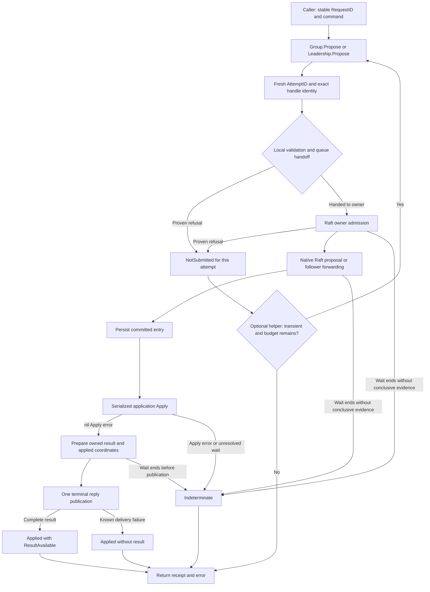

# Write receipts and uncertain outcomes — target architecture

Date: 2026-10-26. Implementation baseline: `8e57798`.
Status: consolidated target after user decisions, reference comparison and peer review. User requested incorporation of the review and explicitly deferred shutdown queue cleanup. Ready for implementation planning; not implemented or runtime-validated.
Discussion: [brainstorm record](20261026-write-receipt-contract.md).
Reference follow-up: [etcd, TiKV and PD retry comparison](20261026-proposal-retry-reference-comparison.md). This target incorporates the subsequently approved simplification: retry only proven non-submission, return Submission directly, and add no shorter attempt timeout. Earlier aggregate/ambiguous-retry proposals remain historical in the brainstorm, not implementation requirements.

Peer review: [thread 1](../review/feat_receipt-error-contract.md). This revision incorporates its verified corrections and minimal-delivery recommendation; historical suggestions and superseded mechanisms are not requirements.

## 1. Request and intended behavior

Resolve [GQ-07 / issue #13](https://github.com/asalimonov/gquorum/issues/13): tell a caller whether one write attempt was proven not submitted, committed and successfully applied, or remains indeterminate. Preserve known application even when its result cannot be delivered; preserve uncertainty across retries. Distinguish the application's logical RequestID from the library's AttemptID. Do not introduce exactly-once execution, global absence proofs, or library-managed deduplication.

The user explicitly accepts a breaking public API change. Replace the return type of `load.Group.Propose` and `load.Leadership.Propose`; do not add a parallel `ProposeWithReceipt` surface. The optional retry helper returns the same Submission type and repeats only proven non-submission with a transient cause. Public proposals require a nonempty caller-owned RequestID. Future extensions must preserve these established signatures and semantics.

Example: attempt A to reserve funds times out without conclusive evidence. ProposeRetry returns its Indeterminate receipt immediately and never starts attempt B. If A was instead proven refused before submission, the helper may try B. Consequently every attempt preceding the returned receipt was proven not submitted; no uncertainty accumulator is needed. A separate caller invocation cannot erase uncertainty from another invocation or prove that the logical operation never executed elsewhere.

### Decision table

| Question | Selected target | Basis |
|---|---|---|
| Public API | Change Propose to return Submission; migrate callers | User confirmed |
| Unknown retries | Always stop; no opt-in in this API | User confirmed simplification |
| Idempotency | RequestID is the application-enforced token | User confirmed |
| Logical ID generation | Caller owns it; reject empty before dispatch | Required by issue; follows breaking API choice |
| ID syntax | Opaque valid UTF-8, non-whitespace, no NUL; preserve exact value | Design recommendation based on current envelope |
| Attempt scope | One public Propose invocation, including its one definitive-drop native retry | Design recommendation |
| Retry result | Submission for the final invoked attempt; no aggregate result or unresolved counters | User confirmed simplification |
| Retry bound | Default three attempts; configurable positive maximum | User confirmed |
| Retry timing | One caller budget; existing engine timeout; helper adds only bounded backoff | User confirmed simplification |
| Error metadata | Receipt return is authoritative; stopped/halted handles are terminal with cause retained | Peer review incorporated |
| Write retry predicate | Submission.CanResubmit owns disposition and terminal precedence; generic fault.Retryable unchanged | Peer review incorporated |
| Result publication | One terminal response on the existing buffered reply channel | Minimal mechanism selected after review |
| Attribution mismatch | Fail the local waiter; apply a valid committed entry normally | Peer review incorporated |
| Shutdown queue cleanup | No new enqueue gate or drain; retain existing queue lifetime behavior | User explicitly deferred cleanup |
| In-flight and queue limits | No new or changed limits; reuse existing MaxPendingProposals slots, proposal queue and enqueue budget | User confirmed B2 addendum |
| Storage | No new tables, buckets, log fields, receipt cache or migrations | Existing correlation field suffices |
| Core rollout | Local Group/Leadership, retry logic and all repository callers | This implementation scope |
| Remote delivery | Mandatory integration contract for #9; no new RPC in #13 core | Existing transport has no remote application proposal RPC |
| Payload policy | #12 owns limits; a delivery adapter must preserve applied evidence | Avoid silently introducing unrelated size defaults |

## 2. Boundaries and high-level flow



The receipt describes the exact replica on which local Apply was observed. A follower/learner proposal still waits for that origin replica to apply. Receipt generation adds no metadata quorum read and no extra network round. Leadership proposals retain captured-term admission, including the native definitive-drop retry; they never gain follower forwarding.

An applied receipt is evidence about execution under the existing Store/StateMachine contract. It does not strengthen memory-storage durability, fsync configuration, external transaction atomicity, outbox behavior, or recovery guarantees. An application dedup hit is itself an applied log command: Index/Term describe that invocation, not the original mutation that populated the application's dedup record.

### 2.1 Reference review: retry ownership and timing

The [source comparison](20261026-proposal-retry-reference-comparison.md) distinguishes Raft replication retries from fresh client submissions. This target does not make every Group.Propose retry three times: Propose is one logical attempt, with only the existing bounded local definitive-drop retry. ProposeRetry is an explicit optional wrapper and always stops at the first indeterminate attempt. Heartbeats/catch-up never justify repeating an already-pending application command.

The examined etcd server proposes ordinary writes once and waits for application; its client restricts mutable retries. TiKV uses route/RPC retries plus domain-specific retained transaction uncertainty and commit records. PD delegates metadata durability to etcd and chooses API-specific retries. These support explicit retry ownership and conservative unknown outcomes, not universal replay of arbitrary writes.

**Approved timing:** the helper passes the caller context unchanged to each invocation and adds no per-attempt timeout. The engine retains its existing proposal timeout, shortened by the caller's deadline. The caller's overall deadline covers all attempts and backoff and is never restarted. ProposalRetryOptions contains only the attempt cap and backoff settings; it does not embed fault.RetryOptions. This avoids creating an unknown outcome merely because a generic three-second timer expired during a still-progressing proposal.

Future #9 should own route refresh and retry budgeting for a remote call, with the same stop-on-uncertainty rule if it returns Submission. Do not encourage another default retry loop around that call. A captured Leadership term cannot be restored by retrying its expired handle; the existing leadership supervisor owns acquiring a new scope.

Future deduplication-aware resubmission or outcome resolution belongs in a separately named API with its own durable contract. Do not later add a flag that weakens the stop-on-uncertainty guarantee of these methods. Receipts remain observations: they cannot authorize execution or be submitted as replay commands. Use keyed options literals in examples; future additive settings must preserve existing zero-value behavior.

## 3. Public API and value invariants


### 3.1 CREATED `load/submission.go`

```go
type SubmissionDisposition uint8

const (
    SubmissionIndeterminate SubmissionDisposition = iota
    SubmissionNotSubmitted
    SubmissionApplied
)

type Submission struct {
    AttemptID       string
    RequestID       string
    Identity        storage.Identity
    RunID           string
    Disposition     SubmissionDisposition
    Index           uint64
    Term            uint64
    Result          Result
    ResultAvailable bool
}

// ErrResultUnavailable means application is known but the complete business
// result is unavailable. Inspect Submission even when this error is returned.
var ErrResultUnavailable = errors.New("proposal result unavailable")

func (s Submission) CanResubmit(err error) bool

func newSubmission(g *raftengine.Group, identity storage.Identity, p Proposal) Submission
func newSubmissionFromLeadership(l *Leadership, p Proposal) Submission
func validateRequestID(id string) error
func submissionFromEngine(s raftengine.Submission) Submission
```

CanResubmit reports eligibility under the library's conservative retry policy; it is false for Applied or Unknown even if err is a generic transient error. It does not make a receipt an authorization token or assert that the logical operation was never executed in another call.

Submission does not embed Result: callers must intentionally use `submission.Result`. No duplicate GroupID field; use `Identity.GroupID`. No public constructor, durable receipt registry, receipt verification endpoint or `SubmissionInfo(error)` is introduced. These values have no implicit JSON/wire stability contract; future protocols define their own versioned envelopes.

| Field / condition | Contract |
|---|---|
| Zero value or unknown disposition number | Treat as Indeterminate; never infer NotSubmitted |
| AttemptID | Fresh opaque random token for every Group/Leadership call, allocated before validation using `crypto/rand.Text()`; callers must not parse it. Helper preflight failures before any invocation have an empty ID under section 3.4 |
| RequestID | Exact caller input; for admitted work exactly the value delivered to Apply; invalid input is echoed only as rejected input |
| Identity | Exact targeted/applier storage identity if a valid handle exists; zero for invalid nil/zero handles; includes cluster, node, group and numeric replica |
| RunID | Exact engine incarnation (`core.RunID()`); empty if no core exists; separate from durable identity |
| Applied | Requires successful nil-error Apply for the exact correlation and command; nonzero Index/Term and complete Identity/RunID |
| Index/Term | Applied entry coordinates only; zero for NotSubmitted and Indeterminate; not diagnostic commit/applied/leader indexes |
| ResultAvailable | True only for Applied with a complete original Code and Data; an empty successful Result is allowed and distinguishable from unavailable |
| Result unavailable | Clear both Code and Data; never retain a partial result or replace it with synthetic success |
| NotSubmitted | Library proves no consensus acceptance/forwarding for this attempt; may have entered a local queue; says nothing about earlier/concurrent attempts |
| `err == nil` | For library Propose, implies Applied and ResultAvailable; business rejection may still be present in Result.Code |
| `err != nil` | May accompany any disposition; inspect the receipt before deciding whether to repeat |
| Receipt ownership | Returned Result.Data is an owned copy; later engine/callback actions cannot mutate the returned receipt |

IDs are not credentials. A random AttemptID reduces accidental correlation collisions; it does not authenticate a peer or authorize a command. RequestID uniqueness and token reuse rules are application-owned. No extra library token is needed.

`validateRequestID` requires `utf8.ValidString(id)`, `strings.TrimSpace(id) != ""`, and no NUL. It does not normalize the input or impose a new standalone ID length limit. Existing encoded admission limits account for its bytes; #12 may specify more explicit bounds. Reject invalid UTF-8 before JSON encoding can replace bytes. Do not tighten the persisted decoder or reinterpret historical records as part of this API validation change.

### 3.2 UPDATED `load/group.go` and `load/leadership.go`

```go
func (g *Group) Propose(ctx context.Context, p Proposal) (Submission, error)
func (l *Leadership) Propose(ctx context.Context, p Proposal) (Submission, error)
```

Both allocate AttemptID, capture exact available identity/run, validate RequestID and refuse invalid handles before dispatch. Pre-canceled calls return NotSubmitted and an error matching the context cause. Stopped handles preserve their original identity and never route to a replacement.

Leadership captures identity from its core's immutable options through the new engine receipt method; it does not look up a fresh Group. Context linking remains joined. Rewriting the outward error to the caller context must never erase or replace an applied receipt. If completion is already published, return that terminal outcome. If the waiter ends before any terminal publication is observed, return Indeterminate even if Apply has already returned. There is no separate applied-header publication.

An expired leadership scope is terminal. Before dispatch, if the scope has ended, return NotSubmitted with `fault.Stopped`. After Submit returns an error, if it matches NotLeader or the leadership lifetime has ended, wrap the cause with `fault.New(fault.Stopped, "leadership scope ended", cause)`, preserving both the receipt and errors.Is on the cause. Prefer the caller context as the nested cause when the caller canceled, while retaining Stopped if the scope also ended. Do not wrap a completed nil-error Applied result. This uses the existing fault classification rather than adding a public expiry type; the retry helper gives Stopped precedence over nested transient classifications. The supervisor, not the helper, acquires any later term.

`load.Result`, `load.Proposal`, `load.Command` and StateMachine signatures remain structurally unchanged. Update Proposal/Command comments in `load/machine.go` to distinguish the idempotency token from the internal attempt correlation. Do not expose AttemptID to the machine or let applications choose it in Proposal.

### 3.3 UPDATED `load/retry.go`

```go
type ProposeFunc func(context.Context, Proposal) (Submission, error)

type ProposalRetryOptions struct {
    MaxAttempts    int
    InitialBackoff time.Duration
    MaxBackoff     time.Duration
}

func ProposeRetry(ctx context.Context, propose ProposeFunc, p Proposal,
    o ProposalRetryOptions) (Submission, error)

func resolveProposalRetryOptions(o ProposalRetryOptions) (ProposalRetryOptions, error)
func normalizeSubmission(p Proposal, s Submission, err error) (Submission, error)
func waitProposalRetry(ctx context.Context, delay time.Duration) error
```

The helper owns an immutable copy of Proposal.Data at entry and gives each callback a fresh copy. RequestID remains unchanged. A callback represents one submission attempt, generates a fresh AttemptID and honors cancellation; it must not hide retries after uncertain submission. Group.Propose and Leadership.Propose satisfy this contract. The helper starts no goroutine to abandon a blocking callback. Engine-owned consensus/Apply may outlive a canceled wait under the existing lifetime contract.

`MaxAttempts == 0` selects three including the first callback invocation; positive values explicitly select a finite cap. Zero InitialBackoff selects 100 ms and zero MaxBackoff selects one second. Negative fields refuse with ErrInvalid before invoking the callback. Resolve MaxBackoff to at least InitialBackoff. Apply existing capped jitter policy with saturating duration arithmetic to avoid overflow. Options do not embed fault.RetryOptions and have no attempt-timeout field. Pass the caller context unchanged; its deadline covers every invocation and backoff. A Group still applies its existing engine timeout, capped by the caller deadline. A finite attempt count is not a wall-clock guarantee for a custom callback that ignores cancellation.

The helper uses `Submission.CanResubmit(err)` as its single write-specific decision point, then checks caller context and attempt budget. Eligibility requires all of: a valid NotSubmitted receipt, a transient cause, a live caller context and attempts remaining. Use `fault.Retryable(err)` only after checking disposition and excluding terminal Stopped, Invalid, Unreadable, IdentityMismatch, Unsupported and context.Canceled classifications. These dominate any nested transient cause; in particular Stopped remains terminal even if it also matches NotLeader or DeadlineExceeded. Applied and Indeterminate always stop, regardless of the error code or missing result. There is no option to retry uncertain attempts. Unknown/unsupported disposition values stop conservatively.

The default is a short-refusal convenience, not a promise to span leader election. With a 100 ms tick and roughly 100/200 ms helper backoffs, three fast refused attempts may finish before the default randomized election completes. Keep the approved cap; callers may explicitly increase MaxAttempts/backoff for their configured election timing and should supply an overall deadline. Background context still has at most three callback invocations; the engine's default 30-second cap includes its nested enqueue wait. A future finite-deadline retry mode is deferred and must preserve current zero-value semantics.

### 3.4 Retry return semantics

ProposeRetry returns the final invoked attempt's Submission, with its original AttemptID, exact available identity and applied coordinates. Every earlier attempt in that helper call was proven NotSubmitted. The helper maintains only a private attempt counter and last receipt; it exposes no aggregate result or unresolved-attempt counters.

| Sequence / exit | Returned receipt | Error / behavior |
|---|---|---|
| Invalid ID/options, nil callback, or canceled parent before any invocation | Explicit NotSubmitted; original RequestID; empty AttemptID/Identity/RunID | Validation/context error; no attempt was made |
| All invoked attempts NotSubmitted | Last invoked attempt's NotSubmitted receipt | Last error at cap, or caller context error during backoff |
| NotSubmitted → Applied | Applied receipt and original complete result | Nil error if result delivery completed |
| NotSubmitted → Indeterminate | Indeterminate receipt | Return its error immediately; no further invocation |
| First attempt Indeterminate | That receipt | Return immediately; no subsequent attempt |
| Applied without result | Applied, ResultAvailable=false | Return delivery/result error; no retry |
| Expired Leadership scope | Preserve observed disposition | Terminal Stopped classification; do not reacquire scope |

The empty AttemptID exception is limited to helper failures before invoking a callback; it is not a receipt from a Group or remote receiver. Do not invent a replica or label a helper-side preflight failure as an engine attempt. Once any callback ran, context expiration during backoff returns its actual last receipt, not a new fabricated attempt. The all-zero Submission remains Indeterminate; known preflight non-submission is set explicitly.

After each callback, preserve Applied or Indeterminate before checking cancellation/backoff eligibility. If complete Applied success was returned, keep it even if the parent is now canceled. If an Indeterminate callback returns an error while the parent has expired, returning the parent cause is allowed without changing the disposition. Never start an additional attempt to retrieve an unavailable result. At the attempt cap return the last callback error; no new exhaustion error or public counter is required.

The helper cannot execute Unknown→NotSubmitted or Unknown→Applied sequences: it stops at Unknown. If an application makes a separate call, that call's receipt has its own scope and cannot clear the earlier uncertainty. DISP-04 is satisfied by preventing the unsafe second invocation within this helper and documenting independent-call scope; general uncertainty aggregation is outside this API.

### 3.5 Custom callbacks and malformed receipts

ProposeFunc is trusted in-process integration code, not an untrusted remote verifier. The callback owns logical targeting and external evidence validation: it must keep the same cluster/group across invocations and must not hide retries of unknown outcomes. Group/Leadership method values are already bound to an exact handle. The helper does not maintain a separate cross-attempt target identity or authenticate arbitrary returned structures. Future remote adapters still perform all exact request/peer/identity checks in section 6.1.

Keep only inexpensive per-response checks: exact RequestID echo when a receipt is supplied, nonempty AttemptID for a supplied definite attempt receipt, and consistent disposition/position/result shape. Normalize an ordinary error with a zero receipt to Indeterminate with the input RequestID for reporting; do not invent an attempt or applied position. Unknown disposition numbers are conservative Unknown. Wrong RequestID or inconsistent receipt shape returns Indeterminate with IdentityMismatch/Unreadable and stops. A nil error without Applied is a callback contract violation, also Unknown. A structurally valid Applied receipt without a complete result remains Applied; if its error is nil, supply ErrResultUnavailable. Do not discard established application merely because result data is absent.

CanResubmit is a convenience predicate for a trusted receipt, not an authentication/authorization API. It requires NotSubmitted, excludes terminal Stopped/Invalid/Unreadable/IdentityMismatch/Unsupported/context.Canceled even when their causes are transient, and then uses fault.Retryable. It does not check the caller deadline or decide application retry policy; callers still own those budgets. There is no second private retry-classification implementation. Add documentation to Propose, ProposeRetry and generic fault.Retry directing write callers to receipt-aware handling: an error alone does not establish whether resubmission is safe. Generic fault.Retry and fault.Retryable behavior remains unchanged.

## 4. Engine changes and ownership

### 4.1 CREATED `internal/raftengine/submission.go`

The engine cannot import public load. Define internal equivalents of disposition/Submission with `raftengine.Result` and `storage.Identity`; use explicit conversion in the load facade. Reuse the existing request.reply channel, capacity one, and its owner-only single-send convention. No separate outcome cell, done channel, atomic publication state, enqueue lock or shutdown drain is introduced.

```go
type SubmissionDisposition uint8
const (
    SubmissionIndeterminate SubmissionDisposition = iota
    SubmissionNotSubmitted
    SubmissionApplied
)

type Submission struct {
    AttemptID, RequestID string
    Identity            storage.Identity
    RunID               string
    Disposition         SubmissionDisposition
    Index, Term         uint64
    Result              Result
    ResultAvailable     bool
}

func (g *Group) Submit(ctx context.Context, p Proposal,
    attemptID string, expectedTerm uint64) (Submission, error)
func (g *Group) Identity() storage.Identity
func (g *Group) submissionBase(p Proposal, attemptID string) Submission
func (g *Group) stoppedSubmissionError() error
func (g *Group) waitSubmission(ctx context.Context, base Submission, req *request) (Submission, error)
func submissionResponse(base Submission, r response) (Submission, error)
func (g *Group) refuseProposal(req *request, err error)
func (g *Group) answerApplied(req *request, entry raftpb.Entry, result Result)
```

UPDATED `internal/raftengine/group.go`: extend its existing private structures, rather than defining replacement request/reply types:

```go
type response struct {
    result          Result
    err             error
    disposition     SubmissionDisposition // Zero is Unknown; legacy callers ignore it.
    index, term     uint64
    resultAvailable bool
}

// Add to existing request; all existing fields remain.
// reportSubmission bool // True only for the new load receipt path.
```

`Submit` is a private-package API for application load receipts. It refuses `_meta` usage and invalid IDs before enqueue. The facade supplies AttemptID; future #9 can allocate it before sending and pass the exact value through authenticated ingress. Validate nonempty valid UTF-8, non-whitespace and no NUL for both IDs. Never silently replace either. Group.Identity builds storage identity from immutable options, allowing Leadership to capture it without finding a different handle.

`expectedTerm==0` is ordinary load behavior; nonzero preserves existing owner admission. Submit uses the existing proposal semaphore, queue, owner map, engine timeout and five-second enqueue budget. The enqueue timeout is nested inside the engine/caller context, not additional time after it. Use the existing brief lifecycle read under g.mu, release that lock, then select between queue send, enqueue timeout and g.done. Do not add serialization between senders and shutdown. Measure the same proposal metrics once; avoid delegating to legacy Propose and counting again.

Before successful enqueue, return NotSubmitted for validation/context/admission failure. If the engine is stopped, halted or otherwise not accepting, stoppedSubmissionError returns fault.Stopped with the retained engine error as its cause. Do not expose a stored Apply failure's Unavailable classification as an independently retryable dead handle. After enqueue, shutdown without a published terminal result returns Unknown plus Stopped. Preserve an observed published reply first, including known Applied. The Stopped wrapper does not itself prove non-submission.

### 4.2 UPDATED existing engine files

| File | Methods / structures changed | Required behavior |
|---|---|---|
| `group.go` | Add reportSubmission to request and receipt fields to response; update `answer(req *request, result Result, err error)` literals | Generic answers remain Unknown by zero value; legacy metadata/control/read behavior ignores new fields |
| `loop.go` | `handleProposal(req *request)` | Explicit owner refusals call refuseProposal; new path uses supplied AttemptID as correlation and exact RequestID; preserve one definitive-drop retry |
| `loop.go` | `pruneWaiters()` | Preserve existing canceled-wait removal; no new receipt cache or guessed non-submission |
| `ready_apply.go` | `applyNormalEntry(entry raftpb.Entry) error` | Match waiter attribution; reject only a mismatched waiter, apply the valid entry, then publish one matching Applied response |
| `ready_apply.go` | `stageReadySnapshot(rd *raft.Ready) error` | Existing generic answer keeps affected proposal outcomes Unknown |
| `forwarding.go` | `retryDroppedProposals(now time.Time)` | Existing scheduling retained; same AttemptID across only the definitive-drop retry |
| `proposals.go` | Type documentation | Clarify business RequestID versus correlation; machine/result signatures unchanged |
| Existing engine tests with unkeyed `response{r, err}` literals | Convert to keyed result/err fields | Shared reply extension must not accidentally alter unrelated read/legacy assertions |

No receipt-specific changes to finishRun are required. Preserve its existing map clearing, read cleanup, worker join and stop behavior; do not remove existing cleanup. The deferred item is new proposal-queue cleanup only.

For a deterministically oversized encoded proposal on the new receipt path, use fault.Invalid with a clear message rather than legacy Overloaded, so the helper does not retry an identical permanently oversized command. Legacy private behavior remains; #12 can add structured size details later.

`proposalAdmission(req *request) error`, `submitProposal(parent context.Context, p Proposal, expectedTerm uint64) (Result,error)`, `Propose(ctx,p) (Result,error)` and `ProposeInTerm(ctx,term,p) (Result,error)` stay available internally for private callers/tests. Public load uses Submit. This preserves metadata's opaque command IDs and avoids migrating its write API. New receipt fields in response have no persisted representation; unrelated readers still use only result/err.

`answer` keeps cloning/sending a generic Result/error with zero disposition. `refuseProposal` deletes the pending map entry and sends NotSubmitted only for an owner-proven refusal, falling back to legacy answer when reportSubmission is false. `answerApplied` clones the result once and publishes Applied/Index/Term/ResultAvailable together, falling back to legacy answer for the old path. Each request gets at most one reply; never close a reply channel from cancellation or shutdown. Owner sends remain nonblocking in the capacity-one buffer even if the waiter has returned.

Call refuseProposal only before possible consensus acceptance, including encoding/admission failure and the exact pinned native ErrProposalDropped after its permitted retry. Unexpected RawNode errors remain Unknown; do not classify all errors as definite drops. The optional precision improvement for definitive-drop limbo is deferred: only published owner proof may become NotSubmitted, and cancellation/snapshot removal remains conservative without it.

### 4.3 One terminal publication and cancellation

After a matching committed command returns nil from Apply, the owner prepares an owned copy of the complete result and the entry's actual Index/Term, then sends one terminal response. There is no intermediate Applied header. If a delivery/size check knows application succeeded but cannot return its result, it must send a single Applied response with ResultAvailable=false, zero Result and a nonnil error. Core local copying has no recoverable failure mode or new size policy; the unavailable-result shape is supported for adapters and #12.

The waiter first selects reply/context/engine completion. If cancellation or engine completion wins, it makes one nonblocking receive from the reply channel before returning. A queued terminal reply wins and is returned unchanged; if none is available at that observation instant, return Unknown and the wait/stop error. A later publication does not mutate a returned receipt.

**Precision tradeoff:** the caller can receive Unknown after Apply returned successfully if it stops waiting before terminal publication, including during a long result copy. Result sizes are not currently bounded, so do not describe that interval as necessarily short. This behavior is intentional and matches the lost-evidence rule: no false Applied, no false NotSubmitted, and known Applied is retained in any delivered failure response. It replaces the earlier atomic-header precision guarantee.

Apply continues under the engine lifetime context. Cancellation ends the caller wait, not committed work. The owner continues to own callbacks/results and existing shutdown joins remain required. An OOM/process crash is not a recoverable result-copy error; a lost response remains Unknown at the caller.

### 4.4 Exact matching at application

Before attributing a committed entry to a receipt waiter, check Correlation against AttemptID, RequestID against the original logical ID, and Data against the owned original bytes. Identity/run come from immutable engine options, not log fields. An unrelated correlation is normal replay/another origin: apply it without resolving a local waiter.

If a correlation matches but RequestID/data differs, remove and answer that local waiter once with Unknown/IdentityMismatch. Then apply the independently valid committed entry normally and continue. This is an attribution failure, not evidence that the committed command itself is malformed; do not halt the replica solely for it. Existing log-validation failures and actual Apply errors still halt. Ensure the mismatch branch cannot later send a second applied reply for the removed waiter.

Do not deduplicate on Correlation or RequestID. Replay still invokes the machine under existing rules, and no durable receipt service is reconstructed after restart.

### 4.5 Startup, shutdown and resource bounds

No new constructor settings, resource acquisition, listeners, callbacks, factories or cleanup dependencies. The request uses one existing buffered reply channel and constant receipt metadata. The existing proposal slot, queue and pending-map count bounds remain; the helper keeps one owned original command and one per-attempt copy. Replay without a waiter allocates no receipt response state.

**No new or changed in-flight limits:** the receipt path reuses the same `load.EngineOptions.MaxPendingProposals` admission slots (default 256, configurable), the existing internal proposal queue (`proposalQueueCapacity = 256`) and the existing five-second enqueue budget, shortened by the engine/caller context. It adds no separate receipt semaphore, capacity setting, queue or retained-attempt allowance. Slot/admission exhaustion retains Overloaded behavior; a full queue retains the existing bounded enqueue wait. Callers needing a higher admission-slot limit can configure MaxPendingProposals; the fixed queue and other existing admission constraints still apply. The helper's MaxAttempts bounds sequential attempts within one call, not the number of concurrent calls. This feature neither removes existing bounded queues nor introduces an additional concurrency cap.

Shutdown preserves the existing stop fence, context cancellation and joined Apply/engine/application ownership. Waiters use existing g.done and their caller deadline to finish. A producer that passed its lifecycle check just before shutdown may still enqueue after the owner exits; no owner consumes that request, and its waiter returns Unknown on cancellation/completion. This is not proof of successful submission or proof authorizing execution after stop. Stopped handles remain exact and never redirect.

**Accepted retention limit:** no new enqueue gate or proposal-queue drain is included. A caller-retained stopped Group may keep up to the existing queue capacity (256) queued command buffers reachable. This bounds count, not total retained bytes: command cloning precedes owner encoding/size validation. Dropping all references to the stopped handle and requests permits garbage collection after other owners finish; merely stopping the handle does not guarantee immediate payload release. Do not claim existing pending-map clearing drains the queue. This is an explicit user-approved scope choice matching the legacy path, not a new public lifecycle API.

Guaranteed queued-payload release is deferred to a separate internal lifecycle change covering both proposal paths; it can be added without changing Propose, Submission or retry signatures. No best-effort drain or per-request cleanup hook is added now. Existing cleanup of maps, reads, transports and application ownership remains mandatory.

## 5. Persistence and state schemas

### 5.1 Durable schema changes: none

There is no new database table, DDL, ORM model, index, constraint, TTL collection or durable cache. Full new DDL/ORM specification is therefore **not applicable**. Do not create an auxiliary receipt database or add receipt fields to application snapshots.

The complete existing application entry shape remains:

```go
type Entry struct {
    Schema      uint32                   `json:"schema"`
    Kind        EntryKind                `json:"kind"`
    Correlation string                   `json:"correlation,omitempty"`
    RequestID   string                   `json:"request_id,omitempty"`
    Data        []byte                   `json:"data,omitempty"`
    Grant       *topology.AuthorityGrant `json:"grant,omitempty"`
    Action      *topology.AuthorizedStep `json:"action,omitempty"`
}
```

For new load proposals, Correlation contains AttemptID. Its field type, encoding and decoder are unchanged. The raw application bytes and logical ID still reach Apply. New random correlation spelling does not require changing schema. Existing persisted entries remain readable under their existing versions.

| Existing persistence | Changes |
|---|---|
| Metadata bbolt buckets `format`, `hardstate`, `entries`, `snapshot`, `applied`, `state`, `identity`, `serve_override`, `load_replicas` | None; schema v4 unchanged |
| Authority journal `format`, `identity`, `fences`, `effects`, `collection` | None; schema v2 unchanged |
| Load WAL segments, native entry/snapshot envelopes, identity.json, applied-state `meta`/`settings` buckets | None |
| Event journal, retirement markers, recovery manifests and lineage evidence | None |
| Application databases, snapshots and dedup/outbox tables | Application-owned; no library change |
| Frozen legacy, scoped and recovery fixtures | Read-only regression inputs; never regenerate |

### 5.2 Volatile state schema

| Key/container | Value | Lifetime / bounds |
|---|---|---|
| Existing `Group.props[correlation]` | Existing request plus reportSubmission flag | Existing MaxPendingProposals; remove after reply/cancellation/snapshot/stop |
| Existing proposal slots | Existing semaphore entries, shared with the legacy proposal path | MaxPendingProposals, default 256 and configurable; unchanged |
| Existing proposal queue | Owned request including immutable Proposal bytes | Capacity 256 and nested five-second enqueue budget, unchanged; queued payloads may remain reachable with a retained stopped handle |
| Per-request response | Existing capacity-one reply channel; immutable base in the waiter; response includes disposition/position/result availability | One owner publication; no outcome cache or added done channel |
| Per-helper local state | Last Submission, private attempt counter and immutable command buffer | One helper call; constant metadata, no attempt history or uncertainty accumulator |

There is no receipt cache hit/miss branch. Application deduplication may have one, but it is inside Apply and outside this state model. A cached status, observed commit index, local absence of a waiter or missing log after compaction cannot supply receipt evidence.

## 6. External delivery contract and adjacent features

### 6.1 #9 remote group client seam

Core #13 adds no service method or HTTP/gRPC route. `transport/loadgrpc` and Node networking remain unchanged. A future GroupClient may return Submission and own bounded route-refresh retries if every earlier attempt is proven NotSubmitted and it stops immediately on Applied or Indeterminate. It returns the final attempt's receipt under the same rule as section 3.4. Any future API that retries uncertain work needs separate naming and explicit deduplication/outcome semantics; it must not silently weaken this contract or require changing existing method signatures.

Before remote dispatch, the client allocates an AttemptID and retains immutable request bytes and expected cluster/group/destination authorization. The authenticated receiver passes that exact AttemptID to the engine Submit seam; it must not silently replace it with a receiver-local token. Every new application-level submission attempt gets a fresh ID; native definitive-drop retry retains one ID. Transparent retransmission capable of creating a second ingress invocation must be treated as another submission attempt unless #9 establishes an explicit bounded replay protocol. There is no transport-level deduplication promise here.

The remote response needs a versioned envelope carrying disposition, AttemptID, RequestID, exact target/applier identity, engine run, applied index/term where present, ResultAvailable, complete result if available and classified error. This is a required semantic schema, **not a new committed wire encoding**. #9 chooses concrete protobuf field numbers, methods and authentication wiring with its route design.

Before accepting a remote receipt, that client must check:

1. Response belongs to its exact outstanding call, from the authenticated/authorized peer and expected cluster lineage.
2. Exact AttemptID and logical RequestID match; requested group and selected durable destination match.
3. Receiver process/session and engine-run binding match the authorized dispatch protocol. A replacement cannot silently satisfy an old exact attempt. #9 must establish that binding before using it as certainty; merely echoing an arbitrary run ID is insufficient.
4. Disposition and position/result shape satisfy section 3; unknown versions/fields conveying unrecognized disposition never become success.
5. The responder matched the request bytes to the engine correlation; any reconnect/duplicate handling preserves the same request binding.

These checks protect against stale or cross-request replies within the existing authenticated, non-Byzantine cluster model. They are not cryptographic proof that a malicious admitted replica applied a command. No portable receipt import API accepts arbitrary caller-supplied structures as evidence.

An ordinary RPC status, adapter error, timeout or connection loss is Unknown once dispatch may have occurred. A local pre-dispatch check can establish NotSubmitted. A remote refusal is NotSubmitted only when the exact authenticated receiver proves refusal before submitting that attempt. An unrecognized receiver code alone cannot.

If an Applied envelope is delivered without its oversized/unavailable result, the caller preserves Applied. If the entire envelope is lost, the caller remains Unknown even though the receiver knows Applied. No observer can recover a lost receipt merely from the fact that a result was expected. Later exact authenticated evidence may resolve that attempt in a future resolver, but #13 adds no query/cache for it.

### 6.2 #12 result-size seam

The result pipeline must establish Applied **before** applying a result-delivery bound. If complete result delivery fails, retain identity/run/position and clear Result/ResultAvailable. Return the size error; ProposeRetry stops because it sees Applied. If a transport cannot deliver even the small receipt envelope, the remote caller remains Unknown.

#13 core introduces no arbitrary proposal-result byte limit and does not reuse read limits for writes. A local adapter can represent this situation with `Submission{Disposition: Applied, ResultAvailable:false, ...}` plus ErrResultUnavailable. #12 will supply dimension/size/limit details and its nonretryable size classification. Checking result size after Apply cannot prevent allocations inside the callback.

### 6.3 Route / constructor / configuration inventory

| Surface | Target change |
|---|---|
| Node, NewNode, LoadOptions, NewStandalone and GroupFactory | No signature/config changes |
| StateMachine.Apply / Snapshot / Restore; optional Query | No signature changes |
| Existing Raft/control/snapshot ingress | No methods, routes, ports or protobuf changes |
| load public proposal methods and retry callback | Breaking signatures in section 3 |
| Retry options | New load.ProposalRetryOptions with count/backoff only; existing fault.RetryOptions and generic fault.Retry unchanged |
| Private engine | Submit receipt entrypoint plus per-request evidence state |
| Built-in managed/standalone handle wiring | Existing handles supply exact core; no new DI service |
| #9 remote proposal service | Deferred to #9; must use this semantic contract |
| #12 limit discovery/preflight | Deferred to #12; preserves receipt on result refusal |

## 7. End-to-end flows and failure behavior

### Local happy path

1. Caller supplies nonempty stable RequestID and command bytes.
2. Public facade allocates AttemptID, captures original handle identity/run and validates input.
3. Engine acquires existing slot, clones command and queues one request, bounded by caller/replica/enqueue deadlines.
4. Owner validates readiness/term/capacity; encodes existing entry with correlation=AttemptID; hands it to native consensus. Ordinary follower/learner forwarding is unchanged.
5. Existing Ready persistence precedes committed application. Matching Apply runs serialized with other machine operations.
6. Owner prepares actual application coordinates and an owned result, then publishes one terminal response. A caller observing it returns Applied/ResultAvailable=true. Result.Code alone carries business acceptance/rejection.

### Refusal / native drop

1. A caller-side failure before successful queue handoff returns NotSubmitted.
2. An owner-side validation refusal before RawNode admission publishes NotSubmitted.
3. A definitive local RawNode drop schedules at most one retry using the same entry correlation; owner rechecks captured leadership/readiness/context.
4. If that retry cannot submit, owner publishes NotSubmitted. If caller stops waiting before owner makes that final statement, caller may conservatively receive Unknown. If accepted, it remains Unknown until Apply.

### Cancellation / snapshot / engine failure

1. After enqueue, wait on evidence completion, caller context and engine completion.
2. On cancellation/engine completion, perform one nonblocking receive from the existing reply channel; do not ask the blocked owner for another round trip.
3. Return a published terminal outcome if received; otherwise return Unknown with the context error or terminal Stopped wrapper. Apply may already have returned before result preparation/publication.
4. Owner work retains lifecycle ownership. Pruning a waiter or restoring a snapshot never asserts that the command was absent from consensus.
5. A machine Apply error halts the replica and yields Unknown, even if some side effect occurred before the error. Commitment alone is not successful application.

### Application deduplication path

1. A repeated logical RequestID may reach Apply at a new log index under a new AttemptID.
2. The application checks its durable dedup record atomically with its mutation logic.
3. Same logical command may return the previous business outcome; conflicting command reuse may return a deterministic business rejection.
4. The engine reports Applied for this invocation and its current entry position; it does not claim the original invocation's position or clear earlier uncertainty.

### Failure matrix

| Event | Single attempt | Result available | Retry behavior |
|---|---|---|---|
| Empty/whitespace/NUL/invalid UTF-8 RequestID | NotSubmitted + Invalid | No | Stop |
| Invalid/nil Group or Leadership | NotSubmitted + Invalid | No | Stop |
| Context already canceled before handoff | NotSubmitted + context cause | No | Stop with canceled parent |
| Halted/stopped engine before handoff | NotSubmitted + Stopped retaining original cause | No | Stop even if cause is Unavailable |
| Engine completion after handoff, no terminal reply | Indeterminate + Stopped retaining original cause | No | Stop; never infer non-submission from shutdown |
| Local slots/stall/owner capacity refusal | NotSubmitted + Overloaded | No | Retry within cap/budget |
| Encoded proposal exceeds existing engine bound | NotSubmitted + Invalid on the new receipt path | No | Stop; #12 can add richer size classification later |
| Scoped term invalid before consensus | NotSubmitted + Stopped wrapping NotLeader | No | Stop; supervisor owns later leadership scopes |
| Local definitive-drop retry exhausted | NotSubmitted + Unavailable/drop cause | No | May create a new attempt within helper cap |
| Queued wait canceled, owner proof absent | Indeterminate | No | Stop immediately; no uncertain retry option |
| Forwarded proposal, reply/outcome unknown | Indeterminate | No | Stop immediately |
| Snapshot may subsume pending command | Indeterminate + Unavailable | No | Stop immediately |
| Apply returns a business rejection in Code | Applied, nil error | Yes | Stop |
| Apply returns error / process lost before evidence | Indeterminate + error | No | Stop; replica still halts |
| Apply returned but waiter ends before terminal publication | Indeterminate + wait error | No | Stop; no intermediate header is exposed |
| Applied complete outcome published before cancellation observation | Applied | Yes | Return published terminal result |
| Applied result refused by delivery size check | Applied + size/result error | No | Stop |
| Complete remote reply lost | Caller Indeterminate; receiver may know Applied | No at caller | Stop |
| Foreign/stale/malformed receipt | Indeterminate + identity/protocol error | No | Stop; do not attribute foreign evidence |
| Local waiter correlation matches a different valid command | Indeterminate + IdentityMismatch for that waiter | No | Remove waiter, apply valid entry normally; no attribution-based halt |
| Old/custom adapter returns generic error | Indeterminate | No | Stop; never infer disposition from code |
| Scripted second refusal after Unknown | First Indeterminate receipt | No | Helper never invokes the scripted second attempt |
| Application separately calls again after Unknown | Each call retains its own receipt | Depends on each call | Later evidence does not erase earlier uncertainty; resolution is application-owned |

## 8. Repository migration and documentation

Do the breaking source migration as one planned change set. This includes Standalone users: Standalone.Group returns the same public Group whose Propose signature changes, even though NewStandalone and Standalone.Group signatures themselves do not change. Release/version numbering is a maintainer release decision; do not claim existing callers remain source-compatible. No compatibility fallback or public alias is required by this target.

| UPDATED files / area | Migration |
|---|---|
| `load/group_test.go`, `group_func_test.go`, `leadership_func_test.go`, `retry_test.go` | Assertions inspect receipt.Result/Disposition/identity; preserve invalid/stopped/term checks with otherwise-valid IDs |
| `examples/scheduler/scheduler.go` | Adapt retry options and read Submission.Result on success; keep ordinary error propagation and the existing scheduling flow |
| `examples/scheduler/executor.go` | Keep its result/error convenience helper by returning submission.Result and the error; after transient failures, re-read committed task state before deciding the next guarded transition |
| `examples/scheduler/localdb/recovery_func_test.go` | New retry return/options, stable logical IDs |
| `examples/inmemory-cache/server/redis.go` | Adapt retry options and read Submission.Result; report write errors simply without an outcome-specific helper or write-side TRYAGAIN inference |
| `tests/cluster/testapp/load_transport.go`, `hooks_cluster.go`, `snapshot_controls.go` | Keep fixture business response shapes intentional; derive applied coordinates from receipt instead of status when claiming command position; add receipt controls for new tests |
| `tests/cluster/testapp/read_func_test.go`, `node_generation_func_test.go` | Result assertions use receipt.Result |
| Other public call sites in root integration, `tests/recovery`, `tests/cluster/testapp`, optional `tests/sim` | Verify stable IDs and compile against new signatures; ignored receipt remains valid only where error-only behavior is intentional |
| `README.md`, `docs/architecture/raft.md`, `runtime.md` | Brief managed/Standalone receipt API, retry and deadline guidance. The user removed library.md during implementation; keep internal delivery/retention details in this target |
| `fault/retry.go` comments | Point write callers to Submission.CanResubmit/ProposeRetry; leave generic retry behavior unchanged |
| `docs/testing/tests.md` or dedicated validation record | Record implemented acceptance coverage and real executions later |

Migrate all examples to proven-refusal-only retries and preserve unknown outcomes at their application boundaries. Do not replace the old helper behavior with another generic fault.Retry loop around proposals. Scheduler commands retain their existing CAS/idempotent transitions; those guards do not enable uncertain retries in this helper. For cache SET/DEL, an intervening write or differing returned delete count makes blind repetition especially misleading. Update comments and error paths to surface uncertainty. Library deduplication is not added to fix the example.

Examples remain intentionally simple per the user's implementation steering. Keep the proposal-return/options migration and ordinary application flow. The executor may recover transient failures in its existing worker loop by re-reading committed task state before its next guarded transition; do not replay a cached proposal. Do not add waitProposalReconcile, replyProposalError, special outcome orchestration or receipt-feature tests under examples. The cache reports ordinary ERR for failed writes so it does not reuse its read-side TRYAGAIN classifier to infer write safety. Core receipt/retry behavior is covered in load/raftengine and the dedicated test fixture; pre-existing example tests still compile/run with the new API.

Document latency honestly: a forwarded proposal with lost evidence may wait until the caller deadline or engine ProposalTimeout (default 30 seconds), then return Unknown and stop. Applications choose deadlines to meet their own latency requirements; heartbeats and a three-attempt cap cannot promise failover completion or a particular tail latency. This API change is not a new performance validation of README claims.

All five normal application modules must compile. Check the separate Gosim module's call sites too; do not add simulation dependencies to the library. Internal metadata `engine.Propose` callers retain their existing signatures. Frozen format fixtures remain untouched.

## 9. Verification plan and acceptance ownership

These are required future checks, not results from this design session. Units use `!functional`, owning single-participant tests use `functional`, multi-node tests use the three-node Docker pool. Use barriers, captured protocol messages and controlled result publication; do not depend on sleeps to win cancellation races.

| Requirement | Core verification | Dependent end-to-end scope |
|---|---|---|
| DISP-01 local refusal | Facade validation units; owner admission and native-drop single-engine functionals | None |
| DISP-02 queued cancellation | Buffered-reply publication race units; blocked owner/canceled waiter functional with real queue | None |
| DISP-03 applied but lost reply | Controlled caller observation after apply; verify Unknown if evidence not delivered | #9 lost RPC reply and later exact evidence, if resolver exists |
| DISP-04 unknown then refusal | Script Unknown then refusal/success; assert only the first callback runs and Unknown is returned. Separate calls cannot claim global non-execution | #9 must also stop before a redirected retry after Unknown |
| DISP-05 business rejection | Single-engine Apply returns non-success Code and nil error; exact result preserved | Three-process follower/learner path |
| DISP-06 oversized result | Adapter contract test strips result after known Applied; helper never retries | #12 actual configured bound and #9 envelope delivery |
| DISP-07 wrong identity/correlation | Wrong RequestID/bytes at local matching boundary fails only the waiter and applies a valid entry; basic custom receipt checks | #9 authenticated wrong group/cluster/process/attempt responses |
| DISP-08 generic error | Custom callback without receipt stays Unknown regardless of fault code | #9 unsupported receiver/adapter protocol |
| DISP-09 concurrent same RequestID | Two different attempt IDs, both can apply; no dedup promise | Three-node simultaneous logical retries with application assertions |
| DISP-10 required/stable IDs | Empty and malformed IDs refused pre-dispatch; exact logical bytes and distinct IDs across helper invocations | #9 lost replies/restarts with caller-retained ID |

Additional core regressions:

- Applied with `Result{}` still has ResultAvailable=true.
- Apply error after application-side mutation never yields a successful applied receipt.
- Cancellation concurrent with an already-buffered terminal Applied returns that evidence. Before terminal publication, cancellation returns Unknown even after Apply completes; a later owner send does not block or mutate the returned receipt.
- An already-published Applied outcome survives engine stop, post-Apply bookkeeping failure and Leadership context error rewriting; known result-delivery failure publishes Applied without fabricated result.
- Halted-handle refusal is Stopped even when its cause is Unavailable; CanResubmit is false. Verify the helper uses that same predicate, while generic fault.Retryable retains its existing behavior.
- Helper always stops on Unknown, including zero receipts and unrecognized disposition values; Applied+DeadlineExceeded never retries.
- Script Unknown→Applied and Unknown→NotSubmitted; assert the second invocation never runs. Verify separate calls retain independent receipts.
- Retry all-not-submitted sequences with a private test invocation count; cap exhaustion/backoff cancellation preserve the actual last receipt. Preflight failure has explicit NotSubmitted and empty AttemptID without invoking the callback.
- The helper passes the original caller context without adding a shorter deadline; backoff is canceled by that same context.
- Expired Leadership refuses before dispatch or preserves its post-dispatch receipt, exposes Stopped even with nested NotLeader/DeadlineExceeded, and causes exactly one helper invocation; no new term is acquired.
- Deterministically oversized encoded input on the new receipt path returns NotSubmitted/Invalid and invokes the callback only once; legacy private-path classification remains unchanged.
- Callback mutation of its input slice cannot alter later attempts; original caller buffer remains unmodified by the helper.
- Nil/malformed custom callback evidence cannot become a success or non-submission claim.
- Same RequestID at two exact handles has independent AttemptIDs and results; a stopped handle never follows its replacement.
- Definitive-drop native retry retains AttemptID and RequestID; successful RawNode forwarding is never automatically re-proposed by the engine.
- Snapshot installation removes pending waits without fabricated result or position.
- Owner reply is sent at most once into the capacity-one buffer; reads and legacy control/metadata replies keep their existing semantics. Cancellation/stop never closes that reply channel or blocks a later owner send. Race coverage preserves callback join and existing pending-map cleanup without asserting proposal-queue payload release.
- Existing admission/queue regression coverage includes the receipt path with a nondefault MaxPendingProposals setting: it shares existing slots, preserves the existing queue capacity and enqueue budget, and adds no independent receipt concurrency limit.

Suggested CREATED test files: `load/submission_test.go`, `load/submission_func_test.go`, `internal/raftengine/submission_test.go`, `internal/raftengine/submission_func_test.go`; extend existing retry/leadership/forwarding tests where fixtures already fit. Process cases belong in `tests/cluster` and use fixture controls, not new in-process multi-node helpers.

During implementation, run focused units/functionals via Makefile filters plus `make lint`. At final feature validation run `make test`, relevant functional and race coverage, then `make lint-full` once before the final process checkpoint. Rebuild the test image after fixture changes and run focused three-node process cases plus required final suite coverage. Run physical-format functional regressions without regenerating fixtures. Run `git diff --check` and verify documentation/API references. No proto generation is required for the core because no protocol source changes; #9 will run its own proto checks.

Do not close #13 claiming full remote/result-size acceptance while #9/#12 integration cases remain unimplemented. Core delivery can be reported separately with explicit dependency gaps.

## 10. NOT CONSIDERED & TODO

- [postponed] Guaranteed proposal-queue payload release for retained stopped handles. No new enqueue gate, queue drain or cleanup API now; a future internal fix can cover both proposal paths without changing public signatures.
- [potential-improvement] Deadline-bound retry mode and more precise owner-published non-submission during definitive-drop limbo; neither is required for this initial contract.
- [postponed] Full #9 routing, remote ingress/session authorization, protobuf encoding and reconnect policy. Required receipt semantics are specified above; no unused stub service is added now.
- [postponed] #12 effective size discovery, preflight formulas, write-result configuration and permanent size error. Core provides the representable Applied-without-result state.
- [postponed] Library-owned durable deduplication and persistent result retention. Explicitly outside scope by user choice; no NotImplemented API is exposed.
- [potential-improvement] Application-specific outcome resolution across calls/restarts, token retention and transactional outbox examples. Must not infer “never applied” from one immediate not-found read.
- [potential-improvement] A future bounded authenticated per-attempt resolver could refine historical Unknown, but requires a separate retention/durability contract; this helper has no such mechanism.

## 11. Key-method pseudocode

The following specifies decision logic, not compile-ready implementation. Private helpers may be factored without changing these boundaries. Existing legacy metadata/control paths stay intact.

### `validateRequestID`

```go
func validateRequestID(id string) error {
    if !utf8.ValidString(id) || strings.TrimSpace(id) == "" || strings.ContainsRune(id, 0) {
        return fault.New(fault.Invalid, "caller-owned RequestID is required and must be valid text", nil)
    }
    return nil // Never trim, rewrite, generate or canonicalize it.
}
```

### `Group.Propose`

```go
func (g *Group) Propose(ctx context.Context, p Proposal) (Submission, error) {
    core := g.core() // nil-safe
    s := newSubmission(core, g.Identity(), p) // new random AttemptID
    if err := validateRequestID(p.RequestID); err != nil { return refused(s), err }
    if core == nil { return refused(s), fault.ErrInvalid }
    if err := ctx.Err(); err != nil { return refused(s), err }
    out, err := core.Submit(ctx, raftengine.Proposal(p), s.AttemptID, 0)
    return submissionFromEngine(out), err
}
```

### `Leadership.Propose`

```go
func (l *Leadership) Propose(ctx context.Context, p Proposal) (Submission, error) {
    s := newSubmissionFromLeadership(l, p) // nil-safe, fresh attempt token
    if err := validateRequestID(p.RequestID); err != nil { return refused(s), err }
    if invalidLeadership(l) { return refused(s), fault.ErrInvalid }
    if err := ctx.Err(); err != nil { return refused(s), err }
    if err := l.ctx.Err(); err != nil {
        return refused(s), fault.New(fault.Stopped, "leadership scope ended", err)
    }
    scoped, join := leadershipContext(l.ctx, ctx)
    defer join()
    out, err := l.core.Submit(scoped, raftengine.Proposal(p), s.AttemptID, l.term)
    // Preserve evidence; expiry remains terminal even when its cause is retryable.
    if err != nil {
        expired := errors.Is(err, fault.ErrNotLeader) || l.ctx.Err() != nil
        if ctx.Err() != nil { err = ctx.Err() }
        if expired { err = fault.New(fault.Stopped, "leadership scope ended", err) }
    }
    return submissionFromEngine(out), err
}
```

### `raftengine.Group.Submit`

```go
func (g *Group) Submit(parent context.Context, p Proposal, attemptID string, term uint64) (Submission, error) {
    base := g.submissionBase(p, attemptID) // Default disposition: Unknown.
    if invalidLoadOrIDs(g, p, attemptID) { return refused(base), fault.ErrInvalid }
    ctx, cancel := context.WithTimeout(parent, g.opts.ProposalTimeout)
    defer cancel()
    // Wrap with existing proposal metrics once; omitted here for clarity.
    if err := ctx.Err(); err != nil { return refused(base), err }
    g.mu.RLock()
    accepting := g.started && !g.stopping && !g.stopped && g.ctx.Err() == nil
    g.mu.RUnlock()
    if !accepting { return refused(base), g.stoppedSubmissionError() }
    if g.WALStall() > time.Second { return refused(base), fault.ErrOverloaded }
    select {
    case g.slots <- struct{}{}:
        defer func() { <-g.slots }()
    default:
        return refused(base), fault.ErrOverloaded
    }
    req := &request{ctx: ctx, expectedTerm: term, correlation: attemptID,
        proposal: cloneProposal(p), reportSubmission: true, reply: make(chan response, 1)}
    enqueueCtx, stopEnqueue := context.WithTimeout(ctx, 5*time.Second)
    defer stopEnqueue()
    // Existing lifecycle check/send race is retained; no new shutdown gate.
    select {
    case g.proposals <- req:
        return g.waitSubmission(ctx, base, req)
    case <-enqueueCtx.Done():
        return refused(base), enqueueCtx.Err() // No queue handoff in this branch.
    case <-g.done:
        return refused(base), g.stoppedSubmissionError()
    }
}
```

### `stoppedSubmissionError`

```go
func (g *Group) stoppedSubmissionError() error {
    cause := g.exitError() // Reads retained error under existing g.mu.
    if errors.Is(cause, fault.ErrStopped) { return cause }
    return fault.New(fault.Stopped, "replica engine is not accepting proposals", cause)
}
```

### `handleProposal` receipt branch

```go
func (g *Group) handleProposal(req *request) {
    if err := g.proposalAdmission(req); err != nil { g.refuseProposal(req, err); return }
    data, err := encodeExistingEntry(req.correlation, exactRequestID(req), req.proposal.Data)
    if err != nil { g.refuseProposal(req, err); return }
    if uint64(len(data)) > g.opts.MaxUncommittedBytes {
        err := error(fault.ErrOverloaded) // Preserve legacy private behavior.
        if req.reportSubmission {
            err = fault.New(fault.Invalid, "encoded proposal exceeds engine capacity", nil)
        }
        g.refuseProposal(req, err); return
    }
    err = g.rn.Propose(data)
    if errors.Is(err, raft.ErrProposalDropped) {
        if !req.retried && isLoad(g) {
            req.retried = true
            req.retryAt = now().Add(g.opts.Timing.TickInterval)
            g.props[req.correlation] = req
            return // No reply yet; recheck captured term on the one native retry.
        }
        g.refuseProposal(req, unavailableWithDropCause(err)); return
    }
    if err != nil {
        delete(g.props, req.correlation)
        answer(req, Result{}, err) // Generic response: Unknown.
        return
    }
    g.props[req.correlation] = req
}
```

### `refuseProposal`

```go
func (g *Group) refuseProposal(req *request, err error) {
    delete(g.props, req.correlation)
    if !req.reportSubmission { answer(req, Result{}, err); return }
    // Only owner-proven refusal reaches this helper.
    req.reply <- response{err: err, disposition: SubmissionNotSubmitted}
}
```

### `applyNormalEntry` application branch

```go
func (g *Group) applyNormalEntry(entry raftpb.Entry) error {
    envelope := decodeAndValidateExistingEntry(entry)
    // Existing empty/administrative-entry branches remain; shown here: application.
    req := g.props[envelope.Correlation]
    if req != nil && req.reportSubmission && !sameCommand(req, envelope) {
        delete(g.props, envelope.Correlation)
        answer(req, Result{}, fault.ErrIdentityMismatch) // Unknown; exactly one reply.
        req = nil // Do not attribute this command's result to the rejected waiter.
    }
    result, err := g.opts.Machine.Apply(g.ctx, commandFrom(entry, envelope))
    if err != nil { return wrapApplyFailure(err) } // Existing actual-Apply halt path.
    if req != nil {
        delete(g.props, envelope.Correlation)
        g.answerApplied(req, entry, result)
    }
    return nil // Valid committed command applied even after a waiter mismatch.
}
```

### `answerApplied`

```go
func (g *Group) answerApplied(req *request, entry raftpb.Entry, result Result) {
    if !req.reportSubmission { answer(req, result, nil); return }
    owned := Result{Code: result.Code, Data: bytes.Clone(result.Data)}
    req.reply <- response{
        result: owned, disposition: SubmissionApplied,
        index: entry.Index, term: entry.Term, resultAvailable: true,
    }
    // For a future known delivery/size failure, the one response instead has:
    // Applied, the same index/term, resultAvailable=false, zero result and a nonnil err.
    // No extra publication, new limit, worker or unavailable-result API is added here.
}
```

### `waitSubmission`

```go
func (g *Group) waitSubmission(ctx context.Context, base Submission, req *request) (Submission, error) {
    var waitErr error
    select {
    case r := <-req.reply:
        return submissionResponse(base, r)
    case <-ctx.Done(): waitErr = ctx.Err()
    case <-g.done: waitErr = g.stoppedSubmissionError()
    }
    // An already-published terminal result wins over wait cancellation/stop.
    select {
    case r := <-req.reply:
        return submissionResponse(base, r)
    default:
        return base, waitErr // Unknown; no delivered evidence at this instant.
    }
}
```

### `submissionResponse`

```go
func submissionResponse(base Submission, r response) (Submission, error) {
    s := base
    switch r.disposition {
    case SubmissionApplied:
        s.Disposition, s.Index, s.Term = SubmissionApplied, r.index, r.term
        s.ResultAvailable = r.resultAvailable
        if r.resultAvailable { s.Result = r.result } // Already an owned copy.
    case SubmissionNotSubmitted:
        s.Disposition = SubmissionNotSubmitted
    default:
        s.Disposition = SubmissionIndeterminate
    }
    // Unknown/refusal retain zero position and no result from the base.
    return s, r.err
}
```

### `normalizeSubmission`

```go
func normalizeSubmission(p Proposal, s Submission, err error) (Submission, error) {
    if isZeroSubmission(s) && err != nil {
        return Submission{RequestID: p.RequestID}, err // Unknown, no invented ID.
    }
    if s.RequestID != p.RequestID {
        return unknownWithoutPositionOrResult(s, p.RequestID), fault.ErrIdentityMismatch
    }
    if !recognizedDisposition(s.Disposition) {
        return unknownWithoutPositionOrResult(s, p.RequestID), nonNilProtocolError(err)
    }
    if !consistentReceiptShape(s) {
        return unknownWithoutPositionOrResult(s, p.RequestID), fault.ErrUnreadable
    }
    if s.Disposition == SubmissionApplied && !s.ResultAvailable && err == nil {
        return s, ErrResultUnavailable // Preserve established application.
    }
    if err == nil && s.Disposition != SubmissionApplied {
        return unknownWithoutPositionOrResult(s, p.RequestID), fault.ErrUnreadable
    }
    return s, err
}
```

Shape checks follow section 3.1: definite receipts from a callback require AttemptID; Applied requires complete identity/run and nonzero coordinates; result availability is allowed only with Applied; unavailable results and non-applied coordinates stay zero. They are local consistency checks, not authentication. Unknown returned without reliable target metadata remains Unknown, never guessed non-submission. Conceptual helpers in this pseudocode may be inlined; they do not require additional public APIs.

### `ProposeRetry`

```go
func ProposeRetry(ctx context.Context, fn ProposeFunc, p Proposal, raw ProposalRetryOptions) (Submission, error) {
    last := Submission{RequestID: p.RequestID, Disposition: SubmissionNotSubmitted}
    o, err := resolveProposalRetryOptions(raw)
    if err != nil { return last, err }
    if fn == nil { return last, fault.ErrInvalid }
    if err := validateRequestID(p.RequestID); err != nil { return last, err }
    immutable := cloneProposal(p)
    delay := o.InitialBackoff
    for attempts := 0; attempts < o.MaxAttempts; attempts++ {
        if err := ctx.Err(); err != nil { return last, err }
        s, err := fn(ctx, cloneProposal(immutable)) // No new attempt deadline.
        s, err = normalizeSubmission(immutable, s, err)
        last = s
        if s.Disposition == SubmissionApplied { return last, err }
        if ctx.Err() != nil { return last, ctx.Err() }
        if !s.CanResubmit(err) || attempts+1 == o.MaxAttempts { return last, err }
        if err := waitProposalRetry(ctx, jitterCapped(delay, o.MaxBackoff)); err != nil { return last, err }
        delay = doubleCappedWithoutOverflow(delay, o.MaxBackoff)
    }
    panic("unreachable: positive attempt cap and final iteration returns")
}
```

### `Submission.CanResubmit`

```go
func (s Submission) CanResubmit(err error) bool {
    if s.Disposition != SubmissionNotSubmitted { return false }
    for _, terminal := range []error{
        fault.ErrStopped, fault.ErrInvalid, fault.ErrUnreadable,
        fault.ErrIdentityMismatch, fault.ErrUnsupported, context.Canceled,
    } {
        if errors.Is(err, terminal) { return false }
    }
    return fault.Retryable(err) // Generic classification only after receipt/terminal checks.
}
```
