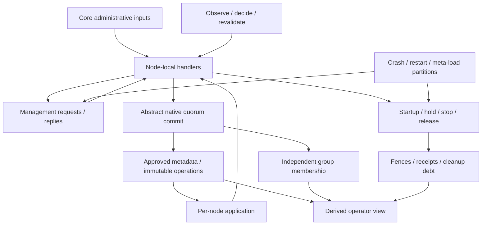

# Target design: initial Quint cluster-management model

**Scope revision:** 2026-10-27. User approved “Lean management scope; defer offline recovery” and then specified that metrics are always good: no lag/stability issues in this iteration.
**Implementation:** Tasks 1–5 complete; Tasks 6–18 remain. This document defines the reduced initial deliverable; it does not claim that it is implemented or verified.
**Method disposition:** [coverage ledger](../../scripts/quint/coverage.md).
**Execution plan:** [implementation plan](../plans/20261027-quint-cluster-management.md).
**Discussion:** [brainstorm log](20261027-quint-cluster-management.md).

## 1. Request and accepted scope

Model gquorum's cluster-management protocol for three-to-five-node clusters: mandatory `_meta`, multiple load groups, topology approvals, scaling, healthy/degraded group creation and deletion, guarded membership, scheduler repairs and returning owners. Find unsafe transitions, stale-authority effects, internal deadlocks and management sequences that cannot progress despite their required resources being available. Keep the model useful for evaluating changes to those mechanisms.

Initial scope is **the management state machine, not the whole public API**. Keep core administrative inputs, reuse shared mechanisms and derive operator observations. Omit getters/telemetry plumbing and defer independent feature families. All model code/dependencies remain under `scripts/quint/`. Application payloads and concrete Raft replication remain abstract.

The user explicitly deferred labels, diagnostic API details, application locks/manual session APIs, EnsureGroup/RollbackTo, live placement-policy tuning, and offline storage-loss/Recovery workflows. This supersedes the earlier full-surface/storage/recovery requirement. Minimum internal session/admission safety, retained restarts, readmission, reseating and exact cleanup evidence remain required.

## 2. Decisions and scope boundaries

| Area | Initial implementation | Deferred or omitted |
| --- | --- | --- |
| Administration | Stage/Approve/Retry; admit/readmit/drain/activate/exclude/force-retire; create/delete; explicit hosting; roles/reseat. | EnsureGroup, RollbackTo and live placement/voter-policy tuning. |
| Membership | Learners, catch-up, fixed voter targets/capacity, guarded promotion/demotion/removal and transfer. | Labels, selectors, distinct-AZ domains, reserved/learner-only labels and heterogeneous type placement. |
| Authority | Exact immutable plans, resource grants/fences, receipts, supersession, retries and uncertainty. | No safety mechanism is removed merely because its API looks internal. |
| Lifecycle | Start/replay/authorize/publish, exact holds, stop/join/release, retained restart and incarnation. | Constructor/DI/accessor mechanics, OS/thread scheduling and borrowed-store variants. |
| Scheduler | Supported repairs, capture/decision/revalidation/CAS and enable/disable with metric evidence fixed good. | Custom policy implementations, custom workload/resource-balancing policies and runtime tuning. |
| Sessions | Internal exact-process activation/renewal/expiry/revocation required by readiness/admission. | Public manual session workflows and all application lock semantics. |
| Storage | Valid retained Node-owned WAL; identity checks, replay boundary, retirement and collection evidence. | Loss/corruption injection suites, memory-store restart semantics, custom donors and offline Recovery. |
| Visibility | Derived topology/progress/owner/fence/debt/blocker summaries for traces and assertions. | Metrics/history, watches, pagination and method-specific polling/getter machines. |
| Verification | Incremental tests/simulation, bounded safety, selected finite progress checks and negative controls. | Universal unbounded correctness or exhaustive-five-node promises; automatic Go replay. |

Labels are excluded through every entry point: Stage, AddNode, CreateGroup, placement and voter configuration. Initial instances fix labels/selectors to empty, domain policy to None and node type to one symbolic type. `SetGroupHosting` still changes explicit/all-eligible host selection; it does not require labels.

Voter target and surge are fixed profile presets, not live administrative variables. Performance/stability metric guards are assumed favorable: lag/backlog within limits, progress healthy, fresh/current metrics, standby stability satisfied and cooldowns clear. No lag-driven/no-progress repair, stale-metric fault, window accumulation or timing/hysteresis correctness is modeled. Actual crash/link availability and native quorum remain explicit; unavailability detection eligibility is abstracted without timing. Existing/role-derived learner pins still constrain promotion, even though the standalone pin setter is deferred. Profiles may select supported legacy/configured presets without implementing policy migration/tuning workflows.

An out-of-scope request is excluded by the model harness/request generator. It must **not** be modeled as a gquorum Unsupported/Invalid response: real gquorum supports these deferred features. Configuration assertions and scope checks reject an invalid model scenario before claiming protocol coverage.

## 3. Grounding and current work

The source baseline is `e8e85db`. The user selected implemented scoped operation ownership despite the global-operation restriction in library.md/review guidance. Preserve this baseline and the discrepancy; global serialization is a future candidate, not an initial behavior change.

Tasks 1–4 through `fa2e8ad` remain completed historical work. They include broader pure label/policy/rollback helpers and tests. Their presence does not make those features initial requirements. On resume, Task 5 must constrain the active domains and separate extension-only tests from initial acceptance. Do not erase the execution record or present deferred work as completed protocol coverage.

The source has implemented offline Rebuild/ResetForJoin; a stale architecture sentence saying otherwise remains a documentation issue. Those real capabilities are intentionally outside this initial model. No new claim is made about disaster recovery correctness or recovery from permanent data loss.

## 4. Components and composition



Keep one composed `cluster.init/step`. Pure modules implement rules and transformations; Choreo supplies local listeners and message effects. Enqueue, delivery, processing, persistence and acknowledgement remain independently interleavable where they affect safety. Abstract consensus can access global native facts; a node handler can only use its local applied/cached view or an explicitly obtained read result.

A human/operator projection may inspect model state for diagnosis. It is not an additional source of authoritative facts for actor decisions. Avoid separate state machines for every status/read/wait wrapper.

## 5. Initial state schema

### 5.1 Bounds and constant configuration

Concrete instances bind a node pool, load-group IDs, initial identities, capacities and finite version/attempt/generation/message/position bounds. Node-pool size differs from admitted membership and voter count. Five-node instances must configure capacity five. IDs never wrap, tombstones never disappear to make space, and search-bound exhaustion is not a product deadlock.

Initial configuration fixes valid retained WAL, one lineage, one node type, empty labels/selectors, no domain policy, normal serving policy and supported voter presets. Storage corruption, memory groups, offline recovery state, application locks and dynamic policy configuration are not active state dimensions. Retain the minimum internal session state described below.

### 5.2 Exact identities and calls

```text
ReplicaKey = { cluster, group, node, member, replica }
ProcessKey = { node, incarnation }
AttemptKey = { version, attempt }
EffectKey = { operation, step, kind, target, grantRevision }
EffectTarget = GroupTarget(group) | ReplicaTarget(ReplicaKey)
RequestKey = { caller: ProcessKey, sequence }
ProposalKey = { request: RequestKey, sequence }
ReadTicket = { owner: ProcessKey, request: RequestKey, proposal, round }
Audit = { actor, comment, forced }
MutationOptions = { expectedVersion, audit: Audit, preview, approve }
CallState = { request, phase, result, waiterCancelled, readIndex, command,
              proposalSequence, commitIndex, commitOutcome, stagedVersion, operationRequest }
```

Bind each confirmed-read round to its exact process/request and distinguish the later metadata recapture from the initial read. Preserve actual CAS, audit and exact predecessor arguments across uncertain replay. Convenience ExpectedVersion=0 captures local Latest; Stage's explicit expected-version argument retains its own semantics. Refusals and indeterminate replies are observable call outcomes. Caller cancellation never rolls back a committed effect.

### 5.3 Topology and fixed policy

Keep Document.Latest/Target, NodeDecl name/member/state, GroupDecl ID/replicas/hosting/allocator, and ReplicaDecl exact key/role/pin. Keep min/max voter bounds distinct from total replica capacity, and hosting distinct from voting. Node placement states remain Active/Draining/Drained/Excluded; all admitted nodes retain `_meta` participation.

Use fixed numeric voter/surge policy presets. Bind performance/stability/cooldown evidence to favorable constants, not changing categories or elapsed counters. Label/selector maps may remain in shared prototype records only as asserted empty constants; domain is None and node type is fixed. Do not generate descriptive-label edits, AZ scenarios, label restrictions or live SetPlacement/SetGroupPlacement/SetGroupVoterConfig/SetReplicaPinnedLearner calls. Existing internal pin behavior, including role-derived pins, remains enforceable.

Stage accepts bounded complete documents representing combinations of **in-scope** changes; it cannot bypass the scope boundary. CreateGroup uses in-scope hosting/storage/policy presets. Preserve retired group IDs and monotonic allocation floors even when staged intent is abandoned.

### 5.4 Local state and minimum sessions

Keep node process phase/incarnation, locally applied metadata index/view, exact captured topology/native facts, pending calls, leader-side operation work, local owner reservations and scheduler capture. Operation work separates the initial confirmed metadata read, native membership read, availability observation, metadata recapture, immutable proposal and reply. Durable host state retains pin, valid replica evidence, metadata replay image/index, authority floors, effect/fence receipts and collection markers.

Owner state separates engine participation, replay readiness, authorization, handle publication, hold, stop request, actual join and application release. Startup scope uses locally applied approved Target, matching `LoadReplicaScope`; new-owner floor import requires a confirmed metadata query, while an already accepted owner can share its reservation without another quorum read. Delayed/failed callbacks or Close retain ownership. Represent callbacks as bounded pending/success/failure outcomes; no application implementation, DI system or thread scheduler is needed.

Established profiles abstract already-consumed founding authority as an exact durable `seedAuthority` set at floor 1. It authorizes retained recovery of those seeded identities only; issued host grants/fences supersede it, and it cannot authorize fresh identities or new effects. Other authority is retained explicitly in the model catalogue and host journal.

Minimum internal session state binds the admitted durable identity to the current process incarnation. Distinguish live, expiry observation, exact-process recheck and committed revocation. Readiness cannot be granted to an unadmitted/unrecovered/wrong-incarnation process. Grant and reserved node binding are separate replicated steps. Renewal refreshes a leader-local lease; expiry observes that lease, probes the exact process and serializes the final revoke decision with renewal acknowledgements. A delayed reply beyond its request deadline cannot extend the local lease. Internal renewal cannot become a quorum certificate. Node readiness is an observed local lease/eligibility predicate, not a linearizable statement about every remote replica. No lock map, lock acquisition, lock-holder APIs, manual session pausing or serving-override workflow belongs to v1.

### 5.5 Native consensus and observations

For each group retain native voters/learners, leader authority, configuration revision, committed position, local applied/catch-up state and pending membership change. A commit needs a communicating native quorum with exact valid identities; global “up node” counts or cached health cannot substitute.

Keep independent directed meta/load connectivity, delayed local metadata application and leadership/topology observations that can become outdated after real state changes. For this iteration, metric evidence is an assumption rather than a fault/state dimension: lag and backlog are within limits, progress is healthy, metric/collector freshness is valid, stability windows are satisfied and cooldowns clear. Native identity/leadership/quorum and crash/link availability remain checked independently. Newly added/returning replicas retain a successful catch-up milestone, with no modeled slowness or lag-failure regime. An abstract load commit token is enough to demonstrate group independence; business commands and Raft log/election message algorithms are excluded.

### 5.6 Operations and authority

Keep immutable Plan required blocks, detached cleanup, source versions, step sequences, voter-set guards and dependencies. Planning returns `Planned(Plan) | PlanRejected(errors)`; refused planning is never an empty successful plan. Retained owner milestones distinguish hosted, stopped and cleanup-owned resources.

Keep per-group operation owners, block/step state, first attempts, immediate retry successors, grants and revocation obligations. Authority keys bind cluster/group/revision, purpose, exact action or admission, resources and targets. Ordinary effect/readmission receipts and fence evidence remain distinct. Retain enough history for exact retry and outstanding proof; public history-query APIs are unnecessary.

### 5.7 Cleanup and returning owners

Keep removed/stopped/retired/collected milestones with exact proof and identity. Collection preparation, physical effect, durable completion, report and exact marker release remain distinct where a process crash can expose their ordering. Retention is an abstract eligibility condition, not a configurable retention-policy implementation.

Approval retains exact planned stop/retirement actions before execution grants exist. Cleanup debt distinguishes those immutable obligations from optional issued grant keys and actual receipts. Logical deletion can finish through `_meta` while an offline owner retains cleanup debt. Returning-owner readmission must fence/join/retire its predecessor and report the required exact batch before successor readiness. Missing files, a fresh member ID or a bare verified flag are never completion proof. Offline disaster recovery/fresh-lineage rebuild is a separate deferred feature.

### 5.8 Network and fault state

Keep queued/delivered management envelopes with exact sender incarnation, destination, channel, request/effect/delivery identity and outcome. Permit loss, delay, replay, asymmetric partitions, crash/restart with retained storage, caller timeout and callback delay/failure. Retain stale-message refusal and ownership checks after waits.

Do not inject lost/corrupt stores or memory loss in initial profiles. Loss of a current quorum remains reachable as expected unavailability; permanent loss does not imply a v1-supported rebuilding path. Fair-progress claims name eventual connectivity/resources/callback completion explicitly.

## 6. Modules and API treatment

| Component | Initial responsibility |
| --- | --- |
| `types.qnt` | Core records; deferred fields fixed/isolated and excluded from active request domains. |
| `topology.qnt`, `placement.qnt`, `planning.qnt` | Validate/transform in-scope documents and build immutable plans. Labels/policy extensions are not v1 acceptance. |
| `membership.qnt` | Commit paths, learner/promotion/removal/transfer and native observation boundaries. |
| `reads.qnt`, `transactions.qnt`, `operations.qnt`, `repair.qnt` | Pure shared reads, call/CAS sequencing, leader planning and atomic repair/rebase rules used by the single composition. |
| `authority.qnt` | Approval/retry, scope ownership, grants/fences/receipts and supersession. |
| `lifecycle.qnt` | Start/replay/publication/holds/stop/join/release, minimum internal session gates, retirement/collection. |
| `scheduler.qnt` | Supported availability/target-count repairs and revalidation/CAS with fixed good metrics. |
| `handlers.qnt`, `cluster.qnt` | One asynchronous composition with explicit message/durable boundaries. |
| `properties.qnt` | Core safety, useful-progress predicates and derived operator summaries. |
| Tests / `instances` / `profiles` | Only in-scope behavior in required profiles; isolate existing extension-only tests. |
| `run.py`, Make targets | Pinned execution, failure-preserving reports and explicit verification qualification. |
| README / coverage / regressions | Scope, evidence and manual Go regression recipes. |

No standalone application-session/lock module or recovery.qnt workflow is required. Existing unused prototype definitions may be retained for later work; no initial profile may activate them or silently count them as covered.

### 6.1 Retained interfaces and actions

Retain the established pure interfaces `validateDocument`, `mutationGuard`, `mutateDocument`, `affectedScopes`, `eligibleHosts`, `makePlan`, `preview`; membership `hasCommitPath`, guarded propose/commit/transfer; authority guarded approve/retry/consume/fence/report; lifecycle reserve/publish/stop/join/retire/collect; scheduler capture/choose/revalidate/makeRepair/independence.

Keep capture→submit→commit→apply→reply/cancel/retry, grant→dispatch→consume→persist→report→checkpoint, native commit/catch-up/transfer, crash/restart, network fault and stabilization actions. Add one shared confirmed-read primitive and minimum internal session transitions. Remove offline recovery/storage-loss actions from the initial step relation. Scope assertions belong to the model boundary, not simulated product errors.

### 6.2 Method classification

The [coverage ledger](../../scripts/quint/coverage.md) classifies all 82 entries. Only 17 are distinct Core controls. Fifteen reuse shared primitives, nineteen are observations, eight are omitted wrappers/diagnostics, and twenty-three belong to deferred features. These counts describe scope, not completion.

Core controls are Stage/Approve/RetryOperation; AddNode/ReadmitNode/DrainNode/ActivateNode/ExcludeNode/ForceRetireNode; CreateGroup/DeleteGroup/SetGroupHosting/ChangeReplica/ReseatReplica; StartLoadGroup/StopLoadGroup/SetSchedulingEnabled. ReseatReplica retains its special atomic repair/approval semantics and independent-intent rebase.

ReadBarrier/ReadTopology share one fresh-read mechanism. Plan/PlanFor reuse pure planning. TransferLeader reuses native transfer while preserving manual-transfer versus approved-step grant identity. Node lifetime methods share phased lifecycle; transport ingress/read/action/fence/report methods map to protocol mechanisms. Do not implement duplicate wrappers merely to fill the matrix.

Status/progress/authority/operation/wait getters derive from existing state. Keep their meaningful freshness/cancellation boundaries without pages, polls, watchers or telemetry. Metrics/MetricsHistory, Get/History query mechanics, Watch, handle accessors and constructor plumbing require no model feature.

### 6.3 Production changes and runner

No production API, Go module, storage encoding, database/cache schema, migration, networking port or infrastructure dependency changes. Preserve opt-in `test-quint`, `test-quint-simulate`, `test-quint-verify`; keep `make test` unchanged.

Keep the implemented profile runner interface, pinned dependencies, executable bound checks, explicit test names, artifact hashes, raw child exits/logs/traces and incomplete-result handling. Verification remains gated on real backend qualification. Do not add downloads, automatic Go replay, a dashboard or metrics-history service.

## 7. Success criteria and explicit limits

Success means an executable, bounded management model with reachable core operations and meaningful refusals/waits, no checked safety violation, demonstrated fault recovery within retained-storage premises, and qualified stuck/liveness checks. Each result names bounds, properties, backend and completion status.

Expected blockers include missing quorum, held owners, disabled repair, overdue callbacks, retention and inaccessible cleanup resources. Distinguish these from controller deadlock after promised resources recover. Claim neither convergence for every destructive operator ordering nor recovery from permanent data loss. No claim extends to labels, application locks, dynamic policy changes, lag/stability/metric-freshness behavior or offline Recovery. Management deadlock/livelock remains a property to check; good metrics are not assumed to imply correct protocol progress.

## 8. Required flows

### 8.1 Topology transaction

Capture original arguments/CAS → stage through `_meta` → retain staged version → optional exact approval → execute owned blocks → checkpoint exact proof → reply/wait. Preserve partial stage success, lost replies, first-attempt replay, failed-attempt successors and scoped supersession. Reseat uses its implemented atomic repair/approval path.

### 8.2 Scaling and membership

Fresh node identity → `_meta` learner admission/catch-up → guarded promotion if required by the fixed preset. Drain evacuates loads, activation reverses eligibility, exclusion removes a proven drained member. Force retirement remains audited and quorum-safe. Transfer before leader removal/demotion; post-check failures cannot manufacture native commitment.

### 8.3 Group creation

Validate unused ID and fixed simple hosting/policy → immutable founding plan → approval → exact local startup/replay/authorization → native group → proven convergence. Include degraded placements that can start and required-offline-host cases that must wait. EnsureGroup is not part of this flow.

### 8.4 Deletion and return

Approve deletion and exact debt → logical completion → independently stop/retire/collect former owners. A returning owner gets exact grants, fences/joins predecessor work and reports the full required retirement batch before successor readiness. Keep physical revocation/debt independent from terminal deletion status.

### 8.5 Scheduler

Leader/enabled controller captures approved/proven state, current availability and fixed-good metric assumptions → supported target-count/unavailability repair decision → fresh identity/availability/native/leadership/scope revalidation → repair CAS → ordinary approved execution. Unavailability eligibility is immediate at this abstraction; no detection/stability/cooldown elapsed windows are explored. Preserve foreign staged intent and independent groups. A decision may become obsolete because the cluster changes, not because this iteration injects bad/old metrics.

### 8.6 Lifetime and sessions

Load startup follows reserve → acquire/replay → exact local scope/floor authorization → handle publication. Node session activation separately establishes reserved node ownership and a live local lease before reporting node readiness; load-handle publication does not itself require a live session. Cancellation of a waiter does not undo accepted work. Stop request precedes actual joins/releases; delayed success or failed release remains owned. Internal session expiry/recheck/revocation is distinct from health/quorum. Local load holds remain explicit.

### 8.7 Reads and operator visibility

A shared confirmed-read action obtains a safe metadata position and waits for local apply before an actor consumes fresh facts. Captured topology/identity/leadership facts may become obsolete after real state changes; metric-age/freshness faults are excluded. Derived trace output shows Latest/Target, operation/block/step, node/member/replica/incarnation, native membership, held/parked owners, pending fences/cleanup and blockers. No query pagination, subscription or telemetry state machine.

### 8.8 Retained restart and excluded disasters

Crash discards volatile ownership/observations but does not fabricate durable receipts. Restart uses retained valid storage, fresh incarnation and ordinary authorization/publication. A node returning after topology changes must complete readmission/retirement obligations. Lost/corrupt storage, memory groups, fresh-lineage Rebuild, ResetForJoin and backup/undo are deferred rather than simulated as successful or unsupported library calls.

## 9. Failure obligations

| Failure | Required result/evidence |
| --- | --- |
| Invalid in-scope request / preview+approve | Explicit refusal without authority. |
| Stale CAS or scope | Conflict; preserve original retry inputs. |
| Stage succeeds, approval fails | Retain staged version, no unauthorized effects. |
| Reply/caller wait lost | Commitment may remain; do not roll back or invent a new attempt. |
| `_meta` unavailable | No new metadata commit; existing independent load paths remain subject to their own safety. |
| Load quorum unavailable | Native work may wait; metadata-only deletion can complete with debt. |
| Effect/receipt/report interrupted | Retain exact obligation/evidence for idempotent retry. |
| Offline resource during supersession | Revocation pending until exact proof. |
| Callback/Close delayed or failed | Retain ownership; no overlapping successor. |
| Returning predecessor or stale delivery | Exact identity/fence/batch checks before readiness/effects. |
| Collection interrupted | Preserve preparation/completion/report/marker ordering. |
| Permanently absent quorum | Expected unavailable state; disaster-recovery assessment outside v1. |

## 10. Properties and verification

### 10.1 Safety

Keep domain/identity validity, mandatory admitted `_meta`, staging grants no effects, exact effect authority, exclusive local ownership, load-handle publication after replay/startup authorization, exact-session node readiness, no identity/group-ID reuse, safe membership changes, exact receipts, complete deletion debt, ordered collection proof, immutable retry plan, repair preserving foreign intent and fences protecting successors. Add the minimum exact-session ownership/readiness invariant. No lock-ownership or recovery-lineage proof is required.

### 10.2 Progress

Keep pending obligations, expected blockers, enabled useful actions and unexpected-stuck predicates. Irrelevant reads, rejected calls or fault toggles cannot hide a stuck operation. Under named stabilization/fairness premises, check per-obligation progress and core administrative recovery paths. Do not assume lost hosts/data return or call offline Recovery in the stabilizing controller.

### 10.3 Tool safeguards

The pinned Quint TLC adapter disables built-in deadlock checks; retain explicit stuck predicates and known failing controls. Qualify temporal support with known passing/failing examples. Simulation is sampled; Apalache is depth-bounded; a TLC exhaustive claim requires a finite state space and completed exploration. Timeout/unsupported/incomplete is not success.

### 10.4 Negative controls and coverage

Keep faulty variants for stale authority, missing debt, wrong successor receipt, early publication/release, false transfer completion, approval of foreign intent and fabricated collection proof. Require witnesses for retained Core controls and meaningful shared mechanisms, not one test machine per getter. Deferred features are scope exclusions, never required negative-control implementations.

## 11. Initial verification profiles

| Profile | Purpose |
| --- | --- |
| foundation | Runnable unadmitted actor/wiring and runner checks. |
| smoke3 | Three nodes/two loads; core operations, refusals and faults. |
| scoped3 | Independent operations, scheduler races, stale captures and retries. |
| deletion3 | Offline owner, absent load quorum, return/readmission and cleanup ordering. |
| admission4 | Learner/replacement capacity requiring a fourth node; no AZ-label cases. |
| scale5 | 3→4→5→4→3 with fixed numeric policy and two groups. |
| progress_small | Tractable finite stuck/fair-progress checking for a focused core obligation. |

The six substantive profiles replace the previous nine; foundation remains a bootstrap check. `storage3`, `recovery3`, `sessions3` and label/domain profiles are deferred. Do not construct empty/no-op versions just to keep names. Existing wider Task 4 tests must be separated during scope normalization before v1 acceptance.

## 12. Implementation sequence and acceptance

Preserve completed Tasks 1–4. Continue with scope normalization plus CAS/approval (5), authority (6), local ownership/minimum sessions (7), membership/scaling (8), create/delete (9), cleanup/readmission (10), scheduler (11), core API/visibility coverage (12), progress/backend calibration (13), profile/negative-control qualification (14), Make/report integration (15), architectural delta (16), external review (17), and documentation/gap closure (18).

Acceptance requires all 82 entries classified, retained actions/mechanisms exercised, core degraded cases reachable, selected safety/progress checks completed at reported bounds, negative controls effective, scope assumptions enforced and useful trace output. It does not require implementing Deferred/Omit entries. Implementation is in progress; this acceptance gate remains unsatisfied.

## 13. Evidence and future expansion

Retain exact revision/hashes, profile bounds, commands/seeds, backend/tool versions, logs/traces, outcomes and incompleteness. Manual Go regression recipes translate core counterexamples into existing suite boundaries. A passing abstract model does not prove Go conformance.

For a future feature, deliberately widen the scope predicates, state schema and profiles, then add its properties/witnesses before evaluating the code change. Labels, locks or Recovery must not slip into v1 through a generic Stage/callback/getter. Fixed assumptions are part of every guarantee.

## 14. Key transition pseudocode

These blocks specify sequencing and guards. Each `BOUNDARY` becomes a separately interleavable action when it crosses commitment, I/O, callback, publication or message delivery. They are not production Go changes.

### mutateAndMaybeApprove

```text
capture request arguments, actor/comment, and original expected version
if preview && approve: record Invalid; return
if preview: compute plan/result from captured input; return without mutation
submit stage with original CAS
BOUNDARY: meta commit validates CAS and document; records new Latest
remember staged version even if caller response is lost
if approve:
    capture plan/scopes for that exact version
    BOUNDARY: validate and commit approval, or return staged version + error
reply with retained version/operation; cancellation changes only waiter state
```

### approvePlan

```text
if retained first attempt exists for requested version:
    return it if exact replay matches; otherwise conflict
confirm/apply metadata, collect native membership and availability separately,
confirm/apply metadata again and compare the affected scope captures
validate current staged version, complete immutable plan, scope captures,
         identities, placement, admission and all evidence prerequisites
prepare candidate ownership and exact resource revocations
prepare admission/cleanup handovers and every deletion debt
validate candidate graph and guards before publishing any change
commit Target, attempt 1, owners, grants and debt atomically in _meta
logical deletion may complete here; do not fabricate host/native stop receipts
```

### retryOperation

```text
find exact failed predecessor and immutable plan
if exact retained successor exists: replay that successor
reject changed plan, wrong predecessor, unsafe/new conflicting scope
validate current retry safety and exact outstanding obligations
commit one immediate successor; never reuse another version's current plan
```

### executeAuthorizedEffect

```text
receive authenticated request carrying exact immutable grant/effect/identity
validate grant catalog/evidence and local durable resource floor
if exact effect receipt already exists: report it without reapplying
verify startup/native/storage preconditions for this action
BOUNDARY: waits, callback or native proposal may occur
recheck required exact authority/identity at the actual consumption boundary
perform supported native/local effect; retain ownership on partial failure
BOUNDARY: persist exact receipt, then report it
checkpoint only if report matches current retained obligation
transfer-start and incomplete acknowledgement cannot complete transfer/stop
```

### membershipChange

```text
read actual native membership/leadership and current health/catch-up evidence
reject unsupported joint or multi-change request
for promotion require existing eligible caught-up learner
for leader removal/demotion initiate transfer and await proven completion
validate last-voter and post-change live-quorum constraints
BOUNDARY: propose single native configuration change
commit only through the abstract current configuration's valid quorum path
apply/check native result before producing completion evidence
```

### schedulerRepair

```text
require local scheduling enabled and observed meta leadership
capture exact approved/proven group input and bounded health observations
BOUNDARY: policy returns no action or one supported decision
freshly revalidate leadership, group source/owner, identities, native state,
                    availability, fixed hosting/voter presets, retained pins and repair independence
if unrelated staged intent exists, use exact implemented rebase semantics
BOUNDARY: replicated repair CAS validates captures again
commit only supported repair; dispatch via ordinary approved plan machinery
on stale/refused decision record waiting reason; never approve latest blindly
```

### startAndPublishReplica

```text
join existing reservation for the exact identity, or acquire one reservation
validate pin, storage, assignment, fence and predecessor ownership
respect exact local hold unless explicit matching start clears it
BOUNDARY: factory/open; late success transfers application ownership
BOUNDARY: restore/replay complete committed state
BOUNDARY: obtain/recheck current startup authorization
publish handle/observation only if replay and authority both succeeded
failure parks/retains evidence and joins owned work before application release
```

### stopAndRetire

```text
mark owner stopping; refuse successor overlap
BOUNDARY: join engine/replay and callbacks
BOUNDARY: close transferred application; failed close retains ownership
record stopped only from actual completed stop with exact authority
verify full retirement proof even when files already appear absent
BOUNDARY: retire exact identity; preserve foreign/successor resources
persist and report exact retirement receipt
```

### collectRetiredReplica

```text
require eligible retention and exact retired identity/ledger/token/assignment
persist collection preparation
BOUNDARY: collect exact resources, rechecking required identity evidence
persist collection completion before reporting it
BOUNDARY: report exact completion to metadata
release exact store marker
BOUNDARY: remove corresponding collected journal row only after release
crash/retry resumes durable phase; absent files alone never prove collection
```

### readmitReturningNode

```text
require exact predecessor member and newly authorized successor
returning process remains non-serving
obtain exact grants for predecessor-owned resources
BOUNDARY: fence and join old owner; retire required prior load replicas
persist/report complete exact readmission receipt batch
metadata consumes batch, settling matching deletion debt without reopening it
BOUNDARY: catch up new meta identity; start only current assigned load identities
publish readiness only after full handover and ordinary startup prerequisites
```

### quorumRead

```text
submit safe read request through appropriate consensus path
BOUNDARY: quorum confirms read position
wait until this node applied at least that position
capture the required topology/authority facts from locally applied metadata
keep metric evidence fixed good; revalidate captured identity/topology/native facts
if waiter cancels, stop waiting without undoing an already committed command
```

## 15. Deferred features and integration debt

| Tag | Deferred / omitted work | Initial treatment |
| --- | --- | --- |
| [postponed] | All labels/selectors/domain/reserved-label/type-placement logic | Empty/fixed inputs; no entry path or profile scenario. |
| [postponed] | Live placement/voter tuning and standalone pin setter | Fixed presets; retain role/hosting changes and pin safety. |
| [postponed] | Metric lag/backlog, no-progress, freshness/observation gaps, stability/cooldown timing | Metrics fixed good; no timing/hysteresis claim. Keep actual availability, quorum and successful catch-up milestones. |
| [postponed] | EnsureGroup and RollbackTo | Core create/stage/approve/retry only. |
| [postponed] | Application locks, public manual session operations, serving override | Minimum internal session/readiness state only; normal serving policy. |
| [postponed] | Store loss/corruption, memory/custom storage and all offline Recovery | Retained valid WAL, one lineage; unavailable quorum remains explicit. |
| [postponed] | Historical required-stop deletion/replay compatibility profiles | Initial profiles exercise current detached-deletion semantics; no compatibility claim. |
| [omitted] | Metrics/history/watch/getter/constructor presentation mechanics | Derived trace observations where useful; no feature backlog or success stub. |
| [postponed] | Automated Go replay | Manual regression recipes. |
| [potential-improvement] | Strict global operation gate | Preserve implemented scoped baseline. |
| [too-complex] | Concrete Raft, payload semantics, byte-level/OS/crypto verification | Abstract only the boundary needed for core properties. |

**[resolved in Task 5] Scope normalization:** executable invocation/safety checks constrain active features, and coreChecks explicitly selects retained tests. Broader schemas/helpers remain inert or available through the separate historical test entry point. Later modules must preserve these restrictions; complete v1 verification remains pending.
