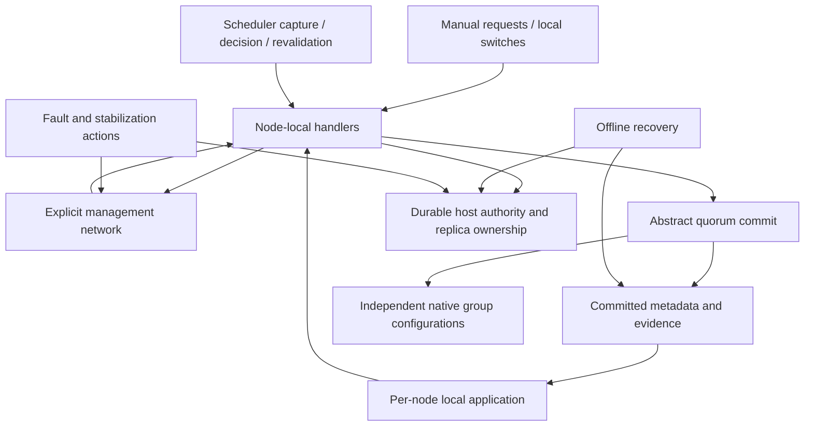

# Target design: executable gquorum cluster-management specification

Date: 2026-10-27. Status: target architecture for implementation planning. This document does not report an implemented or verified model. Decisions and research are recorded in [the brainstorm log](20261027-quint-cluster-management.md).

## 1. Request and accepted scope

Build a Quint model of the current gquorum management protocol, with mandatory `_meta` and multiple load groups on typical three-to-five-node clusters. Cover manual administration, cluster growth/shrink, healthy/degraded group creation/deletion, scheduler repairs, invalid calls, crashes/restarts and network partitions. Add dedicated storage-loss and offline recovery profiles. Discover unsafe states, protocol deadlocks and operation sequences that leave no supported recovery path. Make future changes checkable against the same contracts.

All executable model modules, vendored Quint dependencies, model tests and instance/configuration files belong under `scripts/quint/`. Application data, detailed Raft election/log replication and automatic Go trace replay are excluded from the initial deliverable. Counterexamples include manual Go regression recipes.

The baseline describes implemented behavior at `e8e85db`, not a rewritten policy. User explicitly chose current scoped operation concurrency; a global operation gate remains a possible future comparison. User also approved abstract Raft, separate state records, Choreo management messaging, pure protocol modules, and focused 3/4/5-node profiles.

## 2. Decisions

| Concern | Decision | Reason |
| --- | --- | --- |
| Authority | Go implementation plus stated contracts, with discrepancies recorded | Avoid silently modeling a hoped-for implementation. |
| Application FSM | Abstract away payloads; retain a dummy commit capability witness | Management safety and load independence are the target. |
| Raft | Abstract safe committed order/configuration; expose membership, catch-up, leader authority, availability and local application | Explore management races without re-proving etcd Raft. |
| Coordination | Choreo node handlers; explicit network delivery and abstract consensus actions | Preserve asynchronous boundaries and stale local state. |
| State | Typed records for nodes, consensus, metadata, network and recovery | Separate durable truth, local observations and outstanding obligations. |
| Operation concurrency | Per-group ownership and exact conflicting resources | Matches code and the existing independent-repair test. |
| Faults | Non-Byzantine process faults, independent meta/load links, delayed/lost/duplicate logical messages, failing/delayed callbacks | Captures the requested degraded-cluster behavior. |
| Storage | Durable evidence abstraction; loss/corruption and memory restart in separate profiles | Identity/recovery correctness without byte-level WAL modeling. |
| Verification | Scenario tests + simulation during development; bounded safety checking and selected finite exhaustive/liveness profiles | Different methods support different claims. |
| Implementation correspondence | Source/action/property matrix and manual regression recipes | User deferred an automated replay adapter. |
| Runtime dependencies | Pinned local vendor files and CLI version | No developer-specific absolute imports or implicit latest versions. |

## 3. Grounding and known contract conflicts

`docs/architecture/library.md` design constraint 6 describes one globally active topology operation. Current scoped approval and `TestScopedRepairLeavesIndependentUserOperationOwned` permit independent operations. Model this implementation, including affected-block supersession and resource revocation. Do not enforce the global gate in baseline guards. Evaluate a stricter gate later without weakening safety or deleting independence witnesses from the baseline.

`docs/architecture/raft.md` contains an obsolete statement that majority-loss recovery is unimplemented. `node_recovery.go` and `recovery/types.go` expose Rebuild and ResetForJoin. Include those protocols as confirmed. The implementation task should reconcile these two documentation discrepancies explicitly; this brainstorm does not edit the contracts.

Do not inherit other obsolete behavior from historical plans. Every modeled transition records the source path/symbol and relevant test. When code and a desired invariant disagree, preserve the counterexample and classify the discrepancy; do not silently strengthen an implementation guard or weaken an invariant to get a green run.

## 4. Components and composition



Use pure functions for validation and state transformation. The composed `cluster` module owns `init`, `step`, fault actions and integration actions. Its distributed component uses Choreo handlers. Consensus/environment transitions may update shared service state explicitly; a handler must not consult that state as if a fresh quorum read had occurred.

Keep Choreo's per-process record grouped, with separate `volatile` and `durable` subrecords. Treat Choreo's extensions as typed composition plumbing, not unrestricted access to current metadata. Keep every model variable in the temporal frame: if Choreo's display variable is used, it is derived and included consistently, never a separate source of protocol truth.

## 5. State schema

### 5.1 Type conventions and finite domains

Use `str` for symbolic node/group/cluster names, `int` for member/replica/version/attempt/revision counters, and sum types for phases/results. `Option[T]` comes from the pinned `basicSpells`, not a Quint built-in. Numeric identity spaces remain logically distinct even if the backend type is the same; use named record fields and distinct wrapper records where accidental interchange would be plausible.

Each concrete instance binds `NODE_POOL`, `LOAD_IDS`, permitted node label/type classes, version/attempt/generation limits, in-flight request limits, and profile switches. Include `_meta` separately from `LOAD_IDS`. Replicated capacity settings are instance data distinct from search bounds. A five-node pool must configure an actual node capacity of at least five; the library default is three.

Do not truncate real obligations to satisfy a search bound. Generation exhaustion disables creation of additional fresh identities in that instance and marks the verification boundary. It never wraps a counter or forgets a tombstone. Test edge cases at the boundary separately; do not report bound exhaustion as a product deadlock.

### 5.2 Identity and request records

The following schema uses Quint-like notation; records are to be expressed as actual typed Quint definitions in `types.qnt`.

```text
ReplicaKey = { cluster: str, group: str, node: str, member: int, replica: int }
ProcessKey = { node: str, incarnation: int }
AttemptKey = { version: int, attempt: int }
EffectKey  = { operation: AttemptKey, step: int, action: ActionKind,
               target: EffectTarget, grantRevision: int }
EffectTarget = GroupTarget(str) | ReplicaTarget(ReplicaKey)
RequestKey = { caller: ProcessKey, sequence: int }
Audit      = { actor: str, comment: str, forced: Option[{ node: str, reason: str }] }
MutationOptions = { expectedVersion: int, audit: Audit, preview: bool, approve: bool }
```

Model expected-version zero by capturing the caller's locally observed Latest before submission, matching the convenience API, not by substituting whichever version is latest at commit time. Retrying an uncertain request preserves its original expected version, audit fields, exact predecessors and request identity.

### 5.3 Topology records

```text
NodeDecl = { name: str, member: int, state: Active | Draining | Drained | Excluded,
             nodeType: str, labels: str -> str }
ReplicaDecl = { key: ReplicaKey, role: Voter | Learner, pinnedLearner: bool }
PlacementRule = { minVoters: int, maxVoters: int,
                  allowedTypes: Set[str], selector: str -> str }
HostingRule = { mode: HostingMode, selectedNodes: List[str] }
VoterConfig = { target: int, domain: Option[str], maxSurge: int,
                failureWindow: int, standbyWindow: int,
                failureLag: int, standbyLag: int, standbyApplyBacklog: int,
                replaceNoProgress: bool, noProgressWindow: int,
                maxObservationGap: int, switchCooldown: int, demotionCooldown: int,
                allowNewFailureDuringCooldown: bool }
GroupDecl = { id: str, storage: StorageDefault | StorageMemory,
              labels: str -> str, replicas: Set[ReplicaDecl],
              placement: Option[PlacementRule], hosting: Option[HostingRule],
              voterConfig: Option[VoterConfig], nextReplica: int }
Document = { cluster: str, version: int, parent: int, rebasedFrom: Option[int],
             nodes: str -> NodeDecl, groups: str -> GroupDecl,
             placement: PlacementRule, audit: Audit }
```

Map actual hosting/placement variants from `topology` into a bounded vocabulary; every distinct branch that affects eligibility needs a representative class and witness. Do not make all hosts interchangeable when testing pinned learners, strict failure domains or reserved nodes. Labels on a group are edited through Stage, not an invented SetGroupLabels API.

Execution refinement (Task 4, source-grounded): PlacementRule.MinReplicas/MaxReplicas bound voters; they are distinct from the total hosted-replica capacity. Distinct voter domains belong to VoterConfig, not PlacementRule. Preserve surge and bounded abstract stability/lag/cooldown controls so configuration validation and later scheduler cases remain representable. Hosting names use a list at validation boundaries: typed convenience methods normalize ordering, while duplicate names must not disappear into a set. Group allocation cursors persist even while a fresh document is staged.

Planning clarification: `topology/storage_class.go` admits only default and memory as replicated storage classes. Model Node-owned WAL versus borrowed custom backing separately in node configuration; it affects recovery eligibility but is not a third GroupSpec storage value. `topology/hosting.go` also preserves legacy groups without a hosting declaration. Missing hosting and explicit/all-eligible hosting must remain distinguishable.

### 5.4 Per-node records

```text
ProcessState = {
  phase: New | Starting | Ready | Fenced | Stopping | Stopped | Failed,
  incarnation: int, appliedMetaVersion: int, appliedMetaIndex: int,
  localView: ReadView, observations: str -> Observation,
  owners: str -> OwnerState, session: Option[SessionKey],
  schedulerEnabled: bool, serveOverride: int,
  schedulerCapture: Option[SchedulerCapture], pendingCalls: RequestKey -> CallState
}
HostState = {
  pin: Option[DurableNodeIdentity], replicaEvidence: ReplicaKey -> StorageEvidence,
  authorityFloors: ResourceKey -> int, receipts: Set[Receipt],
  collectionMarkers: ReplicaKey -> CollectionState,
  metaImage: Option[ReadView], metaIndex: int
}
NodeState = { volatile: ProcessState, durable: HostState }
NodeStorageConfig = { defaultBackend: OwnedWAL | BorrowedCustom }
OwnerState = { key: ReplicaKey, phase: OwnerPhase, held: bool,
               reservation: Option[RequestKey], replayReady: bool,
               startupAuthorized: bool, published: bool,
               factoryOutstanding: bool, engineJoined: bool,
               applicationClose: ClosePhase, engineRunning: bool }
```

`OwnerPhase` distinguishes absent, reserved, opening, replaying, ready, parked, stopping and stopped. A retained failed Close keeps ownership until a serialized successful retry. Crash destroys process-owned work but does not fabricate graceful-stop receipts. Runtime holds and observations follow their actual persistence behavior; do not accidentally persist every volatile field. Storage evidence distinguishes valid, missing, foreign, unreadable and contradictory; memory replicas lose their image on process restart.

### 5.5 Native consensus and observations

```text
ConsensusState = {
  lineage: str, configRevision: int,
  voters: Set[ReplicaKey], learners: Set[ReplicaKey],
  leaderAuthority: Option[ReplicaKey], committedPosition: int,
  appliedPositions: ReplicaKey -> int, catchUp: ReplicaKey -> CatchUpClass,
  pendingChange: Option[NativeChange]
}
Observation = { group: str, replica: ReplicaKey, incarnation: int,
                observedConfig: int, observedLeader: Option[ReplicaKey],
                health: HealthClass, age: Fresh | Stale }
```

This is an abstract committed consensus history, not a real global variable available to nodes. A quorum certificate is derived from native membership, durable valid identities, channel connectivity and the chosen leader/commit action. Health/session reports do not create certificates. Configuration proposals and commitment are separate, so a host crash or partition can occur after safety prechecks.

Catch-up classes represent behind, caught-up and unknown. Keep exact configuration/source identity so a stale caught-up observation cannot authorize a replacement. An abstract load command advances only a bounded progress token; this checks independent commit capability without modeling application payload correctness.

### 5.6 Metadata, operations and authority

```text
MetadataState = {
  latest: Document, target: Document, history: int -> Document,
  groups: str -> GroupProgress, nodes: str -> NodeProgress,
  operations: AttemptKey -> Operation,
  firstAttempts: int -> AttemptKey, successors: AttemptKey -> AttemptKey,
  grants: GrantKey -> Grant, revocations: GrantKey -> Revocation,
  cleanup: ReplicaKey -> CleanupDebt,
  memberAllocationFloor: int, replicaAllocationFloors: str -> int,
  retiredGroupIds: Set[str], sessions: SessionKey -> Session,
  locks: str -> SessionKey
}
Operation = { key: AttemptKey, predecessor: Option[AttemptKey], origin: Origin,
              plan: Plan, blocks: str -> BlockProgress, audit: Audit }
Plan = { version: int, blocks: str -> List[PlannedStep],
         cleanup: str -> List[PlannedStep], sources: str -> int,
         dependencies: Set[(int, int)] }
GroupProgress = { sourceVersion: int, proven: Option[GroupDecl],
                  owner: Option[AttemptKey], deleting: bool }
BlockProgress = { phase: Pending | Running | WaitingReplica | WaitingCatchUp |
                         WaitingLeader | Succeeded | Failed | Superseded,
                  step: int, reason: Option[BlockReason] }
Grant = { key: GrantKey, purpose: Effect | Fence | Transfer | Readmission,
          effect: Option[EffectKey], admission: Option[AdmissionKey],
          resources: Set[ResourceKey], targets: Set[ReplicaKey] }
Revocation = { requested: bool, requiredResources: Set[ResourceKey],
               provenResources: Set[ResourceKey] }
Receipt = { grant: GrantKey, effect: Option[EffectKey],
            admission: Option[AdmissionKey], target: ReplicaKey,
            resource: ResourceKey, outcome: ReceiptOutcome }
FenceEvidence = { grant: GrantKey, resource: ResourceKey,
                  receiver: DurableNodeIdentity, replica: Option[ReplicaKey],
                  durablePosition: int }
```

Expand exact identities in readmission/resource types according to `topology/authority*.go`; group-wide effects need explicit target sets rather than a fabricated replica ID zero. An applied or already-satisfied receipt must prove the entire granted effect. A transfer-started receipt is not proof of finished transfer. Scope supersession requests revocation; it does not synchronously revoke unreachable resources.

Planning clarification: effect/readmission receipts and resource-fence evidence are separate proof forms in `topology/authority_receipt.go` and `topology/authority_fence.go`. Validate the exact action/admission shape against the grant; an optional action is not permission for an evidence-free receipt. Retain exact fence evidence for every proven revocation resource, rather than trusting membership in `provenResources` alone. Node storage configuration is instance configuration; memory-group backing overrides its default backend.

Maintain first-attempt and immediate-successor indexes only as bounded derived/replicated abstractions of existing semantics. Historical FullyConverged is a projection/checkpoint, never the controller's global execution cursor. Group progress may refer to different source versions.

### 5.7 Cleanup and recovery

```text
CleanupDebt = { identity: ReplicaKey, sourceOperation: AttemptKey,
                storage: StorageClass, stopGrant: GrantKey,
                stopped: Option[Receipt], retired: Option[Receipt],
                collected: Option[Receipt], retention: RetentionClass,
                collectionPhase: CollectionPhase }
CollectionPhase = Unprepared | Prepared | PhysicallyCollected |
                  CompletionDurable | Reported | MarkerReleased
RecoveryState = { source: DurableNodeIdentity, mode: Rebuild | ResetForJoin,
                  request: RecoveryRequest, plan: Option[RecoveryPlan],
                  acceptance: Option[Acceptance], phase: RecoveryPhase,
                  sourceOwned: bool, filesHook: FilesHookPhase,
                  archivedEvidence: Set[EvidenceKey], newLineage: Option[str],
                  groupsImported: Set[str] }
Acceptance = { exactPlan: PlanKey, acknowledgeDataLoss: bool,
               oldDeploymentFenced: bool }
```

Recovery phases match the implemented Approved/Files/Cancelling/Cancelled/Archiving/AwaitingStart/Importing/Validating/Complete and JoinReady/Joined pathways. Reserved rollback enum values are not executable recovery actions. Each modeled durable boundary has a crash/resume case. External deployment fencing is an explicit environmental premise attested by the caller; the model must not claim gquorum proves it.

### 5.8 Network, calls and session time

```text
NetworkState = { metaLinks: Set[(str, str)], loadLinks: Set[(str, str)],
                 pending: Set[Envelope], delivered: Set[DeliveryKey] }
Envelope = { delivery: DeliveryKey, source: ProcessKey, destination: str,
             channel: MetaChannel | LoadChannel, payload: ManagementMessage }
CallState = { request: ApiRequest, phase: Captured | Submitted | Committed | Replied,
              result: Option[ApiResult], waiterCancelled: bool }
ApiResult = Accepted(ResultValue) | Refused(Refusal) | Indeterminate
Session = { owner: ProcessKey, phase: Live | ExpiredObserved | Revoked,
            renewalGeneration: int }
```

Bounded symbolic time advances stability/lease/retention classes; no wall-clock timestamps. Keep session expiry observation distinct from committed revocation and exact-process checking. Duplicate envelopes have distinct delivery IDs or explicit replay actions, while immutable request/effect identities remain unchanged. A set that silently deduplicates deliveries must not hide replay behavior. Invalid requests update call outcomes without manufacturing domain-state changes.

## 6. File and interface specification

All files in this table are **CREATED** unless explicitly marked otherwise. Names are proposed interfaces to implement, not existing APIs. `ModelConfig` contains the bound/profile constants; `World` below denotes the composed records described above. In concrete modules prefer narrower input records to granting every helper unrestricted state access.

| File under scripts/quint | Exports and responsibility |
| --- | --- |
| `types.qnt` | All shared records/enums; no state variables or transitions. |
| `topology.qnt` | `validateDocument(doc, rules): Set[Refusal]`; `mutationGuard(view, request): bool`; `mutateDocument(view, request): Document`; `affectedScopes(before, after): Set[str]`; `eligibleHosts(doc, group): Set[str]`; `makePlan(input, desired): PlanResult`; `preview(input, request): PreviewResult`. |
| `membership.qnt` | `hasCommitPath(consensus, nodes, links): bool`; `canProposeChange(input, change): bool`; `proposeChange(consensus, change): ConsensusState`; `canCommitChange(input): bool`; `commitChange(input): ConsensusState`; `canTransfer(input, target): bool`; `transfer(input, target): ConsensusState`. |
| `authority.qnt` | `canApprove(meta, captured): bool`; `approve(meta, captured): MetadataState`; `canRetry(meta, predecessor): bool`; `retry(meta, predecessor): MetadataState`; `validateEffect(local, grant, effect): bool`; `installFence(host, grant): HostState`; `acceptReceipt(meta, receipt): MetadataState`; `revocationComplete(meta, key): bool`. |
| `lifecycle.qnt` | `canReserve(input, key): bool`; `reserve(input, key): OwnerState`; `canPublish(input, key): bool`; `publish(owner): OwnerState`; `requestStop(owner): OwnerState`; `canJoin(owner): bool`; `join(owner): OwnerState`; `canRetire(input): bool`; `retire(input): RetirementUpdate`; `canCollect(input): bool`; `collect(input): CollectionUpdate`. |
| `scheduler.qnt` | `capture(local, observations): SchedulerCapture`; `chooseRepair(capture): Option[RepairDecision]`; `canRevalidate(fresh, captured, decision): bool`; `makeRepair(fresh, decision): RepairProposal`; `repairIndependent(staged, repair, dependencies): bool`. |
| `sessions.qnt` | `canActivate(input): bool`; `activate(input): SessionUpdate`; `canRenew(input): bool`; `renew(input): SessionUpdate`; `canRevoke(input): bool`; `revoke(input): SessionUpdate`; `canAcquire(input, key): bool`; `acquire(input, key): SessionUpdate`. |
| `recovery.qnt` | `inspect(input, request): RecoveryPlan`; `canAccept(input, plan, acceptance): bool`; `accept(input, plan, acceptance): RecoveryState`; `canAdvance(input): bool`; `advance(input): RecoveryUpdate`; `canCancel(input): bool`; `cancel(input): RecoveryUpdate`; `canConsumeOnStart(input): bool`; `consumeOnStart(input): RecoveryUpdate`. |
| `handlers.qnt` | Choreo context/listener/transition aliases; named `listen_*` returning enabled parameter sets, matching `act_*` returning transitions; `main_listener(ctx): Set[Transition]`. Pure handlers for API proposals, approved effects, fences, receipts and readmission messages. |
| `cluster.qnt` | Bound parameters, state initialization, `init`, `step`, administrative actions, environment faults, consensus commit/apply, local lifecycle and scheduler actions. Main entry point stays here. |
| `properties.qnt` | Contract invariants, meaningful-progress predicates, expected-blocker classification, temporal properties and reachability predicates. Imports protocol definitions; protocol modules do not import properties. |
| `cluster_test.qnt` | Deterministic runs, malformed/stale-call refusal scenarios, witnesses and fixture assumption tests. |
| `fault_detection_test.qnt` | Negative controls with deliberately omitted checks/debt/identity matching; expected counterexamples, never included in passing production invariants. |
| `instances/*.qnt` | Fully bound concrete wrappers; no executable invocation may leave an uninitialized const. |
| `profiles/*.json` | Tool versions, instance/main, bounds, invariants, witnesses, backend, timeout and temporal property selections. |
| `vendor/*` | Pinned Choreo/basicSpells sources, upstream commit, license and checksums; preserve provenance of any adapter changes. |
| `run.py` | Profile validation and tool orchestration; exact exit status, bounded timeouts and complete run manifests. No installation or network download by default. |
| `README.md`, `coverage.md`, `regressions.md` | Scope/commands, full API correspondence, and manually reproducible Go scenarios. |

Execution refinement (Task 4): PlanResult is `Planned(Plan) | PlanRejected(Set[Refusal])`, matching the Go planner's `(Plan, error)` contract. Never represent a refused plan as an empty successful plan. PlannedStep retains its sequence, expected/result voter identities and optional transfer target. Required blocks, detached cleanup and explicit dependencies remain distinct so logical deletion does not imply stop and replacement ordering can be checked. PlanningInput also carries retained owner milestones (hosted, stopped or cleanup-owned), so a proven old stop is not turned into a new unreachable-host obligation. Source-aligned helpers are split into placement.qnt and planning.qnt behind the topology.qnt interface; these remain pure modules with no independent state. Native observation identities must be grounded in the retained inventory before planning effects.


Pure guard/update pairs are separate. If rejection is observable, use a separate rejection transition, not a successful no-op fallback. Inputs to pure updates include all evidence required by the modeled source contract. Helpers must be total for admissible input domains; map lookup, list head and Option unwrap need explicit shape validation before use.

### 6.1 Composed action signatures

```text
invoke(node: NodeName, request: ApiRequest): bool
refuse(node: NodeName, request: RequestKey, reason: Refusal): bool
submitMeta(node: NodeName, request: RequestKey): bool
commitMeta(request: RequestKey): bool
applyMeta(node: NodeName): bool
reply(node: NodeName, request: RequestKey): bool
cancelWait(node: NodeName, request: RequestKey): bool
retryExact(node: NodeName, request: RequestKey): bool
dispatchEffect(node: NodeName, effect: EffectKey): bool
deliver(message: Envelope): bool
drop(message: Envelope): bool
duplicate(message: Envelope): bool
executeEffect(node: NodeName, effect: EffectKey): bool
persistReceipt(node: NodeName, effect: EffectKey): bool
reportReceipt(node: NodeName, effect: EffectKey): bool
checkpoint(effect: EffectKey): bool
commitNative(group: GroupId): bool
catchUp(group: GroupId, replica: ReplicaKey): bool
elect(group: GroupId, candidate: ReplicaKey): bool
scheduleObserve(node: NodeName): bool
scheduleDecide(node: NodeName): bool
scheduleRevalidate(node: NodeName): bool
crash(node: NodeName): bool
restart(node: NodeName): bool
setLink(channel: Channel, source: NodeName, destination: NodeName, up: bool): bool
loseStore(node: NodeName, replica: ReplicaKey, evidence: StorageEvidence): bool
resolveCallback(node: NodeName, outcome: CallbackOutcome): bool
advanceRecovery(node: NodeName): bool
stabilize(profile: StabilizationProfile): bool
```

Add separate collection/startup/stop actions for every durable or callback boundary listed in sections 5 and 8; do not fuse them into `executeEffect`. Parameter sets enumerate existing exact obligations, not arbitrary integers. Stabilization is a test environment transition that stops further faults/new disruptive requests and restores only the resources promised by that profile; it never resurrects lost storage.

### 6.2 Public API request vocabulary

`ApiRequest` has named variants with the public method's semantic arguments. Distinguish `Stage(document, expectedVersion)`, `Approve(version)`, `RetryOperation(predecessor)`, and each mutation convenience method. Ordinary convenience methods compile to sequences of capture/stage/approval actions. ReseatReplica is the implemented exception: after capture/barrier/validation it atomically commits a repair and approval, rebasing independent staged intent; it does not require Approve=true. Preview remains non-mutating.

| API methods | Semantic request fields / model mapping |
| --- | --- |
| Stage, Plan, PlanFor, Approve | Complete bounded document or version; exact CAS; plan previews perform no mutation. |
| RetryOperation, RollbackTo | Exact attempt predecessor / historical version; rollback creates new intent and does not restore tombstoned identities. |
| AddNode | Node declaration and mutation options. |
| ReadmitNode | Name, nonzero predecessor member ID, mutation options. |
| DrainNode, ActivateNode, ExcludeNode | Name and mutation options; distinct edits and execution preconditions. |
| ForceRetireNode | Name, nonempty reason, audited mutation options; no safety bypass. |
| CreateGroup, EnsureGroup | GroupSpec including ID/storage/rules/hosts; mutation options or actor/comment. Ensure recognizes only its own exact staged creation and retained original CAS. |
| DeleteGroup | Group ID and mutation options; retired ID stays unusable. |
| SetPlacement, SetGroupPlacement | Complete rule and optional group ID; bounded eligibility classes. |
| SetGroupHosting, SetGroupVoterConfig | Group ID, complete hosting/voter declaration and options. |
| SetReplicaPinnedLearner, ChangeReplica, ReseatReplica | Exact identity/key, pin or role change, options; reseat allocates fresh identity. |
| TransferLeader | Group and named target; request/transfer/proof boundaries remain separate. |
| Start, WaitReady, RequestStop, Stop | Process lifetime/wait controls; retained restart uses a new constructed process. |
| StartLoadGroup, StopLoadGroup | Exact replica ref and waiter; local hold differs from retirement. |
| ActivateSession, KeepAlive, DeactivateSession, AcquireLock | Exact session/caller incarnation and bounded lock key. |
| SetSchedulingEnabled, SetServeOverride | Local switch value; values are validated and do not override hard guards. |
| ReadBarrier, ReadTopology, ReadProgress, ReadAuthority, ReadLockHolder | Quorum/read-index barrier, then local apply and result capture. ReadProgress cached attachments are not new remote probes. |
| WaitOperation, WaitRevoked | Observe named obligation until terminal/proven or cancel wait; no automatic cancellation of effects. |
| Recovery.Inspect/Approve/Run/Cancel | Exact request/plan/acceptance/recovery identity, actor/comment and stopped-source preconditions. |

Record the remaining getters (`Rules`, `Identity`, local `Status`, `Latest`, `Target`, `Get`, `History`, `Watch`, `Operation`, `LockHolder`, `ParkedJoins`, `LoadGroup`, `LoadGroupIDs`, `ParkedLoads`, `OwnSessionLive`, `ServeOverride`, `SchedulingStatus`, `HealthObservation`, `IsLeader`, metrics and Recovery.Status/List) in `coverage.md` as local or durable observation projections. Watch delivery may lag/coalesce and does not establish freshness. No production route/HTTP handler is added.

Transport methods (`ReceiveLoadRaft`, `ReadLoadReplica`, `ApplyLoadAction`, `InstallLoadFence`, `ReportLoadDelivery`, `LoadSnapshots`) map to environment/receiver/catch-up actions. Caller authentication is an assumption; exact current identities and authorizations are still checked. Low-level snapshot framing and metric pagination are excluded with reasons, not silently omitted.

### 6.3 Production schema/configuration changes

No production DB tables, bbolt buckets, WAL/envelope encodings, ORM models, indexes, cache keys or TTLs change. Existing `_meta.bolt`, `_authority.bolt`, load storage, application files and compatibility fixtures remain unchanged. There is no new constructor, dependency-injection hook, public Go method or application config setting. The state schema above is the model's schema, not a storage migration.

Root Makefile and `docs/testing/tests.md` are **UPDATED** during implementation only to expose/document opt-in model commands. Proposed targets: `test-quint` (typecheck/tests/smoke simulation), `test-quint-simulate`, `test-quint-verify`. No default `make test` dependency, no Docker invocation from the Quint runner, no unpinned npm installation, and no added Go module dependency.

Runner interface: `python3 scripts/quint/run.py --profile NAME --mode {test,simulate,verify} [--seed INTEGER] [--reports-dir PATH]`. Profile schema includes `schema_version`, `quint_version`, `instance`, `main`, `bounds`, `properties`, `witnesses`, `backend`, `max_steps`, `max_samples`, `timeout_seconds` and optional `tlc_config`. Unsupported combinations fail before execution. Artifacts go under `test-reports/quint/<run>/` by default, respecting `TEST_REPORTS_DIR`.

## 7. Fault assumptions and operational success

The ordinary fault profile permits crash/restart with retained valid disk, asymmetric partitions on meta/load channels, loss/reordering/replay of logical management messages, stale observations, leader changes, caller cancellation and callback failures. These are non-Byzantine faults: peers do not forge valid authorization or fabricate durable receipts. Distinct profiles inject missing/foreign/unreadable/contradictory stores and volatile memory loss.

Do not cap failures at one node: two unavailable nodes in a three-voter group is a required expected-quorum-loss case. “Node available” is insufficient; reachability and native voter placement determine quorum. Admitted learners count as `_meta` participants but not votes. A five-node cluster with three voters has different failure behavior from five voters.

Success classes are: autonomous convergence after promised resources return; recoverable through a valid public API sequence; safe refusal with a named unmet premise; or permanent loss requiring explicit recovery/loss acceptance. The model cannot promise data recovery when no complete survivor exists, nor automatic file-hook success or external deployment fencing. Unexpected need for shell mutation is a finding; supported explicit Rebuild is an intentional recovery class.

## 8. Required data flows

### 8.1 Manual topology mutation

Capture caller view/CAS and immutable arguments → validate preview/options → stage through `_meta` quorum → retain staged version → optionally plan and approve against captured scopes → execute affected blocks → record exact receipts → checkpoint group/node progress → answer/wait. A failure after staging returns the staged version. A lost reply may follow commitment. Repeating Approve returns the first retained attempt; RetryOperation creates at most one immediate successor for an eligible failed attempt.

### 8.2 Growth, shrink and role changes

Stage/approve node admission → reserve exact identity → learner participation → catch-up → guarded promotion if required. Drain changes load eligibility and evacuates loads while retaining `_meta`. Exclusion requires the appropriate drained state and guarded metadata membership change. Transfer leadership before leader demotion/removal. Native configuration changes remain single-change Auto operations. A loss of quorum after precheck stalls commitment; it must not manufacture completion.

### 8.3 Healthy and degraded group creation

Validate unused group ID/storage/placement → create immutable founding plan → approve → dispatch exact local startup → open/replay/factory readiness → authorize publication → form native group and establish required progress. Offline eligible hosts may leave obligations waiting; do not assume a particular creation succeeds without checking its selected placement and founding requirements. Include both degraded successful placement and blocked selected-host witnesses.

### 8.4 Deletion and returning owners

Approve deletion through `_meta` → atomically retain exact debt for every former owner and retire the group ID → logical group completion. Native/host cleanup proceeds separately and may wait without load quorum or offline host access. Returning owners obtain exact grants, fence and join old work, retire old identities, persist/report receipts, and later collect according to retention. There is no instantaneous global serving cutoff in implemented detached deletion; test that contract rather than asserting every offline replica stopped at approval.

### 8.5 Scheduler

Leader with local scheduling enabled captures owned observations → policy chooses no action or one supported repair → callback returns → core rereads topology/scope, identity, health, native membership and leadership → replicated CAS approves repair → ordinary operation execution. Revalidation can refuse stale or unsafe decisions. Independent staged intent is preserved/rebased only by the implemented independence rules. Unsupported custom policy decisions are rejected; a policy cannot bypass membership/authority checks.

### 8.6 Local startup/shutdown

NewNode validates without modeled I/O → Start reserves/acquires → admission/replay/readiness gate → publish only after current authorization. Concurrent exact starts share reservation/result. WaitReady cancellation does not stop the node. RequestStop initiates teardown; Stop joins engine/replay/callbacks and transferred applications. Late successful factories still transfer Close ownership. Failed Close/timeouts retain ownership for serialized retries. Exact StopLoadGroup hold blocks automatic restart while allowing approved retirement.

### 8.7 Reads and cached observations

Local getter returns its own applied/cached projection, possibly stale. Quorum read sends a barrier, obtains safe read position, waits for local application, then captures result. Cache hit attaches only an exact matching identity with original freshness; cache miss produces an absent observation, not fabricated health or an implicit fan-out. A stale observed leader/lock holder is not proof of current authority or lease. Wait cancellation changes only the waiting call.

### 8.8 Storage loss and recovery

Fault changes retained evidence → startup validates and parks incompatible state without erasure → if authorized repair and quorum exist, allocate a fresh replica/member identity and complete required fencing/handover. Permanent loss invokes stopped-source Inspect → exact plan acceptance with loss/fencing attestations → application Files hook → archive → ordinary startup consumes fresh-lineage authorization/import → validate complete survivor state → complete. ResetForJoin archives/fences old identity before joining current lineage. Cancel is allowed only in supported phases and joins/undoes preparation; no fictional disaster rollback.

## 9. Failure-mode obligations

| Failure point | Allowed result | Required preservation |
| --- | --- | --- |
| Invalid request / preview+approve | Definitive refusal | No mutation or authority. |
| Stale stage CAS | Conflict | Existing Latest/Target and caller's original retry identity. |
| Stage committed, approval fails | Error plus staged version | Staged intent retained, no unauthorized effects. |
| Reply lost after commit | Caller uncertainty | Committed result/first attempt remains replayable. |
| `_meta` quorum lost | Metadata commit unavailable | Independent load behavior subject to its own quorum/fences. |
| Load quorum lost | Native work may wait | Detached metadata deletion may complete with full debt. |
| Effect executed, receipt/report lost | Retry/report later | Durable exact effect evidence; no false successor completion. |
| Supersession while host offline | Revocation pending | Required resource obligations, retained old evidence. |
| Callback timeout / late return | Owned waiting/teardown | No overlapping callback or replacement release. |
| Close fails | Retained ownership | Serialized retry; no successor publication. |
| Foreign/missing/contradictory store | Park/refuse | Evidence intact; no automatic refounding. |
| Collection crashes | Resume recorded phase | No deletion of debt before exact marker release. |
| Recovery donor incomplete | Refuse | No silent dropped group or fabricated restored state. |
| Recovery Files hook fails | Retry/cancel where supported | Exact plan/phase, source ownership and backups. |

## 10. Properties and checks

### 10.1 Safety properties

Define separately named predicates: `wellTypedDomain`, `metaParticipationMatchesAdmission`, `stagingGrantsNoEffects`, `exactEffectAuthority`, `exclusiveLocalOwnership`, `publishAfterReplayAndAuthorization`, `noIdentityReuse`, `noDeletedGroupReuse`, `membershipChangeSafe`, `receiptMatchesObligation`, `deletionDebtComplete`, `collectionProofOrdered`, `retryPlanImmutable`, `repairPreservesForeignIntent`, `fencesProtectSuccessors`, `recoveryLineageSeparated`, and `sessionOwnershipExact`.

Properties are scoped precisely: an admitted offline node retains an assigned `_meta` replica but need not have a running one; arbitrary faults can remove quorum after a safe change; historical observations can report different leaders; deletion success does not imply global stop. Properties should catch implementation errors, not outlaw reachable legal observations.

### 10.2 Deadlock, livelock and recoverability

Define `pendingObligations`, `expectedBlockers`, `enabledUsefulActions` and `unexpectedStuck`. Useful actions include necessary preparation, delivery, catch-up, fencing and reporting steps, not only final completion. Exclude unrelated new calls, repeated invalid calls and arbitrary fault toggles from evidence that an existing obligation can progress. Classify hold/retention/nonreturning callback/failure assumptions separately.

Under a stabilization profile with sufficient promised resources, check per-obligation eventual terminal/converged outcomes with fairness for the relevant continuously enabled handler/delivery/commit actions. Fairness on a global `step` alone does not prevent starvation of one group. Do not assume fairness for successful completion of a failed disk or a callback explicitly allowed never to return.

Public-API recoverability is a different reachability question from automatic liveness. A witness proves one recovery path from its start; it does not prove every reachable state has one. For small finite instances, design explicit target-state reachability analysis or equivalent checked temporal formulations, and state whether the result is existential recoverability or universal fair convergence. No universal claim until that analysis completes.

### 10.3 Tool-specific safeguards

The local Quint `quint/src/tlc.ts` invokes TLC with `-deadlock`, disabling built-in deadlock reporting. Define `unexpectedStuck` explicitly and require a known-stuck negative fixture to fail. This avoids depending on backend defaults. See [TLC CLI options](https://docs.tlapl.us/using%3Atlc%3Astart). Temporal backend support must be smoke-tested with a known passing and known failing liveness case before using it for a result claim.

`quint run` is sampling. Apalache verifies only the configured depth. TLC exhaustive results require finite domains and actual completion. State counters, history, request traces and time must be bounded; keep long diagnostic traces in external output rather than an ever-growing model list. See [Quint model checkers](https://quint.sh/docs/model-checkers).

### 10.4 Negative controls and reachability

Require witnesses for every action family and legal degraded case. Add deliberate fault variants that omit post-wait authorization, drop one deletion debt, accept a predecessor receipt for a successor, publish before replay, treat transfer-start as completed, approve foreign staged intent, or fabricate collection proof. Each must be caught by its intended property. Failed witness search is not proof of impossibility; diagnose overconstraint separately from insufficient sampling.

## 11. Concrete verification profiles

| Profile | Domain | Primary purpose |
| --- | --- | --- |
| `smoke3` | 3 nodes, 2 load IDs, short histories | Every-day type/test/sampled safety; legal and refusal witnesses. |
| `scoped3` | 3 nodes, 2 groups, at least 2 independent operation slots | Concurrent repair/user operation, stale captures, supersession and exact retries. |
| `deletion3` | 3 nodes, 2 groups, retained exact former identities | Offline host, no load quorum, returning owner, collection crash boundaries. |
| `admission4` | 4 nodes, bounded replacement generations | Learner admission/promotion, predecessor handover, domain constraints. |
| `scale5` | 5-node pool, 2 load groups, capacity 5 | 3→4→5→4→3, configured voter count distinct from host count. |
| `storage3` | 3 nodes, 2 groups, WAL/memory/invalid evidence classes | Restart loss, parking, reseating and non-refounding. |
| `recovery3` | 3 original nodes, two lineage symbols, bounded survivor inventories | Rebuild, ResetForJoin, incomplete donor refusal and crash/resume. |
| `sessions3` | 3 nodes, two sessions/lock keys with bounded generations | Expiry/revocation, exact-process renewals, stale observations. |
| `progress_small` | Small admitted cluster, 1–2 groups and one focused pending obligation | Completed finite exploration and fair-progress checks at tractable bounds. |

Exact integer bounds are configuration values calibrated during incremental implementation, not promises of tractable five-node exhaustive checking. Every chosen bound must include the named scenario; raise it if a required trace cannot fit. Large integrated profiles use sampling/bounded checking; focused small profiles supply exhaustive results where feasible. A timeout is reported as incomplete.

Profile validation uses `run` assertions for configuration assumptions. Do not rely on Quint `assume` alone without verifying enforcement in the pinned toolchain. Every profile names concrete `main`, `init`, `step`, safety predicate, witnesses and optional temporal properties. Commands must be checked against the pinned CLI, not copied unchecked from a newer website.

## 12. Implementation sequence and acceptance gates

1. Pin tool/vendor provenance, create types and a concrete tiny instance, typecheck and execute init plus one management transition/witness. No monolithic unexecuted model build.
2. Add abstract consensus/connectivity and local metadata application; demonstrate quorum loss and independent load progress.
3. Add document/CAS/plan/approval/retry and explicit refusals, with lost-reply scenarios.
4. Add authority dispatch/receipt/fence boundaries, local ownership and shutdown; run negative controls before adding more scope.
5. Add node/replica/group operations, placement/roles, deletion and cleanup; cover healthy/degraded cases and returning owners.
6. Add scheduler observation/decision/revalidation and independent repair; reproduce the scoped-concurrency source test as a model witness.
7. Add sessions, switches, observation contracts, storage and recovery profiles.
8. Complete the API matrix, fair-progress properties, runner/reporting, focused exhaustive checks and manual regression recipes. Record every unverified scope explicitly.

After each meaningful transition addition: typecheck → deterministic witness/refusal test → small sampled invariant run. Broaden profile runs only after those pass. Model logic remains outside Go modules and unit defaults. Go test execution is required only if implementing a regression or changing Go behavior, which is outside this initial model-only scope.

Acceptance requires all public API families classified, all implemented action families witnessed, required degraded scenarios reachable, safety checks passing at reported bounds, negative controls failing as intended, explicit stuck/livelock testing, and a clear list of properties not exhaustively established. No assertion of “all cluster states safe” from a smoke run. The future strict global-gate experiment is not a baseline acceptance requirement.

## 13. Reports, correspondence and future changes

Each run retains source revision, model/vendor hashes, CLI/backend version, profile/bounds, command, seed, timeout/exit status, raw trace, property outcomes and completeness classification. Failed and interrupted runs retain artifacts. Human trace labels show API operation, version/attempt, group, node/member/replica/incarnation and proof stage. Never reinterpret an intentional witness counterexample as a product failure or suppress a real invariant exit status.

`coverage.md` maps public method → request/action sequence → source symbols → property → witness/refusal case → abstraction notes. `regressions.md` turns meaningful counterexamples into manual Go scenarios with required faults, observable barriers, expected outcomes and the appropriate owning-package/Docker/Gosim suite. Existing `tests/sim` currently focuses on three-node metadata transport; full load/recovery traces cannot be advertised as supported there without extending its fixture.

For a future feature, add or change the intended contract/property first, model the candidate behavior, compare against baseline witnesses/invariants, preserve new counterexamples, then implement and add Go regression coverage. Spec and implementation discrepancies are review decisions. A stricter global gate must be evaluated for safety, safe refusal, independent progress and ability to repair a pending operation—not only for reducing interleavings.

## 14. Key transition pseudocode

These blocks specify sequencing and guards. Each `BOUNDARY` becomes a separately interleavable action when it crosses commitment, I/O, callback, publication or message delivery. They are not production Go changes.

### mutateAndMaybeApprove

```text
capture request arguments, actor/comment, and original expected version
if preview && approve: record Invalid; return
if preview: compute plan/result from captured input; return without mutation
submit stage with original CAS
BOUNDARY: meta commit validates CAS and document; records new Latest
remember staged version even if caller response is lost
if approve:
    capture plan/scopes for that exact version
    BOUNDARY: validate and commit approval, or return staged version + error
reply with retained version/operation; cancellation changes only waiter state
```

### approvePlan

```text
if retained first attempt exists for requested version:
    return it if exact replay matches; otherwise conflict
validate current staged version, complete immutable plan, scope captures,
         identities, placement, admission and all evidence prerequisites
prepare candidate ownership and exact resource revocations
prepare admission/cleanup handovers and every deletion debt
validate candidate graph and guards before publishing any change
commit Target, attempt 1, owners, grants and debt atomically in _meta
logical deletion may complete here; do not fabricate host/native stop receipts
```

### retryOperation

```text
find exact failed predecessor and immutable plan
if exact retained successor exists: replay that successor
reject changed plan, wrong predecessor, unsafe/new conflicting scope
validate current retry safety and exact outstanding obligations
commit one immediate successor; never reuse another version's current plan
```

### executeAuthorizedEffect

```text
receive authenticated request carrying exact immutable grant/effect/identity
validate grant catalog/evidence and local durable resource floor
if exact effect receipt already exists: report it without reapplying
verify startup/native/storage preconditions for this action
BOUNDARY: waits, callback or native proposal may occur
recheck required exact authority/identity at the actual consumption boundary
perform supported native/local effect; retain ownership on partial failure
BOUNDARY: persist exact receipt, then report it
checkpoint only if report matches current retained obligation
transfer-start and incomplete acknowledgement cannot complete transfer/stop
```

### membershipChange

```text
read actual native membership/leadership and current health/catch-up evidence
reject unsupported joint or multi-change request
for promotion require existing eligible caught-up learner
for leader removal/demotion initiate transfer and await proven completion
validate last-voter and post-change live-quorum constraints
BOUNDARY: propose single native configuration change
commit only through the abstract current configuration's valid quorum path
apply/check native result before producing completion evidence
```

### schedulerRepair

```text
require local scheduling enabled and observed meta leadership
capture exact approved/proven group input and bounded health observations
BOUNDARY: policy returns no action or one supported decision
freshly revalidate leadership, group source/owner, identities, native state,
                    health, placement, pins and repair independence
if unrelated staged intent exists, use exact implemented rebase semantics
BOUNDARY: replicated repair CAS validates captures again
commit only supported repair; dispatch via ordinary approved plan machinery
on stale/refused decision record waiting reason; never approve latest blindly
```

### startAndPublishReplica

```text
join existing reservation for the exact identity, or acquire one reservation
validate pin, storage, assignment, fence and predecessor ownership
respect exact local hold unless explicit matching start clears it
BOUNDARY: factory/open; late success transfers application ownership
BOUNDARY: restore/replay complete committed state
BOUNDARY: obtain/recheck current startup authorization
publish handle/observation only if replay and authority both succeeded
failure parks/retains evidence and joins owned work before application release
```

### stopAndRetire

```text
mark owner stopping; refuse successor overlap
BOUNDARY: join engine/replay and callbacks
BOUNDARY: close transferred application; failed close retains ownership
record stopped only from actual completed stop with exact authority
verify full retirement proof even when files already appear absent
BOUNDARY: retire exact identity; preserve foreign/successor resources
persist and report exact retirement receipt
```

### collectRetiredReplica

```text
require eligible retention and exact retired identity/ledger/token/assignment
persist collection preparation
BOUNDARY: collect exact resources, rechecking required identity evidence
persist collection completion before reporting it
BOUNDARY: report exact completion to metadata
release exact store marker
BOUNDARY: remove corresponding collected journal row only after release
crash/retry resumes durable phase; absent files alone never prove collection
```

### readmitReturningNode

```text
require exact predecessor member and newly authorized successor
returning process remains non-serving
obtain exact grants for predecessor-owned resources
BOUNDARY: fence and join old owner; retire required prior load replicas
persist/report complete exact readmission receipt batch
metadata consumes batch, settling matching deletion debt without reopening it
BOUNDARY: catch up new meta identity; start only current assigned load identities
publish readiness only after full handover and ordinary startup prerequisites
```

### quorumRead

```text
submit safe read request through appropriate consensus path
BOUNDARY: quorum confirms read position
wait until this node applied at least that position
capture coherent result from local applied metadata
attach only exact cached observations with preserved age; omit cache misses
if waiter cancels, stop waiting without undoing an already committed command
```

### recoverStoppedSurvivor

```text
Inspect requires stopped exclusive source ownership and preserves evidence
verify supported WAL donor, complete required groups and consistent lineage
Approve requires exact inspected plan and explicit loss/fencing acceptance
persist acceptance before Files/archival work
BOUNDARY: application Files backup; retry/cancel only in supported phases
BOUNDARY: archive old evidence and prepare fresh lineage authorization
ordinary Start imports complete snapshot and committed tail for required groups
validate import/proofs before declaring Complete
old participants require ResetForJoin; historical locks/sessions/operations
are archived according to contract, not revived under the new lineage
```

## 15. Exclusions and residual work

- [postponed] Automated Go trace replay, explicitly deferred by user choice.
- [potential-improvement] Candidate strict global operation serialization, after establishing the implemented baseline.
- [too-complex] Full Raft consensus proof, byte-level storage/wire corruption, arbitrary application semantics and OS resource behavior. Relevant failure outcomes remain modeled.
- [postponed] Calibrate finite bounds/runtime budgets during implementation; no guaranteed exhaustive five-node run before measurement.
- [postponed] Detailed module-level enum variants and source-path mapping are implementation tasks within this design; any newly discovered contract ambiguity must be recorded rather than guessed silently.

The target is a maintained executable specification with honest coverage and reproducible failures. This document completes the architectural brainstorm; it does not claim that the future model or the current Go code has passed formal verification.
