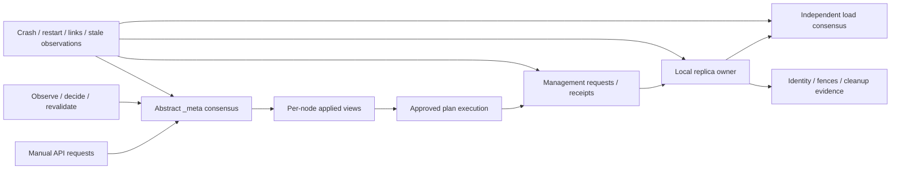

# Quint model of gquorum cluster management

Historical brainstorm completed; implementation subsequently reached Task 4 and is paused. Initial scope was revised on 2026-10-27; see the final scope-review entry and current target. Date: 2026-10-27. Detailed specification: [target design](20261027-quint-cluster-management-target.md).

## Initial request

Model the current gquorum cluster-management protocol in Quint: mandatory `_meta`, multiple independent load groups, typical clusters of three to five nodes, cluster states, manual APIs, scale up/down, group creation/deletion with healthy and unavailable nodes, and automatic scheduler operations. Find unsafe states, deadlocks, invalid operation sequences and behavior that requires rebuilding or shell-based repair. Use the model to evaluate future features. Place the model and its dependencies under `scripts/quint/`. Use the local Quint source and examples at `/Volumes/M4DATA/Users/speckzzz/reps/quint`.

The requested workflow is `go-brainstorm`, with `quint-modeling` and `quint-lang`. This session changes brainstorm documentation only. It produces a detailed target specification once the design questions are resolved; executable model implementation is a subsequent step.

## Confirmed decisions and answers

| Question | User answer | Consequence |
| --- | --- | --- |
| gquorum management or an application protocol? | “gquorum cluster management (recommended)” | Application command payloads and business state are abstracted. |
| Concurrency contract: implemented group ownership or documented global gate? | “Let focus on what already implemented. Possible need to make it stricter with what described in library.md” | Baseline follows implementation. Global serialization is a later candidate change, not an assumed current invariant. |
| Abstract Raft or model elections/log replication? | “Abstract Raft; model gquorum management in detail (recommended)” | Trust Raft consensus safety; preserve membership, quorum, leadership, catch-up and commit/application boundaries relevant to management. |
| Storage loss and permanent majority loss? | “Include dedicated storage-loss and recovery profiles (recommended)” | Include parking, reseating, Rebuild and ResetForJoin in separate profiles alongside retained-storage crash/partition scenarios. |
| Automated implementation trace replay? | “Quint model first; manual Go regression scenarios” | No automated Go replay adapter in the initial deliverable. Record reproducible counterexamples and manual Go regression recipes. |
| Separate node/consensus/metadata/network/recovery records, Choreo, pure modules and focused profiles? | “Use this structure for the detailed target design (recommended)” | Structure accepted; detailed target design written in the companion file. |

The accepted structure is specified in the target document. The design uses non-Byzantine crash/recovery with independent meta/load partitions, delayed/lost/duplicate logical management messages, stale observations and callback failures. Storage faults use abstract evidence classes rather than byte-level corruption. Exact finite bounds and runtime budgets will be calibrated during implementation.

## Source baseline and discrepancies

Repository HEAD during research: `e8e85db` (preceded by detached group deletion `4149a4b`, proposal outcomes `353b57d`, snapshot transfer `8e57798`, majority-loss recovery `14a54c2`). Initial working tree was clean. Local Quint checkout: `bd327e32`; installed CLI and checkout package version: `0.33.0`.

Read README, `docs/project.md`, architecture library/Raft/project map, testing guide, public Cluster/Node/Recovery interfaces, approval and repair implementation, authority types, membership safety, deletion completion, and representative existing test sources. The code catalog is preliminary, not an assertion that every path has been audited.

1. `docs/architecture/library.md`, design constraint 6, states one active topology operation globally. `internal/metaengine/scoped_approval.go` retains independent owners and supersedes affected blocks. `TestScopedRepairLeavesIndependentUserOperationOwned` in `internal/metaengine/scoped_repair_test.go` explicitly permits independent repair alongside an active user operation. The supplied AGENTS.md also describes scoped independence. **Resolution:** model current code; retain the stricter contract as a future experiment. Documentation reconciliation remains outstanding.
2. `docs/architecture/raft.md` says permanent-majority-loss recovery is not implemented. README and `node_recovery.go` expose the implemented Recovery interface. **Baseline:** recovery exists; deciding its model depth remains open. Do not copy the stale limitation into model assumptions.

## What verification can establish

“All possible states” needs a finite abstraction and explicit bounds. Three to five nodes alone does not bound versions, request IDs, replica generations, retries, pending messages or history. Each verification result must name participant/group domains, generation and operation bounds, failure assumptions, depth and backend.

`quint run` samples traces and can find counterexamples; it cannot establish exhaustive coverage. Apalache checks paths up to a specified length. TLC can enumerate a finite reachable state space if exploration completes; temporal checking also needs a precise fairness specification. No result about this abstract model alone proves that the Go implementation conforms to it. See the official [model-checker documentation](https://quint.sh/docs/model-checkers) and [simulation/model-checking distinction](https://quint.sh/docs/what-does-quint-do).

During modeling, use typecheck, scenario tests and sampled runs incrementally. Exhaustive checking is a separately configured verification phase, not a claim inferred from successful simulation. Bounded progress tests are useful but are not unbounded liveness proofs.

## Proposed structure and abstraction

Maintain one protocol definition with small scenario instances and focused property suites, rather than one enormous five-node state-space search or disconnected toy models. A three-node instance with two load groups is the initial integration case. Four-node cases exercise replacement/learner admission; a five-node pool exercises 3→4→5→4→3 transitions. A second load group is essential to detect accidental global blocking.

The node pool is fixed for an instance; admitted membership changes dynamically within it. Repeated admission needs fresh member/replica identities and fresh process incarnations. Bounds must never wrap identities or silently permit reuse. Bound exhaustion must be identified separately from protocol deadlock. Increase generation bounds in dedicated successor/retry profiles.

Abstract each Raft group as an independently committing membership/state service. Consensus commits require a valid current configuration and a communicating quorum, not just a count of globally “up” nodes. Retain distinct `_meta` and load connectivity: one port may fail independently of the other. Metadata commitment and each node's local application/observation are separate; agents cannot read an omniscient current Target in place of their actual local view.

Proposed distributed wrapper: Choreo for node-local handlers and management messages, following the supplied Quint examples. Pure modules implement document changes, planning predicates, identity checks and receipt validation. Explicit environment actions handle crash/restart, connectivity and abstract Raft commitment. Shared consensus state belongs in a separate service/environment component, not an all-knowing local field. Choreo routing must be adapted to explicit delivery/loss/partition controls; its immediate mailbox insertion cannot stand in for reliable delivery across a failed link.



## Proposed state inventory

This is a conceptual schema, not finalized executable Quint declarations.

| State component | Required distinctions |
| --- | --- |
| Node-local state | Process phase, fresh incarnation, applied metadata version, session, scheduler enablement, serving override, cached observations. |
| Durable node state | Cluster lineage, member pin, exact replica identities, local fences/receipts, retained storage evidence. Separate from crash-volatile state. |
| Desired topology | Latest, Target, retained historical declarations, placement/hosting rules, voter targets, learner pins, retired IDs, allocation floors. |
| Per-group consensus | Native voters/learners, leadership, configuration revision, catch-up state, independently available commit path; no application payload model. |
| Operation | Immutable plan, version/attempt/predecessor, per-group block state, current step, owners and exact resources, failure/supersession state. |
| Authority | Immutable grant key/revision, operation/version/attempt/step/action tuple, exact node/member/replica targets, resource fences, revocation obligations and receipts. |
| Local replica | Startup reservation, replay readiness, authorization, published handle identity, held/stopping/stopped/parked state, outstanding application ownership. |
| Cleanup | Former exact owners, removed/stopped/retired/collected milestones, preparation/report/marker-release phases, retained proof. |
| Scheduler | Captured input, chosen repair, revalidation phase, stability/cooldown class and exact captured identities/versions. |
| Environment | Per-channel directed reachability, delayed management messages, crash/restart choices and abstract time/stability events. |
| API observations | Pending request, submitted/committed/replied phases, returned version/error, uncertainty after timeout and exact retry identity. |

Illustrative type fragments to refine before implementation:

```quint
type NodeName = str
type GroupId = str
type ReplicaIdentity = {
  cluster: str, group: GroupId, node: NodeName,
  memberId: int, replicaId: int,
}
type ProcessPhase = New | Starting | Ready | Fenced | Stopping | Stopped | Failed
type CleanupMilestones = {
  removed: bool, stopped: bool, retired: bool, collected: bool,
}
```

Milestones need exact receipts alongside them; booleans alone do not prove completion. Declared membership, native membership, process liveness and observed health are different dimensions. A globally unique observed leader is not a valid invariant: stale observations can disagree; only consensus authority is abstracted as safe.

## Preliminary API coverage catalog

Every public method must eventually map to a modeled transition, observation abstraction, modeled composition of other actions, or an explicit exclusion. “All manual operations” must not silently become only CreateGroup/DeleteGroup.

| Family | APIs / behavior | Required model treatment |
| --- | --- | --- |
| Documents and approval | Stage, Plan, PlanFor, Approve, RetryOperation, RollbackTo | CAS, preview purity, stage/approval split, retained first attempt, immutable retry predecessor, historical rollback as new intent. |
| Node membership | AddNode, ReadmitNode, DrainNode, ActivateNode, ExcludeNode, ForceRetireNode | Placement eligibility separate from `_meta` participation; exact predecessor, fresh IDs, handover and retirement proof. |
| Load groups | CreateGroup, EnsureGroup, DeleteGroup | Founding, idempotent ensure versus conflicting intent, tombstones, logical deletion versus cleanup. |
| Placement and roles | SetPlacement, SetGroupPlacement, SetGroupHosting, SetGroupVoterConfig, SetReplicaPinnedLearner, ChangeReplica, ReseatReplica | Bounded label/type/domain classes, eligibility, learner-first changes, guarded promotion/demotion/removal, fresh identity. |
| Leadership | TransferLeader | Request, actual transfer, stale completion, timeout; starting transfer is not completion proof. |
| Node lifetime | NewNode, Start, WaitReady, RequestStop, Stop, retained restart | Start ownership, readiness publication, cancellation versus joined shutdown; no replacement until old ownership releases. |
| Local group control | StartLoadGroup, StopLoadGroup | Exact local holds, shared startup, authorization/replay before publication, no successor redirection. |
| Sessions and locks | ActivateSession, KeepAlive, DeactivateSession, AcquireLock | Session incarnation, expiry/revocation, committed lock ownership; observation is not a lease guarantee. |
| Local switches | SetSchedulingEnabled, SetServeOverride | Policy/serving controls cannot grant topology or bypass safety. |
| Quorum reads | ReadBarrier, ReadTopology, ReadProgress, ReadAuthority, ReadLockHolder | Successful barrier plus local apply; cached attached observations keep exact identity and age. |
| Observations and waits | Latest, Target, Get, History, Watch, Status, Operation, WaitOperation, WaitRevoked, ParkedJoins, local Node status/group/session/scheduling getters | May be stale; waits may time out without canceling committed effects. Metrics are observational. Pagination/metrics serialization is not protocol state unless a property needs it. |
| Transport integration | ReceiveLoadRaft, ReadLoadReplica, ApplyLoadAction, InstallLoadFence, ReportLoadDelivery, LoadSnapshots | Environment/handler transitions with authentication assumed at ingress and exact identity/grant/delivery checks retained. Snapshot bytes abstract to catch-up progress. |
| Offline recovery | Recovery.Inspect, Approve, Run, Cancel, Status, List; RecoveryStartOptions | Implemented public surface; proposed separate profile for source ownership, explicit loss acceptance, fresh lineage and old-node reset. Depth still to decide. |

Primary correspondence: `cluster.go`, `cluster_mutations.go`, `cluster_ensure.go`, `node.go`, `node_lifecycle.go`, `node_load.go`, `node_recovery.go`; metadata semantics in `internal/metaengine`, dispatch in `internal/operator`, local ownership in `internal/managed` and `internal/authoritystore`, membership in `membership` and `internal/raftengine`.

## Atomic boundaries to preserve

Do not model an entire public mutation as one atomic successful edit. Preserve at least these interleavings:

1. Read/capture expected version → stage commit → approval commit → caller reply. Stage may succeed while approval fails; lost replies may follow committed effects.
2. Scheduler observe → callback decision → fresh scope/health/native membership/leader revalidation → repair CAS. Stale callbacks must not approve unrelated user intent.
3. Grant commit → dispatch → receiver validation/fence check → native or local effect → durable receipt → report → metadata checkpoint. Crashes and delayed messages can occur between durable boundaries.
4. Startup reservation → factory/replay → current startup authorization → publication. Stop/cancellation and late factory success can intervene.
5. Delete Target group and retain complete cleanup debt → logical completion → returning owner stops → retirement → collection preparation → collection → durable completion/report → marker release → debt removal.
6. Readmission grant → fence/join predecessor → complete exact retirement receipt batch → successor admission/catch-up → readiness. Missing files do not establish predecessor retirement.

Logical deletion under `_meta` quorum must remain reachable without the deleted load group's quorum. That does not mean its old native authority is already settled or all old owners have stopped. Keep the documented and implemented distinction; an offline owner cannot be assumed to know deletion instantly.

## Property families

### Safety

- Staged intent and previews grant no effects; successful committed changes have exact authorization.
- Native membership changes preserve supported learner/promotion/removal rules. Do not require quorum to remain available after arbitrary subsequent failures.
- Old grants, callbacks, receipts, delivery reports and handles cannot mutate successor identities.
- Restart retains durable identity and uses a new incarnation; missing/foreign state is parked instead of refounded.
- A replacement does not overlap unresolved local ownership; startup publication requires replay and authorization.
- Every logical deletion retains exact debt for all former owners. Stop, retirement and collection have separate evidence.
- Scheduler repairs preserve unrelated staged intent and obey replicated CAS/resource ownership.
- Retry is bound to the immutable plan and predecessor; lost responses do not justify a new mutation identity.
- `_meta` unavailability prevents new metadata commitments, while independent load paths remain possible subject to their own authority and fencing.

Assertions must be specified from contracts, not copied mechanically from action guards. Include deliberate faulty variants to demonstrate that checks can detect omitted revalidation, lost cleanup debt, premature completion and stale identity acceptance.

### Operation validity and expected failures

Invalid calls are observable behavior, not merely disabled transitions. Model explicit refusal actions with classifications such as conflict, invalid, unavailable, unsafe membership and authorization failure. Check which state may already have committed at each refusal point. Separate request submission, commitment and response so an indeterminate result is not treated as rollback.

Generate a state/operation catalog: accepted now; staged but not approved; waiting on a named obligation; deterministically refused; result uncertain; terminal with residual cleanup. Preserve exact returned version/predecessor information needed for safe API retries.

### Progress and operational recoverability

Distinguish expected quorum loss, explicit local holds, policy-disabled work, retention deferral and external callback nonreturn from an internal protocol deadlock. Progress assumptions must name eventual stable connectivity, necessary quorums, fair processing, callback return and scheduler enablement. No algorithm promises convergence under endless faults.

An always-enabled crash/restart or invalid-request action can hide a stuck controller. Check meaningful progress on pending obligations under a stabilized environment, excluding no-op/rejection steps. A terminal healthy cluster is not a deadlock. A progress witness proves one path exists, not that all fair paths eventually complete.

Separate autonomous convergence from recovery using a valid public API sequence. Neither means every ordering of destructive operations must converge. Identify traces that have no supported repair path under the stated surviving resources and classify expected permanent data loss versus preventable management traps. This requires explicit reachability/liveness analysis, not just a safety invariant.

## Initial scenario matrix

| Scenario | Witness / obligation |
| --- | --- |
| Healthy three-node cluster with two loads | Create, converge and delete; unaffected group continues. |
| One offline node, `_meta` quorum retained | Create with explicit eligible placement; delete with exact offline-owner debt. |
| Load majority lost, `_meta` still available | Metadata-authorized logical deletion; native/host cleanup remains distinct. |
| `_meta` majority lost, healthy load quorum | Topology requests cannot commit; independent existing load consensus can progress where authorized. |
| Three-to-five growth and return to three | Learner admission/catch-up, role changes, drain, exclusion, fresh identities on return. |
| Delete then readmit offline former owner | Complete predecessor retirement receipt batch; no resurrection of deleted group. |
| Scheduler races manual staging/approval | Revalidate stale decisions, preserve foreign staged intent, independent scope progress. |
| Lost reply and exact retry | Retained operation identity and no duplicate plan/attempt effects. |
| Supersede while effect or receipt is delayed | Resource fencing distinguishes requested revocation from completed revocation. |
| Crash at cleanup/collection boundaries | Restart resumes obligations without false collection proof or leaked ownership. |
| User hold, disabled scheduler or blocked hook | Explanatory waiting; safety holds; progress resumes when the relevant blocker clears. |
| Memory replica loses its state on restart | Park old identity and reseat only through safe authorized repair; no identity reuse. |

Existing scenario sources to reuse as witnesses: `tests/cluster/delete_wait_test.go`, `delete_recovery_test.go`, `authority_quorum_test.go`, `authority_admission_test.go`, `membership_test.go`, `rejoin_test.go`, `memory_storage_test.go`, and `internal/metaengine/scoped_repair_test.go`. Reading these is not a fresh test run.

## Proposed package layout

All entries below are proposals under `scripts/quint/`, not files already created.

```text
README.md                 scope, assumptions, guarantees, commands and bounds
coverage.md               public API / source / action / property correspondence
types.qnt                 exact identities, lifecycle and protocol records
topology.qnt              pure document/placement mutation and validity logic
membership.qnt            abstract Raft membership/commit predicates
authority.qnt             grants, fences, receipts, supersession
lifecycle.qnt             startup, ownership, holds, stop and cleanup logic
scheduler.qnt             observe/decide/revalidate and repair logic
cluster.qnt               composition, init, step and protocol actions
properties.qnt            safety and meaningful-progress predicates
cluster_test.qnt          deterministic scenarios and witnesses
instances/                concrete 3/4/5-node, bounded-operation profiles
vendor/                   pinned Choreo/basicSpells with license and provenance
```

Split additional sessions/recovery modules when their agreed scope warrants it. Pin tool/dependency versions; do not embed the developer's absolute Quint checkout path in runnable imports. Counterexamples should carry the instance, seed/backend, bounds and human-readable API/identity trace. Future Go conformance checks should replay against owning-package tests or the existing Docker/Gosim suites, preserving their suite boundaries.

## NOT CONSIDERED & TODO

- [postponed] Confirm full failure envelope: process crashes/restarts, link partitions, stale/lost messages, storage loss/corruption and callback failures; distinguish baseline and dedicated profiles.
- [postponed] Specify the confirmed separate recovery profiles: source stopped and owned, complete survivor, exact-plan acceptance, archival/resume, fresh lineage, explicit ResetForJoin, unsupported donor refusal. Existing recovery APIs are supported escape paths, not automatic lossless repair.
- [postponed] Implement the accepted type schema and Choreo/consensus/local-view boundaries from the target design; validate incrementally before adding protocol breadth.
- [postponed] Select verification bounds/backends, fairness assumptions, CI budget and which finite instances should complete exhaustive exploration.
- [postponed] Finish exact API and source correspondence, including sessions, locks, observations, EnsureGroup and recovery.
- [potential-improvement] Compare a strict global operation gate to the implemented scoped baseline; measure both eliminated interleavings and new blocking/recovery risks.
- [potential-improvement] Automated Go trace replay is explicitly deferred by user choice. Initial output includes manual regression recipes with required observable barriers and exact identity assertions.
- [too-complex] Full etcd Raft election/log proof, byte-level storage corruption, arbitrary application FSM correctness, OS scheduling and serialization correctness are outside the chosen management abstraction. Abstract relevant failure outcomes instead.

## Validation and session summary

Confirmed management-only scope, implementation-first semantics and abstract Raft. Identified a concrete concurrency-contract discrepancy and a stale recovery limitation in architecture docs. Proposed state separation, API coverage, atomic boundaries, properties and scenario profiles; these remain design proposals unless listed as confirmed above.

Subsequently confirmed dedicated storage/recovery profiles, manual Go regression recipes and the proposed state/framework structure. Produced the detailed target with schemas, module signatures, API mapping, data flows, failure-mode obligations, properties, verification profiles and key transition pseudocode. No public API or persisted schema changes are needed to add the model.

Checked the installed Quint version and verification help, verified 15 source references, and ran whitespace validation with `git diff --check` and `git diff --no-index --check /dev/null` for this new file. This repository ignores `docs/brainstorms/`; the log exists locally but is not tracked. No Quint model, simulation, model checking, Go tests or Docker scenarios have been executed in this brainstorm. No Go behavior or public API changes are proposed at this stage. No database/schema/cache changes are required by adding a model; the final target specification must describe the abstract durable evidence schema, not invent a new production database.

## Design checkpoint: proposed record boundaries

The intended schema groups per-node state while keeping separately owned consensus, metadata, network and evidence records explicit. The following is a schema outline, not runnable Quint; detailed records and function signatures belong in the target document.

```text
NodeName -> NodeState {
    volatile: ProcessState { phase, incarnation, appliedMeta, observations,
                             pendingCalls, schedulerCapture, localOwners },
    durable: HostState { pin, replicaEvidence, authorityFloors,
                        effectReceipts, collectionMarkers }
}
GroupId -> ConsensusState {
    nativeMembership, configurationRevision, leaderAuthority,
    committedPosition, replicaCatchUp
}
MetadataState {
    latest, target, historicalDeclarations,
    groupProgress, nodeProgress, operationAttempts,
    grants, revocations, cleanupDebt,
    allocationFloors, retiredGroupIds, sessions, locks
}
NetworkState { metaLinks, loadLinks, inFlightManagementMessages }
RecoveryState { sourceEvidence, acceptedPlan, archiveProgress, newLineage }
```

Choreo provides node-local handler selection and message effects; the composed model explicitly controls network delivery and abstract consensus commits. The pure protocol modules do not depend on that framework. Crash resets volatile fields only; durable loss is a separate fault action. Any observer sees only its applied/cached state unless it successfully completes the modeled quorum-read path.

Three complementary suites are proposed: (1) reachability witnesses and deterministic scenarios, (2) safety invariants with sampled exploration and bounded checking, (3) finite-state progress/recoverability checks under explicitly stabilized, fair environments. Start with three nodes/two loads; add four/five-node and storage/recovery instances for named properties. Record state-space/depth limits for every result; an unfinished exhaustive run is not success.

Additional tool finding: local Quint `quint/src/tlc.ts` passes `-deadlock` to TLC, which disables built-in deadlock checking ([TLC option reference](https://docs.tlapl.us/using%3Atlc%3Astart)). The target therefore mandates explicit meaningful-progress/stuck predicates and known-failing controls. Temporal backend behavior must also be validated with a small passing/failing pair before making liveness claims.

BRAINSTORM DONE


## Scope review — 2026-10-27, after Task 4

User requested a review of coverage.md to remove redundant API modeling and defer features such as labels, then simplify the target and plan. The implementation goal remained paused throughout this documentation review.

The user selected: “Lean management scope; defer offline recovery (recommended).” This supersedes the earlier demand to include storage-loss/Recovery profiles in the first version. The retained objective is core topology transactions, scaling/group operations, automatic repair, exact identity/fencing, retained restarts, minimum session/admission safety and cleanup/readmission.

All 82 public entries were reclassified: 17 Core administrative controls; 15 reused Primitives; 19 Observe projections; 8 Omit wrappers/diagnostics; 23 Deferred feature methods. Metrics/history/watch/getter machinery does not need its own state machine. Labels are deferred as logic across all entry points, including Stage and creation. Live placement/voter tuning, standalone pin setters, EnsureGroup/RollbackTo, application locks/manual sessions, serving override, disk-loss/memory/custom-storage and offline recovery are outside initial scope.

Two source-driven safeguards prevent over-simplification. Node readiness requires an exact admitted/recovered live process session (node_lifecycle.go), so minimum internal session transitions remain. Default voter repair consumes internal metric evidence (scheduling/voters.go and internal/votercheck), so freshness, identity, lag/backlog and stability/no-progress classes remain even though public Metrics/MetricsHistory are omitted. Exact cleanup/collection ordering and returning-owner fencing are also retained.

The revised plan has 18 tasks: four historically completed and fourteen remaining, down from eighteen remaining. The full sessions/locks/read-API task was eliminated, folding necessary primitives into existing work. Three storage/offline-recovery tasks were deferred. Substantive profiles drop from nine to six; foundation remains a bootstrap check. Architectural delta, external review and documentation remain the last three tasks, now 16–18.

Known integration debt is explicit: existing Task 4 extension helpers/tests still appear in executable source/profiles. Revised Task 5 must enforce lean domains and separate extension-only tests before claiming v1 results. No executable .qnt/Python/profile files were changed by this review, no tests were rerun, and no deferred implementation is claimed completed. Historical evidence remains in the progress log/Git.


### Follow-up: metrics always good

The user narrowed the initial scope further: “metrics are always good, we don't simulate issues with lags and stability for this iteration.” This supersedes the preceding recommendation to explore internal metric threshold/stability classes. Initial metric evidence is now fixed favorable: lag/backlog within limits, healthy progress, current/fresh metrics and collector, standby stability satisfied and cooldowns clear. No lag/no-progress repair, observation-gap/metric-age faults, window counters or hysteresis/timing guarantees.

Crashes, partitions, actual native quorum and exact identity remain explicit. Availability-driven repair is retained with detection eligibility abstracted without elapsed-window timing. A new/returning replica still passes a successful catch-up protocol milestone, without slowness or lag-failure regimes. Decisions becoming obsolete due to real topology/identity/leadership changes still require revalidation. Formal management deadlock/livelock checks remain; good metrics do not assume the controller correct. Minimum internal session/admission transitions remain independently necessary.
