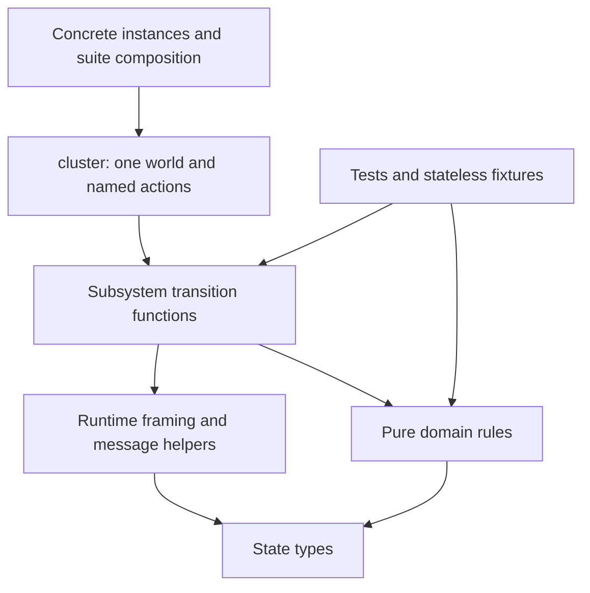

# Implementation plan: organize the Quint model by subsystem

**Plan:** `docs/plans/20261028-quint-module-refactoring.md`
**Date:** 2026-10-28
**Project source:** `../../scripts/quint` relative to this plan; repository path `scripts/quint`
**Branch:** `feat/quint-spec`
**Model baseline:** `b39764c` — cluster-management implementation Tasks 1–7
**Target architecture:** [cluster-management target](../brainstorms/20261027-quint-cluster-management-target.md), especially §§2–6, 8–10 and 14
**Full original brainstorm:** [cluster-management discussion](../brainstorms/20261027-quint-cluster-management.md)
**Refactoring request:** user discussion on 2026-10-28: group modules, hide contextual complexity, reuse higher-order functions, and mirror familiar Go subsystem boundaries.
**Parent implementation plan:** [cluster-management plan](20261027-quint-cluster-management.md)
**Execution log when implemented:** `docs/progress/20261028-quint-module-refactoring.md`
**Status:** refactoring authorized on 2026-10-28; executing from Task 1. Parent protocol Tasks 8–18 remain paused.
**Reviewed corrections:** peer thread 1, rounds 3–5 in `docs/review/feat_quint-spec.md`.
**Execution baseline:** `85cd75d` (model unchanged from `b39764c`).

## Objective and execution position

Reduce the effort needed to navigate, extend and review the current model before implementing parent Task 8. Preserve the existing modeled behavior, assumptions, state schema, interleavings, properties and coverage. This is a structural refactoring, not a smaller model or a new protocol implementation.

Use three implementation commits (organization, mechanical extraction, reusable helpers), followed by architectural verification, external review and documentation. Execute this plan independently from parent Tasks 8–18. Completion does not automatically resume that paused plan.

The expected benefit is clearer ownership and less repeated state-update/transport code. No numerical authoring-speed improvement is claimed. Moving files or using higher-order functions does not itself reduce the model's reachable state space or simulator runtime.

## Motivation: why refactor before the next protocol tasks

The model is already difficult to extend locally: 38 top-level modules mix production rules and tests, while the 1,542-line composition module owns 95 actions across several subsystems. Membership/scaling, group execution, cleanup and scheduling will add more workflows. Refactoring now avoids building those additions on a structure that already requires reading many unrelated definitions for a small change.

- **Make ownership discoverable.** Familiar Go subsystem names let a contributor locate metadata rules, request coordination, replica lifetime or operator execution without reconstructing the import graph. Mirror responsibilities, not every Go implementation file.
- **Reduce inconsistent changes.** Repeated nested world updates and envelope handling make it easy to fix one path while leaving another different. Small framing helpers preserve unrelated fields consistently; domain-specific authorization and safety guards remain explicit.
- **Make tests easier to extend.** Shared stateless fixtures and deliberate suite composition remove the need to import another test module merely to obtain setup data. New scenarios can reuse setup while still interrupting individual protocol phases.
- **Keep protocol reasoning visible.** A smaller composition root makes enabled actions and fault choices easier to inspect. Abstraction should hide record-update mechanics, while retaining commit/apply, consume/report and stop/join boundaries that expose races and deadlocks.

Success means domain bodies leave the composition root, new localized rules have an obvious owner, and fixtures are independent of test modules. Scaling and cleanup remain cross-cutting work. It does not mean fewer total files, fewer modeled states or faster simulation. Source analysis and verification remain necessary; the estimated implementation-effort saving is uncertain. The refactor is worthwhile only if it preserves current coverage and interleavings without introducing a larger framework to maintain.

## Important notices

- Keep exactly one instantiated mutable `world`. A directory is organizational structure, not an automatically isolated Quint state machine or namespace.
- Preserve implemented scoped operation concurrency and explicit hosting. The user selected implemented behavior despite stricter statements in `library.md` and review guidance. Do not resolve that discrepancy by changing semantics during this refactoring.
- Keep favorable metric assumptions, abstract Raft, retained valid storage and the existing deferred-feature boundary. No labels, offline recovery or extra public session/lock workflows.
- Do not edit production Go, generated protocols, immutable compatibility fixtures, vendor sources or dependency versions. Do not add default Go-test/Make integration; that remains parent Task 15.
- Preserve named phase actions. Never replace delayed delivery, commit/apply, callback return, receipt/report or stop/join boundaries with one atomic production transition.
- Do not use test failures as permission to weaken guards, assertions or negative controls. Separate a necessary behavioral correction from the structural change and document the evidence.
- Batch Quint tests after substantial changes. Use focused typechecks during editing and focused diagnostics for failures. Do not rerun entire suites after every rename or extracted helper.
- Record deviations in **NOT PLANNED CHANGES** and unresolved requirements in **NOT IMPLEMENTED GAPS**. A remaining correctness or wiring gap blocks completion.

## Current evidence

At the baseline, `scripts/quint` has 38 top-level `.qnt` files: 21 implementation modules and 17 test modules. There are 44 non-vendor `.qnt` files including instances. `cluster.qnt` contains 1,542 lines and 95 actions. It combines metadata transactions, consensus/network actions, authority, lifecycle, sessions and exploration selectors.

`World`, `Context`, `Transition` and `HostEffect` currently live in `handlers.qnt`. Consequently, initialization, properties and effect execution import a handler module merely to obtain state/transport types. Runtime suites also form an inheritance chain from `cluster_test` through membership, reads, transactions, operations, effects and lifetime tests; several pure tests import other test modules for fixtures.

The existing runner already hashes `.qnt`, `.py` and `.json` files recursively. It compares exact expected test-name inventories after stripping module qualification. Preserve these safeguards; folder nesting alone does not justify rewriting the runner.

| Profile | Runtime cases | Shared core checks |
| --- | ---: | ---: |
| foundation | 7 | — |
| smoke3 | 43 | 91 |
| authority3 | 57 | 91 |
| lifetime3 | 76 | 91 |

These are overlapping suites, not additive unique-case totals. `instances/topologyChecks.qnt` retains broader historical pure checks outside initial acceptance; preserve its availability and scope labeling.

## Refactoring design

### D1. Responsibility-based layout

Use Go subsystem names where responsibilities match. Keep abstract consensus, environment faults and model harnesses explicitly model-specific. Do not reproduce every Go directory, introduce empty future packages, or split the cohesive 348-line type catalogue merely to reduce a file-size statistic.

```text
scripts/quint/
  cluster.qnt                 # sole world variable, stable action facade, step composition
  types.qnt                   # cohesive declarations; no mutable state
  runtime/                    # World/Choreo aliases, framing and envelope primitives
  topology/                   # edits, placement, immutable plan construction
  metaengine/                 # replicated metadata rules, grants, receipts, sessions
  metaservice/                # request/read/approval work and node-side session steps
  managed/                    # replica lifetime, effect consumption, host fencing
  consensus/                  # safe Raft abstraction and native guards
  harness/                    # initialization, properties and environment faults
  tests/
    fixtures/                 # pure data fixtures; no run declarations or model instance
    unit/                     # pure rule tests, grouped by subsystem where useful
    scenarios/                # named asynchronous scenarios by responsibility
  instances/                  # existing concrete instance paths/names retained
  profiles/                   # existing profile names and CLI retained
  vendor/                     # unchanged
  run.py, run_test.py          # stable entry points
```

Use explicit module names/aliases such as `managed_steps` and `metaservice_session_steps`; two files called `steps.qnt` must not accidentally export conflicting unqualified definitions. Prefer direct imports or small explicit exports over wildcard package barrels.

### D2. Migration map

| Existing component | Intended owner |
| --- | --- |
| `types.qnt` | `types.qnt`, unchanged record and variant shapes |
| Choreo aliases currently in `handlers.qnt` | `runtime/world.qnt`; no `var` declaration |
| `apply_custom_effect`, envelope/framing updates | `runtime/frames.qnt` and `runtime/messages.qnt` |
| `topology.qnt`, `placement.qnt`, `planning.qnt` | `topology/` |
| `authority.qnt`, `grants.qnt`, `repair.qnt`, replicated control application | `metaengine/` |
| Replicated session grant/bind/revoke rules | `metaengine/sessions.qnt` |
| `reads.qnt`, caller transaction state, approval capture/recapture | `metaservice/` |
| Local listeners and session renewal/probe handling | `metaservice/handlers.qnt` and cohesive step modules |
| `remaining.qnt`, effect dispatch/checkpoint coordination | `metaservice/` |
| `lifecycle.qnt`, receiver execution and host-fence completion | `managed/` |
| `membership.qnt`, abstract native commit/election/catch-up | `consensus/` |
| Link changes, delivery/loss/duplication, crash/restart orchestration | `harness/` |
| `initial.qnt`, `scope.qnt`, `properties.qnt` | `harness/` |

A current file may span two responsibilities. Split mixed files only at existing functional boundaries: for example, caller preparation stays in `metaservice`, while metadata command validation/application belongs in `metaengine`. Keep exact guard/update behavior and document the old-to-new symbol mapping. Avoid inventing a one-file-per-action convention.

### D3. Dependency and state ownership



`types.qnt` contains no imports from handlers, tests or composition. `runtime` may import state declarations and vendored Choreo, but not domain rules. Domain transition functions do not import `cluster` or define another mutable world. Production code never imports tests. Harness properties inspect state for verification; actors do not gain access to facts through those properties.

Keep `cluster.init`, `cluster.step`, `requestStep`, `protocolStep`, `faultStep`, `nativeStep` and existing named action entry points usable by scenarios. Move substantive guard/update bodies into their owning modules and leave thin wrappers where needed. Aim to remove the majority of domain bodies from `cluster.qnt`; do not achieve a line-count target by hiding phase boundaries or introducing an interpreter.

### D4. Higher-order helpers and transition interfaces

Introduce a small set of helpers with demonstrated repetition. Proposed signatures, subject to the pinned-tool prototype in Task 1:

```quint
pure def withNode(w: World, node: NodeName,
                 update: (LocalNode) => LocalNode): World
pure def withOwner(w: World, node: NodeName, group: GroupId,
                  update: (OwnerState) => OwnerState): World
// Move existing apply_custom_effect unchanged; Queue/Consume stay canonical.
```

These helpers frame updates; they do not authorize operations, allocate replacement identities, select a newer version, or supply default missing owners. Keep business guards in domain code and guard partial map/Option/list access before evaluating it. Test that unrelated state is preserved, in addition to testing the intended update.

For deterministic steps use explicit guard/post functions as the default. Keep shared local bindings unchanged; evaluate post-state expressions only in the guarded branch, preserving partial-access protection. An `Option[World]` result is optional only where it makes the existing control flow clearer; a disabled result must never become stutter.

Four non-selector actions have internal nondeterminism: `handle`, `applyMeta`, `dispatchGrantFrom`, `finishTransfer`. Extract `candidates(w,args): Set[X]` plus guard/post functions with an explicit choice parameter; keep `nondet choice = candidates(world,args).oneOf()` in the action adapter. Keep all seven existing exploration selectors, choice domains and branch order. Do not collect successor worlds into a deduplicating set or store functions in protocol state.

Allowed imports (within each row, same-subsystem imports are also permitted):

| Module family | Allowed production dependencies |
| --- | --- |
| types | vendored basicSpells |
| runtime | types, vendored Choreo/basicSpells |
| topology | types, runtime |
| metaengine | types, runtime, topology |
| consensus | types, runtime, metaengine read-only session seed rules |
| managed | types, runtime, consensus, metaengine read-only/rule functions |
| metaservice | types, runtime, topology, metaengine, consensus, managed |
| harness | any production rule/transition family, but never cluster/test state |
| cluster | all production families; owns the only world |

Folders name responsibilities, not a requirement to copy Go's exact import graph. Node decisions retain local/confirmed views; pure functions receiving `World` cannot invent new authoritative reads.

### D5. Reusable workflows and tests

Production workflows remain the existing phase machines and independently enabled transitions. Reuse guards, single-step transformations and transport helpers. A helper named “approve” must not silently perform submission, commitment, local application and reply together.

Scenario helpers may compose existing `.then` steps because a deterministic test prescribes a trace. Preserve access to individual phase actions for injecting a crash or competing operation between them. Do not use these scenario scripts as the production `step` relation.

Extract pure fixtures from test modules, but retain the staged runtime suite chain and its single constant-binding point. It provides the nested smoke/authority/lifetime inventories. Independently instantiated sibling suites have distinct state entities even when constants match; unqualified re-exports can conceal the split.

Add distinct, non-shadowable stage actions and cross-stage `run` checks in each suite. Their effect types must connect the core initialization and every included stage's world. Typecheck and execute these checks; compiled simulation output alone cannot prove sharing in test-only state. Record newly added composition tests explicitly while preserving every baseline test. Keep stateful scenario helpers with their chain stage; fixtures remain stateless.

### D6. Behavioral preservation and evidence

Preserve state fields, identities, constants, initialization assumptions, branch guards, fault choices, enabled/disabled behavior, mutation frames and step boundaries. Keep exact CAS and retry captures, actor-local versus confirmed knowledge, physical versus logical completion, replica/member/process identities, pending ownership and lease semantics.

Create an action migration ledger covering all 95 baseline actions: old/new locations, guard ownership, fields read/written and unchanged phase boundary. Check the refactored action against its baseline body. Existing scenarios and negative controls are mandatory regression evidence, not a proof of complete equivalence.

Compare representative intermediate states for metadata commit/apply, authority consume/report, host fencing, late factory/Close and session renewal/revoke. Preserve exact IDs and pending queues; only incidental module qualification, source locations and artifact metadata may be normalized. Identical seeds are useful for reproducibility, but module/AST changes may alter sampled traces without changing the transition relation. Do not promise byte-identical ITF or exhaustive equivalence.

## Task list

### Task 1: Establish subsystem boundaries and independent test fixtures

**Files:** module moves under D1/D2; `runtime/world.qnt`; `tests/`; `instances/`; affected profile paths; runner tests only where needed.
**References:** target §§4–6 and 10.3–10.4; this plan D1–D3, D5–D6.

- [x] Confirm the execution baseline and record revision, model/configuration hashes, current test inventories, public action/property names and profile settings in the execution log. Reuse prior validation only when hashes match; otherwise obtain a fresh baseline.
- [x] Use the reviewed LocalNode framing prototype and add distinct cross-stage sharing checks on Quint 0.33.0/Rust v0.7.0. Retain one leaf instantiation and the staged suite chain. Check every stage boundary and retain baseline inventories plus explicitly named new checks.
- [x] Move cohesive pure modules using D2, retaining semantics and stable public action/profile names. Extract state/Choreo aliases from handlers into `runtime/world.qnt`; remove handler dependencies from initialization, properties and pure execution solely used for types.
- [x] Move tests into unit/scenario areas, extract shared data into `tests/fixtures`, and remove fixture dependencies on test modules. Retain and document the staged suite-inheritance chain.
- [x] Keep instance file paths and profile names stable. Update imports and manifests; preserve leaf test names and exact per-profile inventories, including historical `topologyChecks` availability. Do not broaden initial scope by activating historical extension tests.
- [x] Confirm nested modules appear in recursive run manifests. Change `run.py` only if an actual relocation incompatibility is demonstrated; preserve missing/ignored/duplicate-name rejection, exit codes and artifact behavior.
- [x] Remove obsolete forwarding modules after consumers migrate; retain a compatibility shim only for a documented external entry point, not every former leaf path.

#### Verification

- [x] Acyclic imports; no production-to-test imports or test-to-test fixture dependencies; exactly one instantiated mutable world in every concrete instance.
- [x] Every baseline test remains selected; new sharing checks are explicitly listed. Profile bounds/init/step/property selections remain intact. Folder moves do not silently omit checks or artifacts.
- [x] Relevant concrete modules typecheck; foundation and lifetime3 test batches pass. Run focused extra profile checks only for entry points whose wiring differs. Record outcomes before committing this task.

### Task 2: Mechanically extract transition bodies

**Files:** `cluster.qnt`, runtime helpers, subsystem step modules, scenario support and focused tests.
**References:** target §§4–5, 8–10 and 14; this plan D2–D6.

- [x] Create the action migration ledger and extract bodies in cohesive groups: metadata request/commit processing; authority dispatch/consumption; lifecycle/host fencing; sessions; consensus/environment. Preserve guard ordering where partial accesses depend on it.
- [x] Keep one `world`, the stable named action facade and the existing exploration grouping. Use the Task 1-proven transition interface; preserve nondeterministic domains and disabled branches without introducing a generic command/workflow DSL.
- [x] Keep existing update bodies unchanged apart from state/parameter qualification. Check normalized action bodies against the baseline; do not combine helper adoption with mechanical extraction.
- [x] Reuse scenario setup/phase helpers while keeping crash/partition/cancel injection points available. Keep production phase actions independent; do not call multi-step test scripts from simulation drivers.
- [x] Add focused frame and disabled-action regressions, including missing owner/map entries, false guards, late callbacks, stale incarnation/receipt/courier data and preservation of unrelated operation ownership.
- [x] Check all ledger entries against the baseline guards and post-states. Record representative intermediate-state comparisons and unchanged negative-control failures; investigate semantic drift rather than updating assertions to accept it.

#### Verification

- [x] The composition root contains state ownership, small action adapters and exploration composition; domain bodies reside in their named subsystems. Helpers have concrete reuse, not speculative callers.
- [x] All baseline scenarios/core checks still pass; intended negative controls still expose their violations. The helper-disabled path cannot extend a trace by stuttering.
- [x] Run the mechanical checkpoint (foundation, smoke3 and lifetime3); defer the complete matrix and sampled simulations to Task 3 after helpers. Record hashes, commands and results; do not claim a speedup.

### Task 3: Adopt small reusable framing helpers

**Files:** runtime helpers, extracted step modules and focused frame tests.
**References:** target §§4–5, 9–10; this plan D3–D6.

- [x] Introduce `withNode` and `withOwner` only at repeated updates; keep the existing Queue/Consume implementation and explicit delivery identities.
- [x] Keep guards and post-wait identity checks in domain functions. Preserve every untouched World/LocalNode/OwnerState field and the disabled-action behavior.
- [x] Add meaningful frame, false-guard and missing-owner regressions; retain the staged test workflow helpers and their individual phase entry points.
- [x] Compare the helper rewrite against the mechanical-extraction commit and record changed call sites in the migration ledger.

#### Verification

- [x] Frame/disabled-action checks and baseline scenarios pass; existing negative controls remain effective.
- [x] Run the final profile matrix and sampled simulations once for this substantial checkpoint; retain manifests and hashes.

### Task 4: Verify the architectural delta

**Files:** migration ledger, implementation files, this plan's gap/deviation records.
**References:** target §§2–6, 8–10, 14–15; this plan D1–D6.

- [ ] Verify state/runtime ownership: unchanged schema and initialization, one world, correct framing, no function values in model state and no new omniscient actor reads.
- [ ] Verify topology and metadata boundaries: pure edits/planning, exact CAS/replay, scoped ownership, grant/session FSM updates and complete receipt/fence history remain equivalent.
- [ ] Verify service/operator boundaries: request/read/capture/commit/apply/reply and dispatch/checkpoint steps retain their original enabledness and evidence requirements.
- [ ] Verify managed/consensus/environment boundaries: callback ownership, holds, stop/join/release, session leases, native quorums and independent network/failure actions retain their interleavings.
- [ ] Verify fixtures, named scenarios, properties, profiles, runner artifact paths and all baseline test inventories. Historical or deferred checks retain their previous classification.
- [ ] Record and fix every structural or behavioral gap in **NOT IMPLEMENTED GAPS**; do not mark an unimplemented requirement complete.
- [ ] Verify final wiring: every moved action/helper is reachable from the intended production `init/step` or named test entry point, every required property/profile still executes, and no subsystem exists only as unused code.

#### Verification

- [ ] Every baseline action has a reviewed migration entry; all D1–D6 requirements have concrete file/test evidence.
- [ ] Changes since the last batch receive appropriate focused checks; repeat full batches only for broad semantic/wiring changes. No unsupported equivalence or exhaustive-verification claim is made.

### Task 5: Obtain the requested colleague review and resolve findings

**References:** target §§3–4, 9–10; this plan D3–D6; `.revmux/profile.md` and `AGENTS.md`.

- [ ] Per the user’s explicit request, use paseo-peer to ask existing agent `e77ec353-b3eb-4158-9cb2-c3a160ddd0c2` to review the refactoring commits. This replaces the default revmux review route for this task. Keep the discussion in the branch peer file and do not start parent protocol work.
- [ ] Review only the refactoring commit range from the recorded execution baseline. Supply the original target, this plan, migration ledger and validation results; prioritize accidentally collapsed transitions, duplicate state, weakened guards, lost tests and misleading package boundaries.
- [ ] Explicitly preserve the user-approved implemented-code baseline where review guidance requests stricter global topology serialization. Such protocol changes are outside this refactor.
- [ ] Confirm findings against source and traces. Fix confirmed critical/major issues; retain minor findings with reasons. Re-review affected changes and record the report location under `docs/review/` without copying the report into chat.

#### Verification

- [ ] No unresolved critical/major refactoring defect; review findings have evidence and disposition. Required corrections pass their focused checks, with broader reruns for cross-cutting changes.

### Task 6: Close gaps, update documentation and hand back the paused backlog

**Files:** model README/coverage, target §4 organization details, parent plan file paths, execution log, `docs/changelogs/20261028-quint-module-refactoring.md`.
**References:** target §§4–6 and 13–15; this plan D1–D6; `docs/project.md` documentation rules.

- [ ] Resolve every **NOT IMPLEMENTED GAPS** entry against the original requirements. An unresolved required behavior/coverage gap prevents completion; any explicitly accepted structural deviation must be documented, not hidden behind passing tests.
- [ ] Document the subsystem map, one-world rule, supported helper pattern, workflow phase boundaries and where a future task should add a transition/test. Remove stale path/composition descriptions without rewriting historical validation evidence.
- [ ] Update the existing target's organization section and pending parent Tasks 8–18 file references to the implemented locations. Preserve completed task history, remaining protocol scope and pause status; do not restart or renumber the parent implementation.
- [ ] Write a concise changelog about easier navigation, traceability and extension of the model. Do not claim new library behavior, improved correctness coverage or faster simulation without evidence.
- [ ] Record final commit range, source hashes, test/profile inventories, validation/review artifacts and limitations. Verify documentation links and `git diff --check`.

#### Verification

- [ ] Readers can locate topology, metadata FSM, service coordination, managed lifetime and harness code using the documented map.
- [ ] Only necessary compatibility entry points remain; no duplicate implementation or inactive parallel model was left behind. Documentation-only final edits do not trigger unnecessary Quint reruns.

## Validation Commands

Planning does not run these commands. During implementation, use the pinned local CLI/evaluator and existing runner; do not download or upgrade dependencies. Tests run at substantial commit checkpoints, not after each mechanical edit.

```sh
# Focused syntax/effect checks during editing; include historical entry points.
quint typecheck scripts/quint/instances/foundation.qnt
quint typecheck scripts/quint/instances/lifetime3.qnt
quint typecheck scripts/quint/instances/coreChecks.qnt
quint typecheck scripts/quint/instances/topologyChecks.qnt

# Task 1 checkpoint; lifetime3 includes earlier management/authority scenarios.
python3 scripts/quint/run.py --profile foundation --mode test --seed 1
python3 scripts/quint/run.py --profile lifetime3 --mode test --seed 1

# Task 3 final entry-point matrix; run each once after the substantial batch.
python3 scripts/quint/run.py --profile smoke3 --mode test --seed 1
python3 scripts/quint/run.py --profile authority3 --mode test --seed 1
python3 scripts/quint/run.py --profile lifetime3 --mode test --seed 1
python3 scripts/quint/run.py --profile foundation --mode test --seed 1
python3 scripts/quint/run.py --profile smoke3 --mode simulate --seed 1
python3 scripts/quint/run.py --profile lifetime3 --mode simulate --seed 1

# Required if runner/path-discovery/reporting code changes.
python3 -m unittest discover -s scripts/quint -p '*_test.py'
git diff --check
```

Use the same profile bounds, backend and samples for baseline/candidate comparisons. Do not shrink scenarios or lower samples to fit a timeout. Count missing/ignored tests as failure. Empty, interrupted, unsupported and timed-out runs remain incomplete; they are not behavior-preservation evidence. Preserve each run's artifacts under the existing report root.

Use distinctly named cross-stage effect/typechecking regressions for shared test state. Compiled simulation output is supporting evidence only; it can omit test-only worlds. Do not add unverified CLI syntax to automated checks. No new `quint verify`/TLC qualification or Go/Docker/race suite is required by this structural plan; parent verification tasks remain pending.

## NOT CONSIDERED & TODOs

| Tag | Exclusion | Treatment |
| --- | --- | --- |
| [postponed] | Parent Tasks 8–18 protocol implementation | Resume separately only when authorized; this plan changes organization and reuse. |
| [postponed] | Labels, diagnostic API machines, public sessions/locks, offline recovery and metric faults | Keep existing scope exclusions and markers; do not create packages/stubs that imply support. |
| [potential-improvement] | State-space reduction and faster exploration | Separate semantic/performance work with its own justification; no speedup claim from folder moves. |
| [potential-improvement] | Splitting the entire type catalogue | Keep it cohesive unless a demonstrated acyclic dependency requires a small extraction. |
| [too-complex] | Generic workflow interpreter, generated action DSL or full new trace-replay engine | Use existing phase actions, small helpers and representative comparisons instead. |
| [postponed] | Strict global operation serialization or other Go contract changes | Preserve the implemented scoped baseline; no Go changes in this refactor. |

Keep existing `TODO(not planned)` scope markers with moved code. New markers are only needed where a refactored module might otherwise appear to implement an excluded behavior; do not add fake errors or logging paths to a formal model for unmodeled features.

## NOT PLANNED CHANGES

- `runtime/frames.qnt` names the framing helpers instead of the proposed `updates.qnt`; `withProcess` additionally captures repeated volatile-state updates (42 uses).
- Mechanical extraction validation and helper validation are separate checkpoints; the final matrix runs after Task 3, avoiding a redundant full matrix before helper adoption.
- Existing mixed pure command dispatch stays in `metaservice/transactions.qnt`; this refactor preserves its working rule dependencies instead of introducing another split without a consumer benefit. Metadata authority/control/session rules remain in `metaengine`.

## NOT IMPLEMENTED GAPS

No implementation gap identified by the structural audit. Colleague review and documentation closure remain pending. The staged suite chain is retained; independent stateful suite composition is excluded.

## Planning verification

The plan is grounded in the Task 7 checkout, existing target, Go package map, model imports, profiles, runner implementation, repository documentation rules and review profile. After peer corrections it contains three implementation tasks, architectural verification, the user-requested colleague review and documentation. All validation above is prospective; no Quint suite or review was run to write this plan.
