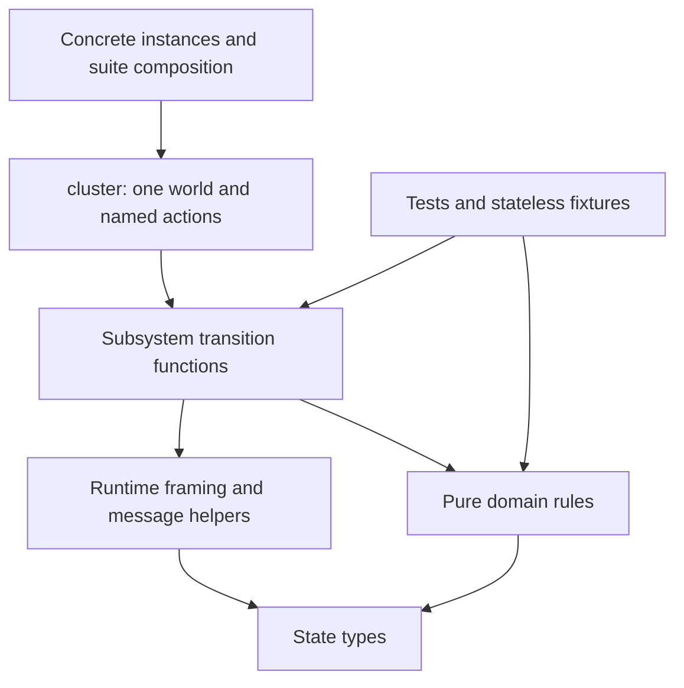

# Implementation plan: organize the Quint model by subsystem

**Plan:** `docs/plans/20261028-quint-module-refactoring.md`
**Date:** 2026-10-28
**Project source:** `../../scripts/quint` relative to this plan; repository path `scripts/quint`
**Branch:** `feat/quint-spec`
**Model baseline:** `b39764c` — cluster-management implementation Tasks 1–7
**Target architecture:** [cluster-management target](../brainstorms/20261027-quint-cluster-management-target.md), especially §§2–6, 8–10 and 14
**Full original brainstorm:** [cluster-management discussion](../brainstorms/20261027-quint-cluster-management.md)
**Refactoring request:** user discussion on 2026-10-28: group modules, hide contextual complexity, reuse higher-order functions, and mirror familiar Go subsystem boundaries.
**Parent implementation plan:** [cluster-management plan](20261027-quint-cluster-management.md)
**Execution log when implemented:** `docs/progress/20261028-quint-module-refactoring.md`
**Status:** planned, not implemented. The parent goal remains paused; writing this plan does not authorize resuming it.

## Objective and execution position

Reduce the effort needed to navigate, extend and review the current model before implementing parent Task 8. Preserve the existing modeled behavior, assumptions, state schema, interleavings, properties and coverage. This is a structural refactoring, not a smaller model or a new protocol implementation.

Use two substantial implementation commits, followed by architectural verification, external review and documentation. Execute this plan independently from parent Tasks 8–18. Completion does not automatically resume that paused plan.

The expected benefit is clearer ownership and less repeated state-update/transport code. The prior estimate of 10–25% less routine implementation/debugging effort is a planning estimate, not a measured performance promise. Moving files or using higher-order functions does not itself reduce the model's reachable state space or simulator runtime.

## Important notices

- Keep exactly one instantiated mutable `world`. A directory is organizational structure, not an automatically isolated Quint state machine or namespace.
- Preserve implemented scoped operation concurrency and explicit hosting. The user selected implemented behavior despite stricter statements in `library.md` and review guidance. Do not resolve that discrepancy by changing semantics during this refactoring.
- Keep favorable metric assumptions, abstract Raft, retained valid storage and the existing deferred-feature boundary. No labels, offline recovery or extra public session/lock workflows.
- Do not edit production Go, generated protocols, immutable compatibility fixtures, vendor sources or dependency versions. Do not add default Go-test/Make integration; that remains parent Task 15.
- Preserve named phase actions. Never replace delayed delivery, commit/apply, callback return, receipt/report or stop/join boundaries with one atomic production transition.
- Do not use test failures as permission to weaken guards, assertions or negative controls. Separate a necessary behavioral correction from the structural change and document the evidence.
- Batch Quint tests after substantial changes. Use focused typechecks during editing and focused diagnostics for failures. Do not rerun entire suites after every rename or extracted helper.
- Record deviations in **NOT PLANNED CHANGES** and unresolved requirements in **NOT IMPLEMENTED GAPS**. A remaining correctness or wiring gap blocks completion.

## Current evidence

At the baseline, `scripts/quint` has 38 top-level `.qnt` files: 21 implementation modules and 17 test modules. There are 44 non-vendor `.qnt` files including instances. `cluster.qnt` contains 1,542 lines and 95 actions. It combines metadata transactions, consensus/network actions, authority, lifecycle, sessions and exploration selectors.

`World`, `Context`, `Transition` and `HostEffect` currently live in `handlers.qnt`. Consequently, initialization, properties and effect execution import a handler module merely to obtain state/transport types. Runtime suites also form an inheritance chain from `cluster_test` through membership, reads, transactions, operations, effects and lifetime tests; several pure tests import other test modules for fixtures.

The existing runner already hashes `.qnt`, `.py` and `.json` files recursively. It compares exact expected test-name inventories after stripping module qualification. Preserve these safeguards; folder nesting alone does not justify rewriting the runner.

| Profile | Runtime cases | Shared core checks |
| --- | ---: | ---: |
| foundation | 7 | — |
| smoke3 | 43 | 91 |
| authority3 | 57 | 91 |
| lifetime3 | 76 | 91 |

These are overlapping suites, not additive unique-case totals. `instances/topologyChecks.qnt` retains broader historical pure checks outside initial acceptance; preserve its availability and scope labeling.

## Refactoring design

### D1. Responsibility-based layout

Use Go subsystem names where responsibilities match. Keep abstract consensus, environment faults and model harnesses explicitly model-specific. Do not reproduce every Go directory, introduce empty future packages, or split the cohesive 348-line type catalogue merely to reduce a file-size statistic.

```text
scripts/quint/
  cluster.qnt                 # sole world variable, stable action facade, step composition
  state/                      # types.qnt; declarations only, no mutable state
  runtime/                    # World/Choreo aliases, framing and envelope primitives
  topology/                   # edits, placement, immutable plan construction
  metaengine/                 # replicated metadata rules, grants, receipts, sessions
  metaservice/                # request/read/approval work and node-side session steps
  operator/                   # remaining-plan checks, dispatch/checkpoint coordination
  managed/                    # replica lifetime, effect consumption, host fencing
  consensus/                  # safe Raft abstraction and native guards
  environment/                # transport delivery, partitions, crash/restart inputs
  harness/                    # initialization, scope assumptions, properties
  tests/
    fixtures/                 # pure data fixtures; no run declarations or model instance
    support/                  # shared scenario helpers and composition support
    unit/                     # pure rule tests, grouped by subsystem where useful
    scenarios/                # named asynchronous scenarios by responsibility
  instances/                  # existing concrete instance paths/names retained
  profiles/                   # existing profile names and CLI retained
  vendor/                     # unchanged
  run.py, run_test.py          # stable entry points
```

Use explicit module names/aliases such as `managed_steps` and `metaservice_session_steps`; two files called `steps.qnt` must not accidentally export conflicting unqualified definitions. Prefer direct imports or small explicit exports over wildcard package barrels.

### D2. Migration map

| Existing component | Intended owner |
| --- | --- |
| `types.qnt` | `state/types.qnt`, preserving record and variant shapes |
| Choreo aliases currently in `handlers.qnt` | `runtime/world.qnt`; no `var` declaration |
| `apply_custom_effect`, envelope/framing updates | `runtime/updates.qnt` and `runtime/messages.qnt` |
| `topology.qnt`, `placement.qnt`, `planning.qnt` | `topology/` |
| `authority.qnt`, `grants.qnt`, `repair.qnt`, replicated control application | `metaengine/` |
| Replicated session grant/bind/revoke rules | `metaengine/sessions.qnt` |
| `reads.qnt`, caller transaction state, approval capture/recapture | `metaservice/` |
| Local listeners and session renewal/probe handling | `metaservice/handlers.qnt` and cohesive step modules |
| `remaining.qnt`, effect dispatch/checkpoint coordination | `operator/` |
| `lifecycle.qnt`, receiver execution and host-fence completion | `managed/` |
| `membership.qnt`, abstract native commit/election/catch-up | `consensus/` |
| Link changes, delivery/loss/duplication, crash/restart orchestration | `environment/` |
| `initial.qnt`, `scope.qnt`, `properties.qnt` | `harness/` |

A current file may span two responsibilities. Split mixed files only at existing functional boundaries: for example, caller preparation stays in `metaservice`, while metadata command validation/application belongs in `metaengine`. Keep exact guard/update behavior and document the old-to-new symbol mapping. Avoid inventing a one-file-per-action convention.

### D3. Dependency and state ownership



`state` contains no imports from handlers, tests or composition. `runtime` may import state declarations and vendored Choreo, but not domain rules. Domain transition functions do not import `cluster` or define another mutable world. Production code never imports tests. Harness properties inspect state for verification; actors do not gain access to facts through those properties.

Keep `cluster.init`, `cluster.step`, `requestStep`, `protocolStep`, `faultStep`, `nativeStep` and existing named action entry points usable by scenarios. Move substantive guard/update bodies into their owning modules and leave thin wrappers where needed. Aim to remove the majority of domain bodies from `cluster.qnt`; do not achieve a line-count target by hiding phase boundaries or introducing an interpreter.

### D4. Higher-order helpers and transition interfaces

Introduce a small set of helpers with demonstrated repetition. Proposed signatures, subject to the pinned-tool prototype in Task 1:

```quint
pure def withNode(w: World, node: NodeName,
                 update: (LocalNode) => LocalNode): World
pure def withOwner(w: World, node: NodeName, group: GroupId,
                  update: (OwnerState) => OwnerState): World
pure def enqueue(w: World, envelope: Envelope): World
pure def consumeEnvelope(w: World, envelope: Envelope): World
```

These helpers frame updates; they do not authorize operations, allocate replacement identities, select a newer version, or supply default missing owners. Keep business guards in domain code and guard partial map/Option/list access before evaluating it. Test that unrelated state is preserved, in addition to testing the intended update.

For deterministic extracted steps, prefer a pure function returning `Option[World]`: `None` means disabled, `Some(updated)` means the existing transition is enabled. One action adapter in `cluster` converts this to the next-state assignment. Its `None` branch must remain disabled, not become a stutter. If the prototype shows this representation adds substantial copying or obscures diagnostics, use explicit guard/post-state functions with the same single-owner facade instead.

Keep nondeterministic choices and exploration grouping visible. Do not collapse separate branches into a set of successor worlds that deduplicates choices or changes sampling weights unintentionally. Operators/functions are source-level parameters, never fields added to persisted model state.

### D5. Reusable workflows and tests

Production workflows remain the existing phase machines and independently enabled transitions. Reuse guards, single-step transformations and transport helpers. A helper named “approve” must not silently perform submission, commitment, local application and reply together.

Scenario helpers may compose existing `.then` steps because a deterministic test prescribes a trace. Preserve access to individual phase actions for injecting a crash or competing operation between them. Do not use these scenario scripts as the production `step` relation.

Extract fixtures from test modules into stateless fixture modules. Replace test-to-test fixture imports and incidental wildcard re-exports with deliberate suite composition. Prototype shared scenario composition first: use a supported singleton import arrangement or stateless higher-order scenario builders invoked by one stateful suite entry point. Inspect the instantiated model to prove it contains only one mutable world. Do not solve compiler limitations by duplicating the cluster or copying entire scenario suites between profiles.

### D6. Behavioral preservation and evidence

Preserve state fields, identities, constants, initialization assumptions, branch guards, fault choices, enabled/disabled behavior, mutation frames and step boundaries. Keep exact CAS and retry captures, actor-local versus confirmed knowledge, physical versus logical completion, replica/member/process identities, pending ownership and lease semantics.

Create an action migration ledger covering all 95 baseline actions: old/new locations, guard ownership, fields read/written and unchanged phase boundary. Check the refactored action against its baseline body. Existing scenarios and negative controls are mandatory regression evidence, not a proof of complete equivalence.

Compare representative intermediate states for metadata commit/apply, authority consume/report, host fencing, late factory/Close and session renewal/revoke. Preserve exact IDs and pending queues; only incidental module qualification, source locations and artifact metadata may be normalized. Identical seeds are useful for reproducibility, but module/AST changes may alter sampled traces without changing the transition relation. Do not promise byte-identical ITF or exhaustive equivalence.

## Task list

### Task 1: Establish subsystem boundaries and independent test fixtures

**Files:** module moves under D1/D2; `runtime/world.qnt`; `tests/`; `instances/`; affected profile paths; runner tests only where needed.
**References:** target §§4–6 and 10.3–10.4; this plan D1–D3, D5–D6.

- [ ] Confirm the execution baseline and record revision, model/configuration hashes, current test inventories, public action/property names and profile settings in the execution log. Reuse prior validation only when hashes match; otherwise obtain a fresh baseline.
- [ ] Prototype one higher-order state-update helper and one independently composed scenario on Quint 0.33.0/Rust v0.7.0. Typecheck and execute them; inspect instantiated state ownership and same-named helper imports. Resolve the composition encoding before bulk moves. If no supported encoding preserves one world, record the blocker instead of introducing duplicate state.
- [ ] Move cohesive pure modules using D2, retaining semantics and stable public action/profile names. Extract state/Choreo aliases from handlers into `runtime/world.qnt`; remove handler dependencies from initialization, properties and pure execution solely used for types.
- [ ] Move tests into unit/scenario areas, extract shared data into `tests/fixtures`, and replace test-module fixture dependencies and the incidental suite-inheritance chain with the validated explicit composition.
- [ ] Keep instance file paths and profile names stable. Update imports and manifests; preserve leaf test names and exact per-profile inventories, including historical `topologyChecks` availability. Do not broaden initial scope by activating historical extension tests.
- [ ] Confirm nested modules appear in recursive run manifests. Change `run.py` only if an actual relocation incompatibility is demonstrated; preserve missing/ignored/duplicate-name rejection, exit codes and artifact behavior.
- [ ] Remove obsolete forwarding modules after consumers migrate; retain a compatibility shim only for a documented external entry point, not every former leaf path.

#### Verification

- [ ] Acyclic imports; no production-to-test imports or test-to-test fixture dependencies; exactly one instantiated mutable world in every concrete instance.
- [ ] Baseline expected test-name sets and profile bounds/init/step/property selections remain intact. Folder moves do not silently omit checks or artifacts.
- [ ] Relevant concrete modules typecheck; foundation and lifetime3 test batches pass. Run focused extra profile checks only for entry points whose wiring differs. Record outcomes before committing this task.

### Task 2: Extract transition bodies and reuse framing/workflow helpers

**Files:** `cluster.qnt`, runtime helpers, subsystem step modules, scenario support and focused tests.
**References:** target §§4–5, 8–10 and 14; this plan D2–D6.

- [ ] Create the action migration ledger and extract bodies in cohesive groups: metadata request/commit processing; authority dispatch/consumption; lifecycle/host fencing; sessions; consensus/environment. Preserve guard ordering where partial accesses depend on it.
- [ ] Keep one `world`, the stable named action facade and the existing exploration grouping. Use the Task 1-proven transition interface; preserve nondeterministic domains and disabled branches without introducing a generic command/workflow DSL.
- [ ] Implement only repeatedly useful higher-order helpers such as owner/node updates and envelope effects. Keep authorization, quorum, identity and post-wait checks explicit in domain functions; preserve unrelated world fields and durable/volatile separation.
- [ ] Reuse scenario setup/phase helpers while keeping crash/partition/cancel injection points available. Keep production phase actions independent; do not call multi-step test scripts from simulation drivers.
- [ ] Add focused frame and disabled-action regressions, including missing owner/map entries, false guards, late callbacks, stale incarnation/receipt/courier data and preservation of unrelated operation ownership.
- [ ] Check all ledger entries against the baseline guards and post-states. Record representative intermediate-state comparisons and unchanged negative-control failures; investigate semantic drift rather than updating assertions to accept it.

#### Verification

- [ ] The composition root contains state ownership, small action adapters and exploration composition; domain bodies reside in their named subsystems. Helpers have concrete reuse, not speculative callers.
- [ ] All baseline scenarios/core checks still pass; intended negative controls still expose their violations. The helper-disabled path cannot extend a trace by stuttering.
- [ ] Run the final profile matrix and bounded simulations in **Validation Commands**. Record source hashes, commands, bounds and results. Measurements are observations, not a promised runtime speedup.

### Task 3: Verify the architectural delta

**Files:** migration ledger, implementation files, this plan's gap/deviation records.
**References:** target §§2–6, 8–10, 14–15; this plan D1–D6.

- [ ] Verify state/runtime ownership: unchanged schema and initialization, one world, correct framing, no function values in model state and no new omniscient actor reads.
- [ ] Verify topology and metadata boundaries: pure edits/planning, exact CAS/replay, scoped ownership, grant/session FSM updates and complete receipt/fence history remain equivalent.
- [ ] Verify service/operator boundaries: request/read/capture/commit/apply/reply and dispatch/checkpoint steps retain their original enabledness and evidence requirements.
- [ ] Verify managed/consensus/environment boundaries: callback ownership, holds, stop/join/release, session leases, native quorums and independent network/failure actions retain their interleavings.
- [ ] Verify fixtures, named scenarios, properties, profiles, runner artifact paths and all baseline test inventories. Historical or deferred checks retain their previous classification.
- [ ] Record and fix every structural or behavioral gap in **NOT IMPLEMENTED GAPS**; do not mark an unimplemented requirement complete.
- [ ] Verify final wiring: every moved action/helper is reachable from the intended production `init/step` or named test entry point, every required property/profile still executes, and no subsystem exists only as unused code.

#### Verification

- [ ] Every baseline action has a reviewed migration entry; all D1–D6 requirements have concrete file/test evidence.
- [ ] Changes since the last batch receive appropriate focused checks; repeat full batches only for broad semantic/wiring changes. No unsupported equivalence or exhaustive-verification claim is made.

### Task 4: Run visible external review and resolve findings

**References:** target §§3–4, 9–10; this plan D3–D6; `.revmux/profile.md` and `AGENTS.md`.

- [ ] Read the current revmux and Paseo skills at execution time. `revmux` is currently available and the repository has `.revmux/profile.md`; run the review in a new visible Paseo terminal as required by the repository.
- [ ] Review only the refactoring commit range from the recorded execution baseline. Supply the original target, this plan, migration ledger and validation results; prioritize accidentally collapsed transitions, duplicate state, weakened guards, lost tests and misleading package boundaries.
- [ ] Explicitly preserve the user-approved implemented-code baseline where review guidance requests stricter global topology serialization. Such protocol changes are outside this refactor.
- [ ] Confirm findings against source and traces. Fix confirmed critical/major issues; retain minor findings with reasons. Re-review affected changes and record the report location under `docs/review/` without copying the report into chat.

#### Verification

- [ ] No unresolved critical/major refactoring defect; review findings have evidence and disposition. Required corrections pass their focused checks, with broader reruns for cross-cutting changes.

### Task 5: Close gaps, update documentation and hand back the paused backlog

**Files:** model README/coverage, target §4 organization details, parent plan file paths, execution log, `docs/changelogs/20261028-quint-module-refactoring.md`.
**References:** target §§4–6 and 13–15; this plan D1–D6; `docs/project.md` documentation rules.

- [ ] Resolve every **NOT IMPLEMENTED GAPS** entry against the original requirements. An unresolved required behavior/coverage gap prevents completion; any explicitly accepted structural deviation must be documented, not hidden behind passing tests.
- [ ] Document the subsystem map, one-world rule, supported helper pattern, workflow phase boundaries and where a future task should add a transition/test. Remove stale path/composition descriptions without rewriting historical validation evidence.
- [ ] Update the existing target's organization section and pending parent Tasks 8–18 file references to the implemented locations. Preserve completed task history, remaining protocol scope and pause status; do not restart or renumber the parent implementation.
- [ ] Write a concise changelog about easier navigation, traceability and extension of the model. Do not claim new library behavior, improved correctness coverage or faster simulation without evidence.
- [ ] Record final commit range, source hashes, test/profile inventories, validation/review artifacts and limitations. Verify documentation links and `git diff --check`.

#### Verification

- [ ] Readers can locate topology, metadata FSM, service coordination, managed lifetime and harness code using the documented map.
- [ ] Only necessary compatibility entry points remain; no duplicate implementation or inactive parallel model was left behind. Documentation-only final edits do not trigger unnecessary Quint reruns.

## Validation Commands

Planning does not run these commands. During implementation, use the pinned local CLI/evaluator and existing runner; do not download or upgrade dependencies. Full tests run at the two implementation checkpoints, not after each mechanical edit.

```sh
# Focused syntax/effect checks during editing; include historical entry points.
quint typecheck scripts/quint/instances/foundation.qnt
quint typecheck scripts/quint/instances/lifetime3.qnt
quint typecheck scripts/quint/instances/coreChecks.qnt
quint typecheck scripts/quint/instances/topologyChecks.qnt

# Task 1 checkpoint; lifetime3 includes earlier management/authority scenarios.
python3 scripts/quint/run.py --profile foundation --mode test --seed 1
python3 scripts/quint/run.py --profile lifetime3 --mode test --seed 1

# Task 2 final entry-point matrix; run each once after the substantial batch.
python3 scripts/quint/run.py --profile smoke3 --mode test --seed 1
python3 scripts/quint/run.py --profile authority3 --mode test --seed 1
python3 scripts/quint/run.py --profile lifetime3 --mode test --seed 1
python3 scripts/quint/run.py --profile foundation --mode test --seed 1
python3 scripts/quint/run.py --profile smoke3 --mode simulate --seed 1
python3 scripts/quint/run.py --profile lifetime3 --mode simulate --seed 1

# Required if runner/path-discovery/reporting code changes.
python3 -m unittest discover -s scripts/quint -p '*_test.py'
git diff --check
```

Use the same profile bounds, backend and samples for baseline/candidate comparisons. Do not shrink scenarios or lower samples to fit a timeout. Count missing/ignored tests as failure. Empty, interrupted, unsupported and timed-out runs remain incomplete; they are not behavior-preservation evidence. Preserve each run's artifacts under the existing report root.

Use structural inspection of parsed/flattened output for the single-world check, with the pinned CLI's documented options. Do not add unverified CLI syntax to automated checks. No new `quint verify`/TLC qualification or Go/Docker/race suite is required by this structural plan; parent verification tasks remain pending.

## NOT CONSIDERED & TODOs

| Tag | Exclusion | Treatment |
| --- | --- | --- |
| [postponed] | Parent Tasks 8–18 protocol implementation | Resume separately only when authorized; this plan changes organization and reuse. |
| [postponed] | Labels, diagnostic API machines, public sessions/locks, offline recovery and metric faults | Keep existing scope exclusions and markers; do not create packages/stubs that imply support. |
| [potential-improvement] | State-space reduction and faster exploration | Separate semantic/performance work with its own justification; no speedup claim from folder moves. |
| [potential-improvement] | Splitting the entire type catalogue | Keep it cohesive unless a demonstrated acyclic dependency requires a small extraction. |
| [too-complex] | Generic workflow interpreter, generated action DSL or full new trace-replay engine | Use existing phase actions, small helpers and representative comparisons instead. |
| [postponed] | Strict global operation serialization or other Go contract changes | Preserve the implemented scoped baseline; no Go changes in this refactor. |

Keep existing `TODO(not planned)` scope markers with moved code. New markers are only needed where a refactored module might otherwise appear to implement an excluded behavior; do not add fake errors or logging paths to a formal model for unmodeled features.

## NOT PLANNED CHANGES

None at planning time. During execution, record the file, reason, scope and relevant commit/diff for every deviation.

## NOT IMPLEMENTED GAPS

None identified as an accepted omission at planning time. Tasks are unimplemented. The pinned-tool scenario-composition prototype is an explicit Task 1 gate, not a claim that its encoding is already verified.

## Planning verification

The plan is grounded in the Task 7 checkout, existing target, Go package map, model imports, profiles, runner implementation, repository documentation rules and review profile. It contains two implementation tasks, then architectural verification, visible external review and documentation. All validation above is prospective; no Quint suite or review was run to write this plan.
