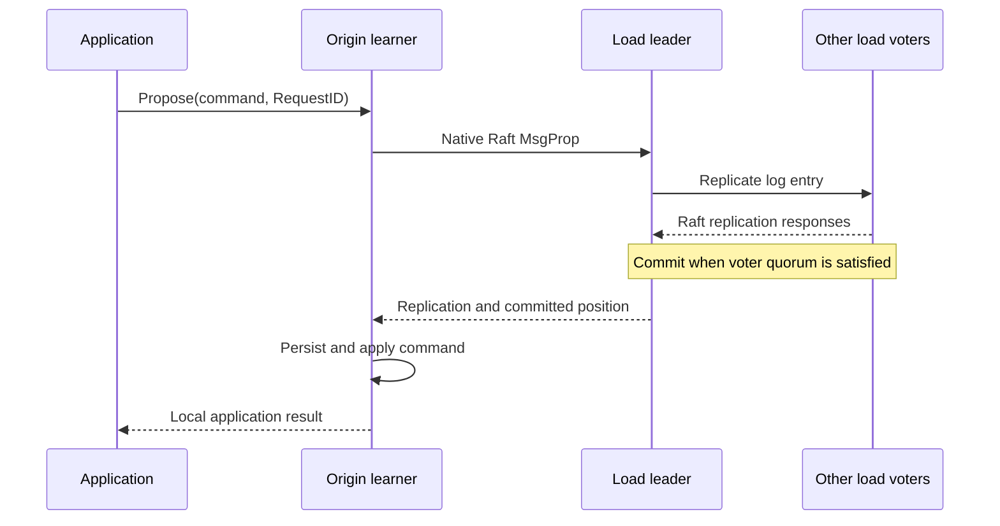

# Cluster actions: Raft consensus, leader decisions and local effects

Date: 2026-10-12. Project: `github.com/asalimonov/gquorum`.

This report describes the **current working-tree implementation**, including
the stable-learner changes staged above baseline commit `84ffa43`. It answers
which actions require agreement through a Raft group and which a leader or
individual node can perform without a new group commit. Source code is the
authority for the classifications below.

The review was read-only apart from creating this report. No tests were run for
this report. Referenced tests are existing coverage, not new validation results.

Navigation: [acknowledgements](#2-what-acknowledged-and-committed-mean-here),
[metadata actions](#3-actions-governed-by-_meta-raft),
[group consensus](#4-actions-governed-by-each-groups-own-raft),
[leader-local actions](#5-what-the-leader-can-do-without-a-new-commit),
[leadership transfer](#6-leadership-transfer-no-new-topology-commit-but-not-unilateral-completion),
[physical effects](#7-physical-effects-committed-authority-local-execution-committed-progress),
[node-local actions](#8-actions-local-to-any-node-or-replica),
[replacement example](#9-worked-example-replacing-a-voter-in-a-seven-node-cluster),
[failover state](#10-what-survives-failover-and-what-does-not),
[quorum loss](#11-behavior-when-acknowledgements-or-quorums-are-unavailable).

## 1. The main distinction

**Leaders choose and coordinate; Raft commits changes to shared authoritative
state.** A leader can collect observations, select a replacement, build a plan,
refresh a session deadline and dispatch an already authorized effect without
asking other replicas to approve that computation. It cannot make a new
topology, session grant, lock acquisition or voter configuration authoritative
merely by updating its own memory.

There are two independent consensus domains:

- **`_meta`** commits topology, approved plans, operator progress, admission,
  session existence, lock ownership and completed voter-switch records.
- **Each load group** commits its application commands and its own native Raft
  membership changes. Its leader can be on a different node from the `_meta`
  leader. An ordinary load write does not make a second proposal to `_meta`.

However, “does not append a new Raft command” does **not** necessarily mean
“returns immediately” or “requires no communication.” Leadership transfer uses
Raft's election protocol; cleanup waits for host acknowledgements; metrics
collection waits for bounded read responses. These are different kinds of work.

| Category | New consensus required for this action? | What the action relies on |
| --- | --- | --- |
| Replicated metadata mutation | Yes, in `_meta` | The meta voter quorum and application of the command |
| Application mutation | Yes, in that load group | That group's voter quorum and application on the submitting local replica |
| Native voter/learner membership change | Yes, in the affected group | Previously committed authorization, runtime safety checks and a committed configuration entry |
| Leader-local decision or bookkeeping | No new commit | Local state, prior committed state and possibly observations from peers |
| Election or transfer initiation | No application/configuration command for the request itself | Raft messages; becoming leader still requires the relevant election quorum |
| Host-local effect under an approved plan | No new group commit for the physical effect itself | Previously committed exact authorization, local I/O and verified host results; progress is separately committed in `_meta` |
| Local read, lifecycle or diagnostic action | Usually no new commit | Local state and ownership; some reads issue probes and some lifecycle paths attempt a separate replicated operation |

Sources: [public Cluster API](../../cluster.go), [public Node API](../../node.go),
[load Group API](../../load/group.go),
[metadata proposal submission](../../internal/metaservice/rpc.go),
[Raft run loop](../../internal/raftengine/loop.go).

## 2. What “acknowledged” and “committed” mean here

### 2.1 The quorum is a majority of voters, not all replicas

For a stable configuration with `V` voters, the quorum is `floor(V/2) + 1`.
Learners receive replicated state but contribute no votes toward commitment or
election. The leader's own durable replica counts when it is a voter.

For seven replicas configured as three voters and four learners:

- A normal commit needs two voters, normally the leader and one other voter.
- It does not wait for all seven hosts, all three voters or all four learners.
- A write submitted through a learner additionally waits for that learner's
  local application before its `load.Group.Propose` call succeeds.
- A one-voter group has quorum one: it can commit with local persistence and no
  remote acknowledgement. That remains a Raft commit, with no redundant voter.

The actual native configuration determines the quorum. Changing the desired
voter target in topology does not immediately change a group's quorum. Each
configuration transition must itself commit under Raft's applicable rules.

Sources: [membership safety](../../membership/safety.go),
[configuration application](../../internal/raftengine/loop.go),
[replicated voter policy](../../topology/voter_policy.go).

### 2.2 Different acknowledgements prove different things

| Response or observation | What it establishes | What it does not establish |
| --- | --- | --- |
| Successful `SendRaft`/meta `StreamMessages` delivery | The transport/receiver accepted and handled the message according to that interface | A voter quorum has persisted it, the command committed, or the application applied it |
| Raft append response from a voter | Replication progress used by Raft to calculate commitment | Every other replica has the entry, or the application finished applying it |
| Heartbeat response | Raft peer contact/activity information | Successful commitment of a new application operation |
| Successful `IdentityPing` or metrics read | A particular process answered a diagnostic request | That process can persist and apply new Raft entries, or a quorum is available |
| Successful `KeepAlive` | The observed meta leader accepted renewal of an existing exact-process session in its local deadline table | A renewal entry was committed, or the deadline was stored on other meta replicas |
| Successful metadata mutation | The command committed and its result was produced by the meta leader's state machine | Every meta replica, including the node that forwarded the request, has applied it |
| Successful `load.Group.Propose` | The command committed in the load group and applied on that exact submitting local replica | All replicas applied it, or an external database/side effect committed |
| Successful configuration-change call | The affected engine applied the committed configuration and completed its applied-state bookkeeping path | All peers have observed the change or all physical cleanup has finished |
| Verified `load.ActionResult` | The exact addressed host attests the requested effect and full authorization/identity tuple | A bare `Verified=true` with missing or different identities is sufficient |
| Operator success / `Active` advancement | Replicated workflow progress and subsequent replicated activation | A distributed transaction atomically combined metadata, load membership and every host's resources |

The inbound Raft loop answers message handling separately from the later
`Ready` persistence/apply path. A network RPC success must therefore not be
interpreted as a durable application result. Outgoing Raft messages for a
`Ready` batch are released only after the engine's required persistence and
application bookkeeping for that batch.

Cancellation or timeout also is not proof of rejection: an already submitted
command can commit after the caller stops waiting. Application request IDs and
durable application deduplication handle uncertain retries.

A deterministic business rejection can itself be the result of a committed
command: applications return it in `Result.Code`. An `Apply` error has a
different meaning and halts the replica. Consensus success does not imply that
the application's business condition was accepted.

Sources: [`StreamMessages`](../../internal/metatransport/server.go),
[`Step` and `submit`](../../internal/raftengine/group.go),
[`run`, `beginReady`, `finishWrite`, `apply`, `advance`](../../internal/raftengine/loop.go),
[action-result verification](../../internal/managed/dispatch.go).

## 3. Actions governed by `_meta` Raft

These operations change common cluster state. The table describes a **new
successful mutation**; rejecting a request or returning an already known result
can avoid a new proposal.

| Action | Committed state / command path | What success waits for |
| --- | --- | --- |
| Stage a topology document | `ProposeDocument`; advances `Latest` using expected-version CAS | Meta commitment and leader-side application |
| Add, drain, activate or exclude a node | Typed mutation constructs a document, then stages it; optional approval is a separate operation | Staging commitment; approval commitment if requested |
| Change placement, explicit hosts, voter policy or pinned-learner intent | The updated document is staged through the same path | Meta commitment; native membership may still be unchanged |
| Create/delete a load group or change replica roles | Staged document and, when requested, approved operator | Metadata acceptance; physical convergence happens afterward |
| Roll back topology | A new version is constructed and staged with validation against retired identities | A new meta commit, not reversal of historical log entries |
| Approve a version | `BeginOperatorProposal` sets `Target` and stores the immutable plan and attempt | Meta commitment before newly authorized effects can execute |
| Automatic repair of a missing load replica | `CommitRepairOperatorProposal` atomically installs the scoped document and approved plan | Meta commitment after fresh driver checks and replicated CAS |
| Automatic stable-learner promotion/demotion | `CommitVoterChangeProposal` atomically installs the role-only document and approved plan | Meta commitment; the role changes subsequently commit in their own group |
| Fresh-ID readmission | Public staged readmission or automatic `CommitReadmissionProposal`, depending on the path | Committed identity allocation and authorization; later admission/effects remain separate |
| Bind a joining process to an admission | `BindAdmissionProposal` | Meta commitment of the exact process/member/operator binding |
| Record the joiner's prepared acknowledgement | `ReadyAdmissionProposal` | Meta commitment; a direct `JoinReady` RPC alone is not the durable record |
| Advance, wait, fail, supersede or complete an operator | `TransitionOperatorProposal` | Meta commitment of the transition, not just changing a controller variable |
| Record completed voter role effects | Deterministic materialization while applying committed operator transitions | The corresponding meta transition commit; no independent raw-metrics proposal |
| Mark a converged target Active | `ActivateTargetProposal`, after final checks | Another meta commitment |
| Grant a session | `GrantSession` records ID, node, process incarnation and TTL configuration | Meta commitment |
| Acquire `node/<name>` or an application lock | `AcquireLock`, checked against replicated sessions and existing ownership | Meta commitment |
| Explicitly deactivate a session | `RevokeSession`; also releases all locks held by that session | Meta commitment for shared revocation; local fencing starts earlier |
| Revoke an expired/stale session | Leader detects/probes first, then submits `RevokeSession` | Meta commitment before replicated ownership is released |
| Retain allocation floors, retired group IDs and approved cleanup evidence | Deterministic FSM updates from committed documents/operators | The owning metadata command; no separate leader-only allocation authority |

Sources: [document mutations](../../internal/metaservice/documents.go),
[typed mutation flow](../../internal/metaservice/mutations.go),
[voter/hosting mutations](../../internal/metaservice/voter_mutations.go),
[approval and activation](../../internal/metaservice/planning.go),
[scheduling-to-proposal adapter](../../internal/metaservice/scheduling.go),
[admission](../../internal/metaservice/join.go),
[metadata command dispatch](../../internal/metaengine/sm.go),
[operator FSM](../../internal/metaengine/operator_state.go),
[role records](../../internal/metaengine/voter_switch.go),
[session/lock FSM](../../internal/metaengine/sessions.go).

### 3.1 Staging, approval and convergence are separate guarantees

`Latest`, `Target` and `Active` are all replicated state, but mean different
things:

1. A committed `Latest` means the edit was accepted as intent.
2. A committed approval makes that version `Target` and authorizes its exact
   immutable plan.
3. Effects execute, are checked, and advance the replicated operator record.
4. Final validation and `ActivateTargetProposal` advance `Active`.

Staging is not a leader-local draft, and successful approval is not proof that
every effect is already complete. A mutation can successfully stage and then
fail approval; its returned staged version must be retained for an approval
retry. Preview and planning do not commit either boundary.

Approving an already running or successfully completed operator for the same
version can return its existing ID without another approval commit. This is
reuse of a previously committed result, not authority created locally.

### 3.2 Metadata forwarding has a different completion boundary from load forwarding

A follower or learner submitting a metadata mutation sends a control RPC to
the observed `_meta` leader. The leader calls the shared engine's `Propose` and
returns its applied result. The forwarding origin does not then wait for its
own metadata FSM to catch up.

Consequently, a successful forwarded mutation followed immediately by a local
`Latest`, `Target`, `Active`, session or operator read can temporarily observe
older state. `WaitOperator` polls the local observation until it sees a terminal
state; callers still need to inspect whether that state is success or failure.

By contrast, native load forwarding keeps the proposal waiter at the origin
replica and returns only after that origin applies the committed command.

Sources: [`submitProposal` and `ProposeMeta`](../../internal/metaservice/rpc.go),
[`Apply`, `applyLocal`, `WaitOperator`](../../internal/metaservice/planning.go),
[load proposal correlation](../../internal/raftengine/loop.go).

## 4. Actions governed by each group's own Raft

| Action | Affected consensus group | Requirement |
| --- | --- | --- |
| Application `Propose` | That load group | Voter quorum commits the command; origin-local application produces the result |
| Add a learner | Group receiving the learner | A committed configuration entry, despite the new member not voting |
| Promote learner to voter | Group being changed | Committed configuration entry after catch-up and safety checks |
| Demote voter to learner | Group being changed | Committed configuration entry; transfer leadership first if needed; preserve safe intermediate membership |
| Remove a replica | Group losing the member | Committed configuration entry, with removal and quorum guards |
| Change `_meta` native membership | `_meta` itself | An approved metadata workflow plus a separate native meta configuration change |

`_meta` approval and a load configuration commit are independent log events.
There is no atomic cross-group transaction. The approved workflow, exact
identities, idempotent effects and persisted progress bridge those events.

For managed replicas, raw membership operations are not exposed through
`load.Group`. The operator dispatches an authorized action to the affected
group's current leader. Its receiver validates authority and identities,
observes current membership/health, and runs `membership.Coordinator.Apply`.
That coordinator serializes changes and calls `ProposeConfChangeV2` only after
core safety checks.

The implementation accepts single-change Auto `ConfChangeV2` operations. It
does not expose arbitrary joint-configuration construction as a shortcut around
these checks.

Sources: [managed action receiver](../../internal/managed/actions.go),
[meta membership effects](../../internal/metaservice/effects.go),
[membership coordinator](../../membership/coordinator.go),
[safety rules](../../membership/safety.go),
[configuration submission](../../internal/raftengine/group.go).

### 4.1 A learner forwarding a write does not bypass consensus



The leader validates forwarded ordinary command envelopes and their native
sender membership. Forwarded configuration entries and raw metadata proposals
are not accepted through this load-command route. A load learner can submit a
write, but it cannot elect itself or promote itself to make the write commit.

Sources: [forwarding validation](../../internal/raftengine/forwarding.go),
[load ingress](../../internal/managed/transport.go),
[proposal application](../../internal/raftengine/loop.go).

## 5. What the leader can do without a new commit

“Leader-local” below means no fresh quorum agreement for the described decision
or memory update. It does not mean zero I/O, zero waiting, or durable failover
semantics.

| Action | Owner | Peer communication / waiting | Durability and boundary |
| --- | --- | --- | --- |
| Refresh an existing session deadline on `KeepAlive` | Meta leader | Requester waits for that leader's reply; leader does not solicit replica votes or acknowledgements for renewal | Deadline is in leader memory; session identity and TTL already exist in committed metadata |
| Extend an expired deadline after a successful exact-process probe | Meta leader | Waits for a bounded `IdentityPing`, or checks its own process locally | Extension remains local; failed probe can lead to a separately committed revoke |
| Seed/rebuild lease deadlines on leadership acquisition | New meta leader | Reads locally applied session records | Fresh deadlines replace the old leader's unreplicated timing state |
| Collect cluster metrics and maintain temporal evidence | Meta leader's collector | Bounded authenticated reads of meta/load replicas, allowing partial outcomes | Histories, sample ages and qualifying windows are local memory |
| Select an unhealthy voter and an eligible standby | Meta leader's scheduler | Uses copied observations; driver refreshes evidence and native status around the callback/planning | Selection is a proposal candidate, not a committed role change |
| Evaluate cooldown and the new-failure exception | Meta leader's observer/driver | Reads replicated switch records and local temporal evidence | Record is durable; elapsed countdown and healthy/failure history are local |
| Choose plan ordering and exact transfer target | Planner, with the meta leader owning approval | May wait for native status/health probes | Computed plan gains authority only when accepted through `_meta` |
| Choose when to retry or wake an operator | Meta leader's controller | Local timers/signals; effects and record writes have their own waits | Retry timing is local; operator state transitions are committed |
| Reject an invalid, unapproved or conflicting join | Meta leader | May probe the prior exact process; admission classification has an applied-current-term guard | Rejection/parked diagnostic creates no new membership authority |
| Return a retained-identity join response or an existing admission | Meta leader | Uses existing approved/applied state; may perform conflict checks | Reusing that result needs no new commit; revoking an old holder or creating a new binding separately requires commitment |
| Keep/sweep parked-join observations | Meta leader's local registry | Local memory; follower reads forward to the leader | Bounded, expiring and not replicated; rebuilt from retries after failover |
| Accept/relay address hints | Meta service, with relay restricted to the observed leader | Message headers and resolver/cache updates | Routes are local hints; committed topology still determines identity ownership |
| Choose replication destinations, retry sends, send heartbeats or snapshots | Leader of each Raft group | Ordinary Raft/transport traffic; destinations have independent bounded queues | Sending is not committing; Raft separately consumes responses for progress |

Sources: [KeepAlive RPC](../../internal/metaservice/rpc.go),
[lease expiry/probes](../../internal/metaservice/expiry.go),
[leadership lease reset](../../internal/metaservice/bootstrap.go),
[collector](../../internal/observe/metrics.go),
[temporal evidence](../../internal/observe/evidence.go),
[voter policy selection](../../policy/voters.go),
[driver revalidation](../../internal/scheduling/voters.go),
[join classification and routes](../../internal/metaservice/join.go),
[parked registry](../../internal/metaservice/parked.go),
[Raft sender](../../internal/raftengine/outbound.go).

### 5.1 Followers do not independently vote on the scheduler's diagnosis

The statement “replica X has failed for 30 seconds” is produced from the meta
leader collector's local observations. Each follower does not run the same
temporal analysis and send an approval vote for that diagnosis.

The scheduler/driver enforces freshness, exact source generations, stability,
cooldowns, pinned learners and current native safety before proposing a change.
The replicated FSM validates the submitted change's deterministic scope, CAS,
policy/identity constraints and plan shape. Raw histories and the complete
temporal proof are not replicated with the proposal. The affected group then
enforces its native membership safety at execution.

Thus consensus agrees on the **ordered authoritative change**, not on every
measurement or the leader's independent reasoning that selected it. This is the
implementation's normal crash-fault trust model, not Byzantine validation of a
leader's telemetry.

Sources: [driver rechecks](../../internal/scheduling/voters.go),
[replicated voter-change validation](../../internal/metaengine/voter_change.go),
[runtime eligibility checks](../../internal/votercheck/check.go).

### 5.2 Session renewal is not a quorum lease

`KeepAlive` checks the exact session/process/member against locally applied
metadata and then calls `leases.refreshTTL`. It has no `Propose`, `ReadIndex` or
per-renewal quorum-confirmation step. Its reply is an acknowledgement from one
observed leader.

`CheckQuorum` eventually makes an isolated Raft leader step down; it is not a
new quorum barrier inside every KeepAlive call. It follows from this code path
that a renewal received while that node still considers itself leader must not
be used as proof that a majority is reachable or that a linearizable read just
occurred.

When the lease expires, the leader may extend it after an exact-process probe.
If revocation is necessary, `RevokeSession` must commit. Until then the
replicated session and lock ownership are not removed merely because a local
timer elapsed. A new meta leader seeds fresh deadlines from replicated session
TTLs, so failover can delay expiration; the previous deadline is not recovered
from the Raft log.

Explicit deactivation also has two boundaries: the local process clears its
own serving/session deadline and pauses automatic activation before submitting
revocation, but shared ownership changes only when revocation commits.

Sources: [`Call("KeepAlive")`](../../internal/metaservice/rpc.go),
[`renewSession`, `Deactivate`](../../internal/metaservice/session.go),
[`seedLeases`, `expireSessions`](../../internal/metaservice/expiry.go),
[session/lock application](../../internal/metaengine/sessions.go).

## 6. Leadership transfer: no new topology commit, but not unilateral completion

`Cluster.TransferLeader(group, node)` is a special control path. It resolves the
exact **Active** voter identity and authorizes a transfer with no operator ID or
step sequence. It does not create a topology version or a new approved plan.
This exception permits transfer to an existing approved voter; it does not
permit arbitrary membership changes.

At the shared engine, `handleControl` validates the target as a non-learner,
calls `RawNode.TransferLeader`, and answers the request immediately. That return
means the transfer was initiated, not that a successor is already leader.

The public paths have different waiting behavior:

| Path | What it waits for |
| --- | --- |
| Direct `_meta` transfer | Engine acceptance of the transfer request; caller must observe the new leader separately |
| Managed load transfer | The action receiver polls until its local native status observes the exact target as leader, rechecking authorization while waiting |
| Transfer step inside an approved operator | Prior committed plan/step authority, effect execution, fresh status verification and committed workflow progress |
| Repeated transfer before guarded demotion | Only the exact approved transfer target; an unavailable target leaves the demotion waiting |

Actual succession uses Raft's transfer/election protocol, including the target's
catch-up requirements and the voter election quorum. A leader cannot assign
leadership to a learner or establish a new leader in a minority by returning
success from the transfer-request handler. Election votes and durable term/vote
state are protocol operations, not an application topology command.

Sources: [public transfer implementation](../../internal/metaservice/mutations.go),
[step-zero authorization](../../internal/metaengine/authorization.go),
[engine control handler](../../internal/raftengine/loop.go),
[meta effects](../../internal/metaservice/effects.go),
[managed load transfer wait](../../internal/managed/actions.go).

## 7. Physical effects: committed authority, local execution, committed progress

The meta leader does not replicate filesystem operations or application factory
calls as load-group commands. It dispatches them under previously committed
authority to the exact owners.

```mermaid
sequenceDiagram
    participant ML as Meta leader controller
    participant MQ as Meta Raft group
    participant Host as Exact host or load leader
    participant LQ as Load Raft group
    ML->>MQ: Commit approval / required current-step transition
    MQ-->>ML: Applied metadata result
    ML->>Host: Authorized exact action
    alt Membership action
        Host->>LQ: Propose configuration change
        LQ-->>Host: Committed and locally applied configuration
    else Host lifecycle or storage action
        Host->>Host: Validate identity; start, stop or retire resources
    end
    Host-->>ML: Verified exact result
    ML->>ML: Revalidate authority and observe required outcome
    ML->>MQ: Commit next step / completion record
    ML->>MQ: Commit Active after final convergence checks
```

An already committed running step can be retried without a new “running” entry
before each retry. The authorization is checked locally against the receiver's
applied metadata; there is no fresh meta quorum round for every such check.
A receiver behind the required committed step refuses with a retryable result
until it catches up. This is deliberately distinct from a per-effect
linearizable read barrier.

| Physical action | New affected-load-group commit for the physical action? | Other required waits/authority |
| --- | --- | --- |
| Prepare a replica / invoke its factory | No | Exact approved identity, local store/ledger validation, replay/readiness and owned publication |
| Create a founding load group on its intended hosts | Not a normal membership proposal to an already existing group | Committed meta authorization, deterministic initial membership installation and verified founding effects; normal operation then needs the new group's quorum |
| Stop an approved retiring replica | No | Previously approved step, exact-host shutdown/join and verified result |
| Retire application state and quarantine its Raft store | No | Full approval/readmission proof, exact identity/ledger checks and an application retirement attestation |
| Delete an entire load group | No requirement to commit removal of every member through that dying group's log | Meta-approved stop/delete plan and acknowledgements from required exact hosts; metadata completion remains a meta commit |
| Collect already retired storage | No | Local retention decision and rechecked opaque token, identity, ledger and absence of live assignment |
| Fence a node after committed self-removal | No additional permission commit for the fence | Locally applied durable removal proof; fencing precedes optional lifecycle callbacks |

Whole-group deletion is an important exception to the idea that every physical
change needs a live load quorum. The controller explicitly continues exact
host-local stops/deletion after enough replicas have stopped that the deleted
group no longer has a leader. An unreachable required host can still prevent
cleanup completion: “no load quorum required” does not mean “no acknowledgement
required.”

If an effect completes and its response or meta progress write is lost, a later
controller can verify the exact existing effect and resume the immutable plan.
The effect is not rolled back just because progress was not yet recorded.
Consequently, loss of meta quorum does not retroactively cancel work already
authorized, dispatched or in flight; new approval/progress cannot commit until
meta quorum is available again.

Sources: [operator execution and verification](../../internal/operator/controller.go),
[fan-out and exact result checks](../../internal/managed/dispatch.go),
[action receiver](../../internal/managed/actions.go),
[local retirement](../../internal/managed/retirement.go),
[self-removal proof](../../internal/metaservice/removal.go).

## 8. Actions local to any node or replica

These are not all “leader-only.” Followers and learners perform many of them.

| Action | Consensus dependency |
| --- | --- |
| `Latest`, `Target`, `Active`, `Get`, `History`, `Operator`, `LockHolder` reads | Read locally applied metadata; no new Raft read barrier |
| `Node.Status`, `load.Group.Status`, `IsLeader`, proposal-pressure/error reads | Local observations; no proof of current quorum |
| `Cluster.Status`, planning and health inspection | Can issue peer probes/status requests, but do not themselves commit a decision or establish a linearizable read |
| `Plan`, `PlanFor`, mutation preview | Compute/validate candidate intent; may wait for observations; create no committed authorization |
| `Cluster.Metrics`, `MetricsHistory`, load metrics reads | Read owned local snapshots/history; no network I/O in those public read methods |
| Local metric sampling and history pruning | In-memory work on each process/engine; not replicated |
| `SetSchedulingEnabled` | Changes this node's scheduler switch and resets its decision evidence; does not revoke an approved operator or configure other nodes |
| `SetServeOverride` | Persists an identity-bound value in this node's store; no leader required and no Raft membership/quorum override |
| `StartLoadGroup`, retained replica recovery | Acquires exact already authorized local resources; does not grant a new assignment or change voting membership |
| `StopLoadGroup` | Installs a local volatile hold and joins that replica; does not demote/remove its Raft ID or delete durable state |
| `NewNode`, `Start`, `WaitReady` | Construction is local; startup begins recovery/admission; readiness observes the required committed admission/session state and local policy, rather than creating a quorum barrier itself |
| `RequestStop`, `Stop` | Local teardown and joined resource ownership; no quorum is needed to stop safely, although shutdown attempts a bounded replicated session revoke |
| `load.Group.Snapshot` and automatic compaction | Local snapshot of already applied committed state, followed by local persistence/compaction; no fresh quorum approval for taking the snapshot |
| Snapshot installation on a follower | Restores received committed state and updates local durable state; transport/reporting is separate from committing a new application command |
| Identity pins, local load ledger, parked-load records, quarantine files | Local durable/diagnostic evidence constrained by approved topology; sharing a bbolt file with metadata does not make these separate local records Raft-replicated |
| Events, watches and optional event journal | Local publication/observation; event-journal durability is not replication through `_meta` |
| Authentication, queue admission, overload rejection, delivery reports | Local ingress/ownership/transport checks; accepted ingress is not application commitment |

Shutdown's session revoke has a two-second best-effort bound in the meta service.
Failure to commit it does not manufacture revocation and does not prevent local
quiescence. Session expiry/revocation can complete later under a healthy leader.

Snapshot success means the local snapshot operation finished, not that every
peer now stores that snapshot. Initial founding also has a special local
initialization path: exact supplied founding membership is installed in fresh
storage before a live cluster quorum exists. This is not permission to refound
an established identity after losing its log.

Sources: [Node lifecycle](../../node_lifecycle.go),
[Node load operations](../../node_load.go),
[local managed startup/stop](../../internal/managed/replica.go),
[metadata reads](../../internal/metaservice/documents.go),
[local scheduling switch](../../internal/metaservice/scheduling.go),
[local serve override](../../internal/metaservice/session.go),
[shutdown deactivation](../../internal/metaservice/lifecycle.go),
[snapshot/founding engine paths](../../internal/raftengine/group.go),
[snapshot writer path](../../internal/raftengine/loop.go),
[local ledger](../../internal/metastore/ledger.go),
[events bus](../../events/bus.go), [event journal](../../events/journal.go).

## 9. Worked example: replacing a voter in a seven-node cluster

Assume `_meta` and one load group each have three voters and four learners.
Every node still hosts `_meta`. Scheduling is enabled and an eligible standby
is already present.

| Phase | Who decides/acts? | Which acknowledgement or commit is required? |
| --- | --- | --- |
| Sample the voter and standbys | Replica owners and meta-leader collector | Diagnostic read replies; no metrics commit |
| Accumulate failure/stability evidence | Meta-leader observer | Local continuous evidence: default 30-second failure and 60-second standby windows |
| Choose candidate and ordering | Built-in/custom scheduler plus core driver | Local policy decision, refreshed observations and safety checks |
| Approve replacement | Meta leader proposes `CommitVoterChange` | Meta quorum commit, with converged-view CAS and immutable exact plan |
| Advance to an executable step | Meta controller | Committed running-step boundary, unless already recorded |
| Promote/demote | Leader of the affected group | That group's configuration commits and effect verification |
| Record role effect and progress | Meta controller / metadata FSM | Meta transition commit materializes the completed role record |
| Publish convergence | Meta controller | Final checks and committed Active advancement |
| Suppress repeated switching | Meta-leader observer | Local elapsed-time evaluation anchored by durable switch records |
| Restart former voter | Its Node and group engine | Retained identity/data recovery; no automatic promotion just because it returned |

With optional surge enabled and permitted by hard limits, the approved sequence
can be `3 voters -> 4 voters -> 3 voters`. The stable quorum sizes are then
`2 -> 3 -> 2`. Promotion itself is committed under the applicable pre-transition
Raft configuration; subsequent work must satisfy the resulting configuration.
The new learner becoming a voter does not retroactively supply a vote needed to
authorize its own promotion.

With surge disabled, a supported safe sequence can be
`3 voters -> 2 voters -> 3 voters`, with quorum sizes `2 -> 2 -> 2`. The driver,
planner and effect receiver must accept each intermediate state. Neither option
permits bypassing the existing voter quorum after majority loss.

Replacements of `_meta` and of the load group are separate group workflows;
one can converge before the other. The built-in voter-policy selector considers
`_meta` first, but it does not atomically replace both memberships.

Apply backlog alone prevents promotion of an unready learner; it does not by
itself select an otherwise well-replicating voter for replacement. The default
policy also permits a qualifying new failure to bypass group cooldown, while a
recently demoted replica's own cooldown remains binding. These are locally
evaluated decisions under a **replicated per-group policy**.

After meta-leader failover, the successor resumes committed operators. It
rebuilds volatile failure/stability evidence and conservatively rearms cooldown
from durable switch records. Replicating the policy and switch record does not
replicate the old observer's stopwatch.

Sources: [voter policy defaults](../../topology/voter_policy.go),
[selection order](../../policy/voters.go),
[eligibility and cooldown checks](../../internal/votercheck/check.go),
[replacement planning](../../topology/voter_plan.go),
[temporal evidence](../../internal/observe/evidence.go),
[completed role records](../../internal/metaengine/voter_switch.go).

## 10. What survives failover, and what does not

| State | Replicated/durable boundary | After leader or process replacement |
| --- | --- | --- |
| Documents, approved plans and exact attempts | `_meta` log/FSM/snapshot | Recovered and used to resume existing authorized work |
| Native membership | Affected group's committed configuration | Recovered with that group's Raft state |
| Application state | Affected load group's committed log and complete application snapshot | Replayed/restored; external application effects require their own design |
| Session identity, TTL configuration and locks | `_meta` FSM | Preserved until a committed revoke/change |
| Session renewal deadline | Meta leader memory | Rebuilt with fresh TTL deadlines; old precise deadline is not preserved |
| Per-group voter policy, hosting and learner pins | Topology in `_meta` | Preserved |
| Completed role-change records | Metadata FSM materialized by committed progress | Preserved; used to suppress subsequent automatic changes |
| Metrics samples, histories and eligibility durations | Local bounded memory | New observer builds fresh evidence; stale generations cannot supply eligibility |
| Cooldown remaining duration | Local monotonic calculation from durable records | Conservatively restarted on a new observer epoch |
| Scheduler enablement, retry timers and callback execution | Local runtime | Follow the successor's local configuration/lifecycle; no replicated callback agreement |
| Parked-join warnings and address caches | Local memory | Relearned from retries/messages/resolution |
| Serve override, pins and load ledger | Exact local durable store | Retained on that disk; not automatically copied as cluster-wide settings |
| StopLoadGroup hold | Current Node's memory | Does not survive constructing a fresh Node |
| Event history | Local bus or optional local journal | Only locally journaled records survive that journal's restart; no cluster consensus history |

Public `NodeOptions.Metrics` settings, transport choices and caller policy
implementations are constructor configuration. They are distinct from the
replicated `Group.VoterPolicy`. A new leader can therefore have different local
collection settings or custom policy code if the application deploys inconsistent
options. Core checks remain mandatory; replicated agreement on arbitrary custom
policy implementations is not implemented.

Sources: [Node options](../../node_options.go),
[metrics options](../../metrics_options.go),
[public scheduler contracts](../../policy/scheduler.go),
[collector epochs](../../internal/observe/metrics.go),
[session lease implementation](../../internal/metaservice/leases.go).

## 11. Behavior when acknowledgements or quorums are unavailable

| Situation | Work that can still occur | Work that cannot newly complete |
| --- | --- | --- |
| Meta voter quorum unavailable, a load quorum still healthy | Local reads/diagnostics, local stop/snapshot, and existing load consensus subject to Node fencing/readiness/application policy; already authorized work may be in flight | New topology/approval/admission/session-grant/lock/progress commits in `_meta` |
| Load voter quorum unavailable, meta quorum healthy | Meta reads/commits, observations and permitted workflow coordination | New writes or native membership commits in the unavailable load group; learner promotion cannot force recovery |
| A meta leader has not yet detected isolation | It may still answer local reads or accept a local renewal under its current leader view | Its leader flag or renewal reply cannot substitute for the missing meta commit quorum |
| Metrics are missing, stale or from another incarnation | Return diagnostics and collect again | Those samples cannot qualify a replacement/promotion |
| Native effect committed; reply or progress write lost | Verify/retry the same exact approved effect under the immutable attempt | Treating missing acknowledgement as proof that the effect never happened |
| Effect receiver has not applied required meta progress | Receiver can catch up; dispatcher can retry | Executing a future step based only on the sender's assertion |
| An exact cleanup host is unreachable | Other authorized work/diagnostics may proceed | Claiming cleanup completion merely because some other hosts form a quorum |
| No new meta leader yet | Node-local operations and independent healthy load groups, subject to lifecycle constraints | New leader-owned meta coordination until election succeeds |
| Majority permanently lost | Diagnose and preserve durable evidence | Force-promoting learners or silently refounding an established group; forced recovery is outside implemented scope |

Two practical implications follow:

1. `KeepAlive`, `IsLeader`, status, `LockHolder` and a healthy HTTP endpoint are
   not substitutes for a committed operation when correctness requires quorum
   agreement.
2. A local stop, timeout or deactivation fence can happen before, or without,
   successful shared-state revocation. Local safety and cluster-wide ownership
   are deliberately separate boundaries.

## 12. Existing coverage and documentation notes

The following source tests are useful for reviewing these classifications.
They were inspected or located as code; none was executed for this report.

| Boundary | Existing coverage |
| --- | --- |
| Staging has no effect authority | [Staged topology process tests](../../tests/cluster/topology_test.go) |
| Approval failure preserves a committed staged version | [Mutation approval regression](../../internal/metaservice/mutations_runtime_func_test.go) |
| Local observed lock holder is not a liveness barrier | [Session API functional tests](../../internal/metaservice/session_api_func_test.go) |
| Lease deadlines are managed locally | [Session manager unit tests](../../internal/metaservice/leases_test.go) |
| Session RPC ownership and reserved node lock scope | [Session RPC functional tests](../../internal/metaservice/session_api_runtime_func_test.go) |
| Shutdown attempts committed revocation | [Meta lifecycle functional tests](../../internal/metaservice/lifecycle_runtime_func_test.go) |
| Explicit transfer uses Active identity without new topology | [Mutation contract tests](../../internal/metaservice/mutation_contracts_func_test.go) |
| Voter effects survive lost acknowledgement and leader crash | [Voter recovery process tests](../../tests/cluster/voter_recovery_test.go) |
| Learner forwarding, automatic promotion, retained return and cooldown | [Five-node process scenario](../../tests/cluster/stable_learner_test.go) |
| Replication failure differs from node liveness | [Live-node lag process scenario](../../tests/cluster/stable_lag_test.go) |
| Local temporal evidence and observer failover | [Evidence unit tests](../../internal/observe/evidence_test.go) |

The broader historical implementation results are recorded in the
[stable-learner validation report](../testing/stable-learner-validation.md).
Those historical results do not constitute a fresh run for this report.

One documentation inconsistency surfaced during this review: section 7 of the
[Raft overview](../architecture/raft.md) still contains the older statement that
the default scheduler does not change meta membership. Current
[`chooseVoterChange`](../../policy/voters.go) explicitly considers `_meta` first
for groups with voter policy. This report uses the current implementation and
distinguishes that policy path from legacy nil-policy load repair. No existing
architecture file was changed as part of this report.
