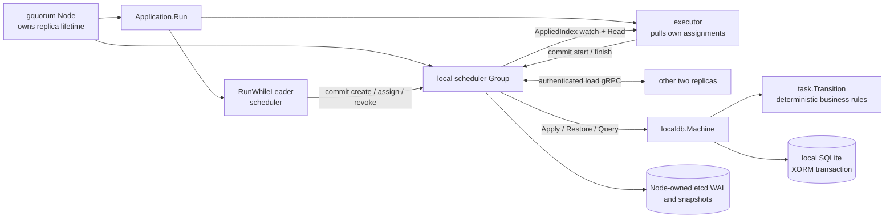
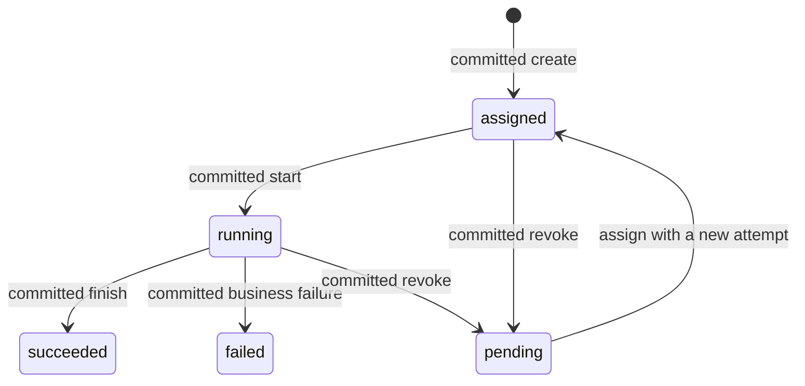

# Replicated task scheduler

Three processes host a `scheduler` Raft group. Its leader creates a burst of up
to three tasks every three seconds and assigns them to followers by committing
the assignment. Each follower watches its own replica, sees its committed
assignments, and runs them one at a time (one running plus four waiting). When
capacity is full, the leader pauses creation. Each task calculates a
deterministic hash and uses a cancellable delay to simulate a two-to-five-second
job.

Task state lives in the replicated state machine. Every replica projects the
same committed commands into its own SQLite database. gquorum owns the Raft WAL,
snapshots, replica lifecycle, leadership scopes and group provisioning. The
application owns task semantics, credentials, servers and SQLite. There is no
application RPC: work moves between scheduler and executors only through the
log.

## Run it

From the repository root, with Docker Compose available:

```sh
make run-scheduler-example
export SCHEDULER_TOKEN=scheduler-local-demo-secret
curl -fsS -H "Authorization: Bearer $SCHEDULER_TOKEN" http://localhost:19081/status
curl -fsS -H "Authorization: Bearer $SCHEDULER_TOKEN" 'http://localhost:19081/tasks?limit=10'
docker compose -f examples/scheduler/compose.yaml logs -f
```

HTTP ports are 19081, 19082, and 19083. Override `SCHEDULER_NODE1_PORT`,
`SCHEDULER_NODE2_PORT`, and `SCHEDULER_NODE3_PORT` if needed. Inside the Compose
network `_meta` listens on port 9000 and load gRPC on 9001. Only HTTP is
published, on loopback.

Configuration is environment variables (or the matching flags):

| Variable | Default | Meaning |
| --- | --- | --- |
| `GQUORUM_NODE` | required | Local node name. |
| `GQUORUM_PEERS` | required | Comma-separated node names; each is also its host name. Member IDs come from `gquorum.FoundingIDs`. |
| `GQUORUM_META_PORT`, `GQUORUM_LOAD_PORT` | 9000, 9001 | Ports on every peer. |
| `GQUORUM_HTTP_LISTEN` | `:8080` | Node HTTP. |
| `GQUORUM_CLUSTER`, `GQUORUM_DATA` | `scheduler-example`, `/data` | Cluster ID and data root. |
| `GQUORUM_CREDENTIAL_FILE` | required | Shared demo secret. |
| `GQUORUM_ALLOW_PLAINTEXT` | false | Explicit opt-in for the isolated demo network. |

The included secret and plaintext networking are **for this local demo**. HTTP
controls and load gRPC authenticate the shared credential; `/healthz` is
unauthenticated. Node validates every load peer against approved topology. Real
deployments must supply their own secrets and transport security; the
[loadgrpc adapter](../../transport/loadgrpc/README.md) accepts caller-owned TLS.

```sh
make stop-scheduler-example   # stop; preserve SQLite and Raft volumes
make run-scheduler-example    # resume from retained state
make clean-scheduler-example  # delete this example's containers and volumes
```

Volumes created by the earlier version of this example (manifest member IDs
1–3) are not compatible; run `make clean-scheduler-example` once.

## Read the code

Start with `runtime.newApplication` in [runtime.go](runtime.go). It opens the
local projection and returns `StateMachine`, `Run`, and `Close` to Node.

| Location | What to read there |
| --- | --- |
| [main.go](main.go), [runtime.go](runtime.go) | Environment/flag configuration, `StaticPeers` routing and founders, `Cluster.EnsureGroup`, factory wiring, listener ownership and shutdown. |
| [service.go](service.go) | `Application.Run`: the executor plus `Group.RunWhileLeader(runScheduler)`. |
| [scheduler.go](scheduler.go) | One leadership term: read state and `Leadership.Replicas`, then revoke, assign or create via `load.ProposeRetry(leader.Propose)`. |
| [scheduling.go](scheduling.go) | Pure revocation rules and executor choice. |
| [executor.go](executor.go) | Wakes on `Observation.AppliedIndex`, reads committed state, runs start → calculate → finish. |
| [task/](task/) | Business data, compare-and-swap commands, deterministic transitions and quorum read helpers. No database access. |
| [localdb/](localdb/) | SQLite/XORM transactions, DDL, snapshots, file ownership and retirement (`RetirementRequest.Verify`). |
| [http.go](http.go) | Node HTTP. |



Only `localdb.Machine` touches application SQL. Settings are code constants in
[task/settings.go](task/settings.go). Opening a database creates the schema;
rows come only from `Restore` and `Apply`. gquorum restores the full snapshot
and replays the committed tail on every open, so the projection keeps no
applied index.

## Task lifetime and failures



Every scheduler command is a compare-and-swap: `create` names the last task ID
it saw, `assign` and `revoke` name the attempt and state. `Leadership.Propose`
admits them only in the proposer's leadership term, and a new leader reads after
every surviving older entry, so a stale scheduler cannot overwrite newer
decisions and no scheduler epoch is stored. A retried command after a lost
reply is refused as `stale`; the next tick re-reads. `start` and `finish` are
idempotent per (task, attempt, executor).

The leader revokes work when its owner has not been `RecentActive` in Raft for
five seconds, is no longer a voter, or has been running longer than its
duration plus ten seconds. An executor promoted to leader finishes its running
task, starts nothing new, and the scheduler revokes its queued assignments.
A restarted executor resumes its own running task. Calculations may repeat, but
a stale attempt cannot commit a result. External side effects would need their
own idempotency/outbox design.

JSON stdout events distinguish:

| Event | Meaning |
| --- | --- |
| `received` | A committed assignment for this executor was first seen. |
| `started` | Start accepted through consensus; calculation begins. |
| `executed` | Calculation returned; its result is not yet durable. |
| `quorum_committed` | Finish accepted and applied through the group. |
| `finished` | The attempt reached a terminal state. |
| `attempt_abandoned` | A stale or retired attempt was refused. |
| `scheduler_started`, `scheduler_stopped` | Entry/exit of the leader's managed scope. |
| `schedule_committed`, `capacity_paused` | Scheduler command outcomes and backpressure. |

## Try transfer, failure and recovery

Use `/status` to find the load leader (`application.observation.is_leader`); the
leader also reports `application.replicas` with each replica's Raft activity.
This can differ from the `_meta` leader. For example, transfer to node2:

```sh
curl -fsS -X POST -H "Authorization: Bearer $SCHEDULER_TOKEN" \
  -H 'Content-Type: application/json' -d '{"node":"node2"}' \
  http://localhost:19081/transfer
```

Kill a follower while it has active/queued tasks, then restart it:

```sh
docker compose -f examples/scheduler/compose.yaml kill -s SIGKILL node3
docker compose -f examples/scheduler/compose.yaml start node3
```

Kill the current load leader to observe automatic election and continued task
creation. Killing two nodes removes quorum: task reads and commits stop until
two voters are available. `/status` and `/healthz` are local observations, not
proof that a quorum is reachable.

Request a snapshot before restarting a node:

```sh
curl -fsS -X POST -H "Authorization: Bearer $SCHEDULER_TOKEN" http://localhost:19081/snapshot
```

Each node retains `/data/system` for `_meta`, `/data/raft` for load WAL/snapshots,
and `/data/application/scheduler/<replica-id>/tasks.sqlite` for its projection.
Foreign or contradictory identity files are refused and preserved. HTTP task
endpoints use quorum-confirmed reads.

| Endpoint | Behavior |
| --- | --- |
| `GET /healthz` | Local node/session/replica readiness, 200 or 503. |
| `GET /status` | Local observation, executor status and (on the leader) replica progress. |
| `GET /tasks?after=0&limit=20` | Consistent page; limit 1–100, response `next` is the next cursor. |
| `GET /tasks/<id>` | Consistent task read; 404 unknown, 410 pruned terminal history. |
| `POST /transfer` | Body `{"node":"node2"}`; request transfer, 202 on acceptance. |
| `POST /snapshot` | Capture this local replica's application snapshot. |

Terminal history retains the newest 1,000 tasks, while IDs and aggregate totals
remain monotonic.

## Verify

```sh
make test                     # fast units in all modules
make lint
make test-function-race        # includes SQLite, recovery and library lifetimes
make test-scheduler-example    # isolated real three-process lifecycle test
```

The Docker test builds its own image and uses unique ports, volumes and project
names. It covers task replication, bounded capacity, transfer while busy,
executor crash/reassignment, leader crash, retained restart, snapshot/tail
recovery, quorum loss/restoration and a partitioned executor.
`SCHEDULER_TEST_IMAGE=<tag>` optionally borrows an already built image without
replacing or deleting that tag.

The demo image bundles the public `demo-credential.txt` at
`/run/secrets/credential`, so Compose needs no host credential bind mount.
Deployments using private credentials should supply their own file and set
`GQUORUM_CREDENTIAL_FILE` accordingly.
